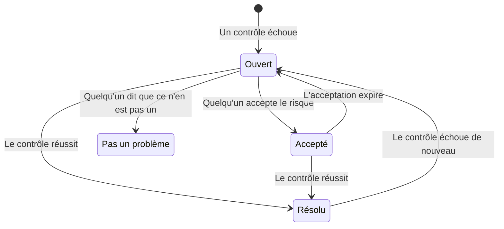

# Contrôles et problèmes de Sécurité des données

Sécurité des données exécute 32 contrôles sur chaque magasin de données, en neuf groupes. Un contrôle lit ce que l'on sait d'un magasin de données - sa configuration, ce qui y a été trouvé, qui peut y accéder, où il se trouve - et réussit, échoue ou ne peut pas trancher. Un contrôle en échec ouvre un problème sur ce magasin de données, et le problème se ferme de lui-même dès que le contrôle réussit. Cette page liste chaque contrôle, la façon dont la gravité et le score de risque d'un problème sont calculés, et ce qu'il advient d'un problème au cours de sa vie.

:::cards
- [Comment un contrôle décide](#comment-un-contrôle-décide): Réussit, échoue ou ne peut pas trancher, et la gravité d'un échec.
- [Chaque contrôle](#chaque-contrôle): Les 32, avec ce que chacun contrôle et comment corriger.
- [Score de risque](#score-de-risque): Comment les problèmes sont ordonnés au sein d'une même gravité.
- [Ce qu'il advient d'un problème](#ce-quil-advient-dun-problème): Ouvert, résolu, accepté, pas un problème.
- [Corriger d'ici](#corriger-dici): Bloquer un bucket public, ou cesser de partager un instantané, en un clic.
:::

## Comment un contrôle décide

Chaque contrôle lit des faits sur un magasin de données et répond de l'une de quatre façons :

| Réponse | Ce que cela signifie | Ce qu'il advient du problème |
| --- | --- | --- |
| Réussit | Le contrôle ne trouve rien d'anormal. | Un problème ouvert ou accepté est résolu. |
| Échoue | Le contrôle trouve le problème, et dit en une phrase ce qu'il a vu : la preuve du problème. | Un problème s'ouvre, ou celui qui est ouvert est mis à jour. |
| Ne peut pas trancher | Un fait n'a pas pu être lu : une autorisation que le rôle n'a pas, un appel qui a échoué. | Rien ne change : un problème ouvert reste ouvert, car personne ne peut conclure qu'un problème est corrigé quand OneUptime n'a pas pu regarder. |
| Ne s'applique pas | Le type du magasin de données n'a pas ce paramètre. | Un problème ouvert est résolu. |

### La gravité suit les données

Le même problème compte davantage sur des données plus sensibles. Chaque contrôle donne une gravité pour chaque niveau de sensibilité, et un problème prend celle de son magasin de données : un bucket public de numéros de carte est Critique, un bucket public d'images de site web seulement Faible. Un tiret signifie aucun problème. La sensibilité d'un magasin de données vient de ses détections (voir [Types de données sensibles](/docs/data-security/data-types#sensibilité)), donc les échantillons de contenu rendent les gravités justes.

Quelques contrôles fixent plutôt la gravité d'après ce qu'ils ont vu. **Des secrets y sont stockés** est Élevé sur n'importe quel magasin de données, et Critique sur un magasin de données public ou partagé avec d'autres comptes.

## Chaque contrôle

La gravité est donnée pour les données de niveau Restreint, Confidentiel, Interne et Public, dans cet ordre. La page de chaque problème montre la correction complète pour son propre magasin de données - les étapes dans la console, la commande CLI et, quand il y en a une adaptée, le Terraform - avec le nom et la région du magasin de données déjà remplis.

### Exposition

| Contrôle | S'exécute sur | Ce qu'il contrôle | Gravité | Comment corriger |
| --- | --- | --- | --- | --- |
| N'importe qui sur Internet peut le lire (`public-read`) | Stockage d'objets, Entrepôt de données, Recherche | La stratégie, l'ACL ou les liaisons IAM du magasin de données permettent à n'importe qui de lire ses données sans se connecter. | Critique / Critique / Élevé / Faible | Retirez chaque autorisation accordée aux principaux anonymes ou à tous les utilisateurs authentifiés. Les fichiers qui doivent être publics ont leur place dans un magasin de données marqué **Public par conception** qui ne contient rien d'autre. |
| N'importe qui sur Internet peut le modifier (`public-write`) | Stockage d'objets, Entrepôt de données, Recherche | La stratégie, l'ACL ou les liaisons IAM du magasin de données permettent à n'importe qui d'écrire ou de supprimer ses données. | Critique / Critique / Critique / Élevé | Retirez chaque autorisation d'écriture ou de suppression accordée aux principaux anonymes ou à tous les utilisateurs authentifiés. |
| L'accès public n'est pas bloqué (`public-access-not-blocked`) | AWS S3 Bucket | S3 Block Public Access n'est pas entièrement activé pour le bucket ou son compte, donc une seule modification de stratégie peut le rendre public. | Élevé / Moyen / Faible / — | Activez les quatre paramètres Block Public Access du bucket. |
| La base de données accepte des connexions depuis Internet (`internet-reachable`) | Base de données, Entrepôt de données, Recherche, Cache | La base de données a un point de terminaison public ou l'accès réseau public activé. | Élevé / Élevé / Moyen / Faible | Désactivez le point de terminaison public, et accédez à la base de données via un réseau privé ou un bastion. |
| Son pare-feu laisse entrer toutes les adresses (`open-to-all-addresses`) | Base de données, Entrepôt de données, Recherche, Cache | Une règle de pare-feu ou un réseau autorisé permet 0.0.0.0/0 ou toute la plage d'adresses. | Critique / Critique / Élevé / Moyen | Remplacez la règle qui autorise tout par les adresses ou les réseaux qui ont besoin d'accès. |
| Un instantané peut en être restauré par n'importe qui (`snapshot-public`) | Base de données, Instantané | Un instantané de base de données est partagé publiquement, donc n'importe quel compte cloud peut en restaurer une copie complète. | Critique / Critique / Critique / Élevé | Rendez l'instantané privé. |
| Un instantané en est partagé avec d'autres comptes (`snapshot-shared-externally`) | Base de données, Instantané | Un instantané de base de données est partagé avec des comptes extérieurs à vos comptes connectés. | Élevé / Élevé / Moyen / Faible | Cessez de partager l'instantané avec les comptes qui ne devraient pas l'avoir. |
| Des comptes extérieurs à votre organisation peuvent y accéder (`shared-with-external-accounts`) | Tous les magasins de données sauf la télémétrie | La stratégie du magasin de données accorde l'accès à des comptes, locataires ou projets qui ne sont pas connectés à OneUptime. | Élevé / Élevé / Moyen / Faible | Examinez chaque principal extérieur, et retirez ceux qui n'ont pas besoin d'accès. |

### Chiffrement

| Contrôle | S'exécute sur | Ce qu'il contrôle | Gravité | Comment corriger |
| --- | --- | --- | --- | --- |
| Ses données ne sont pas chiffrées au repos (`not-encrypted-at-rest`) | Tous les magasins de données sauf la télémétrie | Le chiffrement du stockage est désactivé. | Élevé / Moyen / Faible / — | Activez le chiffrement au repos. Une instance RDS ne peut pas être chiffrée sur place : restaurez une copie chiffrée de son instantané. |
| Les données de niveau Restreint ne sont pas sous votre propre clé (`no-customer-managed-key`) | Tous les magasins de données sauf la télémétrie | Le magasin de données contient des données de niveau Restreint mais est chiffré avec la clé par défaut du fournisseur, et non avec une clé gérée par le client. | Moyen / — / — / — | Chiffrez le magasin de données avec une clé que vous gérez dans votre service de clés. |
| Les connexions non chiffrées sont autorisées (`encryption-in-transit-not-enforced`) | Tous les magasins de données sauf la télémétrie | Le magasin de données accepte des connexions qui n'utilisent pas TLS. | Élevé / Moyen / Faible / — | Exigez TLS pour chaque connexion. Sur S3, refusez chaque requête où `aws:SecureTransport` vaut false. |
| Il accepte un TLS antérieur à 1.2 (`weak-tls`) | Tous les magasins de données sauf la télémétrie | La version minimale de TLS est 1.0 ou 1.1. | Moyen / Moyen / Faible / — | Réglez la version minimale de TLS sur 1.2 ou ultérieure. |

### Récupération

| Contrôle | S'exécute sur | Ce qu'il contrôle | Gravité | Comment corriger |
| --- | --- | --- | --- | --- |
| Il n'a pas de sauvegardes, ou les conserve moins de 7 jours (`no-backups`) | Base de données, Entrepôt de données | Les sauvegardes automatiques sont désactivées, ou conservées moins de 7 jours. | Élevé / Moyen / Faible / — | Activez les sauvegardes automatiques, et conservez-les au moins 7 jours. |
| La restauration à un instant donné est désactivée (`no-point-in-time-recovery`) | AWS DynamoDB Table, Azure Cosmos DB Account | La table ou la base de données ne peut pas être restaurée à un moment antérieur à une erreur. | Moyen / Faible / — / — | Activez la restauration à un instant donné. |
| Il peut être supprimé en une seule étape (`deletion-protection-off`) | Base de données, Entrepôt de données | La protection contre la suppression est désactivée. | Moyen / Faible / — / — | Activez la protection contre la suppression. |
| Les fichiers supprimés ou écrasés ne peuvent pas être récupérés (`deleted-data-not-recoverable`) | Stockage d'objets | Le versioning et la suppression réversible sont tous deux désactivés. | Moyen / Faible / — / — | Activez le versioning ou la suppression réversible. |

### Visibilité

| Contrôle | S'exécute sur | Ce qu'il contrôle | Gravité | Comment corriger |
| --- | --- | --- | --- | --- |
| Personne ne saurait qui l'a lu (`access-not-logged`) | Tous les magasins de données sauf la télémétrie | Les lectures du magasin de données ne sont pas journalisées : aucun journal d'accès, aucun journal d'audit d'accès aux données. | Élevé / Moyen / Faible / — | Activez la journalisation des accès ou l'audit des lectures : journaux d'accès serveur S3 ou événements de données CloudTrail, journaux de diagnostic StorageRead Azure, journaux d'audit Data Access de Cloud Storage. |

### Accès

| Contrôle | S'exécute sur | Ce qu'il contrôle | Gravité | Comment corriger |
| --- | --- | --- | --- | --- |
| N'importe qui ayant la clé du compte peut tout lire (`shared-key-access`) | Azure Storage Account | Le compte de stockage autorise l'accès par clé partagée, qui contourne Microsoft Entra ID et ne laisse aucune piste d'audit par personne. | Moyen / Faible / — / — | Faites passer les applications à Microsoft Entra ID, puis désactivez l'accès par clé du compte de stockage. |
| Les objets peuvent porter leurs propres règles d'accès (`object-acls-enabled`) | AWS S3 Bucket, Google Cloud Storage Bucket | Les ACL d'objet sont activées, donc un objet peut être rendu public alors que le bucket semble privé. | Faible / Faible / — / — | Sur S3, réglez Object Ownership sur Bucket owner enforced. Sur Cloud Storage, activez l'accès uniforme au niveau du bucket. |
| Plus de 25 identités peuvent lire des données de niveau Restreint (`many-readers`) | Tous les magasins de données sauf la télémétrie | Plus d'identités que la plupart des équipes ne peuvent en examiner ont un accès en lecture au magasin de données. | Moyen / — / — / — | Ouvrez la page **Qui peut y accéder** du magasin de données, et retirez les accès inutilisés ou plus larges que nécessaire. |

### Hygiène des données

| Contrôle | S'exécute sur | Ce qu'il contrôle | Gravité | Comment corriger |
| --- | --- | --- | --- | --- |
| Des secrets y sont stockés (`secrets-stored`) | Tous les magasins de données sauf la télémétrie | Des mots de passe, clés API, jetons ou clés privées ont été trouvés dans les données du magasin de données. | Élevé / Élevé / Élevé / Élevé | Renouvelez chaque secret trouvé, comme s'il avait fuité. Déplacez les secrets dans un gestionnaire de secrets et supprimez-les du magasin de données. |
| Des codes de sécurité de carte sont stockés (`card-security-codes-stored`) | Tous les magasins de données sauf la télémétrie | Des codes CVV ou CVC ont été trouvés. PCI DSS interdit de les conserver après l'autorisation d'un paiement, chiffrés ou non. | Critique / Critique / Critique / Critique | Arrêtez le code qui les écrit, supprimez les codes stockés, et vérifiez qu'il n'en reste aucun dans les sauvegardes. |
| Des numéros de carte sont stockés sous forme lisible (`card-numbers-readable`) | Tous les magasins de données sauf la télémétrie | Des numéros de carte complets ont été trouvés sous forme lisible. PCI DSS exige qu'ils soient illisibles partout où ils sont stockés. | Élevé / Élevé / Élevé / Élevé | Tokenisez les numéros de carte avec votre prestataire de paiement, ou chiffrez-les au niveau du champ, et supprimez les copies lisibles. |
| Les mots de passe sont stockés en clair (`plaintext-passwords`) | Tous les magasins de données sauf la télémétrie | Un champ de mot de passe contient des valeurs qui ne sont pas des hachages de mot de passe (bcrypt, argon2, scrypt ou PBKDF2). | Critique / Critique / Critique / Critique | Hachez les mots de passe avec bcrypt, scrypt ou argon2, migrez ceux qui sont stockés, et faites réinitialiser son mot de passe à chaque compte. |
| Des données de production ont été copiées dans un magasin de données hors production (`production-data-in-non-production`) | Tous les magasins de données sauf la télémétrie | Des valeurs trouvées dans un magasin de données de production ont aussi été trouvées ici, dans un magasin de données de développement, de test ou de préproduction. | Élevé / Moyen / — / — | Remplacez la copie par des données masquées ou synthétiques, et supprimez les données réelles du magasin de données hors production. |
| Des données sensibles que personne n'a utilisées depuis 90 jours (`stale-sensitive-data`) | Tous les magasins de données sauf la télémétrie | Le magasin de données contient des données sensibles et n'a eu aucune lecture ni écriture depuis 90 jours. | Moyen / Faible / — / — | Confirmez que les données ne sont plus nécessaires, puis archivez-les avec une date de conservation, ou supprimez-les. |
| Ce magasin de données sensible n'a pas de propriétaire (`no-owner`) | Tous les magasins de données | Le magasin de données contient des données sensibles et n'a pas de propriétaire. | Moyen / Faible / — / — | Ajoutez un propriétaire sur la page **Propriétaires** du magasin de données, ou une règle de propriétaire qui correspond à ses étiquettes. |

### Télémétrie

| Contrôle | S'exécute sur | Ce qu'il contrôle | Gravité | Comment corriger |
| --- | --- | --- | --- | --- |
| Des données sensibles atteignent votre télémétrie (`sensitive-data-in-telemetry`) | Télémétrie | Des journaux, traces, exceptions, relectures ou conversations IA transportent des données sensibles qu'aucune règle de nettoyage ne masque. | Élevé / Moyen / Faible / — | Appuyez sur **Nettoyer** sur chaque détection pour masquer les données à l'ingestion, puis corrigez le code qui les écrit. |
| Des secrets atteignent votre télémétrie (`secrets-in-telemetry`) | Télémétrie | Des mots de passe, clés API ou jetons apparaissent dans des journaux, traces, exceptions ou conversations IA. | Critique / Critique / Critique / Critique | Renouvelez d'abord le secret, puis appuyez sur **Nettoyer** et corrigez le code qui l'écrit. |

### Résidence

| Contrôle | S'exécute sur | Ce qu'il contrôle | Gravité | Comment corriger |
| --- | --- | --- | --- | --- |
| Des données sont stockées hors des régions où elles peuvent résider (`residency-violation`) | Tous les magasins de données sauf la télémétrie | La région du magasin de données, ou une région vers laquelle ses données sont répliquées, enfreint une règle de résidence. | Élevé / Élevé / Moyen / — | Déplacez les données vers une région autorisée, ou cessez de les copier vers l'autre. Si le transfert est légal, acceptez le problème et consignez pourquoi. |

### IA

| Contrôle | S'exécute sur | Ce qu'il contrôle | Gravité | Comment corriger |
| --- | --- | --- | --- | --- |
| Des données sensibles sont envoyées à un fournisseur d'IA (`sensitive-data-to-ai`) | Conversations IA | Les conversations IA enregistrées dans OneUptime transmettent des données sensibles à un fournisseur de modèles. | Critique / Élevé / Faible / — | Masquez les valeurs sensibles avant l'envoi des prompts, ou envoyez ces appels à un modèle que vous hébergez. |
| Des données de niveau Restreint sont dans un magasin de données utilisé pour l'IA (`sensitive-data-in-ai-store`) | Tous les magasins de données sauf la télémétrie | Un magasin de données étiqueté comme données d'entraînement ou de récupération pour l'IA contient des données de niveau Restreint. | Élevé / Moyen / — / — | Retirez ou masquez les données de niveau Restreint avant qu'elles ne servent à entraîner ou à ancrer un modèle. |

## Score de risque

La gravité dit à quel point un problème est grave. Le score de risque, de 0 à 100, ordonne les problèmes d'une même gravité, d'après ce qui aggrave un même problème :

```text
risk = severity + 10 × exposure + 6 × volume + 5 × activity + 4 × production, at most 100
```

| Facteur | Points |
| --- | --- |
| Gravité | 75 pour Critique, 50 pour Élevé, 25 pour Moyen, 0 pour Faible |
| Exposition | 10 pour Public, 8 pour Autres comptes, 6 pour Accessible depuis Internet, 3 pour Inconnu, 0 pour Privé |
| Volume | Jusqu'à 6, selon le nombre estimé d'enregistrements sensibles du magasin de données sur une échelle logarithmique : 1 pour 10 enregistrements, 3 pour 1 000, 5 pour un million, 6 pour dix millions ou plus |
| Activité | 5 quand Opérations de sécurité a relevé des détections sur le magasin de données au cours de la dernière semaine |
| Production | 4 pour un magasin de données en production |

Les suppléments ajoutent au plus 25 points, donc un problème n'obtient jamais un score inférieur à celui d'un problème de gravité moindre. Un bucket public de production contenant un million d'enregistrements de données de niveau Restreint obtient 75 + 10 + 5 + 4 = 94 pour un problème Critique. Chaque problème liste les facteurs qui ont augmenté son score, avec leurs points, et le magasin de données affiche le score de son pire problème ouvert.

L'environnement d'un magasin de données - Production, Staging, Development, Test ou Inconnu - vient de ses étiquettes (`env`, `environment`, `stage`, `tier` et similaires) ou, à défaut, des mots de son nom, comme `prod`, `staging`, `dev` ou `qa`. Réglez-le sur le magasin de données quand ni les unes ni les autres ne l'indiquent.

## Ce qu'il advient d'un problème



OneUptime ouvre, met à jour et résout les problèmes au fil de l'exécution des contrôles. Ce qu'une personne fait d'un problème, c'est décider de la suite :

| Statut | Comment il y arrive | Ce qui suit |
| --- | --- | --- |
| **Ouvert** | Son contrôle échoue actuellement sur le magasin de données. | Il compte dans la Vue d'ensemble, dans le résumé du magasin de données et dans la conformité, jusqu'à ce que le contrôle réussisse. |
| **Résolu** | Son contrôle a réussi lors d'une exécution ultérieure, ne s'applique plus ou a été désactivé, ou son magasin de données a été archivé. Une personne peut aussi choisir **Marquer comme résolu** : le magasin de données est aussitôt contrôlé à nouveau. | Il s'ouvre à nouveau si le contrôle échoue de nouveau, et le problème compte combien de fois il a été rouvert. |
| **Accepté** | Une personne a choisi **Accepter le risque**, avec un **Motif** et une date dans **Accepté jusqu'au**, au plus un an plus tard. | Il reste fermé jusqu'à cette date, puis s'ouvre à nouveau si le contrôle échoue toujours. Acceptez-le alors de nouveau si le motif tient toujours. |
| **Pas un problème** | Une personne a choisi **Pas un problème** : la détection était erronée. | Il reste fermé, même tant que le contrôle échoue. **Rouvrir** le remet à Ouvert. |

Les Security Members, Security Admins, Project Admins et Project Owners peuvent changer le statut d'un problème, et l'**Attribuer** à une personne ou à une équipe. Chaque modification est écrite dans la **Chronologie** du problème : quand il s'est ouvert, chaque changement de gravité, chaque changement de statut et qui l'a fait, les nouveaux contrôles demandés, et ce qu'ont fait les intégrations.

Un problème qui s'ouvre à nouveau garde son historique. Les risques acceptés sont réexaminés chaque jour, donc une acceptation expire à temps même quand rien n'a été analysé.

## Corriger d'ici

Un problème ouvert concernant un bucket public ou un instantané partagé peut être corrigé depuis sa page. Au-dessus des étapes dans la console, **Corriger d'ici** propose la modification qui le corrige :

| Le problème | Son magasin de données | Le bouton | Ce qu'il modifie |
| --- | --- | --- | --- |
| `public-read`, `public-write` ou `public-access-not-blocked` | Un bucket S3, un compte de stockage Azure ou un bucket Cloud Storage | **Bloquer l'accès public** | Active les quatre paramètres Block Public Access du bucket, désactive l'accès anonyme aux blobs du compte de stockage, ou impose la prévention de l'accès public du bucket |
| `snapshot-public` ou `snapshot-shared-externally` | Un instantané RDS, une base de données RDS, ou un cluster Aurora ou DocumentDB | **Révoquer le partage** | Cesse de partager l'instantané, ou chaque instantané manuel partagé de la base de données, avec tout le monde et avec les comptes extérieurs à ceux que vous avez connectés |

Il demande d'abord confirmation, en indiquant ce qui change et ce qui cesse de fonctionner. Il modifie la façon dont le magasin de données est partagé, jamais ses données, et ne modifie rien de ce qui est déjà fermé. Un magasin de données marqué **Public par conception** n'est jamais bloqué.

Il agit via la connexion cloud du magasin de données, donc la connexion doit avoir **Réponse de sécurité des données** activé et sa commande de configuration exécutée à nouveau (voir [Configurer la Sécurité des données](/docs/data-security/setup#laisser-sécurité-des-données-fermer-une-exposition)). D'ici là, le panneau indique ce qu'il faut activer. Le magasin de données est contrôlé à nouveau juste après, et le problème se résout de lui-même dès que son contrôle réussit. La **Chronologie** du problème et la **Chronologie** du magasin de données indiquent ce qui a été fait, et par qui.

## Paramètres des contrôles

**Sécurité des données → Paramètres → Vérifications** liste chaque contrôle par groupe, avec ce qu'il recherche et la gravité qu'obtient un échec pour chaque sensibilité. Chaque contrôle peut être ajusté pour le projet, et chaque modification s'enregistre aussitôt :

- **Son interrupteur** désactive le contrôle, quand il ne correspond pas à votre façon de travailler. Ses problèmes ouverts et acceptés sont résolus, et indiquent que le contrôle ne s'exécute plus.
- **Sa gravité** est **Par sensibilité** par défaut, ou une seule gravité qu'obtient chaque échec du contrôle, quoi que contienne son magasin de données.

Pour faire taire un contrôle sur un seul magasin de données, acceptez le risque sur le problème de ce magasin de données, ou marquez le problème comme n'étant pas un problème. Pour une détection erronée plutôt qu'un problème sans importance, marquez plutôt la détection comme non sensible (voir [Types de données sensibles](/docs/data-security/data-types#non-sensible-et-jamais-sensible)).

**Contrôler maintenant** sur un magasin de données relit sa configuration et exécute ses contrôles. **Analyser maintenant** échantillonne son contenu, et ses contrôles s'exécutent à la fin de l'analyse.

## Prochaines étapes

:::cards
- [Intégrations de Sécurité des données](/docs/data-security/integrations): Dossiers de sécurité, alertes et e-mails aux propriétaires quand un problème s'ouvre.
- [Flux de données, accès et résidence](/docs/data-security/flows-access-residency): Les accès, les copies et les régions que lisent plusieurs contrôles.
- [Conformité de Sécurité des données](/docs/data-security/compliance): Les exigences des référentiels dont chaque contrôle est une preuve.
:::
