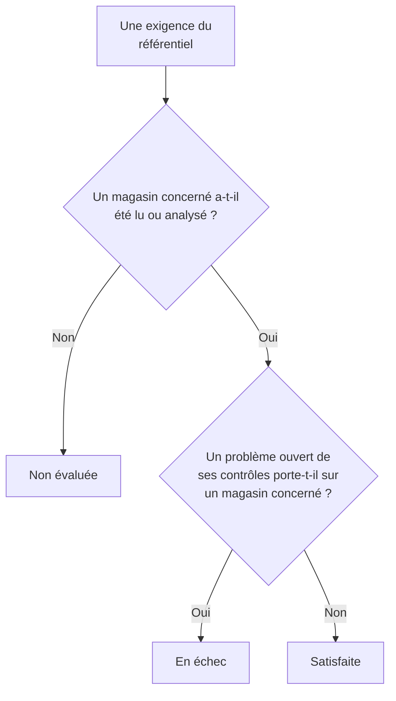

# Conformité de Sécurité des données

Sécurité des données note neuf référentiels d'après ce que ses analyses ont trouvé. Chaque référentiel couvre les magasins de données dont traitent ses règles - le RGPD les magasins de données qui contiennent des données personnelles, PCI DSS ceux où des données de carte ont été trouvées, SOC 2 tous les magasins de données - et chacune de ses exigences est satisfaite ou en échec selon les contrôles qui en sont la preuve. **Sécurité des données → Conformité** montre le score de chaque référentiel, combien de magasins de données il couvre, et chaque exigence avec le nombre de problèmes ouverts qui la mettent en échec. Un score est une preuve pour un audit, pas un certificat : il dit ce que OneUptime peut voir des magasins de données qu'il lit.

:::cards
- [Les référentiels](#les-référentiels): Les neuf, et les magasins de données que couvre chacun.
- [Comment un référentiel est noté](#comment-un-référentiel-est-noté): Exigences satisfaites, en échec et non évaluées.
- [Les exigences et leurs contrôles](#les-exigences-et-leurs-contrôles): Chaque exigence, et les contrôles qui en sont la preuve.
- [Registre des traitements](#registre-des-traitements): L'article 30 du RGPD, rédigé à partir de vos magasins de données.
:::

## Les référentiels

| Référentiel | Nom complet | Magasins de données concernés |
| --- | --- | --- |
| RGPD | Règlement général sur la protection des données de l'UE | Les magasins de données qui contiennent des données personnelles. |
| CCPA | California Consumer Privacy Act, tel que modifié par le CPRA | Les magasins de données qui contiennent des informations personnelles. |
| HIPAA | Règle de sécurité de HIPAA | Les magasins de données qui contiennent des données de santé. |
| PCI DSS | PCI DSS v4.0 | Les magasins de données où des numéros de carte ont été trouvés. |
| SOC 2 | Trust Services Criteria de SOC 2 | Chaque magasin de données. |
| ISO 27001 | ISO/IEC 27001:2022 | Chaque magasin de données. |
| NIST CSF | NIST Cybersecurity Framework 2.0 | Chaque magasin de données. |
| LGPD | Loi générale sur la protection des données du Brésil | Les magasins de données qui contiennent des données personnelles de personnes situées au Brésil. |
| DPDP | Loi indienne de 2023 sur la protection des données personnelles numériques | Les magasins de données qui contiennent des données personnelles de personnes situées en Inde. |

## Quels magasins de données couvre un référentiel

Le périmètre d'un magasin de données vient des données qui y ont été trouvées, donc il change à mesure que les analyses en trouvent davantage :

- **SOC 2, ISO 27001 et NIST CSF** sont des référentiels de sécurité : ils couvrent chaque magasin de données, quoi qu'il contienne.
- **RGPD, CCPA, HIPAA et PCI DSS** couvrent les magasins de données qui contiennent un type de données qu'ils protègent. Les données personnelles font entrer le RGPD et le CCPA, les données de santé aussi HIPAA, et les numéros de carte, les codes de sécurité de carte et les dates d'expiration de carte PCI DSS. Un magasin de données qui ne contient que des secrets ou des documents d'entreprise n'entre dans aucun d'eux.
- **LGPD et DPDP** sont des lois propres à des pays : elles couvrent les magasins de données contenant des données personnelles de personnes situées au Brésil ou en Inde, déduites de types de données propres à ce pays, comme un CPF brésilien ou un numéro Aadhaar indien.

[Types de données sensibles](/docs/data-security/data-types#types-de-données-intégrés) liste chaque type de données, avec son pays.

## Comment un référentiel est noté

- **Une exigence est satisfaite** quand aucun problème ouvert des contrôles qui lui sont associés ne porte sur un magasin de données du périmètre du référentiel, et **en échec** quand il y en a un.
- **Elle n'est pas évaluée** tant qu'aucun magasin de données du périmètre n'a eu sa configuration lue ou son contenu analysé.
- **Deux exigences sont satisfaites par Sécurité des données elle-même** : l'article 30 du RGPD, registre des activités de traitement, et ISO 27001 A.5.12, classification des informations. Elles sont satisfaites dès que chaque magasin de données du périmètre a été lu ou analysé, et en échec tant que l'un ne l'a pas été.
- **Le score** est la part des exigences évaluées d'un référentiel qui sont satisfaites, en pourcentage entier. Un référentiel dont rien n'est évalué n'a pas de score.

Seuls les problèmes ouverts comptent. Un problème dont le risque est accepté, ou qui n'est pas un problème, ne met pas ses exigences en échec : un risque accepté est donc une décision que votre audit peut voir sur le problème, avec qui l'a accepté, pourquoi et jusqu'à quand.

## Les exigences et leurs contrôles

### RGPD

| Exigence | Ce qu'elle demande | Contrôles |
| --- | --- | --- |
| Art. 5(1)(c) | Minimisation des données | `production-data-in-non-production`, `stale-sensitive-data`, `sensitive-data-in-telemetry`, `sensitive-data-to-ai`, `sensitive-data-in-ai-store` |
| Art. 5(1)(e) | Limitation de la conservation | `stale-sensitive-data` |
| Art. 25 | Protection des données dès la conception et par défaut | `production-data-in-non-production`, `stale-sensitive-data`, `sensitive-data-in-telemetry`, `sensitive-data-to-ai`, `sensitive-data-in-ai-store` |
| Art. 28 | Sous-traitants | `sensitive-data-to-ai` |
| Art. 30 | Registre des activités de traitement | Satisfaite par Sécurité des données elle-même |
| Art. 32 | Sécurité du traitement | `public-read`, `public-write`, `public-access-not-blocked`, `internet-reachable`, `open-to-all-addresses`, `snapshot-public`, `snapshot-shared-externally`, `shared-with-external-accounts`, `not-encrypted-at-rest`, `no-customer-managed-key`, `encryption-in-transit-not-enforced`, `weak-tls`, `no-backups`, `no-point-in-time-recovery`, `deletion-protection-off`, `deleted-data-not-recoverable`, `access-not-logged`, `shared-key-access`, `object-acls-enabled`, `many-readers`, `secrets-stored`, `plaintext-passwords`, `secrets-in-telemetry` |
| Arts. 44-49 | Transferts vers des pays tiers | `residency-violation` |

### CCPA

| Exigence | Ce qu'elle demande | Contrôles |
| --- | --- | --- |
| 1798.100(c) | Une collecte limitée à ce qui est nécessaire | `production-data-in-non-production`, `stale-sensitive-data`, `sensitive-data-in-telemetry`, `sensitive-data-to-ai`, `sensitive-data-in-ai-store` |
| 1798.150 | Des procédures de sécurité raisonnables | `public-read`, `public-write`, `public-access-not-blocked`, `internet-reachable`, `open-to-all-addresses`, `snapshot-public`, `snapshot-shared-externally`, `shared-with-external-accounts`, `shared-key-access`, `object-acls-enabled`, `many-readers` |

### HIPAA

| Exigence | Ce qu'elle demande | Contrôles |
| --- | --- | --- |
| 164.308(a)(7) | Plan d'urgence | `no-backups`, `no-point-in-time-recovery`, `deletion-protection-off`, `deleted-data-not-recoverable` |
| 164.312(a)(1) | Contrôle d'accès | `public-read`, `public-write`, `public-access-not-blocked`, `internet-reachable`, `open-to-all-addresses`, `snapshot-public`, `snapshot-shared-externally`, `shared-with-external-accounts`, `shared-key-access`, `object-acls-enabled`, `many-readers` |
| 164.312(a)(2)(iv) | Chiffrement et déchiffrement | `not-encrypted-at-rest`, `no-customer-managed-key` |
| 164.312(b) | Contrôles d'audit | `access-not-logged` |
| 164.312(e)(1) | Sécurité des transmissions | `encryption-in-transit-not-enforced`, `weak-tls` |

### PCI DSS

| Exigence | Ce qu'elle demande | Contrôles |
| --- | --- | --- |
| 3.3.1 | Les données d'authentification sensibles ne sont pas conservées après l'autorisation | `card-security-codes-stored` |
| 3.4.1 | Les numéros de carte sont masqués à l'affichage | `card-numbers-readable`, `sensitive-data-in-telemetry` |
| 3.5.1 | Les numéros de carte sont illisibles partout où ils sont stockés | `not-encrypted-at-rest`, `no-customer-managed-key`, `card-numbers-readable` |
| 4.2.1 | Une cryptographie forte protège les données de carte en transit | `encryption-in-transit-not-enforced`, `weak-tls` |
| 7.2 | L'accès est défini et attribué selon le besoin | `public-read`, `public-write`, `public-access-not-blocked`, `internet-reachable`, `open-to-all-addresses`, `snapshot-public`, `snapshot-shared-externally`, `shared-with-external-accounts`, `shared-key-access`, `object-acls-enabled`, `many-readers` |
| 8.3.2 | Les facteurs d'authentification sont illisibles lorsqu'ils sont stockés | `plaintext-passwords` |
| 10.2 | Les journaux d'audit enregistrent l'accès aux données de carte | `access-not-logged` |

### SOC 2

| Exigence | Ce qu'elle demande | Contrôles |
| --- | --- | --- |
| A1.2 | Sauvegarde et restauration | `no-backups`, `no-point-in-time-recovery`, `deletion-protection-off`, `deleted-data-not-recoverable` |
| CC6.1 | Sécurité des accès logiques | `public-read`, `public-write`, `public-access-not-blocked`, `internet-reachable`, `open-to-all-addresses`, `snapshot-public`, `snapshot-shared-externally`, `shared-with-external-accounts`, `not-encrypted-at-rest`, `no-customer-managed-key`, `shared-key-access`, `object-acls-enabled`, `many-readers`, `secrets-stored`, `plaintext-passwords`, `secrets-in-telemetry` |
| CC6.7 | Transmission des informations | `encryption-in-transit-not-enforced`, `weak-tls` |
| CC7.2 | Surveillance des composants du système | `access-not-logged` |

### ISO 27001

| Exigence | Ce qu'elle demande | Contrôles |
| --- | --- | --- |
| A.5.9 | Inventaire des informations et autres actifs associés | `no-owner` |
| A.5.12 | Classification des informations | Satisfaite par Sécurité des données elle-même |
| A.5.15 | Contrôle d'accès | `public-read`, `public-write`, `public-access-not-blocked`, `internet-reachable`, `open-to-all-addresses`, `snapshot-public`, `snapshot-shared-externally`, `shared-with-external-accounts`, `shared-key-access`, `object-acls-enabled`, `many-readers` |
| A.5.34 | Protection de la vie privée et des données à caractère personnel | `production-data-in-non-production`, `stale-sensitive-data`, `sensitive-data-in-telemetry`, `sensitive-data-to-ai`, `sensitive-data-in-ai-store` |
| A.8.11 | Masquage des données | `production-data-in-non-production`, `stale-sensitive-data`, `sensitive-data-in-telemetry`, `sensitive-data-to-ai`, `sensitive-data-in-ai-store` |
| A.8.12 | Prévention de la fuite de données | `secrets-stored`, `secrets-in-telemetry` |
| A.8.13 | Sauvegarde des informations | `no-backups`, `no-point-in-time-recovery`, `deletion-protection-off`, `deleted-data-not-recoverable` |
| A.8.15 | Journalisation | `access-not-logged` |
| A.8.24 | Utilisation de la cryptographie | `not-encrypted-at-rest`, `no-customer-managed-key`, `encryption-in-transit-not-enforced`, `weak-tls`, `plaintext-passwords` |

### NIST CSF

| Exigence | Ce qu'elle demande | Contrôles |
| --- | --- | --- |
| ID.AM-07 | Des inventaires des données et des métadonnées sont tenus à jour | `no-owner` |
| PR.AA-05 | Les autorisations d'accès sont gérées | `public-read`, `public-write`, `public-access-not-blocked`, `internet-reachable`, `open-to-all-addresses`, `snapshot-public`, `snapshot-shared-externally`, `shared-with-external-accounts`, `shared-key-access`, `object-acls-enabled`, `many-readers` |
| PR.DS-01 | Les données au repos sont protégées | `not-encrypted-at-rest`, `no-customer-managed-key`, `secrets-stored`, `secrets-in-telemetry` |
| PR.DS-02 | Les données en transit sont protégées | `encryption-in-transit-not-enforced`, `weak-tls` |
| PR.DS-11 | Des sauvegardes des données sont conservées et testées | `no-backups`, `no-point-in-time-recovery`, `deletion-protection-off`, `deleted-data-not-recoverable` |
| DE.CM-09 | Les données et leur utilisation sont surveillées | `access-not-logged` |

### LGPD

| Exigence | Ce qu'elle demande | Contrôles |
| --- | --- | --- |
| Art. 6 | Nécessité et limitation des finalités | `production-data-in-non-production`, `stale-sensitive-data`, `sensitive-data-in-telemetry`, `sensitive-data-to-ai`, `sensitive-data-in-ai-store` |
| Art. 33 | Transfert international de données | `residency-violation` |
| Art. 46 | Mesures de sécurité | `public-read`, `public-write`, `public-access-not-blocked`, `internet-reachable`, `open-to-all-addresses`, `snapshot-public`, `snapshot-shared-externally`, `shared-with-external-accounts`, `not-encrypted-at-rest`, `no-customer-managed-key`, `shared-key-access`, `object-acls-enabled`, `many-readers` |

### DPDP

| Exigence | Ce qu'elle demande | Contrôles |
| --- | --- | --- |
| Sec. 8(5) | Des garanties de sécurité raisonnables | `public-read`, `public-write`, `public-access-not-blocked`, `internet-reachable`, `open-to-all-addresses`, `snapshot-public`, `snapshot-shared-externally`, `shared-with-external-accounts`, `not-encrypted-at-rest`, `no-customer-managed-key`, `shared-key-access`, `object-acls-enabled`, `many-readers` |
| Sec. 8(7) | L'effacement une fois la finalité atteinte | `production-data-in-non-production`, `stale-sensitive-data`, `sensitive-data-in-telemetry`, `sensitive-data-to-ai`, `sensitive-data-in-ai-store` |
| Sec. 16 | Le transfert hors de l'Inde | `residency-violation` |

## Registre des traitements

L'article 30 du RGPD vous demande de tenir un registre de vos activités de traitement. Sécurité des données rédige la partie qui porte sur l'endroit où sont conservées les données personnelles : une ligne pour chaque magasin de données qui contient des données personnelles.

| Colonne | D'où elle vient |
| --- | --- |
| Magasin de données, type, fournisseur et région | La découverte |
| Environnement | Les étiquettes ou le nom du magasin de données, ou ce que vous avez réglé |
| Sensibilité, catégories et types de données | Ce que les analyses ont trouvé, ou la sensibilité que vous avez réglée |
| Propriétaires | Les propriétaires du magasin de données : des personnes et les membres de ses équipes |
| Finalité | Ce que vous écrivez dans la **Finalité** du magasin de données : pourquoi il contient des données personnelles |
| Conservation | Ce que vous écrivez dans la **Conservation** du magasin de données : combien de temps les données y sont conservées |
| Référentiels | Les référentiels que ses types de données font entrer dans le périmètre |

Remplissez **Finalité** et **Conservation** dans les **Paramètres** de chaque magasin de données : ce sont les deux choses qu'aucune analyse ne peut savoir. L'API de Sécurité des données fournit aussi le registre et les scores, à `/data-security/record-of-processing` et `/data-security/compliance`, à quiconque peut lire les magasins de données (voir [Intégrations de Sécurité des données](/docs/data-security/integrations#api-terraform-et-mcp)).

## Prochaines étapes

:::cards
- [Contrôles et problèmes de Sécurité des données](/docs/data-security/checks-and-issues): Les contrôles derrière chaque exigence, et comment les corriger.
- [Flux de données, accès et résidence](/docs/data-security/flows-access-residency): Les règles de résidence, pour les transferts au titre du RGPD, de la LGPD et de la DPDP.
- [Types de données sensibles](/docs/data-security/data-types): Les types de données qui font entrer un magasin de données dans le périmètre d'un référentiel.
:::
