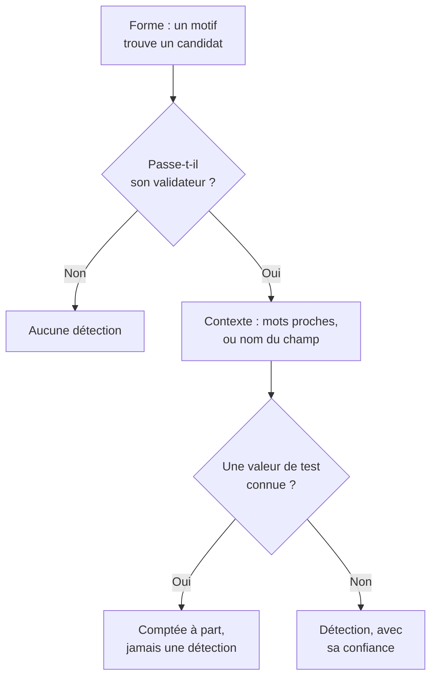

# Types de données sensibles

Sécurité des données connaît 143 sortes de données sensibles : numéros de carte, comptes bancaires, identifiants nationaux de 43 pays, identifiants de santé, clés API et jetons, et les catégories particulières de données personnelles. Chacune a une catégorie, une sensibilité et, quand elle appartient à un pays, ce pays. Cette page indique comment une valeur est trouvée et liste chaque type de données, pour que vous puissiez comprendre pourquoi quelque chose a été trouvé et décider quoi en faire.

:::cards
- [Comment une valeur est trouvée](#comment-une-valeur-est-trouvée): Forme, validateur, contexte, valeurs de test, confiance.
- [Champs et colonnes](#champs-et-colonnes): Comment une colonne ou un attribut est jugé dans son ensemble.
- [Chaque type de données](#types-de-données-intégrés): Les 143, par catégorie.
- [Vos propres types de données](#vos-propres-types-de-données): Identifiants d'employé, numéros de police, et la zone Tester.
:::

## Comment une valeur est trouvée

Chaque analyse - une ligne de journal, une cellule CSV, une ligne de base de données, les premiers octets d'un objet - suit les mêmes étapes :

1. **Forme.** Chaque type de données a des motifs qui trouvent des candidats : seize chiffres, `AKIA` et seize lettres, un mot, un `@` et un domaine. Un motif ne correspond jamais à l'intérieur d'une séquence plus longue, donc un numéro de carte n'est pas trouvé dans une suite de chiffres plus longue.
2. **Validateur.** Un candidat doit respecter les règles propres à son type : une somme de contrôle (Luhn pour les cartes, mod 97 pour les IBAN, Verhoeff pour les numéros Aadhaar, le chiffre de contrôle de la plupart des identifiants nationaux), une date réelle, un préfixe connu, assez d'aléa pour un secret. Un candidat qui échoue n'est pas du tout une détection. Les valeurs fictives comme `000000000` et `123456789` échouent pour chaque type numérique.
3. **Contexte.** Les mots proches d'un candidat - par défaut jusqu'à 64 caractères avant et 32 après - qui disent ce qu'il est relèvent sa confiance d'un niveau, tout comme un champ dont le nom désigne le type. Les mots qui disent qu'il s'agit d'autre chose, comme un numéro de commande ou de suivi, l'abaissent d'un niveau. Un numéro sans somme de contrôle et de forme courante, comme un numéro de passeport ou un compte bancaire, ne compte qu'à côté de mots qui le nomment.
4. **Valeurs de test connues.** Les numéros de carte de test publiés (comme `4242 4242 4242 4242` de Stripe), les IBAN d'exemple, les adresses sur `example.com` et d'autres domaines réservés, les adresses IP de documentation, les identifiants d'exemple qu'imprime la documentation des administrations, les clés en mode test comme `sk_test_` et les clés fictives sont comptés à part. Ils ne produisent jamais de détection, donc un magasin de données qui en est plein se lit comme un environnement de test, pas comme une fuite.
5. **Confiance.** Ce qui reste est une détection, aussi sûre que ses preuves le permettent.

| Confiance | Ce que cela signifie |
| --- | --- |
| **Élevé** | La valeur a passé son validateur, et les mots autour d'elle ou le champ où elle se trouve disent ce qu'elle est - ou, pour un champ, la plupart de ses valeurs sont de ce type. |
| **Moyen** | La valeur a passé son validateur sans rien autour pour la confirmer, ou le nom du champ dit ce qu'il contient et certaines valeurs concordent. |
| **Faible** | La forme correspond, mais rien ne la confirme. |

Seules les détections de confiance Élevé ou Moyen comptent : elles rendent un magasin de données sensible et peuvent ouvrir un problème. Les détections de confiance Faible sont listées sur le magasin de données, repliées, pour qu'une personne en juge.

Quand deux types de données revendiquent les mêmes caractères, la détection la plus sûre l'emporte : la confiance la plus élevée, puis le détecteur dont les propres règles prouvent le plus, puis la correspondance la plus longue.

Une valeur longue est lue par fenêtres de 64 Ko qui se chevauchent de 4 Ko, donc une valeur est trouvée entière où qu'elle se trouve, et au plus 4 Mo d'une même valeur sont lus.

## Champs et colonnes

Une colonne, un champ JSON ou un attribut de journal est jugé dans son ensemble. Son nom suggère un type de données, et ses valeurs échantillonnées en prouvent un. La part de ses valeurs qui contiennent le type décide de la certitude de la détection :

| Valeurs qui contiennent le type | Confiance |
| --- | --- |
| 60 % ou plus | Élevé |
| 25 % ou plus | Élevé quand le nom du champ désigne le type, Moyen sinon |
| Moins | Moyen quand le nom du champ désigne le type, Faible sinon : quelques e-mails dans une colonne d'autre chose |

Un champ dont les valeurs dépassent 80 caractères en moyenne est du texte libre - notes, messages, descriptions - et n'est pas censé contenir un seul type. Ses détections gardent la confiance que chaque correspondance a obtenue seule, et indiquent qu'elles ont été trouvées dans du texte libre. Jusqu'à 1 000 valeurs d'un champ sont classifiées, et jusqu'à 16 Ko de chacune.

Le nom d'un champ est découpé en mots - `customerEmail`, `customer_email` et `customer-email` donnent tous « customer email » - et l'indice de nom d'un type correspond quand ses mots apparaissent dans cet ordre, côte à côte : « date of birth » correspond à `customer_date_of_birth`, pas à `birth_city`. Seule la dernière partie d'un chemin à points est le nom propre du champ, avec la partie qui la précède quand la dernière est un mot générique comme `number`, `id` ou `value` : `customer.address.city` n'est pas une adresse postale, et `card.number` est bien un numéro de carte.

Certains types de données ne se reconnaissent pas à leurs valeurs : aucun motif ne distingue le nom d'une personne d'une rue, ni une religion de n'importe quel autre mot. Ils sont trouvés d'après le seul nom du champ, quand le champ a des valeurs : Nom de personne, Nom d'utilisateur, Genre, Nationalité, Informations de santé, Origine raciale ou ethnique, Croyance religieuse, Orientation sexuelle, Opinion politique, Appartenance syndicale, Données biométriques, Données génétiques et Casier judiciaire. Un nom, un nom d'utilisateur, un genre ou une nationalité a alors une confiance Élevé quand 60 % ou plus des valeurs y ressemblent, et Moyen sinon.

Un champ dont le nom dit qu'il contient un mot de passe - `password`, `passwordHash`, `pwd`, mais pas `password_changed_at` - devrait contenir un hachage : bcrypt, argon2, scrypt, PBKDF2 ou un autre schéma qu'un magasin de données est susceptible d'utiliser. Les valeurs vides, les valeurs fictives comme `********` et les valeurs chiffrées sont mises de côté. Quand le reste compte plus de valeurs qui ne sont pas des hachages que de valeurs qui en sont, le champ contient les mots de passe eux-mêmes, qu'aucun motif ne peut voir, et le magasin de données échoue au contrôle [Les mots de passe sont stockés en clair](/docs/data-security/checks-and-issues#hygiène-des-données).

## Sensibilité

| Sensibilité | Ce que cela signifie |
| --- | --- |
| **Restreint** | Une fuite cause un préjudice : secrets, numéros de carte, dossiers médicaux, identifiants officiels. |
| **Confidentiel** | Les données personnelles, et les documents marqués confidentiels. |
| **Interne** | Les données propres à l'entreprise, non destinées à l'extérieur. |
| **Public** | Rien de sensible n'a été trouvé. |

Un magasin de données est aussi sensible que le type de données le plus sensible qui y a été trouvé avec une confiance d'au moins Moyen. Les valeurs de test et les détections marquées comme non sensibles ne comptent pour rien, et un magasin de données où rien n'a été trouvé est Public. Pour traiter un magasin de données comme plus ou moins sensible que ne le disent ses détections, réglez vous-même sa sensibilité dans les **Paramètres** du magasin de données : les contrôles utilisent alors celle-ci.

## Catégories

| Catégorie | Ce qu'elle couvre | Données personnelles |
| --- | --- | --- |
| Secrets et identifiants de connexion | Mots de passe, clés API, jetons et clés privées qui ouvrent d'autres systèmes. | Non |
| Financier | Numéros de carte, comptes bancaires, IBAN et portefeuilles crypto. | Oui |
| Santé | Numéros de dossier médical, identifiants de santé, diagnostics et prescriptions. | Oui |
| Identifiant officiel | Numéros d'identité nationale, fiscaux, de passeport et de sécurité sociale. | Oui |
| Catégorie particulière | Ce que l'article 9 du RGPD protège le plus : origine ethnique, religion, orientation sexuelle, opinions politiques, appartenance syndicale, données biométriques et génétiques. | Oui |
| Contact et identité | Qui est quelqu'un et comment le joindre : e-mail, téléphone, adresse, date de naissance, adresse IP. | Oui |
| Confidentiel d'entreprise | Documents marqués confidentiels, à usage interne uniquement ou couverts par le secret professionnel. | Non |

Les données personnelles sont des données sur une personne, au sens du RGPD, du CCPA, de la LGPD et du DPDP. Un magasin de données qui ne contient que des secrets et des documents d'entreprise sort du périmètre d'un référentiel de protection de la vie privée, jamais de celui d'un référentiel de sécurité (voir [Conformité de Sécurité des données](/docs/data-security/compliance)).

## Types de données intégrés

Un type de données qui appartient à un pays nomme ce pays, sous forme de code ISO 3166-1 : les règles de résidence et les référentiels liés à un pays le lisent (voir [Résidence](/docs/data-security/flows-access-residency#règles-de-résidence)). L'ID est le nom par lequel l'API et les détections désignent le type.

### Contact et identité

| Type de données | ID | Ce que c'est | Sensibilité | Pays |
| --- | --- | --- | --- | --- |
| Adresse e-mail | `email-address` | L'adresse e-mail d'une personne. | Confidentiel | — |
| Numéro de téléphone | `phone-number` | Un numéro de téléphone au format international ou national. | Confidentiel | — |
| Nom de personne | `person-name` | Le prénom, le nom de famille ou le nom complet d'une personne, trouvé d'après le nom du champ. | Confidentiel | — |
| Adresse postale | `postal-address` | Une adresse postale : un numéro, un nom de rue et un type de voie. | Confidentiel | — |
| Code postal | `postal-code` | Un code postal. À lui seul, il restreint le lieu où vit quelqu'un. | Interne | — |
| Date de naissance | `date-of-birth` | Une date à côté de mots qui disent qu'il s'agit de la date de naissance de quelqu'un. | Confidentiel | — |
| Adresse IP | `ip-address` | Une adresse IPv4 ou IPv6 publique, que le RGPD traite comme une donnée personnelle. | Confidentiel | — |
| Adresse MAC | `mac-address` | L'adresse matérielle d'une carte réseau, qui identifie un appareil. | Confidentiel | — |
| ID publicitaire | `advertising-id` | Un identifiant publicitaire mobile (IDFA, GAID, AAID) qui suit un appareil. | Confidentiel | — |
| Localisation précise | `geolocation` | Une latitude et une longitude assez précises pour trouver un bâtiment. | Confidentiel | — |
| Nom d'utilisateur | `username` | Le nom de connexion ou de compte d'une personne, trouvé d'après le nom du champ. | Confidentiel | — |
| Genre | `gender` | Le genre ou le sexe d'une personne, trouvé d'après le nom du champ. | Confidentiel | — |
| Nationalité | `nationality` | La nationalité ou la citoyenneté d'une personne, trouvée d'après le nom du champ. | Confidentiel | — |
| Numéro d'identification du véhicule | `vehicle-identification-number` | Un VIN de 17 caractères avec un chiffre de contrôle valide. | Confidentiel | — |

### Identifiant officiel

| Type de données | ID | Ce que c'est | Sensibilité | Pays |
| --- | --- | --- | --- | --- |
| Numéro de sécurité sociale américain | `us-ssn` | Un numéro de sécurité sociale américain. | Restreint | US |
| Numéro de contribuable américain (ITIN) | `us-itin` | Un Individual Taxpayer Identification Number américain. | Restreint | US |
| Numéro d'employeur américain (EIN) | `us-ein` | Un Employer Identification Number américain, à côté de mots qui l'indiquent. | Confidentiel | US |
| Numéro de passeport américain | `us-passport` | Un numéro de passeport américain, à côté de mots qui l'indiquent. | Restreint | US |
| Numéro de permis de conduire américain | `us-drivers-license` | Un numéro de permis de conduire américain, à côté de mots qui l'indiquent. | Restreint | US |
| Numéro National Insurance britannique | `uk-nino` | Un numéro National Insurance britannique. | Restreint | GB |
| Numéro de passeport britannique | `uk-passport` | Un numéro de passeport britannique, à côté de mots qui l'indiquent. | Restreint | GB |
| Numéro de permis de conduire britannique | `uk-driving-licence` | Un numéro de permis de conduire britannique de 16 caractères. | Restreint | GB |
| Numéro d'assurance sociale canadien | `ca-sin` | Un numéro d'assurance sociale canadien avec un chiffre de contrôle valide. | Restreint | CA |
| CURP mexicain | `mx-curp` | Une Clave Única de Registro de Población mexicaine. | Restreint | MX |
| RFC mexicain | `mx-rfc` | Un identifiant fiscal Registro Federal de Contribuyentes mexicain. | Restreint | MX |
| CPF brésilien | `br-cpf` | Un numéro Cadastro de Pessoas Físicas brésilien. | Restreint | BR |
| CNPJ brésilien | `br-cnpj` | Un numéro d'immatriculation d'entreprise brésilien (CNPJ). | Confidentiel | BR |
| CUIT / CUIL argentin | `ar-cuit` | Un code d'identification fiscale ou professionnelle argentin. | Restreint | AR |
| RUT chilien | `cl-rut` | Un Rol Único Tributario chilien avec un chiffre de contrôle valide. | Restreint | CL |
| DNI espagnol | `es-dni` | Un numéro de document national d'identité espagnol avec sa lettre de contrôle. | Restreint | ES |
| NIE espagnol | `es-nie` | Un numéro d'identité d'étranger espagnol avec sa lettre de contrôle. | Restreint | ES |
| NIF portugais | `pt-nif` | Un numéro d'identification fiscale portugais. | Restreint | PT |
| Numéro de sécurité sociale français (NIR) | `fr-nir` | Un numéro INSEE français avec sa clé à deux chiffres. | Restreint | FR |
| Identifiant fiscal allemand | `de-tax-id` | Une Steuerliche Identifikationsnummer allemande. | Restreint | DE |
| Codice fiscale italien | `it-codice-fiscale` | Un code fiscal italien avec un caractère de contrôle valide. | Restreint | IT |
| BSN néerlandais | `nl-bsn` | Un numéro de service au citoyen néerlandais qui passe le test des onze. | Restreint | NL |
| Numéro national belge | `be-national-number` | Un numéro de registre national belge. | Restreint | BE |
| PESEL polonais | `pl-pesel` | Un numéro d'identification national polonais. | Restreint | PL |
| Numéro d'identité personnel suédois | `se-personnummer` | Un personnummer suédois avec un chiffre de contrôle valide. | Restreint | SE |
| Numéro d'identité national norvégien | `no-fodselsnummer` | Un fødselsnummer norvégien avec ses deux chiffres de contrôle. | Restreint | NO |
| Numéro CPR danois | `dk-cpr` | Un numéro d'état civil danois, à côté de mots qui l'indiquent. | Restreint | DK |
| Code d'identité personnel finlandais | `fi-hetu` | Un henkilötunnus finlandais avec son caractère de contrôle. | Restreint | FI |
| Numéro PPS irlandais | `ie-ppsn` | Un Personal Public Service Number irlandais. | Restreint | IE |
| Numéro AVS suisse | `ch-ahv` | Un numéro de sécurité sociale suisse (AHV / AVS). | Restreint | CH |
| CNP roumain | `ro-cnp` | Un code numérique personnel roumain. | Restreint | RO |
| EGN bulgare | `bg-egn` | Un numéro civil unifié bulgare. | Restreint | BG |
| OIB croate | `hr-oib` | Un numéro d'identification personnel croate. | Restreint | HR |
| AMKA grec | `gr-amka` | Un numéro de sécurité sociale grec. | Restreint | GR |
| Numéro d'identité turc | `tr-tckn` | Un numéro T.C. Kimlik turc. | Restreint | TR |
| Numéro d'identité israélien | `il-teudat-zehut` | Un numéro Teudat Zehut israélien. | Restreint | IL |
| Numéro d'identité sud-africain | `za-id` | Un numéro d'identité sud-africain avec une date et un chiffre de contrôle valides. | Restreint | ZA |
| Emirates ID des Émirats arabes unis | `ae-emirates-id` | Un numéro de carte d'identité des Émirats arabes unis. | Restreint | AE |
| Identifiant national saoudien | `sa-national-id` | Un numéro d'identité nationale ou d'iqama saoudien. | Restreint | SA |
| Numéro Aadhaar indien | `in-aadhaar` | Un numéro Aadhaar à 12 chiffres qui passe le contrôle de Verhoeff. | Restreint | IN |
| PAN indien | `in-pan` | Un Permanent Account Number indien. | Restreint | IN |
| Numéro d'identité de résident chinois | `cn-resident-id` | Un numéro de carte d'identité de résident chinois de 18 caractères. | Restreint | CN |
| My Number japonais | `jp-my-number` | Un numéro individuel japonais avec un chiffre de contrôle valide. | Restreint | JP |
| Numéro d'enregistrement de résident sud-coréen | `kr-rrn` | Un numéro d'enregistrement de résident coréen. | Restreint | KR |
| NRIC / FIN singapourien | `sg-nric` | Un numéro de carte d'identité ou d'identification d'étranger de Singapour. | Restreint | SG |
| Numéro de carte d'identité de Hong Kong | `hk-hkid` | Un numéro de carte d'identité de Hong Kong avec son chiffre de contrôle. | Restreint | HK |
| Identifiant national taïwanais | `tw-national-id` | Un numéro d'identification national taïwanais. | Restreint | TW |
| Identifiant national thaïlandais | `th-national-id` | Un numéro d'identification de citoyen thaïlandais. | Restreint | TH |
| Numéro MyKad malaisien | `my-mykad` | Un numéro de carte d'identité malaisien. | Restreint | MY |
| NIK indonésien | `id-nik` | Un numéro d'identité de population indonésien. | Restreint | ID |
| Numéro de dossier fiscal australien | `au-tfn` | Un tax file number australien avec un contrôle valide. | Restreint | AU |
| Numéro IRD néo-zélandais | `nz-ird` | Un numéro Inland Revenue néo-zélandais avec un chiffre de contrôle valide. | Restreint | NZ |
| SNILS russe | `ru-snils` | Un numéro de compte d'assurance russe avec son numéro de contrôle. | Restreint | RU |
| INN russe | `ru-inn` | Un numéro d'identification de contribuable russe. | Restreint | RU |
| Numéro de passeport | `passport-number` | Un numéro de passeport de n'importe quel pays, à côté de mots qui l'indiquent. | Restreint | — |

### Financier

| Type de données | ID | Ce que c'est | Sensibilité | Pays |
| --- | --- | --- | --- | --- |
| Numéro de carte | `credit-card-number` | Un numéro de carte de paiement qui passe le contrôle de Luhn et appartient à une marque de carte. | Restreint | — |
| Code de sécurité de carte | `card-verification-code` | Un CVV ou CVC, que PCI DSS interdit de conserver après l'autorisation d'un paiement. | Restreint | — |
| Date d'expiration de carte | `card-expiration-date` | La date d'expiration d'une carte, à côté de mots qui l'indiquent. | Confidentiel | — |
| IBAN | `iban` | Un numéro de compte bancaire international qui passe le contrôle mod-97. | Restreint | — |
| Numéro de compte bancaire | `bank-account-number` | Un numéro de compte bancaire, à côté de mots qui l'indiquent. | Restreint | — |
| Code SWIFT / BIC | `swift-bic` | Le code SWIFT ou BIC d'une banque, à côté de mots qui l'indiquent. | Interne | — |
| Numéro de routage bancaire américain | `us-bank-routing-number` | Un numéro de routage ABA avec une somme de contrôle valide, à côté de mots qui l'indiquent. | Interne | US |
| Sort code britannique | `uk-sort-code` | Un sort code bancaire britannique, à côté de mots qui l'indiquent. | Interne | GB |
| IFSC indien | `in-ifsc` | Un Indian Financial System Code qui désigne une agence bancaire. | Interne | IN |
| BSB australien | `au-bsb` | Un numéro bank-state-branch australien, à côté de mots qui l'indiquent. | Interne | AU |
| Adresse Bitcoin | `bitcoin-address` | Une adresse Bitcoin avec une somme de contrôle valide. | Confidentiel | — |
| Adresse Ethereum | `ethereum-address` | Une adresse Ethereum, à côté de mots qui l'indiquent. | Confidentiel | — |

### Santé

| Type de données | ID | Ce que c'est | Sensibilité | Pays |
| --- | --- | --- | --- | --- |
| Numéro NHS britannique | `uk-nhs-number` | Un numéro du National Health Service britannique avec un chiffre de contrôle valide. | Restreint | GB |
| Identifiant de bénéficiaire Medicare américain | `us-medicare-mbi` | Un Medicare Beneficiary Identifier américain. | Restreint | US |
| Numéro Medicare australien | `au-medicare-number` | Un numéro de carte Medicare australien avec un chiffre de contrôle valide. | Restreint | AU |
| Numéro d'assurance maladie allemand | `de-health-insurance-number` | Une Krankenversichertennummer allemande avec un chiffre de contrôle valide. | Restreint | DE |
| Numéro de dossier médical | `medical-record-number` | Le numéro de dossier médical d'un patient, à côté de mots qui l'indiquent. | Restreint | — |
| Identifiant d'adhérent à une assurance santé | `health-plan-id` | Un numéro d'adhérent ou de police d'assurance santé, à côté de mots qui l'indiquent. | Restreint | — |
| Code de diagnostic (ICD-10) | `diagnosis-code` | Un code de diagnostic ICD-10, à côté de mots qui l'indiquent. | Restreint | — |
| Code de médicament (NDC) | `drug-code` | Un National Drug Code américain, à côté de mots qui l'indiquent. | Confidentiel | — |
| Numéro DEA américain | `us-dea-number` | Le numéro Drug Enforcement Administration d'un prescripteur, avec un chiffre de contrôle valide. | Confidentiel | US |
| Identifiant de prestataire américain (NPI) | `us-npi` | Un National Provider Identifier. Il désigne un prestataire de soins, pas un patient. | Interne | US |
| Informations de santé | `health-information` | Diagnostics, pathologies, médicaments et autres détails de santé, trouvés d'après le nom du champ. | Restreint | — |

### Secrets et identifiants de connexion

| Type de données | ID | Ce que c'est | Sensibilité | Pays |
| --- | --- | --- | --- | --- |
| ID de clé d'accès AWS | `aws-access-key-id` | La moitié publique d'une clé d'accès AWS. Avec son secret, elle signe des requêtes AWS. | Restreint | — |
| Clé d'accès secrète AWS | `aws-secret-access-key` | La moitié secrète d'une clé d'accès AWS, à côté de mots qui l'indiquent. | Restreint | — |
| Clé API Google | `google-api-key` | Une clé API Google Cloud ou Maps. | Restreint | — |
| Clé de compte de service Google | `google-service-account-key` | Un fichier de clé de compte de service Google Cloud avec sa clé privée. | Restreint | — |
| Secret client OAuth Google | `google-oauth-client-secret` | Un secret client OAuth Google. | Restreint | — |
| Clé de compte de stockage Azure | `azure-storage-account-key` | Une clé de compte de stockage Azure ou une chaîne de connexion qui en contient une. | Restreint | — |
| Jeton SAS Azure | `azure-sas-token` | Une signature d'accès partagé Azure, qui accorde l'accès sans connexion. | Restreint | — |
| Secret client Azure | `azure-client-secret` | Un secret client d'application Microsoft Entra ID. | Restreint | — |
| Jeton GitHub | `github-token` | Un jeton GitHub d'accès personnel, OAuth, d'application ou à granularité fine. | Restreint | — |
| Jeton GitLab | `gitlab-token` | Un jeton d'accès personnel GitLab. | Restreint | — |
| Jeton Slack | `slack-token` | Un jeton Slack de bot, d'utilisateur ou d'application. | Restreint | — |
| URL de webhook Slack | `slack-webhook-url` | Un webhook entrant Slack, qui permet à n'importe qui de publier dans un canal. | Restreint | — |
| Clé secrète Stripe | `stripe-secret-key` | Une clé secrète ou restreinte Stripe en mode live, qui peut déplacer de l'argent. | Restreint | — |
| Clé API Twilio | `twilio-api-key` | Un SID de clé API Twilio avec son secret. | Restreint | — |
| Clé API SendGrid | `sendgrid-api-key` | Une clé API SendGrid. | Restreint | — |
| Clé API Mailgun | `mailgun-api-key` | Une clé API Mailgun. | Restreint | — |
| Clé API Mailchimp | `mailchimp-api-key` | Une clé API Mailchimp. | Restreint | — |
| Clé API OpenAI | `openai-api-key` | Une clé API OpenAI, qui dépense le crédit du compte. | Restreint | — |
| Clé API Anthropic | `anthropic-api-key` | Une clé API Anthropic. | Restreint | — |
| Jeton Hugging Face | `huggingface-token` | Un jeton Hugging Face. | Restreint | — |
| Jeton npm | `npm-token` | Un jeton d'accès npm, qui peut publier des paquets. | Restreint | — |
| Jeton PyPI | `pypi-token` | Un jeton d'envoi PyPI. | Restreint | — |
| Jeton Docker Hub | `docker-hub-token` | Un jeton d'accès personnel Docker Hub. | Restreint | — |
| Jeton Shopify | `shopify-token` | Un jeton d'accès ou d'application Shopify. | Restreint | — |
| Jeton Square | `square-token` | Un jeton d'accès ou un secret Square. | Restreint | — |
| Jeton d'accès Braintree | `braintree-access-token` | Un jeton d'accès de production Braintree. | Restreint | — |
| Jeton DigitalOcean | `digitalocean-token` | Un jeton d'accès personnel DigitalOcean. | Restreint | — |
| Clé API New Relic | `new-relic-api-key` | Une clé API utilisateur New Relic. | Restreint | — |
| Clé API Datadog | `datadog-api-key` | Une clé d'API ou d'application Datadog, à côté de mots qui l'indiquent. | Restreint | — |
| Jeton HashiCorp Vault | `vault-token` | Un jeton de service HashiCorp Vault. | Restreint | — |
| Jeton Terraform Cloud | `terraform-cloud-token` | Un jeton API Terraform Cloud ou Enterprise. | Restreint | — |
| Jeton API Atlassian | `atlassian-api-token` | Un jeton API Atlassian. | Restreint | — |
| Clé API Linear | `linear-api-key` | Une clé API Linear. | Restreint | — |
| JSON Web Token | `json-web-token` | Un JWT signé, souvent un jeton de session ou d'accès. | Restreint | — |
| Clé privée | `private-key` | Un bloc de clé privée PEM, OpenSSH ou PGP. | Restreint | — |
| Mot de passe dans une URL | `password-in-url` | Une URL qui porte un nom d'utilisateur et un mot de passe, comme une chaîne de connexion à une base de données. | Restreint | — |
| Mot de passe dans une chaîne de connexion | `connection-string-password` | Une valeur Password= ou Pwd= dans une chaîne de connexion. | Restreint | — |
| En-tête Authorization | `authorization-header` | Un identifiant Basic ou Bearer copié d'un en-tête HTTP Authorization. | Restreint | — |
| Mot de passe ou secret | `generic-secret` | Une valeur affectée à un mot de passe, un secret, une clé API ou un jeton, qui semble assez aléatoire pour être réelle. | Restreint | — |
| Clé privée Bitcoin | `bitcoin-private-key` | Une clé privée Bitcoin au format d'import de portefeuille, avec une somme de contrôle valide. | Restreint | — |

### Catégorie particulière

| Type de données | ID | Ce que c'est | Sensibilité | Pays |
| --- | --- | --- | --- | --- |
| Origine raciale ou ethnique | `racial-or-ethnic-origin` | La race ou l'origine ethnique, trouvée d'après le nom du champ. | Restreint | — |
| Croyance religieuse | `religious-belief` | La religion ou les convictions, trouvées d'après le nom du champ. | Restreint | — |
| Orientation sexuelle | `sexual-orientation` | L'orientation sexuelle, trouvée d'après le nom du champ. | Restreint | — |
| Opinion politique | `political-opinion` | Les opinions politiques ou l'appartenance à un parti, trouvées d'après le nom du champ. | Restreint | — |
| Appartenance syndicale | `trade-union-membership` | L'appartenance syndicale, trouvée d'après le nom du champ. | Restreint | — |
| Données biométriques | `biometric-data` | Empreintes digitales, modèles faciaux, empreintes vocales et autres données biométriques, trouvés d'après le nom du champ. | Restreint | — |
| Données génétiques | `genetic-data` | Données ADN et génomiques, trouvées d'après le nom du champ. | Restreint | — |
| Casier judiciaire | `criminal-record` | Condamnations pénales et infractions (article 10 du RGPD), trouvées d'après le nom du champ. | Restreint | — |

### Confidentiel d'entreprise

| Type de données | ID | Ce que c'est | Sensibilité | Pays |
| --- | --- | --- | --- | --- |
| Document protégé par le secret professionnel | `privileged-document` | Un document marqué comme couvert par le secret avocat-client ou le secret professionnel. | Restreint | — |
| Document marqué confidentiel | `confidential-document` | Un document marqué confidentiel, strictement confidentiel ou secret d'affaires. | Confidentiel | — |
| Document marqué interne | `internal-document` | Un document marqué à usage interne uniquement ou à ne pas diffuser. | Interne | — |

## Vos propres types de données

Ajoutez un type de données pour ce que seule votre entreprise possède : un identifiant d'employé, un numéro de police, un code de projet. Allez dans **Sécurité des données → Paramètres → Types de données** et ajoutez-le sous **Vos types de données**. Il est recherché exactement comme les types intégrés, dans les buckets, les bases de données et la télémétrie, dès la prochaine analyse.

:::steps
### Dire ce que c'est

Donnez-lui un **Nom**, comme Identifiant d'employé, une **Catégorie** et une **Sensibilité** : la sensibilité d'un magasin de données qui le contient. Une **Description** dit ce qu'il est, pour quiconque lit une détection de ce type.

### Dire comment il est trouvé

Saisissez un **Motif** : une expression régulière JavaScript pour une valeur, comme `EMP-\d{6}`. Ajoutez les **Noms de champs** qui le contiennent, comme `employee id`, et les **Mots-clés** qui, près d'une valeur, confirment qu'elle est de ce type. Laissez le motif vide pour trouver le type d'après les seuls noms de champs.

### Le tester

Collez un texte d'exemple dans **Tester** pour voir ce que votre type de données y trouve. La zone exécute le code même du scanner sur le texte, dans votre navigateur : le texte n'est jamais envoyé à OneUptime, et seuls ses 64 premiers Ko sont testés.
:::

Sous **Plus de champs**, **Ignorer la casse** fait correspondre le motif quelle que soit la casse de ses lettres, **Nécessite un mot-clé** ne compte une valeur que lorsqu'un mot-clé est proche ou que le nom du champ dit qu'elle est de ce type, et **Somme de contrôle** demande à une valeur de passer un contrôle : **Aucun**, **Luhn** (le chiffre de contrôle que portent les numéros de carte), **Mod97** (les chiffres de contrôle d'un IBAN) ou **Verhoeff** (le chiffre de contrôle d'un numéro Aadhaar).

Un motif est vérifié à l'enregistrement : il doit compiler, ne correspondre à aucun texte vide et s'exécuter en un temps proportionnel au texte. Il est exécuté par un moteur qui ne fait jamais de retour arrière, donc aucun motif ne peut bloquer une analyse, quelle que soit la façon dont il est écrit. Un type accepte au plus 50 mots-clés et 50 noms de champs.

Une valeur de votre type a une confiance Moyen seule et Élevé avec un mot-clé proche quand elle passe une somme de contrôle, et Faible seule et Moyen avec un mot-clé quand il n'y en a pas. Dans une colonne, c'est la part des valeurs qui correspondent qui décide, comme pour chaque type.

## Non sensible, et jamais sensible

Une analyse peut trouver quelque chose qui n'est pas ce qu'il paraît : une colonne de numéros de commande qui passent le contrôle de Luhn, votre propre adresse de support dans chaque ligne de journal. Dites-le à OneUptime, et il cesse de compter :

- **Marquez la détection comme non sensible.** Sur la page **Contenu** du magasin de données, choisissez **Marquer comme non sensible** sur la détection et dites pourquoi. Elle ne compte plus pour la sensibilité du magasin de données ni pour ses contrôles, et le magasin de données est aussitôt contrôlé à nouveau. La détection reste sur le magasin de données, marquée, avec votre motif, pour que la personne suivante voie ce qui a été décidé.
- **Ajoutez la valeur à Jamais sensible**, dans les paramètres de Sécurité des données, pour une valeur qui n'est jamais une détection, nulle part, comme `support@yourcompany.com`. Les valeurs sont comparées après que le scanner les a normalisées, sans tenir compte de la casse.
- **Désactivez un type de données intégré.** Sous **Types de données intégrés**, sur **Sécurité des données → Paramètres → Types de données**, chaque type de données a un interrupteur, qui s'enregistre dès qu'il est basculé. Aucune analyse du projet ne recherche un type désactivé.

## Prochaines étapes

:::cards
- [Contrôles et problèmes de Sécurité des données](/docs/data-security/checks-and-issues): Ce que la sensibilité d'un magasin de données change à ses problèmes.
- [Données sensibles dans la télémétrie](/docs/data-security/telemetry): Les types de données trouvés dans vos journaux, traces et prompts.
- [Conformité de Sécurité des données](/docs/data-security/compliance): Les référentiels que chaque type de données fait entrer dans le périmètre.
:::
