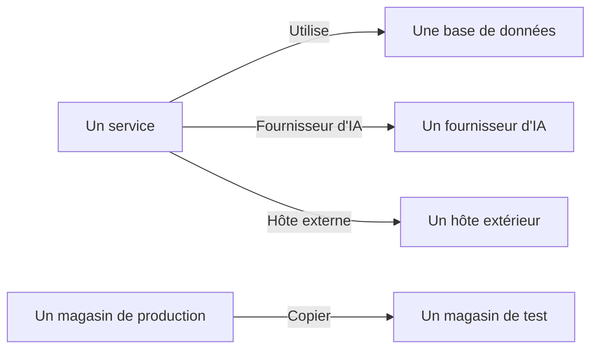

# Flux de données, accès et résidence

Savoir ce que contient un magasin de données, ce n'est que la moitié du travail. Sécurité des données détermine aussi où vont ces données - quels services utilisent le magasin de données, quels fournisseurs d'IA et hôtes extérieurs les données atteignent, et où elles ont été copiées -, qui peut accéder à chaque magasin de données, et s'il réside dans les régions où il en a le droit. Tout cela vient de preuves dont OneUptime dispose déjà : vos traces, les propres paramètres d'accès de votre cloud, et les empreintes de ce que les analyses ont trouvé.

:::cards
- [Flux de données](#flux-de-données): Services, fournisseurs d'IA, hôtes extérieurs et copies.
- [Qui peut accéder à un magasin de données](#qui-peut-accéder-à-un-magasin-de-données): Chaque autorisation que signale votre cloud, et à quel point le magasin de données est exposé.
- [Règles de résidence](#règles-de-résidence): Les régions où chaque sorte de données peut résider.
:::

## Flux de données

| Flux | Ce que cela signifie | D'où il vient |
| --- | --- | --- |
| **Utilise** | Un service communique avec un magasin de données. | La carte des services, que OneUptime déduit des spans client de vos services toutes les dix minutes. Chaque base de données qui y figure est rattachée à son magasin de données par nom, adresse ou point de terminaison, si bien qu'une base de données qu'aucune autre source ne liste devient un magasin de données à part entière. |
| **Fournisseur d'IA** | Un service envoie des données à un fournisseur d'IA. | Les appels d'IA des traces du service sur les 7 derniers jours, qui nomment le fournisseur qu'ils atteignent. |
| **Hôte externe** | Un service appelle un hôte extérieur à vos systèmes. | Les services distants de la carte des services, d'après l'adresse à laquelle ils sont appelés. |
| **Copier** | Un magasin de données contient des valeurs d'un autre. | Les empreintes des valeurs trouvées par chaque analyse : deux magasins de données partagent des données quand leurs empreintes d'un même type de données se recouvrent pour moitié ou plus. |

Un flux transporte les types de données que contient sa source, et leur sensibilité. Un flux est confirmé quand une analyse a prouvé que les données sont là, et pas seulement qu'il existe un chemin vers elles : une copie l'est toujours, et un flux vers un fournisseur d'IA l'est quand les conversations IA du service contiennent des données de niveau Confidentiel ou Restreint. Un flux qui n'est pas revu pendant 30 jours est abandonné.

Deux contrôles lisent les flux. [Des données de production ont été copiées dans un magasin de données hors production](/docs/data-security/checks-and-issues#hygiène-des-données) échoue sur la destination d'une copie. Une copie part du magasin de données de production quand un seul des deux est en production, et sinon du magasin de données que OneUptime a trouvé en premier. [Des données sensibles sont envoyées à un fournisseur d'IA](/docs/data-security/checks-and-issues#ia) échoue sur les conversations IA d'un service quand elles contiennent des données sensibles, et nomme les fournisseurs qu'elles ont atteints.

### Comment les empreintes restent privées

Une copie est trouvée sans les valeurs de l'un ou l'autre magasin de données. Pour chaque type de données qu'elle trouve avec une confiance Élevé, une analyse résume les valeurs qu'elle a lues sous forme de MinHash : 128 cases, chacune le plus petit résultat d'une fonction de hachage sur les valeurs, dont seuls les 16 bits de poids faible sont conservés. Deux résumés concordent sur à peu près autant de cases que leurs deux ensembles de valeurs se recouvrent, donc comparer des résumés estime quelle part d'un magasin de données se trouve dans l'autre.

- **Les valeurs sont hachées avec une clé propre au projet** (HMAC-SHA256), donc personne sans la clé ne peut tester une valeur connue contre un résumé, et les résumés de deux projets ne peuvent jamais être comparés.
- **Seuls 16 bits de chaque minimum sortent de l'analyse.** Aucune valeur, ni aucun hachage d'une valeur, ne peut être retrouvé à partir d'un résumé.
- **Un résumé porte sur un type de données, pas sur un champ.** Un magasin de données en a un pour chaque type de données qui y a été trouvé avec une confiance Élevé, et rien de plus.

## Qui peut accéder à un magasin de données

La lecture de la configuration transforme les propres paramètres d'accès de chaque cloud - stratégies et ACL de bucket, attributions de rôles Azure, liaisons IAM Google Cloud, partages d'instantanés - en une seule liste de qui peut accéder au magasin de données, sur sa page **Qui peut y accéder** :

| Colonne | Ce qu'elle indique |
| --- | --- |
| **Principal** | Qui ou quoi a accès, tel que le cloud le nomme : `*`, un ID de compte, un ARN, un e-mail, un compte de service. |
| **Type de principal** | Public, Compte, Rôle, Utilisateur, Groupe, Principal de service, Compte de service ou Service. |
| **Niveau d'accès** | Lecture, Écriture ou Administrateur. |
| **Accordé via** | Ce qui l'accorde : une stratégie de bucket, une ACL, une attribution de rôle, une liaison IAM ou un partage d'instantané. |
| **Externe** | Le principal est extérieur aux comptes, abonnements et projets connectés à OneUptime. |
| **Public** | Le principal est n'importe qui sur Internet. |

La liste est relue à chaque lecture de la configuration, et une autorisation que le cloud ne signale plus est retirée. [Plus de 25 identités peuvent lire des données de niveau Restreint](/docs/data-security/checks-and-issues#accès) compte les lecteurs qui y figurent. Les services qui utilisent un magasin de données sont ses flux **Utilise**.

D'après ce qu'elle lit, chaque magasin de données reçoit une exposition :

| Exposition | Ce que cela signifie |
| --- | --- |
| **Public** | N'importe qui sur Internet peut le lire. |
| **Autres comptes** | Des comptes extérieurs à vos comptes connectés peuvent y accéder. |
| **Accessible depuis Internet** | Son point de terminaison réseau accepte des connexions depuis Internet. |
| **Privé** | Seuls vos propres comptes et réseaux y accèdent. |
| **Inconnu** | OneUptime n'a pas pu lire assez de sa configuration pour le dire. |

Public l'emporte sur partagé, et partagé sur accessible : un bucket public également partagé avec un autre compte est Public. L'exposition s'ajoute au [score de risque](/docs/data-security/checks-and-issues#score-de-risque) d'un problème.

## Règles de résidence

Une règle de résidence indique où une sorte de données peut résider. Ajoutez-en une dans **Sécurité des données → Paramètres → Règles de résidence** :

| Champ | Ce qu'il fait |
| --- | --- |
| **Nom** | Ce qu'est la règle, par exemple Les données personnelles de l'UE restent dans l'UE. |
| **Régions autorisées** | Les régions où ces données peuvent être stockées et copiées, écrites comme votre cloud les nomme. Une règle sans région ne contrôle rien. |
| **Catégories de données** | Les catégories de données qu'elle couvre. Vide couvre toute sorte de données personnelles. |
| **Données sur des personnes situées dans** | Uniquement les données sur des personnes situées dans ces pays, sous forme de codes ISO 3166-1 comme `DE` ou `IN`. Vide couvre les données sur des personnes situées n'importe où. |
| **Description** | À quoi sert la règle, par exemple Les données de nos clients de l'UE sont stockées uniquement dans l'UE. |
| **Activé** | Si les magasins de données sont contrôlés par rapport à la règle. |

Un magasin de données enfreint une règle quand il contient des données que la règle couvre, et que sa propre région, ou une région vers laquelle ses données sont copiées, ne correspond à aucune des régions autorisées. Les copies sont les régions vers lesquelles les données d'un magasin de données sont répliquées : la réplication S3, la copie géo-redondante d'un compte de stockage, les réplicas d'une base de données. Le magasin de données échoue alors au contrôle [Des données sont stockées hors des régions où elles peuvent résider](/docs/data-security/checks-and-issues#résidence), avec la région et la règle qu'il a enfreinte.

### Régions et caractères génériques

Un `*` dans une région autorisée remplace n'importe quels caractères, majuscules et minuscules sont équivalentes, et le motif doit correspondre à la région entière :

| Région autorisée | Correspond à | Ne correspond pas à |
| --- | --- | --- |
| `eu-*` (AWS) | `eu-west-1`, `eu-central-1` | `us-east-1`, `us-eu-1` |
| `europe-*` (Google Cloud) | `europe-west1`, `europe-north1` | `us-central1` |
| `westeurope` (Azure) | `westeurope` | `northeurope` |

Listez un motif pour chaque cloud que vous utilisez : `eu-*`, `europe-*`, `westeurope` et `northeurope` ensemble gardent les données en Europe sur les trois.

### À qui se rapportent les données d'un magasin de données

OneUptime déduit des données elles-mêmes à qui se rapportent les données d'un magasin de données. Un type de données propre à un pays indique que les personnes concernées se trouvent dans ce pays : un numéro fiscal allemand indique `DE`, un numéro Aadhaar indien `IN`, un numéro NHS britannique `GB`. Le magasin de données liste ces pays comme pays de ses personnes concernées, et une règle limitée aux personnes de certains pays ne couvre que les magasins de données qui contiennent leurs données. [Types de données sensibles](/docs/data-security/data-types#types-de-données-intégrés) indique le pays de chaque type de données qui en a un.

## Prochaines étapes

:::cards
- [Contrôles et problèmes de Sécurité des données](/docs/data-security/checks-and-issues): Chaque contrôle qu'alimentent ces flux, ces autorisations et ces règles.
- [Conformité de Sécurité des données](/docs/data-security/compliance): Comment la résidence et l'accès comptent pour le RGPD, la LGPD et la DPDP.
- [Topologie](/docs/telemetry/topology): La carte des services d'où viennent les flux.
:::
