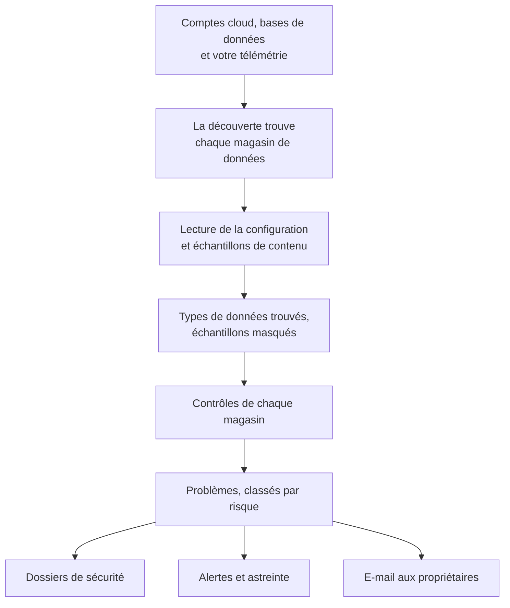

# Sécurité des données

Sécurité des données trouve les données sensibles que conserve votre entreprise - dans des buckets cloud, des bases de données et des entrepôts de données, et dans la télémétrie que vous envoyez à OneUptime - et vous dit ce qui ne va pas dans la façon dont elles sont conservées. Elle trouve les magasins de données d'elle-même, lit la configuration de chacun, échantillonne ce qu'il contient et ouvre un problème pour chaque défaut, classé par risque.

Elle répond à quatre questions :

:::cards
- [Où sont nos données sensibles ?](/docs/data-security/data-types): 143 types de données, des numéros de carte et identifiants nationaux aux clés API, trouvés dans des buckets, des tables et la télémétrie.
- [Sont-elles exposées ?](/docs/data-security/checks-and-issues): 32 contrôles de chaque magasin de données : accès public, chiffrement, sauvegardes, journalisation, secrets et copies.
- [Qui peut y accéder, et où vont-elles ?](/docs/data-security/flows-access-residency): Qui peut lire chaque magasin de données, quels services l'utilisent, et quels fournisseurs d'IA et hôtes ses données atteignent.
- [Respectent-elles nos règles ?](/docs/data-security/compliance): Des règles de résidence, et neuf référentiels de conformité notés d'après ce que les analyses ont trouvé.
:::

## Fonctionnement

1. La **Découverte** trouve les magasins de données que OneUptime connaît déjà : votre inventaire cloud, les bases de données que surveille le produit Bases de données, celles avec lesquelles vos services communiquent sur la carte des services, et la télémétrie de chaque service. Vous n'ajoutez un magasin de données à la main que lorsqu'aucune source ne le liste.
2. **La lecture de la configuration** demande à chaque cloud comment chaque magasin de données est configuré : qui peut y accéder, comment il est chiffré, sauvegardé et journalisé. Elle lit des paramètres, jamais des données.
3. **Les échantillons de contenu** lisent un peu de ce que contient un magasin de données, là où vous l'autorisez : quelques objets de chaque sorte dans un bucket, quelques lignes de chaque table, les enregistrements les plus récents de la télémétrie de chaque service.
4. La **Classification** trouve les valeurs sensibles dans les échantillons, et conserve des comptages et des échantillons masqués, jamais une valeur.
5. Les **Vérifications** déterminent ce qui ne va pas dans chaque magasin de données, et à quel point c'est grave pour les données qu'il contient. Chaque contrôle en échec ouvre un problème, qui se ferme de lui-même dès que le contrôle réussit.

## Ce qui la distingue

- **Votre télémétrie est un magasin de données.** Les journaux, traces, exceptions, relectures de session et conversations IA de chaque service sont contrôlés comme un bucket, toutes les heures. Une adresse e-mail dans une ligne de journal est une détection, et **Nettoyer** la masque à l'ingestion à partir de là. Voir [Données sensibles dans la télémétrie](/docs/data-security/telemetry).
- **Les flux viennent du trafic réel.** La carte des services indique quel service utilise quelle base de données, les appels d'IA nomment le fournisseur qu'ils atteignent, et les copies de données de production sont trouvées en comparant des empreintes. Voir [Flux de données, accès et résidence](/docs/data-security/flows-access-residency).
- **Les preuves sont toujours masquées.** Une détection conserve des comptages et au plus trois échantillons masqués, comme `j***@e******.com`, masqués dans le scanner avant que quoi que ce soit n'en sorte. Désactivez les échantillons et elle ne conserve que des comptages.
- **Le scanner est open source.** Le motif, la somme de contrôle, les mots de contexte et les valeurs de test de chaque type de données se trouvent dans le code source de OneUptime, donc vous pouvez lire exactement ce qui produit une détection. Le même code s'exécute sur les workers de OneUptime, sur une sonde et dans la zone **Tester**.
- **Elle fonctionne avec le reste de OneUptime.** Un problème Critique ouvre un dossier de sécurité sur le magasin de données, donc [Opérations de sécurité](/docs/telemetry/security-cases) le traite comme toute autre menace. Elle peut déclencher une alerte qui prévient la personne d'astreinte, et elle envoie un e-mail aux propriétaires du magasin de données. Voir [Intégrations de Sécurité des données](/docs/data-security/integrations).
- **OneUptime AI aide à corriger.** **Expliquer avec l'IA** dit au propriétaire d'un magasin de données ce qui ne va pas et comment le corriger sur son cloud, et **Corriger avec l'IA** ouvre une pull request dans votre code d'infrastructure.

## Avant de commencer

- **Un rôle qui peut la configurer.** Les Project Owners, Project Admins et Security Admins modifient les paramètres de Sécurité des données. Les Security Members traitent les problèmes et analysent les magasins de données, et les Security Viewers lisent ce qu'elle a trouvé. Les autres rôles n'en voient rien, sauf si leur équipe reçoit ses autorisations : savoir quels buckets contiennent des numéros de carte, c'est exactement ce qu'un attaquant veut connaître. Voir [Rôles](/docs/permissions/reference#rôles).
- **Un compte cloud à lire, ou une base de données.** Sécurité des données lit un compte cloud via une [connexion cloud](/docs/telemetry/cloud-accounts), et une base de données que vous exploitez via une chaîne de connexion en lecture seule. La télémétrie ne demande rien : elle est analysée toutes les heures.

## Démarrage rapide

:::steps
### Connecter un compte cloud

Allez dans **Cloud → Connecter** et choisissez votre cloud. Si le compte est déjà connecté, choisissez plutôt **Modifier** sur sa connexion. [Connecter un compte cloud](/docs/telemetry/cloud-accounts) détaille chaque cloud.

### Choisir le niveau de sécurité des données

Sous **Plus de champs**, réglez **Sécurité des données** sur **Configuration uniquement** pour contrôler la configuration de chaque magasin de données, ou sur **Configuration et échantillons de contenu** pour trouver aussi les données sensibles qu'ils contiennent. La commande qu'affiche le formulaire change selon votre choix : exécutez-la dans le shell de votre cloud, comme l'indique le formulaire. [Configurer la Sécurité des données](/docs/data-security/setup) liste exactement ce qu'accorde chaque niveau, et [Connecter un compte cloud](/docs/telemetry/cloud-accounts#sécurité-des-données) montre la commande de chaque niveau.

### Examiner les problèmes

Ouvrez **Sécurité des données**. Les magasins de données apparaissent sous **Magasins de données** à mesure que la découverte les trouve, toutes les 15 minutes, et la configuration d'une connexion est lue dans l'heure. Les problèmes s'ouvrent sous **Problèmes** dès qu'une lecture ou une analyse se termine, chacun avec son score de risque, et la **Vue d'ensemble** montre les cinq plus risqués. Chaque problème dit ce qui ne va pas, pourquoi c'est important et comment le corriger, avec les commandes pour votre cloud.
:::

## Ce qui compte comme magasin de données

| Où | Magasins de données | Échantillons de contenu |
| --- | --- | --- |
| AWS | AWS S3 Bucket, AWS RDS Instance, AWS Aurora Cluster, AWS RDS Snapshot, AWS DynamoDB Table, AWS Redshift Cluster, AWS DocumentDB Cluster, AWS OpenSearch Domain, AWS ElastiCache Cluster, AWS EFS File System | AWS S3 Bucket |
| Azure | Azure Storage Account, Azure SQL Database, Azure Cosmos DB Account, Azure PostgreSQL Server, Azure MySQL Server | Azure Storage Account |
| Google Cloud | Google Cloud Storage Bucket, Google Cloud SQL Instance, Google BigQuery Dataset, Google Firestore Database, Google Spanner Instance, Google Bigtable Instance | Google Cloud Storage Bucket, Google BigQuery Dataset |
| Bases de données que vous exploitez | PostgreSQL, MySQL, MongoDB, SQL Server, Oracle, Redis, Elasticsearch | PostgreSQL, MySQL |
| OneUptime | Journaux, Traces, Exceptions, Relectures de session, Conversations IA | Journaux, Traces, Exceptions, Relectures de session, Conversations IA |

Chaque magasin de données reçoit les contrôles qui s'appliquent à son type. Un magasin de données dont le contenu ne peut pas être échantillonné est tout de même contrôlé : un bucket public ou une base de données non chiffrée est un problème, quoi qu'il contienne.

Un magasin de données est archivé, avec son historique, dès que sa source ne le liste plus : **Magasins de données archivés**, à la fin du menu de Sécurité des données, le conserve. Il revient de lui-même si sa source le liste à nouveau.

La **Chronologie** d'un magasin de données indique ce qui lui est arrivé, et qui l'a fait : quand il a été trouvé ou ajouté, chaque modification de ses paramètres et de ses propriétaires, quand il a été archivé ou est revenu, et chaque exposition fermée depuis un problème ou un playbook.

## Fréquence d'exécution

| Quoi | Quand |
| --- | --- |
| Trouver de nouveaux magasins de données | Toutes les 15 minutes |
| Lire la configuration d'une connexion cloud | Une fois par jour, et dans l'heure qui suit l'enregistrement par CloudTrail d'une modification de l'accès, du chiffrement, des sauvegardes ou du partage d'un magasin de données AWS |
| Échantillonner le contenu d'un magasin de données | Toutes les 24 heures, ou aussi souvent que l'indique **Analyser toutes les (heures)** |
| Échantillonner la télémétrie de chaque service | Toutes les heures, sur sa dernière heure |
| Contrôler à nouveau chaque magasin de données | Après chaque lecture et chaque analyse, après toute modification d'un élément dont dépend un contrôle, et une fois par jour |

**Analyser maintenant** sur un magasin de données échantillonne aussitôt son contenu, et **Contrôler maintenant** relit sa configuration.

## Prochaines étapes

:::cards
- [Configurer la Sécurité des données](/docs/data-security/setup): Les trois niveaux, les autorisations que chacun accorde, et l'analyse de vos propres bases de données.
- [Types de données sensibles](/docs/data-security/data-types): Comment une valeur est trouvée, et chaque type de données que connaît Sécurité des données.
- [Contrôles et problèmes de Sécurité des données](/docs/data-security/checks-and-issues): Chaque contrôle, le score de risque et ce qu'il advient d'un problème.
- [Intégrations de Sécurité des données](/docs/data-security/integrations): Dossiers de sécurité, alertes, propriétaires, workflows et OneUptime AI.
:::
