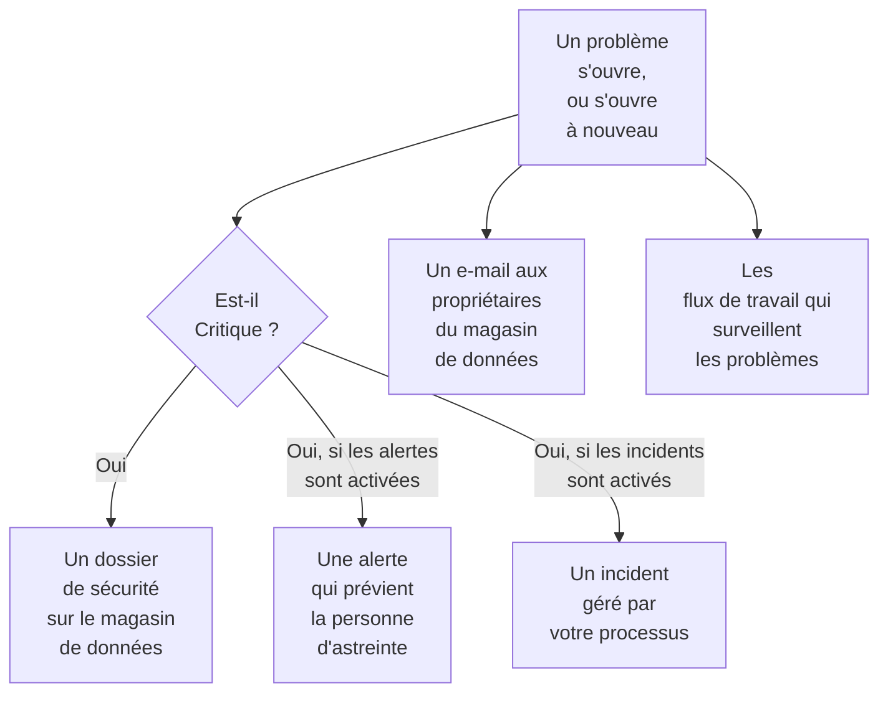

# Intégrations de Sécurité des données

Sécurité des données n'a pas son propre système d'astreinte ni sa propre file de sécurité. Elle confie ce qu'elle trouve aux parties de OneUptime qui en ont déjà : un problème Critique devient un dossier de sécurité, il peut prévenir la personne d'astreinte ou déclarer un incident, et chaque nouveau problème est envoyé par e-mail aux propriétaires du magasin de données. Les flux de travail, OneUptime AI, l'API, Terraform et le serveur MCP accèdent à tout ce qu'elle conserve.

:::cards
- [Opérations de sécurité](#opérations-de-sécurité): Un dossier de sécurité pour chaque magasin de données qui a un problème Critique.
- [S'agit-il d'une violation de données ?](#sagit-il-dune-violation-de-données): Chaque exposition Critique évaluée : combien de temps, qui pouvait lire les données, à qui elles appartenaient, et les lois sur les violations de données qui peuvent s'appliquer.
- [Alertes et astreinte](#alertes-et-astreinte): Prévenir la personne d'astreinte quand un problème Critique s'ouvre.
- [Incidents](#incidents): Déclarer un incident pour une violation de données que votre processus de gestion des incidents doit prendre en charge.
- [Propriétaires](#propriétaires): Analysez un problème, ouvrez une pull request qui le corrige, ou interrogez Demander à l'IA sur vos données et laissez-la agir, avec votre accord.
- [OneUptime AI](#oneuptime-ai): Expliquer un problème, ouvrir une pull request qui le corrige, ou interroger Demander à l'IA sur vos données.
- [Fermer une exposition](#fermer-une-exposition): Bloquer l'accès public ou cesser le partage, depuis un problème ou un playbook, et activer une protection manquante depuis un problème.
:::

## Fonctionnement

Chacune de ces actions s'exécute quand une évaluation ouvre un problème, ou le rouvre. Chacune est faite au mieux : le problème est déjà ouvert et dans sa chronologie, donc une intégration qui échoue est journalisée et ignorée, jamais relancée au risque d'ouvrir un deuxième dossier ou de prévenir l'astreinte une deuxième fois. Ce que chacune a fait est écrit dans la **Chronologie** du problème, et la page du problème renvoie vers le dossier, l'alerte et l'incident qu'il a déclenchés.

| Paramètre | Par défaut | Ce qu'il fait |
| --- | --- | --- |
| **Ouvrir des dossiers de sécurité** | Activé | Un problème Critique ouvre un dossier de sécurité, regroupé par magasin de données. |
| **Déclencher des alertes** | Désactivé | Un problème Critique déclenche une alerte, qui prévient la personne d'astreinte. |
| **Gravité de l'alerte** | Vide | La gravité de ces alertes. Vide correspond à la plus élevée du projet. |
| **Déclarer des incidents** | Désactivé | Un problème Critique déclare un incident, que votre processus de gestion des incidents prend en charge. |
| **Gravité de l'incident** | Vide | La gravité de ces incidents. Vide correspond à la plus élevée du projet. |
| **Notifier les propriétaires** | Activé | Chaque nouveau problème est envoyé par e-mail aux propriétaires de son magasin de données. |

## Opérations de sécurité

Chaque magasin de données est une entité à part entière dans Opérations de sécurité, du type **Magasin de données**. Avec **Ouvrir des dossiers de sécurité** activé, un problème Critique est envoyé à Opérations de sécurité comme une détection portant sur le magasin de données :

- sa source est **Sécurité des données**, et sa règle porte le nom du contrôle, comme `Data Security: public-read` ;
- elle est Critique, donc le dossier qu'elle ouvre a la priorité Critique du projet ;
- elle est regroupée par magasin de données : un deuxième problème Critique sur le même magasin de données rejoint le dossier ouvert qui le concerne au lieu d'en ouvrir un autre.

Le dossier est ensuite traité comme n'importe quel autre : attribué, annoté, fermé, et pris en charge par les playbooks du projet. Les détections du magasin de données comptent dans son risque sur [Risque des entités](/docs/telemetry/security-entity-risk), comme celles de toute entité. Voir [Dossiers de sécurité et playbooks](/docs/telemetry/security-cases).

Tout dossier de sécurité, quelle que soit son origine, montre les données à risque dans son **Impact** : les magasins de données contenant des données sensibles que concerne le dossier, et chaque magasin de données que ses utilisateurs et rôles peuvent atteindre, le plus sensible en premier, avec ce que chacun contient, à peu près combien d'enregistrements, à quel point il est exposé et combien d'identités peuvent l'atteindre. Une session de rôle assumé que nomme le dossier compte comme son rôle, et une adresse e-mail comme les utilisateurs cloud auxquels elle appartient. La lecture se fait avec les propres autorisations du lecteur, donc un rôle qui ne peut pas lire Sécurité des données voit que cette partie est omise.

## S'agit-il d'une violation de données ?

Pour une exposition Critique d'un magasin de données contenant des données de niveau **Restreint** ou **Confidentiel** - ouvert à n'importe qui sur Internet, partagé avec des comptes extérieurs aux vôtres, ou un instantané que d'autres peuvent restaurer -, le dossier est évalué de lui-même dès son ouverture. Tout autre dossier portant sur un magasin de données est évalué lorsqu'une personne appuie sur **Évaluer cette exposition** dans sa **Vue d'ensemble**. Du code simple établit l'évaluation à partir de ce que OneUptime a enregistré, et l'établit à nouveau à chaque lecture :

- **Combien de temps il est resté ouvert** : à partir de la modification, consignée dans le journal de votre cloud, qui a exposé le magasin de données, si une telle modification a été journalisée dans les 30 jours précédant la découverte de l'exposition, sinon au moins depuis sa découverte par Sécurité des données ; jusqu'à ce que la réponse de Sécurité des données elle-même le ferme, qu'une modification le ferme ou qu'un contrôle le trouve fermé.
- **Qui pouvait le lire** : si le magasin de données journalisait les lectures. Sinon, l'évaluation indique « Les lectures n'ont pas été journalisées. Considérez les données comme lues. » Elle compte les comptes extérieurs à votre entreprise qui pouvaient lire le magasin de données, et combien d'entre eux ont utilisé leur accès pendant qu'il était ouvert, sans jamais les nommer. Si le magasin de données est un bucket S3 qui journalise ses accès serveur, **Lire les journaux d'accès** lit ces journaux pour la période, et Data Security les lit de lui-même avant que OneUptime AI rédige l'évaluation : combien de lectures sont venues de n'importe qui sur Internet, de comptes extérieurs à votre entreprise et de demandeurs qu'il ne sait pas identifier, combien d'objets ont été lus et combien de données ont été envoyées. Une personne autorisée à voir qui peut accéder au magasin de données voit quels comptes extérieurs l'ont lu ; le dossier, OneUptime AI et un export ne gardent que les chiffres. Des journaux lus en partie ne montrent jamais que personne n'a lu les données.
- **À qui appartenaient les données** : ce que contient le magasin de données, environ combien d'enregistrements, qui ils concernent, et où vivent les personnes concernées, selon les données et selon ce qu'indique une personne. Une personne indique une région, ou chaque État américain, le district de Columbia et Porto Rico.
- **Les secrets à renouveler** : chaque secret trouvé dans le magasin de données pendant qu'il était ouvert, par type et selon l'endroit où il a été trouvé, jamais sa valeur.
- **Les lois sur les violations de données qui peuvent s'appliquer** : chaque ligne du tableau des lois sur les violations de données de OneUptime, avec ce qu'elle exige, de qui, son délai compté à partir de la découverte de l'exposition par Sécurité des données, et ce qu'une personne vérifie encore avant que la loi s'applique.

Le tableau couvre les articles 33 et 34 du RGPD, les articles 33 et 34 du UK GDPR, la Breach Notification Rule de HIPAA, l'exigence 12.10.1 de PCI DSS avec, à côté, les règles publiées des marques de cartes elles-mêmes - celles de Visa, de Mastercard et d'American Express -, la LGPD du Brésil, les DPDP Rules de l'Inde et les directives de CERT-In, ainsi que les lois sur les violations de données de tous les États américains sauf la Virginie-Occidentale, et du district de Columbia. Pour chaque État figurent sa notification aux personnes concernées et, lorsque sa loi les exige d'une entreprise, ses notifications au procureur général ou à un autre service de l'État et aux agences d'évaluation du crédit, chacune lue dans le texte même de la loi. Chaque ligne renvoie au texte de la loi, sa source, et indique le jour où elle a été vérifiée pour la dernière fois. Tant que personne n'a indiqué dans quels États vivent les personnes concernées, les lois des États sont regroupées sur la carte, les notifications de chaque État sous son nom, et OneUptime AI apprend seulement combien peuvent s'appliquer. Ce que le tableau ne couvre pas - un autre pays ; la Virginie-Occidentale et Porto Rico, dont les lois n'ont pas pu être lues à partir d'une source officielle ; Guam et les îles Vierges des États-Unis ; les marques de cartes qui ne publient aucun délai ; le lieu d'établissement de votre organisation ; vos contrats -, l'évaluation le dit en termes simples.

OneUptime AI rédige l'évaluation comme vos règles IA de Sécurité des données le permettent, ou quand une personne le demande : ce qu'elle signifie, une notification à l'autorité, une communication aux personnes concernées et un résumé interne (voir [OneUptime AI dans Sécurité des données](/docs/data-security/ai)). Chaque brouillon est confronté aux faits de l'évaluation : un brouillon qui contient un nombre ou une loi qu'aucun de ces faits ne contient est écarté. Rien n'est envoyé nulle part : une notification est un texte qu'une personne modifie et copie, et l'évaluation comme chaque brouillon indiquent qu'ils ne constituent pas un conseil juridique.

Les lecteurs du dossier qui peuvent aussi lire le magasin de données et ses détections voient l'évaluation, puisqu'elle nomme ce que contient le magasin. Évaluer, rédiger, modifier une notification et indiquer où vivent les personnes concernées nécessitent aussi l'autorisation de modifier le dossier. Voir [S'agit-il d'une violation de données ?](/docs/telemetry/security-cases#sagit-il-dune-violation-de-données) pour les cartes du dossier.

## Alertes et astreinte

Avec **Déclencher des alertes** activé, un problème Critique déclenche une alerte, nommée « Data Security: » suivi du titre du problème et du magasin de données. L'alerte prévient la personne d'astreinte selon ses propres règles, comme n'importe quelle autre alerte (voir [Alertes](/docs/alerts/index) et [Astreinte](/docs/on-call/index)). Un problème a au plus une alerte ouverte à la fois, quelle que soit la fréquence de son évaluation. **Gravité de l'alerte** fixe la gravité de l'alerte ; laissée vide, c'est la plus élevée du projet.

Une alerte prend fin avec son problème : dès que le problème n'est plus ouvert - son contrôle réussit, ou une personne le marque comme résolu, accepte son risque ou dit que ce n'est pas un problème - l'alerte est résolue, et la **Chronologie** du problème l'indique. Un problème qui s'ouvre à nouveau déclenche une nouvelle alerte.

Les alertes sont désactivées par défaut, car c'est dans un dossier de sécurité que la plupart des équipes veulent d'abord voir une détection de sécurité des données. Activez-les quand un bucket public de numéros de carte doit réveiller quelqu'un.

## Incidents

Avec **Déclarer des incidents** activé, un problème Critique déclare un incident, nommé comme son alerte, pour une violation de données que votre processus de gestion des incidents doit prendre en charge : l'astreinte, les canaux de l'espace de travail, les pages de statut et un post-mortem (voir [Incidents](/docs/incidents/index)). Un problème a au plus un incident ouvert à la fois. **Gravité de l'incident** fixe la gravité de l'incident ; laissée vide, c'est la plus élevée du projet.

Sécurité des données ne résout jamais un incident, même une fois son problème résolu : un incident peut comporter une page de statut et un post-mortem, c'est donc la personne qui le gère qui le ferme. Un dossier de sécurité est l'autre voie vers un incident : **Déclarer un incident** sur le dossier en ouvre un qui lui est lié (voir [Déclarer un incident](/docs/telemetry/security-cases#déclarer-un-incident)).

## Propriétaires

Les propriétaires d'un magasin de données sont des personnes et des équipes, sur la page **Propriétaires** du magasin de données. C'est à eux qu'un problème s'adresse : ils reçoivent l'e-mail, et **Ce magasin de données sensible n'a pas de propriétaire** échoue sur un magasin de données sensible qui n'en a aucun.

Avec **Notifier les propriétaires** activé, chaque évaluation qui ouvre des problèmes sur un magasin de données envoie un seul e-mail à ses propriétaires - les personnes qui le possèdent, et les membres des équipes qui le possèdent, jusqu'à 50 - intitulé avec le nombre de nouveaux problèmes du magasin de données, par exemple « Data Security: 2 new issues on orders-db ». Il liste la gravité et le titre de chaque nouveau problème ainsi que la sensibilité du magasin de données, et renvoie vers le magasin de données. Il ne contient jamais d'échantillon.

Tant qu'OneUptime AI travaille de lui-même sur les nouveaux problèmes, l'e-mail attend son analyse, jusqu'à 10 minutes, et donne à chaque problème analysé deux lignes de plus : son verdict et pourquoi, et le chemin le plus court vers la correction. Chaque propriétaire reçoit les lignes qu'il peut lire : un propriétaire qui ne peut pas lire le problème n'en reçoit aucune, et une ligne qui repose sur quelque chose qu'il ne peut pas lire est omise.

### Règles de propriétaire et règles d'étiquettes

Des règles définissent les propriétaires et les étiquettes à votre place, à mesure que les magasins de données sont trouvés :

| Règle | Où | Ce qu'elle fait |
| --- | --- | --- |
| **Règles de propriétaire** | **Sécurité des données → Règles → Règles de propriétaire** | Ajoute des utilisateurs et des équipes propriétaires à chaque magasin de données qui correspond |
| **Règles d'étiquettes** | **Sécurité des données → Règles → Règles d'étiquettes** | Ajoute des étiquettes à chaque magasin de données qui correspond |

Une règle correspond à un magasin de données par ses étiquettes, par un motif de son nom ou de sa description, ou par **Motif d'étiquette cloud** : un motif comparé à chacune des étiquettes cloud du magasin de données, écrites `key=value`. `^team=payments$` correspond à chaque magasin de données étiqueté `team=payments`, et `^env=` à chaque magasin de données qui a une étiquette `env`. Un nouveau magasin de données reçoit les règles du projet dès qu'il est trouvé, et le paramètre **Notifier les propriétaires** d'une règle de propriétaire indique si les propriétaires qu'elle ajoute sont prévenus. [Règles d'étiquettes et de propriétaires](/docs/configuration/label-and-owner-rules) explique comment chaque règle correspond et quand les règles s'exécutent.

### Les propriétaires que propose OneUptime AI

Un magasin sans propriétaire peut en recevoir de OneUptime AI. Il lit ce qui désigne déjà un propriétaire - les balises cloud du magasin, les services qui l'utilisent, les propriétaires du code du fichier qui le déclare, et qui l'a modifié ou ajouté - et en tire des équipes et des personnes de votre projet. Rien ne change tant qu'une personne ne l'a pas approuvé sous **Propriétaires à examiner**, sur **Magasins de données** ou **Sécurité des données → IA**, et les propriétaires ajoutés sont prévenus comme tout propriétaire. Quand les propriétaires de trois magasins ou plus reposent sur une même étiquette ou un même début de nom, il propose aussi la règle de propriétaire qui garde un propriétaire au prochain magasin semblable, et qui rejoint les **Règles de propriétaire** une fois approuvée. [OneUptime AI dans Sécurité des données](/docs/data-security/ai) dit ce qu'il envoie, et quand il s'exécute.

## Flux de travail

**Magasin de données** et **Problème de sécurité des données** sont des déclencheurs de flux de travail, chacun avec **À la création**, **À la mise à jour**, **À la création ou à la mise à jour** et **À la suppression**. Choisissez-les dans le panneau **Ajouter un déclencheur**, sous **Ressources OneUptime**.

- **Problème de sécurité des données → À la création** s'exécute quand un problème s'ouvre pour la première fois. Lisez sa gravité dans un bloc **Si / Sinon**, et publiez ceux de gravité Critique dans un canal ou ouvrez un ticket dans votre outil de suivi.
- **Problème de sécurité des données → À la mise à jour**, avec **Champs à surveiller** réglé sur son statut, s'exécute quand un problème est résolu, accepté ou s'ouvre à nouveau.
- **Magasin de données → À la création** s'exécute quand la découverte trouve un magasin de données, par exemple pour informer une équipe de chaque nouveau bucket.

Voir [Déclencheurs de flux de travail](/docs/workflows/triggers) pour les champs que transmet chaque déclencheur.

## Pull requests

Une fuite coûte le moins cher à corriger avant sa fusion. Dans un dépôt connecté sous **Code** avec les revues de production activées, la revue de chaque pull request a une section **Données sensibles**, lue dans son diff : du code qui écrit des données personnelles ou un secret dans la télémétrie, dans un journal, un span, une métrique, le message d'une exception, le rapport d'un outil de suivi des erreurs ou l'utilisateur d'une session enregistrée, du code d'infrastructure qui rend public un magasin ou désactive son chiffrement, ses sauvegardes ou sa journalisation, et des migrations qui ajoutent des colonnes pour des données personnelles, des mots de passe ou des données de carte. Chaque point nomme le contrôle de Sécurité des données que le changement ferait échouer une fois livré, et vos propres types de données sont lus par leurs indices de nom, comme les analyses les lisent. Voir [Revue de production des pull requests](/docs/ai/ai-agent#revue-de-production-des-pull-requests).

Ce que sait Sécurité des données rend ces points plus précis, dans le commentaire d'un dépôt privé et, dans Code, pour les personnes qui peuvent lire les détections de Sécurité des données : où la télémétrie du service a contenu le même type de données au cours des 7 derniers jours - ou, pour le code d'une application web ou mobile, les relectures de session de son application RUM - la règle de nettoyage qui le masque à l'ingestion, et le magasin qu'est une ressource, avec sa sensibilité. Pour une migration, dans un dépôt privé seulement, le point nomme le magasin où se trouve la table, ce que contient ce magasin, s'il est accessible depuis l'extérieur ou non chiffré au repos, et les colonnes de la table où le même type de données a déjà été trouvé. Un magasin marqué **Public par conception** ne donne aucun point pour être public. Le commentaire d'un dépôt public ne dit que ce que montre le diff.

**Fuites détectées avant la fusion**, dans **Paramètres du projet → IA → Résultats IA**, compte les fuites que les revues ont repérées dans des pull requests, corrigées là ou pas encore, à côté des problèmes que les analyses ont ouverts sur les mêmes contrôles après la livraison du code.

## OneUptime AI

Deux actions sur un problème demandent de l'aide à OneUptime AI. Toutes deux envoient à OneUptime AI le titre et la gravité du problème, le nom, le type, la région et l'ID cloud du magasin de données, sa sensibilité et ses types de données, chacun par son nom (les vôtres par le nom que vous leur avez donné), la preuve, pourquoi le contrôle est important et la correction pour le cloud du magasin de données - jamais les échantillons d'une détection. Toutes deux s'exécutent selon les interrupteurs et les limites de OneUptime AI du projet. Ce que chacune envoie, ce qu'elle n'envoie jamais et le modèle sur lequel elle s'exécute figurent dans [OneUptime AI dans Sécurité des données](/docs/data-security/ai).

- **Analyser le problème**, en haut de la page du problème, demande à OneUptime AI de rédiger son analyse : si le problème est réel, ce qu'il met en danger, ce que la correction casserait et le chemin le plus court vers la correction (voir [Vérifications et problèmes de la Sécurité des données](/docs/data-security/checks-and-issues)). Elle envoie aussi qui peut atteindre le magasin - chaque autorisation et approximativement quand elle a servi pour la dernière fois, et les services vus en train de l'utiliser -, les copies de ses données dans d'autres magasins, ses dossiers de sécurité, l'action de réponse qui corrige le problème, le dépôt et les fichiers qui déclarent le magasin, et le nombre de ses propriétaires, jamais qui ils sont. L'analyse est conservée sur le problème, son verdict dans la **Chronologie** du problème. Ni ce qui a été envoyé ni la réponse ne sont conservés dans **Paramètres du projet → IA → Journaux IA**, que tout Membre du projet et tout Lecteur peut lire : cette ligne indique seulement que l'appel a eu lieu, et ce qu'il a coûté. Quiconque peut lire le problème peut le demander, et **Expliquer avec l'IA** via l'API et le serveur MCP répond avec la même analyse.
- **Corriger avec l'IA** demande à OneUptime AI de corriger le problème dans votre code d'infrastructure - Terraform, CloudFormation, Bicep ou équivalent - avec la plus petite modification qui fait réussir le contrôle, et d'ouvrir une pull request. Il faut que le dépôt qui contient le code d'infrastructure du magasin de données soit connecté sous **Code** : choisissez-le sous **Dépôt** quand vous pouvez la demander dans plusieurs. La pull request apparaît sous **Code** (voir [Code](/docs/ai/ai-agent)). Les Membres de la sécurité et les rôles supérieurs peuvent la demander, dans un dépôt qu'ils peuvent modifier sous **Code**, comme l'exige une demande à l'IA à cet endroit : un rôle de sécurité ne lit ni ne modifie aucun dépôt à lui seul, donnez donc aussi à leur équipe **Read Code Repository** et **Edit Code Repository**. Quand l'IA ne peut pas travailler maintenant (elle est désactivée, le projet n'a plus de crédits d'IA, ses limites quotidiennes sont atteintes, ou aucun Runner n'est en ligne), Corriger avec l'IA dit ce qu'il faut corriger et ne lance rien. Pour un problème dans la télémétrie d'un service, il montre d'abord une seule pull request pour toutes les fuites du service, avec l'endroit où ses enregistrements disent que chacune est écrite - jamais une valeur -, et là où les données sont écrites à plus de trois endroits, il ajoute plutôt une étape de masquage avec un test : voir [Le corriger dans le code](/docs/data-security/telemetry#le-corriger-dans-le-code).

OneUptime AI travaille aussi de lui-même sur chaque nouveau problème, comme vos règles IA le permettent : voir [OneUptime AI dans la sécurité des données](/docs/data-security/ai).

### Demander à l'IA

**Demander à l'IA** lit la Sécurité des données, et y agit avec votre accord. Sur n'importe quelle page de la Sécurité des données, demandez quels magasins contiennent des numéros de carte, quoi corriger en premier, ou quels magasins un rôle pourrait atteindre s'il fuitait ; sur la page d'un magasin ou d'un problème, elle lit d'abord cet enregistrement. Elle lit avec ces outils, exécutés avec vos propres autorisations :

| Outil | Ce qu'il lit |
| --- | --- |
| `query_data_stores` | Les magasins de données, les plus risqués d'abord, par sensibilité, type de données, exposition, fournisseur ou nom - ou un magasin de données avec ce qui a été trouvé où, qui peut y accéder et ses problèmes ouverts |
| `query_data_security_issues` | Les problèmes, les plus risqués d'abord, par statut, gravité, magasin de données ou contrôle - ou un problème avec sa preuve et la correction pour son cloud |
| `query_data_store_access` | Qui peut accéder à un magasin de données, ou chaque magasin de données qu'un principal peut atteindre |

Ils lisent des types de données, des emplacements et des décomptes, jamais les échantillons d'une détection, masqués ou non. Deux autres lisent ce sur quoi OneUptime AI travaille : `query_data_security_proposals` liste ce qu'elle propose, et les types de données qu'elle a trouvés et que les analyses ne recherchent pas encore, chacun avec la façon dont il a été prouvé et les champs où il se trouve, jamais une valeur ; `draft_data_security_rule` rédige une règle à partir de votre phrase et indique quels magasins elle couvre aujourd'hui. Il n'enregistre rien.

Demander à l'IA fait ce que font les boutons de la Sécurité des données, chacun en apportant exactement la modification que fait son bouton, en votre nom et avec vos autorisations :

| Action | Ce qu'elle fait | Vous demande d'abord |
| --- | --- | --- |
| `scrub_data_security_finding` | **Nettoyer** une détection dans la télémétrie : sa règle de nettoyage prouvée et étroite | En **Demander avant d'agir**, et dans tous les modes quand quelque chose lit ce qu'elle masque |
| `judge_data_security_finding` | **Confirmer**, ou **Non sensible** avec votre raison, et de même pour les détections semblables | **Non sensible** dans tous les modes ; **Confirmer** dans tous les modes quand un problème critique alerte quelqu'un dans votre projet |
| `change_data_security_issue` | **Accepter le risque** avec votre raison et une date de fin, **Pas un problème** avec votre raison, **Rouvrir** ou **Attribuer** | **Accepter le risque** et **Pas un problème** dans tous les modes |
| `set_data_store_owners` | Ajoute ou retire les propriétaires d'un magasin | Dans tous les modes |
| `save_data_security_rule` | Enregistre une règle de résidence, de propriétaire ou d'étiquettes rédigée à partir de votre phrase, et applique une règle de propriétaire ou d'étiquettes aux magasins qu'elle couvre aujourd'hui | Dans tous les modes |
| `respond_on_data_store` | Une action de réponse via la connexion cloud du magasin, comme **Bloquer l'accès public** | Dans tous les modes |
| `fix_data_security_issue_with_ai` | **Corriger avec l'IA** : une pull request que quelqu'un relit et fusionne. Une correction déjà en route n'est pas lancée deux fois | En **Demander avant d'agir** |
| `decide_data_security_proposal` | **Approuver** ou **Masquer** ce que propose OneUptime AI. Un type de données trouvé s'ajoute depuis son formulaire dans **Paramètres → Types de données**, ici il ne peut donc qu'être refusé | Dans tous les modes |

Chaque action montre d'abord une carte qui dit, en mots simples, ce qui change, ce qui cesse de fonctionner et ce qu'elle coûte. En **Demander avant d'agir**, vous autorisez ou ignorez chaque action. En **Exécution automatique**, les actions ci-dessus qui demandent dans tous les modes vous attendent toujours : elles changent qui peut atteindre vos données, font cesser de compter une détection ou un problème, changent qui est informé d'un magasin, ou laisseraient OneUptime AI approuver sa propre proposition. Les noms de magasins, les emplacements des détections et les preuves viennent de vos clouds et de quiconque y écrit, donc Demander à l'IA n'agit jamais parce qu'un tel texte le lui demande, et chaque action est revérifiée, avec vos autorisations, au moment où elle s'exécute.

## Fermer une exposition

Deux modifications ferment l'exposition d'un magasin de données cloud, chacune via la connexion cloud du magasin de données avec **Réponse de sécurité des données** activé (voir [Configurer la Sécurité des données](/docs/data-security/setup#laisser-sécurité-des-données-fermer-une-exposition)), et six autres activent un paramètre qui protège un magasin de données, depuis son problème uniquement :

- **Bloquer l'accès public**, sur un bucket S3, un compte de stockage Azure ou un bucket Cloud Storage.
- **Révoquer le partage**, sur un instantané RDS, ou sur les instantanés manuels partagés d'une base de données RDS, d'un cluster Aurora ou d'un cluster DocumentDB.
- **Activer le versioning**, **Activer la suppression réversible**, **Désactiver les ACL d'objet**, **Activer l'accès uniforme**, **Exiger le transfert sécurisé** et **Activer la restauration à un instant donné**, sur les magasins de données que liste [Corriger d'ici](/docs/data-security/checks-and-issues#corriger-dici).

Une personne en exécute une depuis un problème ouvert qu'elle corrige, avec **Corriger d'ici** (voir [Contrôles et problèmes de Sécurité des données](/docs/data-security/checks-and-issues#corriger-dici)). Un playbook d'Opérations de sécurité les exécute comme étapes de la catégorie **Confinement**, **Bloquer l'accès public aux magasins de données** et **Révoquer le partage des magasins de données** : sur chaque magasin de données que concerne le dossier, 10 au plus, chacune étant une étape qui commence avec **Approbation requise** activé. Un magasin de données marqué **Public par conception** n'est jamais bloqué. Dans les deux cas, le fil d'activité du magasin de données indique ce qui a été fait, et le magasin de données est aussitôt contrôlé à nouveau, donc le problème se résout quand la modification a pris effet.

Le modèle de playbook **Fermer une exposition de données** répond aux dossiers qu'ouvre Sécurité des données : il envoie un e-mail aux propriétaires du magasin de données, bloque l'accès public et révoque le partage une fois qu'une personne a approuvé chaque étape, et ajoute au dossier la liste de contrôle de la réponse sous forme de tâches - qui a lu les données pendant leur exposition, s'il s'agit d'une violation que vous devez déclarer, quels secrets renouveler, et quoi écrire à la clôture du dossier. Ajoutez-le depuis **Créer à partir d'un modèle** dans les playbooks du projet. La carte **S'agit-il d'une violation de données ?** du dossier répond à chacune de ces tâches (voir [S'agit-il d'une violation de données ?](#sagit-il-dune-violation-de-données)).

## API, Terraform et MCP

Tout ce que conserve Sécurité des données est un enregistrement de l'API OneUptime, lu avec les mêmes autorisations que dans le tableau de bord (voir la [Référence de l'API](/docs/api-reference/api-reference)) :

| Enregistrements | Chemin d'API |
| --- | --- |
| Les magasins de données, leurs chronologies, leurs détections, qui peut y accéder et chaque identité qui le peut | `/data-store`, `/data-store-feed`, `/data-store-finding`, `/data-store-access`, `/data-security-identity` |
| Les problèmes, leurs chronologies, leurs pull requests liées et les flux de données | `/data-security-issue`, `/data-security-issue-feed`, `/data-security-issue-pull-request`, `/data-security-flow` |
| Les analyses | `/data-security-scan` |
| Les types de données personnalisés, les paramètres des contrôles, les paramètres de conformité et les règles de résidence | `/data-security-custom-data-type`, `/data-security-check-setting`, `/data-security-compliance-setting`, `/data-security-residency-rule` |
| Les paramètres du projet | `/data-security-setting` |
| Les propriétaires, les règles de propriétaire et les règles d'étiquettes | `/data-store-owner-user`, `/data-store-owner-team`, `/data-store-owner-rule`, `/data-store-label-rule` |
| Ce qu'OneUptime AI propose pour un problème, et pourquoi il a agi ou non sur un problème | `/data-security-ai-proposal`, `/data-security-ai-decision` |

Quelques réponses sont calculées à la demande plutôt que stockées. Chacune est un `POST` :

| Chemin | Ce qu'il fait |
| --- | --- |
| `/data-security/overview` | Les chiffres de la Vue d'ensemble : les magasins de données par sensibilité et par catégorie, les problèmes ouverts par gravité, les problèmes les plus risqués et ceux des 30 derniers jours |
| `/data-security/compliance` | Le score et les exigences de chaque référentiel |
| `/data-security/resource-scope` | Les magasins de données d'une ressource - un cluster Kubernetes, un hôte Docker ou Podman, une base de données, un service ou une ressource cloud - et la ressource dont ils suivent les interrupteurs de conformité |
| `/data-security/resource-compliance` | Les référentiels d'une ressource : leurs scores pour ses magasins de données, et ce qui est désactivé pour elle |
| `/data-security/record-of-processing` | Le registre des traitements du RGPD, une ligne pour chaque magasin de données qui contient des données personnelles. Un magasin de données que OneUptime conserve pour votre sécurité a un objet `declared` : sa propre finalité, sa conservation et qui peut le lire |
| `/data-store/<id>/declared` | Ce que le registre dit d'un magasin de données que OneUptime conserve pour votre sécurité : ce qu'il contient, pourquoi, combien de temps et qui peut le lire |
| `/data-store/<id>/scan-now` | **Analyser maintenant** : échantillonne aussitôt le contenu du magasin de données |
| `/data-store/<id>/check-now` | **Contrôler maintenant** : relit la configuration du magasin de données et exécute ses contrôles |
| `/data-store-finding/<id>/scrub` | **Nettoyer** sur une détection de télémétrie |
| `/data-store-finding/<id>/drop-metric-impact` | Ce que ferait **Abandonner cette métrique** pour une détection dans le nom d'une métrique : combien de métriques elle abandonnerait, et les moniteurs, tableaux de bord, SLO et règles d'enregistrement qui les lisent |
| `/data-store-finding/<id>/drop-metric` | **Abandonner cette métrique** : une règle de pipeline de métriques qui abandonne définitivement les nouveaux points de données de ces métriques du service. Elle prend `{"confirmDataLoss": true}` |
| `/data-security-issue/<id>/explain` | **Expliquer avec l'IA** : l'analyse d'un problème par OneUptime AI, telle que **Analyser le problème** la rédige. Elle renvoie l'analyse conservée sur le problème quand rien de ce sur quoi elle repose n'a changé, sinon en rédige une nouvelle ; `{"force": true}` en rédige une nouvelle, comme **Analyser à nouveau** |
| `/data-security-issue/<id>/analysis` | L'analyse conservée sur le problème, telle que vous pouvez la lire. Elle ne demande jamais rien à OneUptime AI |
| `/data-security-issue/<id>/fix-with-ai` | **Corriger avec l'IA** sur un problème |
| `/data-store/<id>/response-actions` | Les actions de réponse que le magasin de données peut effectuer maintenant, et la raison quand il ne le peut pas |
| `/data-store/<id>/respond` | Une action de réponse sur le magasin de données, comme **Bloquer l'accès public** ou **Activer le versioning**, avec le problème depuis lequel l'action a été lancée |
| `/data-security-ai-proposal/<id>/approve` | **Approuver** sur une modification proposée par OneUptime AI, qui la fait avec vos propres autorisations. Prend le `expectedPlanFingerprint` de la proposition qui vous a été montrée, et refuse celle qui a changé depuis |
| `/data-security-ai-proposal/<id>/dismiss` | **Ignorer la proposition**, avec `{"reason": "..."}`, ajouté à la chronologie du problème |
| `/data-security-ai-proposal/<id>/undo` | **Annuler** sur une modification faite par OneUptime AI : elle est annulée, et le magasin de données est contrôlé à nouveau |
| `/security-case/<id>/exposure-assessment` | L'évaluation de l'exposition d'un dossier de sécurité, telle que vous pouvez la lire : ce que du code simple établit à partir du magasin de données qu'il concerne, et le compte rendu de OneUptime AI |
| `/security-case/<id>/exposure-assessment/assess` | **Évaluer cette exposition** : lance l'évaluation du dossier, pour le magasin de données que nomme `{"dataStoreId": "..."}` quand le dossier en concerne plusieurs |
| `/security-case/<id>/exposure-assessment/draft` | **Rédiger avec OneUptime AI** : OneUptime AI rédige chaque partie qu'aucune personne n'a modifiée. Rien n'est envoyé |
| `/security-case/<id>/exposure-assessment/edit` | Une partie dans les propres mots d'une personne, comme `{"part": "regulatorNotice", "markdown": "..."}`, qui n'est plus jamais rédigée |
| `/security-case/<id>/exposure-assessment/people` | Où vivent les personnes concernées par les données, comme `{"places": ["EEA", "GB"]}` ; une liste vide retire la réponse |

Le [fournisseur Terraform](/docs/terraform/index) a une ressource pour chaque sorte d'enregistrement que vous créez - les magasins de données que vous ajoutez vous-même, les types de données personnalisés, les paramètres des contrôles, les paramètres de conformité, les règles de résidence, les règles de propriétaire et d'étiquettes - nommée d'après l'enregistrement, comme `oneuptime_residency_rule`.

Le [serveur MCP](/docs/ai/mcp-server) a des outils de création, de lecture, de liste, de mise à jour, de suppression et de comptage pour ces enregistrements : Data Store, Data Store Finding, Data Store Access Entry, Data Security Identity, Data Flow, Data Security Issue, Data Security Scan, Custom Data Type, Check Setting, Compliance Setting, Residency Rule et Data Security Setting. Un assistant IA peut alors demander quels magasins de données contiennent des numéros de carte, ou ce qui est ouvert sur un bucket, avec vos autorisations. Il dispose aussi des [actions de Demander à l'IA](#demander-à-lia), un appel chacune, chacune apportant exactement la modification que fait son bouton, en votre nom. Le serveur MCP ne peut montrer de carte à personne, donc une action pour laquelle Demander à l'IA demande dans tous les modes y est refusée : la réponse dit pourquoi, et nomme la page de OneUptime où vous faites la modification. Il en va de même pour une écriture sur l'un de ces enregistrements qui apporte la même modification, comme le `status` d'un problème passé à `Accepted` par `update_data_security_issue`, un type de données désactivé, ou un emplacement exclu des analyses d'un magasin de données ; tout autre champ change comme avant.

## Prochaines étapes

:::cards
- [Dossiers de sécurité et playbooks (SOAR)](/docs/telemetry/security-cases): Traiter les dossiers qu'ouvre Sécurité des données.
- [Règles d'étiquettes et de propriétaires](/docs/configuration/label-and-owner-rules): Comment les règles correspondent, et quand elles s'exécutent.
- [Déclencheurs de flux de travail](/docs/workflows/triggers): Exécuter un flux de travail quand un problème s'ouvre ou qu'un magasin de données est trouvé.
- [Contrôles et problèmes de Sécurité des données](/docs/data-security/checks-and-issues): Ce que signifie chaque problème, et comment le corriger.
:::
