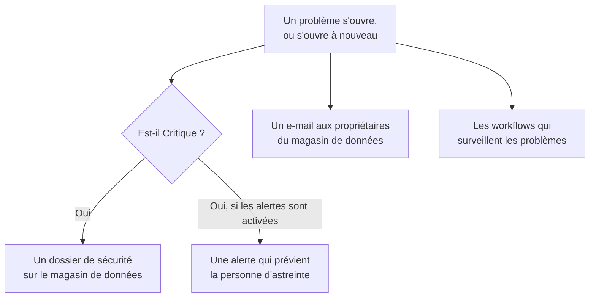

# Intégrations de Sécurité des données

Sécurité des données n'a pas son propre système d'astreinte ni sa propre file de sécurité. Elle confie ce qu'elle trouve aux parties de OneUptime qui en ont déjà : un problème Critique devient un dossier de sécurité, il peut prévenir la personne d'astreinte, et chaque nouveau problème est envoyé par e-mail aux propriétaires du magasin de données. Les workflows, OneUptime AI, l'API, Terraform et le serveur MCP accèdent à tout ce qu'elle conserve.

:::cards
- [Opérations de sécurité](#opérations-de-sécurité): Un dossier de sécurité pour chaque magasin de données qui a un problème Critique.
- [Alertes et astreinte](#alertes-et-astreinte): Prévenir la personne d'astreinte quand un problème Critique s'ouvre.
- [Propriétaires](#propriétaires): Qui possède chaque magasin de données, défini à la main ou par des règles, et l'e-mail qu'ils reçoivent.
- [OneUptime AI](#oneuptime-ai): Expliquer un problème, ouvrir une pull request qui le corrige, ou interroger Demander à l'IA sur vos données.
- [Fermer une exposition](#fermer-une-exposition): Bloquer l'accès public ou cesser le partage, depuis un problème ou un playbook.
:::

## Fonctionnement

Chacune de ces actions s'exécute quand une évaluation ouvre un problème, ou le rouvre. Chacune est faite au mieux : le problème est déjà ouvert et dans sa chronologie, donc une intégration qui échoue est journalisée et ignorée, jamais relancée au risque d'ouvrir un deuxième dossier ou de prévenir l'astreinte une deuxième fois. Ce que chacune a fait est écrit dans la **Chronologie** du problème.

| Paramètre | Par défaut | Ce qu'il fait |
| --- | --- | --- |
| **Ouvrir des dossiers de sécurité** | Activé | Un problème Critique ouvre un dossier de sécurité, regroupé par magasin de données. |
| **Déclencher des alertes** | Désactivé | Un problème Critique déclenche une alerte, qui prévient la personne d'astreinte. |
| **Gravité de l'alerte** | Vide | La gravité de ces alertes. Vide correspond à la plus élevée du projet. |
| **Notifier les propriétaires** | Activé | Chaque nouveau problème est envoyé par e-mail aux propriétaires de son magasin de données. |

## Opérations de sécurité

Chaque magasin de données est une entité à part entière dans Opérations de sécurité, du type **Magasin de données**. Avec **Ouvrir des dossiers de sécurité** activé, un problème Critique est envoyé à Opérations de sécurité comme une détection portant sur le magasin de données :

- sa source est **Sécurité des données**, et sa règle porte le nom du contrôle, comme `Data Security: public-read` ;
- elle est Critique, donc le dossier qu'elle ouvre a la priorité Critique du projet ;
- elle est regroupée par magasin de données : un deuxième problème Critique sur le même magasin de données rejoint le dossier ouvert qui le concerne au lieu d'en ouvrir un autre.

Le dossier est ensuite traité comme n'importe quel autre : attribué, annoté, fermé, et pris en charge par les playbooks du projet. Les détections du magasin de données comptent dans son risque sur [Risque des entités](/docs/telemetry/security-entity-risk), comme celles de toute entité. Voir [Dossiers de sécurité et playbooks](/docs/telemetry/security-cases).

## Alertes et astreinte

Avec **Déclencher des alertes** activé, un problème Critique déclenche une alerte, nommée « Data Security: » suivi du titre du problème et du magasin de données. L'alerte prévient la personne d'astreinte selon ses propres règles, comme n'importe quelle autre alerte (voir [Alertes](/docs/alerts/index) et [Astreinte](/docs/on-call/index)). Un problème a au plus une alerte ouverte à la fois, quelle que soit la fréquence de son évaluation. **Gravité de l'alerte** fixe la gravité de l'alerte ; laissée vide, c'est la plus élevée du projet.

Les alertes sont désactivées par défaut, car c'est dans un dossier de sécurité que la plupart des équipes veulent d'abord voir une détection de sécurité des données. Activez-les quand un bucket public de numéros de carte doit réveiller quelqu'un.

## Propriétaires

Les propriétaires d'un magasin de données sont des personnes et des équipes, sur la page **Propriétaires** du magasin de données. C'est à eux qu'un problème s'adresse : ils reçoivent l'e-mail, et **Ce magasin de données sensible n'a pas de propriétaire** échoue sur un magasin de données sensible qui n'en a aucun.

Avec **Notifier les propriétaires** activé, chaque évaluation qui ouvre des problèmes sur un magasin de données envoie un seul e-mail à ses propriétaires - les personnes qui le possèdent, et les membres des équipes qui le possèdent, jusqu'à 50 - intitulé avec le nombre de nouveaux problèmes du magasin de données, par exemple « Data Security: 2 new issues on orders-db ». Il liste la gravité et le titre de chaque nouveau problème ainsi que la sensibilité du magasin de données, et renvoie vers le magasin de données. Il ne contient jamais d'échantillon.

### Règles de propriétaire et règles d'étiquettes

Des règles définissent les propriétaires et les étiquettes à votre place, à mesure que les magasins de données sont trouvés :

| Règle | Où | Ce qu'elle fait |
| --- | --- | --- |
| **Règles de propriétaire** | **Sécurité des données → Règles → Règles de propriétaire** | Ajoute des utilisateurs et des équipes propriétaires à chaque magasin de données qui correspond |
| **Règles d'étiquettes** | **Sécurité des données → Règles → Règles d'étiquettes** | Ajoute des étiquettes à chaque magasin de données qui correspond |

Une règle correspond à un magasin de données par ses étiquettes, par un motif de son nom ou de sa description, ou par **Motif d'étiquette cloud** : un motif comparé à chacune des étiquettes cloud du magasin de données, écrites `key=value`. `^team=payments$` correspond à chaque magasin de données étiqueté `team=payments`, et `^env=` à chaque magasin de données qui a une étiquette `env`. Un nouveau magasin de données reçoit les règles du projet dès qu'il est trouvé, et le paramètre **Notifier les propriétaires** d'une règle de propriétaire indique si les propriétaires qu'elle ajoute sont prévenus. [Règles d'étiquettes et de propriétaires](/docs/configuration/label-and-owner-rules) explique comment chaque règle correspond et quand les règles s'exécutent.

## Workflows

**Magasin de données** et **Problème de sécurité des données** sont des déclencheurs de workflow, chacun avec **À la création**, **À la mise à jour**, **À la création ou à la mise à jour** et **À la suppression**. Choisissez-les dans le panneau **Ajouter un déclencheur**, sous **Ressources OneUptime**.

- **Problème de sécurité des données → À la création** s'exécute quand un problème s'ouvre pour la première fois. Lisez sa gravité dans un bloc **Si / Sinon**, et publiez ceux de gravité Critique dans un canal ou ouvrez un ticket dans votre outil de suivi.
- **Problème de sécurité des données → À la mise à jour**, avec **Champs à surveiller** réglé sur son statut, s'exécute quand un problème est résolu, accepté ou s'ouvre à nouveau.
- **Magasin de données → À la création** s'exécute quand la découverte trouve un magasin de données, par exemple pour informer une équipe de chaque nouveau bucket.

Voir [Déclencheurs de workflow](/docs/workflows/triggers) pour les champs que transmet chaque déclencheur.

## OneUptime AI

Deux actions sur un problème demandent de l'aide à OneUptime AI. Toutes deux envoient à OneUptime AI le titre et la gravité du problème, le nom, le type, la région et l'ID cloud du magasin de données, sa sensibilité et ses types de données, la preuve, pourquoi le contrôle est important et la correction pour le cloud du magasin de données - jamais les échantillons d'une détection. Toutes deux s'exécutent selon les interrupteurs et les limites de OneUptime AI du projet.

- **Expliquer** rédige, pour le propriétaire du magasin de données, ce qui ne va pas, ce qui pourrait arriver et les étapes exactes pour le corriger sur son cloud. L'explication est conservée dans la **Chronologie** du problème. Quiconque peut lire Sécurité des données peut la demander.
- **Corriger avec l'IA** demande à OneUptime AI de corriger le problème dans votre code d'infrastructure - Terraform, CloudFormation, Bicep ou équivalent - avec la plus petite modification qui fait réussir le contrôle, et d'ouvrir une pull request. Il faut que le dépôt qui contient le code d'infrastructure du magasin de données soit connecté sous **Code** : choisissez-le sous **Dépôt** quand le projet en a plusieurs. La pull request apparaît sous **Code** (voir [Code](/docs/ai/ai-agent)). Les Security Members et les rôles supérieurs peuvent la demander.

### Demander à l'IA

**Demander à l'IA** lit aussi Sécurité des données. Sur n'importe quelle page de Sécurité des données, demandez quels magasins de données contiennent des numéros de carte, quoi corriger en premier, ou quels magasins de données un rôle pourrait atteindre s'il fuitait ; sur la page d'un magasin de données ou d'un problème, elle lit d'abord cet enregistrement. Elle répond avec trois outils de lecture, exécutés avec vos propres autorisations :

| Outil | Ce qu'il lit |
| --- | --- |
| `query_data_stores` | Les magasins de données, les plus risqués d'abord, par sensibilité, type de données, exposition, fournisseur ou nom - ou un magasin de données avec ce qui a été trouvé où, qui peut y accéder et ses problèmes ouverts |
| `query_data_security_issues` | Les problèmes, les plus risqués d'abord, par statut, gravité, magasin de données ou contrôle - ou un problème avec sa preuve et la correction pour son cloud |
| `query_data_store_access` | Qui peut accéder à un magasin de données, ou chaque magasin de données qu'un principal peut atteindre |

Ils lisent des types de données, des emplacements et des comptages, jamais les échantillons d'une détection, masqués ou non. Demander à l'IA ne modifie rien dans Sécurité des données.

## Fermer une exposition

Deux modifications ferment l'exposition d'un magasin de données cloud, chacune via la connexion cloud du magasin de données avec **Réponse de sécurité des données** activé (voir [Configurer la Sécurité des données](/docs/data-security/setup#laisser-sécurité-des-données-fermer-une-exposition)) :

- **Bloquer l'accès public**, sur un bucket S3, un compte de stockage Azure ou un bucket Cloud Storage.
- **Révoquer le partage**, sur un instantané RDS, ou sur les instantanés manuels partagés d'une base de données RDS, d'un cluster Aurora ou d'un cluster DocumentDB.

Une personne en exécute une depuis un problème ouvert qu'elle corrige, avec **Corriger d'ici** (voir [Contrôles et problèmes de Sécurité des données](/docs/data-security/checks-and-issues#corriger-dici)). Un playbook d'Opérations de sécurité les exécute comme étapes de la catégorie **Confinement**, **Bloquer l'accès public aux magasins de données** et **Révoquer le partage des magasins de données** : sur chaque magasin de données que concerne le dossier, 10 au plus, chacune étant une étape qui commence avec **Approbation requise** activé. Un magasin de données marqué **Public par conception** n'est jamais bloqué. Dans les deux cas, le fil d'activité du magasin de données indique ce qui a été fait, et le magasin de données est aussitôt contrôlé à nouveau, donc le problème se résout quand la modification a pris effet.

## API, Terraform et MCP

Tout ce que conserve Sécurité des données est un enregistrement de l'API OneUptime, lu avec les mêmes autorisations que dans le tableau de bord (voir la [Référence de l'API](/docs/api-reference/api-reference)) :

| Enregistrements | Chemin d'API |
| --- | --- |
| Les magasins de données, leurs chronologies, leurs détections et qui peut y accéder | `/data-store`, `/data-store-feed`, `/data-store-finding`, `/data-store-access` |
| Les problèmes, leurs chronologies et les flux de données | `/data-security-issue`, `/data-security-issue-feed`, `/data-security-flow` |
| Les analyses | `/data-security-scan` |
| Les types de données personnalisés, les paramètres des contrôles et les règles de résidence | `/data-security-custom-data-type`, `/data-security-check-setting`, `/data-security-residency-rule` |
| Les paramètres du projet | `/data-security-setting` |
| Les propriétaires, les règles de propriétaire et les règles d'étiquettes | `/data-store-owner-user`, `/data-store-owner-team`, `/data-store-owner-rule`, `/data-store-label-rule` |

Quelques réponses sont calculées à la demande plutôt que stockées. Chacune est un `POST` :

| Chemin | Ce qu'il fait |
| --- | --- |
| `/data-security/overview` | Les chiffres de la Vue d'ensemble : les magasins de données par sensibilité et par catégorie, les problèmes ouverts par gravité, les problèmes les plus risqués et ceux des 30 derniers jours |
| `/data-security/compliance` | Le score et les exigences de chaque référentiel |
| `/data-security/record-of-processing` | Le registre des traitements du RGPD, une ligne pour chaque magasin de données qui contient des données personnelles |
| `/data-store/<id>/scan-now` | **Analyser maintenant** : échantillonne aussitôt le contenu du magasin de données |
| `/data-store/<id>/check-now` | **Contrôler maintenant** : relit la configuration du magasin de données et exécute ses contrôles |
| `/data-store-finding/<id>/scrub` | **Nettoyer** sur une détection de télémétrie |
| `/data-security-issue/<id>/explain` | **Expliquer** un problème |
| `/data-security-issue/<id>/fix-with-ai` | **Corriger avec l'IA** sur un problème |
| `/data-store/<id>/response-actions` | Les actions de réponse que le magasin de données peut effectuer maintenant, et la raison quand il ne le peut pas |
| `/data-store/<id>/respond` | **Bloquer l'accès public** ou **Révoquer le partage** sur le magasin de données, avec le problème depuis lequel l'action a été lancée |

Le [fournisseur Terraform](/docs/terraform/index) a une ressource pour chaque sorte d'enregistrement que vous créez - les magasins de données que vous ajoutez vous-même, les types de données personnalisés, les paramètres des contrôles, les règles de résidence, les règles de propriétaire et d'étiquettes - nommée d'après l'enregistrement, comme `oneuptime_residency_rule`.

Le [serveur MCP](/docs/ai/mcp-server) a des outils de création, de lecture, de liste, de mise à jour, de suppression et de comptage pour ces enregistrements : Data Store, Data Store Finding, Data Store Access Entry, Data Flow, Data Security Issue, Data Security Scan, Custom Data Type, Check Setting, Residency Rule et Data Security Setting. Un assistant IA peut alors demander quels magasins de données contiennent des numéros de carte, ou ce qui est ouvert sur un bucket, avec vos autorisations.

## Prochaines étapes

:::cards
- [Dossiers de sécurité et playbooks (SOAR)](/docs/telemetry/security-cases): Traiter les dossiers qu'ouvre Sécurité des données.
- [Règles d'étiquettes et de propriétaires](/docs/configuration/label-and-owner-rules): Comment les règles correspondent, et quand elles s'exécutent.
- [Déclencheurs de workflow](/docs/workflows/triggers): Exécuter un workflow quand un problème s'ouvre ou qu'un magasin de données est trouvé.
- [Contrôles et problèmes de Sécurité des données](/docs/data-security/checks-and-issues): Ce que signifie chaque problème, et comment le corriger.
:::
