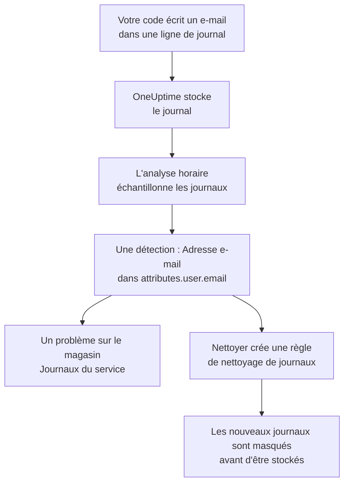

# Données sensibles dans la télémétrie

La télémétrie contient tout ce qu'écrit votre code : une adresse e-mail dans une ligne de journal, un numéro de carte dans un attribut de span, un jeton dans une trace de pile, la question d'un client dans un prompt. Sécurité des données traite les journaux, traces, exceptions et conversations IA de chaque service, ainsi que les sessions de chaque application RUM, comme des magasins de données à part entière. Elle les échantillonne toutes les heures, y trouve les données sensibles comme dans un bucket, et **Nettoyer** transforme une détection en une règle de nettoyage qui masque ces données à l'ingestion à partir de là.

Il n'y a rien à configurer : la télémétrie de chaque service est analysée toutes les heures, sauf si **Analyser la télémétrie** est désactivé dans les paramètres du projet.

:::cards
- [Ce qui est lu](#ce-qui-est-lu): Les attributs, les corps, les messages et les prompts de chaque signal.
- [Comment une analyse échantillonne](#comment-une-analyse-échantillonne): Les enregistrements les plus récents de chaque service, toutes les heures.
- [Nettoyer](#nettoyer): Masquer une détection à l'ingestion, en un clic.
- [Ce qui compte comme nettoyé](#ce-qui-compte-comme-nettoyé): Quand une règle de nettoyage couvre déjà une détection.
:::

## Fonctionnement

Une détection couverte par une règle de nettoyage est marquée comme nettoyée : ce qui reste de ces données, ce sont d'anciennes données qui attendent la fin de leur conservation, pas une fuite qui continue. Les deux contrôles de télémétrie ne comptent que ce qu'aucune règle ne couvre, donc leur problème se résout dès que chaque détection est nettoyée (voir [Contrôles de télémétrie](/docs/data-security/checks-and-issues#télémétrie)).

## Ce qui est lu

| Magasin de données | Ce qui est lu | Où pointe une détection |
| --- | --- | --- |
| Journaux | Chaque attribut, et le corps | `attributes.<key>`, `body` |
| Traces | Chaque attribut de span, et les attributs de chaque événement de span | `attributes.<key>`, `events.<event>.<key>` |
| Exceptions | Le message, la trace de pile et les attributs | `message`, `stackTrace`, `attributes.<key>` |
| Conversations IA | Les prompts et les réponses de chaque appel d'IA, sous les clés où les conventions GenAI les placent, et chaque autre attribut | La clé où ils se trouvent, comme `gen_ai.input.messages` ou `gen_ai.prompt[].content` |
| Relectures de session | Les attributs des spans et des journaux d'une application RUM, les attributs de ses sessions, les traits que `identify()` a donnés à ses utilisateurs et la référence utilisateur qui lui a été indiquée | `spans.attributes.<key>`, `logs.attributes.<key>`, `sessions.attributes.<key>`, `sessions.identifiedUserTraits.<key>`, `sessions.identifiedUserLabel` |

Les clés numérotées sont regroupées en un seul emplacement : `gen_ai.prompt.3.content` devient `gen_ai.prompt[].content`, si bien que les vingt messages d'une conversation font une seule détection, pas vingt. Les attributs que OneUptime ajoute lui-même, qui commencent par `oneuptime.`, ne sont pas lus.

### Pourquoi l'enregistrement d'une relecture n'est jamais lu

L'enregistrement d'une relecture de session contient le texte des pages que les gens ont vues. Le regarder demande une autorisation à part, et une détection tirée de lui montrerait du texte de page masqué à tous ceux qui peuvent lire Sécurité des données. Une relecture n'est donc lue que par ses attributs : les spans, les journaux et les détails de session à côté de l'enregistrement. L'enregistreur masque déjà ce qu'il enregistre dans le navigateur, et les règles de nettoyage de journaux s'appliquent aussi aux enregistrements (voir [Relecture de session](/docs/telemetry/session-replay)).

### Conversations IA

Le prompt d'un appel d'IA porte toute la conversation qui précède le dernier message de la personne, c'est pourquoi jusqu'à 16 384 caractères de chaque valeur d'un appel d'IA sont lus. Quand des conversations IA contiennent des données sensibles, deux choses de plus en découlent : le fournisseur d'IA auquel les appels sont allés devient un flux de ces données, et [Des données sensibles sont envoyées à un fournisseur d'IA](/docs/data-security/checks-and-issues#ia) échoue sur le magasin de données.

Les conversations d'un [outil d'IA de l'entreprise](/docs/telemetry/ai-company-tools) sont exclues. Seuls les Project Owners et les Project Admins peuvent les lire, et une détection arrive là où la lit quiconque lit Sécurité des données : les spans de ces services ne sont donc jamais lus, et leurs conversations IA sont signalées comme non lues.

## Comment une analyse échantillonne

Toutes les heures, les enregistrements les plus récents de la dernière heure de chaque signal sont lus, puis classifiés champ par champ comme ceux de n'importe quel autre magasin de données (voir [Champs et colonnes](/docs/data-security/data-types#champs-et-colonnes)) :

| Limite | Valeur |
| --- | --- |
| Enregistrements de chaque service et de chaque signal | **Taille de l'échantillon de télémétrie**, 500 par défaut, jamais plus de 1 000 |
| Services ou applications RUM lus par signal | Les 200 plus actifs |
| Enregistrements en une lecture | 5 000, partagés entre les services ; 500 pour les appels d'IA |
| Caractères d'un corps de journal, d'un message d'exception ou d'une trace de pile | 8 192 |
| Caractères d'une valeur d'attribut | 4 096 |
| Caractères d'une valeur d'un appel d'IA | 16 384 |
| Attributs d'un enregistrement | 128 ; 64 pour un appel d'IA |
| Événements d'un span, et attributs d'un événement | 16 et 32 |
| Emplacements d'un magasin de données | 500 |

Chaque valeur est tronquée dans la base de données, si bien qu'aucune valeur longue n'en sort, et chaque lecture s'arrête au bout de 30 secondes. Une lecture qui échoue devient un avertissement sur les magasins de données qu'elle concernait ; l'analyse continue avec la suivante.

Pour exclure quelque chose, ajoutez-le aux **Exclusions d'analyse** du magasin de données : un emplacement nommé en entier (`attributes.http.url`), tout ce qui se trouve sous un emplacement (`attributes.http`), ou une clé d'attribut nommée seule (`http.url`).

## Nettoyer

**Nettoyer**, sur une détection, crée la règle de nettoyage qui masque ce type de données à cet emplacement à partir de là, ou indique la règle activée qui le fait déjà :

:::steps
### Ouvrir la détection

Ouvrez le magasin de données de télémétrie - les **Journaux** d'un service, par exemple - puis la détection.

### Cliquer sur Nettoyer

Cliquez sur **Nettoyer**. OneUptime crée une règle de nettoyage de journaux pour les journaux et les journaux d'une application RUM, et une règle de nettoyage de traces pour les spans, les exceptions et les appels d'IA, sur la partie de l'enregistrement où se trouve la détection.

### Corriger aussi le code

La règle masque les nouvelles données avant qu'elles ne soient stockées. Les données déjà stockées restent jusqu'à la fin de leur conservation, alors corrigez le code qui les écrit : la détection nomme le service et l'attribut.
:::

La règle est nommée d'après ce qu'elle masque, par exemple « Data Security: Email address in attributes.user.email », et apparaît avec vos autres règles de nettoyage (voir [Filtres de suppression et règles de nettoyage](/docs/telemetry/drop-filters-and-scrub-rules#masquer-les-données-sensibles)). C'est l'une de celles-ci :

| Détection | Règle que crée Nettoyer |
| --- | --- |
| Adresse e-mail, numéro de carte, numéro de sécurité sociale américain, numéro de téléphone ou adresse IP | Le motif intégré de ce type. Les numéros de carte, les numéros de sécurité sociale et les numéros de téléphone sont masqués, le reste est caviardé. |
| Une valeur sous une clé qui semble sensible, comme `password` ou `token` | Une règle **Sensitive Attribute Keys**, qui caviarde la valeur entière de chacun de ces attributs |
| Tout autre type de données qu'un motif peut trouver | Une règle **Regex personnalisée** construite à partir des motifs propres au type de données, qui caviarde chaque valeur de cette forme |

Certaines détections ne peuvent pas être nettoyées par une règle, et **Nettoyer** dit pourquoi :

- Un type de données trouvé d'après les seuls noms de champs, comme le nom d'une personne : aucun motif ne peut le trouver. Renommez l'attribut avec une clé que masque une règle de clés sensibles, ou cessez de l'envoyer.
- Un type de données qui ne se distingue des autres valeurs que par les mots qui l'entourent, comme un numéro de routage bancaire : une règle masquerait bien plus que ce type de données.
- Un marquage de document : masquer le mot ne masquerait pas le document.
- L'un de vos propres types de données : ajoutez vous-même une règle de nettoyage personnalisée avec son motif.
- Les détails propres d'une session (`sessions.*`) : l'ingestion des relectures de session n'applique aucune règle de nettoyage.

**Nettoyer** crée la règle en votre nom, avec vos propres autorisations : les Project Owners et les Project Admins peuvent l'utiliser, tout comme une équipe autorisée à créer des règles de nettoyage de journaux, et des règles de nettoyage de traces pour les spans, les exceptions et les appels d'IA.

## Ce qui compte comme nettoyé

Une détection n'est marquée comme nettoyée que lorsque l'ingestion lui appliquerait une règle activée et que la règle trouverait son type de données :

- **Les bons enregistrements.** Les règles de journaux couvrent les journaux et les journaux d'une application RUM. Les règles de traces couvrent les spans, les exceptions et les appels d'IA : une exception est une copie de l'événement d'exception de son span, donc les règles qui nettoient les événements la nettoient.
- **La bonne partie.** Les **Champs à nettoyer** de la règle incluent la partie de l'enregistrement où se trouve la détection, ou la règle les laisse à leur valeur par défaut.
- **Un motif qui trouve le type.** Un **Type de modèle** intégré trouve son propre type de données : **Adresse e-mail** trouve les adresses e-mail, **Numéro de carte de crédit** les numéros de carte, **SSN (numéro de sécurité sociale)** les numéros de sécurité sociale américains, **Numéro de téléphone** les numéros de téléphone et **Adresse IP** les adresses IP. **Sensitive Attribute Keys** couvre chaque valeur sous une clé qui semble sensible, quelle que soit la valeur.
- **Vos propres motifs personnalisés ne comptent jamais.** Une **Regex personnalisée** ne couvre une détection que si elle est exactement le motif que **Nettoyer** crée pour son type. Une détection ne conserve que des échantillons masqués, sur lesquels aucun motif ne peut être essayé : OneUptime ne pourrait donc pas prouver que votre motif masque les données, et une détection marquée à tort comme nettoyée est une fuite que personne ne regarde.

Une règle désactivée, ou qui ne nettoie rien, ne compte jamais. La couverture est recalculée après chaque analyse, donc une règle que vous ajoutez ou supprimez à la main change ce qui est marqué comme nettoyé dans l'heure.

## Prochaines étapes

:::cards
- [Filtres de suppression et règles de nettoyage](/docs/telemetry/drop-filters-and-scrub-rules): Chaque option des règles de nettoyage, et les règles que vous écrivez vous-même.
- [Contrôles et problèmes de Sécurité des données](/docs/data-security/checks-and-issues): Les deux contrôles de télémétrie et les contrôles IA.
- [Flux de données, accès et résidence](/docs/data-security/flows-access-residency): Les fournisseurs d'IA et les hôtes auxquels vos services envoient des données.
:::
