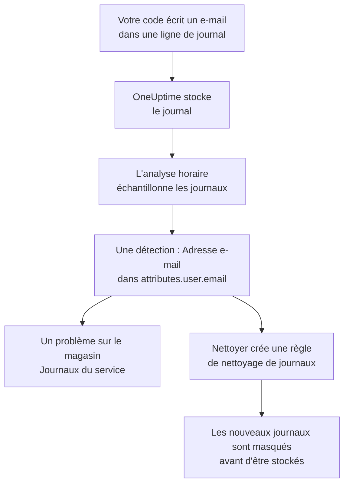

# Données sensibles dans la télémétrie

La télémétrie contient tout ce qu'écrit votre code : une adresse e-mail dans une ligne de journal, un numéro de carte dans un attribut de span, un jeton dans une trace de pile, la question d'un client dans un prompt, l'adresse IP d'un utilisateur dans l'étiquette d'une métrique. Sécurité des données traite les journaux, traces, métriques, exceptions et conversations IA de chaque service, ainsi que les sessions de chaque application RUM, comme des magasins de données à part entière. Elle les échantillonne toutes les heures, y trouve les données sensibles comme dans un bucket, et **Nettoyer** transforme une détection en une règle qui masque ces données à l'ingestion à partir de là.

Il n'y a rien à configurer : la télémétrie de chaque service est analysée toutes les heures, sauf si **Analyser la télémétrie** est désactivé dans les paramètres du projet. Pour laisser de côté les journaux, les traces ou un autre signal d'un service, désactivez **Analyser le contenu** dans les **Paramètres** de ce magasin de données : dès l'analyse suivante, rien n'en est lu.

:::cards
- [Ce qui est lu](#ce-qui-est-lu): Les attributs, les corps, les messages et les prompts de chaque signal.
- [Comment une analyse échantillonne](#comment-une-analyse-échantillonne): Les enregistrements les plus récents de chaque service, toutes les heures.
- [Nettoyer](#nettoyer): Masquer une détection à l'ingestion, en un clic.
- [Abandonner cette métrique](#abandonner-cette-métrique): Ne plus stocker les métriques dont le nom contient des données sensibles.
- [Ce qui compte comme nettoyé](#ce-qui-compte-comme-nettoyé): Quand une règle de nettoyage couvre déjà une détection.
:::

## Fonctionnement

Une détection couverte par une règle de nettoyage est marquée comme nettoyée : ce qui reste de ces données, ce sont d'anciennes données qui attendent la fin de leur conservation, pas une fuite qui continue. Les deux contrôles de télémétrie ne comptent que ce qu'aucune règle ne couvre, donc leur problème se résout dès que chaque détection est nettoyée (voir [Contrôles de télémétrie](/docs/data-security/checks-and-issues#télémétrie)).

## Ce qui est lu

| Magasin de données | Ce qui est lu | Où pointe une détection |
| --- | --- | --- |
| Journaux | Chaque attribut, et le corps | `attributes.<key>`, `body` |
| Traces | Chaque attribut de span, et les attributs de chaque événement de span | `attributes.<key>`, `events.<event>.<key>` |
| Exceptions | Le message, la trace de pile et les attributs | `message`, `stackTrace`, `attributes.<key>` |
| Conversations IA | Les prompts et les réponses de chaque appel d'IA, sous les clés où les conventions GenAI les placent, et chaque autre attribut | La clé où ils se trouvent, comme `gen_ai.input.messages` ou `gen_ai.prompt[].content` |
| Relectures de session | Les attributs des spans et des journaux d'une application RUM, les attributs de ses sessions, les traits que `identify()` a donnés à ses utilisateurs et la référence utilisateur qui lui a été indiquée | `spans.attributes.<key>`, `logs.attributes.<key>`, `sessions.attributes.<key>`, `sessions.identifiedUserTraits.<key>`, `sessions.identifiedUserLabel` |
| Métriques | Chaque attribut d'un point de données, y compris ceux de sa ressource, et les noms des métriques | `attributes.<key>`, `attributes.resource.<key>`, `name` |

Les clés numérotées sont regroupées en un seul emplacement : `gen_ai.prompt.3.content` devient `gen_ai.prompt[].content`, si bien que les vingt messages d'une conversation font une seule détection, pas vingt. Les attributs que OneUptime ajoute lui-même, qui commencent par `oneuptime.`, ne sont pas lus.

### Métriques

Les attributs d'une métrique sont les étiquettes de ses séries. Ils sont les mêmes sur chaque point de données d'une série : une métrique qui écrit mille points par minute peut donc ne contenir que trois valeurs, et une étiquette qui expose l'e-mail d'un utilisateur ajoute une série, pas un point. Une métrique est donc échantillonnée par ses séries, pas par ses points :

- **Un point de chaque série.** Chaque métrique est lue à la minute la plus récente où elle a écrit au cours de la dernière heure : un point de données de chacune des 100 séries au plus de cette minute, quelle que soit la fréquence d'envoi de la métrique, si bien qu'une série active n'évince jamais une série calme. Une valeur est classée une seule fois, quel que soit le nombre de séries qui la répètent, donc une détection compte les valeurs distinctes à son emplacement.
- **Les nouvelles métriques d'abord, puis les autres à tour de rôle.** La liste des métriques qu'un service a écrites, et le moment où chacune a écrit pour la première fois au cours du dernier jour, vient de l'agrégation par minute que conserve la table des métriques, jamais de ses points. Chaque analyse lit les métriques les plus actives d'un service, les plus susceptibles d'avoir de nombreuses séries. Viennent ensuite les métriques qu'il a commencé à écrire au cours des 2 dernières heures, car une nouvelle fuite vient le plus souvent d'un nouveau code, puis les suivantes de ses autres métriques, dans un ordre fixe, à partir de l'endroit où la dernière analyse s'est arrêtée. Les nouvelles métriques prennent au plus la moitié de ces tours, si bien que les autres gardent toujours les leurs.
- **Chaque métrique dans un délai fixe.** Une analyse donne à chaque service 10 de ses lectures, moins lorsque le projet compte plus de 10 services. Les lectures qu'un service laisse inutilisées, parce qu'il a moins de métriques, vont une à une aux services dont des métriques attendent encore leur tour, si bien qu'aucune n'est perdue et qu'aucun service n'a moins que sa part. Les 5 métriques les plus actives d'un service occupent 5 de ses lectures, et le reste lit ses autres métriques à tour de rôle : pour un service de M métriques qui reçoit r lectures à tour de rôle, chacune est lue au moins une fois toutes les M ÷ r heures, arrondi au supérieur. Cela fait 60 heures pour un service de 300 métriques qui ne reçoit que ses 5 propres, et 11 heures quand deux autres services de 300 métriques partagent son projet, car chacun reçoit alors 28 ou 29. Tant qu'il commence de nouvelles métriques chaque heure, ce délai est au plus doublé.
- **La plage propre à chaque métrique.** Les métriques sont lues ensemble, chacune par sa propre plage de la clé primaire de la table. Une métrique dont la minute la plus récente contient plus de 16 384 points, comme une métrique étiquetée avec l'e-mail de chaque utilisateur, est lue seule, et la lecture s'arrête à ses premiers points : elle ne coûte donc pas plus que n'importe quelle autre métrique.

Une détection nomme l'attribut, comme `attributes.user.email`, ou `name` pour des données dans le nom d'une métrique. Ses enregistrements sont les points de données où elle a été trouvée : chacun montre sa métrique et la valeur de l'attribut, masquée, et s'ouvre dans **Métriques** sur cette métrique, regroupée par cet attribut. Quand le nom d'une métrique contient des données sensibles, le nom est masqué lui aussi, et l'enregistrement ouvre plutôt les métriques du service.

### Pourquoi l'enregistrement d'une relecture n'est jamais lu

L'enregistrement d'une relecture de session contient le texte des pages que les gens ont vues. Le regarder demande une autorisation à part, et une détection tirée de lui montrerait du texte de page masqué à tous ceux qui peuvent lire Sécurité des données. Une relecture n'est donc lue que par ses attributs : les spans, les journaux et les détails de session à côté de l'enregistrement. L'enregistreur masque déjà ce qu'il enregistre dans le navigateur, et les règles de nettoyage de journaux s'appliquent aussi aux enregistrements (voir [Relecture de session](/docs/telemetry/session-replay)).

### Conversations IA

Le prompt d'un appel d'IA porte toute la conversation qui précède le dernier message de la personne, c'est pourquoi jusqu'à 16 384 caractères de chaque valeur d'un appel d'IA sont lus. Quand des conversations IA contiennent des données sensibles, deux choses de plus en découlent : le fournisseur d'IA auquel les appels sont allés devient un flux de ces données, et [Des données sensibles sont envoyées à un fournisseur d'IA](/docs/data-security/checks-and-issues#ia) échoue sur le magasin de données.

Les conversations d'un [outil d'IA de l'entreprise](/docs/telemetry/ai-company-tools) sont exclues. Seuls les Propriétaires du projet et les Administrateurs du projet peuvent les lire, et une détection arrive là où la lit quiconque lit Sécurité des données : les spans de ces services ne sont donc jamais lus, et leurs conversations IA sont signalées comme non lues.

## Comment une analyse échantillonne

Toutes les heures, les enregistrements les plus récents de la dernière heure de chaque signal sont lus, puis classifiés champ par champ comme ceux de n'importe quel autre magasin de données (voir [Champs et colonnes](/docs/data-security/data-types#champs-et-colonnes)) :

| Limite | Valeur |
| --- | --- |
| Enregistrements de chaque service et de chaque signal | **Taille de l'échantillon de télémétrie**, 500 par défaut, jamais plus de 1 000 |
| Services ou applications RUM lus par signal | Les 200 plus actifs |
| Enregistrements en une lecture | 5 000, partagés entre les services ; 500 pour les appels d'IA |
| Caractères d'un corps de journal, d'un message d'exception ou d'une trace de pile | 8 192 |
| Caractères d'une valeur d'attribut | 4 096 |
| Caractères d'une valeur d'un appel d'IA | 16 384 |
| Attributs d'un enregistrement | 128 ; 64 pour un appel d'IA |
| Événements d'un span, et attributs d'un événement | 16 et 32 |
| Emplacements d'un magasin de données | 500 |
| Métriques lues en une analyse | 100, partagées entre les services, au moins une de chacun ; 10 de chaque service, la moitié parmi ses plus actives et la moitié parmi ses nouvelles et ses autres, à tour de rôle, et les lectures qu'un service laisse inutilisées vont aux autres, à tour de rôle |
| Une nouvelle métrique | Une métrique dont le premier point des dernières 24 heures est arrivé au cours des 2 dernières heures |
| Séries d'une métrique | Un point de données de chacune, de sa minute la plus récente, au plus 100 |

Chaque valeur est tronquée dans la base de données, si bien qu'aucune valeur longue n'en sort, et chaque lecture s'arrête au bout de 30 secondes. Une lecture qui échoue devient un avertissement sur les magasins de données qu'elle concernait ; l'analyse continue avec la suivante.

Pour exclure quelque chose, ajoutez-le aux **Exclusions d'analyse** du magasin de données : un emplacement nommé en entier (`attributes.http.url`), tout ce qui se trouve sous un emplacement (`attributes.http`), ou une clé d'attribut nommée seule (`http.url`).

## Nettoyer

**Nettoyer**, sur une détection, crée la règle qui masque ce type de données à cet emplacement à partir de là, ou indique la règle activée qui le fait déjà :

:::steps
### Ouvrir la détection

Ouvrez le problème - **Où cela a été trouvé** liste chaque détection qui le cause - ou **Sécurité des données > Dans votre télémétrie**, où **Afficher les enregistrements** ouvre, à côté de la liste, les enregistrements où une détection a été trouvée.

### Cliquer sur Nettoyer

Cliquez sur **Nettoyer**. OneUptime crée une règle de nettoyage de journaux pour les journaux et les journaux d'une application RUM, une règle de nettoyage de traces pour les spans, les exceptions et les appels d'IA, sur la partie de l'enregistrement où se trouve la détection, et une règle de pipeline de métriques pour l'attribut d'une métrique.

### Corriger aussi le code

La règle masque les nouvelles données avant qu'elles ne soient stockées. Les données déjà stockées restent jusqu'à la fin de leur conservation, alors corrigez le code qui les écrit : la détection nomme le service et l'attribut.
:::

La règle est nommée d'après ce qu'elle masque, par exemple « Data Security: Email address in attributes.user.email », et apparaît avec vos autres règles de nettoyage (voir [Filtres de suppression et règles de nettoyage](/docs/telemetry/drop-filters-and-scrub-rules#masquer-les-données-sensibles)). C'est l'une de celles-ci :

| Détection | Règle que crée Nettoyer |
| --- | --- |
| Adresse e-mail, numéro de carte, numéro de sécurité sociale américain, numéro de téléphone ou adresse IP | Le motif intégré de ce type. Les numéros de carte, les numéros de sécurité sociale et les numéros de téléphone sont masqués, le reste est caviardé. |
| Une valeur sous une clé qui semble sensible, comme `password` ou `token` | Une règle **Clés d'attributs sensibles**, qui caviarde la valeur entière de chacun de ces attributs |
| Tout autre type de données qu'un motif peut trouver | Une règle **Regex personnalisée** construite à partir des motifs propres au type de données, qui caviarde chaque valeur de cette forme |
| Tout type de données dans l'attribut d'une métrique | Une règle de pipeline de métriques **Masquer l'attribut** pour le service, qui remplace par `[REDACTED]` les valeurs de l'attribut ayant la forme du type de données, ou chaque valeur de l'attribut quand aucun motif ne trouve ce type de données |

Certaines détections ne peuvent pas être nettoyées par une règle, et **Nettoyer** dit pourquoi. L'attribut d'une métrique peut toujours l'être, puisque sa règle peut masquer chaque valeur de l'attribut :

- Un type de données trouvé d'après les seuls noms de champs, comme le nom d'une personne : aucun motif ne peut le trouver. Renommez l'attribut avec une clé que masque une règle de clés sensibles, ou cessez de l'envoyer.
- Un type de données qui ne se distingue des autres valeurs que par les mots qui l'entourent, comme un numéro de routage bancaire : une règle masquerait bien plus que ce type de données.
- Un marquage de document : masquer le mot ne masquerait pas le document.
- L'un de vos propres types de données : ajoutez vous-même une règle de nettoyage personnalisée avec son motif.
- Les détails propres d'une session (`sessions.*`) : l'ingestion des relectures de session n'applique aucune règle de nettoyage.
- Le nom d'une métrique (`name`) : c'est le code qui crée la métrique qui le définit, et une règle de pipeline ne peut que renommer une métrique en entier. Renommez la métrique, et envoyez plutôt ce qui varie dans son nom sous forme d'attribut. D'ici là, **Abandonner cette métrique** peut cesser de stocker ces métriques.

**Nettoyer** crée la règle en votre nom, avec vos propres autorisations : les Propriétaires du projet et les Administrateurs du projet peuvent l'utiliser, tout comme une équipe autorisée à créer des règles de nettoyage de journaux, des règles de nettoyage de traces pour les spans, les exceptions et les appels d'IA, et des règles de pipeline de métriques pour les métriques.

## Abandonner cette métrique

Aucune règle ne retire les données du nom d'une métrique : tant que le code qui nomme la métrique n'est pas corrigé, les données continuent d'arriver. **Abandonner cette métrique** sur une détection dans le nom d'une métrique cesse de stocker les métriques dont le nom les contient, au prix de leurs données, et ne se fait donc que si vous le demandez :

- **Les métriques d'un seul service.** L'action crée une règle de pipeline de métriques **Supprimer** pour le service de la détection : chaque nouveau point de données d'une métrique dont le nom contient ce type de données est abandonné avant d'être stocké. Son filtre est le motif que **Nettoyer** utilise pour ce type, donc un type qu'aucun motif ne peut trouver, comme le nom d'une personne, ne peut pas être abandonné, et la boîte de dialogue dit pourquoi.
- **Dit avant d'être fait.** La boîte de dialogue indique que ces points de données sont perdus définitivement, combien des métriques du service écrites au cours du dernier jour portent un tel nom, ce qui les lit et ne reçoit donc plus de nouvelles données, que ce qui est déjà stocké reste jusqu'à la fin de sa rétention, et comment revenir en arrière. Rien n'est abandonné tant que vous n'avez pas coché que vous comprenez.
- **Ce qui les lit, et ce qui lui arrive.** La boîte de dialogue nomme, chacun sous forme de lien, chaque moniteur, chaque tableau de bord avec ses widgets qui lisent ces métriques, chaque SLO de métrique du service et chaque règle d'enregistrement de métriques qui les lit. Les moniteurs ne peuvent plus alerter sur leurs valeurs, les widgets n'affichent plus de nouvelles données, les SLO ne comptent plus de nouveaux événements de ces métriques, et les métriques de sortie des règles d'enregistrement ne les incluent plus. Ce que vous ne pouvez pas voir est compté, jamais nommé.
- **En votre nom, et tracé.** La règle est créée avec votre propre autorisation de créer des règles de pipeline de métriques : les Propriétaires du projet et les Administrateurs du projet peuvent la créer, tout comme une équipe autorisée à créer des règles de pipeline de métriques. Les journaux d'audit enregistrent qui l'a créée.
- **Annulé en supprimant la règle.** La règle est nommée d'après ce qu'elle abandonne, par exemple « Data Security: drop metrics named with Email address », et apparaît avec vos autres règles de pipeline de métriques sous **Métriques → Paramètres → Règles de pipeline**. Supprimez-la ou désactivez-la, et ces métriques sont de nouveau stockées à partir de ce moment. Ce qui a été abandonné entre-temps ne revient pas.

La détection est alors marquée **Abandonné**, et compte comme nettoyée : plus aucune de ces données n'est stockée.

## Ce qui compte comme nettoyé

Une détection n'est marquée comme nettoyée que lorsque l'ingestion lui appliquerait une règle activée et que la règle trouverait son type de données :

- **Les bons enregistrements.** Les règles de journaux couvrent les journaux et les journaux d'une application RUM. Les règles de traces couvrent les spans, les exceptions et les appels d'IA : une exception est une copie de l'événement d'exception de son span, donc les règles qui nettoient les événements la nettoient.
- **La bonne partie.** Les **Champs à nettoyer** de la règle incluent la partie de l'enregistrement où se trouve la détection, ou la règle les laisse à leur valeur par défaut.
- **Un motif qui trouve le type.** Un **Type de modèle** intégré trouve son propre type de données : **Adresse e-mail** trouve les adresses e-mail, **Numéro de carte de crédit** les numéros de carte, **SSN (numéro de sécurité sociale)** les numéros de sécurité sociale américains, **Numéro de téléphone** les numéros de téléphone et **Adresse IP** les adresses IP. **Clés d'attributs sensibles** couvre chaque valeur sous une clé qui semble sensible, quelle que soit la valeur.
- **Vos propres motifs personnalisés ne comptent jamais.** Une **Regex personnalisée** ne couvre une détection que si elle est exactement le motif que **Nettoyer** crée pour son type. Une détection ne conserve que des échantillons masqués, sur lesquels aucun motif ne peut être essayé : OneUptime ne pourrait donc pas prouver que votre motif masque les données, et une détection marquée à tort comme nettoyée est une fuite que personne ne regarde.
- **L'attribut d'une métrique.** Une règle de pipeline de métriques **Masquer l'attribut** ou **Supprimer l'attribut** portant sur la clé de cet attribut, pour le service de la détection ou pour tout le projet, la couvre quand elle n'a aucun filtre, ou exactement le filtre que crée **Nettoyer**. Un filtre que vous avez écrit ne compte jamais, pour la même raison.
- **Le nom d'une métrique.** Une règle de pipeline de métriques **Supprimer** pour le service de la détection ou pour tout le projet la couvre quand elle a exactement le filtre que crée **Abandonner cette métrique**, ou aucun filtre, auquel cas elle ne stocke aucune des métriques du service. Une telle règle sans filtre couvre toutes les détections dans ces métriques.

Une règle désactivée, ou qui ne nettoie rien, ne compte jamais. La couverture est recalculée après chaque analyse, donc une règle que vous ajoutez ou supprimez à la main change ce qui est marqué comme nettoyé dans l'heure.

## Prochaines étapes

:::cards
- [Filtres de suppression et règles de nettoyage](/docs/telemetry/drop-filters-and-scrub-rules): Chaque option des règles de nettoyage, et les règles que vous écrivez vous-même.
- [Contrôles et problèmes de Sécurité des données](/docs/data-security/checks-and-issues): Les deux contrôles de télémétrie et les contrôles IA.
- [Flux de données, accès et résidence](/docs/data-security/flows-access-residency): Les fournisseurs d'IA et les hôtes auxquels vos services envoient des données.
:::
