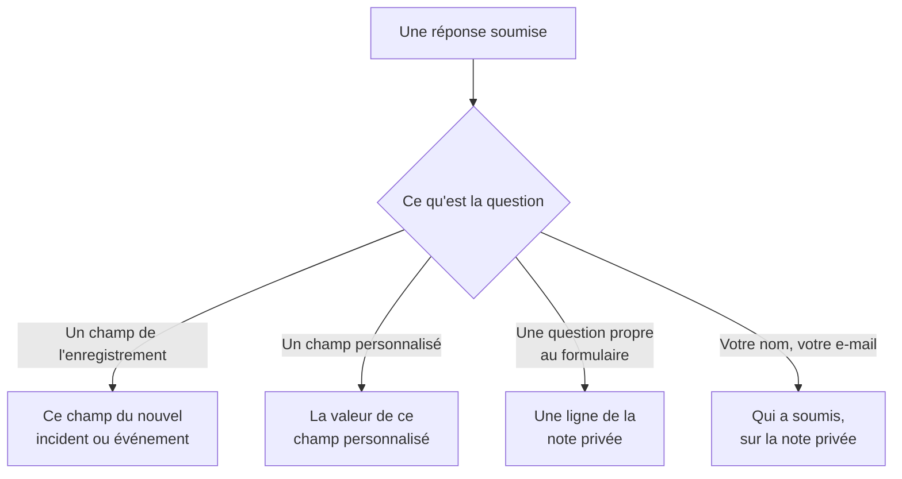

# Créer un formulaire

La page **Construire** d'un formulaire est l'endroit où vous décidez ce qu'il demande et à quoi ressemble sa page. Les questions sont à gauche, dans l'ordre où la page publique les affiche ; **Ajouter une question**, à droite, liste tout ce que vous pouvez ajouter. Au-dessus des questions, replié, se trouve l'[image de marque](#image-de-marque) du formulaire : son logo et son favicon. Les ensembles de réponses nommés à partir desquels on peut commencer le formulaire — chacun pouvant aussi rendre une question obligatoire, facultative ou masquée pour son propre cas — sont sur sa page **Modèles** : voir [Modèles](#modèles).

:::cards
- [L'éditeur](#léditeur): Ajouter, modifier, déplacer et enregistrer des questions.
- [Ce que vous pouvez ajouter](#ce-que-vous-pouvez-ajouter): Vos propres questions, les champs de l'enregistrement, les champs personnalisés et la personne qui soumet.
- [Questions masquées](#questions-masquées): Remplies par un modèle, jamais par la personne qui soumet.
- [Modèles](#modèles): Un formulaire, et un lien, pour chaque cas que votre équipe signale souvent.
:::

## Où va chaque réponse

Chaque réponse est aussi conservée avec la soumission, sur la page **Soumissions** du formulaire. Un champ que le formulaire ne demande pas, ou laissé vide, est rempli à partir des [paramètres À la soumission](/docs/forms/on-submit) du formulaire.

## L'éditeur

:::steps
### Ajouter une question

Choisissez quoi ajouter dans **Ajouter une question**. La nouvelle question est insérée après celle qui est sélectionnée, ou à la fin, et sélectionnée.

### La modifier sur place

Sélectionnez une carte pour la modifier : sa question, son texte d'aide, son type de réponse et ses options, si elle est obligatoire ou masquée, et les boutons pour la dupliquer ou la supprimer. **Terminé** la referme.

### La mettre à sa place

Faites glisser une carte par sa poignée pour la déplacer, ou utilisez **Monter** et **Descendre** sur la carte sélectionnée — sur un téléphone, ou au clavier.

### Enregistrer le formulaire

**Enregistrer les modifications** enregistre toutes les modifications d'un coup. Tant que vous n'avez pas enregistré, l'éditeur indique **Modifications non enregistrées** et propose **Annuler les modifications**, et le navigateur demande confirmation avant que vous quittiez la page.
:::

- **L'en-tête du formulaire** montre son nom et sa description comme la page publique le fera. **Modifier le nom et la description** les modifie.
- **Les questions** sont des cartes. Chacune montre la question telle que les gens la verront, avec un badge qui dit à quoi elle est liée — **Incident · Gravité**, **Champ personnalisé · Region**, **Auteur de la soumission · E-mail**, ou son type de réponse pour une question propre au formulaire. Un astérisque rouge marque une question obligatoire, et un badge **Masqué** une question [masquée](#questions-masquées).
- **Limites.** Un formulaire peut avoir jusqu'à 50 questions. Les personnes qui peuvent lire un formulaire sans pouvoir le modifier voient l'éditeur en lecture seule.

## Image de marque

**Image de marque**, replié au-dessus des questions, est l'apparence de la page du formulaire : votre logo en haut de la page, au-dessus du nom du formulaire, et votre favicon dans l'onglet du navigateur tant que le formulaire est ouvert. Tant que vous n'avez pas téléversé les vôtres, le formulaire affiche le logo et le favicon de OneUptime.

Replié, la section liste **Logo** et **Favicon** — affichés comme définis dès que le formulaire a les siens — et dit lesquels de OneUptime s'appliquent encore. Dépliez-la pour voir les deux tels que la page les montre : le logo tel qu'il se place en haut de la page, et le favicon dans un onglet de navigateur à côté du nom du formulaire, qui est le titre de l'onglet.

**Modifier l'image de marque** les modifie dans une seule boîte de dialogue :

| Champ | Ce que c'est |
| --- | --- |
| **Logo** | Affiché en haut de la page du formulaire, au-dessus de son nom, à la place du logo de OneUptime. Une image PNG, JPEG, GIF, WebP ou SVG de 512 Ko au plus. Retirez-le pour revenir au logo de OneUptime. |
| **Texte alternatif du logo** | Ce que dit le logo, lu par les lecteurs d'écran : généralement le nom de votre organisation. Demandé dès qu'il y a un logo. Laissez-le vide et les lecteurs d'écran ignorent le logo — le nom du formulaire le suit de toute façon. Retirer le logo le vide aussi. |
| **Favicon** | L'icône dans l'onglet du navigateur tant que le formulaire est ouvert, à la place du favicon de OneUptime. Une image PNG, JPEG, GIF, WebP, SVG ou ICO de 128 Ko au plus ; un PNG, SVG ou ICO carré fonctionne le mieux. Retirez-le pour revenir au favicon de OneUptime. |

Le logo garde la hauteur du logo de OneUptime qu'il remplace, et un logo large est ajusté à la largeur de la page. Chaque image est vérifiée à l'enregistrement — depuis le tableau de bord, l'API, Terraform ou un flux de travail : elle doit avoir été téléversée dans le projet du formulaire, être de l'un des types ci-dessus et ne pas dépasser sa limite. Un logo qui n'est pas l'une de ces images est refusé avec "The logo must be a PNG, JPEG, GIF, WebP or SVG image.", un logo trop grand avec "The logo must be 512 KB or smaller.", et un logo dont le téléversement a disparu — ou qui a été téléversé dans un autre projet — avec "The logo's file could not be found. Upload the logo again." Un favicon est refusé de la même façon, avec "The favicon must be a PNG, JPEG, GIF, WebP, SVG or ICO image.", "The favicon must be 128 KB or smaller." et "The favicon's file could not be found. Upload the favicon again."

**Aperçu** montre le logo comme la page le fait. Les personnes qui peuvent lire un formulaire sans pouvoir le modifier voient son image de marque sans **Modifier l'image de marque**. Le logo et le favicon n'atteignent la page du formulaire qu'à l'intérieur du formulaire lui-même — voir [Partage et sécurité](/docs/forms/sharing-and-security#ce-qui-protège-un-formulaire).

## Ce que vous pouvez ajouter

**Ajouter une question** liste quatre groupes : **Questions** propres au formulaire, **Champs de l'incident** ou **Champs de la maintenance planifiée** de ce que le formulaire crée, **Champs personnalisés** et **Auteur de la soumission**.

### Questions propres au formulaire

| Type de réponse | Ce que donne la personne qui soumet |
| --- | --- |
| **Réponse courte** | Une ligne de texte. |
| **Paragraphe** | Plusieurs lignes de texte. |
| **Texte enrichi** | Du texte avec mise en forme et liens. |
| **Nombre** | Un nombre. |
| **Liste déroulante** | Un choix dans une liste. |
| **Choix multiple** | Un nombre quelconque de choix dans une liste. |
| **Case à cocher** | Une case à cocher, comme une confirmation. |
| **Date** | Un jour. |
| **Date et heure** | Un jour et une heure. |

Une liste déroulante ou une sélection multiple liste les **Options** que vous lui donnez, chacune avec une couleur facultative (le bouton à côté d'une option ouvre un ensemble de couleurs nommées, avec **Couleur personnalisée** pour un code exact), de une à 100. Passer une question de **Liste déroulante** à **Choix multiple** conserve ses options ; une question qui devient l'un de ces types commence avec deux options que vous pouvez renommer, et une qui cesse de l'être les abandonne. **Dupliquer** copie une question propre au formulaire juste en dessous.

Les réponses à ces questions sont conservées avec la soumission et listées sur la note privée de ce que le formulaire crée — elles ne remplissent aucun champ. Pour remplir un champ, ajoutez le champ lui-même, depuis les deux groupes suivants.

### Champs de ce que le formulaire crée

Les champs d'un incident, ou d'un événement de maintenance planifiée, auxquels une personne qui soumet peut répondre. La réponse devient la valeur du champ.

| Champ d'incident | Répondu avec |
| --- | --- |
| **Titre** | Une ligne, jusqu'à 500 caractères. |
| **Description** | Du texte enrichi, jusqu'à 20 000 caractères. |
| **Gravité** | L'une de vos gravités d'incident. |
| **Moniteurs** | N'importe lesquels des moniteurs que vous proposez — les moniteurs affectés de l'incident. |
| **Étiquettes** | N'importe lesquelles des étiquettes que vous proposez. |
| **Début de l'impact** | Une date et une heure : quand le problème a commencé, selon le souvenir de la personne qui soumet. |

| Champ de maintenance planifiée | Répondu avec |
| --- | --- |
| **Titre** | Une ligne, jusqu'à 100 caractères. |
| **Description** | Du texte enrichi, jusqu'à 20 000 caractères. |
| **Commence le** | Une date et une heure. Toujours demandé et toujours obligatoire. |
| **Se termine le** | Une date et une heure après **Commence le**. Toujours demandé et obligatoire. |
| **Moniteurs** | N'importe lesquels des moniteurs que vous proposez. |
| **Pages de statut** | N'importe lesquelles des pages de statut que vous proposez. |
| **Étiquettes** | N'importe lesquelles des étiquettes que vous proposez. |

Chaque champ ne peut être demandé qu'une fois ; la liste marque ceux qui sont déjà dans le formulaire avec **Ajouté**. Un champ que le formulaire ne demande pas — ou laissé vide — est rempli à partir des [paramètres À la soumission](/docs/forms/on-submit) du formulaire.

**Choix proposés.** Une page publique ne doit pas lister tout votre projet à des inconnus, donc un champ auquel on répond en choisissant des enregistrements ne propose que ceux que vous choisissez. **Moniteurs**, **Étiquettes** et **Pages de statut** listent exactement les choix que vous proposez, et ne sont pas demandés tant que vous n'en proposez pas au moins un. **Gravité** propose toutes les gravités d'incident sauf si vous la restreignez, puisque les gravités ne sont pas secrètes. Les réponses hors des choix proposés sont refusées.

### Champs personnalisés

Vos champs personnalisés d'incident — ou de maintenance planifiée, pour un formulaire de maintenance — chacun une question dont la réponse devient la valeur du champ. La question prend son type et ses options du champ personnalisé, et commence avec son nom comme question et sa description comme texte d'aide, que vous pouvez changer.

Un formulaire ne demande que les champs personnalisés que vous lui ajoutez, quoi que dise **Afficher à la création** : chaque champ qu'un formulaire demande montre son nom, sa description et ses options à toute personne ayant le lien. Quand un champ personnalisé est supprimé, sa question reste dans le formulaire mais n'est plus demandée, et sa carte le dit — supprimez la question. Un champ recréé avec le même nom est un nouveau champ : ajoutez-le à nouveau.

Un champ personnalisé qui copie sa valeur d'un champ personnalisé de moniteur l'indique sur sa carte : quand l'incident ou l'événement a des moniteurs qui s'accordent sur une valeur pour lui, cette valeur remplace la réponse de la personne qui soumet.

### Personne qui soumet

**Votre nom** et **Votre e-mail** demandent qui soumet. Ils sont conservés avec la soumission et nommés sur la note privée, pour que votre équipe puisse faire un suivi, et ne sont jamais affichés sur l'incident ou l'événement lui-même. OneUptime n'écrit jamais d'e-mail à la personne qui soumet. Omettez-les, ou rendez-les facultatifs, pour accepter des soumissions anonymes.

L'e-mail doit être une seule adresse ordinaire, comme `ada@example.com` — pas un nom avec l'adresse entre chevrons, ni une liste d'adresses. Le nom et l'e-mail font chacun jusqu'à 100 caractères.

## Les questions d'un nouveau formulaire

Un nouveau formulaire commence avec les questions qu'il devrait presque toujours poser, pour qu'il fonctionne dès sa création : le **Titre**, obligatoire ; la **Description** ; pour un formulaire de maintenance, **Commence le** et **Se termine le** ; et **Votre nom** et **Votre e-mail**, obligatoires. Leur libellé est dans la langue de votre tableau de bord. Modifiez-les, masquez-les ou retirez-les à votre guise — sauf le début et la fin d'un événement de maintenance, sans lesquels aucun événement ne peut être planifié. Quand vos propres questions disent tout, masquez la **Description** plutôt que de laisser une zone où personne ne devrait écrire : voir [Questions masquées](#questions-masquées).

## Questions obligatoires

**Obligatoire** signifie que le formulaire ne peut pas être soumis sans réponse. Une réponse composée uniquement d'espaces, de tabulations ou de sauts de ligne compte comme une absence de réponse, et une **Case à cocher** obligatoire doit être cochée. Le serveur vérifie à nouveau chaque question obligatoire à la soumission, donc une requête faite sans la page y est aussi soumise.

Une question non obligatoire peut rester vide : son champ est alors rempli à partir des paramètres À la soumission, comme si le formulaire ne l'avait pas demandée.

## Questions masquées

Activez **Masqué** sur une carte et la question n'est plus affichée dans le formulaire. Personne ne se la voit poser, donc elle n'est jamais obligatoire, et une soumission ne peut pas y répondre — la requête n'est même pas lue pour elle. Seul le [modèle](#modèles) dont part une soumission y répond, et elle reste sans réponse quand la personne qui soumet ne part d'aucun modèle, ou d'un modèle qui la laisse vide. Un modèle peut aussi poser une question masquée malgré tout, pour son propre cas : voir [Comment un modèle pose chaque question](#comment-un-modèle-pose-chaque-question).

Masquez une question quand sa réponse revient à votre équipe, pas à la personne qui soumet :

- **La description de l'incident**, quand les questions que vous avez ajoutées disent tout. Masquée, elle n'invite plus personne à écrire là ; donnez à chaque modèle le texte standard que vous envoyez pour son cas, ou laissez les incidents commencer sans.
- **Un champ personnalisé que vos flux de travail ou vos règles lisent**, comme un type de notification, défini par chaque modèle.
- **Une question propre au formulaire** dont seule votre équipe a besoin de la réponse sur la note privée.

Une question masquée garde sa place, son libellé et ses paramètres, pour que vous puissiez l'afficher à nouveau à tout moment. Un champ sans lequel la cible du formulaire ne peut pas être créée — **Commence le** et **Se termine le** d'un événement de maintenance — ne peut pas être masqué. La réponse à une question masquée est vérifiée et stockée exactement comme une réponse saisie le serait, et conservée avec la soumission.

## Modèles

La page **Modèles** d'un formulaire contient des ensembles de réponses nommés à partir desquels on peut commencer le formulaire — un pour chaque cas que votre équipe signale souvent, comme **Panne de l'application**, **Maintenance prévue** ou **Service restauré** — si bien qu'un formulaire, et un lien, les sert tous.

:::steps
### Ajouter un modèle

Cliquez sur **Ajouter un modèle**. L'éditeur a deux parties. **Questions** liste chaque question du formulaire avec la façon dont ce modèle la pose — voir [Comment un modèle pose chaque question](#comment-un-modèle-pose-chaque-question). **Réponses** les liste à nouveau, questions masquées comprises et aucune obligatoire : remplissez ce à quoi le modèle doit répondre, et laissez le reste à la personne qui soumet. Une réponse à une question que le modèle ne pose pas le signale en dessous — elle est utilisée telle quelle.

### Choisir le modèle par défaut

**Par défaut** en fait le modèle avec lequel le formulaire s'ouvre. Un seul modèle peut être le modèle par défaut, et un formulaire dont le seul modèle est son modèle par défaut est simplement un formulaire pré-rempli.

### Partager son lien

**Copier le lien** copie le lien propre au modèle, qui ouvre le formulaire rempli avec lui. Voir [Partage et sécurité](/docs/forms/sharing-and-security#un-lien-pour-chaque-modèle).
:::

Chaque modèle liste ce qu'il remplit et les questions qu'il pose à sa façon, comme **Date de la maintenance planifiée · Masqué**, et a **Modifier**, **Dupliquer** — une copie juste après lui, nommée comme **Panne de l'application 2** —, **Monter** et **Descendre**, pour l'ordre dans lequel le formulaire les liste, et **Supprimer**.

Sur la page publique, un formulaire avec des modèles les liste au-dessus de ses questions, sous **Partir d'un modèle**. En choisir un remplit le formulaire et pose les questions comme ce modèle les pose ; la personne qui soumet peut encore changer n'importe quelle réponse avant de soumettre, et en choisir un autre recommence le formulaire à partir de celui-ci. La page s'ouvre avec le modèle que son lien nomme, sinon avec le modèle par défaut, sinon sans aucun. **Aperçu** liste aussi les modèles et s'ouvre sur le modèle par défaut.

> [!IMPORTANT]
> Toute personne qui ouvre le lien voit le nom de chaque modèle et ses réponses aux questions qu'il pose — c'est ainsi que la page se remplit. Les réponses d'un modèle aux questions qu'il ne pose pas ne quittent jamais le serveur ; gardez donc ce qui est interne dans une question masquée.

Chaque réponse de chaque modèle est vérifiée par rapport à sa question quand les modèles sont enregistrés — une option que la question propose, un enregistrement que le formulaire propose, un texte qui convient —, de même que chaque question qu'un modèle pose à sa façon, et l'enregistrement est refusé avec un message qui nomme le modèle et le problème, qu'il vienne du tableau de bord, de l'API ou de Terraform. Le nom d'un modèle fait jusqu'à 100 caractères et est unique dans le formulaire, et un formulaire a jusqu'à 50 modèles. Si vous changez plus tard les questions, la réponse d'un modèle à une question retirée, ou qui ne lui convient plus, n'est simplement pas utilisée, et le prochain enregistrement de ce modèle l'abandonne. L'enregistrement des autres modèles n'est jamais refusé pour autant : ce qu'un modèle contenait déjà n'est pas vérifié à nouveau.

### Comment un modèle pose chaque question

Des cas différents demandent des questions différentes : une panne a besoin de l'application touchée et pas d'une fenêtre de maintenance, une maintenance prévue a besoin de la fenêtre. Plutôt que de construire un formulaire pour chaque cas, laissez chaque modèle poser les questions du formulaire à sa façon. Dans les **Questions** d'un modèle, chaque question a l'un de ces réglages :

| Réglage | Quand quelqu'un part du modèle |
| --- | --- |
| **Valeur par défaut du formulaire** | La question est posée comme le formulaire la pose — obligatoire, facultative ou masquée, comme le dit sa carte dans l'éditeur. Le sélecteur dit laquelle, comme **Par défaut du formulaire (Masqué)**, et suit la carte quand vous la changez. |
| **Obligatoire** | La question est posée, et le formulaire ne peut pas être soumis sans réponse. |
| **Facultatif** | La question est posée, et peut rester vide. |
| **Masqué** | La question n'est pas posée. La propre réponse du modèle, s'il en a une, est la réponse, comme pour une question que le formulaire masque. |

Un seul formulaire d'incident peut ainsi servir les deux cas :

| Question | Panne de l'application | Maintenance prévue |
| --- | --- | --- |
| Nom de l'application | Obligatoire | Obligatoire |
| Installations touchées | Obligatoire | Facultatif |
| Date de la maintenance planifiée | Masqué | Obligatoire |

Chaque question commence sur **Valeur par défaut du formulaire**, de même que chaque question que vous ajoutez plus tard au formulaire, dans chaque modèle. **Commence le** et **Se termine le** d'un événement de maintenance sont toujours demandés et toujours obligatoires : aucun modèle ne peut les changer. Un modèle peut masquer toutes les autres questions et y répondre lui-même : son lien est alors un formulaire d'un seul bouton, **Soumettre** — pratique pour un cas comme **Service restauré**.

La page suit le modèle que choisit la personne qui soumet : en choisir un autre redessine le formulaire avec les questions de ce modèle, et **Aperçu** fait de même. Le serveur tient chaque soumission aux questions que pose le modèle qu'elle nomme, quoi qu'ait envoyé la requête : une question que le modèle exige doit recevoir une réponse, et une qu'il masque n'est pas lue dans la requête — la propre réponse du modèle est utilisée. Une soumission qui ne nomme aucun modèle, ou un modèle supprimé depuis, est tenue aux paramètres propres du formulaire. Une question que le formulaire masque n'est montrée à la page publique que lorsqu'un modèle la pose.

## Quand l'éditeur signale une question

Une carte où quelque chose ne va pas le dit, en ambre :

| La carte dit | Ce qui ne va pas |
| --- | --- |
| **Ce champ personnalisé a été supprimé, la question n'est donc pas posée. Supprimez la question.** | La page publique omet la question. |
| **Choisissez au moins un choix à proposer, sinon la question n'est pas posée.** | Un champ auquel on répond en choisissant des enregistrements n'en propose aucun : choisissez les moniteurs, étiquettes ou pages de statut qu'il propose. |
| **Ajoutez au moins une option.** | Une liste déroulante ou une sélection multiple n'a rien à choisir. |
| **Rédigez la question.** | La question n'a pas de texte. |

Le formulaire ne peut pas être enregistré tant qu'une question présente l'un des trois derniers : **Enregistrer les modifications** dit quelle question et ce qui ne va pas, et l'aperçu omet une telle question. L'enregistrement vérifie aussi les questions dans leur ensemble, et est refusé avec un message qui nomme le problème quand, par exemple, deux questions demandent le même champ, ou qu'un formulaire de maintenance ne demande pas quand la maintenance commence et finit — que les questions viennent de l'éditeur, de l'API, de Terraform ou d'un flux de travail.

## Aperçu

**Aperçu** ouvre le formulaire exactement comme les gens le voient à son lien — le même logo, les mêmes questions, champs, options et vérifications, sa liste de modèles, et seulement les questions que pose le modèle choisi — et vous laisse le remplir. Rien de ce que vous y saisissez n'est soumis : **Soumettre** ne fait que vérifier vos réponses, et **Le remplir à nouveau** recommence. L'aperçu montre les questions telles qu'elles sont dans l'éditeur, enregistrées ou non, et dit quand il omet une question signalée.

## Ce que voit la personne qui soumet

La page publique montre le logo du formulaire — le logo de OneUptime tant que vous n'avez pas téléversé le vôtre —, puis le nom et la description du formulaire, ses modèles s'il en a, les questions qu'il pose — comme le modèle choisi les pose, ou celles qu'il ne masque pas quand aucun modèle n'est choisi — et **Soumettre**, et l'onglet du navigateur montre le nom du formulaire et son favicon. Elle est dans la langue de la personne qui soumet quand OneUptime l'a — la langue qu'elle a choisie en dernier dans OneUptime sur ce navigateur, ou sinon celle que son navigateur demande — et en anglais sinon. Vos questions, options et textes d'aide sont affichés tels que vous les avez écrits.

Après la soumission, la page dit "Merci — votre réponse a été envoyée." et donne le numéro de ce qui a été créé — "Votre numéro de référence est INC-42." —, suivi du message de remerciement du formulaire, si vous en avez écrit un sur la page **Partager**. **Envoyer une autre réponse** ouvre un formulaire vide. La personne qui soumet ne reçoit aucun e-mail et n'a aucun moyen de revenir à l'incident ou à l'événement.

## Limites de taille

| Réponse | Limite |
| --- | --- |
| Le **Titre** d'un incident | 500 caractères, sans compter les espaces aux deux extrémités. |
| Le **Titre** d'un événement de maintenance | 100 caractères. |
| **Description** | 20 000 caractères. |
| Toute autre réponse textuelle | 10 000 caractères. |
| Une réponse de sélection multiple | 100 choix. |
| **Votre nom**, **Votre e-mail** | 100 caractères chacun. |

Une soumission qui dépasse une limite, omet une réponse obligatoire ou donne une réponse qui ne convient pas à sa question est refusée avec un message qui dit laquelle, et rien n'est créé. Les réponses aux questions que le formulaire ne pose pas sont ignorées.

## Étapes suivantes

:::cards
- [Ce que crée une soumission](/docs/forms/on-submit): Comment les réponses et les paramètres À la soumission deviennent un incident ou un événement de maintenance.
- [Partage et sécurité](/docs/forms/sharing-and-security): Partager le lien, un lien pour chaque modèle, et ce qui les protège.
- [Paramètres et automatisation des incidents](/docs/incidents/settings): Champs personnalisés et modèles d'incident.
:::
