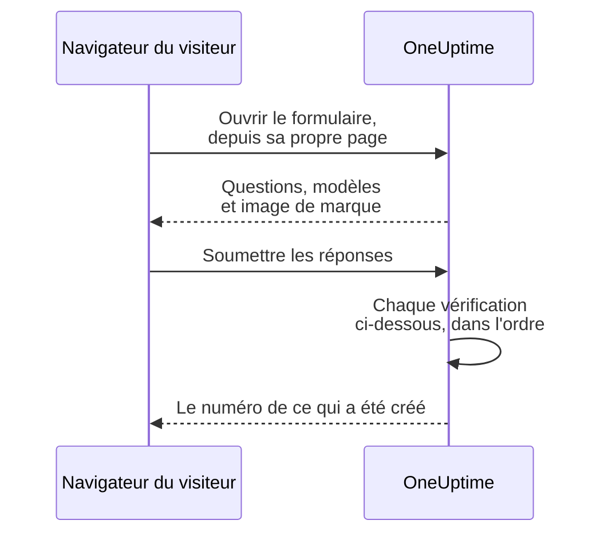

# Partage et sécurité

Un formulaire est ouvert à toute personne qui a son lien, et chaque soumission peut alerter votre équipe d'astreinte ou mettre une fenêtre de maintenance dans votre calendrier. Cette page couvre la page **Partager** du formulaire — le lien, la désactivation du formulaire, le message après la soumission et la liste d'adresses IP autorisées — et chaque autre vérification qu'une requête passe en chemin. Elle explique aussi comment servir le formulaire sur votre propre domaine.

:::cards
- [Partager le lien](#partager-le-lien): Le copier, l'ouvrir et le réinitialiser quand il circule trop.
- [Un lien pour chaque modèle](#un-lien-pour-chaque-modèle): Un favori par cas, un seul formulaire derrière.
- [Domaines personnalisés](#domaines-personnalisés): Servir le formulaire sur votre propre domaine, avec un certificat gratuit.
- [Ce qui protège un formulaire](#ce-qui-protège-un-formulaire): Chaque vérification qu'une requête passe, dans l'ordre.
- [Dépannage](#dépannage): Ce que veut dire chaque message de la page du formulaire, et quoi faire.
:::

## La page Partager

| Carte | Ce qu'elle contient |
| --- | --- |
| **Statut** | **Accepte les soumissions** — si le lien du formulaire fonctionne. |
| **Lien de partage** | Chaque adresse à laquelle le formulaire répond, chacune avec **Copier le lien**, et **Réinitialiser le lien**. |
| **Après la soumission** | Le **Message de remerciement** que les gens voient une fois qu'ils ont soumis, sous le numéro de ce que le formulaire a créé. |
| **Plus de paramètres** | La **Liste d'autorisation IP**, repliée jusqu'à ce que vous l'ouvriez. |

## Partager le lien

La carte **Lien de partage** liste chaque adresse à laquelle le formulaire répond : d'abord ses [domaines personnalisés](#domaines-personnalisés), puis son lien sur OneUptime, comme `https://oneuptime.com/accounts/form/<share-key>` :

- Chaque adresse ouvre le formulaire dans un nouvel onglet, tel que les gens le voient, et **Copier le lien** à côté la copie.
- Un domaine personnalisé qui ne fonctionne pas encore est marqué **Pas encore en ligne**, avec la raison. Sans domaine personnalisé, une ligne sous le lien propose **Ajouter un domaine personnalisé**.
- **Réinitialiser le lien** donne au formulaire un nouveau lien, après confirmation. L'ancien lien cesse aussitôt de fonctionner et affiche le message d'indisponibilité, donc toutes les personnes avec qui vous l'avez partagé ont besoin du nouveau. Utilisez-le quand un lien a circulé plus loin qu'il ne devrait. Les domaines personnalisés du formulaire ne portent aucune clé, et continuent de fonctionner.

Toute personne qui a le lien peut ouvrir le formulaire et le soumettre, sans compte OneUptime et sans se connecter. Être connecté ne change rien : OneUptime ne sait qui a soumis que par le nom et l'e-mail saisis dans le formulaire. Traitez donc le lien comme un numéro de téléphone de votre équipe d'astreinte. Partagez-le là où les personnes qui doivent l'utiliser le trouveront — une page d'intranet, un runbook de support, un message épinglé dans une discussion — et pas sur un site web public, sauf si vous voulez des soumissions de n'importe qui.

Le lien porte une clé aléatoire qui lui est propre, pas l'ID du formulaire. Sur une installation auto-hébergée, il est servi depuis votre propre hôte OneUptime, et ne fonctionne qu'à l'adresse que configurent `HTTP_PROTOCOL` et `HOST` : ouvert sous un autre nom du serveur, ou à son adresse IP, les requêtes du formulaire sont refusées comme venant d'un autre site.

Les liens vers les anciens formulaires d'incident, `/accounts/incident-form/<share-key>`, ouvrent le même formulaire à sa nouvelle adresse.

### Un lien pour chaque modèle

Chacun des [modèles](/docs/forms/building#modèles) du formulaire a son propre lien : le lien du formulaire avec `?template=` et l'ID du modèle, comme `https://oneuptime.com/accounts/form/<share-key>?template=<template-id>`. **Copier le lien** sur la page **Modèles** du formulaire le copie. Il ouvre le formulaire rempli avec ce modèle, si bien qu'une équipe peut garder en favori un lien par cas pendant que vous gardez un seul formulaire. Quand la personne qui soumet choisit un autre modèle, l'adresse dans son navigateur suit, donc le lien qu'elle copie est le formulaire tel qu'elle le voit. Sur un [domaine personnalisé](#domaines-personnalisés), le lien d'un modèle est le domaine avec le même `?template=`, comme `https://report.acme.com/?template=<template-id>`, et **Réinitialiser le lien** le laisse fonctionner.

Le lien d'un modèle est le lien du formulaire : il fonctionne tant que le formulaire est en **Accepte les soumissions**, et **Réinitialiser le lien** le retire avec les autres. Un lien qui nomme un modèle supprimé ouvre le formulaire comme s'il n'en nommait aucun — avec le modèle par défaut, s'il y en a un.

### Désactiver un formulaire

Pour ne plus accepter de soumissions sans supprimer le formulaire, désactivez **Accepte les soumissions**. Le lien affiche alors "Ce formulaire n'est pas disponible. Il a peut-être été désactivé, ou le lien n'est plus à jour.", et la carte **Lien de partage** vous rappelle que le formulaire est désactivé. Réactivez-le et le même lien fonctionne à nouveau. Les domaines personnalisés du formulaire affichent le même message tant qu'il est désactivé.

### Le message de remerciement

Après une soumission, la page dit "Merci — votre réponse a été envoyée." et donne le numéro de ce qui a été créé, puis votre **Message de remerciement**, en Markdown. Utilisez-le pour dire ce qui se passe ensuite, et où aller quand quelque chose est urgent. Sans lui, la page n'affiche que le message standard.

Une image dans la description ou le message de remerciement du formulaire est montrée à toute personne qui ouvre le lien tant que le formulaire est en **Accepte les soumissions**. Désactivez le formulaire, ou retirez l'image, et l'image redevient privée, sauf si un autre élément visible de tous la contient encore.

## Domaines personnalisés

Par défaut, un formulaire est servi à son lien, sur l'adresse de OneUptime. Pour le servir sur un domaine à vous, comme `report.acme.com`, ouvrez la page **Domaines personnalisés** du formulaire, juste après **Partager** dans son menu latéral. Elle fonctionne comme les [domaines personnalisés d'une page de statut](/docs/status-pages/branding-and-domains#domaines-personnalisés).

Placer le formulaire sur votre propre domaine se fait en trois étapes, et seules les deux premières vous reviennent :

1. **Ajouter le domaine** : un sous-domaine et l'un de vos domaines vérifiés.
2. **Ajouter son enregistrement CNAME** chez votre fournisseur DNS. La boîte de dialogue **Configuration DNS** s'ouvre avec l'enregistrement dès que vous ajoutez le domaine.
3. **Le certificat SSL gratuit est émis automatiquement** une fois l'enregistrement trouvé. Il n'y a aucun bouton à presser.

Une fois le domaine en service, la carte **Lien de partage** le liste au-dessus du lien du formulaire. Les deux ouvrent le même formulaire.

### Ajouter un domaine

Cliquez sur **Créer : Domaine de formulaire**. La boîte de dialogue tient sur une page :

- **Sous-domaine** : le libellé seul, avec le texte indicatif `report (leave blank for root)`. Saisissez juste `report`, pas le nom d'hôte complet. Laissez-le vide ou saisissez `@` pour utiliser le domaine racine.
- **Domaine** : l'un des domaines vérifiés sous **Paramètres du projet** > **Avancé** > **Domaines**, où vous prouvez qu'un domaine vous appartient avec un enregistrement TXT. Le lien **Ajouter un domaine** à côté du champ ouvre cette page dans un nouvel onglet.
- **Plus de champs** : replié. Ne l'ouvrez que pour utiliser votre propre certificat : activez **Téléverser un certificat personnalisé**, puis collez le **Certificat** et sa **Clé privée du certificat**.

Cliquez de nouveau sur **Créer : Domaine de formulaire** pour l'ajouter. La boîte de dialogue se ferme et la **Configuration DNS** du nouveau domaine s'ouvre. Le nom d'un domaine et son formulaire sont fixés dès qu'il est ajouté, donc **Modifier** ne change que son certificat : pour changer l'un ou l'autre, ajoutez le nouveau domaine et supprimez l'ancien.

Un domaine affiche une seule page de statut, un seul tableau de bord ou un seul formulaire, donc un nom que l'un d'eux a déjà, dans n'importe quel projet, est refusé : "report.acme.com is already in use: a domain can show only one status page, dashboard or form. Choose another subdomain, or remove report.acme.com where it is used first."

### Configuration DNS et Vérifier maintenant

La boîte de dialogue **Configuration DNS** montre l'enregistrement à ajouter chez votre fournisseur DNS, chaque champ avec un bouton de copie : **Type** `CNAME`, **Nom** le domaine complet que vous avez ajouté, et **Valeur** l'enregistrement CNAME de votre installation. Pour un domaine racine, beaucoup de fournisseurs DNS n'acceptent pas d'enregistrement CNAME : utilisez plutôt l'enregistrement ALIAS, ANAME ou CNAME aplati de votre fournisseur, avec la même valeur.

OneUptime vérifie chaque domaine non vérifié toutes les 15 minutes, et quand il trouve l'enregistrement, il commande le certificat Let's Encrypt gratuit du domaine lors de la même vérification. Pour vérifier tout de suite, cliquez sur **Vérifier maintenant**. Tant qu'un domaine n'est pas en service, sa ligne a une action **Configuration DNS** qui ouvre la même boîte de dialogue, où **Vérifier maintenant** commande aussi de nouveau un certificat qui a échoué ou expiré, au plus une fois par domaine toutes les 15 minutes. Le renouvellement est automatique, bien avant l'expiration du certificat.

La colonne **Statut** indique où en est chaque domaine sur son chemin vers HTTPS, avec les huit mêmes états que les domaines d'une page de statut : voir [Lire la colonne Statut du domaine](/docs/status-pages/branding-and-domains#lire-la-colonne-statut-du-domaine). Quand une commande a échoué, la raison est sur la ligne du dessous : le plus souvent un enregistrement CAA de votre domaine qui n'autorise pas `letsencrypt.org` ou, sur une installation auto-hébergée, un serveur que Let's Encrypt ne peut pas joindre sur le port 80.

Une fois qu'un certificat gratuit a été commandé pour un domaine, sa ligne affiche **Reissue SSL**, qui demande à Let's Encrypt un tout nouveau certificat avant le renouvellement automatique, une fois toutes les 24 heures par domaine. Le formulaire reste en ligne avec le certificat actuel pendant ce temps. Un certificat que vous avez téléversé est à renouveler par vous : modifiez le domaine et collez le nouveau.

### Ce que montre le domaine

Un domaine montre son formulaire à sa racine, comme `https://report.acme.com`, et rien d'autre de OneUptime : aucune page de connexion, et aucun autre formulaire. Toute autre adresse du domaine ouvre le formulaire à sa racine, en gardant sa requête, si bien que le lien d'un modèle y fonctionne aussi. La page est celle du formulaire : son logo ou aucun, jamais celui de OneUptime, son nom comme titre de l'onglet, dans le thème clair, et sans les analyses de OneUptime. Le captcha, les fichiers et le message de remerciement y fonctionnent comme sur le lien, et chaque vérification de [Ce qui protège un formulaire](#ce-qui-protège-un-formulaire) s'applique, avec le domaine comme page propre du formulaire.

- **Réinitialiser le lien** ne change que le lien du formulaire sur OneUptime : ses domaines ne portent aucune clé, donc ils continuent de fonctionner.
- Désactiver **Accepte les soumissions** ferme aussi le formulaire sur ses domaines, avec le message d'indisponibilité.
- Supprimer le formulaire supprime ses domaines, et **Dupliquer le formulaire** n'en copie aucun. Un domaine supprimé cesse aussitôt de montrer le formulaire.

### Sur une installation auto-hébergée

Les formulaires utilisent l'enregistrement CNAME des pages de statut : `STATUS_PAGE_CNAME_RECORD` dans `config.env`, ou `statusPage.cnameRecord` dans le chart Helm. Pour donner aux domaines de formulaire une cible à eux, définissez `FORM_CNAME_RECORD` : dans `config.env` pour Docker Compose, ou avec le `extraEnv` global du chart Helm. Sans l'un ni l'autre, la page **Domaines personnalisés** indique que les domaines personnalisés ne sont pas activés au lieu de montrer un enregistrement, et OneUptime ne vérifie aucun domaine de formulaire et ne commande aucun certificat pour eux.

Le serveur doit répondre sur le port 80, où Let's Encrypt vérifie chaque domaine. Une installation sans clé de compte Let's Encrypt, `LETS_ENCRYPT_ACCOUNT_KEY` (`letsEncrypt.accountKey` dans le chart Helm), ne commande aucun certificat : le domaine d'un formulaire est en service dès que son enregistrement est vérifié, servi avec le HTTPS de votre propre proxy ou un certificat que vous téléversez. Avec le captcha activé, une clé de site qui liste les noms d'hôte sur lesquels elle fonctionne doit aussi lister les domaines du formulaire.

### Qui peut gérer les domaines

Les propriétaires et administrateurs du projet, et toute personne qui a **Edit Form**, peuvent ajouter les domaines d'un formulaire, les vérifier, réémettre leurs certificats et les supprimer. Les permissions propres aux domaines d'un formulaire le peuvent aussi, comme **Edit Form Domain** : la [Vue d'ensemble des formulaires](/docs/forms/index#autorisations) les liste. Toute personne qui peut lire un formulaire voit ses domaines, leur **Statut** et l'enregistrement dans **Configuration DNS** ; pour elle, **Vérifier maintenant** et **Reissue SSL** sont verrouillés et disent quelle permission il faut. Une clé d'API fonctionne de la même façon sur `/form-domain` : `verify-cname`, `order-ssl` et `reissue-ssl` demandent **Edit Form Domain** ou **Edit Form**.

## Ce qui protège un formulaire

Chaque requête passe ces vérifications, dans cet ordre :

1. La requête doit venir de la propre page du formulaire, pas d'un autre site — voir [Requêtes venant d'autres sites](#requêtes-venant-dautres-sites).
2. Elle doit respecter les limites de débit.
3. Le formulaire doit exister, être en **Accepte les soumissions**, et appartenir à un projet dont le plan inclut les formulaires.
4. Elle doit venir d'une adresse de la **Liste d'autorisation IP**, quand le formulaire en a une.
5. Une soumission doit réussir le captcha, quand l'instance a activé le captcha.
6. Chaque réponse doit respecter les limites de taille et convenir à sa question — voir [Créer un formulaire](/docs/forms/building#limites-de-taille).
7. Ce que les réponses et les paramètres produisent doit pouvoir être créé : un incident a besoin d'une gravité, un événement d'une fin après son début.
8. Une soumission doit tenir dans le quota horaire du formulaire — voir [Limites de débit](#limites-de-débit).
9. Ses fichiers doivent tenir dans le quota horaire de fichiers du formulaire, juste avant d'être enregistrés.

Le logo et le favicon d'un formulaire font partie du formulaire : ils sont envoyés à l'intérieur de la réponse qui l'ouvre, en base64, seulement une fois les quatre premières vérifications passées, et jamais depuis une adresse à eux. Personne ne peut les récupérer sans le formulaire, et aucun fichier ne peut être récupéré par son ID via un formulaire ; les fichiers eux-mêmes restent privés. Un formulaire n'affiche que des images téléversées dans son propre projet : un fichier d'un autre projet est refusé à l'enregistrement du formulaire, et jamais envoyé à sa page.

### Liste d'adresses IP autorisées

Pour limiter un formulaire à vos propres réseaux :

:::steps
1. Ouvrez la page **Partager** du formulaire.
2. Ouvrez **Plus de paramètres**, puis cliquez sur **Modifier la liste d'autorisation IP**.
3. Saisissez un réseau par ligne, et enregistrez. La carte les liste ensuite sous **Liste d'autorisation IP**.
:::

Chaque ligne est l'une de celles-ci :

| Entrée | Exemple | Remarque |
| --- | --- | --- |
| Une adresse IPv4 | `203.0.113.7` | |
| Une adresse IPv6 | `2001:db8::7` | Correspond quelle que soit son écriture, en majuscules ou avec ses zéros écrits en entier. |
| Une plage IPv4, en notation CIDR | `10.0.0.0/8` | Les plages IPv6 ne sont pas prises en charge — listez chaque adresse IPv6 sur sa propre ligne. |

Une adresse IPv4 doit être écrite comme telle : écrite à la manière IPv6, comme `::ffff:203.0.113.7`, elle est refusée. La liste est vérifiée à chaque enregistrement — depuis le tableau de bord, l'API, Terraform ou un flux de travail —, et une ligne qui ne pourrait jamais correspondre est refusée avec un message qui la nomme. Laissez la liste vide pour autoriser tous les réseaux. Dès qu'elle a une entrée, une requête dont l'adresse ne peut pas être établie est refusée.

Sur OneUptime Cloud, définir la liste d'adresses IP autorisées demande le plan **Scale** — quand un formulaire est créé avec une liste par l'API comme quand il est modifié —, comme la liste d'adresses IP autorisées d'un [tableau de bord public](/docs/dashboards/sharing). La vider fonctionne sur tous les plans. En auto-hébergement, la modifier fait partie de l'Enterprise Edition : sur la Community Edition, une liste déjà définie continue de s'appliquer et ne peut qu'être supprimée.

### Requêtes venant d'autres sites

Un navigateur indique à un serveur quelle page a envoyé une requête. Quand la page d'un autre site fait ouvrir ou soumettre un formulaire au navigateur d'un visiteur, la requête est refusée avec "This form can only be used from its own page." — avant qu'une limite de débit ne la compte, et quel que soit le lien, si bien que la réponse ne dit rien des formulaires qui existent.

Une requête est refusée quand son en-tête `Sec-Fetch-Site` est présent et dit autre chose que `same-origin` ou `none`, ou quand son en-tête `Origin` est présent et n'est pas votre adresse OneUptime — `HTTP_PROTOCOL` et `HOST`, avec le port quand `HOST` en a un. Une soumission doit aussi être envoyée en JSON (`application/json`) ; une soumission envoyée comme champs de formulaire d'une page web, ou en texte brut, est refusée avec "The request must be a JSON object holding the form's answers in "data".". Lire un formulaire demande aussi l'en-tête que la page du formulaire ajoute à chacune de ses requêtes, `X-OneUptime-Form: 1` : une page ne peut pas faire ajouter un en-tête par un navigateur sans script, et le script d'un autre site qui en ajoute un se trahit par son `Origin`.

### Limites de débit

Ouvrir un formulaire et le soumettre sont limités par adresse réseau, et la soumission est limitée par formulaire aussi :

- **Ouvrir un formulaire** — par formulaire depuis une adresse, et par adresse sur tous les formulaires, avec de la marge pour tout un bureau qui ouvre le lien en même temps. Au-delà de l'une ou l'autre, la page affiche "Trop de requêtes. Veuillez réessayer plus tard." Si le limiteur de débit est injoignable, les formulaires s'ouvrent quand même.
- **Soumettre, par adresse** — par formulaire depuis une adresse, et par adresse sur tous les formulaires. Au-delà de l'une ou l'autre, la personne qui soumet voit "Trop de signalements envoyés depuis votre réseau. Veuillez patienter quelques minutes, puis réessayer." Tout le monde derrière une même adresse — un réseau de bureau, une passerelle VPN — partage ces limites, et chaque soumission compte, même une qui est ensuite refusée pour une mauvaise réponse.
- **Soumettre, par formulaire** — combien d'enregistrements un formulaire peut créer en une heure, toutes adresses confondues, si bien que même des soumissions depuis de nombreuses adresses à la fois ne peuvent vous alerter qu'un nombre limité de fois par heure. Seule une soumission qui a passé toutes les autres vérifications compte, juste avant la création de son enregistrement. Au-delà, tout le monde voit "Ce formulaire reçoit trop de réponses en ce moment. Veuillez réessayer plus tard." jusqu'à la fin de la fenêtre. **Réinitialiser le lien** démarre le nouveau lien avec un quota neuf.
- **Fichiers, par formulaire** — combien de mégaoctets de fichiers un formulaire peut recevoir en une heure, toutes adresses confondues. Seuls comptent les fichiers d'une soumission qui a passé toutes les autres vérifications, juste avant d'être enregistrés. Au-delà, une soumission avec des fichiers est refusée avec "Ce formulaire reçoit trop de fichiers en ce moment. Veuillez réessayer plus tard." jusqu'à la fin de la fenêtre ; une soumission sans fichier passe toujours.

Chaque limite répond `429` avec un en-tête `Retry-After`, en secondes, et la page dit à la personne qui soumet quand réessayer. Les fenêtres sont fixes, pas glissantes. Chaque limite par adresse compte aussi ensemble les adresses d'un même /64 IPv6, avec dix fois son nombre. Si le limiteur de débit est injoignable, les soumissions sont refusées plutôt que laissées passer sans être comptées : l'API répond `503`, et la personne qui soumet voit "Les réponses ne peuvent pas être acceptées pour le moment. Veuillez réessayer dans quelques minutes."

Sur une installation auto-hébergée, ces variables d'environnement de l'application OneUptime changent les limites :

| Variable | Par défaut | Ce qu'elle définit |
| --- | --- | --- |
| `FORM_RATE_LIMIT_WINDOW_SECONDS` | `60` | La fenêtre pour l'ouverture des formulaires, en secondes. |
| `FORM_RATE_LIMIT_PER_FORM_AND_IP_PER_WINDOW` | `120` | Combien de fois une adresse peut ouvrir un formulaire par fenêtre. |
| `FORM_RATE_LIMIT_PER_IP_PER_WINDOW` | `600` | Combien de fois une adresse peut ouvrir des formulaires par fenêtre, sur tous les formulaires. |
| `FORM_SUBMIT_RATE_LIMIT_WINDOW_SECONDS` | `900` | La fenêtre pour les limites de soumission par adresse, en secondes. |
| `FORM_SUBMIT_RATE_LIMIT_PER_FORM_AND_IP_PER_WINDOW` | `10` | Les soumissions à un formulaire depuis une adresse par fenêtre. |
| `FORM_SUBMIT_RATE_LIMIT_PER_IP_PER_WINDOW` | `30` | Les soumissions depuis une adresse par fenêtre, sur tous les formulaires. |
| `FORM_SUBMIT_RATE_LIMIT_PER_FORM_WINDOW_SECONDS` | `3600` | La fenêtre pour la limite par formulaire, en secondes. |
| `FORM_SUBMIT_RATE_LIMIT_PER_FORM_PER_WINDOW` | `60` | Les enregistrements qu'un formulaire peut créer par fenêtre, toutes adresses confondues. |
| `FORM_SUBMIT_FILE_RATE_LIMIT_WINDOW_SECONDS` | `3600` | La fenêtre de la limite de fichiers par formulaire, en secondes. |
| `FORM_SUBMIT_FILE_RATE_LIMIT_MEGABYTES_PER_FORM_PER_WINDOW` | `200` | Mégaoctets de fichiers qu'un formulaire peut recevoir par fenêtre, toutes adresses confondues. |

Chaque variable lit aussi son ancien nom, avec `INCIDENT_FORM_` devant au lieu de `FORM_` — comme `INCIDENT_FORM_SUBMIT_RATE_LIMIT_PER_FORM_PER_WINDOW` —, si bien qu'une installation qui avait ajusté les formulaires d'incident garde ses limites ; le nouveau nom l'emporte quand les deux sont définis. Ni `config.env` ni les valeurs du chart Helm ne les transmettent : ajoutez-les vous-même à l'environnement du conteneur `app` — avec `app.extraEnv`, ou le `extraEnv` global du chart, dans le chart Helm, ou dans un `docker-compose.override.yml` pour Docker Compose. `TRUSTED_PROXY_HOPS` décide quelle adresse comptent les limites par adresse.

### Captcha

Quand votre instance OneUptime a activé hCaptcha, le formulaire affiche un captcha, et une soumission qui ne l'a pas réussi est refusée. Il n'y a pas de réglage par formulaire. Une installation auto-hébergée active le captcha avec `CAPTCHA_ENABLED`, `CAPTCHA_SITE_KEY` et `CAPTCHA_SECRET_KEY` — les mêmes paramètres qui protègent l'inscription. Sans lui, les limites de débit et la liste d'adresses IP autorisées portent la charge.

## Dépannage

:::details Le lien dit que le formulaire n'est pas disponible
"Ce formulaire n'est pas disponible. Il a peut-être été désactivé, ou le lien n'est plus à jour." La page donne la même réponse quelle que soit la raison, si bien qu'elle ne dit jamais à un inconnu si un formulaire existe :

- **Accepte les soumissions** est désactivé sur la page **Partager**.
- Le lien a été remplacé avec **Réinitialiser le lien**. Partagez le nouveau.
- Le formulaire a été supprimé.
- Sur OneUptime Cloud, le projet est sous le plan **Growth**, ou son abonnement est impayé.
- Le lien a été tronqué lors de la copie.
:::

:::details Le domaine du formulaire ne montre pas le formulaire
Ouvrez la page **Domaines personnalisés** du formulaire et lisez la colonne **Statut** du domaine : tant que son enregistrement n'est pas vérifié et que son certificat n'est pas en place, un navigateur affiche un avertissement de certificat, ou rien du tout. Un domaine qui n'est plus sur la page, parce qu'il a été supprimé ou que son formulaire l'a été, affiche une page introuvable, et un domaine dont le domaine parent n'est plus vérifié affiche le message d'indisponibilité. Sur une installation auto-hébergée, vérifiez que l'enregistrement pointe vers votre serveur OneUptime, et que le serveur répond sur les ports 80 et 443.
:::

:::details Le formulaire ne s'ouvre que depuis un réseau autorisé
"Ce formulaire ne peut être ouvert que depuis un réseau autorisé." L'adresse de la personne qui soumet n'est pas dans la **Liste d'autorisation IP** du formulaire : ajoutez son réseau, ou videz la liste. Sur une installation auto-hébergée derrière un proxy ou un répartiteur de charge, vérifiez `TRUSTED_PROXY_HOPS` — s'il est trop bas, OneUptime voit l'adresse de votre proxy au lieu de celle de la personne qui soumet. La page dit la même chose quand le formulaire a été ouvert à une autre adresse que celle de votre OneUptime : ouvrez le lien exactement comme la carte **Lien de partage** le montre.
:::

:::details Trop de soumissions
"Trop de signalements envoyés depuis votre réseau. Veuillez patienter quelques minutes, puis réessayer." Tout le monde derrière une même adresse partage les limites par adresse, ce qui compte lors d'une grosse panne, quand beaucoup de personnes signalent en même temps. La page dit quand réessayer. "Ce formulaire reçoit trop de réponses en ce moment. Veuillez réessayer plus tard." est plutôt le quota par formulaire : il ne concerne pas le réseau de la personne qui soumet, et les signalements sont de nouveau acceptés à la fin de la fenêtre. Si les soumissions ne sont pas authentiques parce que le lien a circulé plus loin qu'il ne devrait, **Réinitialiser le lien** arrête l'ancien lien aussitôt.
:::

:::details Les soumissions ne peuvent pas être acceptées pour le moment
"Les réponses ne peuvent pas être acceptées pour le moment. Veuillez réessayer dans quelques minutes." Le limiteur de débit était injoignable, donc les soumissions sont refusées plutôt que laissées passer sans être comptées. Ouvrir le formulaire fonctionne toujours. Sur une installation auto-hébergée, vérifiez que Valkey, le cache dans lequel compte le limiteur de débit, fonctionne et est joignable depuis l'application OneUptime.
:::

:::details Ce formulaire ne peut pas créer d'incident parce qu'il n'a pas de gravité
Le formulaire ne demande pas de gravité, ses paramètres n'en nomment aucune — ou celle nommée a été supprimée — et son modèle d'incident n'en définit pas non plus. Choisissez une gravité sur la page **À la soumission** du formulaire. Voir [Pas de gravité, pas d'incident](/docs/forms/on-submit#comment-une-soumission-devient-un-incident).
:::

:::details Une soumission est refusée
Le message dit ce qui ne va pas : une réponse obligatoire manque ou ne contient que des espaces, une réponse est trop longue ou ne convient pas à sa question, l'adresse e-mail n'est pas une seule adresse ordinaire, ou une fenêtre de maintenance finit avant de commencer. "La vérification captcha a échoué. Veuillez réessayer." signifie que le captcha n'a pas été réussi, ou a expiré : résolvez-le à nouveau. Sur une installation auto-hébergée où chaque soumission échoue au captcha, vérifiez que `CAPTCHA_SITE_KEY` et `CAPTCHA_SECRET_KEY` sont tous deux définis.
:::

:::details Une question n'est pas dans le formulaire
L'éditeur signale les questions qu'il omet du formulaire public — un champ personnalisé supprimé, par exemple — et **Aperçu** dit quand il en omet une. Voir [Quand l'éditeur signale une question](/docs/forms/building#quand-léditeur-signale-une-question). Une question avec un badge **Masqué** est omise exprès : seuls les modèles y répondent. Voir [Questions masquées](/docs/forms/building#questions-masquées). Une question peut aussi être dans le formulaire pour un modèle et pas pour un autre : chaque modèle peut masquer une question, ou en poser une que le formulaire masque. Ouvrez **Modifier** du modèle et vérifiez ses **Questions**. Voir [Comment un modèle pose chaque question](/docs/forms/building#comment-un-modèle-pose-chaque-question).
:::

:::details Un modèle ne remplit pas une question
La réponse d'un modèle n'est utilisée que tant qu'elle convient encore à sa question : une option que la question propose encore, un enregistrement que le formulaire propose encore, un texte qui n'est pas trop long. Modifiez le modèle, répondez à nouveau à la question, et enregistrez-le. Voir [Modèles](/docs/forms/building#modèles).
:::

:::details L'incident ou l'événement n'est pas sur la page de statut
C'est voulu : les incidents d'un formulaire sont déclarés masqués, et les événements de maintenance restent masqués sauf si les paramètres **Publication** du formulaire disent le contraire. Voir [Ce que crée une soumission](/docs/forms/on-submit).
:::

:::details Personne n'a été alerté
L'incident d'un formulaire exécute les politiques d'astreinte que nomment ses paramètres et son modèle, et ce que vos règles d'astreinte ajoutent, comme tout autre incident. Sans rien de cela, personne n'est alerté. Ajoutez une politique d'astreinte sur la page **À la soumission** du formulaire, ou écrivez une règle d'astreinte qui correspond à ses incidents — par une étiquette que le formulaire ajoute toujours, par exemple.
:::

## Étapes suivantes

:::cards
- [Vue d'ensemble des formulaires](/docs/forms/index): À quoi servent les formulaires, les autorisations et l'API.
- [Créer un formulaire](/docs/forms/building): Les questions, les questions masquées et les modèles.
- [Ce que crée une soumission](/docs/forms/on-submit): L'incident ou l'événement que crée chaque soumission.
:::
