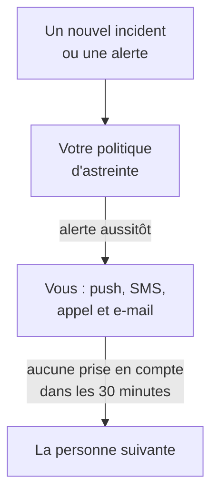

# Être alerté par appel, SMS ou push

À la fin de ce guide, OneUptime vous alerte sur votre téléphone, par notification push, SMS ou appel téléphonique, pour chaque nouvel incident et chaque nouvelle alerte de votre projet ; la personne suivante est alertée si personne n'a pris l'alerte en compte au bout de 30 minutes ; et un appel de test que vous avez pris en compte prouve que tout fonctionne. Le guide suit la configuration guidée **Alerter la bonne personne quand quelque chose tombe en panne** et prend environ 10 minutes.

## Ce qu'il vous faut

- Un projet dont vous êtes propriétaire : seul un propriétaire peut activer les SMS et les appels, et seul un propriétaire ou un administrateur peut créer une politique d'astreinte.
- Votre téléphone mobile.
- Les membres de votre équipe à alerter, ajoutés au projet : [Inviter des personnes](/docs/permissions/inviting-people) explique comment.

:::tabs
@tab OneUptime Cloud
Les notifications push sont gratuites avec tous les forfaits. Les SMS et les appels sont payés avec le solde du projet, qui part de 0.00 USD, et ajouter un numéro de téléphone envoie un SMS : le solde doit donc d'abord dépasser 1.00 USD. Le solde ajouté est débité sur la carte du projet. Le forfait Free comprend une personne et une règle d'escalade : vous seul êtes alerté, et l'alerte se répète au lieu de joindre quelqu'un d'autre.
@tab Auto-hébergé
Votre serveur doit pouvoir envoyer des e-mails et des SMS, et passer des appels. Son administrateur principal les configure à `/admin/setup`, avec un test pour chacun, comme le montre le [Guide de l'auto-hébergement](/docs/installation/self-hosting-guide). Les notifications push arrivent dans l'application par le relais push de OneUptime, sans aucune configuration.
:::

## Étapes

:::steps
### Ouvrir la configuration guidée

Sur la page **Accueil** de votre projet, cliquez sur **Configurez une politique d'astreinte** dans la liste de vérification **Bienvenue sur OneUptime 👋**. Dans un nouveau projet, la page d'accueil demande d'abord **Que voulez-vous faire en premier ?** : cochez **Alerter la bonne personne quand quelque chose tombe en panne** et cliquez sur **Continuer**. Si l'étape n'apparaît pas ou est déjà faite, appuyez sur `Ctrl+K` (`Cmd+K` sur un Mac), tapez `get paged` et choisissez **Alerter la bonne personne quand quelque chose tombe en panne**.

### Installer l'application sur votre téléphone

Installez OneUptime On-Call depuis l'App Store ou Google Play et connectez-vous : l'application enregistre votre téléphone pour les notifications push. De retour dans la configuration, cliquez sur **Revérifier** : **Application mobile ou navigateur**, sous **Comment devons-nous vous joindre ?**, affiche maintenant votre téléphone.

### Activer les SMS et les appels

Dans un nouveau projet, les SMS et les appels téléphoniques sont désactivés. Si vous êtes propriétaire du projet, cliquez sur **Activer les SMS et les appels** ; les autres voient qui peut le faire. Sur OneUptime Cloud, si le solde est de 1.00 USD ou moins, cliquez sur **Ajouter du solde**, saisissez un montant de 20 à 1 000 USD sous **Montant (USD)** et cliquez sur **Recharger**.

### Ajouter votre numéro de téléphone

Saisissez votre numéro de mobile avec son indicatif pays dans **Votre numéro de téléphone**, par exemple `+15551234567`, et cliquez sur **M'envoyer un code par SMS**. Saisissez ensuite le code reçu par SMS et cliquez sur **Vérifier** : ce même numéro est aussi appelé lors des alertes. Cliquez sur **Continuer**. Pour n'être alerté que par l'application et par e-mail, laissez le numéro vide et cliquez directement sur **Continuer**.

### Choisir qui d'autre est alerté

Sous **Qui d'autre est d'astreinte ?**, vous êtes déjà dans **Alertés en premier**. Cliquez sur **Ajouter des membres de l'équipe** pour alerter d'autres personnes avec vous, puis cliquez sur **Enregistrer et continuer**. Dans un projet qui n'a pas encore de politique d'astreinte, cela crée `Default on-call policy`, qui alerte ces personnes pour chaque nouvel incident et chaque nouvelle alerte. Dans un projet qui en a une, choisissez-la sous **Politique d'astreinte**, et ajoutez plutôt les personnes sous **Ajouter à la première règle d'escalade**. Si quelqu'un ne peut pas encore être joint, l'étape reste ouverte sur **Une alerte les atteint-elle ?** : cliquez sur **Envoyer un rappel de configuration** pour cette personne, puis sur **Continuer**.

### Décider de ce qui se passe si personne ne répond

Sous **Et si personne ne répond ?**, gardez **Alerter quelqu'un d'autre**, choisissez qui sous **Alertés ensuite**, et laissez **Minutes d'attente** à `30` ou choisissez une autre valeur. Cliquez sur **Enregistrer et continuer**. Avec le forfait Free, l'étape propose plutôt **Alerter à nouveau les mêmes personnes**, avec **Nombre de nouvelles alertes** à `2`.

### Envoyer un appel de test

Sous **Envoyer un appel de test**, cliquez sur **Tester cette politique**. Choisissez une **Gravité** et cliquez sur **Envoyer l'appel de test**. La première règle d'escalade de la politique est alertée comme le ferait un vrai incident, et chaque message indique TEST. Aucun incident n'est créé, et aucune page de statut ni aucun abonné n'est informé.

### Prendre en compte l'appel de test

Prenez l'appel de test en compte depuis le lien du SMS ou de l'e-mail, ou appuyez sur 1 pendant l'appel téléphonique. L'application montre que l'appel de test est arrivé, mais ne peut pas prendre en compte un test. Cliquez ensuite sur **Terminé** dans la boîte de dialogue, puis sur **Continuer**.
:::

## Vérifier que tout fonctionne

- L'étape de test indique qui a pris l'appel de test en compte, par quel moyen et en combien de temps.
- La configuration se termine sur **L'alerte est configurée**, un récapitulatif tiré de ce qui est enregistré : **Qui est alerté**, **Si personne ne répond** et **Testé**. Un problème de la politique elle-même, comme une personne qu'elle ne peut pas joindre, est listé sous **Attention requise**.
- Sur la page **Accueil**, la liste de vérification marque l'étape **Configurez une politique d'astreinte** comme terminée. Si c'était la dernière étape, la liste de vérification disparaît.

Si la politique alerte quelqu'un d'autre, vous pouvez aussi observer l'escalade : cliquez sur **Ouvrir la politique d'astreinte** dans le récapitulatif, puis sur **Tester cette politique**. Activez **Parcourir chaque niveau d'escalade**, envoyez le test et ne prenez pas en compte la première alerte : la personne suivante est alertée au plus 2 minutes plus tard.

## Ce qui peut mal tourner

:::details Il n'y a pas de bouton M'envoyer un code par SMS
Les SMS sont désactivés ou ne peuvent pas être envoyés, et l'étape indique pourquoi. Seul un propriétaire du projet, ou une personne qui gère la facturation, voit **Activer les SMS et les appels**. Sur OneUptime Cloud, un solde de 1.00 USD ou moins masque le champ. Sur un serveur auto-hébergé qui ne peut pas envoyer de SMS, son administrateur principal voit **Configurer les SMS et les appels**, qui ouvre l'Admin Dashboard pour ajouter Twilio, comme le montre [Intégration Twilio](/docs/self-hosted/twilio-integration).
:::

:::details Ajouter du solde indique qu'aucun moyen de paiement n'a été trouvé
Le solde ajouté est débité sur la carte du projet. Ajoutez-en une sous **Paramètres du projet → Facturation et factures → Facturation** avec **Ajouter un mode de paiement**, puis ajoutez du solde à nouveau. D'ici là, l'application et l'e-mail vous alertent toujours.
:::

:::details Auto-hébergé : le numéro est refusé car aucun compte Twilio n'est configuré
Seul l'administrateur principal est prévenu à l'avance que le serveur ne peut pas envoyer de SMS. Demandez-lui de configurer les SMS et les appels à `/admin/setup`. En attendant, cliquez sur **Continuer** : l'application et l'e-mail vous alertent toujours.
:::

:::details Le code ou l'appel de test n'arrive jamais
Vérifiez d'abord l'indicatif pays du numéro. Après un appel de test, fermez la boîte de dialogue avec **Terminé** et cliquez sur **Je ne l'ai pas reçu** : OneUptime indique alors quoi vérifier, et **Ouvrir mes méthodes de notification** liste tous les moyens de vous joindre. Sur un serveur auto-hébergé, envoyez un SMS de test depuis `/admin/setup`, et lancez `npm run doctor` sur le serveur.
:::

## Étapes suivantes

:::cards
- [Plannings d'astreinte](/docs/on-call/schedules): Se relayer, pour que chaque alerte aille à la personne d'astreinte. Sur Cloud, à partir du forfait Growth.
- [Règles d'escalade](/docs/on-call/escalation-rules): Ajouter des niveaux, des équipes et des plannings à la politique.
- [Comment me joindre](/docs/notifications/on-call-rules): Choisir quel moyen vous joint en premier, et quand.
- [Publier une page de statut](/docs/guides/status-page): Dire à vos clients ce qui se passe, sur votre propre domaine.
:::
