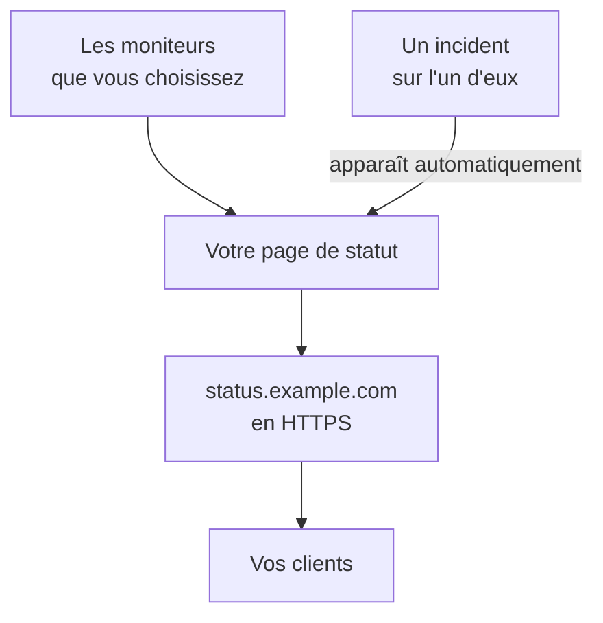

# Publier une page de statut

À la fin de ce guide, vos clients ouvrent une page de statut à une adresse qui vous appartient, comme `status.example.com`, en HTTPS. Elle affiche les moniteurs que vous choisissez avec leur statut et leur disponibilité, et un incident sur l'un d'eux y apparaît automatiquement. Le guide suit la configuration guidée **Publiez une page de statut**, puis ajoute votre domaine dans les **Domaines personnalisés** de la page : environ 15 minutes, plus le délai de votre fournisseur DNS.

## Ce qu'il vous faut

- Au moins un moniteur : une page de statut affiche des moniteurs. S'il n'y en a encore aucun, la configuration guidée propose d'abord **Configurer un moniteur**.
- Le rôle de propriétaire ou d'administrateur du projet : la page demande l'autorisation de créer des pages de statut, et votre domaine celle d'ajouter et de vérifier les domaines du projet.
- Un domaine que vous contrôlez, et l'accès à ses enregistrements DNS chez votre fournisseur DNS.

:::tabs
@tab OneUptime Cloud
Un domaine personnalisé et son certificat SSL gratuit sont inclus dans tous les forfaits. Le forfait Free comprend une page de statut par projet : si vous en avez déjà une, ouvrez ses **Domaines personnalisés** et commencez à l'étape qui ajoute votre domaine. Une nouvelle page de statut est publique ; la rendre privée demande le forfait Growth.
@tab Auto-hébergé
Votre serveur a besoin de son propre nom d'hôte, comme `oneuptime.example.com`, avec un enregistrement A qui pointe vers lui, et doit répondre sur les ports 80 et 443. Réglez `STATUS_PAGE_CNAME_RECORD` sur ce nom dans `config.env` (`statusPage.cnameRecord` dans le chart Helm), à la place de la valeur d'exemple qui s'y trouve. Les certificats gratuits ont aussi besoin de `LETS_ENCRYPT_ACCOUNT_KEY` (`letsEncrypt.accountKey`) : une clé privée créée avec openssl et encodée en base64. Redémarrez OneUptime après les avoir modifiés. **Ajouter un domaine personnalisé** vérifie d'abord le serveur, et liste ce qui manque encore.
:::

## Étapes

:::steps
### Ouvrir la configuration guidée

Sur la page **Accueil** de votre projet, cliquez sur **Publiez une page de statut** dans la liste de vérification **Bienvenue sur OneUptime 👋**. Dans un nouveau projet, la page d'accueil demande d'abord **Que voulez-vous faire en premier ?** : cochez **Informer mes clients avec une page de statut** et cliquez sur **Continuer**. Si l'étape n'apparaît pas ou est déjà faite, appuyez sur `Ctrl+K` (`Cmd+K` sur un Mac), tapez `status page` et choisissez **Publiez une page de statut**.

### La nommer et choisir ce qu'elle affiche

Sous **Nommez-la et choisissez ce qu'elle affiche**, gardez le **Nom de la page de statut** proposé ou saisissez le vôtre. Sous **Ce qu'elle affiche**, cochez les moniteurs que vos clients doivent voir, ou cliquez sur **Tout sélectionner**. Cliquez sur **Créer la page de statut**. Dès cet instant, la page est publique à son lien, et n'affiche que les moniteurs que vous avez cochés.

### Regarder ce que voient vos clients

Sous **Voici ce que voient vos clients**, ouvrez l'adresse affichée sous **Lien public** : vos moniteurs y sont listés avec leur statut. De retour dans la configuration, cliquez sur **C'est bon**.

### Ouvrir Domaines personnalisés

La configuration se termine sur un récapitulatif. Sous **Personnalisez-la (facultatif)**, cliquez sur **Votre propre domaine**. La page **Domaines personnalisés** de la page de statut s'ouvre.

### Ajouter votre domaine

Cliquez sur **Ajouter un domaine personnalisé**. Dans **Domaine**, saisissez l'adresse que vos clients ouvriront, comme `status.example.com`, et cliquez sur **Continuer**. La boîte de dialogue **Configuration DNS** s'ouvre avec les enregistrements à ajouter.

### Ajouter les enregistrements DNS

Chez votre fournisseur DNS, ajoutez chaque enregistrement que liste **Configuration DNS**, avec son **Type**, son **Nom** et sa **Valeur** : un enregistrement CNAME qui fait pointer l'adresse vers OneUptime et, la première fois que le projet utilise ce domaine, un enregistrement TXT qui montre que le projet en est propriétaire. Si votre fournisseur ajoute lui-même le domaine à chaque nom, saisissez seulement la partie qui le précède, comme `status`, et `@` pour le domaine lui-même.

### Vérifier les enregistrements

Gardez **Configuration DNS** ouverte et cliquez sur **Vérifier maintenant**. Sous chaque enregistrement, elle indique ce qu'elle a recherché et ce qui est revenu. L'enregistrement TXT passe en premier : tant qu'il n'est pas trouvé, le domaine n'est pas ajouté, alors cliquez à nouveau sur **Vérifier maintenant** jusqu'à ce qu'il le soit. Une fois l'enregistrement CNAME trouvé, la boîte de dialogue indique **Votre enregistrement CNAME est vérifié.**, et un certificat SSL gratuit est émis, généralement en moins de 15 minutes.
:::

## Vérifier que tout fonctionne

- Ouvrez `https://status.example.com`, avec votre propre adresse : votre page de statut s'ouvre sans avertissement de certificat.
- Dans **Domaines personnalisés**, le **Statut** du domaine indique **Certificat émis, renouvelé automatiquement.** Il peut afficher **Émission d'un certificat gratuit, généralement en moins de 15 minutes.** pendant un moment, alors que la page s'ouvre déjà.
- Sur la page **Accueil**, la liste de vérification marque l'étape **Publiez une page de statut** comme terminée : elle l'est dès qu'une page de statut affiche un moniteur. Si c'était la dernière étape, la liste de vérification disparaît.

Rien d'autre n'est nécessaire : OneUptime renouvelle le certificat de lui-même. Une fois le domaine listé, OneUptime contrôle son enregistrement CNAME toutes les 15 minutes, et vérifie le domaine dès que l'enregistrement est actif, même si vous fermez **Configuration DNS**.

## Ce qui peut mal tourner

:::details Le domaine n'est pas dans la liste après la fermeture de Configuration DNS
**Configuration DNS** a été fermée avant que son enregistrement TXT soit trouvé : le domaine n'a donc jamais été ajouté. Cliquez sur **Ajouter un domaine personnalisé**, saisissez la même adresse, cliquez sur **Continuer**, puis sur **Vérifier maintenant** jusqu'à ce que la boîte de dialogue trouve les deux enregistrements.
:::

:::details Le domaine reste sur En attente du DNS
Ouvrez **Configuration DNS** depuis la ligne du domaine et cliquez sur **Vérifier maintenant** : elle indique ce qu'elle a trouvé. Vérifiez que le nom de l'enregistrement est l'adresse complète, comme `status.example.com`, et que sa valeur est celle qu'affiche **Configuration DNS**. Si le nom répond avec une adresse, il a un enregistrement A, ou votre fournisseur DNS le fait passer par un proxy : remplacez l'enregistrement A, ou passez le nom en DNS only. Pour un domaine racine, comme `example.com`, utilisez l'enregistrement ALIAS, ANAME ou d'aplatissement de CNAME de votre fournisseur.
:::

:::details Le Statut indique qu'aucun certificat gratuit n'a pu être émis
Un enregistrement CAA sur votre domaine qui n'inclut pas `letsencrypt.org` bloque le certificat. Sur un serveur auto-hébergé, Let's Encrypt doit pouvoir joindre le serveur sur le port 80. Corrigez la cause : OneUptime continue d'essayer de lui-même, et **Vérifier maintenant** dans **Configuration DNS** passe une nouvelle commande, au plus une fois toutes les 15 minutes par domaine.
:::

:::details Auto-hébergé : le serveur n'est pas prêt pour les domaines personnalisés
**Ajouter un domaine personnalisé** indique **Ce serveur n'est pas encore prêt pour les domaines personnalisés**, avec une ligne pour chaque élément encore manquant et ce qu'il faut changer : les paramètres de [Ce qu'il vous faut](#ce-quil-vous-faut). Sans `LETS_ENCRYPT_ACCOUNT_KEY`, un domaine vérifié indique **Vérifié. Utilise le HTTPS de votre propre proxy.** : servez son HTTPS depuis votre propre proxy. [Personnalisation et domaines de la page de statut](/docs/status-pages/branding-and-domains#avant-de-commencer) donne le détail.
:::

## Étapes suivantes

:::cards
- [Personnalisation et domaines de la page de statut](/docs/status-pages/branding-and-domains): Votre logo, vos couleurs, les liens d'en-tête et le pied de page.
- [Abonnés et annonces](/docs/status-pages/subscribers): Permettre aux clients de s'abonner, et publier des annonces.
- [Maintenance planifiée](/docs/scheduled-maintenance/index): Prévenir les clients des travaux prévus avant qu'ils ne commencent.
- [Être alerté par appel, SMS ou push](/docs/guides/paging): Être alerté quand l'un de ces moniteurs tombe en panne.
:::
