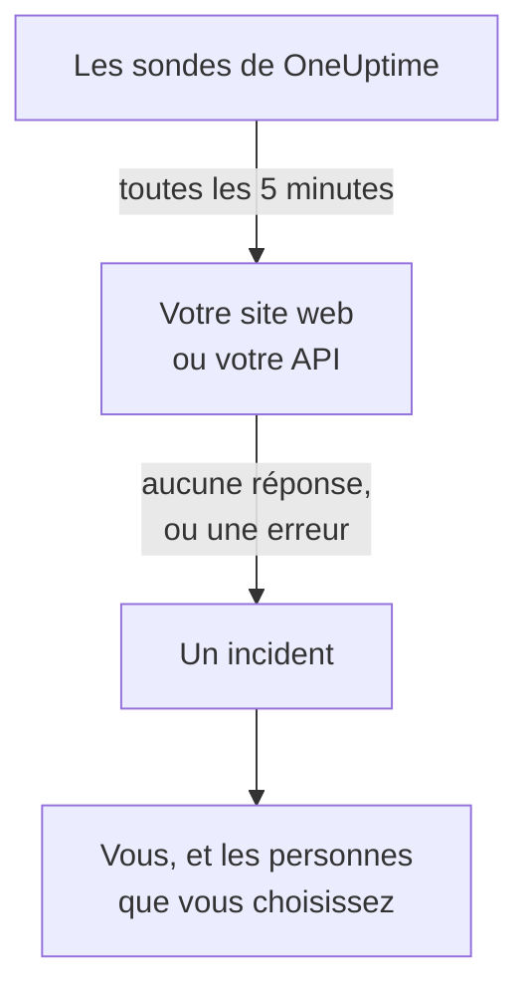

# Savoir quand votre site web ou votre API tombe

À la fin de ce guide, OneUptime vérifie votre site web ou votre API toutes les 5 minutes, ouvre un incident et vous prévient quand aucune réponse n'arrive ou que la réponse est une erreur ; et un appel de test que vous avez pris en compte prouve que le message vous parvient. Le guide suit la configuration guidée **Savoir quand mon site web ou mon API est en panne** et prend environ 5 minutes.

## Ce qu'il vous faut

- Un projet OneUptime dans lequel vous pouvez créer des moniteurs : les propriétaires, les administrateurs et les membres le peuvent. Pour créer un compte et un projet, suivez la première partie du [Démarrage rapide](/docs/introduction/quickstart#créer-un-projet).
- L'adresse à vérifier, comme `https://example.com`. Pour une API, choisissez un point de terminaison qui répond à un simple `GET` sans clé, par exemple un health check : une réponse telle que `401` compte comme une panne.

:::tabs
@tab OneUptime Cloud
Des sondes situées dans plusieurs régions vérifient l'adresse : elle doit donc être joignable depuis Internet. Le forfait Free comprend 10 moniteurs actifs.
@tab Auto-hébergé
L'adresse est vérifiée par la propre sonde de votre serveur : elle doit donc être joignable depuis celui-ci. Pour que vous soyez prévenu par e-mail, le serveur doit pouvoir envoyer des e-mails : son administrateur principal configure l'e-mail à `/admin/setup`, comme le montre le [Guide de l'auto-hébergement](/docs/installation/self-hosting-guide). L'administrateur principal ne devient pas propriétaire de ce qu'il crée : pour être prévenu par e-mail, il s'ajoute donc lui-même sur la page **Propriétaires** du moniteur.
:::

## Étapes

:::steps
### Ouvrir la configuration guidée

Dans un nouveau projet, la page **Accueil** demande d'abord **Que voulez-vous faire en premier ?** : cochez **Savoir quand mon site web ou mon API est en panne** et cliquez sur **Continuer**. Cliquez ensuite sur **Créez votre premier moniteur** dans la liste de vérification **Bienvenue sur OneUptime 👋**. Si la liste de vérification n'affiche pas cette étape, appuyez sur `Ctrl+K` (`Cmd+K` sur un Mac), tapez `website down` et choisissez **Savoir quand mon site web ou mon API est en panne**.

### Saisir l'adresse

Sous **Que devons-nous vérifier ?**, saisissez l'adresse dans **Adresse du site web ou de l'API**. Pour un point de terminaison d'API, cochez **Il s'agit d'un point de terminaison d'API**. Cliquez sur **Lancer la vérification** : les sondes vérifient aussitôt l'adresse, et une phrase indique ce qu'elles ont trouvé. Cliquez sur **Continuer**.

### Choisir qui est prévenu

Sous **Qui faut-il prévenir ?**, ce que vous voyez dépend du projet :

- Si le projet n'a encore ni politique d'astreinte ni règle d'astreinte, vous êtes déjà dans **Qui est alerté**. Cliquez sur **Ajouter des membres de l'équipe** pour ajouter des personnes qui font déjà partie du projet, puis cliquez sur **Enregistrer et continuer**. Cela crée `Default on-call policy`, qui alerte ces personnes pour chaque nouvel incident et chaque nouvelle alerte du projet.
- Si le projet a une politique ou une règle d'astreinte, ce sont ses propres règles qui décident qui est alerté : cliquez sur **Continuer**.
- Si vous êtes membre, et ne pouvez donc pas configurer les alertes, l'étape vous indique que vous recevrez un e-mail en tant que propriétaire du moniteur : cliquez sur **Continuer**.

### Vous envoyer un test

Sous **Envoyer un test**, cliquez sur **M'envoyer un appel de test**. Choisissez une **Gravité** et cliquez sur **Envoyer l'appel de test**. Le test vous parvient comme le ferait un vrai appel, et chaque message indique TEST. Aucun incident n'est créé.

### Prendre en compte l'appel de test

Prenez l'appel de test en compte depuis le lien de l'e-mail. Un numéro de téléphone vérifié fonctionne aussi, une fois les SMS et les appels activés pour le projet : ouvrez le lien du SMS, ou appuyez sur 1 pendant l'appel téléphonique. Cliquez ensuite sur **Terminé** dans la boîte de dialogue, puis sur **Continuer**.
:::

## Vérifier que tout fonctionne

- La configuration se termine sur son récapitulatif, tiré de ce qui est enregistré : **Vérifié**, **En cas de panne**, **Qui est prévenu** et **Testé**.
- Cliquez sur **Ouvrir le moniteur**, puis sur **Afficher la chaîne** dans sa carte **Quand il tombe en panne** : la carte montre la chaîne qui mène du moniteur aux personnes qu'il joint, et indique **Rien n'interrompt la chaîne.** quand rien ne l'interromprait.
- Sur la page **Accueil**, la liste de vérification marque l'étape **Créez votre premier moniteur** comme terminée dès que le résultat de la première vérification arrive. Si c'était la dernière étape, la liste de vérification disparaît.

Pour configurer une autre adresse plus tard, rouvrez la configuration et cliquez sur **Vérifier une autre adresse**.

## Ce qui peut mal tourner

:::details Le résultat de la première vérification n'arrive jamais
Si la phrase indique qu'aucun emplacement ne vérifie l'adresse, le moniteur n'a pas de sonde ; si elle continue d'indiquer que la vérification est en cours, sa sonde n'est pas connectée. Ouvrez **Moniteurs → Paramètres → Sondes** pour voir le statut de chaque sonde. Sur un serveur auto-hébergé, l'administrateur principal vérifie la sonde du serveur à `/admin/setup`. Ouvrez ensuite le moniteur, ajoutez-lui une sonde connectée, et rouvrez la configuration.
:::

:::details Le site fonctionne, mais le moniteur indique qu'il est en panne
Le moniteur compte comme une panne l'absence de réponse, ou une réponse dont le code n'est pas compris entre 200 et 399. Pour le moniteur, un pare-feu qui bloque les sondes équivaut à une absence de réponse : sur OneUptime Cloud, autorisez les adresses de la page [Adresses IP](/docs/configuration/ip-addresses) ; sur un serveur auto-hébergé, autorisez la machine sur laquelle tourne la sonde. Pour changer la règle, consultez [Surveillance de site web](/docs/monitor/website-monitor) ou [Surveillance d'API](/docs/monitor/api-monitor).
:::

:::details L'appel de test ne peut pas être pris en compte
Aucun message permettant de le prendre en compte n'est arrivé, ce qui, sur un serveur auto-hébergé, signifie généralement que le serveur ne peut pas encore envoyer d'e-mails : l'étape l'indique, et son administrateur principal voit **Configurer l'e-mail**. Configurez-le, puis cliquez sur **Envoyer un autre test**, ou cliquez sur **Ignorer le test** et revenez-y plus tard. Après un test, fermez la boîte de dialogue avec **Terminé** et cliquez sur **Je ne l'ai pas reçu** : OneUptime indique alors quoi vérifier.
:::

## Étapes suivantes

:::cards
- [Être alerté par appel, SMS ou push](/docs/guides/paging): Être alerté sur votre téléphone, et alerter la personne suivante si personne ne répond.
- [Publier une page de statut](/docs/guides/status-page): Montrer le moniteur à vos clients, sur votre propre domaine.
- [Critères et statuts](/docs/monitor/criteria-and-statuses): Décider précisément quand un moniteur compte comme en panne.
:::
