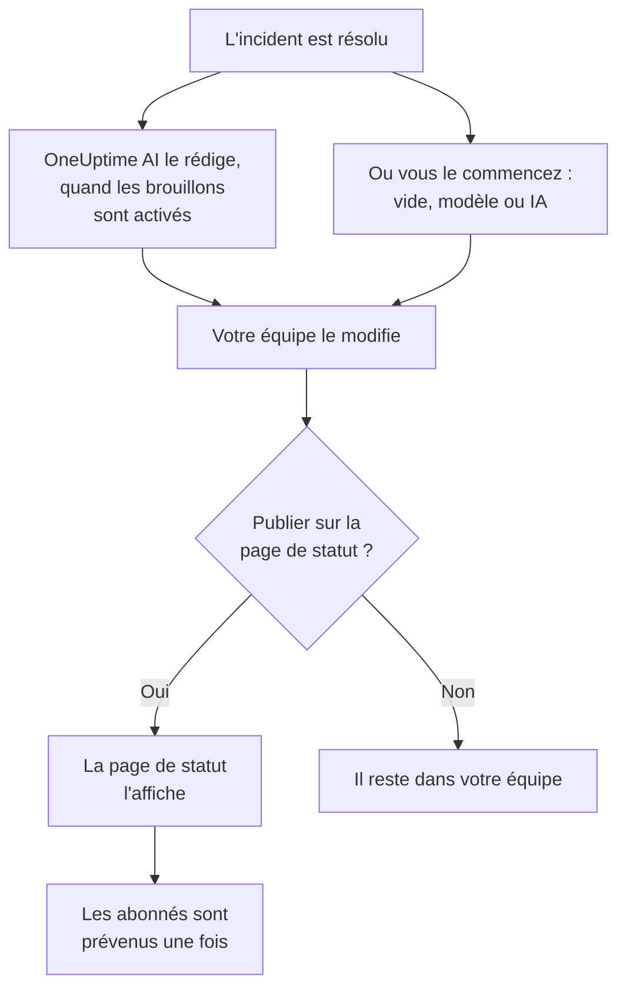

# Post-mortems

Un post-mortem est le compte rendu après un incident : ce qui s'est passé, pourquoi, ce que cela a coûté à vos utilisateurs et ce qui change désormais. Dans OneUptime, vous le rédigez sur l'incident lui-même. Il peut partir de votre propre modèle ou d'un brouillon de OneUptime AI, et il peut être publié sur votre page de statut comme dernière mise à jour de l'incident. Chaque post-mortem a aussi un statut, et **Incidents → Post-mortems** liste le post-mortem de chaque incident, pour voir ceux qui restent à faire.

:::cards
- [Rédiger un post-mortem](#rédiger-un-post-mortem): Sur la page Post-mortem de l'incident, en cinq étapes.
- [Partir d'un modèle ou d'un brouillon de l'IA](#partir-dun-modèle-ou-dun-brouillon-de-lia): Votre plan, ou un plan que OneUptime AI remplit.
- [Le publier sur votre page de statut](#le-publier-sur-votre-page-de-statut): Le montrer aux clients, et prévenir les abonnés une seule fois.
- [Suivre où en est chaque post-mortem](#suivre-où-en-est-chaque-post-mortem): Non démarré, Brouillon, Achevé, ou un statut à vous.
- [Voir tous les post-mortems](#voir-tous-les-post-mortems): Filtrer par propriétaire, gravité et statut pour trouver ceux qui restent à faire.
- [Post-mortems des épisodes](#post-mortems-des-épisodes): Un seul compte rendu pour un groupe d'incidents.
:::

## Comment un post-mortem se construit

Un post-mortem a trois parties, toutes sur l'incident : la note, rédigée en Markdown ; ses pièces jointes, comme des captures d'écran et des rapports ; et le fait qu'il soit ou non sur votre page de statut. Elles se trouvent sur la page **Post-mortem** de l'incident, sous **Investigation** dans son menu latéral. Un post-mortem a aussi un statut, qui dit où il en est, et des propriétaires : ceux de l'incident.

## Rédiger un post-mortem

:::steps
### Ouvrir le post-mortem

Ouvrez l'incident, puis cliquez sur **Post-mortem** sous **Investigation** dans son menu latéral. La carte **Post-mortem** montre le **Statut** et les **Propriétaires** du post-mortem, la note, les pièces jointes et si le post-mortem est sur la page de statut. **Ajouter des propriétaires**, à côté des propriétaires, fait d'une personne ou d'une équipe de votre projet un propriétaire de l'incident, sur place.

### Cliquer sur Rédiger le post-mortem

La boîte de dialogue **Rédiger le post-mortem** s'ouvre sur sa première étape, **Post-mortem**. Une fois le post-mortem rédigé, le bouton de la carte devient **Modifier la note de post-mortem**, qui ouvre les mêmes étapes.

### Rédiger la note et joindre des fichiers

Rédigez la **Note du post-mortem** en Markdown : ce qui s'est passé, l'impact, comment il a été résolu et les suites à donner. Ajoutez des captures d'écran, des rapports ou des chronologies sous **Pièces jointes du post-mortem**.

### Choisir de publier ou non

Cliquez sur **Suivant**. À l'étape **Page de statut**, **Publier sur la page de statut** est désactivé au départ, le post-mortem reste donc au sein de votre équipe. Pour le montrer aux clients, voir [Le publier sur votre page de statut](#le-publier-sur-votre-page-de-statut).

### Enregistrer le post-mortem

Cliquez sur **Enregistrer les modifications**. La carte affiche la note et les pièces jointes. Le statut du post-mortem passe de **Non démarré** à **Brouillon** : voir [Comment un post-mortem avance](#comment-un-post-mortem-avance).
:::

Chaque modification de la note est consignée dans le fil de l'incident, et publiée dans le canal Slack ou Microsoft Teams de l'incident s'il en a un. Tant que le post-mortem n'est pas publié, aucun abonné de la page de statut n'en entend parler.

Rédiger un post-mortem demande le rôle Project Owner, Project Admin, Project Member, Incident Admin ou Incident Member, ou un rôle personnalisé avec l'autorisation Edit Incident. Toute personne qui peut lire l'incident peut lire son post-mortem.

## Partir d'un modèle ou d'un brouillon de l'IA

Deux boutons remplissent la note pour vous. Tant que rien n'est rédigé, ils sont à côté de **Rédiger le post-mortem** : **Partir d'un modèle**, dès que le projet a un modèle de post-mortem, et **Générer avec l'IA**. Une fois le post-mortem rédigé, ils sont dans le menu **⋯** à côté de **Modifier la note de post-mortem**, sous les noms **Appliquer le modèle** et **Générer avec l'IA**. Les deux ouvrent le même éditeur, avec la note remplie et le reste du post-mortem inchangé. Rien n'est enregistré tant que vous n'avez pas cliqué sur **Enregistrer les modifications** : relisez donc la note et corrigez-la d'abord.

### Appliquer un modèle

**Appliquer le modèle** apparaît dès que le projet a un modèle de post-mortem. Vous les créez sous **Incidents → Paramètres → Modèles de post-mortem** : voir [Modèles de post-mortem](/docs/incidents/settings#modèles-de-post-mortem). Sur OneUptime Cloud, les modèles nécessitent le plan Growth.

Cliquez sur **Partir d'un modèle**, ou sur **Appliquer le modèle** dans le menu **⋯**, choisissez-en un sous **Sélectionner le modèle** dans la boîte de dialogue **Appliquer le modèle de post-mortem**, puis cliquez sur **Appliquer le modèle**. Un projet qui n'a qu'un modèle l'a déjà sélectionné.

### Le générer avec l'IA

Cliquez sur **Générer avec l'IA**. La boîte de dialogue **Générer le post-mortem avec l'IA** propose un plan sous **Sélectionner le modèle** : **Standard Postmortem**, **Detailed Technical Postmortem** ou **Brief Postmortem**, puis vos propres modèles de post-mortem. **Template Preview** montre le plan, et vous pouvez le modifier avant de générer.

Cliquez sur **Générer avec l'IA** en bas de la boîte de dialogue. OneUptime AI lit l'incident (sa description, sa cause racine et sa remédiation, sa chronologie d'états, ses notes publiques et privées, les messages de son canal Slack ou Microsoft Teams, et ce qui s'est dit pendant [ses appels](/docs/workspace-connections/video-calls#transcriptions-des-appels)) et rédige le post-mortem selon votre plan. L'éditeur s'ouvre ensuite dessus.

La génération demande que l'IA soit activée pour le projet, sous **Paramètres du projet → IA → Fonctionnalités IA**, et un fournisseur LLM : voir [Fournisseurs LLM](/docs/ai/llm-provider). Elle demande aussi le rôle Project Owner ou Project Admin, ou un rôle personnalisé avec l'autorisation Edit Incident : les autres rôles peuvent rédiger le post-mortem, mais pas le générer.

### Laisser OneUptime AI le rédiger quand un incident est résolu

Avec **Rédiger un post-mortem quand un incident est résolu** activé, OneUptime AI rédige le post-mortem chaque fois qu'un incident est résolu, l'enregistre comme note et le publie dans le fil de l'incident pour que votre équipe le relise. L'interrupteur se trouve sous **Incidents → IA → Paramètres**, et il est activé pour les nouveaux projets.

- Il ne remplace jamais une note déjà rédigée.
- Il n'écrit jamais dans un post-mortem déjà publié, où le brouillon atteindrait la page de statut sans relecture.
- Il demande que l'IA soit activée pour le projet, et s'arrête pour la journée dès que le projet atteint ses limites quotidiennes d'IA. Voir [Post-mortem automatique](/docs/ai/ai-sre#post-mortem-automatique).
- Quand la transcription de l'appel de l'incident est encore en route au moment où l'incident est résolu, il attend que OneUptime AI la lise, pour que le brouillon reprenne ce qui s'est dit pendant l'appel : jusqu'à six heures pendant que le fournisseur prépare la transcription. Voir [Enregistrer et transcrire chaque appel](/docs/workspace-connections/video-calls#enregistrer-et-transcrire-chaque-appel).

#### Choisir quels incidents reçoivent un brouillon, et son modèle

Sans règle, chaque incident résolu reçoit un brouillon, selon le plan standard de OneUptime AI. Les **Règles de post-mortem**, sous **Plus de paramètres** sur la même page, changent cela :

- Une règle cible **Tous les incidents**, ou **Uniquement les incidents qui correspondent aux conditions** sur les moniteurs, sévérités, labels, labels de moniteur, titre et description, comme une règle IA.
- Ses **Modèles** sont les modèles de post-mortem que le brouillon peut suivre. Sans aucun, le brouillon suit le plan standard ; avec un, ce modèle ; avec plusieurs, celui qui, selon OneUptime AI, convient le mieux à l'incident. La publication du brouillon dans le fil nomme le modèle qu'il a suivi.
- Son **Fournisseur LLM**, sous **Plus de champs**, est le fournisseur avec lequel OneUptime AI écrit le brouillon et choisit son modèle. Si aucun n'est choisi, c'est le fournisseur par défaut du projet, sinon le fournisseur global. La publication du brouillon dans le fil nomme le fournisseur choisi par une règle, ou celui utilisé à la place, et pourquoi. Voir [Quel fournisseur LLM une règle utilise](/docs/ai/ai-sre#quel-fournisseur-llm-une-règle-utilise).
- La première règle activée qui correspond à l'incident décide, en partant du haut de la liste : faites glisser une règle pour changer sa place. Un incident auquel aucune règle ne correspond ne reçoit pas de brouillon, et aucun incident n'en reçoit tant que les règles ne peuvent pas être lues.
- **Rédiger un post-mortem quand un incident est résolu** reste le seul interrupteur qui désactive les brouillons. Les règles ne décident que des brouillons que OneUptime AI rédige de lui-même : **Générer avec l'IA** propose tous les plans, quoi qu'elles disent.
- Créer, modifier et réordonner des règles demande le rôle Project Owner ou Project Admin. Sur OneUptime Cloud, les modèles nécessitent le plan Growth : en dessous, les règles décident toujours quels incidents reçoivent un brouillon, et chaque brouillon suit le plan standard.

## Le publier sur votre page de statut

Un post-mortem publié est la dernière mise à jour de l'incident pour vos clients : la page de statut affiche la note, mise en évidence dans la chronologie de l'incident, avec ses pièces jointes à télécharger.

:::steps
### Ouvrir l'étape Page de statut

Cliquez sur **Modifier la note de post-mortem**, puis sur **Suivant** pour atteindre l'étape **Page de statut**.

### Activer Publier sur la page de statut

Activez **Publier sur la page de statut**. Deux champs de plus apparaissent : **Notifier les abonnés**, activé, et **Post-mortem publié le**, réglé sur maintenant.

### Décider qui est prévenu, et quand il s'affiche

Désactivez **Notifier les abonnés** pour publier sans prévenir les abonnés. Modifiez **Post-mortem publié le** pour afficher une autre heure à côté du post-mortem.

### Le publier

Cliquez sur **Enregistrer les modifications**. La carte affiche maintenant **Post-mortem visible sur la page de statut ?**, **Notifier les abonnés**, **Statut de notification de l'abonné** et **Post-mortem publié le**.
:::

Ce qui décide si les clients le voient, et s'ils en sont informés :

- **L'incident doit être sur la page de statut.** Une page de statut n'affiche un post-mortem que sur un incident qu'elle affiche : **Visible sur la page de statut** activé, et l'incident non privé.
- **La note doit dire quelque chose.** Un post-mortem publié avec une note vide n'est pas affiché, et personne n'est prévenu.
- **Les abonnés sont prévenus une seule fois**, la première fois que la page de statut affiche le post-mortem. L'enregistrer à nouveau, ou le modifier pendant qu'il est publié, met à jour la page sans prévenir personne. Le retirer puis le publier à nouveau les prévient à nouveau. Un post-mortem publié pendant que son incident est masqué est envoyé quand l'incident est rendu visible.
- **Notifier les abonnés est lu au moment où la notification part.** L'activer après la publication du post-mortem n'envoie rien.

**Statut de notification de l'abonné** indique si la notification est partie, et propose **Réessayer** en cas d'échec. Voir [Le post-mortem](/docs/status-pages/subscribers#le-post-mortem) pour chaque cas, et [Réessayer et renvoyer](/docs/status-pages/subscribers#réessayer-et-renvoyer).

**Post-mortem publié le** est aussi le moment où le post-mortem compte comme publié pour la mesure **Délai du post-mortem** : voir [Mesures prêtes à l'emploi](/docs/incidents/settings#mesures-prêtes-à-lemploi).

## Suivre où en est chaque post-mortem

Le post-mortem de chaque incident est dans l'un des statuts de post-mortem du projet, affiché sous **Statut** en haut de sa carte **Post-mortem**. Un nouveau projet en a quatre. Un post-mortem en **Non démarré** ou en **Brouillon** reste à faire ; un post-mortem en **Achevé** ou en **Pas nécessaire**, non :

| Statut | Ce qu'il signifie | Reste à faire |
| --- | --- | --- |
| **Non démarré** | Personne n'a encore rédigé ce post-mortem. | Oui |
| **Brouillon** | Le post-mortem est en cours de rédaction. | Oui |
| **Achevé** | Le post-mortem est rédigé et terminé. | Non |
| **Pas nécessaire** | Cet incident n'a pas besoin de post-mortem. | Non |

### Comment un post-mortem avance

OneUptime fait avancer un post-mortem de lui-même à trois moments :

- Le post-mortem d'un nouvel incident commence en **Non démarré**, ou en **Brouillon** quand l'incident est déclaré avec une note, ou en **Achevé** quand cette note est publiée en même temps.
- La première note d'un post-mortem en **Non démarré** le fait passer en **Brouillon**, que quelqu'un la rédige, applique un modèle ou que OneUptime AI la rédige.
- Le publier sur la page de statut le fait passer en **Achevé**, sauf s'il est déjà terminé.

Il ne revient jamais en arrière : vider la note, ou retirer le post-mortem de la page de statut, laisse son statut où il est. Un statut que quelqu'un choisit dans le même enregistrement l'emporte toujours.

### Le déplacer vous-même

Cliquez sur le statut, sur la page **Post-mortem** de l'incident ou sur sa ligne de la liste des post-mortems, et choisissez-en un sous **Déplacer le post-mortem vers**. Le post-mortem est déplacé aussitôt. Déplacer un post-mortem demande les rôles qui le rédigent, et toute personne qui peut lire l'incident voit où en est son post-mortem.

### Adapter les statuts à votre équipe

Si votre processus a une étape à lui, comme une relecture, ajoutez-lui un statut. Ouvrez **Incidents → Paramètres → Statuts de post-mortem**, cliquez sur **Créer : Statut du post-mortem** et donnez-lui un nom, comme **En relecture**, une couleur et une description. Un nouveau statut se place juste au-dessus de **Achevé** ; faites glisser un statut pour changer sa position.

La position d'un statut détermine ce qu'il vaut, affiché sous **Compte comme** : au-dessus de **Brouillon**, **Non démarré** ; à partir de **Brouillon** et en dessous, **En cours** ; à partir de **Achevé** et en dessous, **Terminé**, et il ne reste plus à faire. **En relecture**, entre les deux, reste à faire ; **Pas nécessaire**, sous **Achevé**, non.

**Non démarré**, **Brouillon** et **Achevé** sont intégrés, puisque OneUptime y place les post-mortems : vous pouvez les renommer et changer leur couleur, mais pas les supprimer ni les archiver, et ils gardent leur ordre. Archivez un statut que vous n'utilisez plus depuis le menu **⋯** de sa ligne : personne ne peut plus y déplacer un post-mortem, les post-mortems qui s'y trouvent y restent jusqu'à ce que quelqu'un les déplace, et la liste filtre toujours par ce statut. **Statuts de post-mortem archivés**, replié sous le tableau, les liste, avec **Désarchiver** pour en faire revenir un. Créer, modifier et supprimer des statuts demande le rôle Project Owner, Project Admin ou Incident Admin, ou un rôle personnalisé avec l'autorisation correspondante sur les statuts de post-mortem.

## Voir tous les post-mortems

**Incidents → Post-mortems** liste le post-mortem de chaque incident du projet, le plus récent en premier, avec les colonnes **Incident**, **Titre**, **Statut du post-mortem**, **Gravité**, **Propriétaires** et **Déclaré**. **Voir** sur une ligne ouvre la page **Post-mortem** de l'incident.

Au-dessus de la liste, une tuile par statut compte les post-mortems qui s'y trouvent. Cliquez sur une tuile pour ne lister que ceux-là, et cliquez de nouveau pour les lister tous.

Filtrez la liste avec les puces au-dessus : **Propriétaire**, une personne ou une équipe ; **Gravité** ; **Statut du post-mortem** ; **État de l'incident** ; **Étiquettes** ; et **Ressources affectées**. Pour voir les post-mortems qu'une équipe doit encore pour vos incidents les plus graves, choisissez l'équipe sous **Propriétaire**, la gravité sous **Gravité**, et **Non démarré** et **Brouillon** sous **Statut du post-mortem**. Les filtres sont gardés dans l'adresse de la page : vous pouvez donc mettre la liste en favori ou la partager.

Pour en modifier plusieurs à la fois, sélectionnez-les et ouvrez **Actions groupées** : **Modifier le statut du post-mortem** les place tous dans un même statut, comme **Pas nécessaire** pour les incidents qui n'en ont pas besoin, et **Ajouter un propriétaire** et **Remove Owner** changent leurs propriétaires.

## Post-mortems des épisodes

Un épisode d'incidents a lui aussi une page **Post-mortem**, sous **Investigation** : un seul compte rendu pour chaque incident de l'épisode. Cliquez sur **Modifier le post-mortem** pour le rédiger. **Appliquer le modèle** et **Générer avec l'IA** fonctionnent comme sur un incident, et l'IA lit l'épisode et ses incidents membres.

Le post-mortem d'un épisode se limite à la note : il n'a pas de pièces jointes, et aucune page de statut ne l'affiche. OneUptime AI n'en rédige pas de lui-même quand un épisode est résolu. Le générer demande le rôle Project Owner ou Project Admin, ou un rôle personnalisé avec l'autorisation Edit Incident Episode. Il n'a pas de statut non plus, et la liste des post-mortems ne l'inclut pas.

Les alertes et les événements de maintenance planifiée n'ont pas de post-mortem.

## Via l'API

Un post-mortem est un ensemble de champs de l'incident, lus et écrits via `/api/incident` comme le reste de l'incident :

| Champ | Ce que c'est |
| --- | --- |
| `postmortemNote` | La note, en Markdown. |
| `showPostmortemOnStatusPage` | Si le post-mortem est publié sur vos pages de statut. Vaut `false` au départ. |
| `notifySubscribersOnPostmortemPublished` | Si les abonnés sont prévenus lors de sa publication. Vaut `true` au départ. |
| `postmortemPostedAt` | L'heure que la page de statut affiche à côté. |
| `postmortemStatusId` | Le statut du post-mortem : l'un des statuts du projet, sous `/api/incident-postmortem-status`. |

Écrire `showPostmortemOnStatusPage` à `true` sur une `postmortemNote` rédigée publie le post-mortem, comme le fait la boîte de dialogue. Cela fait aussi passer le post-mortem en **Achevé**, sauf si la même écriture définit `postmortemStatusId`.

## Dépannage

:::details Appliquer le modèle n'est pas sur la carte
Le projet n'a pas encore de modèle de post-mortem, ou votre rôle ne peut pas les lire. Créez-en un sous **Incidents → Paramètres → Modèles de post-mortem**. Sur OneUptime Cloud, les modèles nécessitent le plan Growth.
:::

:::details Générer avec l'IA indique que l'IA est désactivée, ou que vous n'avez pas l'autorisation
Activez l'IA sous **Paramètres du projet → IA → Fonctionnalités IA**. La génération demande le rôle Project Owner ou Project Admin, ou un rôle personnalisé avec l'autorisation Edit Incident, même pour quelqu'un qui peut modifier le post-mortem.
:::

:::details Le post-mortem n'est pas sur la page de statut
Vérifiez trois choses : **Publier sur la page de statut** est activé, la note n'est pas vide, et l'incident est affiché sur la page de statut (**Visible sur la page de statut** activé, et non privé).
:::

:::details Les abonnés n'ont pas été prévenus du post-mortem
**Notifier les abonnés** était désactivé lors de la publication, ou l'incident est masqué : il est alors envoyé dès que l'incident est rendu visible. **Statut de notification de l'abonné** sur la carte indique lequel.
:::

:::details Aucun brouillon de l'IA n'est apparu à la résolution de l'incident
L'incident avait déjà une note, le post-mortem était déjà publié, aucune règle de post-mortem ne lui correspondait, ou **Rédiger un post-mortem quand un incident est résolu** est désactivé. L'IA doit être activée pour le projet, et le projet ne doit pas avoir atteint ses limites quotidiennes d'IA. Quand la transcription de l'appel de l'incident est en route, le brouillon arrive une fois que OneUptime AI l'a lue.
:::

:::details Le statut d'un post-mortem n'a pas bougé quand sa note a été rédigée
Seul un post-mortem en **Non démarré**, ou dans un de vos statuts au-dessus de **Brouillon**, avance de lui-même, à sa première note. Un post-mortem en cours ou terminé reste où il est, tout comme un statut que quelqu'un a choisi dans le même enregistrement. Déplacez-le vous-même depuis son statut : voir [Le déplacer vous-même](#le-déplacer-vous-même).
:::

## Étapes suivantes

:::cards
- [Vue d'ensemble des incidents](/docs/incidents/index): Les autres pages de l'incident, de la déclaration à la résolution.
- [Paramètres et automatisation des incidents](/docs/incidents/settings): Les modèles de post-mortem et la mesure du délai du post-mortem.
- [Abonnés et annonces](/docs/status-pages/subscribers): Tout ce qu'une page de statut dit à ses abonnés.
- [AI SRE](/docs/ai/ai-sre): Ce que OneUptime AI fait de lui-même après un incident.
:::
