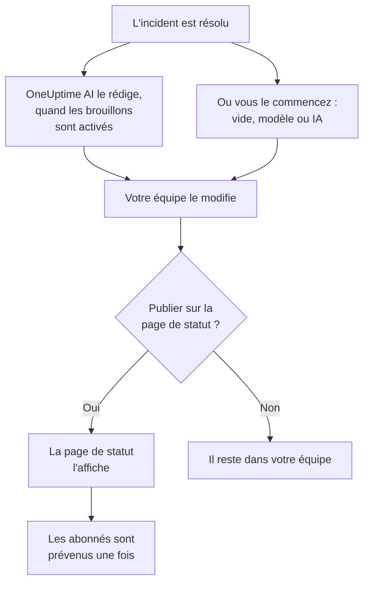

# Post-mortems

Un post-mortem est le compte rendu après un incident : ce qui s'est passé, pourquoi, ce que cela a coûté à vos utilisateurs et ce qui change désormais. Dans OneUptime, vous le rédigez sur l'incident lui-même. Il peut partir de votre propre modèle ou d'un brouillon de OneUptime AI, et il peut être publié sur votre page de statut comme dernière mise à jour de l'incident.

:::cards
- [Rédiger un post-mortem](#rédiger-un-post-mortem): Sur la page Post-mortem de l'incident, en cinq étapes.
- [Partir d'un modèle ou d'un brouillon de l'IA](#partir-dun-modèle-ou-dun-brouillon-de-lia): Votre plan, ou un plan que OneUptime AI remplit.
- [Le publier sur votre page de statut](#le-publier-sur-votre-page-de-statut): Le montrer aux clients, et prévenir les abonnés une seule fois.
- [Post-mortems des épisodes](#post-mortems-des-épisodes): Un seul compte rendu pour un groupe d'incidents.
:::

## Comment un post-mortem se construit

Un post-mortem a trois parties, toutes sur l'incident : la note, rédigée en Markdown ; ses pièces jointes, comme des captures d'écran et des rapports ; et le fait qu'il soit ou non sur votre page de statut. Elles se trouvent sur la page **Post-mortem** de l'incident, sous **Investigation** dans son menu latéral.

## Rédiger un post-mortem

:::steps
### Ouvrir le post-mortem

Ouvrez l'incident, puis cliquez sur **Post-mortem** sous **Investigation** dans son menu latéral. La carte **Note du post-mortem** montre la note, les pièces jointes et si le post-mortem est sur la page de statut.

### Cliquer sur Modifier la note de post-mortem

La boîte de dialogue **Modifier la note de post-mortem** s'ouvre sur sa première étape, **Post-mortem**.

### Rédiger la note et joindre des fichiers

Rédigez la **Note du post-mortem** en Markdown : ce qui s'est passé, l'impact, comment il a été résolu et les suites à donner. Ajoutez des captures d'écran, des rapports ou des chronologies sous **Pièces jointes du post-mortem**.

### Choisir de publier ou non

Cliquez sur **Suivant**. À l'étape **Page de statut**, **Publier sur la page de statut** est désactivé au départ, le post-mortem reste donc au sein de votre équipe. Pour le montrer aux clients, voir [Le publier sur votre page de statut](#le-publier-sur-votre-page-de-statut).

### Enregistrer le post-mortem

Cliquez sur **Enregistrer les modifications**. La carte affiche la note et les pièces jointes.
:::

Chaque modification de la note est consignée dans le fil de l'incident, et publiée dans le canal Slack ou Microsoft Teams de l'incident s'il en a un. Tant que le post-mortem n'est pas publié, aucun abonné de la page de statut n'en entend parler.

Rédiger un post-mortem demande le rôle Project Owner, Project Admin, Project Member, Incident Admin ou Incident Member, ou un rôle personnalisé avec l'autorisation Edit Incident. Toute personne qui peut lire l'incident peut lire son post-mortem.

## Partir d'un modèle ou d'un brouillon de l'IA

Deux boutons de la carte remplissent la note pour vous : **Générer avec l'IA**, et **Appliquer le modèle** dès que le projet a un modèle de post-mortem. Les deux ouvrent le même éditeur que **Modifier la note de post-mortem**, avec la note remplie et le reste du post-mortem inchangé. Rien n'est enregistré tant que vous n'avez pas cliqué sur **Enregistrer les modifications** : relisez donc la note et corrigez-la d'abord.

### Appliquer un modèle

**Appliquer le modèle** apparaît dès que le projet a un modèle de post-mortem. Vous les créez sous **Incidents → Paramètres → Modèles de post-mortem** : voir [Modèles de post-mortem](/docs/incidents/settings#modèles-de-post-mortem). Sur OneUptime Cloud, les modèles nécessitent le plan Growth.

Cliquez sur **Appliquer le modèle**, choisissez-en un sous **Sélectionner le modèle** dans la boîte de dialogue **Appliquer le modèle de post-mortem**, puis cliquez sur **Appliquer le modèle**. Un projet qui n'a qu'un modèle l'a déjà sélectionné.

### Le générer avec l'IA

Cliquez sur **Générer avec l'IA**. La boîte de dialogue **Générer le post-mortem avec l'IA** propose un plan sous **Sélectionner le modèle** : **Standard Postmortem**, **Detailed Technical Postmortem** ou **Brief Postmortem**, puis vos propres modèles de post-mortem. **Template Preview** montre le plan, et vous pouvez le modifier avant de générer.

Cliquez sur **Générer avec l'IA** en bas de la boîte de dialogue. OneUptime AI lit l'incident (sa description, sa cause racine et sa remédiation, sa chronologie d'états, ses notes publiques et privées, les messages de son canal Slack ou Microsoft Teams, et ce qui s'est dit pendant [ses appels](/docs/workspace-connections/video-calls#transcriptions-des-appels)) et rédige le post-mortem selon votre plan. L'éditeur s'ouvre ensuite dessus.

La génération demande que l'IA soit activée pour le projet, sous **Paramètres du projet → IA → Fonctionnalités IA**, et un fournisseur LLM : voir [Fournisseurs LLM](/docs/ai/llm-provider). Elle demande aussi le rôle Project Owner ou Project Admin, ou un rôle personnalisé avec l'autorisation Edit Incident : les autres rôles peuvent rédiger le post-mortem, mais pas le générer.

### Laisser OneUptime AI le rédiger quand un incident est résolu

Avec **Rédiger un post-mortem quand un incident est résolu** activé, OneUptime AI rédige le post-mortem chaque fois qu'un incident est résolu, l'enregistre comme note et le publie dans le fil de l'incident pour que votre équipe le relise. L'interrupteur se trouve sous **Incidents → IA → Paramètres**, et il est activé pour les nouveaux projets.

- Il ne remplace jamais une note déjà rédigée.
- Il n'écrit jamais dans un post-mortem déjà publié, où le brouillon atteindrait la page de statut sans relecture.
- Il demande que l'IA soit activée pour le projet, et s'arrête pour la journée dès que le projet atteint ses limites quotidiennes d'IA. Voir [Post-mortem automatique](/docs/ai/ai-sre#post-mortem-automatique).
- Quand la transcription de l'appel de l'incident est encore en route au moment où l'incident est résolu, il attend que OneUptime AI la lise, pour que le brouillon reprenne ce qui s'est dit pendant l'appel : jusqu'à six heures pendant que Zoom ou Google Meet prépare la transcription. Voir [Enregistrer et transcrire chaque appel](/docs/workspace-connections/video-calls#enregistrer-et-transcrire-chaque-appel).

## Le publier sur votre page de statut

Un post-mortem publié est la dernière mise à jour de l'incident pour vos clients : la page de statut affiche la note, mise en évidence dans la chronologie de l'incident, avec ses pièces jointes à télécharger.

:::steps
### Ouvrir l'étape Page de statut

Cliquez sur **Modifier la note de post-mortem**, puis sur **Suivant** pour atteindre l'étape **Page de statut**.

### Activer Publier sur la page de statut

Activez **Publier sur la page de statut**. Deux champs de plus apparaissent : **Notifier les abonnés**, activé, et **Post-mortem publié le**, réglé sur maintenant.

### Décider qui est prévenu, et quand il s'affiche

Désactivez **Notifier les abonnés** pour publier sans prévenir les abonnés. Modifiez **Post-mortem publié le** pour afficher une autre heure à côté du post-mortem.

### Le publier

Cliquez sur **Enregistrer les modifications**. La carte affiche maintenant **Post-mortem visible sur la page de statut ?**, **Notifier les abonnés**, **Statut de notification de l'abonné** et **Post-mortem publié le**.
:::

Ce qui décide si les clients le voient, et s'ils en sont informés :

- **L'incident doit être sur la page de statut.** Une page de statut n'affiche un post-mortem que sur un incident qu'elle affiche : **Visible sur la page de statut** activé, et l'incident non privé.
- **La note doit dire quelque chose.** Un post-mortem publié avec une note vide n'est pas affiché, et personne n'est prévenu.
- **Les abonnés sont prévenus une seule fois**, la première fois que la page de statut affiche le post-mortem. L'enregistrer à nouveau, ou le modifier pendant qu'il est publié, met à jour la page sans prévenir personne. Le retirer puis le publier à nouveau les prévient à nouveau. Un post-mortem publié pendant que son incident est masqué est envoyé quand l'incident est rendu visible.
- **Notifier les abonnés est lu au moment où la notification part.** L'activer après la publication du post-mortem n'envoie rien.

**Statut de notification de l'abonné** indique si la notification est partie, et propose **Réessayer** en cas d'échec. Voir [Le post-mortem](/docs/status-pages/subscribers#le-post-mortem) pour chaque cas, et [Réessayer et renvoyer](/docs/status-pages/subscribers#réessayer-et-renvoyer).

**Post-mortem publié le** est aussi le moment où le post-mortem compte comme publié pour la mesure **Délai du post-mortem** : voir [Mesures prêtes à l'emploi](/docs/incidents/settings#mesures-prêtes-à-lemploi).

## Post-mortems des épisodes

Un épisode d'incidents a lui aussi une page **Post-mortem**, sous **Investigation** : un seul compte rendu pour chaque incident de l'épisode. Cliquez sur **Modifier le post-mortem** pour le rédiger. **Appliquer le modèle** et **Générer avec l'IA** fonctionnent comme sur un incident, et l'IA lit l'épisode et ses incidents membres.

Le post-mortem d'un épisode se limite à la note : il n'a pas de pièces jointes, et aucune page de statut ne l'affiche. OneUptime AI n'en rédige pas de lui-même quand un épisode est résolu. Le générer demande le rôle Project Owner ou Project Admin, ou un rôle personnalisé avec l'autorisation Edit Incident Episode.

Les alertes et les événements de maintenance planifiée n'ont pas de post-mortem.

## Via l'API

Un post-mortem est un ensemble de champs de l'incident, lus et écrits via `/api/incident` comme le reste de l'incident :

| Champ | Ce que c'est |
| --- | --- |
| `postmortemNote` | La note, en Markdown. |
| `showPostmortemOnStatusPage` | Si le post-mortem est publié sur vos pages de statut. Vaut `false` au départ. |
| `notifySubscribersOnPostmortemPublished` | Si les abonnés sont prévenus lors de sa publication. Vaut `true` au départ. |
| `postmortemPostedAt` | L'heure que la page de statut affiche à côté. |

Écrire `showPostmortemOnStatusPage` à `true` sur une `postmortemNote` rédigée publie le post-mortem, comme le fait la boîte de dialogue.

## Dépannage

:::details Appliquer le modèle n'est pas sur la carte
Le projet n'a pas encore de modèle de post-mortem, ou votre rôle ne peut pas les lire. Créez-en un sous **Incidents → Paramètres → Modèles de post-mortem**. Sur OneUptime Cloud, les modèles nécessitent le plan Growth.
:::

:::details Générer avec l'IA indique que l'IA est désactivée, ou que vous n'avez pas l'autorisation
Activez l'IA sous **Paramètres du projet → IA → Fonctionnalités IA**. La génération demande le rôle Project Owner ou Project Admin, ou un rôle personnalisé avec l'autorisation Edit Incident, même pour quelqu'un qui peut modifier le post-mortem.
:::

:::details Le post-mortem n'est pas sur la page de statut
Vérifiez trois choses : **Publier sur la page de statut** est activé, la note n'est pas vide, et l'incident est affiché sur la page de statut (**Visible sur la page de statut** activé, et non privé).
:::

:::details Les abonnés n'ont pas été prévenus du post-mortem
**Notifier les abonnés** était désactivé lors de la publication, ou l'incident est masqué : il est alors envoyé dès que l'incident est rendu visible. **Statut de notification de l'abonné** sur la carte indique lequel.
:::

:::details Aucun brouillon de l'IA n'est apparu à la résolution de l'incident
L'incident avait déjà une note, le post-mortem était déjà publié, ou **Rédiger un post-mortem quand un incident est résolu** est désactivé. L'IA doit être activée pour le projet, et le projet ne doit pas avoir atteint ses limites quotidiennes d'IA. Quand la transcription de l'appel de l'incident est en route, le brouillon arrive une fois que OneUptime AI l'a lue.
:::

## Étapes suivantes

:::cards
- [Vue d'ensemble des incidents](/docs/incidents/index): Les autres pages de l'incident, de la déclaration à la résolution.
- [Paramètres et automatisation des incidents](/docs/incidents/settings): Les modèles de post-mortem et la mesure du délai du post-mortem.
- [Abonnés et annonces](/docs/status-pages/subscribers): Tout ce qu'une page de statut dit à ses abonnés.
- [AI SRE](/docs/ai/ai-sre): Ce que OneUptime AI fait de lui-même après un incident.
:::
