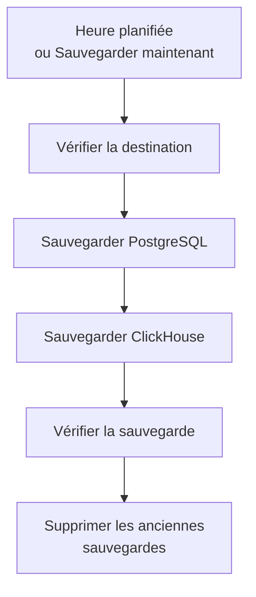

# Sauvegardes

Sauvegardez un OneUptime auto-hébergé dans un stockage qui vous appartient, selon un planning, et restaurez-le depuis l'Admin Dashboard. Une sauvegarde contient PostgreSQL, avec vos projets, moniteurs, incidents, pages de statut et utilisateurs, et ClickHouse, avec vos logs, traces et métriques. Les sauvegardes sont conservées autant de jours que vous le choisissez, les plus anciennes sont supprimées pour vous, et toute sauvegarde peut être restaurée sur place. Les sauvegardes font partie de l'Édition Enterprise.

:::cards
- [Configurer les sauvegardes](#configurer-les-sauvegardes): Choisir une destination, la tester, définir un planning.
- [Destinations](#destinations): Ce que demande chaque destination recommandée.
- [Restaurer une sauvegarde](#restaurer-une-sauvegarde): Ce qui est remplacé, et comment les données actuelles restent protégées.
- [Passer sur un nouveau serveur](#passer-sur-un-nouveau-serveur): Restaurer les sauvegardes d'une installation sur une autre.
:::

## Comment fonctionne une sauvegarde



- **Cohérente.** PostgreSQL est sauvegardé en une seule transaction : le dump est donc la base telle qu'elle était à un instant donné, pendant que OneUptime continue de fonctionner. ClickHouse sauvegarde chaque table telle qu'elle était lorsqu'il en a lu les parts.
- **Directement vers la destination.** La sortie de `pg_dump` est envoyée en flux vers le stockage au fur et à mesure, et ClickHouse écrit lui-même sa sauvegarde dans le stockage. Rien n'est écrit sur le disque du serveur, quelle que soit la taille des données.
- **Vérifiée.** Avant qu'une sauvegarde compte, `pg_restore` relit le dump depuis la destination, et l'enregistrement que ClickHouse tient de sa sauvegarde y est retrouvé. Le SHA-256 du dump est conservé avec la sauvegarde, et une restauration le vérifie avant de remplacer quoi que ce soit. Une sauvegarde qui échoue ou est annulée supprime ce qu'elle a écrit : la destination ne contient donc que des sauvegardes complètes.
- **Chiffrée.** Les sauvegardes arrivent au stockage en HTTPS, sauf si vous saisissez un point de terminaison `http://`. Amazon S3, Google Cloud Storage, Azure Blob Storage et Cloudflare R2 chiffrent tout ce qu'ils stockent ; sur un autre stockage, activez le chiffrement au repos du bucket. Les identifiants de la destination sont stockés chiffrés, et ne sont plus jamais affichés.
- **Une à la fois.** Une seule sauvegarde ou restauration s'exécute à la fois sur toute l'installation. Les autres attendent leur tour.

Chaque sauvegarde est un dossier à part dans le dossier de la destination (`oneuptime/backups/` sauf si vous en choisissez un autre), nommé d'après son heure de début, en UTC :

```text
oneuptime/backups/20261024T020000Z-3f2a9c1b/manifest.json
oneuptime/backups/20261024T020000Z-3f2a9c1b/postgres.dump
oneuptime/backups/20261024T020000Z-3f2a9c1b/clickhouse/
```

`manifest.json` est écrit en dernier : il indique ce que contient la sauvegarde, et quelle version de OneUptime l'a créée.

## Avant de commencer

- **L'Édition Enterprise**, avec une licence qui inclut les sauvegardes. Les sauvegardes s'exécutent pendant la période d'essai et la période de grâce. Sans licence, aucune nouvelle sauvegarde n'est effectuée, et la restauration et la suppression des sauvegardes fonctionnent toujours. Voir [Édition Enterprise](/docs/self-hosted/enterprise).
- **Un administrateur principal.** Les sauvegardes se configurent dans l'Admin Dashboard.
- **Un bucket ou un conteneur réservé aux sauvegardes**, et des identifiants qui peuvent y lire, écrire, lister et supprimer.
- **Une destination que ClickHouse atteint aussi.** ClickHouse écrit lui-même sa sauvegarde dans le stockage : son réseau doit donc atteindre le stockage, comme celui de OneUptime.
- **Pour restaurer PostgreSQL, un utilisateur de base de données autorisé à créer des bases.** Une restauration écrit dans une nouvelle base à côté de la base active. Le PostgreSQL fourni avec OneUptime se connecte en superutilisateur, qui en a le droit.

## Configurer les sauvegardes

:::steps
### Ouvrir la page des sauvegardes

Dans l'Admin Dashboard, allez dans **Paramètres → Sauvegardes** et cliquez sur **Configurer les sauvegardes**.

### Choisir où vont les sauvegardes

Choisissez l'une des destinations recommandées. Ce que chacune demande se trouve dans [Destinations](#destinations).

### Renseigner la connexion

Renseignez ce que la destination demande. Un dossier, une région et les paramètres que la plupart laissent tels quels attendent sous **Plus de champs**, et **Guide de configuration** ouvre la section de la destination sur cette page.

### Tester la destination

Cliquez sur **Tester la destination**. OneUptime écrit, lit, liste et supprime un petit fichier de test, vérifie que `pg_dump` peut sauvegarder votre PostgreSQL, et demande à ClickHouse d'écrire une sauvegarde de test des définitions de ses tables. Rien n'est enregistré, et une vérification qui échoue indique quoi changer.

### Choisir quand les sauvegardes s'exécutent

Choisissez **Fréquence** et l'heure dans **À (UTC)**, et pour les sauvegardes hebdomadaires le **Jour de la semaine**. **Conserver les sauvegardes (jours)** vaut 30 sauf si vous le changez. Désactivez **Sauvegarder aussi ClickHouse** pour ne sauvegarder que PostgreSQL.

### Commencer les sauvegardes

Cliquez sur **Commencer les sauvegardes**. La première sauvegarde s'exécute à la prochaine heure planifiée, et **Sauvegarder maintenant** en lance une tout de suite.
:::

La page montre ensuite où en sont les sauvegardes : quand la dernière s'est exécutée, sa taille et sa durée, et quand la prochaine s'exécutera. Une sauvegarde en cours montre l'étape où elle en est, et **Voir les étapes** montre chaque étape au fil de l'exécution.

## Destinations

| Destination | Stockage | Se connecte avec |
| --- | --- | --- |
| [Amazon S3](#amazon-s3) | Amazon S3 | Une clé d'accès |
| [Cloudflare R2](#cloudflare-r2) | Stockage compatible S3 | Un jeton d'API R2 |
| [Backblaze B2](#backblaze-b2) | Stockage compatible S3 | Une clé d'application |
| [Wasabi](#wasabi) | Stockage compatible S3 | Une clé d'accès |
| [MinIO](#minio) | Stockage compatible S3 | Une clé d'accès |
| [Google Cloud Storage](#google-cloud-storage) | Google Cloud Storage | Une clé HMAC |
| [Azure Blob Storage](#azure-blob-storage) | Azure Blob Storage | Un jeton SAS ou une clé d'accès |
| [Autre stockage compatible S3](#autre-stockage-compatible-s3) | Stockage compatible S3 | Une clé d'accès |

Une clé pour Amazon S3 ou un autre stockage compatible S3 a besoin de `s3:PutObject`, `s3:GetObject`, `s3:ListBucket`, `s3:DeleteObject` et `s3:AbortMultipartUpload` sur le dossier, et de rien d'autre :

```json
{
  "Version": "2012-10-17",
  "Statement": [
    {
      "Effect": "Allow",
      "Action": "s3:ListBucket",
      "Resource": "arn:aws:s3:::my-backups"
    },
    {
      "Effect": "Allow",
      "Action": [
        "s3:PutObject",
        "s3:GetObject",
        "s3:DeleteObject",
        "s3:AbortMultipartUpload"
      ],
      "Resource": "arn:aws:s3:::my-backups/oneuptime/backups/*"
    }
  ]
}
```

### Amazon S3

| Champ | Ce qu'il faut saisir |
| --- | --- |
| **Bucket** | Le bucket où les sauvegardes sont écrites. Réservez-le aux sauvegardes. |
| **Région** | La région du bucket. Elle vaut `us-east-1` au départ. |
| **ID de clé d'accès** | Une clé d'accès disposant des permissions ci-dessus. |
| **Clé d'accès secrète** | Le secret de la clé. |
| **Dossier** | Sous **Plus de champs**. Laissé vide, les sauvegardes vont dans `oneuptime/backups/`. |

Amazon S3 chiffre chaque fichier qu'il stocke, et OneUptime le lui demande (SSE-S3) pour chaque fichier qu'il écrit.

### Cloudflare R2

Saisissez comme **Point de terminaison** l'adresse de l'API S3 de votre compte, `https://<account-id>.r2.cloudflarestorage.com`, depuis les paramètres du bucket dans R2. Saisissez ensuite le **Bucket**, puis l'**ID de clé d'accès** et la **Clé d'accès secrète** d'un jeton d'API R2 autorisé à y lire et écrire des objets. Relire des sauvegardes depuis R2 ne coûte rien.

### Backblaze B2

Saisissez comme **Point de terminaison** le point de terminaison S3 du bucket, affiché sur sa page Buckets dans Backblaze, par exemple `https://s3.us-west-004.backblazeb2.com`. Saisissez ensuite le **Bucket**, puis l'identifiant et la clé d'une clé d'application comme **ID de clé d'accès** et **Clé d'accès secrète**. La région est déduite du point de terminaison.

### Wasabi

Saisissez comme **Point de terminaison** l'URL du service de la région du bucket, par exemple `https://s3.us-east-1.wasabisys.com`, puis le **Bucket** et une clé d'accès. La région est déduite du point de terminaison.

### MinIO

Saisissez comme **Point de terminaison** l'adresse de l'API S3 de votre serveur MinIO, par exemple `https://minio.example.com:9000`, puis le **Bucket** et une clé d'accès dont la stratégie permet d'y lire, écrire, lister et supprimer. OneUptime et ClickHouse doivent tous deux atteindre l'adresse.

### Google Cloud Storage

Saisissez le **Bucket**, puis la **Clé d'accès HMAC** et le **Secret HMAC** d'un compte de service disposant du rôle Storage Object Admin sur le bucket. Créez la clé dans les paramètres de Cloud Storage, dans l'onglet Interopérabilité. OneUptime et ClickHouse atteignent le bucket via l'API compatible S3 de Cloud Storage.

### Azure Blob Storage

Saisissez le **Compte de stockage** et le **Conteneur**, et choisissez dans **Se connecter avec** comment se connecter : un **Jeton SAS** avec les permissions Lecture, Ajout, Création, Écriture, Suppression et Liste sur le conteneur, ou une **Clé d'accès** du compte de stockage. Un jeton SAS peut être limité au conteneur : c'est donc le choix le plus sûr. **Cloud** et **Dossier** attendent sous **Plus de champs**.

### Autre stockage compatible S3

Pour Ceph, DigitalOcean Spaces, Hetzner Object Storage et tout stockage doté d'une API S3, saisissez son adresse S3 comme **Point de terminaison**, puis le **Bucket** et une clé d'accès. **Région**, sous **Plus de champs**, n'est nécessaire que si le stockage en demande une. Laissée vide, elle est déduite du point de terminaison, ou vaut `us-east-1`.

## Planning et conservation

| Paramètre | Ce qu'il fait |
| --- | --- |
| **Fréquence** | **Toutes les heures**, **Toutes les 6 heures**, **Toutes les 12 heures**, **Tous les jours** ou **Toutes les semaines**. Tous les jours convient à la plupart des installations. |
| **À (UTC)** | L'heure de début des sauvegardes, en UTC, avec votre propre heure affichée à côté. Toutes les 6 ou 12 heures se comptent à partir d'elle : à `02:00`, les sauvegardes toutes les 6 heures s'exécutent à 02:00, 08:00, 14:00 et 20:00. Les sauvegardes toutes les heures s'exécutent à l'heure pile. |
| **Jour de la semaine** | Le jour où s'exécutent les sauvegardes hebdomadaires. |
| **Conserver les sauvegardes (jours)** | De 1 à 3650 jours. 30 sauf si vous le changez. |
| **Sauvegarder aussi ClickHouse** | Activé sauf si vous le désactivez. PostgreSQL est toujours sauvegardé. |

Après chaque sauvegarde, les sauvegardes démarrées il y a plus de **Conserver les sauvegardes (jours)** sont supprimées, à la destination et de la liste, sauf la sauvegarde réussie la plus récente, qui est conservée quel que soit son âge. Désactiver les sauvegardes, ou une licence qui expire, ne vous laisse donc jamais sans sauvegarde à restaurer.

**Désactiver les sauvegardes planifiées**, dans le menu de la carte d'état, arrête le planning. **Sauvegarder maintenant** fonctionne toujours, et aucune sauvegarde n'est supprimée. **Activer** relance le planning.

## Restaurer une sauvegarde

:::warning Ce qu'une restauration remplace
Une restauration remplace les données actuelles par celles de la sauvegarde. Tout ce qui a changé depuis la sauvegarde est perdu, sauf si vous sauvegardez d'abord les données actuelles.
:::

:::steps
### Choisir la sauvegarde

Dans le tableau **Sauvegardes**, cliquez sur **Restaurer** sur la sauvegarde à laquelle revenir. OneUptime vérifie d'abord la sauvegarde : que ses fichiers sont à la destination et inchangés, quelle version de OneUptime l'a créée, et que ce serveur peut la restaurer.

### Choisir ce qu'il faut restaurer

Cochez **PostgreSQL : projets, moniteurs, incidents, utilisateurs**, **ClickHouse : logs, traces, métriques** ou les deux. La boîte de dialogue montre combien de projets, d'utilisateurs et de moniteurs contient la sauvegarde, et combien il y en a actuellement.

### Protéger les données actuelles

**Sauvegarder d'abord les données actuelles** est coché : la restauration commence par une sauvegarde des données qu'elle remplace, pour que vous puissiez y revenir. Décochez-le seulement si vous avez une autre copie, car sans elle la restauration ne peut pas être annulée.

### Confirmer

Saisissez `restore` et cliquez sur **Restaurer**.
:::

Une restauration s'exécute étape par étape, et la page affiche chacune d'elles :

| Étape | Ce qui se passe |
| --- | --- |
| **Vérifier la sauvegarde** | Les fichiers de la sauvegarde sont là, et cette installation peut la restaurer. |
| **Sauvegarder les données actuelles** | Une sauvegarde des données actuelles, sauf si vous l'avez décochée. |
| **Restaurer PostgreSQL** | La sauvegarde est restaurée dans une nouvelle base à côté de la base active, puis vérifiée. |
| **Restaurer ClickHouse** | La télémétrie active est mise de côté, et celle de la sauvegarde est restaurée à sa place. |
| **Basculer sur les données restaurées** | La base restaurée prend le nom de la base active, en un instant. |
| **Mettre à jour les données restaurées** | Les migrations de base de données de cette version s'exécutent sur les données restaurées. |
| **Nettoyer** | Ce qui a été mis de côté est supprimé. |

OneUptime continue de fonctionner sur les données actuelles jusqu'à la bascule, et rien de ce qu'il utilise ne change avant. Une restauration qui échoue ou est annulée avant la bascule laisse tout tel quel, et une qui échoue pendant la bascule remet en place ce qu'elle avait mis de côté. La télémétrie qui arrive pendant la restauration de ClickHouse n'est pas stockée. Après la restauration de PostgreSQL, vous serez peut-être déconnecté : connectez-vous avec un compte présent dans la sauvegarde.

:::details La restauration indique que la sauvegarde a été créée avec un autre ENCRYPTION_SECRET
Les identifiants que OneUptime stocke, comme la clé d'une destination, sont chiffrés avec `ENCRYPTION_SECRET`. Définissez l'`ENCRYPTION_SECRET` avec lequel la sauvegarde a été créée avant de restaurer, sinon ces identifiants ne pourront plus être lus ensuite.
:::

## Passer sur un nouveau serveur

:::steps
### Installer OneUptime sur le nouveau serveur

Installez l'Édition Enterprise, dans la version qui a créé les sauvegardes ou une plus récente.

### Configurer la même destination

Dans **Paramètres → Sauvegardes**, configurez la destination où se trouvent vos sauvegardes. La page trouve les sauvegardes déjà présentes et les liste, prêtes à être restaurées. **Rechercher des sauvegardes**, dans le menu de la carte d'état, cherche de nouveau.

### Restaurer la sauvegarde la plus récente

Restaurez-la comme ci-dessus. Une sauvegarde créée par une version plus ancienne de OneUptime est mise à niveau vers cette version. Une sauvegarde créée par une version plus récente peut être restaurée une fois la mise à jour faite.
:::

## Quand une sauvegarde échoue

La carte d'état indique **La dernière sauvegarde a échoué**, avec l'erreur, et **Voir les étapes** montre l'étape où elle s'est arrêtée et pourquoi. Chaque administrateur principal reçoit aussi un e-mail, au plus une fois toutes les 12 heures tant que les sauvegardes continuent d'échouer. Une restauration qui échoue est toujours signalée par e-mail.

## Dépannage

:::details ClickHouse n'atteint pas la destination
ClickHouse se connecte lui-même au stockage. Laissez son réseau atteindre l'adresse de la destination, comme celui de OneUptime, puis testez de nouveau la destination.
:::

:::details pg_dump est absent ou trop ancien
L'image Enterprise contient `pg_dump` et `pg_restore` 16, 17 et 18, qui sauvegardent PostgreSQL 18 et toutes les versions antérieures. Sur une autre image, installez les outils clients PostgreSQL, ou définissez `BACKUP_POSTGRES_BIN_DIR` sur le répertoire qui les contient. `pg_dump` doit être au moins aussi récent que votre serveur PostgreSQL.
:::

:::details Restaurer PostgreSQL nécessite une modification
Une restauration crée une base de données, ce que l'utilisateur de base de données de OneUptime doit avoir le droit de faire. Exécutez ceci sur PostgreSQL en superutilisateur, avec votre `DATABASE_USERNAME` à la place de `oneuptime`, puis restaurez de nouveau :

```sql
ALTER USER oneuptime CREATEDB;
```
:::

:::details Une sauvegarde se trouve à une destination précédente
Après un changement de destination, les sauvegardes créées à l'ancienne restent dans la liste, marquées **À une destination précédente**. Configurez de nouveau cette destination pour en restaurer une, ou supprimez-la de la liste : ses fichiers restent où ils sont.
:::

## Étapes suivantes

:::cards
- [Édition Enterprise](/docs/self-hosted/enterprise): Les licences, et ce qu'ajoute l'Édition Enterprise.
- [Mise à niveau](/docs/installation/upgrading): Sauvegarder avant chaque mise à niveau.
- [Docker Compose](/docs/installation/docker-compose): Faire tourner OneUptime sur un seul serveur.
:::
