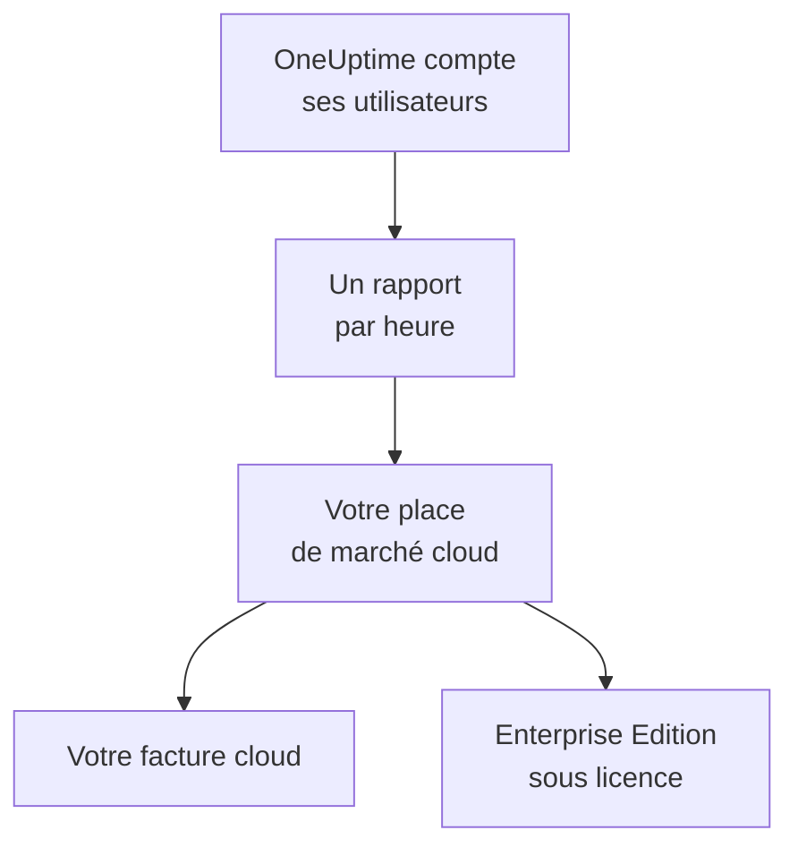

# Places de marché cloud

Exécutez OneUptime Enterprise, acheté sur AWS Marketplace, Microsoft Marketplace ou Google Cloud Marketplace, dans votre propre cluster Kubernetes. La place de marché facture chaque utilisateur de votre installation à l'heure, sur votre facture cloud, et votre abonnement vaut licence pour l'Enterprise Edition : il n'y a aucune clé de licence à activer.

:::cards
- [Installer OneUptime](#installer-oneuptime): Sur Amazon EKS, Azure Kubernetes Service ou Google Kubernetes Engine.
- [Fonctionnement de la facturation](#fonctionnement-de-la-facturation): USD 0.10 par utilisateur et par heure, déclaré toutes les heures.
- [Mise à niveau](#mise-à-niveau): Comment une nouvelle version arrive dans votre cluster.
- [Dépannage](#dépannage): Quand le libellé d'édition affiche un avertissement lié à la place de marché.
:::

## Fonctionnement

OneUptime compte ses utilisateurs toutes les 15 minutes et, chaque heure, déclare une seule fois à la place de marché où vous l'avez acheté le plus grand nombre d'utilisateurs relevé pendant cette heure. La place de marché ajoute l'heure à votre facture cloud. Chaque rapport qu'elle accepte indique aussi à OneUptime que votre abonnement est actif, et c'est ce qui maintient la licence de l'Enterprise Edition.



| | AWS | Microsoft | Google Cloud |
| --- | --- | --- | --- |
| Fiche | Pas encore publique : [contactez-nous](https://oneuptime.com/enterprise/demo) | [OneUptime Enterprise](https://marketplace.microsoft.com/en-us/product/oneupitme.oneuptime-enterprise) | Pas encore publique : [contactez-nous](https://oneuptime.com/enterprise/demo) |
| S'exécute sur | Amazon EKS | Azure Kubernetes Service (AKS) | Google Kubernetes Engine (GKE) |
| Vous l'installez avec | Helm, depuis le registre de la fiche | Le portail Azure | La console Google Cloud |
| OneUptime déclare avec | Le rôle IAM de son compte de service Kubernetes | L'identité managée qu'Azure attribue à l'installation | Le secret de déclaration que Google Cloud Marketplace crée pour le déploiement |
| Nouvelles versions | Vous mettez à niveau avec Helm | Les versions mineures sont installées pour vous | Vous mettez à niveau à la main |

## Avant de commencer

- **Un cluster Kubernetes** sur le cloud de la place de marché, avec au moins 3 nœuds de 4 vCPU et 16 GiB de mémoire, une StorageClass par défaut et la prise en charge des services `LoadBalancer`. OneUptime exécute ses propres PostgreSQL, ClickHouse et Valkey dans le cluster ; pour les dimensionner, voir [Dimensionnement et planification de la capacité](/docs/installation/sizing).
- **Un nom de domaine** pour OneUptime, comme `oneuptime.example.com`, que vous pouvez faire pointer vers l'équilibreur de charge du cluster.
- **Un accès HTTPS sortant** du cluster vers la place de marché, pour que OneUptime puisse déclarer ses utilisateurs : `metering.marketplace.<region>.amazonaws.com` et `sts.<region>.amazonaws.com` sur AWS, `marketplaceapi.microsoft.com` sur Azure, `servicecontrol.googleapis.com` et `oauth2.googleapis.com` sur Google Cloud.

## Installer OneUptime

### AWS Marketplace

Sur AWS, OneUptime déclare ses utilisateurs avec un rôle IAM qu'EKS attribue à son compte de service Kubernetes (rôles IAM pour les comptes de service). AWS Marketplace n'accepte les données d'utilisation provenant d'EKS que si elles sont signées de cette façon.

:::steps
1. Abonnez-vous à OneUptime Enterprise sur AWS Marketplace, puis choisissez **Continue to Configuration**, sélectionnez la version et choisissez **Continue to Launch**.
2. Associez un fournisseur OIDC IAM au cluster, s'il n'en a pas encore, et créez le compte de service `oneuptime` avec un rôle IAM qui a la politique `AWSMarketplaceMeteringFullAccess`, avec les commandes ci-dessous. Exécutez-les à la place de la commande `eksctl` de l'étape 1 des **General launch instructions** de la page de lancement : cette commande associe un rôle que vous devriez d'abord créer vous-même.
3. Authentifiez Helm auprès du registre de la fiche et installez le chart avec les commandes de l'étape 2 des **General launch instructions**. Dans la commande `helm install`, définissez `serviceAccount.name` sur `oneuptime`, `host` sur votre nom de domaine, et `httpProtocol` sur `https` si un certificat se trouve devant OneUptime.
4. [Ouvrir OneUptime](#ouvrir-oneuptime).
:::

```bash
eksctl utils associate-iam-oidc-provider --cluster <cluster> --approve
eksctl create iamserviceaccount --name oneuptime --namespace oneuptime --cluster <cluster> \
  --attach-policy-arn arn:aws:iam::aws:policy/AWSMarketplaceMeteringFullAccess \
  --approve --override-existing-serviceaccounts
```

Conservez les valeurs de l'étape 3 dans un fichier, et passez-le à chaque `helm upgrade` :

```yaml title="values.yaml"
host: oneuptime.example.com
httpProtocol: https
serviceAccount:
  name: oneuptime
```

### Microsoft Marketplace

Sur Azure, OneUptime est une application Kubernetes : AKS l'installe comme extension de cluster et lui attribue l'identité managée avec laquelle OneUptime déclare ses utilisateurs.

:::steps
1. Ouvrez OneUptime Enterprise sur Microsoft Marketplace dans le portail Azure, ou ouvrez votre cluster AKS et sélectionnez **Extensions + applications** > **Add**, puis choisissez le forfait et sélectionnez **Create**.
2. Choisissez l'abonnement et le groupe de ressources, et indiquez si vous installez sur un cluster AKS existant ou si vous en créez un nouveau.
3. À l'étape **OneUptime**, saisissez un nom pour l'installation, votre nom de domaine et son protocole.
4. Sélectionnez **Review + create**, puis **Create**. L'installation prend quelques minutes ; elle est terminée quand **Extensions + applications** affiche son état de provisionnement à **Succeeded**.
5. [Ouvrir OneUptime](#ouvrir-oneuptime).
:::

Les compteurs personnalisés fonctionnent sur les clusters AKS, pas sur Kubernetes avec Azure Arc : OneUptime Enterprise sur Microsoft Marketplace ne s'installe donc que sur AKS.

### Google Cloud Marketplace

Sur Google Cloud, Marketplace exécute un déployeur qui installe OneUptime dans le namespace de votre choix, avec un secret de déclaration qui permet à OneUptime de déclarer ses utilisateurs.

:::steps
1. Ouvrez OneUptime Enterprise sur Google Cloud Marketplace dans la console Google Cloud et sélectionnez **Configure**.
2. Choisissez le cluster GKE et le namespace, puis saisissez un nom pour l'installation, votre nom de domaine et son protocole.
3. Sélectionnez **Deploy**. Le déploiement prend quelques minutes ; il est terminé quand l'application apparaît comme prête sous **Kubernetes Engine** > **Applications**.
4. [Ouvrir OneUptime](#ouvrir-oneuptime).
:::

## Ouvrir OneUptime

OneUptime commence par migrer sa base de données, ce qui prend quelques minutes sur une nouvelle installation. Faites ensuite pointer votre nom de domaine vers son équilibreur de charge :

```bash
kubectl get service --namespace <namespace>
```

Le service dont le nom se termine par `-nginx` a une `EXTERNAL-IP` : créez pour votre nom de domaine un enregistrement DNS qui pointe vers cette adresse. Ouvrez le nom de domaine et inscrivez-vous. Le premier compte d'une nouvelle installation en devient l'administrateur principal, qui peut ouvrir le tableau de bord admin à `/admin`.

Dans l'heure, le libellé d'édition affiche l'Enterprise Edition, sous licence via votre place de marché. Les administrateurs principaux voient le libellé d'édition dans l'en-tête du tableau de bord admin et dans le pied de page du Dashboard.

## Fonctionnement de la facturation

| Quoi | Fonctionnement |
| --- | --- |
| Prix | USD 0.10 par utilisateur et par heure, soit environ USD 73 par utilisateur et par mois. |
| Qui est compté | Toute personne qui a un compte OneUptime sur l'installation. Les abonnés des pages de statut et les personnes qui se connectent à une page de statut privée ne sont pas comptés. |
| Quand | OneUptime compte ses utilisateurs toutes les 15 minutes et déclare chaque heure une seule fois, avec le plus grand nombre d'utilisateurs relevé pendant cette heure. Une heure pendant laquelle OneUptime ne tournait pas n'est pas facturée. |
| Où | Sur votre facture AWS, Azure ou Google Cloud, via la place de marché. |
| Non inclus | Le cluster lui-même : votre cloud facture ses nœuds, ses disques et ses équilibreurs de charge comme d'habitude. |

Chaque installation est facturée séparément : une installation de staging l'est donc aussi. Pour un tarif annuel, des remises sur volume ou un prix pour des installations hors production, demandez à [sales@oneuptime.com](mailto:sales@oneuptime.com) une offre privée, que vous acceptez sur la place de marché.

Quand un rapport ne peut pas être envoyé, à cause d'un problème réseau ou d'une panne de la place de marché, OneUptime le renvoie à sa prochaine exécution. Chaque rapport porte une clé propre à son heure : une heure n'est donc jamais facturée deux fois.

## Fonctionnement des licences

Votre abonnement à la place de marché est votre licence. Chaque rapport accepté par la place de marché couvre chaque fonction Enterprise, pour chaque utilisateur, pendant les 72 heures suivantes. Une clé de licence de OneUptime fonctionne aussi sur la même installation : l'installation s'appuie alors sur la meilleure des deux.

| Ce qui se passe | Ce qu'affiche le libellé d'édition |
| --- | --- |
| La place de marché accepte les rapports horaires | L'Enterprise Edition, sous licence via votre place de marché. |
| Aucun rapport n'a été accepté depuis 72 heures | **Enterprise Edition (Marketplace Reports Failing)** : chaque fonction Enterprise continue de fonctionner pendant un délai de grâce de 30 jours. |
| La place de marché indique que l'installation n'est pas abonnée, ou le délai de grâce prend fin | **Enterprise Edition (Marketplace Subscription Ended)** : les fonctions Enterprise s'arrêtent, comme lorsqu'une [licence expire](/docs/self-hosted/enterprise#quand-une-licence-expire-ou-manque). |

Ce que la place de marché refuse, c'est un abonnement résilié ou suspendu, ou une installation qui n'est pas celle que vous avez achetée. La supervision, les alertes, les incidents, l'astreinte et les pages de statut continuent de fonctionner dans tous les cas, et rien n'est supprimé. Abonnez-vous de nouveau, et le prochain rapport accepté rétablit la licence de l'Enterprise Edition, sans redémarrage.

## Mise à niveau

| Place de marché | Comment une nouvelle version arrive dans votre cluster |
| --- | --- |
| AWS Marketplace | Chaque version de OneUptime devient une nouvelle version de la fiche. Lancez `helm upgrade` avec le chart du registre de la fiche, la nouvelle version et votre fichier de valeurs. |
| Microsoft Marketplace | AKS installe pour vous les nouvelles versions mineures et correctives. Une nouvelle version majeure attend que vous l'acceptiez. Vous pouvez désactiver les mises à niveau automatiques sur la page de l'installation, dans **Extensions + applications**. |
| Google Cloud Marketplace | Google Cloud Marketplace garde un déploiement sur la version installée et ne le met jamais à jour. Contactez le [support](https://oneuptime.com/support) avant de faire passer un déploiement à une nouvelle version. |

OneUptime migre sa base de données au démarrage de la nouvelle version. Lisez les [notes de mise à niveau](/docs/installation/upgrading) avant de passer à une nouvelle version majeure.

Mettez à niveau via la place de marché. Une installation issue de la place de marché ne se compare pas aux versions de OneUptime publiées sur GitHub : les versions que propose votre place de marché sont celles vers lesquelles mettre à niveau.

## Paramètres et mise à l'échelle

Votre facture ne change pas avec l'échelle : OneUptime est facturé par utilisateur. Davantage de réplicas ou des nœuds plus grands ne changent que ce que votre cloud facture pour le cluster.

| Place de marché | Où se trouvent vos paramètres |
| --- | --- |
| AWS Marketplace | Votre fichier de valeurs. Tous les paramètres du [chart Helm](https://artifacthub.io/packages/helm/oneuptime/oneuptime) fonctionnent, sauf les opérateurs fournis avec le chart. |
| Microsoft Marketplace | Les paramètres de configuration de l'installation, sur sa page dans **Extensions + applications** ou avec `az k8s-extension update --configuration-settings`. Chaque paramètre est une valeur du chart, comme `autoscaling.enabled=true`. |
| Google Cloud Marketplace | Les champs du formulaire de déploiement. Modifiez tout le reste avec `kubectl`, sur les ressources propres au déploiement. |

- **Mettez OneUptime à l'échelle** avec les paramètres de réplicas et d'autoscaling du chart (`deployment.replicaCount`, `autoscaling.enabled` et les réglages propres à chaque service), et les nœuds avec l'autoscaler de votre cluster.
- **Gardez les paramètres de place de marché tels que la fiche les définit** : `enterpriseMarketplace` et, sur AWS, `serviceAccount`. Sans eux, OneUptime ne peut pas envoyer ses rapports, et l'Enterprise Edition n'est pas sous licence.
- **Les opérateurs KEDA, CloudNativePG et Altinity ClickHouse ne sont pas inclus**, car une place de marché ne livre que les images de sa fiche. Pour des bases de données hautement disponibles, pointez OneUptime vers des services managés avec `externalPostgres`, `externalRedis` et `externalClickhouse`.

La facturation ne dépend pas du nombre de réplicas en cours d'exécution : une seule exécution à la fois envoie les rapports, et chaque heure a un seul rapport.

## Dépannage

:::details Le libellé d'édition affiche Enterprise Edition (Marketplace Reports Failing)
OneUptime ne parvient pas à transmettre ses rapports à la place de marché. Chaque ligne qu'il journalise à ce sujet commence par `OneUptime Enterprise marketplace billing` ; une ligne indiquant que l'utilisation « cannot be reported » nomme ce qui manque. Les causes habituelles :

- **AWS :** le compte de service `oneuptime` n'a pas de rôle IAM, ou le rôle n'a pas la politique `AWSMarketplaceMeteringFullAccess` (`AWSMarketplaceMeteringRegisterUsage` ne suffit pas). Associez la politique au rôle, ou créez le rôle avec la commande `eksctl` de la section [AWS Marketplace](#aws-marketplace), puis redémarrez les pods de OneUptime avec `kubectl rollout restart deployment --namespace oneuptime`.
- **Azure :** l'installation n'est pas l'application Microsoft Marketplace, par exemple parce qu'elle a été installée avec Helm : elle n'a donc ni identité ni forfait pour déclarer son utilisation. Installez-la depuis le portail Azure.
- **Google Cloud :** le secret de déclaration du déploiement a été supprimé ou remplacé.
- **Toutes les places de marché :** un pare-feu ou un proxy bloque le HTTPS sortant décrit dans [Avant de commencer](#avant-de-commencer).

L'utilisation est conservée pendant que vous corrigez le problème, et facturée dès que OneUptime peut de nouveau envoyer ses rapports. L'utilisation de plus de 30 jours n'est pas facturée.
:::

:::details Le libellé d'édition affiche Enterprise Edition (Marketplace Subscription Ended)
La place de marché a refusé l'installation : l'abonnement a été résilié ou suspendu, ou l'installation n'est pas celle achetée sur la place de marché. Vérifiez l'abonnement sur la place de marché et abonnez-vous de nouveau ; le prochain rapport accepté rétablit la licence de l'Enterprise Edition. Le même libellé s'affiche quand les rapports ont échoué pendant tout le délai de grâce.
:::

:::details Les pods restent en attente après l'installation
Les bases de données de OneUptime ont besoin de volumes persistants. Donnez au cluster une StorageClass par défaut : sur Amazon EKS, installez le module complémentaire du pilote Amazon EBS CSI.
:::

## Étapes suivantes

:::cards
- [Édition Enterprise](/docs/self-hosted/enterprise): Ce qu'ajoute l'Enterprise Edition, et ce qui s'arrête quand une licence expire.
- [Mise à niveau](/docs/installation/upgrading): Les notes de mise à niveau de chaque version.
- [Dimensionnement et planification de la capacité](/docs/installation/sizing): Dimensionner les bases de données pour votre télémétrie.
- [Architecture](/docs/self-hosted/architecture): Ce qui s'exécute dans votre cluster.
- [Agent Kubernetes](/docs/telemetry/kubernetes-agent#installer-en-tant-que-module-complémentaire-amazon-eks): Gratuit sur AWS Marketplace également, en tant que module complémentaire Amazon EKS, pour les clusters qui envoient leurs données à OneUptime.
:::
