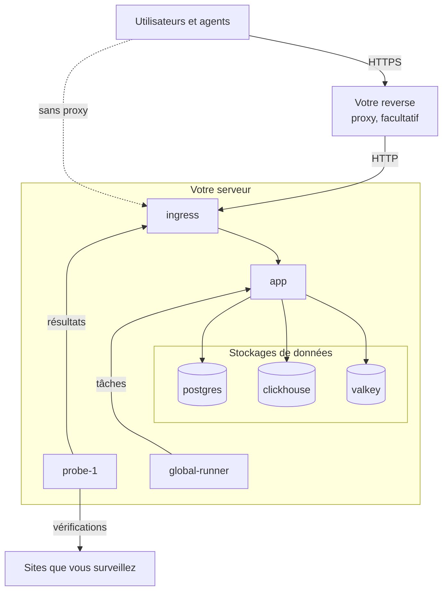

# Docker Compose

Exécutez une instance OneUptime complète et gratuite sur un seul serveur Linux avec Docker Compose. Cette page vous mène d'un serveur vierge à une instance en fonctionnement, puis couvre HTTPS, le durcissement pour la production, les sauvegardes, les mises à jour et la désinstallation. Pour travailler plutôt sur le code de OneUptime lui-même, voir [Développement local](/docs/installation/local-development).

:::cards
- [Installer OneUptime](#installer-oneuptime): D'un serveur vierge à votre premier compte, en cinq étapes.
- [Configurer HTTPS](#configurer-https): Laisser OneUptime obtenir un certificat, ou placer votre propre proxy devant.
- [Liste de contrôle pour la production](#liste-de-contrôle-pour-la-production): Ce qu'il faut régler avant l'arrivée du vrai trafic.
- [Mettre à jour OneUptime](#mettre-à-jour-oneuptime): Passer à la dernière version.
:::

## Fonctionnement

Docker Compose exécute chaque partie de OneUptime sous forme de conteneur sur votre serveur. Tout le trafic entre par le conteneur `ingress`, qui l'achemine vers l'`app`. L'application conserve ses données dans PostgreSQL, ClickHouse et Valkey. Une sonde intégrée exécute les vérifications de vos moniteurs et renvoie les résultats via l'ingress.



| Service | Image | Ce qu'il fait |
| --- | --- | --- |
| `ingress` | `oneuptime/nginx` | Reçoit tout le trafic sur les ports 80 et 443 et l'achemine vers l'application. Sert HTTPS quand OneUptime gère le certificat. |
| `app` | `oneuptime/app` | Le tableau de bord, l'API, les pages de statut, l'ingestion de télémétrie et les workers en arrière-plan. |
| `probe-1` | `oneuptime/probe` | Une sonde globale qui exécute les vérifications de vos moniteurs. Elle utilise le réseau de l'hôte. |
| `global-runner` | `oneuptime/runner` | Le Runner global intégré, qui exécute les étapes JavaScript des runbooks et les corrections de code de OneUptime AI pour tous les projets. |
| `postgres` | `postgres:15` | Configuration et état : moniteurs, incidents, utilisateurs. Stockés dans le volume `postgres`. |
| `clickhouse` | `clickhouse/clickhouse-server:26.7` | Télémétrie : logs, métriques, traces et exceptions. Stockées dans le volume `clickhouse`. |
| `valkey` | `valkey/valkey:9.1-alpine` | Cache et files d'attente. Il ne conserve rien sur disque. |

> [!NOTE]
> Le service `valkey` exécute [Valkey](https://valkey.io), le fork sous licence BSD de Redis 7.2, configuré via les paramètres `VALKEY_*` de `config.env`. Tout serveur parlant le protocole Redis convient — pointez `VALKEY_HOST` vers un Redis managé si vous préférez. Ces paramètres s'appelaient `REDIS_*` jusqu'à la 13.0.0 ; les anciens noms sont toujours lus, le conteneur répond toujours au nom d'hôte `redis`, et `npm run update` ne les réécrit pas : un ancien `config.env` n'a donc besoin d'aucune modification.

Pour la production à grande échelle, ou quand vous avez besoin de haute disponibilité, utilisez plutôt le [chart Helm](https://artifacthub.io/packages/helm/oneuptime/oneuptime) sur Kubernetes : Docker Compose exécute une seule copie de chaque service sur un seul serveur.

## Prérequis

Choisissez la taille du serveur selon ce que vous allez y exécuter. C'est la télémétrie (logs, métriques, traces) qui détermine la mémoire et le disque ; consultez [Dimensionnement et planification de la capacité](/docs/installation/sizing) une fois vos volumes connus.

| | Recommandé | Minimum pour un homelab |
| --- | --- | --- |
| **Mémoire** | 16 Go | 8 Go |
| **CPU** | 8 cœurs | 4 cœurs |
| **Disque** | 400 Go | 20 Go |
| **Système** | Ubuntu 22.04, ou un autre Linux basé sur Debian, Ubuntu ou RHEL | Le même |
| **Architecture** | x86-64 (`amd64`) ou ARM (`arm64`) | La même |

Le minimum pour un homelab convient à un usage personnel et expérimental — certains font tourner OneUptime sur un Raspberry Pi.

Il vous faut aussi :

- **Docker** avec le plugin **Docker Compose v2** (la commande `docker compose`).
- **Git**, pour récupérer OneUptime.
- **Node.js et npm**, qui exécutent les scripts `npm start` et `npm run update` qui enveloppent Docker Compose.
- **Ports 80 et 443** libres sur le serveur. Le tableau ci-dessous liste chaque port que OneUptime utilise sur l'hôte.

| Port de l'hôte | Utilisé par | Paramètre | À quoi il sert |
| --- | --- | --- | --- |
| 80 | `ingress` | `ONEUPTIME_HTTP_PORT` | Le tableau de bord, l'API, l'ingestion de télémétrie et la validation Let's Encrypt. |
| 443 | `ingress` | `STATUS_PAGE_HTTPS_PORT` | HTTPS pour votre instance quand OneUptime gère le certificat, et pour les pages de statut et tableaux de bord sur des domaines personnalisés. |
| 5400 | `postgres` | `DATABASE_PUBLISHED_PORT` | Permet à `npm run backup` et à `restore.sh` de joindre PostgreSQL depuis le serveur lui-même. Il n'est publié que sur `127.0.0.1`. |
| 3874 | `probe-1` | `GLOBAL_PROBE_1_PORT` | Le serveur propre à la sonde. Rien hors du serveur n'en a besoin. |

Il existe aussi une [vidéo pas à pas](https://youtu.be/j1SWmMW2oL4) de l'installation.

## Installer OneUptime

Sur un serveur Ubuntu, Debian ou basé sur RHEL tout neuf, une seule commande peut exécuter pour vous les étapes ci-dessous. Elle installe Docker, Git et Node.js s'ils manquent, clone la branche release dans un dossier `oneuptime`, demande l'adresse que les gens utiliseront et lance `npm start` :

```bash
curl -fsSL https://oneuptime.com/install.sh | bash
```

:::steps
### Cloner la branche release

La branche `release` contient les fichiers de la dernière version.

```bash
git clone --depth 1 --single-branch --branch release https://github.com/OneUptime/oneuptime.git
cd oneuptime
```

### Créer config.env

Tous les paramètres de OneUptime se trouvent dans `config.env`. Partez de l'exemple :

```bash
cp config.example.env config.env
```

### Définir le nom d'hôte

Ouvrez `config.env` et réglez `HOST` sur le nom de domaine ou l'adresse IP qu'on utilisera pour joindre OneUptime, sans `http://`. Ne gardez `localhost` que pour essayer OneUptime sur votre propre ordinateur.

```ini title="config.env"
HOST=oneuptime.example.com
```

### Démarrer OneUptime

:::tabs
@tab npm
```bash
npm start
```
@tab Docker CLI
```bash
sh Scripts/Install/WithConfig.sh docker compose up --remove-orphans -d
```
Avant le premier démarrage, remplacez vous-même les secrets factices, comme le montre [Générer des secrets aléatoires](#générer-des-secrets-aléatoires) : seul `npm start` le fait pour vous.
:::

`npm start` vérifie d'abord le serveur : Docker, la mémoire, l'espace disque, les ports qu'utilise OneUptime et `HOST`. Il s'arrête sur tout ce qui empêcherait OneUptime de fonctionner, et dit quoi changer. Il donne ensuite à chaque secret factice de `config.env` sa propre valeur aléatoire, démarre OneUptime et attend que chaque partie réponde. Le premier démarrage prend plusieurs minutes, le temps que Docker télécharge les images et que OneUptime crée ses bases de données. Il se termine par **OneUptime is up!** et l'adresse à ouvrir.

### Créer le premier compte

Ouvrez `http://` suivi de votre `HOST` (par exemple `http://localhost`) et inscrivez-vous. Le premier compte d'une nouvelle instance en devient l'administrateur principal, qui peut ouvrir l'Admin Dashboard à `/admin`.

Toute personne qui peut joindre la page peut s'inscrire après vous. Pour l'empêcher, ouvrez l'Admin Dashboard, allez dans **Paramètres > Authentification** et désactivez **Autoriser les inscriptions**. Les personnes que vous invitez dans un projet peuvent toujours créer leur compte.
:::

### Générer des secrets aléatoires

`config.example.env` livre chaque secret sous forme de secret factice, public sur GitHub. `npm start` donne à chacun sa propre valeur aléatoire avant de démarrer quoi que ce soit, et nomme les paramètres qu'il a remplis :

| Paramètre | Ce qu'il protège |
| --- | --- |
| `ONEUPTIME_SECRET` | Les appels entre les services de OneUptime. |
| `ENCRYPTION_SECRET` | Les secrets que OneUptime stocke, comme les jetons d'intégration et les mots de passe SMTP, et les jetons de connexion qu'il émet. |
| `DATABASE_PASSWORD`, `CLICKHOUSE_PASSWORD`, `VALKEY_PASSWORD` | Les trois stockages de données. |
| `REGISTER_PROBE_KEY` | L'enregistrement des sondes auprès de votre instance. |
| `GLOBAL_PROBE_1_KEY`, `GLOBAL_PROBE_2_KEY` | Les sondes globales que Docker Compose peut exécuter (`probe-1` tourne par défaut). |
| `GLOBAL_RUNNER_KEY` | Le Runner global intégré, qui exécute les étapes JavaScript et les corrections de code par IA de tous les projets. |

> [!IMPORTANT]
> Conservez les secrets une fois OneUptime démarré. PostgreSQL ne prend son mot de passe qu'à la création de sa base, et modifier `ENCRYPTION_SECRET` plus tard rend illisible toute valeur chiffrée avec l'ancien. C'est pourquoi `npm start` ne définit `DATABASE_PASSWORD` et `ENCRYPTION_SECRET` que sur une nouvelle installation, avant que PostgreSQL ne crée sa base.

Avec la Docker CLI, remplacez vous-même les secrets factices avant le premier démarrage :

```bash
while grep -q "please-change-this-to-random-value" config.env; do
  sed -i "0,/please-change-this-to-random-value/{s/please-change-this-to-random-value/$(openssl rand -hex 32)/}" config.env
done
grep -c "please-change-this" config.env
```

La dernière commande affiche `0` : il ne reste aucun secret factice. La boucle utilise GNU `sed`, présent sur tout serveur Linux.

## Configurer HTTPS

OneUptime sert du HTTP simple jusqu'à ce que vous choisissiez l'une des deux façons d'ajouter HTTPS :

| | Laisser OneUptime obtenir un certificat | Utiliser votre propre reverse proxy |
| --- | --- | --- |
| **TLS se termine sur** | L'`ingress` de OneUptime, avec un certificat Let's Encrypt gratuit qu'il renouvelle lui-même | Votre proxy : Caddy, Nginx ou un équilibreur de charge |
| **Il vous faut** | Un nom de domaine public qui pointe vers le serveur, et les ports 80 et 443 joignables depuis Internet | Un proxy, et un certificat pour votre domaine |
| **Paramètres** | `PROVISION_SSL=true`, `HTTP_PROTOCOL=https` | `PROVISION_SSL=false`, `HTTP_PROTOCOL=https`, `TRUSTED_PROXY_HOPS=2` |
| **Pages de statut sur des domaines personnalisés** | Fonctionnent sans configuration supplémentaire | Votre proxy doit aussi servir ces domaines |

Si vous placez des pages de statut ou des tableaux de bord sur des domaines personnalisés, laisser OneUptime gérer TLS est la configuration la plus simple : l'ingress commande et sert lui-même les certificats de ces domaines.

Avec `HTTP_PROTOCOL=https`, OneUptime construit des liens HTTPS, garde les cookies de connexion sur HTTPS et demande aux navigateurs de n'atteindre votre `HOST` qu'en HTTPS. Un navigateur s'y tient pendant un an, sur tous les ports de ce nom ; si `HOST` doit un jour répondre de nouveau en HTTP simple, définissez donc `HSTS_MAX_AGE_SECONDS=0` dans `config.env` quelque temps avant : les navigateurs oublient la règle à leur visite suivante.

### Laisser OneUptime obtenir un certificat

:::steps
#### Faire pointer votre domaine vers le serveur

Créez un enregistrement DNS `A` (ou `AAAA` pour IPv6) pour votre domaine, avec l'adresse IP publique du serveur comme valeur. Avec un enregistrement `AAAA`, activez aussi IPv6 pour OneUptime : voir [Adresses des visiteurs](#adresses-des-visiteurs).

#### Activer l'obtention de certificats

Définissez ces valeurs dans `config.env` :

```ini title="config.env"
HOST=oneuptime.example.com
PROVISION_SSL=true
HTTP_PROTOCOL=https
```

`HOST` doit être un nom de domaine : OneUptime ne peut pas obtenir de certificat pour une adresse IP ni pour `localhost`.

#### Redémarrer avec les nouveaux paramètres

```bash
npm start
```

#### Ouvrir votre instance en HTTPS

Ouvrez `https://oneuptime.example.com`. OneUptime commande le certificat au démarrage puis le vérifie toutes les heures, et le renouvelle quand il reste moins de 30 jours. Jusqu'à l'arrivée du premier certificat, généralement en quelques minutes, l'ingress sert un certificat auto-signé temporaire et votre navigateur vous avertit.
:::

### Utiliser votre propre reverse proxy

Ces étapes font tourner le proxy sur le même serveur que OneUptime. Si votre proxy tourne sur une autre machine, sautez la première étape, pointez le proxy vers le port 80 de ce serveur et, avec le pare-feu de votre fournisseur cloud, ne laissez que le proxy joindre les ports 80 et 443 : un visiteur qui joint OneUptime sans passer par le proxy peut choisir l'adresse sous laquelle OneUptime le compte.

:::steps
#### Déplacer l'ingress hors des ports 80 et 443

Le proxy a besoin des ports 80 et 443 : déplacez donc l'ingress sur d'autres ports, publiés uniquement sur l'adresse de bouclage `127.0.0.1` de ce serveur, pour que les visiteurs ne joignent OneUptime qu'à travers votre proxy :

```ini title="config.env"
ONEUPTIME_HTTP_PORT=127.0.0.1:8080
STATUS_PAGE_HTTPS_PORT=127.0.0.1:8443
```

La sonde utilise le réseau de l'hôte et joint OneUptime via `http://localhost`. `npm start` la déplace sur le nouveau port de l'ingress, `http://localhost:8080`, et l'indique.

#### Indiquer à OneUptime qu'il est derrière un proxy

```ini title="config.env"
HOST=oneuptime.example.com
HTTP_PROTOCOL=https
PROVISION_SSL=false
TRUSTED_PROXY_HOPS=2
```

`HTTP_PROTOCOL=https` fait utiliser HTTPS aux liens que OneUptime construit. `TRUSTED_PROXY_HOPS=2` compte votre proxy et l'ingress de OneUptime, pour que OneUptime lise l'adresse réelle du visiteur pour les listes d'IP autorisées et les limites de débit. Ajoutez-en un pour chaque proxy supplémentaire qui complète `X-Forwarded-For`, comme un CDN ou un équilibreur de charge.

#### Redémarrer OneUptime sur les nouveaux ports

```bash
npm start
```

`npm start` vérifie OneUptime sur son nouveau port, `localhost:8080`, et se termine par **OneUptime is up!**

#### Configurer le proxy

:::tabs
@tab Caddy
```text title="Caddyfile"
oneuptime.example.com {
	reverse_proxy localhost:8080
}
```
Caddy obtient et renouvelle le certificat lui-même, redirige HTTP vers HTTPS et laisse passer les connexions WebSocket. Rechargez Caddy après avoir modifié le fichier, par exemple avec `sudo systemctl reload caddy`.
@tab Nginx
```nginx title="/etc/nginx/conf.d/oneuptime.conf"
map $http_upgrade $oneuptime_connection_upgrade {
    default upgrade;
    ""      close;
}

server {
    listen 80;
    server_name oneuptime.example.com;
    return 301 https://$host$request_uri;
}

server {
    listen 443 ssl;
    server_name oneuptime.example.com;

    ssl_certificate     /etc/letsencrypt/live/oneuptime.example.com/fullchain.pem;
    ssl_certificate_key /etc/letsencrypt/live/oneuptime.example.com/privkey.pem;

    # The limits OneUptime's own ingress uses.
    client_max_body_size 50M;
    proxy_read_timeout 300s;
    proxy_send_timeout 300s;

    proxy_http_version 1.1;
    proxy_set_header Host $host;
    proxy_set_header X-Forwarded-For $proxy_add_x_forwarded_for;
    proxy_set_header X-Forwarded-Proto $scheme;
    proxy_set_header Upgrade $http_upgrade;
    proxy_set_header Connection $oneuptime_connection_upgrade;

    location / {
        proxy_pass http://127.0.0.1:8080;
    }

    # MCP clients keep a stream open.
    location /mcp {
        proxy_pass http://127.0.0.1:8080;
        proxy_buffering off;
        proxy_read_timeout 86400s;
        proxy_send_timeout 86400s;
    }
}
```
Les chemins des certificats sont ceux où Certbot place un certificat Let's Encrypt ; utilisez les chemins de votre propre certificat s'il vient d'ailleurs. Vérifiez le fichier et rechargez Nginx avec `sudo nginx -t && sudo systemctl reload nginx`.
:::

Les deux envoient `X-Forwarded-Proto`, qui indique à OneUptime qu'un visiteur est venu en HTTPS. Tout autre proxy doit l'envoyer aussi, sinon les cookies de connexion des pages de statut et des tableaux de bord sur vos domaines personnalisés ne restent pas sur HTTPS.

#### Ouvrir votre instance via le proxy

Ouvrez `https://oneuptime.example.com`. Vous devriez voir la page de connexion de OneUptime, servie avec le certificat de votre proxy.
:::

> [!NOTE]
> Derrière votre propre proxy, envoyez la télémétrie en OTLP/HTTP (`/otlp`). OTLP en gRPC ne joint OneUptime que lorsque son propre ingress termine TLS (`PROVISION_SSL=true`).

## Adresses des visiteurs

OneUptime compte chaque visiteur selon l'adresse depuis laquelle il se connecte : les limites de connexion, les autres limites par adresse et les listes d'IP autorisées des pages de statut et des tableaux de bord la lisent toutes. Deux configurations ont besoin d'un réglage pour que cette adresse soit bien celle du visiteur :

| Configuration | Réglage |
| --- | --- |
| Des personnes joignent OneUptime en IPv6, par exemple via un enregistrement `AAAA` | IPv6 sur le réseau de OneUptime, dans `docker-compose.override.yml` |
| Votre propre reverse proxy est placé devant OneUptime | `TRUSTED_PROXY_HOPS=2`, avec l'ingress publié sur `127.0.0.1` (voir [Utiliser votre propre reverse proxy](#utiliser-votre-propre-reverse-proxy)) |

Sans IPv6 sur le réseau de OneUptime, Docker transmet chaque visiteur qui arrive en IPv6 à OneUptime depuis une adresse à lui, et OneUptime les compte tous comme un seul visiteur : les échecs de connexion d'une personne peuvent bloquer les autres. Activer IPv6 demande Docker Engine 27 ou plus récent (`docker version` affiche la vôtre).

:::steps
### Activer IPv6

Créez `docker-compose.override.yml` à côté de `docker-compose.yml`, ou complétez celui que vous avez ; `npm start` et `npm run update` le lisent :

```yaml title="docker-compose.override.yml"
networks:
  oneuptime:
    enable_ipv6: true
```

### Redémarrer OneUptime

```bash
npm stop
npm start
```

OneUptime s'arrête, puis redémarre avec IPv6 sur son réseau. Vos données sont conservées. Docker ne peut pas supprimer un réseau auquel un conteneur à vous est encore rattaché, comme un reverse proxy : détachez-le d'abord du réseau de OneUptime, et rattachez-le ensuite. Si `npm start` s'arrête sur `has active endpoints`, détachez-le, puis relancez `npm stop` et `npm start`.

### Vérifier le réseau

```bash
docker network ls --quiet --filter name=_oneuptime | xargs docker network inspect | grep EnableIPv6
```

La commande affiche `"EnableIPv6": true,`.
:::

Quand plusieurs personnes se connectent depuis une même adresse de réseau privé, la page **Santé OneUptime** de l'Admin Dashboard le signale, avec le réglage qui change cela.

## Liste de contrôle pour la production

Docker Compose exécute une seule copie de chaque service sur un seul serveur, ce qui convient aux petites équipes et aux homelabs. Avant de vous y fier, passez cette liste en revue.

| Domaine | Que faire |
| --- | --- |
| **Secrets** | Aucune valeur de `config.env` n'est encore un secret factice `please-change-this-to-random-value`. Voir [Générer des secrets aléatoires](#générer-des-secrets-aléatoires), et [Changer le mot de passe de la base](#changer-le-mot-de-passe-de-la-base) pour une installation qui a démarré avec le secret factice dans `DATABASE_PASSWORD`. |
| **HTTPS** | On joint OneUptime en HTTPS et `HTTP_PROTOCOL=https` est défini. Voir [Configurer HTTPS](#configurer-https). |
| **Inscriptions** | Une fois que votre équipe a ses comptes, désactivez **Autoriser les inscriptions** sous **Paramètres > Authentification** dans l'Admin Dashboard. |
| **Pare-feu** | Seuls les ports 80 et 443 (et SSH) sont ouverts sur Internet. OneUptime ne publie le port 5400 de PostgreSQL que sur `127.0.0.1`. Fermez tout autre port que vous publiez avec le pare-feu de votre fournisseur cloud : les règles `ufw` ne s'appliquent pas aux ports que Docker publie. |
| **Adresses des visiteurs** | La page **Santé OneUptime** de l'Admin Dashboard ne signale pas que plusieurs personnes se connectent depuis une même adresse. Voir [Adresses des visiteurs](#adresses-des-visiteurs). |
| **Sauvegardes** | PostgreSQL est sauvegardé chaque jour et les copies quittent le serveur. Voir [Sauvegarder et restaurer](#sauvegarder-et-restaurer). |
| **E-mail** | Un serveur de messagerie est configuré sous **Paramètres > Notifications > E-mails** dans l'Admin Dashboard, pour que OneUptime puisse envoyer invitations et notifications. Voir [SMTP](/docs/emails/smtp). |
| **Disque** | L'espace libre est surveillé. ClickHouse grandit avec la télémétrie que vous conservez (voir [Dimensionnement et planification de la capacité](/docs/installation/sizing)) ; le log de chaque conteneur est plafonné à 1000 Mo. |
| **Mises à jour** | OneUptime est mis à jour au moins une fois par semaine. Les versions sortent souvent. Voir [Mettre à jour OneUptime](#mettre-à-jour-oneuptime). |
| **Haute disponibilité** | Si vous en avez besoin, passez au [chart Helm](https://artifacthub.io/packages/helm/oneuptime/oneuptime) sur Kubernetes. |

### Changer le mot de passe de la base

PostgreSQL garde le mot de passe avec lequel il a été créé : changer seulement `DATABASE_PASSWORD` dans `config.env` prive OneUptime de sa base. Pour donner un mot de passe propre à une installation qui a démarré avec le secret factice, changez-le dans PostgreSQL et dans `config.env` en même temps, puis redémarrez OneUptime :

```bash
NEW_PASSWORD=$(openssl rand -hex 32) &&
  echo "ALTER USER CURRENT_USER PASSWORD '$NEW_PASSWORD';" | sh Scripts/Install/WithConfig.sh sh -c 'docker compose exec -T postgres psql -v ON_ERROR_STOP=1 -U "$DATABASE_USERNAME" -d "$DATABASE_NAME"' &&
  sed -i "s/^DATABASE_PASSWORD=.*/DATABASE_PASSWORD=$NEW_PASSWORD/" config.env
npm start
```

Si vous avez défini `DATABASE_BACKUP_PASSWORD` et `DATABASE_RESTORE_PASSWORD`, donnez-leur aussi la nouvelle valeur.

## Sauvegarder et restaurer

PostgreSQL contient tout ce que vous configurez : moniteurs, incidents, pages de statut, utilisateurs. `npm run backup` le vide dans un fichier du dossier `Backups`. L'Enterprise Edition peut aussi sauvegarder PostgreSQL et ClickHouse selon un planning, vers un stockage qui vous appartient, depuis l'Admin Dashboard : voir [Sauvegardes](/docs/installation/backups).

:::steps
### Donner au script de sauvegarde le mot de passe de la base

Dans `config.env`, réglez `DATABASE_BACKUP_PASSWORD` sur la valeur de `DATABASE_PASSWORD`. Le script lit `config.env` comme du texte brut : le `${DATABASE_PASSWORD}` fourni n'est donc jamais remplacé.

### Lancer la sauvegarde

```bash
npm run backup
```

Il demande votre mot de passe sudo et écrit `Backups/db-<day of the month>.backup` : les sauvegardes quotidiennes remplacent donc celles du mois précédent. Lancez-le au moins une fois par jour.

### Copier les sauvegardes hors du serveur

Une sauvegarde sur le même disque que la base de données ne survit pas à la perte de ce disque.
:::

Seul le serveur lui-même joint PostgreSQL : il répond sur le port 5400 de `127.0.0.1`. Pour le sauvegarder depuis une autre machine, ouvrez un tunnel SSH depuis cette machine, puis connectez-vous à son propre port 5400 :

```bash
ssh -N -L 5400:127.0.0.1:5400 you@oneuptime.example.com
```

:::details Publier PostgreSQL sur une adresse d'un réseau privé
Si un outil de votre réseau privé doit joindre PostgreSQL sans tunnel, publiez-le aussi sur l'adresse du serveur dans ce réseau, sur un port à part. Créez `docker-compose.override.yml` à côté de `docker-compose.yml` ; `npm start` et `npm run update` le lisent :

```yaml title="docker-compose.override.yml"
services:
  postgres:
    ports:
      - "10.0.0.5:5401:5432"
```

Mettez l'adresse privée du serveur lui-même à la place de `10.0.0.5`, jamais une adresse publique, et donnez d'abord à PostgreSQL un mot de passe propre (voir [Changer le mot de passe de la base](#changer-le-mot-de-passe-de-la-base)). Lancez ensuite `npm start`, et PostgreSQL répond aussi sur le port 5401 de cette adresse.
:::

ClickHouse conserve votre télémétrie dans le volume Docker `oneuptime_clickhouse`, et aucun script ne le sauvegarde. Si vous devez conserver cette télémétrie, sauvegardez le volume avec un outil ClickHouse comme [clickhouse-backup](https://github.com/Altinity/clickhouse-backup), ou copiez-le pendant que OneUptime est arrêté.

Pour restaurer PostgreSQL, définissez les valeurs `DATABASE_RESTORE_*` dans `config.env` : `DATABASE_RESTORE_PASSWORD` sur la valeur de `DATABASE_PASSWORD`, comme pour les sauvegardes, et `DATABASE_RESTORE_FILENAME` sur la sauvegarde à restaurer, par exemple `db-31.backup`. Lancez ensuite `bash restore.sh`. La base dans laquelle il restaure doit déjà exister ; c'est le cas sur une installation en fonctionnement.

> [!CAUTION]
> `restore.sh` supprime de la base cible chaque objet présent dans la sauvegarde avant de le recréer. Il demande confirmation avant de commencer ; vérifiez le nom de la base qu'il affiche.

## Mettre à jour OneUptime

Sauvegardez d'abord, puis lancez :

```bash
git checkout release
git pull
npm run update
```

`npm run update` ajoute à votre `config.env` les nouveaux paramètres de `config.example.env` (vos propres valeurs sont conservées), récupère les nouvelles images et redémarre OneUptime. Comme `npm start`, il se termine par **OneUptime is up!**

Passer à une nouvelle version majeure (de 13 à 14, par exemple) peut demander davantage : lisez [Mettre à niveau OneUptime](/docs/installation/upgrading) avant de commencer.

`APP_TAG=release` dans `config.env` récupère toujours la dernière version de la Community Edition. Pour rester sur une version, réglez `APP_TAG` sur son numéro, par exemple `14.0.22`. Pour l'Enterprise Edition, les tags sont `enterprise-release` et `enterprise-14.0.22`.

## Désinstaller OneUptime

Arrêtez OneUptime et supprimez ses conteneurs et son réseau :

```bash
npm run down
```

Vos données restent dans les volumes `oneuptime_postgres` et `oneuptime_clickhouse`, et le dossier `oneuptime` conserve `config.env` et vos sauvegardes. Pour supprimer aussi les données :

```bash
sh Scripts/Install/WithConfig.sh docker compose down --volumes --remove-orphans
```

Supprimez ensuite le dossier `oneuptime`.

> [!CAUTION]
> `--volumes` supprime définitivement chaque moniteur, incident, utilisateur et toute la télémétrie. Sauvegardez d'abord si vous pourriez en avoir besoin.

## Dépannage

:::details npm start s'arrête avant de démarrer OneUptime
`npm start` vérifie d'abord le serveur et s'arrête sur tout ce qui empêcherait OneUptime de fonctionner : Docker ou son plugin Compose absent, Docker arrêté ou hors de portée de votre utilisateur, un port occupé par un autre programme, ou un `HOST` qu'aucun navigateur ne peut ouvrir. Chaque ligne marquée ✗ dit quoi changer. Corrigez-le, puis relancez `npm start`. Si une vérification se trompe sur votre serveur, démarrez sans les vérifications :

```bash
ONEUPTIME_SKIP_PREFLIGHT=true npm start
```
:::

:::details Docker indique "permission denied" quand vous lancez npm start
Votre utilisateur ne peut pas joindre le démon Docker. Ajoutez-le au groupe `docker`, puis déconnectez-vous et reconnectez-vous :

```bash
sudo usermod -aG docker $USER
```
:::

:::details L'ingress ne peut pas démarrer car le port 80 ou 443 est occupé
Un autre programme du serveur, souvent un serveur web, occupe le port. `npm start` vérifie les ports avant de démarrer quoi que ce soit, et nomme le conteneur qui en occupe un quand Docker l'exécute. Arrêtez ce programme, ou déplacez l'ingress sur d'autres ports et placez le programme devant OneUptime comme décrit dans [Utiliser votre propre reverse proxy](#utiliser-votre-propre-reverse-proxy).
:::

:::details npm start se termine par "Maximum retries reached"
La vérification qui termine `npm start` a abandonné avant que OneUptime ne réponde. Le premier démarrage peut durer plus longtemps que l'attente de la vérification, pendant le téléchargement des images et la création des bases. Regardez ce qui tourne et lisez les logs :

```bash
npm run ps
npm run logs
```

Une fois chaque conteneur démarré, relancez la vérification avec `npm run status-check`. Elle vérifie l'ingress sur le port que fixe `ONEUPTIME_HTTP_PORT`.
:::

:::details Le navigateur affiche "OneUptime n'est pas configuré pour cette adresse"
Vous avez ouvert OneUptime à une autre adresse que son `HOST`, par exemple l'adresse IP du serveur alors que `HOST` vaut encore `localhost`. La page affiche la ligne `HOST` correspondant à l'adresse ouverte, avec un bouton qui la copie : mettez cette ligne dans `config.env`, puis lancez `npm start`. Si vous avez ouvert l'adresse de `HOST` et que la page dit que votre proxy ne l'a pas transmise, réglez le proxy pour qu'il transmette le nom d'hôte demandé par le navigateur : Caddy le fait par défaut, Nginx avec `proxy_set_header Host $host;` et Apache avec `ProxyPreserveHost On`.
:::

:::details Certaines pages se chargent, mais les mises à jour en direct ou les envois échouent
Ouvrez OneUptime à l'adresse indiquée dans `HOST`. L'ingress achemine les requêtes selon le nom d'hôte : seuls `HOST` et `localhost` atteignent toute l'application, et tout autre nom, comme l'adresse IP du serveur, est traité comme un domaine de page de statut. Réglez `HOST` sur le nom qu'on utilise, puis lancez `npm start`.
:::

:::details L'inscription ou la connexion échoue avec "Page not found"
La page d'inscription se charge, mais l'inscription échoue avec `Page not found - /identity/signup`, et la connexion avec `Page not found - /identity/login`. La requête a atteint OneUptime sous un autre nom d'hôte que `HOST`, donc l'ingress l'a acheminée comme le domaine personnalisé d'une page de statut, où l'inscription et la connexion de OneUptime lui-même ne sont pas servies. Vérifiez ces deux points :

- `HOST` est l'adresse que les gens ouvrent, avec son port s'ils en utilisent un, par exemple `oneuptime.example.com:8080`. Lancez `npm start` après l'avoir modifié.
- Un proxy placé devant OneUptime transmet le nom d'hôte demandé par le navigateur. Caddy le fait par défaut, Nginx avec `proxy_set_header Host $host;` comme dans [Utiliser votre propre reverse proxy](#utiliser-votre-propre-reverse-proxy), et Apache avec `ProxyPreserveHost On`.
:::

:::details Le navigateur avertit au sujet du certificat après avoir défini PROVISION_SSL
Jusqu'à ce que Let's Encrypt émette le certificat, l'ingress sert un certificat auto-signé temporaire. Si l'avertissement persiste plus de quelques minutes, vérifiez que :

- `HOST` est un nom de domaine, pas une adresse IP ni `localhost`.
- L'enregistrement DNS du domaine pointe vers ce serveur.
- Le port 80 est joignable depuis Internet, pour que Let's Encrypt puisse valider le domaine.

Quand une commande échoue, l'application journalise une erreur qui commence par `CoreSSL:EnsurePrimaryHostCertificate`, suivie de la raison :

```bash
sh Scripts/Install/WithConfig.sh docker compose logs app | grep -A 5 CoreSSL
```
:::

:::details La sonde intégrée affiche Déconnecté après le changement de port de l'ingress
L'Admin Dashboard liste la sonde sous **Paramètres > Surveillance > Sondes globales**. Elle joint OneUptime à `GLOBAL_PROBE_1_ONEUPTIME_URL`, qui vaut `http://localhost` (port 80) par défaut. `npm start` la déplace sur le port de l'ingress tant qu'elle pointe vers `localhost`. Si vous l'avez réglée sur une autre adresse, ou avez démarré OneUptime avec la Docker CLI, réglez-la sur le nouveau port de l'ingress, par exemple `http://localhost:8080`, et redémarrez OneUptime.
:::

## Étapes suivantes

:::cards
- [Mettre à niveau OneUptime](/docs/installation/upgrading): Ce que chaque version majeure demande de votre part.
- [Dimensionnement et planification de la capacité](/docs/installation/sizing): Prévoir la mémoire et le disque pour votre télémétrie.
- [Architecture auto-hébergée](/docs/self-hosted/architecture): Comment les composants s'assemblent.
- [Édition Enterprise](/docs/self-hosted/enterprise): Ce que l'image Enterprise ajoute, et sa licence.
:::
