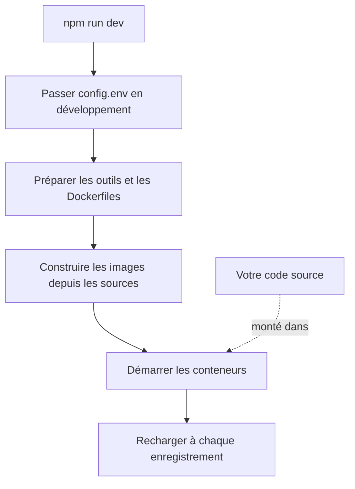

# Développement local

Exécutez OneUptime depuis les sources sur votre propre ordinateur pour travailler dessus. La pile de développement construit chaque service à partir de votre copie de travail, monte votre code source dans les conteneurs et les recharge dès que vous enregistrez un fichier.

Pour exécuter plutôt une version publiée, utilisez [Docker Compose](/docs/installation/docker-compose).

## Fonctionnement de la pile de développement

`npm run dev` prépare votre copie de travail, puis démarre la pile définie dans `Scripts/Dev/docker-compose.dev.yml` :



| Étape | Ce qui se passe |
| --- | --- |
| Passage en développement | Définit `ENVIRONMENT=development` dans `config.env`. |
| Préparation | Demande votre mot de passe sudo, installe les outils manquants (Git, curl, Node.js, Docker, gomplate, ts-node), exécute `git pull` sur votre branche actuelle, ajoute à `config.env` les nouveaux paramètres de `config.example.env` et génère un `Dockerfile` à partir de chaque `Dockerfile.tpl`. |
| Construction | Construit une image pour chaque service depuis les sources. La première construction prend un moment. |
| Exécution | Démarre les conteneurs avec votre code source monté dedans. |
| Rechargement | L'App redémarre son API quand un fichier serveur change et reconstruit les tableaux de bord pendant que vous les modifiez. |

Quand le dossier `ee/` du dépôt est présent, l'App charge l'Enterprise Edition depuis ce dossier. Définissez `ONEUPTIME_EDITION=community` dans `config.env` pour exécuter plutôt la Community Edition.

## Avant de commencer

| Il vous faut | Remarques |
| --- | --- |
| **Docker** | Docker Desktop sur macOS et Windows, ou Docker Engine avec le plugin Docker Compose v2 sur Linux. |
| **Node.js 26 ou plus récent, et npm** | La version demandée par le `package.json` du dépôt, et celle qu'utilise la CI. |
| **Git** | Pour cloner le dépôt. |
| **Un accès sudo** | `npm run dev` demande votre mot de passe avant d'installer quoi que ce soit. |
| **Les ports 80 et 443 libres** | La pile sert OneUptime sur `http://localhost` (port 80), et HTTPS sur le port 443. |

## Démarrer la pile de développement

:::steps
### Cloner le dépôt

```bash
git clone https://github.com/OneUptime/oneuptime.git
cd oneuptime
```

### Créer config.env

```bash
cp config.example.env config.env
```

Les valeurs d'exemple fonctionnent telles quelles pour le développement. Vous pouvez les modifier, mais ce n'est pas nécessaire.

### Démarrer la pile

```bash
npm run dev
```

La commande demande votre mot de passe sudo, puis construit les images et démarre les conteneurs en arrière-plan. Suivez le démarrage de l'App avec `docker logs -f oneuptime-app-1`.

### Ouvrir OneUptime

Ouvrez `http://localhost` et inscrivez-vous. Le premier compte devient l'administrateur principal, qui peut ouvrir l'Admin Dashboard à l'adresse `http://localhost/admin`.
:::

## Travailler sur le code

Modifiez les fichiers sous `packages/` et enregistrez : les conteneurs prennent la modification en compte.

Avant d'ouvrir une pull request, vérifiez votre modification sur votre ordinateur, hors des conteneurs. Installez pour cela les dépendances une fois : exécutez `npm install` à la racine du dépôt, pour ESLint et les outils de migration, puis `npm run install-modules`, qui supprime et réinstalle les `node_modules` de chaque paquet et prend un moment.

:::steps
### Compiler ce que vous avez modifié

Lancez le compilateur dans chaque paquet modifié, par exemple l'App :

```bash
cd packages/App
npm run compile
```

### Linter uniquement vos fichiers

Depuis la racine du dépôt, passez les fichiers que vous avez modifiés :

```bash
npx eslint --fix packages/App/path/to/File.ts
```

Évitez `npm run lint` et `npm run fix-lint` : ils lintent tout le dépôt.

### Exécuter les tests qui couvrent votre modification

Depuis le paquet, exécutez les fichiers de test pertinents plutôt que toute la suite :

```bash
cd packages/App
npx jest Tests/path/to/YourChange.test.ts
```
:::

### Migrations de base de données

| Base de données | Comment ajouter une migration |
| --- | --- |
| PostgreSQL | Modifiez le modèle, puis exécutez `npm run generate-postgres-migration` au lieu d'écrire la migration à la main. Enregistrez le nouveau fichier dans `packages/Common/Server/Infrastructure/Postgres/SchemaMigrations/Index.ts` : il ne s'exécute pas tant qu'il n'y est pas listé. `npm run check-postgres-schema-drift` affiche toute instruction encore manquante. |
| ClickHouse | Écrivez la migration à la main dans `packages/App/FeatureSet/Workers/DataMigrations`, sur le modèle des migrations existantes. |

## Référence

### Commandes

Exécutez-les depuis la racine du dépôt.

| Tâche | Commande |
| --- | --- |
| Démarrer la pile, ou appliquer des modifications de `config.env` | `npm run dev` |
| Reconstruire les images, après un changement de dépendances | `npm run build`, puis `npm run dev` |
| Reconstruire les images de zéro | `npm run force-build-dev`, puis `npm run dev` |
| Lister les conteneurs en cours d'exécution | `docker ps` |
| Suivre les journaux d'un service | `docker logs -f oneuptime-app-1` |
| Arrêter la pile et supprimer ses conteneurs | `npm run down` |

`npm run down` conserve vos données : les volumes PostgreSQL et ClickHouse lui survivent.

### Ports

La pile de développement publie les bases de données, pour que vous puissiez vous y connecter avec vos propres outils. Les mots de passe sont dans `config.env`.

| Service | Adresse | Se connecter avec |
| --- | --- | --- |
| OneUptime | `http://localhost` | Le compte que vous avez créé |
| PostgreSQL | `localhost:5400` | Utilisateur `postgres`, base `oneuptimedb`, mot de passe `DATABASE_PASSWORD` |
| ClickHouse | `localhost:8189` (HTTP), `localhost:9034` (natif) | Utilisateur `default`, base `oneuptime`, mot de passe `CLICKHOUSE_PASSWORD` |
| Valkey | `localhost:6310` | Mot de passe `VALKEY_PASSWORD` |

## Dépannage

:::details npm run dev s'arrête au git pull
`npm run dev` exécute `git pull` sur votre branche actuelle avant de construire. Git refuse sur une branche sans branche amont, ou quand le pull écraserait vos modifications non validées. Définissez la branche amont (par exemple en la poussant avec `git push -u origin <branch>`), ou validez votre travail, puis relancez `npm run dev`.
:::

:::details npm run dev s'arrête pendant l'installation d'un outil
Installez cet outil vous-même, par exemple gomplate ou ts-node, et relancez `npm run dev` : la commande ignore tout outil déjà installé.
:::

:::details Un service échoue après une modification de ses dépendances
Les images contiennent encore les anciennes dépendances. Reconstruisez-les avec `npm run build`, puis redémarrez la pile avec `npm run dev`. Si cela ne suffit pas, reconstruisez de zéro avec `npm run force-build-dev`.
:::

:::details Le port 80 ou 443 est déjà utilisé
Un autre programme sur votre ordinateur, souvent un serveur web local, occupe le port. Arrêtez-le, puis relancez `npm run dev`.
:::

## Étapes suivantes

:::cards
- [Architecture auto-hébergée](/docs/self-hosted/architecture): Comment s'articulent les services que vous venez de démarrer.
- [Docker Compose](/docs/installation/docker-compose): Exécuter une version publiée sur un serveur.
- [Référence de l'API](/docs/api-reference/api-reference): Appeler l'API de votre instance locale.
:::
