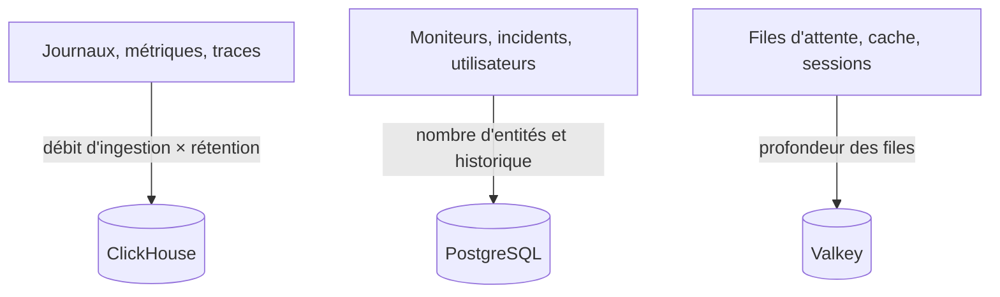

# Dimensionnement et planification de la capacité

Planifiez le CPU, la mémoire et le disque d'un OneUptime auto-hébergé sur Kubernetes avec le [chart Helm](https://artifacthub.io/packages/helm/oneuptime/oneuptime). Dimensionnez séparément les trois bases de données – **ClickHouse**, **PostgreSQL** et **Valkey** – et l'application, partez de l'un des paliers ci-dessous, puis ajustez dès que vous avez de vrais chiffres.

> [!IMPORTANT]
> Les valeurs par défaut du chart ne sont pas un dimensionnement de production. Les services qu'il exécute par défaut ne définissent **aucune requête ni limite de CPU ou de mémoire**, et PostgreSQL et ClickHouse reçoivent de petits volumes de **25 Gi**, pour que le chart s'installe sur n'importe quel cluster. Au-delà d'un essai, définissez vous-même les ressources et le stockage, avec les chiffres de cette page.

Vous utilisez plutôt l'installation Docker Compose sur un seul serveur ? Son dimensionnement est plus simple : voir les [exigences](/docs/installation/docker-compose#requirements) (16 Go de mémoire, 8 cœurs et 400 Go de disque recommandés).

:::cards
- [Ce qui fait grossir chaque base](#what-drives-each-datastore): Trois bases qui grossissent avec trois choses différentes.
- [Paliers de départ](#starting-tiers): Des points de départ petit, moyen et grand.
- [Haute disponibilité](#high-availability): Réplicas et basculement pour chaque base.
- [Rétention](#retention-and-how-it-affects-storage): Le paramètre qui multiplie votre disque.
:::

## Dimensionner votre installation

:::steps
1. Déterminez la quantité de télémétrie que vous envoyez : les Go de journaux, de métriques et de traces par jour. Mesurez-la sur une petite installation si vous le pouvez.
2. Décidez combien de jours la conserver. La rétention multiplie le disque de ClickHouse (voir [Rétention](#retention-and-how-it-affects-storage)).
3. Calculez le disque de ClickHouse avec la [formule de stockage](#storage-formula), puis ceux de PostgreSQL et de Valkey d'après leurs propres sections.
4. Choisissez le [palier de départ](#starting-tiers) le plus proche de vos chiffres et définissez son CPU, sa mémoire et son stockage dans vos valeurs Helm.
5. Activez la [haute disponibilité](#high-availability) pour les bases qui en ont besoin, puis surveillez l'utilisation réelle et ajustez.
:::

## Ce qui fait grossir chaque base

OneUptime a besoin de trois bases de données en production. Chacune grossit avec quelque chose de différent : dimensionnez-les indépendamment.



| Base | Ce qu'elle stocke | Ce qui détermine sa taille |
| --- | --- | --- |
| **ClickHouse** | Toute la télémétrie – journaux, métriques, traces, exceptions, profils | La télémétrie : **débit d'ingestion × rétention**. C'est environ 95 % de votre stockage et le coût principal. |
| **PostgreSQL** | La configuration et l'état – moniteurs, incidents, alertes, utilisateurs, équipes, projets, workflows, pages de statut, tableaux de bord | **Le nombre d'entités et l'historique**, pas le volume de télémétrie. Croît lentement. |
| **Valkey** | Cache, files de travail et sessions | **La profondeur des files et les sessions actives**. Limité par la mémoire et modeste. Pas une source de vérité. |

OneUptime n'a jamais besoin d'un stockage objet (S3, MinIO) pour fonctionner, et il ne déplace pas l'ancienne télémétrie vers un stockage objet. Il ne vous en faut un que si vous choisissez des sauvegardes vers un stockage objet : le plugin Barman Cloud pour CloudNativePG, ou [clickhouse-backup](https://github.com/Altinity/clickhouse-backup) pour ClickHouse. La sauvegarde CloudNativePG propre au chart (`postgresOperator.cnpg.backup`) prend des instantanés de volume et ne nécessite aucun stockage objet. CloudNativePG ne supprime jamais les anciens instantanés : nettoyez-les vous-même, sinon ils ne cessent de s'accumuler.

## ClickHouse – le facteur principal

Presque tout votre stockage et une grande partie de votre mémoire vont à ClickHouse, car chaque ligne de journal, point de métrique, span de trace et exception s'y trouve.

### Formule de stockage

```text
ClickHouse disk ≈ (daily raw telemetry GB ÷ compression) × retention days × replicas × 1.3 (headroom)
```

La compression dépend du signal :

| Signal | Compression typique | Ce qui la fait varier |
| --- | --- | --- |
| Journaux | Environ 5:1 | Les journaux se compressent bien. |
| Métriques | Environ 2:1 | Une forte **cardinalité** des labels gonfle le disque et la mémoire plus vite que le volume brut. Gardez une cardinalité de labels faible. |
| Traces | Entre les deux | Les attributs de span que vous envoyez. |

### Exemple chiffré

Une flotte de **10 clusters**, chacun avec environ 10 nœuds et 100 pods qui journalisent au niveau INFO, produit en gros **50 à 150 Go de journaux bruts par cluster sur 30 jours** (environ 1,7 à 5 Go par jour et par cluster). Pour toute la flotte, avec les métriques et les traces et après compression, prévoyez en gros **5 à 15 Go de télémétrie compressée par jour**.

| Rétention | Un seul réplica | 2 réplicas + 30 % de marge |
| --- | --- | --- |
| 30 jours | ~150–450 Go | **~0,4–1,2 To** |
| 90 jours | ~0,45–1,35 To | **~1,2–3,5 To** |

Le stockage croît **linéairement avec la rétention** : une fenêtre de 90 jours coûte environ trois fois une fenêtre de 30 jours.

### Mémoire et type de disque

- **Utilisez du NVMe ou du SSD.** La télémétrie est très orientée écriture, avec des rafales de lectures d'agrégation ; ClickHouse peine sur des disques rotatifs.
- **Donnez beaucoup de mémoire à ClickHouse.** Les requêtes d'agrégation consomment beaucoup de mémoire. En règle générale, dimensionnez la mémoire à 25–50 % de vos données compressées *chaudes* (interrogées récemment), avec un plancher pratique de 16 Go pour toute vraie flotte de production.
- **Surveillez la cardinalité des métriques.** C'est le plus gros levier à lui seul sur la mémoire et le disque de ClickHouse. Imposez des conventions de labels à faible cardinalité là où vous collectez les métriques, et surveillez le nombre de séries actives.

## PostgreSQL – configuration et état

PostgreSQL stocke votre configuration et votre état opérationnel, pas la télémétrie : il croît lentement et reste petit à côté de ClickHouse. Même les grandes installations se situent généralement dans les dizaines de Go. Le volume par défaut de **25 Gi** suffit pour les petites installations ; prévoyez 50 à 100 Go pour les plus grandes, avec de la marge pour l'historique des incidents et des alertes.

Avec de nombreux réplicas d'app, de workers et de sondes, les connexions à la base peuvent manquer avant le stockage. Chaque pod ouvre jusqu'à 50 connexions par défaut, et le PostgreSQL fourni en accepte 500. Le chart inclut justement pour cela un pooler de connexions **PgBouncer** facultatif (`pgbouncer.enabled`) : activez-le pour les installations avec de nombreux réplicas.

## Valkey – cache, files d'attente et sessions

La couche de cache exécute [Valkey](https://valkey.io), le fork de Redis 7.2 sous licence BSD, comme cache, file de travail et magasin de sessions. N'importe quel serveur compatible avec le protocole Redis peut le remplacer, et le dimensionnement ci-dessous s'applique dans les deux cas. Il est **limité par la mémoire**, et la persistance est **désactivée par défaut** : ce n'est pas une source de vérité et il peut être reconstruit. Dimensionnez-le selon la profondeur des files et les sessions simultanées ; 2 à 8 Go de mémoire suffisent pour la plupart des installations. Sa politique d'éviction est `noeviction` : surveillez sa mémoire si les files s'engorgent sous une charge soutenue.

## Calcul de l'application

Au-delà des bases de données, dimensionnez les charges de travail sans état. Chacune s'exécute **sans requêtes ni limites de ressources** tant que vous ne les définissez pas, et avec un réplica, sauf le telemetry writer, qui en a deux.

| Charge de travail | Clé des valeurs | Croît avec |
| --- | --- | --- |
| App : tableau de bord, API et ingestion | `app` | Les utilisateurs, les appels API et la télémétrie entrante |
| Workers, quand ils sont séparés de l'app | `worker` | La télémétrie et le traitement des tâches de fond |
| Sondes | `probes` | Le nombre de moniteurs actifs |
| Passerelle d'entrée | `nginx` | Le volume de requêtes |
| Telemetry writer, quand il est activé | `telemetryWriter` | Pas avec la charge : il regroupe chaque insertion de télémétrie dans ClickHouse, il se dimensionne donc selon ce que ClickHouse peut absorber |

Le chart intègre **KEDA**, pour que l'app, les workers, les sondes et le Runner puissent s'adapter à leur file d'attente. Activez `keda.enabled` en même temps que le `keda.enabled` propre à chaque service (par exemple `app.keda.enabled`). Sur un cluster qui n'a pas encore KEDA, la première installation demande un passage supplémentaire : voir le [guide KEDA](https://github.com/OneUptime/oneuptime/blob/master/HelmChart/Docs/Keda.md) du chart. Les services que KEDA ne gère pas peuvent utiliser à la place un autoscaler fondé sur le CPU ou la mémoire (`autoscaling`).

## Paliers de départ

Choisissez le palier le plus proche de votre environnement comme point de départ, puis surveillez l'utilisation réelle (`kubectl top pods`, la croissance du disque de ClickHouse et de PostgreSQL) et ajustez.

- **Petit / PoC** – 1 à 3 clusters, ≤30 nœuds, ≤5 Go/jour de télémétrie brute, 30 jours de rétention.
- **Moyen / Flotte de production** – ~10 clusters, ~100 nœuds, 10 à 30 Go/jour de télémétrie brute, 30 à 90 jours de rétention.
- **Grand / Plusieurs flottes** – 50+ clusters, 500+ nœuds, 100+ Go/jour de télémétrie brute, 90 jours de rétention.

| | Petit / PoC | Moyen / Flotte de production | Grand / Plusieurs flottes |
| --- | --- | --- | --- |
| **ClickHouse** | 4 vCPU / 16 Go / 200 Go NVMe | 8 vCPU / 32 Go / 1–3 To NVMe | 16+ vCPU / 64–128 Go / 5–15 To NVMe, **shardé** |
| **PostgreSQL** | 2 vCPU / 4 Go / 50 Go SSD | 4 vCPU / 8 Go / 100 Go SSD | 8 vCPU / 16–32 Go / 250 Go SSD (+ PgBouncer) |
| **Valkey** | 1 vCPU / 2 Go | 2 vCPU / 4 Go | 4 vCPU / 8–16 Go |
| **Rétention prévue** | 30 jours | 30 à 90 jours | 90 jours |

Ces paliers dimensionnent le backend de OneUptime. L'agent que vous installez sur chaque cluster surveillé est traité sur la page [Agent Kubernetes](/docs/telemetry/kubernetes-agent), qui montre aussi comment réduire le volume de données qu'il envoie.

## Haute disponibilité

Les bases de données intégrées au chart s'exécutent par défaut en **instances uniques**. Pour la haute disponibilité en production :

| Base | Pour la haute disponibilité |
| --- | --- |
| **PostgreSQL** | Activez l'opérateur [CloudNativePG](https://cloudnative-pg.io) fourni (`postgresOperator.cnpg.enabled`) avec **3 instances** (`postgresOperator.cnpg.instances`) : un primaire et deux réplicas en attente active, avec basculement automatique. |
| **ClickHouse** | Activez l'opérateur [Altinity](https://github.com/Altinity/clickhouse-operator) fourni (`clickhouseOperator.altinity.enabled`) avec **au moins 2 réplicas par shard** (`clickhouseOperator.altinity.cluster.replicasCount`). Son ClickHouse Keeper fourni s'exécute sur **3 nœuds** pour le quorum. Ajoutez des shards (`shardsCount`) dès que le disque ou la mémoire d'un nœud devient la limite. |
| **Valkey** | Le chart ne le réplique pas. Pointez OneUptime vers un Redis ou un Valkey externe géré avec basculement automatique (`externalValkey`). OneUptime se connecte à un seul hôte et port : utilisez le point de terminaison principal du service, pas un point de terminaison en mode cluster. |

> [!WARNING]
> Activer l'un ou l'autre opérateur pour une installation existante démarre une nouvelle base vide : aucun des deux ne copie les données de la base à instance unique qu'il remplace. Migrez vos données comme le décrivent les guides du chart – pour [PostgreSQL](https://github.com/OneUptime/oneuptime/blob/master/HelmChart/Docs/MigratePostgresStandaloneToOperator.md) et pour [ClickHouse](https://github.com/OneUptime/oneuptime/blob/master/HelmChart/Docs/MigrateClickhouseStandaloneToOperator.md).

## La rétention et son effet sur le stockage

La rétention de la télémétrie est un **TTL ClickHouse compté en jours**. Chaque édition dispose de la valeur par défaut du projet, sous **Paramètres du projet > Télémétrie & APM > Rétention des données** (**Conservation par défaut (jours)**) ; quand rien n'est défini, elle est de 15 jours. L'[Enterprise Edition](/docs/self-hosted/enterprise) ajoute des remplacements : par signal (journaux, traces, métriques, profils), par sévérité de journal et statut de trace, et par service ou ressource.

Les journaux et les métriques sont supprimés une journée à la fois, au premier minuit (heure du serveur ClickHouse) après la fin de leur rétention, ce qui évite à ClickHouse de réécrire chaque journée toutes les quelques heures pendant qu'elle expire. Juste avant minuit, jusqu'à un jour de plus que la fenêtre de rétention reste encore sur le disque : dimensionnez les journaux et les métriques pour **jours de rétention + 1**.

Comme la rétention multiplie le stockage de ClickHouse, décidez-la avant de dimensionner le disque. OneUptime n'archive **pas** l'ancienne télémétrie et ne la déplace pas vers un stockage objet. Pour une rétention de conformité sur plusieurs années, allongez la fenêtre de rétention et dimensionnez le stockage de ClickHouse en conséquence, ou exportez vers une archive externe de votre choix.

## Mesurer avant de s'engager

Le volume de télémétrie varie énormément selon la verbosité des journaux des applications, le nombre de namespaces, l'intervalle de collecte et l'activation éventuelle de journaux DEBUG quelque part. Considérez les paliers ci-dessus comme des points de départ : **collectez depuis votre environnement pendant au moins quatre semaines**, mesurez les Go réels par jour pour chaque signal, puis dimensionnez la rétention et le stockage à partir de données réelles.

## Étapes suivantes

:::cards
- [Docker Compose](/docs/installation/docker-compose): Les exigences d'une installation sur un seul serveur.
- [Architecture auto-hébergée](/docs/self-hosted/architecture): Comment les composants s'articulent.
- [Agent Kubernetes](/docs/telemetry/kubernetes-agent): Le collecteur qui envoie la télémétrie d'un cluster.
- [Enterprise Edition](/docs/self-hosted/enterprise): Les remplacements de rétention et les autres fonctionnalités Enterprise.
:::
