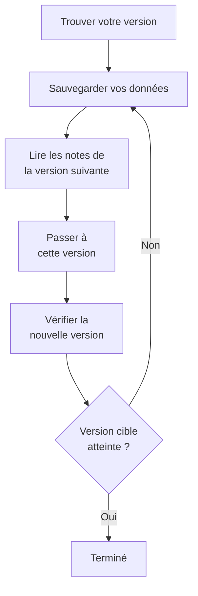

# Mise à niveau

Mettez à niveau une instance OneUptime auto-hébergée – avec Docker Compose, ou avec Kubernetes et Helm – vers une version plus récente. Suivez la procédure ci-dessous et lisez les notes de chaque version majeure entre celle que vous exécutez et celle vers laquelle vous passez.

:::cards
- [Comment faire la mise à niveau](#comment-faire-la-mise-à-niveau): La procédure, pour Docker Compose et Kubernetes.
- [Les notes de chaque version](#trouver-les-notes-de-votre-version): Ce que chaque version majeure vous demande, en un coup d'œil.
- [Images Community Edition et Enterprise Edition](#images-community-edition-et-enterprise-edition): Quelle image exécuter à partir de la 14.
- [Mise à niveau de OneUptime 13 → 14](#mise-à-niveau-de-oneuptime-13-14): La version majeure la plus récente.
:::

## Comment faire la mise à niveau

Trois règles rendent une mise à niveau sûre :

- **Montez d'une seule version majeure à la fois** (par exemple 6 → 7 → 8). Ne sautez aucune version majeure.
- **Sautez à votre gré les versions mineures et correctives** (par exemple 8.1 → 8.4), du moment que vous suivez leurs notes de version.
- **Sauvegardez avant chaque mise à niveau**, et vérifiez que vous savez restaurer la sauvegarde.



:::steps
### Trouvez votre version actuelle

En tant qu'administrateur principal, ouvrez l'étiquette d'édition dans l'en-tête du tableau de bord admin : **This installation** indique la version que vous exécutez. L'instance l'indique aussi sur `/version` :

```bash
curl http://localhost/version
```

Remplacez `http://localhost` par l'adresse de votre instance. La réponse est du JSON, par exemple `{"version":"14.0.22","commit":"..."}`.

### Sauvegardez vos données

Sauvegardez PostgreSQL, et ClickHouse si vous avez besoin de sa télémétrie. Avec Docker Compose, voir [Sauvegarder et restaurer](/docs/installation/docker-compose#sauvegarder-et-restaurer). Sur Kubernetes, utilisez vos instantanés de volumes ou les sauvegardes CloudNativePG du chart.

### Lisez les notes de la version majeure suivante

Vous les trouverez dans [le tableau ci-dessous](#trouver-les-notes-de-votre-version). Faites ce qu'elles demandent avant la mise à niveau : certaines étapes, comme renommer des valeurs Helm, doivent avoir lieu d'abord.

### Lancez la mise à niveau

:::tabs
@tab Docker Compose
```bash
git checkout release
git pull
npm run update
```
`npm run update` ajoute les nouveaux paramètres à votre `config.env` sans modifier les vôtres, récupère les nouvelles images et redémarre OneUptime.
@tab Kubernetes
```bash
helm repo update
helm upgrade my-oneuptime oneuptime/oneuptime -f values.yaml
```
Utilisez votre propre nom de release et votre propre fichier de valeurs. Le chart exécute les migrations de la base de données dans un Job à part, avant que les nouveaux pods ne servent du trafic.
:::

### Vérifiez la nouvelle version

Avec Docker Compose, `npm run update` se termine par **OneUptime is up!** Sur Kubernetes, attendez que chaque pod soit `Running` et prêt :

```bash
kubectl get pods -n <namespace>
```

Vérifiez ensuite de nouveau votre version, comme à la première étape. Si vous n'avez pas encore atteint votre version cible, revenez à [Sauvegardez vos données](#sauvegardez-vos-données) et passez à la version majeure suivante.
:::

### Trouver les notes de votre version

| Mise à niveau | Ce que vous devez faire |
| --- | --- |
| [13 → 14](#mise-à-niveau-de-oneuptime-13-14) | Choisir une édition. Les installations Docker Compose qui définissent `IS_ENTERPRISE_EDITION=true` passent à `APP_TAG=enterprise-release`. Activer une licence sur l'édition Enterprise. Réenregistrer les moniteurs IPv6 Ping, Port et SSL. |
| [12 → 13](#mise-à-niveau-de-oneuptime-12-13) | En général rien : Redis devient Valkey, et les anciens noms de paramètres continuent de fonctionner. Vous lancez Docker Compose à la main ? Ajoutez `--remove-orphans`. Vous utilisez votre propre cache ? Lisez [Si vous exploitez votre propre cache](#si-vous-exploitez-votre-propre-cache). |
| [11 → 12](#mise-à-niveau-de-oneuptime-11-12) | Redéployer les Runbook Agents en Runners. Avec Docker Compose, définir `ONEUPTIME_RUNNER_KEY`. Avec Helm, renommer `aiAgent:` en `runner:`. Réattribuer les autorisations Runner que les clés d'API détenaient directement. |
| [10 → 11](#mise-à-niveau-de-oneuptime-10-11) | SCIM et les paramètres de conformité d'équipe exigent l'édition Enterprise. Pour garder votre historique de télémétrie, renommez les anciennes tables ClickHouse avant la mise à niveau. |
| [9 → 10](#mise-à-niveau-de-oneuptime-9-10) | Rien. |
| [8 → 9](#mise-à-niveau-de-oneuptime-8-9) | Avec Helm, retirer les surcharges `oneuptimeIngress` de vos valeurs. |
| [7 → 8](#mise-à-niveau-de-oneuptime-7-8) | Avec Helm, passer à la nouvelle structure de valeurs pour Postgres, Redis et ClickHouse. Sauvegarder d'abord. |

## Images Community Edition et Enterprise Edition

OneUptime livre désormais l'application sous forme de deux images. La **Community Edition** est open source sous licence Apache 2.0 et inclut l'authentification unique SAML et OIDC, le SSO global et « Require SSO for login ». L'**Enterprise Edition** ajoute les modules Enterprise du répertoire `ee/` du dépôt : SCIM, la conformité d'équipe, les journaux d'audit et les tableaux de bord Health Enterprise du tableau de bord admin. Avant ce changement, les deux éditions exécutaient le même code, et `IS_ENTERPRISE_EDITION` décidait quelles fonctions étaient activées. Désormais c'est l'image qui décide, et l'image Community ne contient pas le répertoire `ee/`.

La page [Édition Enterprise](/docs/self-hosted/enterprise) présente la comparaison complète des fonctions, les détails de licence et ce qui se passe quand vous changez d'édition.

### Ce qu'il faut faire avant la mise à niveau

- **Community Edition sans SCIM :** rien. Mettez à niveau comme d'habitude.
- **Helm avec `image.type: enterprise-edition` :** rien. Le chart récupère déjà les images `enterprise-`, qui contiennent désormais les modules Enterprise.
- **Docker Compose avec `IS_ENTERPRISE_EDITION=true` :** passez à l'image Enterprise lors de la mise à niveau en définissant `APP_TAG=enterprise-release` (ou `enterprise-<version>`) dans `config.env`. `APP_TAG=release` est l'image Community, et `IS_ENTERPRISE_EDITION=true` n'active plus rien. `npm run update` fait ce changement pour vous tant que `IS_ENTERPRISE_EDITION=true` (`release` devient `enterprise-release`, un `13.0.7` figé devient `enterprise-13.0.7`) et affiche ce qu'il a changé. L'application **refuse désormais de démarrer** quand `IS_ENTERPRISE_EDITION=true` est défini sur l'image Community, au lieu d'arrêter en silence le provisionnement SCIM et la journalisation d'audit. L'erreur indique quoi définir : `APP_TAG=enterprise-<version>` pour garder l'édition Enterprise, ou `IS_ENTERPRISE_EDITION=false` pour exécuter l'édition Community.
- **Image Community avec SCIM déjà configuré :** le provisionnement SCIM s'arrête avec cette mise à niveau, déprovisionnement compris. Passez à l'image Enterprise pour le garder. Sinon, lisez [Passer d'Enterprise à Community](/docs/self-hosted/enterprise#switching-from-enterprise-to-community) avant la mise à niveau. Elle explique ce qui s'arrête et qui retirer d'abord. Pour exécuter l'édition Community, définissez aussi `IS_ENTERPRISE_EDITION=false`. L'authentification unique n'est pas concernée : l'image Community la sert aussi.

Votre configuration n'est jamais supprimée, et changer d'édition ne demande aucune migration, dans un sens comme dans l'autre.

### La licence après la mise à niveau

L'édition Enterprise vérifie désormais sa licence :

- **Une installation avec une clé de licence** continue de fonctionner. Elle vérifie la licence auprès de OneUptime au démarrage puis une fois par jour. Si la licence expire, tout continue de fonctionner pendant un délai de grâce de 30 jours, après quoi il se passe la même chose que pour une installation sans licence.
- **Une installation sans licence**, par exemple une qui exécutait l'édition Enterprise avec `IS_ENTERPRISE_EDITION=true` seul, bénéficie d'un essai de 14 jours à partir du premier démarrage de cette version. **Si vous utilisez SCIM ou la journalisation d'audit, activez une licence avant la fin de l'essai.** Après l'essai, le provisionnement SCIM s'arrête et la journalisation d'audit n'enregistre plus rien. La configuration Enterprise passe aussi en lecture seule et les tableaux de bord Health Enterprise sont verrouillés. L'authentification unique n'est pas concernée. Tout reprend, sans redémarrage, dès que vous activez une licence. L'essai sert à l'évaluation : l'usage en production de l'édition Enterprise exige un abonnement OneUptime Enterprise. Voir [Quand une licence expire ou manque](/docs/self-hosted/enterprise#when-a-license-expires-or-is-missing).
- **Les installations isolées du réseau** peuvent s'activer avec un jeton de licence signé au lieu d'une clé. Voir [Activation hors ligne](/docs/self-hosted/enterprise#offline-activation-air-gapped-installs).

### Clients de OneUptime Cloud

Rien ne change pour vous. OneUptime Cloud exécute l'édition Enterprise, et votre plan décide toujours des fonctions auxquelles vous avez droit : SSO, OIDC, SCIM et conformité d'équipe à partir du plan Scale, et journaux d'audit dans le plan Enterprise. Les projets du plan Scale voient désormais les paramètres SSO, OIDC, SCIM et de conformité d'équipe qui affichaient auparavant une invitation à passer à un plan supérieur.

### Changements de l'API et des points de terminaison

- `GET /api/global-config/license` ne renvoie la clé de licence, le jeton de licence, la liste des instances, l'identifiant d'instance et les détails de version qu'aux administrateurs principaux. Les autres appelants reçoivent l'édition et l'état de la licence.
- Les installations auto-hébergées ne servent plus les points de terminaison du serveur de licences sous `/api/enterprise-license/`. Seul oneuptime.com les utilise.
- Les points de terminaison SCIM gardent exactement leurs chemins sur l'édition Enterprise, donc la configuration du fournisseur d'identité ne change pas. Sur l'édition Community, ils renvoient `404`. Sur l'édition Enterprise, ils refusent les requêtes tant que la licence est caduque (après l'essai ou le délai de grâce), et répondent de nouveau dès qu'une licence est activée.
- Les points de terminaison SSO et OIDC (URL de connexion et ACS SAML, URI de redirection OIDC, et points de terminaison du SSO global) gardent exactement leurs chemins et sont servis par les deux éditions, quel que soit l'état de la licence.

## Mise à niveau de OneUptime 13 → 14

OneUptime 14 sépare l'application en deux éditions, et l'image que vous récupérez décide de celle que vous exécutez. La **Community Edition** (Apache-2.0, les tags `release` et `<version>`) inclut SAML SSO, OpenID Connect, le SSO global et « Require SSO for login ». Elle ne contient pas le répertoire `ee/` du dépôt : le provisionnement SCIM, les paramètres de conformité d'équipe, les journaux d'audit, les tableaux de bord **Health** du tableau de bord admin et la **Query Console** du tableau de bord admin ne sont pas du tout dans cette image. L'**Enterprise Edition** (les tags `enterprise-release` et `enterprise-<version>`) les contient, et vérifie une licence Enterprise pendant son exécution, ce que OneUptime 13 ne faisait jamais. L'authentification unique ne dépend pas de cette licence.

[Images Community Edition et Enterprise Edition](#images-community-edition-et-enterprise-edition) ci-dessus est la référence de ce changement : ce que contient chaque édition, ce qu'il faut définir selon le mode de déploiement, et ce que fait la licence. Cette section décrit la mise à niveau elle-même. Partez de la 13 – si vous êtes encore en 12, faites d'abord 12 → 13.

Rien n'est supprimé, dans aucune des deux éditions. L'authentification unique fonctionne de la même façon dans les deux : vos configurations SSO et OIDC ainsi que vos réglages « Require SSO for login » sont repris tels quels. Votre configuration SCIM et les journaux d'audit déjà enregistrés restent en base. L'édition Community se contente de ne pas les servir, et changer d'édition ne demande aucune migration, dans un sens comme dans l'autre.

### Ce que vous devez faire

1. **Décidez quelle édition exécute cette installation.** Si vous utilisez le provisionnement SCIM, les paramètres de conformité d'équipe ou les journaux d'audit, ou si vous voulez les tableaux de bord **Health** du tableau de bord admin, c'est l'édition Enterprise. Sinon il n'y a rien à décider : l'édition Community est ce que vous avez déjà, et elle inclut SAML SSO et OpenID Connect.
2. **Avec Helm, indiquez l'édition dans votre fichier de valeurs :** `image.type: enterprise-edition` (la valeur par défaut est `community-edition`). Ne touchez pas à `image.tag` – le chart ajoute lui-même le préfixe `enterprise-`, donc `image.tag: release` récupère `oneuptime/app:enterprise-release`. Cette valeur n'est pas nouvelle. Si vous êtes déjà en `enterprise-edition`, il n'y a rien à changer : le tag que vous récupérez déjà contient désormais `ee/`.
3. **Avec Docker Compose, définissez `APP_TAG=enterprise-release`** (ou `enterprise-<version>` pour figer une version) dans `config.env`. `APP_TAG=release` est l'image Community. C'est le seul point qui bloque une installation 13 : en 13, une installation Enterprise sous Compose était `APP_TAG=release` plus `IS_ENTERPRISE_EDITION=true`, et cette combinaison **refuse maintenant de démarrer** au lieu de démarrer en édition Community avec le provisionnement SCIM et la journalisation d'audit arrêtés en silence. `npm run update` réécrit `APP_TAG` pour vous tant que `IS_ENTERPRISE_EDITION=true` (`release` devient `enterprise-release`, un `13.0.8` figé devient `enterprise-13.0.8`) et affiche ce qu'il a changé. Si vous récupérez plutôt les images à la main, définissez d'abord `APP_TAG` vous-même.
4. **Sur l'édition Enterprise, activez une licence.** Une installation sans licence bénéficie d'un essai de 14 jours, compté à partir de son premier démarrage de l'édition Enterprise – pour une mise à niveau, c'est le jour de la mise à niveau, pas celui où vous avez installé OneUptime pour la première fois. Un administrateur principal l'active depuis l'étiquette d'édition dans l'en-tête du tableau de bord admin ; les installations isolées du réseau s'activent plutôt avec un jeton signé. Voir [Licences](/docs/self-hosted/enterprise#licensing).
5. **Si cette installation va exécuter l'édition Community alors que votre fournisseur d'identité déprovisionne des utilisateurs via SCIM, vérifiez qui a accès avant la mise à niveau.** Le déprovisionnement SCIM s'arrête : les personnes que vous retirez dans votre fournisseur d'identité conservent donc leur compte OneUptime, et, à moins que « Require SSO for login » ne s'applique à elles, toute personne qui atteint encore la boîte mail d'un tel compte peut définir un mot de passe avec « Mot de passe oublié » et se connecter. Supprimez d'abord ces utilisateurs : [Passer d'Enterprise à Community](/docs/self-hosted/enterprise#switching-from-enterprise-to-community).
6. **Si vous surveillez des adresses IPv6 avec des moniteurs Ping, Port ou SSL, réenregistrez ces moniteurs après la mise à niveau.** Les destinations enregistrées avant la 14 peuvent avoir été stockées tronquées – voir [Moniteurs IPv6 Ping, Port et SSL](#moniteurs-ipv6-ping-port-et-ssl).

### Éditions : ce qui change et ce qui ne change pas

| | Jusqu'en 13 | À partir de 14 |
| --- | --- | --- |
| Code Enterprise | dans chaque image ; `IS_ENTERPRISE_EDITION=true` l'activait | dans `ee/`, et uniquement dans les images `enterprise-` |
| Sélecteur Helm | `image.type` | `image.type` – inchangé, mais les images diffèrent désormais |
| Sélecteur Compose | `IS_ENTERPRISE_EDITION=true` | `APP_TAG=enterprise-release` |
| Licence Enterprise | jamais vérifiée à l'exécution | vérifiée au démarrage puis une fois par jour |
| Points de terminaison SSO et OIDC | les mêmes chemins dans les deux éditions | les mêmes chemins dans les deux éditions, quel que soit l'état de la licence |
| Points de terminaison SCIM | les mêmes chemins dans les deux éditions | les mêmes chemins en Enterprise ; `404` en Community |
| Votre configuration Enterprise | stockée, appliquée | stockée dans les deux cas, appliquée en Enterprise |

Une migration s'exécute : une colonne nullable `enterpriseEditionFirstSeenAt` sur la table `GlobalConfig`, qui ne contient qu'une ligne, donc instantanée. Il n'y a aucune migration ClickHouse, rien n'est supprimé, et changer d'édition ne demande de migration dans aucun sens.

### Le calendrier de la licence sur l'édition Enterprise

- **Une installation sans licence** dispose d'un essai de 14 jours, compté depuis le premier démarrage de l'édition Enterprise. Toutes les fonctions Enterprise fonctionnent pendant cet essai, et l'étiquette d'édition avertit avant sa fin. L'essai sert à l'évaluation : l'usage en production de l'édition Enterprise exige un abonnement sous la OneUptime Enterprise License.
- **Une licence qui expire** obtient un délai de grâce de 30 jours à partir de sa date d'expiration, pendant lequel toutes les fonctions Enterprise fonctionnent et l'étiquette d'édition avertit.
- **Après l'essai, ou après ce délai de grâce**, et jusqu'à l'activation d'une licence : les requêtes SCIM de votre fournisseur d'identité sont refusées et la journalisation d'audit n'enregistre plus rien. La configuration Enterprise passe en lecture seule – vous pouvez toujours la consulter, la supprimer et réinitialiser un jeton porteur SCIM, c'est-à-dire ce dont un incident a besoin – et les tableaux de bord Health et la Query Console du tableau de bord admin sont verrouillés.
- **Rien n'est supprimé, et la supervision principale n'est jamais affectée.** Moniteurs, alertes, incidents, astreintes, pages de statut et télémétrie sont hors licence, tout comme la connexion : la connexion SSO et OIDC, « Require SSO for login » et la connexion par mot de passe pour tous les utilisateurs, administrateurs principaux inclus, fonctionnent de la même façon quel que soit l'état de la licence. Activer une licence rétablit le provisionnement SCIM et la journalisation d'audit avec la configuration que vous avez déjà, sans redémarrage.
- **Une clé de licence que vous détenez déjà est acceptée**, comme licence « unverified » : sa date d'expiration et son nombre de sièges viennent de ce que le serveur de licences a déjà communiqué à cette installation, et elle bénéficie du même délai de grâce de 30 jours après cette expiration. Les licences émises à partir de maintenant sont signées et vérifiées par l'application elle-même. Cette mise à niveau ne demande pas de nouvelle clé.
- **Une clé dont cette installation n'a jamais enregistré la date d'expiration** continue de fonctionner pendant l'essai au lieu de s'arrêter. Le serveur de licences écrit la clé et la date d'expiration séparément, si bien qu'une installation peut détenir une clé dont l'expiration ne lui a jamais été communiquée. Une telle installation est traitée exactement comme une installation sans licence : toutes les fonctions Enterprise fonctionnent pendant l'essai de 14 jours, compté depuis le premier démarrage de l'édition Enterprise, et après l'essai les mêmes choses s'arrêtent que ci-dessus. Le nombre de sièges n'est pas imposé dans cet état, parce que l'enregistrement de licence que détient l'installation est déjà incomplet. Il suffit qu'un administrateur principal réactive la licence depuis l'étiquette d'édition, ou que la synchronisation quotidienne de la licence récupère la date d'expiration depuis oneuptime.com, pour la rétablir sans redémarrage.

Le tableau complet des états figure dans [Quand une licence expire ou manque](/docs/self-hosted/enterprise#when-a-license-expires-or-is-missing).

### Docker Compose : choisir le tag d'image

```bash
git checkout release # Please make sure you're on release branch.
git pull
npm run update
```

- **`npm run update` déplace `APP_TAG` tant que `IS_ENTERPRISE_EDITION=true`**, vers l'image Enterprise de la même version, et affiche ce qu'il a changé. Il conserve vos commentaires et vos guillemets, laisse tel quel un `APP_TAG` qui est déjà un tag `enterprise-`, et ne change rien lors d'une deuxième exécution.
- **Récupérer les images à la main contourne cela**, et l'application s'arrête alors au démarrage avec une erreur qui indique exactement quoi définir : `APP_TAG=enterprise-<version>` pour garder l'édition Enterprise, ou `IS_ENTERPRISE_EDITION=false` pour exécuter l'édition Community.
- **Pour passer volontairement à l'édition Community**, définissez `APP_TAG=release` et `IS_ENTERPRISE_EDITION=false`. Lisez d'abord le point 5 ci-dessus si votre fournisseur d'identité déprovisionne des utilisateurs via SCIM.
- Rien d'autre n'a besoin de changer dans `config.env` pour cette version.

### Helm : choisir le type d'image

```bash
helm repo update
helm upgrade my-oneuptime oneuptime/oneuptime -f values.yaml
```

- **Une installation déjà en `image.type: enterprise-edition` n'a aucune valeur à changer.** Le chart préfixe le tag depuis longtemps ; la nouveauté est que les images `enterprise-` contiennent `ee/`. La licence s'y applique à partir de cette version, selon le calendrier ci-dessus.
- **`image.tag: release` est la valeur par défaut**, donc un chart resté sur ce tag flottant passe en 14 à sa prochaine mise à niveau sans aucun changement de valeurs. Si SCIM est configuré sur cette installation en `community-edition`, définissez `image.type: enterprise-edition` dans la même mise à niveau.
- **`IS_ENTERPRISE_EDITION` est toujours émis par le chart**, dérivé de `image.type` pour que les deux ne puissent jamais diverger. Il ne contrôle rien. Le forcer à `true` via `extraEnv` sur une image Community ne fait que provoquer le refus de démarrage de l'application. Ne définissez jamais `ONEUPTIME_EDITION` via le chart.
- **Les sondes du chart respectent de nouveau `probes.<key>.allowPrivateNetworkMonitors`** ([#3879](https://github.com/OneUptime/oneuptime/issues/3879)). Rien ne change si vous ne la définissez pas – elle vaut toujours `false` – et elle s'applique aux moniteurs de tous les projets de l'instance, car les sondes du chart sont des sondes globales. La boucle locale, le lien-local et `169.254.169.254` restent bloqués quelle que soit la valeur.

### Autres changements en 14

Ces changements modifient le comportement de OneUptime après la mise à niveau, et la plupart ne demandent rien de votre part. Lisez-les si vous utilisez des rôles personnalisés ou des clés d'API composés d'autorisations individuelles, des états personnalisés d'incident, d'alerte ou de maintenance, Terraform ou l'API, le SSO, ou les applications Slack et Microsoft Teams.

:::details Lire les autres changements en 14
- **L'ingestion OTLP n'acquitte un lot qu'une fois que la file d'attente l'a accepté.** La 13 répondait `200` d'abord et mettait en file ensuite, si bien qu'un lot refusé par la file était perdu en silence. La 14 répond plutôt `503` avec `Telemetry queue unavailable. Please retry.`, et le point de terminaison gRPC renvoie `UNAVAILABLE` ; les deux peuvent être réessayés, et les exportateurs réessaient. Cela concerne les journaux, les métriques, les traces et les profils. Aucune action n'est nécessaire, mais les nouvelles tentatives côté exportateur et la contre-pression de la file deviennent visibles là où les données disparaissaient – utile à savoir si vous dimensionnez la capacité d'ingestion.
- **Les tableaux de bord Health et la Query Console du tableau de bord admin exigent l'édition Enterprise**, tout comme les alertes de santé PostgreSQL et Valkey. En 13, ils venaient avec `IS_ENTERPRISE_EDITION=true` seul : c'est donc une perte visible pour une installation Community qui les utilisait. La supervision de capacité ClickHouse et son élagage, l'état des migrations, les sondes globales et le bundle de support sont dans les deux éditions.
- **Les moniteurs HTTPS qui atteignent une adresse IP via le proxy d'une sonde fonctionnent de nouveau.** La sonde envoyait l'IP comme nom de serveur TLS, ce qui n'est pas un nom de serveur valide et que Node refuse catégoriquement, si bien qu'un moniteur sur `https://<private IP>` depuis une sonde globale avec `PROBE_ALLOW_PRIVATE_NETWORK_MONITORS` échouait à la négociation. La sonde omet désormais le nom de serveur pour une cible IP et vérifie le certificat contre l'IP elle-même. Les cibles par nom d'hôte ne changent pas.
- **La CLI `oneuptime` indique sa vraie version** pour `--version` au lieu d'un texte de remplacement.
- **Une nouvelle alerte ou un nouvel épisode commence dans l'état que nomme sa création.** L'API, Terraform (`current_alert_state_id`, `current_incident_state_id`) et les workflows peuvent nommer l'état dans lequel commence une alerte, un épisode d'alertes ou un épisode d'incidents, comme le fait le champ **État initial** du tableau de bord. Auparavant, cet état était remplacé par l'état de création du projet ; une configuration Terraform qui le définissait recevait une autre valeur que celle qu'elle avait planifiée. Une création qui ne nomme aucun état commence toujours dans l'état de création, et un état d'un autre projet est refusé. Voir [L'état dans lequel commence un nouvel enregistrement](/docs/api-reference/api-reference).
- **Un enregistrement créé déjà pris en compte ou résolu n'alerte personne.** Un incident, une alerte ou un épisode créé dans un état ultérieur – via **État initial**, l'état initial d'un modèle, l'API, Terraform ou un workflow – n'exécute plus ses politiques d'astreinte ; son flux le signale à la place. Un enregistrement créé résolu n'est plus non plus regroupé dans un épisode, remédié, investigué par OneUptime AI, ni doté d'un canal Slack ou Microsoft Teams, et un incident créé résolu laisse tranquilles le statut et la supervision de ses moniteurs et ne démarre aucun SLA. Un enregistrement créé pris en compte démarre son SLA déjà marqué comme ayant reçu une réponse. Les enregistrements créés dans l'état de création, comme tous ceux qu'ouvre un moniteur, ne changent pas. Voir [Déclaré déjà pris en compte ou résolu](/docs/incidents/declaring-incidents#déclaré-déjà-pris-en-compte-ou-résolu).
- **Un état placé après votre état résolu compte partout comme résolu.** Un incident, une alerte ou un épisode dans un état que vous avez placé après l'état résolu – un état **Closed** sous **Résolu**, par exemple – comptait jusqu'ici comme résolu à certains endroits et comme ouvert à d'autres. Chacun de ces endroits applique désormais une seule règle : l'état résolu du projet, et chaque état qui le suit, est résolu. Les enregistrements dans un tel état quittent les listes **Incidents actifs** et **Alertes actives** et leurs compteurs du menu latéral, les listes d'incidents et d'alertes des tableaux de bord, les épisodes actifs et les listes d'enregistrements ouverts de l'application mobile ; les résumés Slack et Microsoft Teams les comptent comme résolus, et les chronologies des pages de statut affichent une telle ligne comme résolue. Un moniteur ou une règle de taux de consommation SLO dont l'incident ou l'alerte se trouve dans un tel état en ouvre un nouveau la prochaine fois qu'il se déclenche, là où il prenait auparavant l'ancien pour toujours ouvert. Passer un incident directement dans un tel état le résout comme le fait **Résolu**, et le faire avancer depuis **Résolu** ne rouvre plus d'épisode ni ne démarre de nouveau SLA pour l'incident. Les projets dont tous les états personnalisés sont placés au-dessus de l'état résolu ne voient aucun changement. Voir [La liste des incidents actifs](/docs/incidents/states-and-severities#la-liste-incidents-actifs).
- **Un état placé après votre état de prise en compte compte partout comme pris en compte.** Un incident, une alerte ou un épisode dans un état que vous avez placé entre vos états de prise en compte et de résolution – un état **Investigating** sous **Pris en compte**, par exemple – arrêtait déjà les appels d'astreinte, mais l'application mobile et Microsoft Teams proposaient encore **Acknowledge** pour lui, et prendre en compte une alerte ou un épisode dans cet état (depuis Teams, Slack ou une page d'astreinte) le ramenait à **Pris en compte**. Chacun de ces endroits applique désormais une seule règle : l'état de prise en compte du projet, chaque état qui le suit et un état résolu comptent comme pris en compte. **Acknowledge** n'est plus proposé nulle part pour un tel enregistrement, et sa prise en compte est refusée ("... is already acknowledged.") au lieu de le faire revenir en arrière ; un intervenant qui prend en compte son appel pour lui termine simplement l'appel. Passer un enregistrement directement dans un tel état marque désormais le SLA de l'incident comme ayant reçu une réponse – là où il restait sans réponse jusqu'à la résolution de l'incident, ce qui pouvait dépasser l'objectif de réponse – et compte comme sa prise en compte dans le délai de prise en compte de la vue d'ensemble, la métrique **Time to Acknowledge**, les mesures et le MTTA des résumés Slack et Microsoft Teams. Un enregistrement résolu sans avoir été pris en compte compte désormais comme pris en compte au moment de sa résolution, comme la vue d'ensemble l'affichait déjà. Les filtres de liste **Pris en compte** affichent aussi les enregistrements dans de tels états, et l'attribut `isAcknowledgedState` de la métrique **Time in State** vaut `true` pour eux. Les projets dont tous les états personnalisés sont placés au-dessus de l'état de prise en compte ne voient aucun changement. Voir [Ce que fait la prise en compte](/docs/incidents/states-and-severities#ce-que-fait-la-prise-en-compte).
- **Les épisodes changent d'état selon la règle que suivent les incidents et les alertes.** Un épisode d'incidents ou d'alertes pouvait remonter dans sa liste d'états – un épisode résolu ramené à **Pris en compte**, par exemple – depuis la chronologie d'état du tableau de bord, Slack, Microsoft Teams, l'API ou Terraform, et le changement se répercutait sur ses incidents ou ses alertes. Désormais, un passage vers un état situé plus tôt dans l'ordre que l'état actuel de l'épisode est refusé avec l'erreur que reçoit un incident ("Episode cannot transition to Acknowledged state from Resolved state because Acknowledged is before Resolved in the order of incident states."), et rien ne change. L'option **Rouvrir les épisodes résolus récemment** d'une règle de regroupement rouvre toujours un épisode, comme changement propre à OneUptime. Pour corriger un état défini par erreur, supprimez sa ligne de la chronologie d'état de l'épisode, comme pour un incident ; l'épisode revient à l'état de sa dernière ligne restante, et supprimer la ligne qui l'a résolu efface son heure de résolution. Un épisode ne fait avancer chacun de ses incidents ou alertes que là où l'état de ceux-ci avancerait : un incident ou une alerte déjà dans cet état, ou au-delà, reste où il est.
- **Une écriture de l'état actuel d'un enregistrement suit la même règle.** Mettre à jour l'état actuel d'un incident, d'une alerte, d'un épisode ou d'un événement de maintenance planifiée via l'API ou Terraform (`currentIncidentStateId`, `currentAlertStateId`, `currentScheduledMaintenanceStateId`) est refusé avant tout enregistrement quand cela fait remonter l'enregistrement dans sa liste, avec la même erreur. Auparavant, l'écriture atteignait l'enregistrement et la chronologie d'état la refusait ensuite, laissant l'enregistrement dans un état que sa chronologie n'avait jamais contenu. Écrire l'état d'un épisode d'incidents l'inscrit désormais dans la chronologie d'état de l'épisode et fait avancer ses incidents, comme le faisait déjà l'écriture de l'état d'un épisode d'alertes. Un plan Terraform qui définit un état antérieur échoue à l'apply ; définissez les états dans leur ordre, ou changez l'état avec une ligne de chronologie d'état.
- **Change State dans Slack et Microsoft Teams ne propose que les états dans lesquels un enregistrement peut passer ensuite.** Un enregistrement dans le dernier état qu'il peut atteindre reçoit la réponse "There is no later state to move this incident to." au lieu d'un formulaire dont chaque choix serait refusé. Le menu **Changer l'état en** de l'en-tête du tableau de bord applique la même règle.
- **L'erreur pour un événement de maintenance planifiée qu'on fait remonter dans sa liste se lit comme les autres :** "Scheduled Maintenance cannot transition to Scheduled state from Ongoing state because Scheduled is before Ongoing in the order of scheduled maintenance states." (elle disait `ScheduledMaintenance` et `scheduledMaintenance states`). Un script qui comparait l'ancien texte a besoin du nouveau. Voir [L'ordre est une vraie contrainte](/docs/incidents/states-and-severities#lordre-est-une-vraie-contrainte-pas-une-préférence-daffichage).
- **Résoudre un incident ne rend que les moniteurs qu'il détient.** OneUptime enregistre désormais si un incident détient le statut de ses moniteurs. Un incident déjà résolu une fois puis rouvert ne remet plus ses moniteurs en fonctionnement quand il est de nouveau résolu, si bien qu'un statut qu'ils ont reçu entre-temps – de leurs sondes, d'une maintenance ou défini à la main – est conservé ; modifier ses moniteurs, ou le statut dans lequel il les met, pendant qu'il est ouvert le fait de nouveau les détenir. Les incidents antérieurs à la mise à niveau rendent leurs moniteurs à leur prochaine résolution, comme ils l'ont toujours fait. Voir [Ce que fait la résolution](/docs/incidents/states-and-severities#ce-que-fait-la-résolution).
- **L'épisode d'un incident ou d'une alerte n'est défini que par les membres de l'épisode.** `incidentEpisodeId` et `alertEpisodeId` (et les relations `incidentEpisode` et `alertEpisode`) sont en lecture seule. L'API, Terraform (`incident_episode_id`, `alert_episode_id`), les outils MCP et les workflows pouvaient les écrire sans ajouter l'enregistrement à l'épisode : la vue d'ensemble de l'épisode listait alors un incident ou une alerte que sa page **Membres** ne contenait pas, et un enregistrement créé avec un épisode défini n'était jamais regroupé. Une création ou une mise à jour qui en envoie un est désormais refusée, avec un message qui renvoie aux membres de l'épisode : ajoutez l'enregistrement avec `POST /api/incident-episode-member` (ou `/api/alert-episode-member`) et supprimez ce membre pour l'en retirer, et la référence à l'épisode suit. La lecture ne change pas. Une configuration Terraform qui définit `incident_episode_id` ou `alert_episode_id` doit le retirer dès que vous mettez à niveau le fournisseur, qui ne fait plus que les lire ; les ressources `oneuptime_incident_episode_member` et `oneuptime_alert_episode_member` gèrent l'appartenance. Voir [L'épisode d'un incident ou d'une alerte](/docs/api-reference/api-reference).
- **Les nouvelles règles d'escalade des appels entrants sonnent 20 secondes, pas 30.** Beaucoup de téléphones envoient un appel sans réponse vers la messagerie vocale en moins de 30 secondes, et une messagerie qui répond met fin à l'appel au lieu de le transmettre à la règle suivante. Le champ **Durée de sonnerie (en secondes)** du tableau de bord, l'API (`escalateAfterSeconds`) et le fournisseur Terraform (`escalate_after_seconds`) démarrent désormais une nouvelle règle à 20. Les règles existantes gardent leur durée de sonnerie : la mise à niveau ne change que la valeur par défaut de la colonne. Une configuration Terraform qui omet `escalate_after_seconds` planifiera `30 -> 20` pour les règles qu'elle gère dès que vous mettrez à niveau le fournisseur ; définissez `escalate_after_seconds = 30` pour garder 30. Voir [Politique d'appels entrants](/docs/on-call/incoming-call-policy).
- **Les résumés Slack et Microsoft Teams gardent leur heure lors des changements d'heure.** Un résumé a désormais un fuseau horaire, et sa planification se lit sur cette horloge. Jusqu'ici elle se lisait en UTC, si bien qu'un résumé réglé sur 09:00 à Berlin partait à 08:00 heure locale après le passage à l'heure d'hiver. La mise à niveau donne à chaque résumé existant le fuseau horaire du profil de son créateur, l'horloge que le tableau de bord lui affichait, ou UTC quand il n'a pas de créateur qui en a un (une clé d'API l'a créé), soit ce dans quoi il était lu jusqu'ici. Aucun prochain envoi ne se déplace pendant la mise à niveau ; à partir de son prochain envoi, un résumé qui avait dérivé d'une heure revient à l'heure de son premier résumé, et un résumé mensuel du 29 au 31 ne glisse plus au 28. L'API et Terraform (`timezone`) acceptent un nom de fuseau horaire IANA ; un résumé créé sans fuseau prend le fuseau horaire du profil de son créateur, ou UTC quand une clé d'API le crée, et un nom qui n'est pas un fuseau horaire est refusé. Voir [Résumés](/docs/workspace-connections/slack#résumés).
- **L'entrée « mis à jour » du flux d'un incident ou d'une alerte n'enregistre que ce qui a changé.** Enregistrer la carte **Détails de l'incident** après n'avoir changé que le titre, ou un client d'API, un workflow ou un script qui réécrivait un incident ou une alerte tel quel, ajoutait jusqu'ici une entrée répétant le titre, la description, la cause racine, les notes de remédiation et les étiquettes qu'il portait – publiée aussi dans les canaux Slack et Microsoft Teams de l'incident ou de l'alerte –, et chaque écriture qui transportait les étiquettes ou l'interrupteur **Envoyer des rappels** relançait l'intervalle de rappel, même sans changement, si bien qu'un incident souvent modifié repoussait sans cesse ses rappels. Désormais chaque ligne est écrite pour une valeur qui a changé, et rien pour un enregistrement qui n'a rien changé ; la règle de rappel est de nouveau appliquée, et l'intervalle relancé, seulement quand la gravité ou les étiquettes changent ou que **Envoyer des rappels** est basculé. Un texte qui se lit pareil compte comme identique (fins de ligne et espaces autour mis à part), et les étiquettes comme le même ensemble dans n'importe quel ordre. Les alertes enregistrent désormais aussi une cause racine modifiée sur sa propre page, qu'elles perdaient sauf si le titre changeait avec elle, ainsi qu'une description, une cause racine ou des notes de remédiation vidées. Retirer toutes les étiquettes est enregistré comme "All labels removed.". Voir [Ce que le flux enregistre](/docs/incidents/notes-owners-and-feed#ce-que-consigne-le-fil).
- **L'entrée « mis à jour » du flux d'un événement de maintenance planifiée ou d'un moniteur n'enregistre aussi que ce qui a changé.** Enregistrer la carte **Détails de la maintenance** ou **Ressources affectées** d'un événement, ou les détails d'un moniteur, sans rien changer, ou un client d'API, un workflow, Terraform ou un script qui réécrivait un événement ou un moniteur tel quel, ajoutait jusqu'ici une entrée répétant le titre (le nom d'un moniteur), la fenêtre, la description, les rappels, les pages de statut, les ressources affectées et les étiquettes qu'il portait – publiée aussi dans ses canaux Slack et Microsoft Teams –, et chaque écriture qui transportait les étiquettes d'un événement ou son interrupteur **Envoyer des rappels** relançait son intervalle de rappel. Désormais chaque ligne est écrite pour une valeur qui a changé, et rien pour un enregistrement qui n'a rien changé ; la règle de rappel d'un événement n'est de nouveau appliquée que quand ses étiquettes changent ou que **Envoyer des rappels** est basculé. Une heure compte comme identique quand elle désigne le même instant, quelle que soit la façon de l'écrire, et les rappels, les pages de statut, les ressources affectées et les étiquettes comme le même ensemble dans n'importe quel ordre. Vider la description, les rappels, les pages de statut ou les étiquettes d'un événement, ou la description ou les étiquettes d'un moniteur, est désormais enregistré, et le nom, la description et les noms d'étiquettes d'un moniteur s'affichent tels que saisis au lieu d'être lus comme du Markdown. Un événement passé de **Planifié** directement dans un état personnalisé placé entre **En cours** et **Terminé** démarre désormais comme le fait **En cours** : ses moniteurs passent à son **Changer le statut du moniteur en**, là où ils restaient jusqu'ici tels quels. Voir [Événements de maintenance planifiée](/docs/status-pages/subscribers#événements-de-maintenance-planifiée).
- **Un événement de maintenance dans un état personnalisé placé avant En cours démarre à son heure, et est listé comme à venir.** Un événement de maintenance planifiée passé de **Planifié** à un état personnalisé placé au-dessus de **En cours** – une étape "Confirmed", par exemple – n'était jamais démarré à son **Commence le** : ses moniteurs n'étaient pas mis en maintenance et ses propriétaires et abonnés n'étaient pas prévenus, jusqu'à ce que quelqu'un le fasse avancer à la main. Il disparaissait aussi des événements à venir de ses pages de statut et de leurs flux RSS et Atom, de la maintenance planifiée de l'application Microsoft Teams, et les rappels de ses abonnés avant l'événement étaient abandonnés. Il démarre désormais à son heure comme un événement laissé en **Planifié**, et d'ici là il est listé et rappelé comme un événement à venir. Un événement déjà passé son début dans un tel état est démarré dans la minute qui suit la mise à niveau – et terminé une minute plus tard si son **Se termine le** est passé aussi – avec ses propriétaires et abonnés prévenus comme pour tout démarrage et toute fin ; avant la mise à niveau, faites donc avancer ou supprimez tout événement de ce type resté en plan. Un état personnalisé placé avant **Planifié** – un brouillon ou une étape d'approbation – reste à la main d'une personne, comme avant. Quatre changements plus petits l'accompagnent. Chaque changement d'état d'un événement calcule aussitôt le statut des sites réseau qu'il couvre, y compris quand il revient en arrière parce que l'entrée de l'état dans lequel il se trouve a été supprimée de sa **Chronologie d'état**, là où un tel retour attendait jusqu'ici le balayage de cinq minutes. Un événement est achevé dans **Achevé** et dans chaque état personnalisé placé après – "Archived" : les rappels de ses propriétaires ne sont plus replanifiés pour lui après un changement de règle de rappel, Microsoft Teams le traite comme clos quand il cherche des réactions à transformer en notes, et son flux et la chronologie de la page de statut le marquent comme terminé. La carte **Mesures** de l'événement traite un événement dans un état personnalisé placé après **Terminé** comme passé, comme le fait son en-tête, et « l'entrée dans l'état terminé » et « l'entrée dans l'état achevé » sont les passages dans un état où l'événement est passé ou achevé, si bien qu'un événement achevé directement depuis **En cours** y enregistre sa fin. Enfin, un état portant plus d'un des quatre indicateurs intégrés se lit désormais de la même façon dans l'en-tête de l'événement que sur le serveur. Les projets sans états personnalisés ne voient que les changements des sites réseau et des mesures. Voir [Événements de maintenance planifiée](/docs/status-pages/subscribers#événements-de-maintenance-planifiée).
- **Un événement de maintenance dans un état personnalisé placé après En cours compte partout comme en cours.** Un événement de maintenance planifiée passé de **En cours** à un état personnalisé placé au-dessus de **Terminé** – une étape "Verifying", par exemple – gardait ses moniteurs en maintenance, mais rien d'autre ne le considérait comme en cours : la vue d'ensemble de ses pages de statut l'omettait complètement, les sites réseau et les séries de télémétrie qu'il couvre n'étaient plus mis en sourdine, les alertes de taux de consommation SLO sur ses moniteurs se déclenchaient, les listes **En cours** sous **Maintenance planifiée** et **Accueil**, leurs badges de menu et la tuile **Maintenance en cours** l'omettaient, l'application Microsoft Teams ne le listait pas, et rien ne le terminait à son **Se termine le** : il restait dans cet état, avec ses moniteurs en maintenance, jusqu'à ce que quelqu'un le fasse avancer. Chacun de ces endroits applique désormais une seule règle : un événement est en cours dans l'état en cours et dans chaque état personnalisé placé entre **En cours** et **Terminé**. Un tel événement est terminé à son **Se termine le** comme un événement en cours, en prévenant ses abonnés si **Lorsque l'événement se termine** est activé, si bien qu'un événement resté en "Verifying" au-delà de sa fin est terminé dans la minute qui suit la mise à niveau. Un état personnalisé placé après **Terminé** – "Reviewing" – est passé : y faire entrer un événement depuis **En cours** ou "Verifying" le termine désormais comme le fait **Terminé**, là où ses moniteurs restaient jusqu'ici en maintenance pour de bon, et l'en-tête de l'événement ne propose plus **Marquer comme Terminé** pour lui. Un état placé avant **En cours** attend toujours le début. Faire passer un événement à la main dans un état personnalisé qui le démarre ou le termine lance **Notifier les abonnés de la page de statut** comme le feraient **Marquer comme En cours** ou **Marquer comme Terminé**. La page des événements planifiés de la page de statut et ses flux RSS et Atom listent aussi un événement en cours qui a commencé avant la fenêtre d'historique de la page. Les projets dont tous les états personnalisés sont placés avant **En cours** ne voient aucun changement. Trois corrections plus petites l'accompagnent : déplacer le **Commence le** d'un événement déplace avec lui son premier rappel quand sa règle de rappel attend le début ; retirer sa dernière ressource affectée en dehors des moniteurs est enregistré dans son flux comme "No other affected resources." ; et un **Commence le** ou un **Se termine le** écrit sans fuseau horaire est comparé en UTC, comme il est stocké, si bien qu'un serveur qui ne tourne pas en UTC n'enregistre plus un déplacement qui n'en était pas un. Voir [Événements de maintenance planifiée](/docs/status-pages/subscribers#événements-de-maintenance-planifiée).
- **Réenregistrer un secret tel quel ne change rien.** Un secret de moniteur, une variable de workflow, un secret ou un identifiant de runbook, la clé d'API d'un fournisseur LLM, un secret client OIDC et les autres valeurs que OneUptime stocke chiffrées sont chiffrés à nouveau à chaque enregistrement, si bien qu'un enregistrement qui en renvoyait une inchangée ressemblait à un changement : il exécutait les workflows **On Update** de l'enregistrement, poussait l'enregistrement vers les tableaux de bord ouverts et ajoutait une entrée au journal d'audit. Une valeur réécrite telle quelle compte désormais comme inchangée ; une nouvelle valeur fait toujours les trois, et reste stockée chiffrée.
- **Sur OneUptime Cloud, les clés d'API cessent de fonctionner en dessous de leur plan, et SCIM ne fait plus que retirer des personnes.** Les clés d'API d'un projet exigent **Growth** et ses connexions SCIM – celles du projet et de ses pages de statut – exigent **Scale**. Jusqu'ici, elles continuaient de fonctionner après la fin d'un essai ou le passage du projet à un plan inférieur. Désormais, chaque requête faite avec l'une des clés d'API du projet – l'API REST, Terraform, la CLI, les clients MCP connectés avec une clé d'API – est refusée avec `402` et un message qui nomme le plan, et chaque requête SCIM qui ajouterait ou modifierait des personnes ou des groupes est refusée avec `402` au format d'erreur SCIM. SCIM désactive, supprime et retire toujours des personnes sur tous les plans, si bien que quiconque part perd toujours son accès. Rien n'est supprimé : elles fonctionnent de nouveau pleinement, telles quelles, dès que le projet revient sur le plan, en moins d'une minute. Les propriétaires du projet reçoivent un e-mail quand un changement de plan les arrête, et les propriétaires des projets qui étaient déjà en dessous de ces plans reçoivent un seul e-mail après cette mise à niveau, qui dit ce qui s'est arrêté et comment le réactiver. **Paramètres du projet** > **Facturation** indique combien un plan inférieur en arrête ou en limite. Les personnes qui se connectent, les clients MCP connectés par connexion, les clés d'ingestion de télémétrie, les clés de sonde et les clés d'agent ne sont pas concernés, et les installations auto-hébergées (sans plans) ne voient aucun changement. Voir [Clés d'API et SCIM en dessous de leur plan](/docs/api-reference/api-reference).
- **Un interrupteur écrit sous forme de texte est l'interrupteur qui est stocké, et un enregistrement qui ne change rien ne déclenche rien.** L'API, Terraform et les workflows peuvent envoyer un champ activé/désactivé sous forme de texte ou de nombre : `"true"`, `"yes"`, `"on"`, `"1"` ou `1` pour activé, `"false"`, `"no"`, `"off"`, `"0"` ou `0` pour désactivé. La base de données les a toujours stockés comme activé ou désactivé, mais OneUptime lui-même lisait le texte : un événement de maintenance planifiée envoyé avec `"isVisibleOnStatusPage": "true"` s'affichait sur sa page de statut avec ses images laissées privées, qui ne s'y chargeaient donc pas, et un moniteur envoyé avec `"isArchived": "false"` restait non archivé mais portait la mention de qui l'avait archivé, et quand. Désormais, chacune de ces valeurs est l'activé ou le désactivé que stocke la base de données, partout où OneUptime la lit. Une valeur que la base de données ne peut pas stocker, comme `"maybe"`, `""` ou `2`, est refusée avec `400` et un message qui nomme le champ (`isEnabled must be true or false.`) au lieu d'une erreur serveur ; cela inclut `""` pour les options d'alerte et d'incident d'une règle de taux de consommation SLO, qui était lu comme leur valeur par défaut. Réécrire un enregistrement avec les valeurs qu'il a déjà – un interrupteur désactivé envoyé comme désactivé, un compte de 0 comme 0, les mêmes étiquettes dans un autre ordre – ne lance plus ses workflows **On Update**, n'envoie plus de mise à jour en direct et n'ajoute plus d'entrée au journal d'audit, et une entrée pour un vrai changement ne liste que les champs qui ont changé. Le **Listen on** d'un workflow n'entend désormais que les champs qu'une mise à jour modifie, et entend chaque changement de ceux-ci : un workflow qui écoute un interrupteur s'exécute aussi quand l'interrupteur est désactivé, ce qu'il manquait jusqu'ici. Voir [Interrupteurs](/docs/api-reference/api-reference).
- **Les Runners ont quitté les Paramètres du projet pour Runbooks.** Les Runners se trouvent désormais sous **Runbooks → Agents de runbook** (`…/runbooks/runners`) et les identifiants de Runner sous **Runbooks → Agents de runbook → Identifiants** (`…/runbooks/runner-credentials`), à côté des runbooks dont ils exécutent les étapes. Les anciennes URL `…/settings/runners` et `…/settings/runner-credentials` redirigent, donc les favoris continuent de fonctionner. Rien d'autre ne change : les Runners conservent leurs identifiants, leurs clés, leurs capacités et leurs autorisations, et ils exécutent toujours les corrections de code IA et les commandes de remédiation IA. Une image Runner antérieure à cette version écrit encore "Project Settings > Runners" dans ses messages de journal ; lisez-y Runbooks → Agents de runbook.
- **Les mises à jour en direct se terminent avec la connexion qui les a ouvertes, et demandent ce que demande chaque requête.** Les mises à jour en direct d'une page ouverte – les compteurs de l'en-tête, les journaux en direct, le chat IA – s'arrêtent désormais quand sa connexion s'arrête : déconnexion, changement de mot de passe, blocage, ou expiration du jeton d'accès de 15 minutes. Une minute avant l'expiration du jeton, la page renouvelle sa connexion et se reconnecte d'elle-même, si bien que ses mises à jour en direct continuent ; une connexion qui ne peut pas être renouvelée emmène la personne vers la page de connexion, comme avant. Un projet qui exige le SSO, ou une instance qui l'exige, ne donne de mises à jour en direct qu'aux pages connectées avec le SSO, et envoie une page sans SSO se connecter avec le SSO, comme ses requêtes le faisaient déjà – y compris les pages déjà ouvertes quand l'exigence est activée. Un changement des autorisations de quelqu'un, un blocage, ou la perte du rôle d'administrateur principal atteint aussitôt ses pages ouvertes, sur chaque serveur d'application plutôt que seulement sur celui qui a fait le changement : chaque serveur d'application garde une connexion de plus à Valkey, abonnée au canal `oneuptime:realtime:access-changes`. Quand ce canal est injoignable, un serveur se rattrape en 30 secondes pour les autorisations, en une minute pour un blocage, et dans les 15 minutes du jeton d'accès pour une session ou une connexion SSO nouvellement exigée. Voir [Utilisateurs, équipes et autorisations](/docs/permissions/index).
- **Désactiver le fournisseur SSO d'un projet, ou le supprimer, met fin aux connexions qu'il a accordées.** Là où le SSO est exigé, les personnes qui se sont connectées avec un fournisseur SAML ou OIDC désactivé ou supprimé doivent se reconnecter avec le SSO à leur prochaine requête, leurs pages ouvertes cessent de recevoir des mises à jour en direct, et les clients MCP qu'elles ont connectés avec cette connexion doivent être reconnectés. Réactiver le fournisseur ne rétablit pas ces connexions, et un fournisseur déjà désactivé au moment de la mise à niveau compte comme désactivé lors de la mise à niveau. Un nouveau certificat ou un nouveau secret client garde tout le monde connecté. Tant qu'un projet exige le SSO, son dernier fournisseur, et le fournisseur qu'il exige, ne peuvent être ni désactivés ni supprimés tant que "Require SSO for Login" n'est pas désactivé ; quand le serveur entier exige le SSO, le dernier fournisseur d'un projet ne peut être ni désactivé ni supprimé tant qu'un autre n'est pas activé. Voir [SSO](/docs/identity/sso#désactiver-ou-supprimer-un-fournisseur).
- **Les fournisseurs SSO globaux et ceux des pages de statut mettent fin à leurs connexions de la même façon, et activer "Require SSO for Login" demande un fournisseur.** Désactiver un fournisseur SAML ou OIDC global, ou le supprimer, met fin aux connexions qu'il a accordées, comme le fait le fournisseur d'un projet, et le réactiver ne les rétablit pas ; un fournisseur global déjà désactivé au moment de la mise à niveau compte comme désactivé lors de la mise à niveau. Une modification d'un fournisseur global ou de ses projets rattachés qui laisserait un projet qui exige le SSO – lui-même ou parce que le serveur entier l'exige – sans fournisseur pour se connecter est refusée, en nommant les projets. Activer "Require SSO for Login", pour un projet ou pour le serveur entier, est refusé tant qu'aucun fournisseur n'y connecterait les personnes ; le message dit quoi configurer d'abord. Désactiver le fournisseur SSO ou OIDC d'une page de statut, ou le supprimer, déconnecte les utilisateurs privés qu'il a connectés, et une page de statut qui exige le SSO ne garde plus les sessions ouvertes avec un mot de passe. Les utilisateurs privés que seul le SSO a jamais connectés se reconnectent une fois après la mise à niveau. Voir [SSO global](/docs/identity/global-sso#désactiver-ou-supprimer-un-fournisseur) et [Pages de statut](/docs/status-pages/index#sso-et-oidc).
- **Créer un projet suit aussi les règles du SSO, et les changements qui permettent aux personnes de se connecter atteignent aussitôt chaque serveur d'application.** Tant que le serveur entier exige le SSO pour la connexion, créer un projet demande un fournisseur SSO global activé qui connecte les personnes à chaque projet, puisqu'un nouveau projet n'a pas encore de fournisseur propre ; sans lui, la création d'un projet est refusée, et le message demande à un administrateur du serveur d'en activer un. Les administrateurs principaux peuvent toujours créer des projets. Un projet créé avec "Require SSO for Login" déjà activé demande la même chose. Activer un fournisseur ou le rattachement d'un fournisseur global, lever la restriction d'un fournisseur global à ses projets rattachés, et désactiver "Require SSO for Login", pour un projet ou pour le serveur entier, atteignent désormais aussitôt chaque serveur d'application, comme le faisaient déjà les changements qui mettent fin aux connexions, plutôt qu'à l'expiration une minute plus tard de la réponse mise en cache par un autre serveur. Ce n'est que lorsque deux changements du même paramètre sont enregistrés exactement au même moment qu'un serveur d'application peut encore mettre jusqu'à une minute à suivre. Voir [SSO](/docs/identity/sso#exiger-le-sso-pour-votre-projet) et [SSO global](/docs/identity/global-sso#imposer-le-sso).
- **Réenregistrer "Require SSO for Login" activé est vérifié comme l'activation.** Un enregistrement qui envoie "Require SSO for Login" activé – pour un projet ou pour le serveur entier – ou qui nomme le fournisseur qu'un projet exige est désormais vérifié même quand le paramètre a déjà cette valeur, comme le font l'API, Terraform et les autres outils qui envoient tous les paramètres à chaque enregistrement. Tant qu'aucun fournisseur n'y connecterait les personnes, ou que le fournisseur qu'un projet exige est désactivé, un tel enregistrement est refusé avec le message que donne l'activation, quoi qu'il change d'autre : activez d'abord un fournisseur, ou désactivez le paramètre. Le désactiver et effacer le fournisseur exigé ne sont jamais refusés. Voir [SSO](/docs/identity/sso#exiger-le-sso-pour-votre-projet).
- **Un enregistrement que vous ne pouvez pas lire ne peut plus être modifié ni supprimé, et une modification par identifiant qui n'atteint rien le dit.** Une modification ou une suppression – depuis le tableau de bord, l'API, Terraform, les outils MCP ou un workflow – n'atteint désormais que les enregistrements que son appelant peut lire, et un enregistrement lu à travers un autre seulement à travers un enregistrement que son appelant peut lire. Les rôles livrés avec OneUptime fonctionnent comme avant : chacun de ceux qui peuvent modifier ou supprimer un type d'enregistrement peut le lire, les rôles d'alerte voient toujours à quels incidents leurs alertes sont liées, les rôles Télémétrie lisent toujours les règles de pipeline de métriques et les source maps, et chacun lit toujours le journal des notifications qui lui ont été envoyées. Ce qui change concerne les rôles personnalisés et les clés d'API composés d'autorisations individuelles :
  - Une autorisation de modifier ou de supprimer un type d'enregistrement a besoin d'une autorisation de le lire : `EditProjectIncident` sans autorisation de lire les incidents ne modifie aucun incident. Un rôle dont les lectures sont limitées à certaines étiquettes ou certains propriétaires ne modifie et ne supprime que ces enregistrements, quelle que soit l'étendue de ses autorisations de modification ou de suppression, et un blocage de la lecture retire aussi la modification et la suppression.
  - Un enregistrement lu à travers un autre – les notes d'un incident ou d'une alerte, les annonces et les domaines d'une page de statut, les règles d'escalade d'une politique d'astreinte et autres – a besoin d'une autorisation de lire cet autre enregistrement : `ReadIncidentInternalNote` sans autorisation de lire les incidents n'atteint désormais aucune note, là où elle atteignait les notes de tous les incidents. Un blocage avec étiquettes sur la lecture des incidents omet les notes des incidents qui les portent.
  - Modifier ou supprimer un enregistrement par son identifiant (`PUT` ou `DELETE /api/<resource>/<id>`, et les routes `update-item` et `delete-item`) répond `404` quand l'enregistrement n'existe pas ou que l'appelant ne peut pas le lire, et `422` quand l'appelant peut le lire mais pas le modifier. Une suppression répondait jusqu'ici `200` sans rien supprimer, et une mise à jour `422` dans les deux cas. Terraform lit un `404` lors d'un destroy comme déjà supprimé.

  Donnez à un rôle personnalisé ou à une clé d'API l'autorisation de lecture à côté de chaque autorisation de modification ou de suppression, et l'autorisation de lecture du parent à côté de celle d'une note ou d'une annonce. Une clé d'API Project Admin lit désormais aussi les fournisseurs SSO et OIDC du projet qu'elle pouvait déjà modifier. Voir [Modifier ou supprimer un enregistrement que vous ne pouvez pas lire](/docs/api-reference/api-reference) et [Utilisateurs, équipes et autorisations](/docs/permissions/index).
- **Un enregistrement lu à travers un autre n'est créé que sous un enregistrement que son créateur peut lire.** Les notes, la chronologie d'état et le flux d'un incident, d'une alerte, d'un épisode ou d'un événement de maintenance planifiée, les annonces, domaines, groupes et propriétaires d'une page de statut, les règles d'escalade d'une politique d'astreinte et les autres enregistrements lus à travers un autre ne sont créés – depuis le tableau de bord, l'API, Terraform ou les outils MCP – que sous un enregistrement que l'appelant peut lire, selon la règle que suit sa lecture : les étiquettes ou les propriétaires qu'atteint l'autorisation de lecture de l'appelant, moins ce qu'un blocage avec étiquettes sur sa lecture retire. Un enregistrement que l'appelant ne peut pas lire est refusé comme s'il n'existait pas, avec le `400` qui nomme le champ et l'identifiant, et rien n'est écrit. Un incident, une alerte ou un épisode privé ne les accepte que de ses propriétaires, directement ou via une équipe, et des propriétaires et administrateurs du projet. Une annonce n'est créée que sur des pages de statut que l'appelant peut lire, chacune d'elles, et un appelant dont l'autorisation de lire les pages de statut n'en atteint que certaines en nomme au moins une. Les rôles livrés avec OneUptime fonctionnent comme avant, tout comme un rôle personnalisé ou une clé d'API qui lit dans tout le projet les enregistrements sous lesquels il crée. Ce qui change concerne ceux composés d'autorisations individuelles : `CreateIncidentInternalNote` sans autorisation de lire les incidents ne crée désormais aucune note, là où elle pouvait en ajouter une à n'importe quel incident, et avec `ReadProjectIncident` limité à certaines étiquettes ou à la portée **Possédées** elle n'ajoute de notes qu'à ces incidents. L'historique de statut d'un moniteur suit la même règle : un incident que quelqu'un déclare ou modifie change le statut des moniteurs que cette personne peut lire et laisse les autres tels quels. Donnez à un rôle personnalisé ou à une clé d'API l'autorisation de lecture de l'enregistrement sous lequel il crée à côté de chacune de ces autorisations de création. Voir [Enregistrements qu'une requête nomme](/docs/api-reference/api-reference) et [Utilisateurs, équipes et autorisations](/docs/permissions/index).
- **Un enregistrement déplacé sous un autre, ou à qui l'on ajoute des enregistrements dans une liste, ne reçoit que des enregistrements que son auteur peut lire, et une autorisation de créer restreinte à des étiquettes ou à la portée Possédées vaut aussi pour l'enregistrement qu'elle crée.** Une modification qui déplace un enregistrement lu à travers un autre – une annonce mise sur d'autres pages de statut, une règle déplacée vers un autre service – suit la règle que suit une création : chaque enregistrement qu'elle ajoute comme parent doit être un enregistrement que l'appelant peut lire, sinon la modification est refusée avec le `400` qui nomme le champ et l'identifiant, et rien n'est écrit. Les enregistrements qu'une création ou une modification liste – les moniteurs d'un incident, les services d'une alerte, les pages de statut d'un événement de maintenance planifiée – s'en tiennent à l'autorisation de l'appelant de lire ce type d'enregistrement quand il en a une, et dans tous les cas à un blocage avec étiquettes sur sa lecture. Ce qu'une modification laisse en place, comme parent ou dans une liste, n'est pas vérifié à nouveau. Une autorisation de créer restreinte à des étiquettes ne crée que des enregistrements qui portent l'une de ses étiquettes – pour un enregistrement sans étiquettes propres, des enregistrements sous un enregistrement qui en porte une – à moins qu'une autre autorisation de créer ce type d'enregistrement n'atteigne tout le projet, et un blocage avec étiquettes sur une autorisation de créer refuse un enregistrement qui porte l'une de ses étiquettes ; l'un comme l'autre est refusé avec un `422` qui nomme les étiquettes. Une autorisation de créer en portée **Possédées** ne crée un moniteur, une page de statut ou un autre enregistrement ayant ses propres propriétaires que pour une personne, qui en devient propriétaire, et une note que sur un incident que cette personne ou l'une de ses équipes possède. Les rôles et les clés d'API dont les autorisations atteignent tout le projet fonctionnent comme avant ; donnez à celui qui est restreint à des étiquettes l'une de ces étiquettes sur chaque enregistrement qu'il crée. Les propriétaires choisis à la création d'un moniteur, d'un incident, d'une alerte, d'un événement de maintenance planifiée, d'une page de statut ou d'un modèle, et la première règle d'escalade choisie à la création d'une politique d'astreinte, sont ajoutés pour leur créateur même quand sa propre autorisation de lecture n'atteint pas le nouvel enregistrement. Un choix que son autorisation d'ajouter n'atteint pas – restreinte à des étiquettes que le nouvel enregistrement ne porte pas, par exemple – fait refuser la création, et rien n'est enregistré. Voir [Enregistrements qu'une requête nomme](/docs/api-reference/api-reference) et [Utilisateurs, équipes et autorisations](/docs/permissions/index).
- **L'unique enregistrement qu'une écriture nomme, et une modification des étiquettes d'un enregistrement, s'en tiennent aussi aux autorisations de l'appelant.** L'unique enregistrement qu'une création ou une modification nomme dans un champ à part – le moniteur d'une alerte, le moniteur qu'affiche une ressource de page de statut, le service d'un budget de coûts, l'incident auquel une exécution de runbook est liée – suit la règle que suivent les enregistrements qu'une écriture liste, sous l'un ou l'autre de ses noms : un enregistrement hors de l'autorisation de l'appelant de lire ce type d'enregistrement, ou portant une étiquette qu'un blocage sur sa lecture retire, est refusé avec le `400` qui nomme le champ et l'identifiant, et rien n'est écrit. Une modification ne le vérifie que lorsqu'elle nomme un autre enregistrement. Les sondes globales et les agents IA de OneUptime restent ouverts à tous les projets. Les enregistrements qu'un service remplit pour son appelant – les moniteurs, pages de statut et politiques d'astreinte qu'un modèle d'incident ajoute à un incident déclaré à partir de lui – sont vérifiés de la même façon, avant tout enregistrement et avant que l'incident ne prenne son numéro. Une modification des étiquettes que porte un enregistrement le garde dans l'autorisation de l'appelant de le modifier : restreinte à des étiquettes, l'enregistrement garde l'une d'elles, et un blocage avec étiquettes sur sa modification refuse de lui donner l'une de ses étiquettes ; l'un comme l'autre est refusé avec un `422` qui nomme les étiquettes. Un créateur dont l'autorisation de créer n'atteint que ce qu'il possède en est fait propriétaire juste après l'enregistrement, avant que quoi que ce soit d'autre n'arrive à l'enregistrement, et en cas d'échec l'enregistrement est de nouveau retiré et la création refusée avec un `500`. Les propriétaires des moniteurs, des incidents, des alertes, des événements de maintenance planifiée et de leurs modèles sont désormais lus à travers l'enregistrement qu'ils possèdent, comme ceux d'une page de statut et d'un service. Les rôles et les clés d'API dont les autorisations atteignent tout le projet fonctionnent comme avant ; donnez à un rôle personnalisé ou à une clé d'API restreint à des étiquettes la lecture des enregistrements qu'il nomme. Voir [Enregistrements qu'une requête nomme](/docs/api-reference/api-reference) et [Utilisateurs, équipes et autorisations](/docs/permissions/index).
- **Ce qu'atteignent un abonnement, le Run Now d'une règle, une liste de fournisseurs LLM et l'approbation d'un plan d'IA reste dans ce qui leur est permis.**
  - Un abonnement à une page de statut ne nomme que des ressources de sa propre page de statut. Une inscription ou une modification sur la page de statut ne nomme que les ressources que la page affiche, donc pas une ressource dont le moniteur est archivé, et une création ou une modification par l'équipe, une clé d'API ou un workflow ne nomme que des ressources de la page de l'abonné ; toute autre ressource est refusée avec le `400` qui nomme le champ et l'identifiant, comme une ressource qui n'existe pas. Une modification ne demande que les ressources qu'elle ajoute, si bien qu'un abonnement garde ce qu'il nomme déjà. Un abonnement enregistré avant cela qui nomme une ressource d'une autre page est laissé tel quel : il n'est informé des événements qu'à travers les ressources de sa propre page, comme il l'a toujours été.
  - **Run Now** sur les règles d'affectation de site, d'étiquettes d'appareil et d'import automatique d'un réseau exige des autorisations qui atteignent tout le projet, comme le fait le **Run Now** de toute autre règle : modifier la règle, et `EditNetworkDevice` – ou, pour une règle d'import automatique, `CreateNetworkDevice`, et `CreateProjectMonitor` quand la règle a un modèle de moniteur. Une autorisation restreinte à des étiquettes ou aux ressources possédées est refusée avec un `422`, tout comme un blocage avec étiquettes d'une équipe sur les ressources qu'une exécution modifie, pour le **Run Now** de chaque règle : l'exécution modifierait aussi les ressources qui portent ces étiquettes. Donnez à un rôle ou à une clé d'API qui exécute des règles ces autorisations avec une portée sur toutes les ressources du projet.
  - Les fournisseurs LLM ne sont lus que par les membres du projet qui peuvent lire ses paramètres (`ProjectOwner`, `ProjectAdmin`, `ProjectMember`, `Viewer`, `SettingsAdmin`, `SettingsMember`, `SettingsViewer` et `ReadProjectLlm`) ; une requête non connectée reçoit un `401`. La liste des fournisseurs LLM globaux sous **Paramètres du projet → IA → Fournisseurs LLM** affiche leur nom, leur description et leur prix à toute personne connectée.
  - Approuver un plan de commandes IA contenant une commande SSH exige l'autorisation de lire les identifiants de runbook (`ReadRunbookCredential`, ou `ProjectOwner` ou `ProjectAdmin`), comme le fait la mention d'un identifiant dans une étape de runbook ; sans elle, l'approbation est refusée avec un `422` et rien ne s'exécute. Enregistrer une règle de remédiation automatique qui laisse OneUptime AI exécuter ses commandes sans demander – OneUptime AI qui compose les commandes, **Corriger sans demander** et une liste d'autorisation de commandes – exige la même autorisation quand l'enregistrement active cela (activation d'une telle règle comprise) ou ajoute des motifs de liste d'autorisation ou des Runners. Les règles qui fonctionnent déjà ainsi continuent, et les restreindre ou désactiver cela n'exige rien de plus. Activer **Exécute les commandes de remédiation IA** pour un Runner qui détient des identifiants SSH exige la même autorisation ; un Runner qui les exécute déjà continue de le faire. `ProjectMember` et les rôles runbook approuvent de tels plans dès que `ReadRunbookCredential` est ajouté à leur équipe.
  Voir [Laisser les abonnés choisir les ressources et les types d'événements](/docs/status-pages/subscribers#laisser-les-abonnés-choisir-ressources-et-types-dévénements), [Exécuter les règles sur les ressources existantes](/docs/configuration/run-rules-now#avant-de-commencer) et [Utilisateurs, équipes et autorisations](/docs/permissions/index).
- **Les propriétaires d'une ressource, et un paramètre qui contient des identifiants, ne sont désignés que par quelqu'un qui peut les lire.** Les propriétaires de toute ressource – politiques et plannings d'astreinte, groupes de moniteurs, tableaux de bord, politiques d'appels entrants, workflows, runbooks, sondes, hôtes et clusters, SLO et le reste – sont désormais listés, lus, ajoutés et retirés à travers la ressource qu'ils possèdent, comme ceux d'un moniteur, d'une page de statut et d'un service : un rôle ou une clé d'API restreint à des étiquettes atteint les propriétaires des ressources qui portent ses étiquettes, un blocage avec étiquettes sur la lecture de la ressource omet leurs propriétaires, et une autorisation sur les seuls propriétaires n'en atteint aucun. Les propriétaires des politiques d'appels entrants prennent désormais les rôles propres à la politique (`SettingsAdmin`, `SettingsMember`, `SettingsViewer`) au lieu de ceux de l'astreinte. Une création ou une modification qui nomme un serveur SMTP, un fournisseur d'appels et de SMS, un identifiant de runbook, des identifiants SNMP, une connexion d'appel vidéo ou une clé d'API – le serveur SMTP ou le fournisseur d'appels et de SMS d'une page de statut, le fournisseur d'une politique d'appels entrants, l'identifiant qu'un cluster Kubernetes donne à OneUptime AI, les identifiants SNMP d'un appareil réseau ou d'un site, la connexion d'un appel vidéo, la clé d'une autorisation de clé d'API, l'identifiant des étapes SSH et Kubernetes d'un runbook – exige une autorisation de lire ce type de paramètre, et est sinon refusée avec le `400` qui nomme le champ et l'identifiant ; une modification qui garde le paramètre qu'un enregistrement nomme déjà n'est pas vérifiée. Un rôle qui modifie les pages de statut mais ne peut pas lire les serveurs SMTP ni les fournisseurs d'appels et de SMS du projet, comme `StatusPageAdmin`, n'en choisit plus pour une page de statut ; l'auteur d'un runbook a besoin de `ReadRunbookCredential` pour nommer un identifiant dans une étape. Rechercher des numéros à acheter, et lister les numéros que possède un fournisseur d'appels et de SMS, exigent la même lecture du fournisseur nommé. L'endroit où un projet a été acheté – son revendeur, son plan de revendeur et sa licence – n'est défini que par OneUptime : la création d'un projet qui envoie `resellerId`, `resellerPlanId`, `resellerLicenseId` ou leurs relations est refusée avec un `400` qui nomme le champ, comme l'était déjà leur modification. Voir [Enregistrements qu'une requête nomme](/docs/api-reference/api-reference) et [Utilisateurs, équipes et autorisations](/docs/permissions/index).
- **Chaque attribution et chaque portée restreignent ce qu'elles atteignent, et la lecture par identifiant d'un enregistrement que vous ne pouvez pas lire répond `404`.** La même règle vaut désormais là où elle ne s'appliquait pas encore :
  - Lire un enregistrement par son identifiant (`POST /api/<resource>/<id>/get-item`) répond `404` quand l'enregistrement n'existe pas, appartient à un autre projet ou fait partie de ceux que l'appelant ne peut pas lire – la même réponse dans chaque cas, comme celle que donnent déjà une modification ou une suppression par identifiant. Elle répondait jusqu'ici `200` avec un corps vide. Le tableau de bord affiche un tel enregistrement comme introuvable, comme avant. Les outils MCP répondent par une erreur d'enregistrement introuvable qui renvoie à l'outil de liste, et la CLI se termine avec le code `3`. Le fournisseur Terraform retire de son état une ressource qu'il ne peut plus lire lors d'un rafraîchissement, et le plan suivant la recrée : donnez à la clé d'API qu'utilise Terraform les autorisations, et les étiquettes, pour lire chaque ressource qu'il gère (voir [Dépannage](/docs/terraform/troubleshooting#a-resource-leaves-the-state-and-the-next-apply-creates-it-again)).
  - Une autorisation **All Operational Resources** restreinte à des étiquettes (`ReadAllOperationalResources`, `EditAllOperationalResources`, `DeleteAllOperationalResources`) atteignait chaque moniteur, incident, page de statut et autre ressource opérationnelle du projet, quelles que soient ses étiquettes. Elle atteint désormais celles qui portent l'une de ses étiquettes, comme le fait l'autorisation propre de chaque ressource restreinte aux mêmes étiquettes, et un blocage avec étiquettes sur elle retire de ce qu'elle accorde les ressources qui portent ces étiquettes. Une équipe ou une clé d'API qui a besoin de chaque ressource détient l'autorisation avec la portée **Tous**.
  - Quand un rôle ne peut lire les incidents qu'avec la portée **Possédées**, les enregistrements lus à travers un incident – ses notes, sa chronologie d'état, son flux et autres – sont ceux des incidents que ses personnes ou leurs équipes possèdent, pour la lecture, la modification et la suppression, quelle que soit la portée de l'autorisation sur ces enregistrements eux-mêmes. Il en va de même pour les alertes, les épisodes, la maintenance planifiée, les moniteurs, les politiques d'astreinte, les pages de statut et tout autre enregistrement à travers lequel d'autres sont lus : les notes d'un épisode, ou les annonces d'une page de statut, atteignaient jusqu'ici celles de tous les épisodes ou de toutes les pages de statut.
  - Supprimer de la télémétrie – journaux, traces, métriques, exceptions, profils et enregistrements de session – s'en tient aux ressources dont l'appelant peut à la fois lire et supprimer la télémétrie, moins celles qu'un blocage avec étiquettes retire, et se fait un projet à la fois : une requête portant sur tous les projets de l'appelant est refusée. La suppression d'une ligne par son identifiant qui n'atteint rien répond `404`, ou `422` quand l'appelant peut lire la ligne mais pas la supprimer.
  - Les fournisseurs de connexion SAML et OIDC d'une page de statut sont lus par `ProjectOwner`, `ProjectAdmin`, `ProjectMember`, `Viewer` et les autorisations **Read Status Page SSO** et **Read Status Page OIDC**, et non plus par chaque membre qui peut lire la page de statut. La page de connexion propre à la page de statut n'est pas concernée.

  Voir [Lire un enregistrement par son identifiant](/docs/api-reference/api-reference) et [Utilisateurs, équipes et autorisations](/docs/permissions/index).
- **Runbook Member exécute les runbooks et n'en construit aucun.** `RunbookMember` pouvait créer et supprimer des runbooks, des Runners et leurs propriétaires, sans pouvoir les modifier. Il ouvre désormais les runbooks et leurs exécutions et les exécute – lance une exécution, termine ou saute ses étapes, l'annule – et n'en crée, n'en modifie et n'en supprime aucun : donnez `RunbookAdmin` aux personnes qui construisent les runbooks. Un rôle n'exécute en outre que les runbooks qu'atteignent ses étiquettes et sa portée sur les ressources possédées, lus avec la propre attribution de ce rôle : auparavant, un `RunbookMember` limité à certaines étiquettes pouvait exécuter n'importe quel runbook du projet, depuis la page du runbook, son API ou en approuvant une suggestion de remédiation. **Run Now** est verrouillé, avec la raison dans son infobulle, pour quiconque ne peut pas exécuter de runbooks. `WorkflowMember` n'ajoute ni ne retire plus les propriétaires d'un workflow. Voir [Autorisations](/docs/runbooks/configuration#autorisations).
- **Les rôles de facturation font ce qu'ils disent.** `BillingViewer` lit les pages et les enregistrements de facturation du projet – le plan et l'abonnement, les factures, l'utilisation, les soldes, les crédits IA, les moyens de paiement et les coordonnées de facturation – et ne change rien. `BillingMember` télécharge en plus les factures et modifie les coordonnées de facturation, et `BillingAdmin` fait ce que fait `BillingMember` et active ou désactive les SMS, les appels téléphoniques, WhatsApp et Telegram. Auparavant, une équipe ou une clé d'API avec seulement `BillingViewer` ou `BillingMember` ne pouvait rien en lire, et la page de facturation échouait pour tous sauf les propriétaires. **Manage Billing** lit et paie désormais aussi les factures. Changer de plan, de moyens de paiement ou de soldes, et payer des factures, exigent toujours `ProjectOwner` ou **Manage Billing** : ces boutons sont verrouillés pour tous les autres, en indiquant qui le peut.
- **Les e-mails aux propriétaires suivent les blocages d'équipe.** Les e-mails que reçoivent les propriétaires d'un projet – changements de plan, arrêt dû au plan, limites et crédits IA, soldes bas – vont aux membres qui détiennent `ProjectOwner`, et non plus à quelqu'un qu'une équipe en bloque. Une invitation en attente n'est pas une appartenance.
- **La description de chaque rôle dit ce que fait le rôle.** Les descriptions du sélecteur de rôles ont été vérifiées par rapport aux autorisations de chaque rôle. Celles qui promettaient plus que ce que fait le rôle – les clés d'API, équipes, étiquettes, SSO et domaines de `SettingsAdmin`, les pipelines et clés d'ingestion de `TelemetryAdmin`, les sondes et secrets de `MonitorAdmin`, le SSO de `StatusPageAdmin` – disent désormais ce qu'il fait, et celles qui en disaient trop peu, comme le « can view most resources » de `ProjectMember`, disent ce qu'il modifie. Aucun autre rôle n'a perdu quoi que ce soit qu'il pouvait faire : seuls `RunbookMember` et `WorkflowMember` ci-dessus. **Create Team** n'est plus proposé à `ProjectMember`, `SettingsAdmin` et `SettingsMember` : le nom d'une équipe exige `ProjectAdmin` ou **Create Team**, ils n'auraient donc jamais pu en créer une.
- **Une connexion à Slack, Microsoft Teams ou GitHub qui n'aboutit pas dit pourquoi, sur la page d'où elle est partie.** Une connexion qui échouait au moment de se terminer – un échange de jeton refusé par Slack, une lecture ou une écriture qui échouait – pouvait laisser le navigateur attendre sans aucune réponse ; une connexion Slack ou GitHub refusée finissait sur une page d'erreur nue, et celles de Microsoft Teams et de GitHub pouvaient afficher ce que Microsoft ou GitHub avait répondu. Désormais, le navigateur revient toujours à la page d'où la connexion est partie – Slack ou Microsoft Teams dans les paramètres du projet ou dans vos propres paramètres utilisateur, GitHub dans les dépôts de code – qui indique, dans votre langue, que la connexion n'a pas été établie et pourquoi, avec son bouton de connexion juste là. Ce que le fournisseur a répondu ne figure que dans le journal du serveur. Un lien qui n'est plus utilisable mène à `/dashboard/connect-return`, qui ouvre la page du fournisseur dans le projet que vous avez ouvert. Rien à configurer : les URL de redirection de l'application Slack, de l'inscription d'application Microsoft et de la GitHub App restent les mêmes. Voir [Slack](/docs/self-hosted/slack-integration#dépannage), [Microsoft Teams](/docs/self-hosted/microsoft-teams-integration#la-connexion-na-pas-abouti) et [GitHub](/docs/self-hosted/github-integration#dépannage).
- **Un administrateur du serveur n'est soumis à aucun plan dans un projet.** Là où la facturation est activée, une requête qu'un administrateur du serveur faisait dans un projet via les routes propres à l'API – une notification de test, le démarrage d'une connexion GitHub – était soumise au plan du projet, alors que la création d'enregistrements ne l'était jamais. Une seule règle vaut désormais partout : un administrateur du serveur qui agit dans un projet n'est soumis à aucun plan, et tous les autres au plan du projet. Les installations où la facturation est désactivée, le réglage par défaut en auto-hébergement, ne voient aucun changement.
- **Changer un état exige l'autorisation de la chronologie d'état, et rien de plus.** Un incident, une alerte, un épisode ou un événement de maintenance planifiée change d'état, et un moniteur change de statut, par une nouvelle ligne dans sa chronologie d'état, et l'enregistrement prend ensuite le nouvel état. Cette seconde écriture se faisait avec vos propres autorisations, si bien qu'un rôle personnalisé avec **Create Incident State Timeline** mais sans **Edit Incident** – ou une équipe avec un blocage sur **Edit Incident** – voyait son changement enregistré dans la chronologie et refusé sur l'incident, qui gardait son ancien état. OneUptime écrit désormais lui-même l'état de l'enregistrement une fois la ligne de chronologie autorisée, si bien que ces rôles changent les états. Si vous utilisiez un blocage sur la modification pour empêcher une équipe de changer les états, bloquez plutôt l'autorisation de création de la chronologie d'état. Une note publiée avec un changement exige toujours sa propre autorisation. Un changement d'état qui a échoué après avoir commencé ne retient plus non plus le changement suivant du même enregistrement : le suivant passe aussitôt, là où il attendait une dizaine de secondes avant de passer sans le verrou qui empêche deux changements de se croiser. Voir [Changer un état](/docs/permissions/index#changer-un-état).
- **Prendre en compte des alertes en déclarant un incident exige ce que leur prise en compte exige partout ailleurs.** Déclarer un incident à partir d'alertes avec la case de prise en compte cochée – `acknowledgeAlertsToLink` dans l'API – exigeait **Edit Alert** en plus de **Create Alert State Timeline** pour chaque alerte prise en compte, plus que de prendre en compte les mêmes alertes une à une sur leurs propres pages. Cela n'exige désormais que **Create Alert State Timeline**, restreint par vos étiquettes, vos propriétaires et la confidentialité de chaque alerte comme sur la page de l'alerte, si bien qu'un rôle personnalisé avec cette autorisation mais sans **Edit Alert** – ou une équipe avec un blocage sur **Edit Alert** – prend en compte les alertes en déclarant. Un blocage sur **Create Alert State Timeline** en empêche toujours une équipe, et les rôles intégrés ne voient aucun changement. La case du tableau de bord demande la même chose, et Terraform ne déclare pas d'incidents à partir d'alertes, donc rien n'y change. Voir [Prendre en compte les alertes en déclarant](/docs/incidents/linked-alerts#prendre-les-alertes-en-compte-en-déclarant).
- **Les numéros de téléphone d'une politique d'appels entrants suivent les rôles de la politique.** Rechercher des numéros – `POST /api/notification/phone-number/search` et `/list-owned` – exige l'autorisation de lire les politiques d'appels entrants et de lire les configurations d'appels et de SMS, si bien que **Viewer** et les rôles **Settings** peuvent désormais rechercher des numéros, et qu'un rôle personnalisé avec seulement **Read Incoming Call Policy**, qui était laissé entrer puis apprenait que la configuration était introuvable, est refusé avec "Looking up phone numbers needs permission to read incoming call policies and call and SMS settings." Acheter, rattacher et libérer un numéro – `/purchase`, `/assign-existing` et `/release` – exigent l'autorisation de modifier les politiques d'appels entrants, que **Settings Admin** et **Settings Member** ont désormais ici, comme sur la politique elle-même. Un blocage d'équipe sans étiquettes sur l'une ou l'autre autorisation la retire, là où il était ignoré jusqu'ici. Les boutons **Ajouter un numéro de téléphone** et **Libérer** du tableau de bord restent à l'écran, verrouillés, pour quiconque l'API refuserait. Acheter un numéro débite toujours votre propre compte Twilio et n'exige aucune autorisation de facturation. Terraform ne gère pas les numéros de téléphone, donc rien n'y change. Voir [Qui peut ajouter et libérer des numéros de téléphone](/docs/on-call/incoming-call-policy#qui-peut-ajouter-et-libérer-des-numéros-de-téléphone).
- **Les formulaires Slack et Microsoft Teams agissent en tant que le membre OneUptime qui les utilise.** `/incident` et `/maintenance` dans Slack, les cartes `create incident` et `create maintenance` de Microsoft Teams, et les sélecteurs **Execute On-Call Policy** listaient jusqu'ici chaque gravité, moniteur, statut de moniteur, politique d'astreinte et étiquette du projet, et `/incident` dans Slack était ouvert à tous dans l'espace de travail, connecté ou non. Désormais, quelqu'un dont le compte de chat n'est pas connecté à OneUptime est invité à le connecter, quelqu'un qui ne peut pas déclarer d'incident, créer d'événement ou exécuter de politique en est informé avant qu'un formulaire ne s'ouvre, chaque liste ne contient que ce que ce membre peut lire, et l'envoi se fait avec les propres autorisations du membre : un enregistrement qu'il ne peut pas lire, ou d'un autre projet, est refusé comme un enregistrement que le projet n'a pas, et rien n'est créé. Les vues des moniteurs et des politiques d'astreinte de Teams lisent aussi en tant que le membre, et escalader une politique depuis une carte exige l'autorisation d'en exécuter une. Aucun paramètre de projet ne rétablit la déclaration depuis Slack sans compte connecté. L'API REST et Terraform ne changent pas. Voir [Slack](/docs/workspace-connections/slack#créer-des-incidents-et-des-maintenances-depuis-slack) et [Microsoft Teams](/docs/workspace-connections/microsoft-teams#créer-des-incidents-et-des-maintenances-depuis-microsoft-teams).
- **Les boutons Slack et Microsoft Teams agissent en tant que le membre OneUptime qui les presse.** **Acknowledge**, **Resolve**, **Change State**, **Mark as Ongoing**, **Mark as Complete**, **Add Note** et **Execute On-Call Policy** sur les incidents, les alertes, les épisodes et les événements de maintenance planifiée, ainsi que les notes enregistrées depuis un message avec une réaction, font désormais le changement que fait le tableau de bord pour la même action, avec les propres autorisations du membre, et le lui attribuent. Un membre qui ne peut pas faire ce changement dans OneUptime, un enregistrement hors de ses étiquettes ou d'un autre projet, et un changement que le plan du projet n'inclut pas sont refusés, et rien ne change. **Acknowledge** et **Resolve** de Microsoft Teams exigeaient l'autorisation de modifier l'incident ou l'alerte ; comme le panneau d'état du tableau de bord, ils exigent désormais l'autorisation de changer son état (**Create Incident State Timeline**, **Create Alert State Timeline**), vérifiez donc les rôles personnalisés qui détiennent l'une des deux et pas l'autre. **Change State** ne liste que les états que le membre peut lire. **Escalate** de Teams exécute sa politique pour l'incident, l'alerte ou l'épisode dont parle sa carte, et une carte qui ne parle d'aucun d'eux reçoit une réponse à la place. Exécuter une politique d'astreinte archivée, depuis **Exécuter la politique d'astreinte** d'un enregistrement ou via l'API aussi, n'appelle personne, et son journal d'exécution dit pourquoi, comme le faisait déjà la déclaration d'un incident avec une telle politique. Voir [Slack](/docs/workspace-connections/slack#agir-sur-les-incidents-alertes-et-événements-depuis-slack) et [Microsoft Teams](/docs/workspace-connections/microsoft-teams#agir-sur-les-incidents-alertes-et-événements-depuis-microsoft-teams).
- **Les actions d'Ask AI sont faites en tant que la personne qui a demandé.** Prendre en compte ou résoudre un incident ou une alerte, appeler une politique d'astreinte, exécuter un runbook, changer la gravité d'un incident, lancer une investigation IA et écrire du code dans un dépôt depuis Ask AI font désormais le changement que fait le tableau de bord pour la même action, avec les propres autorisations, étiquettes et propriétaires de la personne qui demande, et le lui attribuent. La prise en compte et la résolution exigeaient l'autorisation de modifier l'incident ou l'alerte ; comme le panneau d'état du tableau de bord, elles exigent désormais l'autorisation de changer son état (**Create Incident State Timeline**, **Create Alert State Timeline**). Appeler exigeait l'autorisation de modifier les incidents et exige désormais l'autorisation d'exécuter les politiques d'astreinte (**Create On-Call Duty Policy Execution Log**), et exécuter un runbook exigeait l'autorisation de modifier les runbooks et exige désormais l'autorisation de lancer des exécutions de runbook (**Create Runbook Execution**) ; vérifiez donc les rôles personnalisés qui détiennent l'ancienne autorisation et pas la nouvelle. Une action refusée ne change rien, et Ask AI dit pourquoi. Les réponses de l'IA dans Slack et Microsoft Teams, et les investigations IA autonomes, ne font aucune de ces actions. Voir [Ask AI](/docs/ai/ask-ai#actions-are-made-as-you).
- **Un identifiant SSH n'atteint un Runner qui exécute les commandes de OneUptime AI qu'à travers quelqu'un qui peut lire les identifiants de runbook.** Créer un identifiant de runbook SSH avec un Runner dont **Exécute les commandes de remédiation IA** est activé, ou ajouter un tel Runner à un identifiant, exige désormais l'autorisation de lire les identifiants de runbook (`ReadRunbookCredential`, ou `ProjectOwner` ou `ProjectAdmin`), comme l'exige déjà l'activation de cet interrupteur pour un Runner qui détient des identifiants SSH ; sans elle, l'enregistrement est refusé avec un `422` qui nomme le Runner. Les identifiants gardent les Runners qui leur étaient attribués avant la mise à niveau, et retirer des Runners, enregistrer un identifiant avec les Runners qu'il a et les identifiants Kubernetes n'exigent rien de plus. La création d'un tel identifiant et l'activation de l'interrupteur par quelqu'un sans cette autorisation sont enregistrées une à la fois dans un projet : un tel enregistrement qui attend trop longtemps un autre, ou qui ne peut pas joindre Valkey, est refusé avec un `400` qui demande de réessayer dans un instant. Enregistrer un Runner sans changer son interrupteur – en modifiant sa description, par exemple – n'attend jamais et n'a pas besoin de Valkey, quel que soit l'auteur de l'enregistrement. Les étapes d'un workflow agissent en tant que Project Admin mais ne se voient jamais prêter la lecture des identifiants de runbook, ni d'aucun autre paramètre qui contient des identifiants : une étape qui laisserait les commandes de OneUptime AI utiliser un identifiant de runbook, ou qui nomme un serveur SMTP, un fournisseur d'appels et de SMS, des identifiants SNMP, une connexion d'appel vidéo, une clé d'API ou un identifiant de runbook, est refusée, et son journal d'exécution dit qu'une personne qui peut les lire doit faire le changement. Mise à niveau de 14.0.26 à 14.0.31 : ces versions s'appuyaient plutôt sur la personne qui avait enregistré en dernier les étapes d'un workflow, inscrite dans une colonne en lecture seule `lastSavedByUserId` des workflows. Cette colonne est supprimée au démarrage, l'API et Terraform ne la renvoient plus, et une étape est refusée quel que soit l'auteur de l'enregistrement du workflow. Voir [Runners qui exécutent les commandes de OneUptime AI](/docs/runbooks/credentials#agents-runbook-qui-exécutent-les-commandes-doneuptime-ai) et [Ce que peuvent faire les étapes de workflow](/docs/workflows/configuration#ce-que-les-étapes-dun-workflow-peuvent-faire).
- **Les paramètres supplémentaires d'un fournisseur LLM sont lus comme sa clé d'API, et son URL de base n'est modifiée que par ceux qui peuvent les lire.** Les **Paramètres supplémentaires** d'un fournisseur sont envoyés au fournisseur avec chaque requête et peuvent contenir un jeton ou un en-tête ; ils ne sont donc désormais lus que par les propriétaires et administrateurs du projet (`ProjectOwner`, `ProjectAdmin`), comme l'était déjà la **Clé API**. Les autres membres, et les clés d'API qui détiennent leurs rôles, reçoivent un `422` quand ils demandent `additionalParams` ; ils peuvent lire à la place le nouveau champ en lecture seule `hasAdditionalParams`, qui indique si des paramètres sont enregistrés et qui est calculé à partir d'eux à chaque lecture. Les membres qui peuvent modifier un fournisseur peuvent toujours remplacer sa clé d'API et ses paramètres. La clé d'API et les paramètres sont envoyés à l'**URL de base** du fournisseur, si bien que modifier `baseUrl` exige désormais aussi `ProjectOwner` ou `ProjectAdmin` ; tous les autres reçoivent un `422` qui nomme qui peut la modifier. Le fournisseur Terraform et le serveur MCP omettent ce qu'une clé d'API ne peut pas lire, si bien qu'une clé d'API Terraform qui gère `additional_params` ou `base_url` a besoin de `ProjectOwner` ou `ProjectAdmin`. Toute personne qui lit un fournisseur lit son **URL de base**, n'y mettez donc ni clés ni jetons. Voir [Qui peut voir un fournisseur](/docs/ai/llm-provider#configuration-dun-fournisseur-llm).
- **Les sondes et les agents IA ne sont lus que par les membres de leur projet.** Lire les sondes ou les agents IA d'un projet exige un rôle qui peut les lire, comme **Viewer**, **Settings Viewer**, **Read Probe** ou **Read AI Agent** (et les rôles de moniteur, pour les sondes), et une requête sans utilisateur connecté ni clé d'API reçoit un `401`. Quiconque peut lire, créer ou modifier des moniteurs, les sondes d'un moniteur, des appareils réseau, leurs analyses de découverte ou des sites réseau lit ce qu'un sélecteur de sondes affiche des sondes du projet – nom, description, icône, statut et si les nouveaux moniteurs démarrent avec elle – mais pas la clé, la version, les étiquettes ni le rapport de capture de paquets d'une sonde. La clé d'une sonde reste réservée aux propriétaires et administrateurs du projet. Les listes des sondes globales et des agents IA globaux ne répondent qu'aux utilisateurs connectés.
- **Une mise à jour ou une suppression nomme son projet.** La mise à jour ou la suppression des enregistrements d'un projet par un utilisateur connecté qui ne nomme aucun projet (pas d'en-tête `tenantid`), ou qui porte sur tous ses projets (l'en-tête `is-multi-tenant-query`), est refusée avec un `400` qui dit de passer l'identifiant du projet. Une telle requête échouait jusqu'ici avec un `500`. Les clés d'API agissent dans leur propre projet, et le tableau de bord et l'application mobile envoient toujours le projet avec un changement, donc aucun des deux n'est concerné. Voir [Les changements se font un projet à la fois](/docs/api-reference/api-reference).
- **Une instruction de base de données que l'application cesse d'attendre est annulée.** Quand une instruction dépasse `DATABASE_QUERY_TIMEOUT_MS` (35 secondes par défaut), l'application l'annule désormais dans la base de données et ferme la connexion sur laquelle elle s'exécutait, au lieu de seulement l'abandonner. Derrière PgBouncer, une telle instruction continuait de s'exécuter, et une création dont elle faisait partie pouvait être validée par la requête suivante utilisant cette connexion, après que la première s'était vu dire qu'elle avait échoué. Une requête dont l'instruction dure aussi longtemps attend désormais jusqu'à 5 secondes de plus, que la base de données confirme l'annulation, puis échoue comme avant. Le PgBouncer du chart refuse désormais une instruction qui a attendu 30 secondes dans sa file une connexion serveur libre (`pgbouncer.queryWaitTimeoutSeconds` ; la valeur par défaut propre à PgBouncer est de 120 secondes), si bien qu'elle ne démarre jamais après que l'application l'a abandonnée. Si vous exploitez votre propre PgBouncer ou un point de terminaison mutualisé géré, réglez son `query_wait_timeout` en dessous de `DATABASE_QUERY_TIMEOUT_MS`, et gardez `statement_timeout` défini sur le rôle de base de données de l'application : il termine toujours une instruction dont l'annulation ne peut pas atteindre la base de données. Un changement des paramètres de connexion SSO, ou des Runners et identifiants que OneUptime AI peut utiliser, dont l'écriture a été annulée rend désormais son verrou aussitôt au lieu de retenir d'autres changements de ce type jusqu'à une minute.
- Voir [Changements de l'API et des points de terminaison](#changements-de-lapi-et-des-points-de-terminaison) ci-dessus pour les points de terminaison déplacés ou restreints, dont `GET /api/global-config/license` et les points de terminaison du serveur de licences que les installations auto-hébergées ne servent plus.
:::

### Les étapes de workflow agissent en tant que Project Admin

Les étapes Find, Create, Update et Delete d'un workflow, et ses déclencheurs On Create, On Update et On Delete, agissaient jusqu'ici en tant que OneUptime lui-même : aucune vérification d'autorisation, de colonne ou de plan ne s'appliquait à elles. Elles agissent désormais en tant que **Project Admin** du projet du workflow, sur le plan du projet. Voir [Ce que peuvent faire les étapes de workflow](/docs/workflows/configuration#ce-que-les-étapes-dun-workflow-peuvent-faire).

Ce qui change pour un workflow existant :

- Une étape qui accordait à une équipe ou à une clé d'API une autorisation que n'a pas un Project Admin – **Project Owner**, la facturation ou la suppression du projet, ou toute autorisation hors de celles d'un Project Admin – est refusée, tout comme une étape qui ajoute quelqu'un à une équipe ayant plus d'autorisations qu'un Project Admin, comme l'équipe des propriétaires.
- Une étape qui modifiait ou supprimait une entrée de flux, écrivait un journal de notification, définissait une valeur que OneUptime garde pour lui-même (un CNAME vérifié, les interrupteurs de protection d'une équipe, le rôle d'incident principal, les champs de notification et de rappel, qui est d'astreinte en ce moment, les résultats d'un SLO, le jeton de réinitialisation du mot de passe d'un utilisateur privé…) ou déplaçait un enregistrement vers un autre parent est refusée. La liste figure sur cette page.
- Une étape **Create One Incident** qui déclarait à partir d'un modèle en envoyant `createdIncidentTemplateId` est refusée. Choisissez plutôt le modèle dans le paramètre **Incident Template** de l'étape, et retirez `createdIncidentTemplateId` de son **JSON Object**. L'étape déclare alors l'incident à partir du modèle comme le fait le tableau de bord – tout ce que l'étape définit l'emporte, un état compris –, ajoute les propriétaires du modèle et enregistre le modèle. Le journal d'exécution d'une étape qui envoie encore la colonne renvoie au paramètre. Voir [Déclarer un incident à partir d'un modèle](/docs/workflows/components#déclarer-un-incident-à-partir-dun-modèle).
- Une étape qui sélectionne qui a créé une sonde ou un agent IA est refusée.
- Une étape qui nomme un serveur SMTP, un fournisseur d'appels et de SMS, des identifiants SNMP, une connexion d'appel vidéo, une clé d'API ou un identifiant de runbook est refusée – une étape qui définit le serveur SMTP d'une page de statut, par exemple, ou qui accorde une autorisation à une clé d'API. Une étape ne se voit jamais prêter la lecture des paramètres qui contiennent des identifiants : une personne qui peut les lire doit faire ce changement. Une étape qui garde celui qu'un enregistrement nomme déjà, ou qui l'efface, n'est pas refusée.
- Sur OneUptime Cloud, une étape qui crée ou modifie ce que le plan du projet n'inclut pas est refusée avec le plan nécessaire, comme l'est le tableau de bord.
- Une étape Update n'écrit plus le projet : un enregistrement reste dans son projet, comme avant.

Une étape refusée prend sa sortie **Error** sans faire le changement refusé, et son journal d'exécution nomme l'étape et la raison (une étape Create Many s'arrête à l'enregistrement refusé, en gardant ceux qu'elle a créés avant). Après la mise à niveau, parcourez les **Exécutions** de vos workflows à la recherche d'étapes refusées.

Ce qui ne change pas : l'API, Terraform et le serveur MCP soumettaient déjà leurs appelants à ces vérifications, et le font toujours, donc rien ne change pour eux. Les étapes de workflow qui parlent à d'autres systèmes (API, e-mail, chat, Custom Code, IA) ne sont pas concernées. Qui peut modifier ou exécuter un workflow ne change pas.

Le journal d'audit enregistre désormais les changements que font les étapes d'un workflow et nomme le workflow, par son nom au moment du changement. C'étaient jusqu'ici des événements système, enregistrés seulement quand **Stocker les événements système** était activé. Les deux nouvelles colonnes du journal d'audit, `workflowId` et `workflowName`, sont ajoutées au démarrage ; les entrées écrites avant la mise à niveau se lisent comme avant.

Les actions Slack et Microsoft Teams sont aussi soumises au plan du projet : appeler une politique d'astreinte depuis le chat sur un plan qui n'inclut pas l'astreinte est refusé avec le plan nécessaire, comme dans le tableau de bord.

### Moniteurs IPv6 Ping, Port et SSL

Une destination Ping ou Port collée avec des espaces autour – ce que donne la copie d'une adresse depuis un looking glass ou une configuration de routeur – était stockée tronquée : `2001:518:2800:9::2 ` devenait l'hôte `2001` avec le port `518`. Les deux moitiés sont légales, donc rien n'échouait et aucune erreur n'était affichée ; le moniteur surveillait simplement un hôte que personne n'avait saisi. Les adresses IPv4 n'ont jamais été touchées, faute de deux-points où découper. La 14 corrige l'analyse, ainsi que les moniteurs Ping IPv6 qui échouaient instantanément et durablement sur les sondes macOS et FreeBSD (et étaient signalés comme de vraies pannes) et les moniteurs SSL IPv6 qui échouaient avec `ENOTFOUND`.

Il n'existe aucune migration pour les destinations déjà stockées : **rouvrez chaque moniteur IPv6 Ping, Port et SSL après la mise à niveau et enregistrez-le de nouveau**, en vérifiant la destination qu'il affiche. Attendez-vous à ce que les moniteurs qui échouaient en permanence sur les sondes macOS ou FreeBSD se mettent à dire la vérité, ce qui peut résoudre des incidents ou en déclencher de nouveaux.

### Chart de l'agent Kubernetes : l'agent IA Kubernetes

Le chart `kubernetes-agent` exécute désormais par défaut l'**Agent IA Kubernetes** : un petit pod en lecture seule (`component=ai-agent`, image `oneuptime/kubernetes-ai-agent`) qui permet à OneUptime AI d'exécuter `kubectl` pendant qu'il investigue un incident ou une alerte sur ce cluster. Il remplace le Runner interne au cluster que `aiAccess.enabled=true` installait. Il n'a aucun rapport avec l'AI Agent retiré dans OneUptime 12 ([Si vous exécutiez l'AI Agent autonome](#si-vous-exécutiez-lai-agent-autonome)).

- **Mettez à niveau le serveur OneUptime avant le chart.** L'agent IA a besoin d'une API que les serveurs plus anciens n'ont pas. Face à l'un d'eux, il journalise "This OneUptime server does not have the Kubernetes AI agent API" et réessaie toutes les 5 minutes – et la mise à niveau du chart a déjà retiré l'ancien Runner interne au cluster. Tant que vous ne pouvez pas mettre le serveur à niveau, installez la version du chart qui lui correspond (`--version <your OneUptime version>`).
- **Mettez l'image en miroir, ou désactivez-la, si vos mises à niveau attendent.** La mise à niveau du chart ajoute un pod qui récupère `docker.io/oneuptime/kubernetes-ai-agent`. Si vos nœuds récupèrent les images via un miroir ou une liste d'autorisation d'images et que vous mettez à niveau avec `--wait` ou `--atomic`, avec Terraform ou avec Flux, mettez l'image en miroir et définissez `aiAgent.image.repository` (et `aiAgent.imagePullSecrets` pour un registre privé), ou passez `--set aiAgent.enabled=false`. Sinon le pod ne devient jamais prêt, la mise à niveau expire, et `--atomic` annule toute la release.
- **Les paramètres `aiAccess` sont repris.** L'accès en écriture, la liste des espaces de noms, l'interrupteur des opérations sur les nœuds et `aiAccess.extraEnv` continuent de s'appliquer jusqu'à ce que vous définissiez la valeur `aiAgent.*` correspondante, qui l'emporte toujours. `aiAccess.enabled=false` ne désactive pas l'agent IA – `--set aiAgent.enabled=false` le fait – et `aiAccess.image` et `aiAccess.resources` ne sont pas repris.
- **Les paramètres IA des clusters sont conservés**, avec deux changements faits par la mise à niveau du serveur : un cluster dont quelqu'un avait détaché ou supprimé le Runner (le Runner interne au cluster ou un autre) démarre avec l'accès kubectl désactivé, et **Automatique** ou **Contourner l'approbation** sur un cluster dont le projet n'a jamais activé **Enable AI Command Execution** devient **Demander une approbation**.
- **Pour revenir à un chart antérieur, utilisez `helm rollback`**, pas `helm upgrade --version <older version>` : le schéma d'un chart plus ancien refuse les valeurs `aiAgent` stockées sur la release. Dans la semaine qui suit la mise à niveau, le retour arrière rétablit le Runner interne au cluster, qui se reconnecte de lui-même une fois l'agent IA arrêté. Après cela, OneUptime peut avoir retiré l'ancien Runner, et celui qui est rétabli n'est utilisé que si vous le rattachez de nouveau au cluster avec l'API ou Terraform (l'**Agent Runbook d'accès IA** du cluster ; un Project Owner, un Project Admin ou **Edit Auto Remediation Rule** peut le faire), ou si vous mettez de nouveau le chart à niveau.

```bash
helm repo update
helm upgrade kubernetes-agent oneuptime/kubernetes-agent \
  --namespace oneuptime-agent --reset-then-reuse-values \
  --set aiAgent.enabled=true
```

Utilisez votre propre nom de release et votre propre espace de noms s'ils diffèrent. La section [Mettre l'agent à niveau](/docs/telemetry/kubernetes-agent) de la page de l'agent Kubernetes donne les détails, et [AI SRE – Accès au cluster](/docs/ai/ai-sre#cluster-access-let-oneuptime-ai-run-kubectl) explique ce que l'agent peut faire et comment le laisser corriger ce qu'il trouve.

### Ce que l'IA peut faire est défini sur l'agent IA

L'investigation et les corrections sur un cluster Kubernetes ou une ressource d'infrastructure sont désormais les propres paramètres de l'agent IA – `aiAgent.investigation` et `aiAgent.fixes` du chart, ou `ONEUPTIME_AI_INVESTIGATION` et `ONEUPTIME_AI_FIXES` là où s'exécute l'agent IA d'une ressource. L'agent les rapporte, OneUptime les applique, et la page de l'agent IA les affiche en lecture seule : **Modifier** affiche la commande de chaque option au lieu d'enregistrer quoi que ce soit.

- **Les paramètres que vous avez choisis restent.** Un cluster ou une ressource dont quelqu'un a choisi les paramètres IA sur la page de son agent IA les garde jusqu'à ce que la configuration de son agent les nomme. Un agent ou un chart antérieur à cette version ne rapporte rien, et la page les définit comme avant.
- **Une configuration qui les nomme l'emporte.** OneUptime refuse alors un changement fait n'importe où ailleurs – la page de l'agent IA, l'API, Terraform – jusqu'à ce que la configuration cesse de les nommer. La liste d'autorisation des commandes reste sur la page.
- **Rien n'est encore choisi : les valeurs par défaut de l'agent.** Investigation activée, et corrections **Demander une approbation** quand l'agent a un accès en écriture, sinon **Désactivé**.
- Un cluster dont les commandes IA passent par un Runner que vous avez rattaché garde ses paramètres sur la page.

[AI SRE – Accès au cluster](/docs/ai/ai-sre#cluster-access-let-oneuptime-ai-run-kubectl) et [Agents IA d'infrastructure](/docs/ai/infrastructure-ai-agents#what-ai-may-do-set-by-the-agent) donnent les commandes.

### Activer l'IA est le seul interrupteur IA

**Paramètres du projet → Fonctionnalités IA** avait trois interrupteurs. **Enable Auto-Remediation** et **Enable AI Command Execution (for Runners)** ont disparu : la remédiation automatique et les commandes IA sur les Runners s'exécutent dès que **Activer l'IA** est activé. Désactiver **Activer l'IA** les arrête avec toutes les autres fonctionnalités IA, y compris les règles de remédiation automatique qui lancent un runbook sans IA. Un projet où **Activer l'IA** est déjà désactivé cesse donc d'exécuter ces règles après la mise à niveau ; activez **Activer l'IA** pour les garder.

Les deux interrupteurs retenaient certaines corrections. Pour que rien ne se mette à modifier vos systèmes sans humain quand ils disparaissent, la mise à niveau du serveur fait passer ces corrections à une demande préalable :

- Dans un projet qui avait désactivé **Enable Auto-Remediation**, les règles **Entièrement automatique** deviennent **Suggest**, et les clusters et ressources réglés sur **Automatique** ou **Contourner l'approbation** deviennent **Demander une approbation**.
- Dans un projet qui n'a jamais activé **Enable AI Command Execution**, les règles **Entièrement automatique** qui laissent l'IA composer des commandes deviennent **Suggest**. Un cluster Kubernetes que l'IA atteint via un Runner que vous lui avez rattaché (avec un identifiant Kubernetes) passe de **Automatique** ou **Contourner l'approbation** à **Demander une approbation**. Les clusters atteints via l'agent IA Kubernetes gardent leur mode, tout comme les ressources : ils n'ont jamais eu besoin de cet interrupteur.

Rien n'est désactivé. Les règles, clusters et ressources que l'un des interrupteurs gardait silencieux se mettent à proposer des corrections, et chaque correction attend toujours un humain. Pour garder la remédiation automatique hors d'un projet, désactivez **Activer l'IA**, ou désactivez **Corriger automatiquement les nouveaux incidents** et **Corriger automatiquement les nouvelles alertes** (Incidents ou Alertes → IA → Paramètres ; voir [Corriger les nouveaux incidents et alertes a son propre interrupteur](#corriger-les-nouveaux-incidents-et-alertes-a-son-propre-interrupteur)). Les clients d'API et les configurations Terraform qui définissent `enableAutoRemediation` ou `enableAiCommandExecution` (`enable_auto_remediation` ou `enable_ai_command_execution` dans Terraform) devraient cesser de les définir.

### Les nouveaux projets démarrent avec toutes les fonctionnalités IA activées

Un projet créé après la mise à niveau démarre avec toutes les fonctionnalités IA activées, pas seulement l'investigation automatique des incidents et des alertes : les brouillons de postmortem (Incidents → IA → Paramètres), et AI Insights avec ses pull requests de correctif et l'archivage automatique des exceptions de refus attendu (IA → Analyses → Paramètres). Les pull requests qu'ouvre OneUptime AI pour les incidents et les alertes font partie de la correction, qui démarre désactivée ; voir [Les interrupteurs de pull request font partie de la correction](#les-interrupteurs-de-pull-request-font-partie-de-la-correction).

Les projets qui existent déjà gardent leurs paramètres ; la mise à niveau n'active rien. Activé ne veut pas non plus dire en marche : chaque fonctionnalité a toujours besoin d'un fournisseur LLM (et de crédits IA sur OneUptime Cloud), et celles qui ouvrent des pull requests ont besoin d'un dépôt connecté et d'un Runner doté de la capacité de correction de code. Désactivez l'une d'elles sur sa page de paramètres, ou toutes avec **Activer l'IA**.

Un projet créé via l'API qui définit l'un de ces champs à `false` le garde désactivé. La valeur par défaut du fournisseur Terraform pour ces attributs reste `false`, si bien qu'un projet créé avec Terraform démarre avec eux désactivés à moins que sa configuration ne les définisse à `true`.

### L'IA n'a aucune limite par défaut

Chaque limite du travail que l'IA fait d'elle-même est désormais à activer explicitement, et une limite que personne n'a définie ne s'applique pas. Là où un projet existant avait laissé l'un de ces paramètres vide, il recevait une valeur par défaut et ne reçoit désormais aucune limite :

| Paramètre | Avant | Maintenant |
| --- | --- | --- |
| **Gravité minimale à investiguer** (alertes) | Les deux niveaux de gravité les plus élevés du projet | Toutes les gravités |
| **Re-investigation Cooldown (Minutes)** (incidents et alertes) | 30 minutes | Aucun délai : chaque incident et chaque alerte est investigué |
| **Nombre max d'investigations d'incidents simultanées**, **Nombre max d'investigations d'alertes simultanées** | 3, et une valeur que vous définissiez était bornée à 1–25 | Aucune limite : chaque investigation démarre aussitôt |
| **Limite quotidienne de tâches de correctif IA pour les incidents**, **Limite quotidienne de tâches de correctif IA pour les alertes** | 25 par jour UTC | Aucune limite |
| Le travail de l'IA hors incidents et alertes : le tri des analyses, et les tâches de correctif pour les exceptions, les analyses et les performances | 3 exécutions à la fois, 25 tâches de correctif par jour UTC | Aucune limite |
| **Nombre max de demandes de tirage de correctifs ouvertes** (la page **Paramètres** d'un dépôt) | 5 | Aucun plafond |

Les valeurs qu'un projet a déjà définies sont conservées telles quelles, et rien n'est migré. Elles fonctionnent comme avant, sauf qu'un plafond de simultanéité n'est plus borné à 25 : il peut être n'importe quel nombre à partir de 1. Les investigations ne font la queue pour une place libre que dans une file qui a un plafond, et une investigation en attente expire toujours au bout de 30 minutes. 0 met toujours en pause là où c'était le cas : une limite quotidienne de tâches de correctif de 0 met en pause les tâches de correctif de cette file, et un **Nombre max de demandes de tirage de correctifs ouvertes** de 0 bloque les pull requests de correctif IA sur ce dépôt. Un délai reste borné à 1440 minutes au plus (un jour).

Pour garder les anciennes limites, définissez-les vous-même : **Gravité minimale à investiguer**, le délai, les plafonds de simultanéité et les limites quotidiennes de tâches de correctif sur **Incidents → IA → Paramètres** et **Alertes → IA → Paramètres**, et **Nombre max de demandes de tirage de correctifs ouvertes** sur la page **Paramètres** de chaque dépôt. Le travail de l'IA hors incidents et alertes n'a pas de paramètre, il s'exécute donc sans ces limites. Rien ne change pour **Limite quotidienne de jetons IA pour les incidents** et **Limite quotidienne de jetons IA pour les alertes** (0 met toujours cette file en pause) ni pour la limite de durée d'investigation : elles n'étaient déjà pas définies par défaut, ce qui signifie aucune limite.

Les pages IA ont aussi changé dans les menus latéraux Incidents et Alertes. La section **IA** de chaque menu, juste après **Épisodes** et repliée tant que vous ne l'ouvrez pas, contient tout ce que OneUptime AI fait pour ce type de signal : **Analyses** et **Journaux**, qui sont nouvelles, puis **Paramètres**, la page qui s'appelait **Investigation**, et **Règles de remédiation automatique**, la page qui s'appelait **Remédiation**. Leurs adresses sont passées de `…/settings/ai` et `…/settings/auto-remediation-rules` à `…/ai/settings` et `…/ai/auto-remediation-rules`. Les anciennes adresses ouvrent les nouvelles pages, donc les favoris continuent de fonctionner.

### Les AI Logs reçoivent un index pour les limites quotidiennes de l'IA

Les limites quotidiennes de l'IA d'un projet (**Paramètres du projet → Fonctionnalités IA → Plus de paramètres**) et les limites quotidiennes de jetons des incidents et des alertes additionnent les AI Logs du jour avant chaque appel à l'IA. Jusqu'ici, cela lisait chaque AI Log que le projet avait jamais écrit, et une installation auto-hébergée les garde tous. La mise à niveau ajoute un index sur les AI Logs (`LlmLog`), sur le projet et l'heure de chaque appel, si bien que chaque vérification ne lit que ceux du jour. La page des AI Logs liste aussi plus vite les journaux d'un projet.

Rien à faire : l'index est construit en ligne pendant la mise à niveau (`CREATE INDEX CONCURRENTLY`), et les appels à l'IA continuent de fonctionner pendant sa construction. Sur une grande table d'AI Logs, cela prend quelques minutes. La construction attend au plus deux minutes derrière une même transaction longue, comme une sauvegarde, et dure au plus quinze. Si elle ne peut pas se terminer, la mise à niveau se termine quand même, les limites continuent de fonctionner sans l'index, et le journal le dit et explique comment le construire. Exécutez ceci sur la base de données OneUptime, hors transaction, à tout moment :

```sql
CREATE INDEX CONCURRENTLY IF NOT EXISTS "IDX_LLM_LOG_PROJECT_CREATED_AT"
  ON "LlmLog" ("projectId", "createdAt");
```

Si le journal indique qu'une copie inachevée (INVALID) est restée, supprimez-la d'abord avec `DROP INDEX CONCURRENTLY IF EXISTS "IDX_LLM_LOG_PROJECT_CREATED_AT";`. Cela arrive quand une sauvegarde s'exécute pendant la mise à niveau : la sauvegarde retient la table jusqu'à sa fin. Un index que vous construisez ainsi avant la mise à niveau est conservé tel quel.

Avec Helm et `migrate.hook: true`, `helm upgrade` attend les migrations, par défaut pendant 5 minutes. Si votre table d'AI Logs est très grande, lancez cette mise à niveau avec `--timeout 20m`.

### Corriger les nouveaux incidents et alertes a son propre interrupteur

**Incidents → IA → Paramètres** et **Alertes → IA → Paramètres** ont chacun un nouvel interrupteur, **Corriger automatiquement les nouveaux incidents** et **Corriger automatiquement les nouvelles alertes**. Tant qu'il est désactivé, rien de nouveau de ce type n'est corrigé : aucune correction de cluster Kubernetes ou d'hôte, et aucune règle de remédiation automatique. Il démarre désactivé, pour les nouveaux projets aussi, parce qu'il laisse OneUptime AI modifier votre infrastructure. **Activer l'IA** désactive toujours toute l'IA d'un coup.

La mise à niveau garde chaque projet en train de corriger ce qu'il corrigeait avant :

- L'interrupteur est activé pour les incidents (ou les alertes) dans un projet qui avait une règle de remédiation automatique activée pour eux, ou les corrections activées pour l'un de ses clusters Kubernetes ou de ses hôtes. Partout ailleurs, il est désactivé.
- Avec des règles en place, seuls les incidents qui correspondent à l'une d'elles sont désormais corrigés. Jusqu'ici, OneUptime AI corrigeait chaque incident sur les clusters et les hôtes auxquels il était lié, quoi que disent les règles ; un projet avec des règles activées et des corrections activées pour un cluster ou un hôte reçoit donc une règle de plus, **Fix every incident with OneUptime AI** (ou **Fix every alert with OneUptime AI**), qui correspond à chacun et laisse OneUptime AI le corriger. Supprimez-la pour ne corriger que ce à quoi correspondent vos autres règles.
- Une règle de remédiation automatique pose désormais trois questions : quels incidents (ses conditions), **Corriger avec** (**OneUptime AI** ou **Runbooks**) et **Approbation** (**Demander avant de corriger** ou **Corriger sans demander**). Une règle existante sans paramètre IA est une règle **Runbooks** et exécute ses runbooks comme avant ; une règle qui laissait l'IA composer des commandes ou choisir un runbook continue de le faire. Leurs autres paramètres (la liste d'autorisation des commandes, les Runners de commandes, la fenêtre de vérification et la résolution automatique) sont conservés, et se définissent via l'API ou Terraform : le tableau de bord ne les affiche plus.
- Les règles sont passées d'une page à part à **Plus de paramètres** sur la page des paramètres IA, à côté des nouvelles **Règles d'investigation**, qui restreignent quels incidents (ou alertes) sont investigués ; sans elles, chacun l'est. `…/ai/auto-remediation-rules` et `…/settings/auto-remediation-rules` ouvrent la page des paramètres IA.

Les clients d'API et les configurations Terraform peuvent activer la correction avec `enableAutomaticIncidentRemediation` et `enableAutomaticAlertRemediation` du projet (`enable_automatic_incident_remediation` et `enable_automatic_alert_remediation` dans Terraform), et indiquer avec quoi une règle corrige dans son `remediationAction` (`OneUptimeAI` ou `Runbooks`). Une règle créée sans cette indication, avec des runbooks et sans paramètre IA, est une règle **Runbooks**, comme elle se serait exécutée avant.

### Les interrupteurs de pull request font partie de la correction

**Ouvrir une pull request de correctif quand une investigation trouve une modification de code** et **Ouvrir une pull request qui ajoute la télémétrie manquante** (Incidents ou Alertes → IA → Paramètres) se trouvent désormais sous **Corriger automatiquement les nouveaux incidents** (ou **Corriger automatiquement les nouvelles alertes**). Ils ne sont affichés que tant que la correction est activée ; activer la correction les active tous les deux, et la désactiver les désactive tous les deux. Tant que la correction est activée, chacun peut être désactivé à part.

Ce qui change après la mise à niveau :

- Une pull request ne s'ouvre d'elle-même que si la correction est activée en plus de son propre interrupteur. Un projet qui avait un interrupteur de pull request activé et la correction désactivée cesse d'ouvrir ces pull requests de lui-même. Activez la correction pour les retrouver. Pour empêcher OneUptime AI de modifier vos clusters ou vos hôtes, laissez **Correctifs** désactivé sur leurs pages **Agent IA** (la valeur par défaut) et n'ajoutez aucune règle de remédiation automatique.
- La mise à niveau ne change aucun paramètre stocké. Un interrupteur de pull request qui était activé sous une correction désactivée reste activé et attend ; la page des paramètres l'affiche dès que la correction est activée, et activer la correction l'active de toute façon.
- Un nouveau projet démarre avec les interrupteurs de pull request désactivés, comme la correction. Les investigations, les brouillons de postmortem et AI Insights démarrent toujours activés.
- **Ouvrir une PR de correctif à partir de cette analyse** sur une investigation ne change pas : il n'a besoin d'aucun des deux interrupteurs.

Les clients d'API et les configurations Terraform gardent leurs champs (`enableAutomaticIncidentCodeFixes`, `enableIncidentInstrumentationFixTasks`, `enableAutomaticAlertCodeFixes`, `enableAlertInstrumentationFixTasks`, ou `enable_automatic_incident_code_fixes` et les autres dans Terraform). Le serveur stocke ce qu'ils écrivent, et n'active ni ne désactive les champs de pull request avec `enableAutomaticIncidentRemediation` (ou le champ des alertes) : définissez les trois dans une même requête pour activer la correction avec ses pull requests.

### Vérifier l'édition et la licence

- L'**étiquette d'édition dans l'en-tête du tableau de bord admin** nomme l'édition en cours d'exécution, et sur l'édition Enterprise l'état de la licence avec elle.
- **Compose:** `docker compose images` liste les tags que vous exécutez – sur l'édition Enterprise, chaque image OneUptime porte le préfixe `enterprise-`.
- **Helm:** `kubectl get pods -n <namespace> -o jsonpath='{..image}'` affiche les images qu'exécutent les pods ; la même règle de préfixe s'applique.
- Les points de terminaison SCIM distinguent les deux cas : `404` signifie que cette image ne contient pas `ee/` (l'édition Community), tandis que `402` ou `403` signifie que l'édition Enterprise tourne avec une licence qui demande votre attention.

### Revenir à la 13

- Les deux éditions et les deux versions lisent les mêmes données, et le seul changement de schéma est une colonne nullable que la 13 ignore : revenir en arrière sur les images ne demande aucun travail en base.
- **Docker Compose:** remettez `APP_TAG` sur le tag 13 que vous exécutiez (`13.0.8` ou `enterprise-13.0.8`) et lancez `npm run update`. En 13, c'est `IS_ENTERPRISE_EDITION=true` qui active les fonctions Enterprise : remettez-le si vous l'aviez.
- **Helm:** `helm rollback my-oneuptime`, ou figez `image.tag` sur `13.0.8`.
- Votre configuration Enterprise n'est pas touchée par l'exécution de la 14, un retour arrière la retrouve donc telle qu'elle était.

> [!TIP]
> Sur l'édition Enterprise, activez la licence le jour de la mise à niveau plutôt qu'à la fin de l'essai. C'est l'activation qui maintient en marche le provisionnement SCIM et la journalisation d'audit, et l'essai se compte à partir de cette mise à niveau, pas de la date de votre installation d'origine.

## Mise à niveau de OneUptime 12 → 13

OneUptime 13 remplace Redis par [Valkey](https://valkey.io) comme moteur de cache et de files d'attente intégré. Redis 7.4 a quitté la licence BSD et la plupart des contributeurs historiques de Redis sont passés à Valkey, un fork de Redis 7.2 qui parle le même protocole. Rien n'a changé au-dessus du socket – et vous pouvez toujours pointer OneUptime vers un vrai Redis, ou vers un service géré compatible Redis, si vous le préférez.

Tout ce que vous configurez porte désormais ce nom : les paramètres sont `VALKEY_*`, les valeurs Helm sont `valkey:` / `externalValkey:` et les objets Kubernetes sont `<release>-valkey*`. **Tous les anciens noms fonctionnent encore**, donc un `config.env` ou un `values.yaml` laissé tel quel se met à niveau et continue de fonctionner. Aucune configuration n'est à modifier obligatoirement, et il n'y a aucune donnée à migrer – le cache n'est pas une source de vérité, et Postgres et ClickHouse ne sont pas touchés.

Ce que vous avez à faire dépend de votre mode de déploiement :

- **Docker Compose :** mettez à niveau comme d'habitude, avec une option qui compte – voir [Mise à niveau avec Docker Compose](#mise-à-niveau-avec-docker-compose).
- **Helm :** aucune modification des valeurs, mais le pod du cache est recréé et revient vide – voir [Mise à niveau avec Helm](#mise-à-niveau-avec-helm).
- **Vous pointez OneUptime vers un cache que vous exploitez vous-même** (Redis géré, ElastiCache, Memorystore, votre propre Valkey) : lisez [Si vous exploitez votre propre cache](#si-vous-exploitez-votre-propre-cache). C'est la seule configuration qui peut cesser d'atteindre votre serveur sans rien signaler.
- **Vous avez des tableaux de bord, des alertes, des politiques réseau ou des scripts basés sur les noms d'objets Kubernetes :** ces noms changent – voir [Mise à niveau avec Helm](#mise-à-niveau-avec-helm).

### Ce qui change et ce qui ne change pas

| | Jusqu'à 12 | À partir de 13 |
| --- | --- | --- |
| Moteur | `redis:7.0.12` | `valkey/valkey:9.1-alpine` |
| Paramètres | `REDIS_*` | `VALKEY_*` – `REDIS_*` toujours lu |
| Service Compose | `redis` | `valkey` – répond toujours au nom d'hôte `redis` |
| Valeurs Helm | `redis:`, `externalRedis:` | `valkey:`, `externalValkey:` – les anciennes clés s'appliquent toujours |
| Objets Kubernetes | `<release>-redis`, `<release>-redis-master` | `<release>-valkey`, `<release>-valkey-master` |
| Secret généré | `redis-password` dans `<release>-redis` | `valkey-password` dans `<release>-valkey` |
| Secret du cache externe | `<release>-external-redis` | `<release>-external-valkey` |

Les dix paramètres renommés sont `VALKEY_HOST`, `VALKEY_PORT`, `VALKEY_DB`, `VALKEY_USERNAME`, `VALKEY_PASSWORD`, `VALKEY_IP_FAMILY`, `VALKEY_TLS_CA`, `VALKEY_TLS_CERT`, `VALKEY_TLS_KEY` et `VALKEY_TLS_SENTINEL_MODE`. Lorsqu'un paramètre est présent sous les deux orthographes, l'application préfère la version `VALKEY_*`. Le chart Helm tranche dans l'autre sens : une clé héritée `redis:` l'emporte sur la nouvelle valeur par défaut, si bien qu'un fichier de valeurs jamais modifié se comporte exactement comme avant.

**Le cache redémarre une fois**, sur les deux modes de déploiement, parce que le conteneur est remplacé. Il ne conserve rien sur disque (`appendonly no`, `save ""`) : il revient donc froid, les valeurs mises en cache ont disparu, et les tâches BullMQ en attente, différées ou en backoff sont perdues. Les tâches répétables et cron se réinscrivent d'elles-mêmes à la reconnexion. Faites la mise à niveau à un moment calme si la télémétrie en cours ou les reprises de workflows comptent pour vous.

### Mise à niveau avec Docker Compose

La mise à jour habituelle suffit :

```bash
git checkout release # Please make sure you're on release branch.
git pull
npm run update
```

- **Utilisez `--remove-orphans` si vous lancez Compose à la main.** `npm run update` et `npm run start` la passent déjà, et c'est elle qui supprime l'ancien conteneur `redis`. Si vous laissez ce conteneur tourner, deux conteneurs répondent au nom d'hôte `redis` – les connexions atterrissent au hasard sur l'ancien.
- **Votre `config.env` n'est pas réécrit.** `npm run update` ajoute normalement tout paramètre présent dans `config.example.env` et absent de votre fichier, mais il reconnaît ces dix-là comme des renommages et laisse vos valeurs – y compris votre `REDIS_PASSWORD` – exactement où elles sont. Il affiche celles qu'il a conservées.
- Renommer vos propres clés en `VALKEY_*` est facultatif et peut se faire plus tard sans risque. Ne définissez qu'une seule orthographe par paramètre.
- **Si vous définissez des variables de cache dans un `docker-compose.override.yml`, renommez-les en `VALKEY_*`.** Le fichier de base définit désormais `VALKEY_HOST` à partir de votre `REDIS_HOST`, et l'application lit `VALKEY_HOST` en premier, si bien qu'une surcharge qui ne définit que `REDIS_HOST` ne l'emporte plus.

### Mise à niveau avec Helm

```bash
helm repo update
helm upgrade my-oneuptime oneuptime/oneuptime -f values.yaml
```

- **Aucune modification des valeurs n'est nécessaire.** `redis:` et `externalRedis:` fonctionnent toujours – ce que vous y définissez est superposé aux nouvelles valeurs par défaut de `valkey:` / `externalValkey:` – et `helm upgrade` affiche un avis `DEPRECATED VALUES` listant les anciennes clés trouvées. Renommez-les quand cela vous arrange.
- **Rien n'est régénéré.** Le chart lit le mot de passe dans votre Secret `<release>-redis` existant et le reporte dans `<release>-valkey`, au lieu d'en créer un nouveau.
- **Les deux anciens Secrets sont conservés.** `<release>-redis` et, si vous apportez votre propre cache, `<release>-external-redis` portent l'annotation `helm.sh/resource-policy: keep` : ils restent en place avec des copies désormais inutilisées. Supprimez-les une fois la mise à niveau stabilisée – mais lisez d'abord [Revenir en arrière](#revenir-à-la-12).
- **Les noms d'objets changent.** Mettez à jour tout ce qui repose sur `<release>-redis` ou `<release>-redis-master` : tableaux de bord Grafana, règles d'alerte, NetworkPolicies, ServiceMonitors, tâches de sauvegarde.
- Le Service est aussi publié sous son ancien nom, `<release>-redis-master`, pour que les pods pas encore redéployés se reconnectent d'eux-mêmes au lieu de ne rien résoudre pendant toute la durée du déploiement. Passez `valkey.legacyServiceAlias: false` pour le retirer une fois tous les workloads redéployés.
- **Si vous aviez `persistence.enabled: true`**, le nouveau StatefulSet réclame un volume neuf `data-<release>-valkey-0`. L'ancien `data-<release>-redis-0` n'a jamais rien contenu : supprimez-le pour cesser de le payer.

### Si vous exploitez votre propre cache

Pointer OneUptime vers un cache qu'il n'exploite pas reste entièrement pris en charge, et le serveur à l'autre bout peut être Valkey, Redis ou un service géré compatible Redis. Ce qui change, c'est le nom du bloc qui le configure.

- Renommez `externalRedis:` en `externalValkey:` dans votre fichier de valeurs. C'est facultatif – l'ancienne clé s'applique toujours – mais c'est ce que le chart documente désormais.
- Le chart régénère le Secret sous le nouveau nom, `<release>-external-valkey`. L'ancien `<release>-external-redis` est conservé mais n'est plus mis à jour : si vos propres manifestes le référencent par son nom, repointez-les.
- **Les surcharges `extraEnv` n'atteignent plus le cache – et cela échoue en silence.** Si vous pointez vers un cache géré avec `extraEnv: [{name: REDIS_HOST, ...}]` plutôt qu'avec le bloc `externalValkey:`, votre entrée gagne toujours l'emplacement `REDIS_HOST`, mais l'application lit d'abord `VALKEY_HOST` – que le chart règle sur son propre cache interne au cluster. Votre surcharge figure dans la spécification du pod et est ignorée. Renommez ces entrées en `VALKEY_*`, ou déplacez les paramètres dans `externalValkey:`, la méthode prise en charge. `helm upgrade` avertit pour les entrées `extraEnv` de tout le chart ; il ne voit pas les listes `<service>.extraEnv` propres à un service, vérifiez-les donc vous-même. L'équivalent Compose est un fichier de surcharge qui ne définit que `REDIS_HOST`.

### Vérifier la mise à niveau

- **Tableau de bord admin → Santé OneUptime → Valkey** doit indiquer « Connected », avec une valeur de mémoire. C'est le même test d'accessibilité que celui des e-mails d'alerte de santé.
- **Compose :** `docker compose ps` liste un service `valkey` et aucun conteneur `redis`.
- **Helm :** `kubectl get pods,svc -n <namespace>` montre `<release>-valkey-0` en état Running et le Service `<release>-valkey-master`. Lancez `helm get notes my-oneuptime` pour réafficher les avis de dépréciation imprimés par la mise à niveau.
- Pour aller plus loin, `HelmChart/Public/diagnose.sh` rapporte la mémoire du cache, les évictions et la connectivité, et comprend aussi bien les anciens que les nouveaux noms d'objets.

### Revenir à la 12

- **Helm :** `helm rollback` fonctionne, car le chart 12 retrouve en place le Secret `<release>-redis` qu'il avait créé et en réutilise le mot de passe. C'est pour cela que les anciens Secrets sont conservés – ne les supprimez pas avant d'être certain de rester en 13.
- **Docker Compose :** gardez l'orthographe `REDIS_*` dans `config.env` tant que vous n'êtes pas certain. OneUptime 12 ne lit que `REDIS_*` : revenir en arrière avec un `config.env` dont vous avez renommé les clés laisse le cache sans mot de passe configuré, ouvert sur le réseau Compose, alors que l'application ne parvient pas à s'authentifier. Conserver les deux orthographes, avec des valeurs identiques, fonctionne aussi.
- Un retour en arrière redémarre à nouveau le cache, avec le même coût de démarrage à froid.

### Les noms restés Redis à dessein

Ce ne sont pas des oublis, et aucun ne demande d'action :

- **L'API garde sa forme.** `components.redis` et `summary.redis` dans la réponse de santé de l'instance, la route `/api/admin/health/redis` et la valeur de moteur `redis` dans la Query Console d'administration sont des clés de protocole, pas du texte affiché. Tout ce que vous avez scripté dessus continue de fonctionner.
- **Le vocabulaire du protocole Redis :** `redis-cli`, le champ `redis_version` d'`INFO`, et la valeur de référence mémoire stockée à laquelle les notifications de santé se comparent. Renommer cette clé effacerait l'historique de chaque instance.
- **Le nom d'hôte par défaut reste `redis`**, pour les manifestes écrits à la main et les installations en simple `docker run`. Il n'est utilisé que si ni `VALKEY_HOST` ni `REDIS_HOST` ne sont définis, ce qui n'arrive jamais dans nos propres Compose et Helm.
- Les noms de classes internes et les noms de colonnes Postgres, que personne ne voit et dont le renommage coûterait une migration.

## Mise à niveau de OneUptime 11 → 12

OneUptime 12 fusionne deux composants en un seul. Le **Runbook Agent** (le conteneur que vous installiez sur vos propres hôtes pour exécuter les étapes des runbooks) et l'**AI Agent** (le service qui travaillait sur les corrections de code par IA) forment désormais un seul composant : le **OneUptime Runner**, livré sous forme d'image Docker `oneuptime/runner`. Les anciennes images `oneuptime/runbook-agent` et `oneuptime/ai-agent` ne sont plus construites ni publiées – les tags existants restent récupérables, mais ils ne recevront plus jamais de mise à jour.

Un Runner est un conteneur installé qui peut porter plusieurs **capacités**, activées par Runner dans le tableau de bord : **Exécute les runbooks** (activée par défaut), **Exécute les corrections de code IA** (désactivée par défaut) et **Exécute les commandes de remédiation IA** (désactivée par défaut). Les changements de capacités sont adoptés au prochain heartbeat du Runner – aucun redémarrage n'est nécessaire. Voir [Runners](/docs/runbooks/agents) pour le fonctionnement du composant au quotidien.

Ce que vous avez à faire dépend de votre mode de déploiement :

- **Tout le monde :** lisez [Ce qui se passe automatiquement](#ce-qui-se-passe-automatiquement) et [Pages du tableau de bord déplacées](#pages-du-tableau-de-bord-déplacées).
- **Vous avez installé des Runbook Agents sur vos hôtes :** redéployez-les sur la nouvelle image – voir [Redéployer vos Runbook Agents](#redéployer-vos-runbook-agents).
- **Docker Compose :** des renommages de variables d'environnement plus **une étape importante pour la sécurité** – voir [Déploiements Docker Compose](#déploiements-docker-compose).
- **Helm :** un renommage dans le fichier de valeurs qui échoue à la validation s'il est oublié – voir [Déploiements Helm](#déploiements-helm).
- **Les clés d'API auxquelles des autorisations d'agent ont été accordées directement :** réattribuez-les – voir [Autorisations : les équipes migrent, pas les clés d'API](#autorisations-les-équipes-migrent-pas-les-clés-dapi).

### Ce qui se passe automatiquement

Aucun travail manuel en base. Au premier démarrage, la v12 exécute une migration qui :

- renomme les tables et les colonnes Postgres (`RunbookAgent` → `Runner`, `RunbookAgentJob` → `RunnerJob`, ainsi que les tables de propriétaires, d'étiquettes et de jointure correspondantes). Les identifiants, les clés et l'historique des tâches des Runners ne sont pas touchés – c'est un renommage, pas un nouvel enregistrement.
- migre chaque attribution d'autorisation d'**équipe** des anciens noms d'autorisation `…RunbookAgent…` vers les nouveaux noms `…Runner…`, si bien que les rôles d'équipe continuent de fonctionner sans réattribution. (Les attributions directes aux clés d'API sont l'exception – voir ci-dessous.)

L'API reste aussi compatible :

- Les requêtes vers `/api/runbook-agent`, `/api/runbook-agent-job`, `/api/runbook-agent-owner-team` et `/api/runbook-agent-owner-user` sont réécrites côté serveur vers leurs équivalents `/runner…`, si bien que les scripts existants continuent de fonctionner.
- Le chemin d'ingestion des agents `/runbook-agent-ingest` est toujours servi à côté du nouveau `/runner-ingest`, si bien que **les conteneurs Runbook Agent que vous n'avez pas encore redéployés continuent d'envoyer des heartbeats et d'exécuter les étapes Bash et JavaScript** face à un serveur v12. Chacun journalise sur le serveur un avertissement de dépréciation qui nomme l'agent à redéployer.

### Redéployer vos Runbook Agents

Vos agents existants continuent d'exécuter les étapes Bash et JavaScript sans changement, donc cela ne bloque pas la mise à niveau – mais faites-le peu après :

- **Les étapes SSH et Kubernetes (nouvelles en v12) échouent sur les anciens agents.** Le serveur n'empêche pas les anciens agents de les prendre : un agent encore sur l'image `runbook-agent` prendra une tâche SSH ou Kubernetes et la fera échouer avec `Unsupported step type` – typiquement en plein incident, quand le runbook s'exécute. Redéployez l'agent **avant** d'écrire des étapes SSH ou Kubernetes qui le ciblent.
- L'ancienne image ne reçoit plus aucune mise à jour, de quelque nature que ce soit.

Redéployer veut dire relancer la commande d'installation avec la nouvelle image et les nouveaux noms de variables. L'identifiant et la clé de l'agent sont **inchangés** (même ligne en base) – changez les noms, gardez les valeurs :

```bash
docker rm -f oneuptime-runbook-agent

docker run --name oneuptime-runner --restart unless-stopped \
  -e ONEUPTIME_RUNNER_ID=<agent-id> \
  -e ONEUPTIME_RUNNER_KEY=<agent-key> \
  -e ONEUPTIME_URL=https://oneuptime.yourdomain.com \
  -d oneuptime/runner:release
```

(Ou ouvrez le Runner dans **Runbooks → Agents de runbook** et utilisez **Afficher les instructions de configuration** pour une commande préremplie.)

Si vous aviez réglé l'agent avec des variables d'environnement, renommez-les – les anciens noms sont **ignorés en silence** par la nouvelle image :

| Ancien (Runbook Agent) | Nouveau (Runner) |
| --- | --- |
| `RUNBOOK_AGENT_ID` | `ONEUPTIME_RUNNER_ID` |
| `RUNBOOK_AGENT_KEY` | `ONEUPTIME_RUNNER_KEY` |
| `RUNBOOK_AGENT_POLL_INTERVAL_MS` | `ONEUPTIME_RUNNER_POLL_INTERVAL_MS` |
| `RUNBOOK_AGENT_HEARTBEAT_INTERVAL_MS` | `ONEUPTIME_RUNNER_HEARTBEAT_INTERVAL_MS` |
| `RUNBOOK_AGENT_JOB_HEARTBEAT_INTERVAL_MS` | `ONEUPTIME_RUNNER_JOB_HEARTBEAT_INTERVAL_MS` |
| `RUNBOOK_AGENT_CONCURRENCY` | `ONEUPTIME_RUNNER_CONCURRENCY` |

### Si vous exécutiez l'AI Agent autonome

La page **Paramètres → IA → Agents IA** a disparu et l'image `oneuptime/ai-agent` n'est plus construite. Si vous aviez installé vous-même un conteneur AI Agent, remplacez-le par un Runner :

:::steps
1. Créez un Runner sous **Runbooks → Agents de runbook** et installez-le avec la commande du bouton **Afficher les instructions de configuration**.
2. Activez **Exécute les corrections de code IA** sur lui. Le changement est pris en compte au prochain heartbeat.
:::

Les anciens identifiants d'AI Agent démarrent toujours la nouvelle image `oneuptime/runner` grâce à un repli hérité (corrections de code uniquement, avec un avertissement journalisé qui vous invite à créer un vrai Runner) – voyez cela comme une passerelle pendant la migration, pas comme une destination.

### Déploiements Docker Compose

Le service Compose `ai-agent` s'appelle désormais `runner`. Si vous mettez à niveau avec le flux habituel `npm run update`, les nouvelles variables sont ajoutées automatiquement à votre `config.env` et la pile démarre – mais lisez l'avertissement sur la clé ci-dessous. Les renommages, si vous gérez `config.env` ou des surcharges à la main :

| Ancien | Nouveau |
| --- | --- |
| `AI_AGENT_KEY` | `ONEUPTIME_RUNNER_KEY` |
| `AI_AGENT_ONEUPTIME_URL` | `ONEUPTIME_RUNNER_ONEUPTIME_URL` |
| `AI_AGENT_PORT` | `ONEUPTIME_RUNNER_PORT` |
| `DISABLE_TELEMETRY_FOR_AI_AGENT` | `DISABLE_TELEMETRY_FOR_RUNNER` |
| `ENABLE_PROFILING_FOR_AI_AGENT` | `ENABLE_PROFILING_FOR_RUNNER` |

Les anciennes lignes `AI_AGENT_*` peuvent rester dans `config.env` ; plus rien ne les lit.

**Important – définissez `ONEUPTIME_RUNNER_KEY` à une valeur aléatoire.** La fusion du modèle l'ajoute avec la valeur de remplacement littérale `please-change-this-to-random-value` ; votre ancienne valeur `AI_AGENT_KEY` n'est **pas** reprise. Cette clé enregistre le Runner de l'instance et authentifie le protocole de correction de code par IA – y compris l'émission de jetons d'accès aux dépôts –, laisser en place cette valeur publiquement connue est donc une faille de sécurité. Avant de démarrer la v12, définissez-la à une longue valeur aléatoire (réutiliser votre ancienne valeur `AI_AGENT_KEY` convient).

**Supprimez le conteneur orphelin `ai-agent`.** `npm start` lance Compose avec `--remove-orphans` et le nettoie. Si vous lancez `docker compose up -d` à la main, ajoutez `--remove-orphans` (ou supprimez l'ancien conteneur avec `docker rm -f`) – sinon l'ancien AI Agent continue de tourner et de prendre des tâches de correction de code à côté du nouveau Runner.

### Déploiements Helm

- Renommez le bloc `aiAgent:` de vos surcharges de valeurs en `runner:`. Toutes les sous-clés (`enabled`, `replicaCount`, `resources`, `keda`, etc.) sont inchangées. C'est une rupture franche : le schéma du chart refuse les clés inconnues, donc `helm upgrade` **échoue à la validation** tant qu'un bloc `aiAgent:` subsiste.
- Les noms des workloads passent de `<release>-ai-agent` à `<release>-runner` – mettez à jour tout ce qui repose sur les anciens noms (tableaux de bord, alertes, politiques réseau).
- La clé du secret de la release passe de `ai-agent-key` à `runner-key`. Une nouvelle clé est générée lors de la mise à niveau et le Runner interne au cluster se réenregistre automatiquement, il n'y a donc rien à faire, sauf si quelque chose d'externe référençait l'ancienne valeur du secret.
- Volontairement inchangé : la métrique de mise à l'échelle KEDA s'appelle toujours `oneuptime_ai_agent_queue_size` – ne la renommez pas dans vos scalers personnalisés.

### Autorisations : les équipes migrent, pas les clés d'API

Douze autorisations ont été renommées (`CreateRunbookAgent` → `CreateRunner`, `EditRunbookAgent` → `EditRunner`, `DeleteRunbookAgent` → `DeleteRunner`, `ReadRunbookAgent` → `ReadRunner`, et les quatre mêmes verbes pour `…RunbookAgentOwnerTeam` → `…RunnerOwnerTeam` et `…RunbookAgentOwnerUser` → `…RunnerOwnerUser`). Les attributions détenues via des **équipes** sont migrées automatiquement. Les attributions rattachées **directement à une clé d'API** ne le sont pas – une clé qui détenait l'une de ces douze autorisations perd cet accès après la mise à niveau. Réattribuez les nouvelles autorisations `…Runner…` à ces clés dans le tableau de bord. Les familles d'autorisations `RunbookSecret`, `RunbookCredential` et `RunbookExecution` ont gardé leurs noms.

Par ailleurs, la v12 corrige une faille : lancer une exécution de runbook exige désormais un appelant authentifié avec `ProjectOwner`, `ProjectAdmin`, `ProjectMember`, `CreateRunbookExecution`, `RunbookAdmin` ou `RunbookMember` – faire avancer ou annuler une exécution accepte aussi `EditRunbookExecution`. Le déclenchement non authentifié ne fonctionne plus, et les rôles en lecture seule (par exemple `RunbookViewer`) ne peuvent plus lancer d'exécutions – l'automatisation par API qui déclenche des runbooks a besoin de `CreateRunbookExecution`.

### Pages du tableau de bord déplacées

Il n'y a aucune redirection depuis les anciennes URL – mettez à jour vos favoris et les liens de vos wikis internes :

| Page | Ancien emplacement | Nouvel emplacement |
| --- | --- | --- |
| Runners (anciennement « Agents ») | Runbooks → Paramètres → Agents (`…/runbooks/settings/agents`) | Paramètres → Runners (`…/settings/runners`) |
| Identifiants de Runner | Runbooks → Paramètres → Identifiants (`…/runbooks/settings/credentials`) | Paramètres → Identifiants de Runner (`…/settings/runner-credentials`) |
| Agents IA | Paramètres → IA → Agents IA (`…/settings/ai-agents`) | Supprimée – les Runners dotés de la capacité **Exécute les corrections de code IA** la remplacent |

Les secrets de runbook restent où ils étaient, sous Runbooks → Paramètres → Secrets.

C'est là que se trouvaient les pages en 12 et 13. En 14, les deux pages Runner ont de nouveau déménagé, vers **Runbooks → Agents de runbook** (`…/runbooks/runners`) et **Runbooks → Agents de runbook → Identifiants** (`…/runbooks/runner-credentials`) ; les URL 12 et 13 du tableau redirigent vers elles. Voir [Autres changements en 14](#autres-changements-en-14).

### Nouveau en 12, rien à activer par mégarde

La v12 ajoute les commandes de remédiation composées par l'IA : l'IA peut proposer un plan de commandes et le confier à un Runner pour exécution. Tout cela est désactivé par défaut et le reste tant que vous n'avez pas donné votre accord deux fois – le paramètre **AI command execution** au niveau du projet et la capacité **Exécute les commandes de remédiation IA** par Runner doivent tous deux être activés, et seuls les runbooks et règles que vous configurez pour cela y participent. La mise à niveau ne change rien ici.

> [!TIP]
> Comme pour toute mise à niveau majeure, sauvegardez Postgres avant la mise à niveau (revenir à la v11 implique de restaurer cette sauvegarde), testez d'abord en préproduction, et montez étape par étape – 11 → 12, sans sauter depuis des versions majeures plus anciennes.

## Mise à niveau de OneUptime 10 → 11

OneUptime 11 apporte deux changements qui demandent votre attention avant la mise à niveau :

1. **Le provisionnement SCIM et les paramètres de conformité d'équipe sont passés à l'édition Enterprise** – si vous les utilisez sur une version Community auto-hébergée, lisez d'abord ceci.
2. **Le stockage de télémétrie ClickHouse a été reconstruit** – à lire si vous voulez conserver l'historique de télémétrie.

Cette page explique les deux – ce qui change, qui doit agir et (pour la reconstruction de la télémétrie) chaque requête nécessaire pour migrer l'historique.

### SCIM et les paramètres de conformité d'équipe exigent désormais l'édition Enterprise

En v11, les fonctions de gestion des accès suivantes sont passées à l'**OneUptime Enterprise Edition** et ne font plus partie de la version gratuite et open source (Community) :

- **Provisionnement des utilisateurs SCIM** – projets et pages de statut
- **Paramètres de conformité d'équipe**

SAML SSO, OpenID Connect (OIDC) et le SSO global (à l'échelle de l'instance), pour la connexion aux projets comme aux pages de statut, font partie de l'édition Community – voir [Images Community Edition et Enterprise Edition](#images-community-edition-et-enterprise-edition).

**Ce que vous verrez après la mise à niveau :** si vous aviez configuré SCIM ou des paramètres de conformité d'équipe sur une version Community, les pages de paramètres affichent une invitation à passer à l'édition supérieure au lieu du formulaire de configuration, et la configuration ne peut plus être modifiée. Votre configuration existante est **conservée en base** – rien n'est supprimé – et elle fonctionne de nouveau dès que l'instance exécute l'édition Enterprise.

**Disponibilité :**

- **Auto-hébergé :** exige la version **Enterprise Edition**.
- **OneUptime Cloud :** exige le plan **Scale** (ou supérieur).

**Si vous dépendez de SCIM et que vous êtes auto-hébergé**, écrivez à [support@oneuptime.com](mailto:support@oneuptime.com) pour obtenir une licence Enterprise Edition, mentionnez que vous êtes passé de la v10 à la v11, et nous vous aiderons à le remettre en service. Si votre équipe est en pleine mise à niveau et que cela bloque le provisionnement, contactez-nous avant de mettre à niveau la production pour que nous la planifiions avec vous.

### Ce qui change en v11 (stockage de la télémétrie)

La télémétrie (journaux, traces, métriques, exceptions, profils, journaux de moniteurs, journaux d'audit) passe dans de nouvelles tables ClickHouse avec un partitionnement temporel, des codecs de compression par colonne et les nouvelles colonnes du modèle d'entités :

| Ancienne table | Nouvelle table |
| --- | --- |
| `LogItemV2` | `LogItemV3` |
| `MetricItemV2` | `MetricItemV3` |
| `SpanItemV2` | `SpanItemV3` |
| `ExceptionItemV2` | `ExceptionItemV3` |
| `ProfileItemV2` | `ProfileItemV3` |
| `ProfileSampleItemV2` | `ProfileSampleItemV3` |
| `MonitorLogV2` | `MonitorLogV3` |
| `AuditLogV1` | `AuditLogV2` |

Deux colonnes sont renommées dans chaque table de télémétrie : `serviceId` → `primaryEntityId` et `serviceType` → `primaryEntityType`. C'est un renommage strict – **si vous interrogez directement l'API d'analyse de OneUptime avec des filtres `serviceId`/`serviceType`, mettez-les à jour avec les nouveaux noms.** Les tableaux de bord, moniteurs et alertes de OneUptime sont migrés automatiquement.

La bascule se fait **uniquement vers l'avant** : les nouvelles tables démarrent vides, toute la télémétrie ingérée après la mise à niveau y arrive immédiatement, et l'historique se reconstitue naturellement avec le temps. Les anciennes tables sont **supprimées automatiquement** pendant la mise à niveau pour libérer leur espace disque – si vous voulez garder la possibilité de conserver l'historique, renommez-les **avant** la mise à niveau ([Avant la mise à niveau, renommer les anciennes tables](#avant-la-mise-à-niveau-renommer-les-anciennes-tables)).

> [!IMPORTANT]
> **Déjà en 11.0.0 ou 11.0.1 ?** Ces versions conservaient les anciennes tables (elles se vidaient via le TTL, et la copie pouvait être lancée « à tout moment après la mise à niveau »). Toute mise à jour ultérieure **les supprime au démarrage**. Si vous voulez encore la copie de l'historique et ne l'avez pas encore faite, renommez les anciennes tables ([Avant la mise à niveau, renommer les anciennes tables](#avant-la-mise-à-niveau-renommer-les-anciennes-tables)) avant d'appliquer la mise à jour.

### Qui doit agir

- **Nouvelles installations :** rien à faire.
- **Mises à niveau qui n'ont pas besoin de la télémétrie antérieure dans l'interface :** rien à faire. Les pages de télémétrie affichent simplement les données à partir du moment de la mise à niveau ; les anciennes tables sont supprimées pendant la mise à niveau.
- **Mises à niveau qui veulent voir la télémétrie antérieure :** renommez les anciennes tables **avant** la mise à niveau ([Avant la mise à niveau, renommer les anciennes tables](#avant-la-mise-à-niveau-renommer-les-anciennes-tables)), puis lancez la copie manuelle à tout moment après.

Comme toujours : montez les versions majeures étape par étape (10 → 11, sans sauter), et sauvegardez Postgres et ClickHouse avant la mise à niveau.

### Facultatif : conserver l'historique de télémétrie

La première étape s'exécute **avant la mise à niveau** ; chaque étape suivante s'exécute **une fois la mise à niveau entièrement démarrée** (les nouvelles tables et leurs vues matérialisées doivent exister). Connectez-vous directement sur votre hôte ClickHouse – le protocole natif n'a pas de délais d'expiration HTTP, donc des instructions de plusieurs heures ne posent pas de problème :

```bash
clickhouse-client --database oneuptime
```

Bon à savoir avant de commencer :

- La copie peut s'exécuter sans risque pendant que OneUptime est en service. La nouvelle télémétrie s'écrit dans les nouvelles tables indépendamment ; l'historique copié se remplit derrière.
- Comptez des heures à grande échelle (des centaines de Go).
- Chaque instruction ci-dessous porte un `insert_deduplication_token`, et les nouvelles tables sont livrées avec une fenêtre de déduplication – **relancer une instruction qui a échoué en cours de route est donc sans risque** (les blocs déjà insérés sont ignorés, y compris dans les agrégats de métriques), à condition de la relancer assez vite. Sous une forte ingestion en direct, la fenêtre (les 10 000 derniers blocs insérés par table) finit par évincer les anciens jetons.
- Copier les métriques reconstruit aussi automatiquement les agrégats pré-calculés des tableaux de bord (chaque ligne copiée alimente de nouveau les vues matérialisées des agrégats) – la copie des métriques est donc plus lente que les autres ; lancez-la en dernier.

:::details La copie, étape par étape
:::steps
#### Avant la mise à niveau, renommer les anciennes tables

La mise à niveau supprime les anciennes tables au démarrage : mettez d'abord celles depuis lesquelles vous voulez copier hors de sa portée. Arrêtez OneUptime (réduisez le déploiement à zéro) pour que rien n'y écrive ni ne puisse les recréer, puis renommez – `RENAME TABLE` est une opération instantanée sur les métadonnées, et `IF EXISTS` permet au lot d'ignorer les tables que votre installation n'a jamais eues (les déploiements antérieurs au milieu de la 10.0.x peuvent ne pas avoir `AuditLogV1` ou certaines tables `…V2` du tout – il n'y a alors aucun historique de ce type à copier) :

```sql
RENAME TABLE IF EXISTS LogItemV2 TO LogItemV2_backup;
RENAME TABLE IF EXISTS MetricItemV2 TO MetricItemV2_backup;
RENAME TABLE IF EXISTS SpanItemV2 TO SpanItemV2_backup;
RENAME TABLE IF EXISTS ExceptionItemV2 TO ExceptionItemV2_backup;
RENAME TABLE IF EXISTS ProfileItemV2 TO ProfileItemV2_backup;
RENAME TABLE IF EXISTS ProfileSampleItemV2 TO ProfileSampleItemV2_backup;
RENAME TABLE IF EXISTS MonitorLogV2 TO MonitorLogV2_backup;
RENAME TABLE IF EXISTS AuditLogV1 TO AuditLogV1_backup;
RENAME TABLE IF EXISTS MetricItemAggMV1mByHost TO MetricItemAggMV1mByHost_backup;
```

Lancez ensuite la mise à niveau et laissez OneUptime démarrer entièrement avant de continuer.

> [!WARNING]
> Si vous revenez à la v10 après avoir renommé (la v10 recrée au démarrage des tables vides sous les anciens noms), renommez les tables `_backup` avec leurs noms d'origine avant de redémarrer la v10 – sinon la télémétrie ingérée pendant le retour arrière atterrit dans les tables recréées et est supprimée lors de la mise à niveau suivante.

#### Lister les partitions sources

Chaque ancienne table a au plus 16 partitions. Pour chaque table source :

```sql
SELECT DISTINCT _partition_id FROM LogItemV2_backup ORDER BY _partition_id;
```

#### Générer l'instruction de copie

Les ensembles de colonnes peuvent légèrement différer d'une installation à l'autre (les déploiements plus anciens peuvent ne pas avoir les colonnes ajoutées récemment) : générez donc l'instruction à partir de votre schéma réel plutôt que de copier une instruction figée. Définissez `src` et `dst` dans la clause `WITH` sur l'une des paires de tables du tableau ci-dessus (la source porte le suffixe `_backup` de la première étape), puis exécutez :

```sql
WITH 'LogItemV2_backup' AS src, 'LogItemV3' AS dst
SELECT concat(
  'INSERT INTO ', dst, ' (`', arrayStringConcat(groupArray(name), '`, `'), '`)',
  ' SELECT ', arrayStringConcat(groupArray(selectExpr), ', '),
  ' FROM ', src,
  ' WHERE _partition_id = ''{PARTITION}''',
  ' ORDER BY ', (SELECT sorting_key FROM system.tables WHERE database = currentDatabase() AND name = dst), ', _id',
  ' SETTINGS max_execution_time = 0, max_partitions_per_insert_block = 0, insert_deduplication_token = ''v3copy:', dst, ':{PARTITION}'', deduplicate_blocks_in_dependent_materialized_views = 1'
) AS copy_sql
FROM (
  SELECT name,
    multiIf(name = 'primaryEntityId', 'serviceId', name = 'primaryEntityType', 'serviceType', name) AS srcName,
    if(srcName = name, concat('`', name, '`'), concat('`', srcName, '` AS `', name, '`')) AS selectExpr,
    position
  FROM system.columns
  WHERE database = currentDatabase() AND table = dst
    AND srcName IN (SELECT name FROM system.columns WHERE database = currentDatabase() AND table = src)
  ORDER BY position
);
```

L'instruction générée ne copie que les colonnes que les deux tables partagent (les nouvelles colonnes prennent leurs valeurs par défaut), renomme `serviceId`/`serviceType` à la volée, ordonne les lignes de façon déterministe pour qu'une relance produise des blocs identiques et dédupliquables, et lève les limites de durée d'exécution et de nombre de partitions dont une instruction de cette taille a besoin.

#### L'exécuter, une partition à la fois

Prenez l'instruction générée et remplacez `{PARTITION}` (il apparaît deux fois – dans le `WHERE` et dans le jeton) par chaque identifiant de partition que vous avez listé. Exécutez les instructions une à une, puis listez, générez et exécutez de nouveau pour chaque paire de tables.

> [!NOTE]
> Si une table source n'existait pas sur votre installation, la première étape l'a ignorée, et lister ses partitions échoue avec `UNKNOWN_TABLE` – ignorez simplement la paire ; il n'y a aucun historique de ce type à copier.

Si une instruction échoue en cours de route, relancez rapidement la **même** instruction – les blocs déjà validés sont dédupliqués. Si vous relancez beaucoup plus tard, comparez d'abord le nombre de lignes ([Vérifier la copie](#vérifier-la-copie)).

#### Facultatif : copier les agrégats de métriques par hôte

Les lignes de métriques brutes copiées reconstruisent automatiquement les agrégats au niveau des services, mais pas l'agrégat **par hôte** (les anciennes lignes n'ont pas de clé d'entité d'hôte). L'ancienne table d'agrégats que vous avez renommée à la première étape est la seule source de cet historique ; conservez-le en calculant la nouvelle clé à partir du nom d'hôte :

```sql
INSERT INTO MetricItemAggMV1mByHostV2 (projectId, name, hostEntityKey, bucketTime, valueSumState, valueCountState, valueMinState, valueMaxState, retentionDate)
SELECT
  projectId,
  name,
  substring(lower(hex(SHA256(concat(projectId, '|host|host.name=', lower(trimBoth(hostIdentifier)))))), 1, 16) AS hostEntityKey,
  bucketTime,
  valueSumState,
  valueCountState,
  valueMinState,
  valueMaxState,
  retentionDate
FROM MetricItemAggMV1mByHost_backup
ORDER BY projectId, name, hostIdentifier, bucketTime, _id
SETTINGS max_execution_time = 0, insert_deduplication_token = 'v3copy:MetricItemAggMV1mByHostV2:all';
```

L'`ORDER BY` compte : il fait qu'une relance produit des blocs d'insertion identiques, que le jeton de déduplication peut reconnaître. Sans lui, une relance pourrait être ignorée en silence ou comptée deux fois. (Cas limite : les noms d'hôte contenant `\`, `|` ou `=` – des caractères non autorisés par la RFC 1123 dans un nom d'hôte – calculeraient une autre clé que l'application ; ignorez-le sauf si vous savez avoir de tels hôtes.)

#### Vérifier la copie

Comparez les totaux par paire de tables (la nouvelle table contient aussi les lignes postérieures à la mise à niveau, elle doit donc être supérieure ou égale à l'ancienne) :

```sql
SELECT
  (SELECT count() FROM LogItemV2_backup) AS old_rows,
  (SELECT count() FROM LogItemV3) AS new_rows;
```

#### Supprimer les sauvegardes

Les tables renommées gardent leur TTL de rétention, elles se vident et rétrécissent donc d'elles-mêmes – mais une fois satisfait de la copie, supprimez-les pour libérer l'espace disque immédiatement :

```sql
DROP TABLE IF EXISTS LogItemV2_backup SETTINGS max_table_size_to_drop = 0;
DROP TABLE IF EXISTS MetricItemV2_backup SETTINGS max_table_size_to_drop = 0;
DROP TABLE IF EXISTS SpanItemV2_backup SETTINGS max_table_size_to_drop = 0;
DROP TABLE IF EXISTS ExceptionItemV2_backup SETTINGS max_table_size_to_drop = 0;
DROP TABLE IF EXISTS ProfileItemV2_backup SETTINGS max_table_size_to_drop = 0;
DROP TABLE IF EXISTS ProfileSampleItemV2_backup SETTINGS max_table_size_to_drop = 0;
DROP TABLE IF EXISTS MonitorLogV2_backup SETTINGS max_table_size_to_drop = 0;
DROP TABLE IF EXISTS AuditLogV1_backup SETTINGS max_table_size_to_drop = 0;
DROP TABLE IF EXISTS MetricItemAggMV1mByHost_backup SETTINGS max_table_size_to_drop = 0;
```

(`max_table_size_to_drop = 0` lève la protection de suppression de 50 Go du serveur pour cette seule instruction.)
:::
:::

> [!TIP]
> Comme pour toute mise à niveau majeure, testez d'abord dans un environnement de préproduction et vérifiez que la télémétrie arrive dans les nouvelles tables avant de vous fier à la copie en production.

## Mise à niveau de OneUptime 9 → 10

Aucun changement ne demande d'action manuelle : suivez [Comment faire la mise à niveau](#comment-faire-la-mise-à-niveau).

## Mise à niveau de OneUptime 8 → 9

Le chart Helm ne crée plus de ressource Ingress Kubernetes. OneUptime livre un conteneur de passerelle d'entrée qui termine déjà le TLS, gère les domaines des pages de statut et achemine le trafic de la plateforme : un contrôleur d'entrée de cluster n'est donc plus nécessaire.

- Retirez toute surcharge `oneuptimeIngress` de vos fichiers `values.yaml` personnalisés avant la mise à niveau. Ces clés sont désormais ignorées et provoqueront des erreurs de validation si elles restent en place.
- Vérifiez que `nginx.service.type` correspond à la façon dont vous voulez exposer la passerelle d'entrée intégrée (par exemple `LoadBalancer`, `NodePort`, ou `ClusterIP` avec un équilibreur de charge externe).
- Vérifiez que les enregistrements DNS des pages de statut ou des hôtes principaux pointent toujours vers le Service ou l'équilibreur de charge placé devant la passerelle d'entrée de OneUptime.
- Après la mise à niveau, confirmez que les certificats TLS continuent de se renouveler via la passerelle intégrée et que les domaines des pages de statut se résolvent correctement.

## Mise à niveau de OneUptime 7 → 8

Si vous êtes sur Kubernetes, il y a des changements incompatibles importants :

- Nous n'utilisons plus les charts Bitnami pour Postgres, Redis et ClickHouse en raison des [changements de licence de Bitnami](https://github.com/bitnami/charts/issues/35164)
- Ces changements ne sont pas rétrocompatibles. Vous devez suivre la nouvelle structure du `values.yaml` du chart Helm.
- Sauvegardez vos données (Postgres, ClickHouse et tous les volumes persistants) avant la mise à niveau.

> [!TIP]
> Testez d'abord la mise à niveau dans un environnement de préproduction. Vérifiez que vos workloads sont en bonne santé et que les données sont intactes avant de mettre à niveau la production.

## Étapes suivantes

:::cards
- [Docker Compose](/docs/installation/docker-compose): Installer, sauvegarder et mettre à jour une instance sur un seul serveur.
- [Édition Enterprise](/docs/self-hosted/enterprise): Les éditions, la licence et le passage de l'une à l'autre.
- [Dimensionnement et planification de la capacité](/docs/installation/sizing): Prévoir les ressources avant que votre installation ne grandisse.
- [Architecture](/docs/self-hosted/architecture): Comment les composants s'assemblent.
:::
