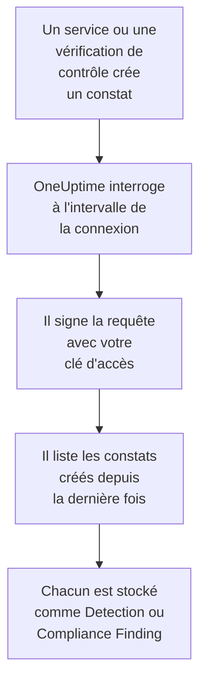

# AWS Security Hub

Importez les constats d'[AWS Security Hub](https://aws.amazon.com/security-hub/) dans les événements de sécurité de OneUptime : les constats de GuardDuty, Inspector, Macie et IAM Access Analyzer, les propres vérifications de contrôles de Security Hub, et les constats des produits partenaires. Vous les y recherchez à côté de vos logs, traces et métriques, vous les corrélez avec toutes les autres sources, et vous prévenez l'astreinte pour ceux qui comptent. OneUptime les lit avec une clé d'accès que vous créez, autorisée à une seule action en lecture seule, et ne modifie rien dans AWS. Il n'y a ni agent, ni règle EventBridge, ni export S3 à configurer.

:::cards
- [Configurer la connexion](#configurer-la-connexion): Une politique IAM, une clé d'accès et le formulaire de la connexion.
- [Ce qui est importé](#ce-qui-est-importé): Comment chaque constat devient un événement de sécurité.
- [Fonctionnement des interrogations](#fonctionnement-des-interrogations): La fenêtre que lit chaque interrogation, et pourquoi elle chevauche la précédente de 30 minutes.
- [Dépannage](#dépannage): Ce que signifie chaque erreur, et ce qu'il faut changer.
:::

## Fonctionnement



Chaque minute, OneUptime interroge chaque connexion activée dont l'intervalle d'interrogation est écoulé. Une interrogation appelle `GetFindings` de Security Hub dans votre région, en signant la requête avec [Signature Version 4](https://docs.aws.amazon.com/IAM/latest/UserGuide/reference_sigv-create-signed-request.html), pour les constats créés depuis la dernière interrogation. Elle stocke chacun comme un événement [OCSF](https://schema.ocsf.io/) : une vérification de contrôle comme un Compliance Finding (classe `2003`), et tout autre constat comme un Detection Finding (classe `2004`). Les règles de détection, les moniteurs et les tableaux de bord le traitent alors comme un événement de sécurité de n'importe quelle autre source.

## Avant de commencer

- Dans OneUptime, le rôle Project Owner, Project Admin ou Security Admin. Les rôles Security Member et Security Viewer voient les connexions et l'historique de leurs exécutions, mais ne peuvent pas les modifier.
- Un compte AWS où Security Hub est activé dans la région que vous connectez. Security Hub est régional : une connexion lit les constats qu'un compte détient dans une région.
- Pour lire les constats de chaque compte et de chaque région via une seule connexion, le compte administrateur délégué de Security Hub, dans sa région d'origine, avec l'[agrégation entre régions](https://docs.aws.amazon.com/securityhub/latest/userguide/finding-aggregation.html) activée. **Security Hub → Settings → Regions** indique la région d'origine.
- Du HTTPS sortant de l'application et des workers OneUptime vers `securityhub.<region>.amazonaws.com`, ou `securityhub.<region>.amazonaws.com.cn` en Chine, et une horloge exacte sur leurs hôtes : AWS refuse une requête signée avec plus de 5 minutes d'écart.

## Configurer la connexion

La connexion signe ses requêtes avec une clé d'accès IAM. L'identité de la clé a besoin d'une seule action, `securityhub:GetFindings`, et de rien d'autre : la connexion ne modifie jamais un constat.

:::steps
### Autoriser la lecture des constats

Dans la [console IAM](https://console.aws.amazon.com/iam/), ouvrez **Policies → Create policy**, choisissez **JSON**, et collez cette politique. Nommez-la, par exemple `OneUptimeSecurityHubRead` :

```json
{
  "Version": "2012-10-17",
  "Statement": [
    {
      "Effect": "Allow",
      "Action": "securityhub:GetFindings",
      "Resource": "*"
    }
  ]
}
```

`GetFindings` ne peut pas être limité à une ressource, `Resource` reste donc `*`. La politique gérée `AWSSecurityHubReadOnlyAccess` fonctionne aussi, mais autorise davantage.

### Créer une clé d'accès

1. Ouvrez **Users → Create user**, nommez l'utilisateur, par exemple `oneuptime-security-hub`, laissez l'accès à la console désactivé, et attachez la politique. Pour les constats d'autres comptes, faites-le dans le compte administrateur délégué.
2. Ouvrez l'utilisateur, puis **Security credentials → Access keys → Create access key**, et choisissez **Third-party service**.
3. Copiez l'**ID de clé d'accès** et la **Clé d'accès secrète**. AWS n'affiche le secret qu'une fois.

### Ajouter la connexion dans OneUptime

Ouvrez **Produits → Événements de sécurité → Connexions** (`/dashboard/{projectId}/security-events/connections`), cliquez sur **Ajouter une connexion**, choisissez **AWS Security Hub**, puis cliquez sur **Suivant**. Remplissez les paramètres du tableau ci-dessous, cliquez sur **Suivant**, et collez le secret dans **Clé d'accès secrète**.

### La tester avant d'enregistrer

Cliquez sur **Test these settings** sous **Tester avant d'enregistrer**. Le test signe une requête avec les valeurs du formulaire, sans rien stocker : une mauvaise clé ou une autorisation manquante apparaît donc avant que la connexion n'existe. Cliquez ensuite sur **Suivant**, donnez un **Nom** à la connexion et créez-la.
:::

| Réglage | Ce qu'il faut saisir |
| --- | --- |
| **Région** | Le code de la région, par exemple `us-east-1`, `eu-central-1` ou `us-gov-west-1` : pour les constats d'autres comptes, la région d'origine du compte administrateur. |
| **ID de clé d'accès** | L'ID de la clé : 16 à 128 lettres ou chiffres, en général 20, commençant par `AKIA`, ou par `ASIA` pour des identifiants temporaires. |
| **Clé d'accès secrète** | Le secret de la clé. Il est chiffré, jamais renvoyé par l'API et jamais réaffiché. Remplacez-le avec **Update credentials** sur la connexion. |
| **Session token** | Seulement pour des identifiants temporaires, qui en ont besoin : une clé `ASIA` est refusée sans lui, et une clé `AKIA` est refusée avec lui. |

Les identifiants temporaires de `aws sts assume-role` ou `aws sts get-session-token` expirent, au bout de 12 heures au plus pour un rôle assumé, et l'interrogation s'arrête jusqu'à ce que vous en colliez de nouveaux avec **Update credentials**. Une clé de longue durée avec cette politique étroite, renouvelée selon votre propre calendrier, continue d'interroger sans intervention. Pour passer d'identifiants temporaires à une clé de longue durée, saisissez la nouvelle clé dans **Update credentials** et activez **Remove the stored Session token**.

L'étape **Polling** contient aussi une **Description** facultative, le **Poll Interval (Minutes)**, un nombre entier de `1` à `1440` qui vaut `5` au départ, et **Activé**, qui est activé au départ.

## Ce qui est importé

Chaque constat devient un événement, avec le fournisseur `Amazon Web Services` et le produit `AWS Security Hub`. Un constat avec un objet `Compliance`, une vérification de contrôle par rapport à une norme comme AWS Foundational Security Best Practices ou CIS, devient un Compliance Finding (classe OCSF `2003`). Tout autre constat devient un Detection Finding (classe OCSF `2004`).

| Champ du constat | Colonne OneUptime |
| --- | --- |
| `Id`, un ARN pour les constats que crée AWS | UID de l'événement, qui sert aussi à écarter les doublons |
| `CreatedAt`, sinon `UpdatedAt`, sinon `FirstObservedAt` | Heure de l'événement |
| `Title` | Nom de la règle |
| `GeneratorId`, comme le type de constat GuardDuty ou l'ID du contrôle | ID de la règle |
| `Title`, sinon `Description` | Message |
| `Severity.Label`, sinon une tranche de `Severity.Normalized` | Gravité |
| `Workflow.Status` : `NEW`, `NOTIFIED`, `RESOLVED` ou `SUPPRESSED`, sinon l'ancien `WorkflowState` | Statut |
| `Types` sous `TTPs/` : `TTPs/Initial Access/...` devient `TA0001` | Tactiques et techniques MITRE ATT&CK |
| L'utilisateur IAM d'une ressource clé d'accès ou utilisateur, `Network.SourceIpV4` ou `SourceIpV6`, `Process.Name` ou `Process.Path` | Utilisateur, IP et processus de l'acteur |
| `Process.Name` et `Process.Path` | Nom et chemin du processus. Un constat ne donne ni ligne de commande ni processus parent. |
| L'ID d'instance d'une ressource `AwsEc2Instance`, `Network.DestinationIpV4` ou `DestinationIpV6`, `Network.DestinationPort`, le premier `Resources[].Id` | Hôte, IP, port et ressource de la cible |
| Ceux-ci, chaque `Resources[].Id`, `AwsAccountId`, les domaines du réseau, les noms de logiciels malveillants et les valeurs de renseignement sur les menaces | Observables |
| Le constat entier, aplati en clés à points, comme `Compliance.Status` et `Remediation.Recommendation.Url` | `attributes` |

Quand un constat n'a pas de `Severity.Label`, `Severity.Normalized` décide : `0` est Informational, de `1` à `39` Low, de `40` à `69` Medium, de `70` à `89` High, et de `90` à `100` Critical. Un constat que Security Hub met à jour plus tard, avec un nouveau `Workflow.Status` ou un contrôle qui passe désormais, garde son `Id`, il n'est donc pas réimporté : l'événement garde le constat tel qu'il était lors de l'import.

## Fonctionnement des interrogations

Chaque interrogation liste les constats créés dans sa fenêtre, les plus anciens d'abord, 100 par page, et suit `NextToken` jusqu'à avoir lu toute la fenêtre :

```text
POST https://securityhub.{region}.amazonaws.com/findings
    {"Filters": {"CreatedAt": [{"Start": "{window start}", "End": "{window end}"}]},
     "SortCriteria": [{"Field": "CreatedAt", "SortOrder": "asc"}],
     "MaxResults": 100}
```

- **L'heure de création est le curseur.** Les constats sont listés par `CreatedAt`, jamais par `FirstObservedAt`. GuardDuty crée un constat une fois qu'il a vu assez d'activité, et une vérification de contrôle quand Security Hub vérifie la ressource pour la première fois, des heures ou des jours après le début de l'activité. Un curseur sur l'heure d'observation les sauterait.
- **La première interrogation remonte 24 heures en arrière**, si bien qu'une nouvelle connexion montre tout de suite ses constats récents.
- **Chaque interrogation suivante commence 30 minutes avant le curseur enregistré.** `CreatedAt` est fixé par le service qui a trouvé le problème, et le constat atteint Security Hub plus tard : GuardDuty envoie les nouveaux constats en moins de cinq minutes, et une livraison échouée via EventBridge est réessayée pendant 24 heures au plus. Le chevauchement lit ces constats à l'interrogation suivante. Un constat qui arrive plus de 30 minutes après son `CreatedAt` peut passer derrière le curseur : importez sa plage de temps pour le récupérer.
- **Une interrogation lit au plus 24 heures au-delà du curseur.** Une connexion dont le curseur a pris du retard le rattrape en une suite de fenêtres de 24 heures, et sa **Santé** indique **Catching up**.
- **Les doublons sont écartés par l'`Id` du constat** au sein du projet, si bien que le chevauchement, une fenêtre relue et un import ne stockent jamais un constat deux fois.

### Quand une fenêtre contient plus qu'une interrogation ne peut lire

Une interrogation envoie au plus 20 requêtes de 100 constats : 2 000 constats. Quand une fenêtre en contient davantage, l'exécution est **Partial**, avec un avertissement comme celui-ci :

```text
Stopped after 20 findings requests (the per-run request limit) before the window was fully read. The last finding read was created at 2026-09-14T08:12:44.000Z.
```

Les constats sont lus les plus anciens d'abord, OneUptime déplace donc le curseur à l'heure de création du dernier constat lu, et l'interrogation suivante commence là, sans le chevauchement de 30 minutes, avec la même longueur de fenêtre. Un compte chargé rattrape environ 2 000 constats par interrogation, au lieu de relire les mêmes. Le chevauchement revient une fois que le curseur a avancé de 30 minutes au-delà de ce point.

Quand une exécution ne parvient pas du tout à dépasser le curseur enregistré, par exemple parce que les 30 minutes de chevauchement contiennent à elles seules plus de 2 000 constats, OneUptime raccourcit plutôt la fenêtre :

1. **Réduire.** L'interrogation suivante lit une fenêtre deux fois plus courte, depuis le même point de départ, et continue de la diviser par deux jusqu'à ce qu'une fenêtre soit lue entièrement, jusqu'à une minute. L'avertissement de l'exécution le dit : `This window holds more records than one poll can read; the next poll reads a {n} minute window from the same starting point.`
2. **Revenir à la taille normale.** Une fois une fenêtre lue entièrement, la suivante est de nouveau deux fois plus longue, jusqu'à 24 heures.
3. **Passer au-delà d'une seule minute.** Si même une minute contient plus qu'une interrogation ne peut lire, l'interrogation passe au-delà, pour que les constats plus récents continuent d'arriver, et le chevauchement des interrogations suivantes ne remonte plus jusqu'à elle. L'exécution reste **Partial**, et **Dernière erreur** indique `More records were created in the one minute from {cursor} to {end} than one poll can read. Polling moved past this minute so newer records keep arriving; use Import this time range in Diagnostics on this minute to recover what one run can read.` Importez cette minute avec **Importer cette plage de temps** pour récupérer ce qu'une exécution peut lire.

Une exécution qui échoue complètement, avec une erreur d'AWS, garde le curseur et la longueur de fenêtre, et l'interrogation suivante relit la même fenêtre. La seule exception est une requête qui a expiré : le curseur reste, mais la fenêtre suivante est deux fois plus courte, car une fenêtre trop lourde pour recevoir une réponse à temps expirerait à chaque essai. Changer le **Poll Interval (Minutes)** n'y change rien : il décide à quelle fréquence une interrogation commence, pas où commence sa fenêtre.

### Exécuter, prévisualiser et importer à la demande

Cliquez sur **Diagnostics** sur une connexion pour voir ses exécutions récentes et travailler avec elle à la main. Quiconque peut modifier la connexion peut les lancer ; quiconque peut la voir peut lire l'historique.

- **Run now** lance tout de suite une interrogation, avec le curseur habituel, même quand la connexion n'est pas **Activé**.
- **Preview findings** lit une plage de temps de 7 jours au plus et n'importe rien.
- **Importer cette plage de temps** importe une plage de 7 jours au plus, après votre confirmation, sans déplacer le curseur. Les constats déjà importés sont sautés.
- **Copier les diagnostics** sur une exécution copie son rapport pour le support. Il ne contient jamais d'identifiants.

## Tester la connexion

**Tester la connexion** sur la ligne d'une connexion, et **Test these settings** dans le formulaire, s'exécutent dans le processus de l'API, pas dans un worker d'arrière-plan, pour qu'un test réponde même quand les workers sont le problème. Il effectue ces vérifications, dans l'ordre :

| Vérification | Ce qu'elle vérifie |
| --- | --- |
| **Configuration** | Chaque réglage est présent et bien formé. Rien n'est contacté quand cela échoue. |
| **Authenticate with AWS** | AWS accepte une requête `GetFindings` signée pour un constat créé dans les 24 dernières heures. AWS vérifie la signature avant la politique IAM, donc un refus de la politique passe quand même cette vérification : la clé est bonne. |
| **Read findings** | Security Hub répond à cette requête : l'identité a le droit d'appeler `securityhub:GetFindings`, et Security Hub est activé dans la région. |
| **Findings available to import** | Combien de constats ont été créés dans les 24 dernières heures et les 7 derniers jours, une page de 100 pour chacun, si bien que `100+` signifie davantage. Aucun en 7 jours est un avertissement, pas un échec. |
| **Background workers**, **Poll scheduler**, **Security event storage** | Le côté de OneUptime lui-même : un processus prend les tâches de la file Worker, la tâche d'interrogation s'exécute chaque minute, et le stockage des événements de sécurité répond. |
| **Scheduled polling** | Pour une connexion enregistrée : l'interrogation est activée, aucune exécution n'est bloquée en attente d'un worker, et les interrogations s'exécutent à l'heure. |

Chaque requête d'un test a un délai de 20 secondes. Un test n'importe jamais rien et ne déplace jamais le curseur, et chaque vérification en échec dit ce qu'il faut changer.

## Dépannage

La **Dernière erreur** de la connexion conserve le message d'erreur complet, identifiants masqués, derrière un préfixe qui nomme l'étape en échec. Quand une connexion a une erreur, sélectionnez **Voir l'erreur** dans sa colonne **Actions** pour la lire, et **Copier l'erreur** dans la boîte de dialogue pour la copier. Chaque message commence par `AWS Security Hub findings request` ; lisez ce qui suit.

:::details Dernière erreur indique `failed (HTTP 401)` ou `failed (HTTP 403)`
AWS a refusé la requête. Le message cite le code d'erreur d'AWS, ou les propres mots d'AWS quand il n'a envoyé aucun code :

- `AccessDeniedException`, ou `is not authorized to perform` : la clé est bonne, mais son identité n'a pas le droit d'appeler `securityhub:GetFindings`. Attachez la politique de [Configurer la connexion](#configurer-la-connexion). Une limite d'autorisations ou une politique de contrôle des services peut aussi la refuser.
- `InvalidAccessException`, ou `is not subscribed to AWS Security Hub` : Security Hub n'est pas activé pour ce compte dans cette **Région**, ou le compte n'y est pas son administrateur.
- `InvalidSignatureException` ou `SignatureDoesNotMatch`, ou `The request signature we calculated does not match` : la **Clé d'accès secrète** n'appartient pas à l'**ID de clé d'accès**. Créez une nouvelle clé d'accès, et enregistrez-la avec **Update credentials**.
- `UnrecognizedClientException` ou `InvalidClientTokenId`, ou `The security token included in the request is invalid` : AWS ne connaît pas l'**ID de clé d'accès**. Il est mal saisi, supprimé, désactivé ou d'une autre partition, ou c'est une clé temporaire sans son **Session token**.
- `ExpiredTokenException`, ou `The security token included in the request is expired` : les identifiants temporaires ont expiré. Émettez-en de nouveaux, ou passez à une clé de longue durée.
- `RequestTimeTooSkewed` ou `RequestExpired`, ou `Signature expired` : l'horloge des hôtes OneUptime a plus de 5 minutes d'écart. Corrigez NTP sur les hôtes de l'application et des workers.
- Aucun code : AWS n'a pas dit si c'est la clé ou la politique qui l'a refusée. Vérifiez d'abord la clé, puis la politique.
:::

:::details Dernière erreur indique `failed (HTTP ...)` avec un autre statut
- `HTTP 404` : aucun point de terminaison Security Hub n'a répondu pour cette **Région**. Comparez-la avec le menu des régions de la console AWS : `us-east-1`, pas `us-east1` ni `N. Virginia`.
- `HTTP 429` : le compte a atteint la limite de Security Hub, 3 requêtes `GetFindings` par seconde dans une région. L'interrogation suivante réessaie. Si cela continue, cherchez un autre outil ou une autre connexion qui lit le même compte et la même région.
- `HTTP 5xx` : Security Hub a eu un problème de son côté. L'interrogation suivante réessaie.
- `HTTP 400` : Security Hub a refusé la requête, que construit OneUptime, pas vos paramètres. Envoyez le message au support de OneUptime.
:::

:::details Dernière erreur indique `returned`, `timed out` ou `Could not reach data source`
- `returned a non-JSON body` ou `returned an unrecognized response shape` : autre chose que Security Hub a répondu, par exemple la page de connexion d'un proxy ou une passerelle qui réécrit les réponses. C'est signalé au lieu d'être pris pour une fenêtre vide, pour que le curseur ne dépasse jamais des constats que personne n'a lus.
- `timed out after 60 seconds with no response`, ou `failed: Could not reach data source` : la requête n'a pas reçu de réponse. Les points de terminaison de Security Hub sont publics : vérifiez donc le DNS, les pare-feu et les proxys entre l'application et les workers OneUptime et `securityhub.<region>.amazonaws.com`.
:::

:::details Dernière interrogation vaut Never et Dernière erreur est vide
Aucune interrogation ne s'est terminée pour cette connexion. Lancez **Tester la connexion** : ses vérifications **Background workers** et **Poll scheduler** nomment la cause. Sur une installation auto-hébergée, la cause habituelle est `DISABLE_QUEUE_WORKERS=true` sur l'application, sans déploiement de workers séparé qui prenne les tâches : réglez-le sur `false`, ou lancez le déploiement des workers (Helm : `worker.enabled: true`).
:::

:::details Une exécution est Partial
- `Stopped after 20 findings requests` : la fenêtre contenait plus que les 2 000 constats qu'une exécution lit. Rien n'est perdu : l'interrogation suivante commence après le dernier constat lu. Une connexion qui reste **Partial** d'interrogation en interrogation rattrape un retard, et ses valeurs **Dernière interrogation** et **Dernier événement importé** continuent d'avancer. Si elle ne rattrape jamais, le compte crée plus de 2 000 constats par intervalle d'interrogation : raccourcissez le **Poll Interval (Minutes)**.
- `More records were created in the one minute from ... than one poll can read` : l'interrogation est passée au-delà de cette minute. Importez-la avec **Importer cette plage de temps** dans **Diagnostics**. Une importation lit autant qu'une interrogation.
:::

:::details Le test réussit, mais rien n'est importé
Lisez **Findings available to import** dans le rapport du test. `0` sur les 7 derniers jours signifie que Security Hub n'a créé aucun constat dans ce compte et cette région : vérifiez que GuardDuty, Inspector ou une norme de sécurité y est activé. Pour voir les constats d'autres comptes et régions, connectez le compte administrateur dans sa région d'origine.
:::

:::details Un constat de la console Security Hub n'est jamais arrivé
Comparez son `CreatedAt` avec son `ProcessedAt`, quand Security Hub l'a reçu. Un constat arrivé plus de 30 minutes après son `CreatedAt` peut passer derrière le curseur : importez son `CreatedAt` avec **Importer cette plage de temps**.
:::

## Ce que vous obtenez

- **Recherche.** Filtrez les constats par gravité, statut, règle, compte, ressource ou n'importe quel observable dans l'explorateur des événements de sécurité, à côté de toutes les autres sources.
- **Corrélation.** Les utilisateurs, instances, IP, ARN de ressources et ID de comptes de chaque constat sont indexés comme observables, si bien qu'une recherche trouve tout ce qui les mentionne.
- **Règles de détection.** Des règles Sigma qui s'exécutent selon un planning sur vos événements de sécurité, et ouvrent des alertes qui préviennent l'astreinte.
- **Moniteurs.** Les moniteurs d'événements de sécurité comptent les événements correspondants, par exemple les nouveaux constats GuardDuty critiques ou les contrôles en échec, et ouvrent des incidents ou des alertes au-delà d'un seuil.

Les événements de sécurité sont facturés comme le reste de votre télémétrie, par Go ingéré. Voir les [tarifs](https://oneuptime.com/pricing).

## Étapes suivantes

:::cards
- [Événements de sécurité](/docs/telemetry/security-events): Rechercher, corréler et alerter sur ce que vous importez.
- [Okta System Log](/docs/integrations/okta): Importer aussi les connexions de votre fournisseur d'identité.
- [Rôles](/docs/permissions/reference#rôles): Ce que les rôles Security peuvent voir et modifier.
- [Présentation des intégrations](/docs/integrations/index): Les autres outils que vous pouvez connecter.
:::
