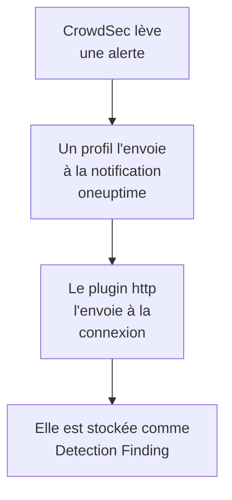

# CrowdSec

Recevez les alertes de [CrowdSec](https://www.crowdsec.net/) dans les événements de sécurité de OneUptime à mesure que CrowdSec les lève, et bloquez avec CrowdSec les adresses de la liste de blocage de votre projet. Le plugin de notification de CrowdSec lui-même envoie chaque alerte à une connexion CrowdSec, qui ouvre des dossiers à partir des détections de CrowdSec. Une fois le blocage activé, OneUptime bannit chaque adresse que vous bloquez via la Local API de CrowdSec, et chaque bouncer qui la lit bloque l'adresse.

:::cards
- [Configurer la connexion](#configurer-la-connexion): Une connexion, et la notification qui lui envoie les alertes de CrowdSec.
- [Ce qui est reçu](#ce-qui-est-reçu): Comment chaque alerte CrowdSec devient un événement de sécurité.
- [Bloquer des adresses avec CrowdSec](#bloquer-des-adresses-avec-crowdsec): Bannir dans CrowdSec les adresses de votre liste de blocage.
- [Lire les listes de blocage de CrowdSec](#lire-les-listes-de-blocage-de-crowdsec): Les listes que sert la CrowdSec Console, comme flux de renseignements sur les menaces.
- [Dépannage](#dépannage): Ce que signifie chaque erreur, et ce qu'il faut changer.
:::

## Fonctionnement



La Local API de CrowdSec remet chaque alerte qu'un profil envoie à une notification au plugin de cette notification. La notification de la connexion utilise le plugin `http` de CrowdSec : il envoie l'alerte, dans le JSON propre à CrowdSec, à l'ingestion des événements de sécurité avec votre clé d'ingestion, en nommant la connexion. OneUptime la stocke comme un événement [OCSF](https://schema.ocsf.io/) Detection Finding (classe `2004`), la confronte à vos règles de détection, et ouvre un dossier à partir de chacune des détections propres à CrowdSec qui atteint le niveau **Ouvrir des dossiers à partir de** de la connexion. Rien n'est interrogé : une alerte arrive quelques secondes après que CrowdSec l'a levée.

## Avant de commencer

- Dans OneUptime, le rôle Propriétaire du projet, Administrateur du projet ou Administrateur de la sécurité. Les rôles Membre de la sécurité et Lecteur de la sécurité voient les connexions, mais ne peuvent pas les modifier.
- CrowdSec 1.5 ou ultérieur, avec sa Local API et le plugin de notification `http` qu'il fournit. Cette page est écrite pour CrowdSec v1.8.2.
- Le HTTPS sortant de l'hôte qui exécute la Local API de CrowdSec vers votre OneUptime.
- Pour bloquer aussi des adresses : une Local API que OneUptime peut joindre, et une machine pour OneUptime (voir [Bloquer des adresses avec CrowdSec](#bloquer-des-adresses-avec-crowdsec)).

## Configurer la connexion

:::steps
### Ajouter la connexion dans OneUptime

Ouvrez **Produits → Événements de sécurité → Connexions** (`/dashboard/{projectId}/security-events/connections`), cliquez sur **Ajouter une connexion**, choisissez **CrowdSec**, et cliquez sur **Suivant**. Pour recevoir seulement les alertes, laissez vides tous les réglages du tableau ci-dessous ; pour bloquer aussi des adresses, remplissez-les.

### La tester avant d'enregistrer

Cliquez sur **Tester ces paramètres** sous **Tester avant d'enregistrer**. Sans Local API renseignée, le test le dit et ne contacte rien ; avec une Local API, il la joint et se connecte en tant que la machine, et n'enregistre rien. Cliquez ensuite sur **Suivant**, donnez à la connexion un **Nom** à l'étape **Alertes**, choisissez la valeur de **Ouvrir des dossiers à partir de**, et créez-la.

### Enregistrer la notification sur l'hôte CrowdSec

Créer la connexion ouvre son **Envoyer les alertes**, que vous rouvrez ensuite depuis la ligne de la connexion. Sous **Choisir une clé d'ingestion**, choisissez une clé, puis enregistrez la notification affichée, avec votre clé et votre connexion déjà renseignées, sur l'hôte qui exécute la Local API de CrowdSec :

```yaml title="/etc/crowdsec/notifications/oneuptime.yaml"
type: http
name: oneuptime

# info or quieter: at debug, CrowdSec logs each request's headers.
log_level: info

format: |
  {{.|toJson}}

url: https://oneuptime.com/security-events/v1/ingest?connection=YOUR_CONNECTION_ID&format=crowdsec
method: POST
headers:
  Content-Type: application/json
  x-oneuptime-token: YOUR_INGESTION_TOKEN
```

### Y envoyer les alertes de vos profils

Dans `/etc/crowdsec/profiles.yaml`, ajoutez `oneuptime` aux `notifications` de chaque profil dont OneUptime doit recevoir les alertes, puis rechargez CrowdSec :

```yaml title="/etc/crowdsec/profiles.yaml"
notifications:
  - oneuptime
```

```bash
sudo systemctl reload crowdsec
```

### Envoyer une alerte de test

```bash
sudo cscli notifications test oneuptime
```

**Envoyer les alertes** indique quand elle arrive, et **Voir les alertes** l'ouvre dans les événements de sécurité. C'est un événement de gravité Informational, qui n'ouvre aucun dossier.
:::

| Réglage | Ce qu'il faut saisir |
| --- | --- |
| **URL de la Local API** | Uniquement pour bloquer des adresses : où OneUptime joint la Local API de CrowdSec, par exemple `https://crowdsec.example.com:8080`. Utilisez `https` dès que la connexion traverse un réseau. |
| **ID de machine** | Uniquement pour bloquer des adresses : la machine sous laquelle OneUptime se connecte, ajoutée sur l'hôte CrowdSec avec `sudo cscli machines add oneuptime --auto -f -`. |
| **Bloquer des adresses avec CrowdSec** | Désactivé sur une nouvelle connexion. Activé, il bannit dans CrowdSec les adresses et les plages de votre liste de blocage, et nécessite les trois autres réglages (voir [Bloquer des adresses avec CrowdSec](#bloquer-des-adresses-avec-crowdsec)). |
| **Mot de passe de la machine** | Uniquement pour bloquer des adresses : le mot de passe que `cscli` a affiché pour la machine. Il est chiffré, jamais renvoyé par l'API et plus jamais affiché. Remplacez-le avec **Mettre à jour les identifiants** sur la connexion. |

L'étape **Alertes** contient aussi une **Description** facultative, et **Activé**, qui est activé au départ. Une connexion qui n'est pas activée conserve comme événements les alertes qu'elle reçoit, et n'en ouvre aucun dossier.

Dans un conteneur, la notification va dans le répertoire monté sur `/etc/crowdsec/notifications/`, et un redémarrage du conteneur la lit. Une installation Kubernetes la déclare dans ses valeurs Helm sous `config.notifications`, avec `profiles.yaml` à côté sous `config`.

## Ce qui est reçu

Chaque alerte que CrowdSec envoie devient un événement Detection Finding (classe OCSF `2004`), avec le fournisseur et le produit `CrowdSec` :

| Champ CrowdSec | Colonne OneUptime |
| --- | --- |
| `uuid`, ou un hachage pour une alerte qui n'en a pas | UID de l'événement, qui sert aussi à écarter les doublons |
| `stop_at`, ou `start_at` | Heure de l'événement |
| `scenario` | ID de la règle, et le nom de la règle : le titre du scénario sur le CrowdSec Hub, ou son nom |
| `source.ip`, ou `source.value` d'une alerte `Ip` | IP principale |
| `target_fqdn` ou `target_host` de l'alerte ou de ses événements, sinon la `machine` que nomment ses événements | Hôte cible |
| `target_user`, `target_uri` | Utilisateur et ressource cibles |
| Le `type` de la première décision | Statut : `Blocked` pour un bannissement, `Challenge` pour un captcha, `Logged` sans décision ou en mode simulation |
| Le comportement du scénario | Gravité, et ses tactiques et techniques MITRE ATT&CK |
| Tout le reste, comme `source.cn`, `source.as_name` et `events_count` | `attributes` : les champs de l'alerte aplatis en clés pointées, ses 10 premiers événements en entier, et la lecture de OneUptime sous `crowdsec.` |

Une alerte CrowdSec n'a pas de gravité propre : OneUptime la déduit donc de ce que le scénario détecte, tel que le CrowdSec Hub l'étiquette (`ssh:bruteforce`, `http:exploit`) :

| Comportement | Gravité |
| --- | --- |
| Un exploit, comme une CVE ou ce que le composant AppSec a bloqué, ou ce que fait un attaquant une fois à l'intérieur | High |
| Force brute, déni de service, fraude, connexion impossible, ou un comportement que OneUptime ne sait pas classer | Medium |
| Scans, sondages, explorations, bots, spam et modifications relevées par l'audit cloud | Low |
| Les scénarios de test propres à CrowdSec | Informational |

Avec **Ouvrir des dossiers à partir de** sur **Élevé et au-dessus**, les exploits de CrowdSec ouvrent des dossiers, et ses bannissements quotidiens de scanners et de devineurs de mots de passe restent des événements pour vos règles de détection. Seules les détections propres à CrowdSec ouvrent des dossiers. Une décision ajoutée par quelqu'un avec `cscli` ou dans la Console de CrowdSec, une adresse d'une liste de blocage CrowdSec, l'alerte de test et les propres bannissements de OneUptime qui reviennent sont Informational, et n'en ouvrent aucun. Une alerte envoyée deux fois, comme le fait `cscli notifications reinject`, est stockée une seule fois.

## Bloquer des adresses avec CrowdSec

Activez **Bloquer des adresses avec CrowdSec** sur une connexion, et les adresses et les plages de la [liste de blocage](/docs/telemetry/security-cases#liste-de-blocage) de votre projet sont bannies dans CrowdSec. Chaque bouncer qui lit sa Local API, comme ses bouncers de pare-feu, nginx et Traefik, les bloque là où il s'exécute, comme il bloque les propres bannissements de CrowdSec. Les blocages passent par les mêmes approbations, les mêmes limites de réponse automatique et le même **Lever** que partout ailleurs où votre liste de blocage est appliquée.

L'interrupteur est désactivé sur une nouvelle connexion. Pour l'activer :

1. Sur l'hôte CrowdSec, ajoutez une machine pour OneUptime ; la commande affiche son mot de passe :

   ```bash
   sudo cscli machines add oneuptime --auto -f -
   ```

2. Permettez à OneUptime de joindre la Local API, qui écoute sur `127.0.0.1:8080` sauf indication contraire : réglez `api.server.listen_uri` dans le `config.yaml` de CrowdSec, servez-la en TLS ou derrière un proxy `https`, et laissez passer les adresses de OneUptime dans votre pare-feu.
3. Modifiez la connexion, renseignez **URL de la Local API** et **ID de machine**, mettez le mot de passe dans **Mot de passe de la machine**, activez **Bloquer des adresses avec CrowdSec**, et enregistrez. **Tester la connexion** vérifie alors que la machine se connecte et lit les bannissements de OneUptime, sans rien modifier.

Comment un bannissement est créé, et comment il prend fin :

- Chaque blocage est une décision de bannissement, créée comme `cscli decisions add` en crée une, sous le scénario `oneuptime/blocklist`. CrowdSec la conserve comme une décision manuelle : elle n'est donc jamais partagée avec la Central API de CrowdSec, sauf si vous partagez les décisions manuelles. OneUptime ne lit et ne supprime que ses propres bannissements, jamais un bannissement créé par une personne ou par CrowdSec.
- Un blocage avec une fin est un bannissement jusqu'à exactement cette fin, et CrowdSec le lève alors de lui-même, que OneUptime puisse le joindre ou non. Un blocage valable jusqu'à sa levée est un bannissement de 7 jours, renouvelé dès qu'il reste 3 jours ou moins : un bannissement que OneUptime ne maintient plus prend donc fin en une semaine.
- **Lever** supprime le bannissement au passage suivant, en moins d'une minute. Un bannissement supprimé dans CrowdSec, par `cscli decisions delete` ou un flush, est recréé au passage suivant tant que le blocage dure.
- Une adresse ou une plage présente sur l'une des listes d'autorisation de CrowdSec n'est jamais bannie : le blocage l'indique comme non appliqué à cet endroit, en nommant la liste d'autorisation, et un bannissement déjà créé est supprimé dès qu'une liste d'autorisation contient l'adresse.
- Les propres adresses de votre projet, comme vos **Proxys de confiance**, vos répartiteurs de charge et vos réseaux en périphérie, ne sont jamais bloquées nulle part, CrowdSec compris.
- CrowdSec bannit seulement : un défi n'y est pas appliqué, et un domaine, une URL ou un fichier ne lui est pas envoyé.

Quand la Local API est injoignable, rien ne change dans CrowdSec : les bannissements qu'il détient restent, et prennent fin quand ils prennent fin. **Appliqué sur** dans la **Liste de blocage** indique quand CrowdSec a détenu chaque blocage pour la dernière fois, et OneUptime réessaie après 1 minute, puis attend deux fois plus longtemps à chaque fois, jusqu'à 30 minutes. Un nouveau blocage attend de pouvoir être créé.

## Lire les listes de blocage de CrowdSec

La CrowdSec Console sert les listes de blocage auxquelles votre organisation s'abonne sous forme d'intégration Raw IP List : une adresse par ligne, derrière un nom d'utilisateur et un mot de passe. Un [flux de renseignements sur les menaces](/docs/telemetry/threat-intelligence) les lit, et confronte vos événements à elles :

1. Dans la CrowdSec Console, créez une intégration Raw IP List, avec l'agrégation d'IP désactivée : OneUptime compare des adresses, pas des plages. Copiez son endpoint, son nom d'utilisateur et son mot de passe.
2. Dans OneUptime, ouvrez **Produits → Événements de sécurité → Détections → Renseignement sur les menaces**, cliquez sur **Créer : Flux de renseignements sur les menaces**, et choisissez **Liste d'indicateurs**.
3. Collez l'endpoint comme **URL de la liste**, choisissez **Nom d'utilisateur et mot de passe** sous **Connexion**, et collez les deux. Avec l'offre Community de CrowdSec, qui autorise un téléchargement par jour, réglez **Intervalle d'interrogation (minutes)** sur `1440`.

Les listes appartiennent à CrowdSec : vous pouvez les utiliser dans vos propres outils, mais pas les redistribuer. OneUptime ne propose aucune liste qui lui soit propre.

## Tester la connexion

**Tester la connexion** sur la ligne d'une connexion, et **Tester ces paramètres** dans le formulaire, s'exécutent dans le processus de l'API, pas dans un worker d'arrière-plan. Ils effectuent ces vérifications, dans l'ordre :

| Vérification | Ce qu'elle vérifie |
| --- | --- |
| **Configuration** | Les réglages sont soit tous vides, soit tous renseignés, et bien formés. Rien n'est contacté quand cela échoue. |
| **Reach CrowdSec's Local API** | `GET /health` répond. Sans Local API renseignée, la vérification indique que la connexion reçoit seulement des alertes, et les trois suivantes ne sont pas exécutées. |
| **Sign in to the Local API** | `POST /v1/watchers/login` accepte la machine et son mot de passe. |
| **Read CrowdSec's allowlists** | `GET /v1/allowlists` répond, et combien d'adresses et de plages elles contiennent. Une Local API antérieure à 1.6.8, qui n'en a pas, réussit. |
| **Block with CrowdSec** | Seulement avec **Bloquer des adresses avec CrowdSec** activé : la machine peut relire les bannissements de OneUptime, et combien sont en vigueur. La vérification ne modifie rien. |
| **Background workers**, **Security event storage** | Le côté de OneUptime lui-même : un processus prend les tâches de la file Worker, qui stockent ce qu'envoie CrowdSec, et le stockage des événements de sécurité répond. |
| **Alerts received** | Pour une connexion enregistrée : quand la dernière alerte est arrivée. Aucune pour l'instant est un avertissement, avec la façon d'envoyer une alerte de test. |

Un test ne bannit et ne supprime jamais rien. **Copier le rapport** copie la liste des vérifications en JSON, sans le mot de passe ni les jetons.

## Dépannage

La **Santé** de la connexion affiche **En attente d'alertes** jusqu'à l'arrivée de la première alerte, puis **Reçoit des alertes**, quel que soit le temps que met la suivante ; **Dossiers en pause** signifie que la connexion n'est pas activée. CrowdSec écrit ce que le plugin a répondu dans son propre journal, `/var/log/crowdsec.log`, sous la forme `HTTP server returned non 200 status code`.

:::details Aucune alerte n'arrive
- Exécutez `sudo cscli notifications list` : `oneuptime` doit être listée, et active dans un profil. Une notification qu'aucun profil ne nomme n'envoie rien.
- `401` : la clé d'ingestion dans `x-oneuptime-token` est absente, erronée ou expirée, et `422` : elle est désactivée. Choisissez une clé dans **Envoyer les alertes**, et copiez de nouveau la notification.
- `400` : l'adresse ne nomme aucune connexion CrowdSec de ce projet. Copiez l'adresse depuis **Envoyer les alertes** de la connexion : elle se termine par l'ID de la connexion.
- Rien du tout dans le journal : l'hôte CrowdSec ne peut pas joindre votre OneUptime. Vérifiez son HTTPS sortant, et son proxy.
:::

:::details Tester la connexion échoue à Reach CrowdSec's Local API
`CrowdSec Local API health check could not be completed` signifie que rien n'a répondu : la Local API écoute par défaut sur `127.0.0.1`, donc OneUptime ne peut pas la joindre tant que `api.server.listen_uri` et votre pare-feu ne le permettent pas. Un avertissement indiquant qu'elle répond en `http` signifie que le mot de passe de la machine traverse le réseau en clair : servez la Local API en TLS, ou placez un proxy `https` devant elle.
:::

:::details Tester la connexion échoue à Sign in to the Local API
`CrowdSec Local API login failed (HTTP 401)` se termine par ce qu'il faut faire : vérifiez l'ID de machine et le mot de passe avec `sudo cscli machines list`, validez une machine pas encore validée avec `sudo cscli machines validate oneuptime`, ou ajoutez une machine qui se connecte avec un mot de passe. Enregistrez un nouveau mot de passe avec **Mettre à jour les identifiants**.
:::

:::details Un blocage n'est pas appliqué dans CrowdSec
Survolez son **Appliqué sur** : il nomme une liste d'autorisation qui contient l'adresse, un défi que CrowdSec n'applique pas, ou l'erreur de la Local API. Tant que la Local API est injoignable, OneUptime continue d'essayer, et les bannissements que CrowdSec détient déjà restent en vigueur.
:::

:::details CrowdSec envoie ses alertes, mais aucune n'est stockée
Ce qu'envoie CrowdSec est stocké par les workers d'arrière-plan : sur une installation auto-hébergée avec `DISABLE_QUEUE_WORKERS=true` sur l'application et sans déploiement de workers séparé, les alertes sont reçues et jamais stockées. **Tester la connexion** le montre comme une vérification **Background workers** en échec. Réglez-le sur `false`, ou lancez le déploiement des workers (Helm : `worker.enabled: true`).
:::

## Étapes suivantes

:::cards
- [Événements de sécurité](/docs/telemetry/security-events): Rechercher, corréler et alerter sur ce qu'envoie CrowdSec.
- [Dossiers de sécurité](/docs/telemetry/security-cases): Traiter les dossiers qu'ouvrent les détections de CrowdSec, et bloquer depuis ceux-ci.
- [Renseignement sur les menaces](/docs/telemetry/threat-intelligence): Confronter vos événements aux listes de blocage de CrowdSec.
- [Présentation des intégrations](/docs/integrations/index): Les autres outils que vous pouvez connecter.
:::
