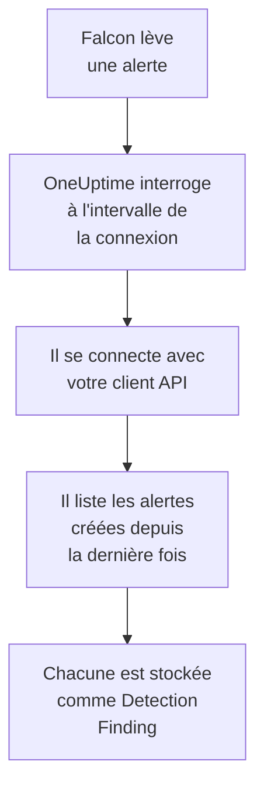

# CrowdStrike Falcon

Importez les alertes [CrowdStrike Falcon](https://www.crowdstrike.com/platform/), issues des détections sur les points de terminaison, les identités et le cloud, dans les événements de sécurité de OneUptime. Vous les y recherchez à côté de vos logs, traces et métriques, vous les corrélez avec toutes les autres sources, et vous prévenez l'astreinte pour celles qui comptent. OneUptime les lit via l'API Alerts de Falcon avec un client API que vous créez, et n'écrit jamais dans Falcon.

:::cards
- [Configurer la connexion](#configurer-la-connexion): Un client API avec une seule étendue, et le formulaire de la connexion.
- [Ce qui est importé](#ce-qui-est-importé): Comment chaque alerte Falcon devient un événement de sécurité.
- [Fonctionnement des interrogations](#fonctionnement-des-interrogations): La fenêtre que lit chaque interrogation, et ce qu'en fait un CID chargé.
- [Dépannage](#dépannage): Ce que signifie chaque erreur, et ce qu'il faut changer.
:::

## Fonctionnement



Chaque minute, OneUptime interroge chaque connexion activée dont l'intervalle d'interrogation est écoulé. Une interrogation se connecte à votre cloud Falcon avec l'ID et le secret du client API, demande à l'API Alerts les alertes créées depuis la dernière interrogation, et stocke chacune comme un événement [OCSF](https://schema.ocsf.io/) Detection Finding (classe `2004`). Les règles de détection, les moniteurs et les tableaux de bord le traitent alors comme un événement de sécurité de n'importe quelle autre source.

## Avant de commencer

- Dans OneUptime, le rôle Project Owner, Project Admin ou Security Admin. Les rôles Security Member et Security Viewer voient les connexions et l'historique de leurs exécutions, mais ne peuvent pas les modifier.
- Un ID client Falcon (CID), et un utilisateur de la console Falcon qui peut gérer les clients API : le rôle Falcon Administrator, ou un rôle personnalisé avec l'autorisation API clients and keys.
- Le HTTPS sortant de l'application et des workers OneUptime vers l'hôte API de votre cloud Falcon, listé sous **Falcon cloud** ci-dessous.

## Configurer la connexion

:::steps
### Créer un client API

1. Dans la console Falcon, ouvrez **Support and resources → API clients and keys**, et sélectionnez **Create API client**.
2. Nommez-le, par exemple `OneUptime security events`. Sous **API scopes**, activez **Alerts → Read**, et laissez toutes les autres étendues désactivées : la connexion n'écrit jamais dans Falcon.
3. Créez le client. Falcon affiche une seule fois son ID client, son secret et son URL de base. Copiez les trois maintenant : le secret peut être réinitialisé plus tard, mais plus jamais affiché.

### Trouver votre cloud Falcon

L'URL de base affichée par Falcon vous indique le cloud de votre CID. La page **API clients and keys** l'affiche aussi, à côté de chaque client. Un client d'un cloud est refusé par les autres.

| URL de base affichée par Falcon | Cloud Falcon |
| --- | --- |
| `https://api.crowdstrike.com` | US-1 |
| `https://api.us-2.crowdstrike.com` | US-2 |
| `https://api.eu-1.crowdstrike.com` | EU-1 |
| `https://api.laggar.gcw.crowdstrike.com` | US-GOV-1 |

### Ajouter la connexion dans OneUptime

Ouvrez **Produits → Événements de sécurité → Connexions** (`/dashboard/{projectId}/security-events/connections`), cliquez sur **Ajouter une connexion**, choisissez **CrowdStrike Falcon**, et cliquez sur **Suivant**. Remplissez les réglages du tableau ci-dessous, cliquez sur **Suivant**, et collez le secret dans **Secret client**.

### La tester avant d'enregistrer

Cliquez sur **Tester ces paramètres** sous **Tester avant d'enregistrer**. Le test se connecte et lit les alertes avec les valeurs du formulaire, et n'enregistre rien, un mauvais cloud ou une étendue manquante apparaît donc avant que la connexion existe. Cliquez ensuite sur **Suivant**, donnez à la connexion un **Nom**, et créez-la.
:::

| Réglage | Ce qu'il faut saisir |
| --- | --- |
| **ID client** | L'ID du client API, tel que Falcon l'a affiché à la création du client. |
| **Falcon cloud** | Le cloud de votre CID : **US-1 (api.crowdstrike.com)**, **US-2 (api.us-2.crowdstrike.com)**, **EU-1 (api.eu-1.crowdstrike.com)** ou **US-GOV-1 (api.laggar.gcw.crowdstrike.com)**. Chaque requête va à l'hôte API de ce cloud. |
| **Secret client** | Le secret du client API. Il est chiffré, jamais renvoyé par l'API et plus jamais affiché. Remplacez-le avec **Mettre à jour les identifiants** sur la connexion. |

L'étape **Interrogation** contient aussi une **Description** facultative, le **Intervalle d'interrogation (minutes)**, un nombre entier de `1` à `1440` qui vaut `5` au départ, et **Activé**, qui est activé au départ. Une connexion qui n'est pas activée peut quand même être testée, et interrogée à la main.

## Ce qui est importé

La connexion lit les alertes de Falcon : ce que la console Falcon liste sous **Endpoint security → Endpoint detections** et **Next-Gen SIEM → Alerts**, de chaque produit qui les lève. Chaque alerte devient un événement Detection Finding (classe OCSF `2004`), avec le fournisseur `CrowdStrike` et le produit `Falcon` :

| Champ Falcon | Colonne OneUptime |
| --- | --- |
| `composite_id` | UID de l'événement, qui sert aussi à écarter les doublons |
| `created_timestamp` | Heure de l'événement |
| `display_name`, ou `name` | Nom de la règle |
| `pattern_id` | ID de la règle |
| `description`, ou le nom de la règle | Message |
| `severity_name`, ou `severity` de 0 à 100 | Gravité |
| `status`, comme `new`, `in_progress` ou `closed` | Statut |
| `tactic_id`, `technique_id` | Tactiques et techniques MITRE ATT&CK |
| `device.hostname`, `device.local_ip`, `user_name`, `filename` ou `cmdline` | Hôte, IP, utilisateur et processus principaux |
| `filename`, `filepath` et `cmdline` ; `parent_details.filename`, `parent_details.filepath` et `parent_details.cmdline` | Nom, chemin et ligne de commande du processus ; nom, chemin et ligne de commande du processus parent |
| `device.hostname`, `device.local_ip`, `device.external_ip`, `user_name`, `sha256` | Observables |
| Tout le reste, comme `device.platform_name`, `falcon_host_link`, `product` et `timestamp` | `attributes`, aplati en clés pointées |

L'heure de l'événement est volontairement celle où Falcon a créé l'alerte : l'heure du comportement qui la motive, `timestamp`, reste dans `attributes.timestamp`.

## Fonctionnement des interrogations

- **L'heure de création est le curseur.** Les alertes sont listées par `created_timestamp`, jamais par l'heure du comportement qui les motive. Falcon peut lever une alerte bien après l'activité qu'elle décrit, et un curseur sur l'heure d'activité sauterait chacune de ces alertes.
- **La première interrogation remonte 24 heures en arrière**, pour qu'une nouvelle connexion montre tout de suite ses alertes récentes.
- **Chaque interrogation suivante commence 1 minute avant le curseur enregistré**, pour qu'une alerte créée à la frontière entre deux fenêtres ne soit jamais manquée.
- **Une interrogation lit au plus 24 heures au-delà du curseur.** Une connexion dont le curseur a pris du retard le rattrape en une suite de fenêtres de 24 heures.
- **Les doublons sont écartés par `composite_id`** au sein du projet, pour que le chevauchement et une fenêtre relue ne stockent jamais une alerte deux fois.
- **Chaque fenêtre coûte** une requête de jeton, gardé pendant sa durée de vie, puis une requête d'alertes et une récupération d'alertes par tranche de 1 000 alertes, chacune avec son propre délai.

### Quand une fenêtre contient plus qu'une interrogation ne peut lire

Une interrogation envoie au plus 20 requêtes. Avec une requête de jeton et deux requêtes par tranche de 1 000 alertes, elle lit au plus 9 000 alertes. Quand une fenêtre en contient davantage, l'exécution est **Partiel**, avec un avertissement comme celui-ci :

```text
Stopped after 19 requests before reading the whole window. Alerts are read oldest first; every alert created before 2026-09-14T08:12:44.995Z was read.
```

La requête d'alertes est triée par `created_timestamp`, les plus anciennes d'abord, OneUptime déplace donc le curseur à l'heure de création de la dernière alerte lue, et l'interrogation suivante commence là, avec la même longueur de fenêtre, depuis le décalage `0`. Un CID chargé rattrape environ 9 000 alertes par interrogation, au lieu de relire les mêmes. Les alertes créées au même instant sont lues deux fois, et la vérification des doublons écarte la seconde copie.

La requête d'alertes de Falcon ne peut pas paginer au-delà de 10 000 résultats (`limit` plus `offset`). La limite de requêtes arrête une exécution à 9 000 alertes, avant ce plafond. Si le plafond arrête un jour une lecture, c'est traité de la même façon : l'exécution est **Partiel**, le curseur passe à la dernière alerte lue, et la requête suivante repart du décalage `0`.

Quand une exécution ne parvient pas du tout à dépasser le curseur enregistré, par exemple parce que plus de 9 000 alertes partagent la minute de chevauchement, OneUptime raccourcit plutôt la fenêtre :

1. **Réduire.** L'interrogation suivante lit une fenêtre deux fois plus courte, depuis le même point de départ, et continue de la diviser par deux jusqu'à ce qu'une fenêtre soit lue entièrement, jusqu'à une minute. L'avertissement de l'exécution le dit : `This window holds more records than one poll can read; the next poll reads a {n} minute window from the same starting point.`
2. **Revenir à la taille normale.** Une fois une fenêtre lue entièrement, la suivante est de nouveau deux fois plus longue, jusqu'à 24 heures.
3. **Passer au-delà d'une seule minute.** Si même une minute contient plus qu'une interrogation ne peut lire, l'interrogation passe au-delà, pour que les alertes plus récentes continuent d'arriver. L'exécution reste **Partiel**, et **Dernière erreur** indique `More records were created in the one minute from {cursor} to {end} than one poll can read. Polling moved past this minute so newer records keep arriving; use Import this time range in Diagnostics on this minute to recover what one run can read.` Importez cette minute avec **Importer cette plage de temps** pour récupérer ce qu'une exécution peut lire.

Une exécution qui échoue complètement, avec une erreur de Falcon, garde le curseur et la longueur de fenêtre, et l'interrogation suivante relit la même fenêtre. La seule exception est une requête qui a expiré : le curseur reste, mais la fenêtre suivante est deux fois plus courte, car une fenêtre trop lourde pour recevoir une réponse à temps expirerait à chaque essai. Changer le **Intervalle d'interrogation (minutes)** n'y change rien : il décide à quelle fréquence une interrogation commence, pas où commence sa fenêtre.

### Exécuter, prévisualiser et importer à la demande

Cliquez sur **Diagnostics** sur une connexion pour voir ses exécutions récentes et travailler avec elle à la main. Quiconque peut modifier la connexion peut les lancer ; quiconque peut la voir peut lire l'historique.

- **Exécuter maintenant** lance tout de suite une interrogation, avec le curseur habituel, même quand la connexion n'est pas **Activé**.
- **Preview alerts** lit une plage de temps de 7 jours au plus et n'importe rien.
- **Importer cette plage de temps** importe une plage de 7 jours au plus, après votre confirmation, sans déplacer le curseur. Les alertes déjà importées sont sautées.
- **Copier les diagnostics** sur une exécution copie son rapport pour le support. Il ne contient jamais d'identifiants.

## Tester la connexion

**Tester la connexion** sur la ligne d'une connexion, et **Tester ces paramètres** dans le formulaire, s'exécutent dans le processus de l'API, pas dans un worker d'arrière-plan, pour qu'un test réponde même quand les workers sont le problème. Il effectue ces vérifications, dans l'ordre :

| Vérification | Ce qu'elle vérifie |
| --- | --- |
| **Configuration** | **ID client**, **Falcon cloud** et **Secret client** sont présents et bien formés. Rien n'est contacté quand cela échoue. |
| **Authenticate with CrowdStrike Falcon** | `POST /oauth2/token` avec l'ID et le secret du client API, sur l'hôte de votre cloud, renvoie un jeton. |
| **Read alerts from the Falcon Alerts API** | Une requête d'alertes pour une seule alerte (`limit=1`) sur les 24 dernières heures est acceptée, ce qui prouve l'étendue **Alerts → Read**. |
| **Alerts available to import** | Combien d'alertes ont été créées dans les 24 dernières heures et les 7 derniers jours. Aucune en 7 jours est un avertissement, pas un échec : l'interrogation importe les nouvelles alertes à mesure que Falcon les crée. |
| **Background workers**, **Poll scheduler**, **Security event storage** | Le côté de OneUptime lui-même : un processus prend les tâches de la file Worker, la tâche d'interrogation s'exécute chaque minute, et le stockage des événements de sécurité répond. |
| **Scheduled polling** | Pour une connexion enregistrée : l'interrogation est activée, aucune exécution n'est bloquée en attente d'un worker, et les interrogations s'exécutent à l'heure. |

Chaque requête d'un test a un délai de 20 secondes. Un test n'importe jamais rien et ne déplace jamais le curseur, et chaque vérification en échec dit ce qu'il faut changer. **Copier le rapport** copie la liste des vérifications en JSON, sans identifiants ni jetons.

## Dépannage

La **Dernière erreur** de la connexion, et chaque vérification en échec, conservent le message d'erreur complet, identifiants masqués, derrière un préfixe qui nomme l'étape en échec. Quand une connexion a une erreur, sélectionnez **Voir l'erreur** dans sa colonne **Actions** pour la lire, et **Copier l'erreur** dans la boîte de dialogue pour la copier. Lisez d'abord le préfixe.

:::details Dernière erreur commence par `CrowdStrike Falcon token request`
- `CrowdStrike Falcon token request failed (HTTP 401)` ou `(HTTP 403)` : Falcon a refusé l'ID et le secret du client API, avant que l'API Alerts soit contactée. Vérifiez que **Falcon cloud** est le cloud de votre CID, car un client d'un autre cloud est refusé ici, que **ID client** est celui du client, et que **Secret client** est le secret délivré avec lui. Si le secret a été perdu, réinitialisez-le dans la console Falcon, et enregistrez-le avec **Mettre à jour les identifiants**.
- `CrowdStrike Falcon token request returned ...` : Falcon a répondu par quelque chose d'inutilisable, un corps qui n'est pas du JSON ou sans `access_token`. C'est généralement un proxy ou une passerelle entre les deux, pas les identifiants.
:::

:::details Dernière erreur commence par `CrowdStrike Falcon alerts`
- `CrowdStrike Falcon alerts query failed (HTTP 403)` : le jeton a été accepté, mais le client API n'a pas l'étendue **Alerts → Read**. Activez-la pour le client sous **API clients and keys**, et enregistrez. Elle s'applique au jeton suivant, testez donc de nouveau après une minute.
- `CrowdStrike Falcon alerts query failed (HTTP 401)` : l'API Alerts a refusé le jeton, ce qui signifie presque toujours que **Falcon cloud** n'est pas le cloud qui a délivré le client.
- `CrowdStrike Falcon alerts query failed (HTTP 429)` ou `CrowdStrike Falcon alerts fetch failed (HTTP 429)` : Falcon limite le débit de ce client API. Le client HTTP de OneUptime ne garde aucun en-tête de réponse sur une erreur, le message se termine donc généralement par `the X-RateLimit-RetryAfter header was not available` au lieu de le citer. Les interrogations planifiées réessaient d'elles-mêmes. Si cela continue, donnez à OneUptime son propre client API, plutôt qu'un client partagé avec d'autres outils.
- `CrowdStrike Falcon alerts query failed (HTTP 400)` : Falcon a refusé la requête. La connexion envoie un filtre FQL fixe sur `created_timestamp`, copiez donc le rapport et envoyez-le au support de OneUptime.
- `CrowdStrike Falcon alerts query returned ...` ou `CrowdStrike Falcon alerts fetch returned ...` : Falcon a répondu `200`, avec un corps qui n'est pas du JSON, ou dont la forme est inconnue de la connexion. C'est signalé plutôt que pris pour une fenêtre vide, pour que le curseur ne dépasse jamais des alertes que personne n'a lues.
- `CrowdStrike Falcon alerts fetch failed (HTTP ...)` : les alertes ont été listées, mais leur récupération a échoué, pour les mêmes raisons que la requête. Un `403` ici signifie que l'étendue a été retirée entre les deux appels.
:::

:::details Dernière erreur dit que la requête n'a pas pu aboutir
`CrowdStrike Falcon token request could not be completed`, `CrowdStrike Falcon alerts query could not be completed` et `CrowdStrike Falcon alerts fetch could not be completed` signifient que rien n'est revenu : un délai dépassé, un échec DNS ou un trafic sortant bloqué. Vérifiez le HTTPS sortant de l'application et des workers OneUptime vers l'hôte API de votre cloud, comme `api.crowdstrike.com`.
:::

:::details Dernière erreur nomme un cloud inconnu
`CrowdStrike Falcon cloud "..." is not one of us-1, us-2, eu-1, us-gov-1` signifie que le cloud enregistré n'est pas l'un de ceux que connaît la connexion. Modifiez la connexion, et choisissez un cloud dans la liste.
:::

:::details Une exécution est Partial
- `Stopped after 19 requests before reading the whole window` : la fenêtre contenait plus que les 9 000 alertes qu'une exécution lit. Rien n'est perdu : l'interrogation suivante commence après la dernière alerte lue. Une connexion qui reste **Partiel** d'une interrogation à l'autre rattrape un retard, et sa **Dernière interrogation** et son **Dernier événement importé** continuent d'avancer. Le nombre peut dépasser un peu 19 quand le jeton a été renouvelé pendant l'exécution.
- `Falcon returned alerts out of created_timestamp order, so this run cannot name a point to resume from.` : la requête a ignoré l'ordre des plus anciennes aux plus récentes, l'exécution ne peut donc pas déplacer le curseur sur sa dernière alerte, et l'interrogation suivante lit plutôt une fenêtre plus courte. Si cela se répète, envoyez le rapport de l'exécution au support de OneUptime.
- `More records were created in the one minute from ... than one poll can read` : l'interrogation est passée au-delà de cette minute. Importez-la avec **Importer cette plage de temps** dans **Diagnostics**. Une importation lit autant qu'une interrogation.
:::

:::details Dernière interrogation vaut Never et Dernière erreur est vide
Aucune interrogation ne s'est exécutée, rien n'a donc atteint Falcon. **Tester la connexion** le montre comme une vérification **Background workers** ou **Poll scheduler** en échec. Sur une installation auto-hébergée, la cause habituelle est `DISABLE_QUEUE_WORKERS=true` sur l'application, sans déploiement de workers séparé qui prenne les tâches : réglez-le sur `false`, ou lancez le déploiement des workers (Helm : `worker.enabled: true`).
:::

:::details Le test réussit, mais aucun événement n'apparaît
Lisez **Alerts available to import** : un avertissement à cet endroit signifie que Falcon n'a créé aucune alerte dans les 7 derniers jours, il n'y a donc encore rien à importer. Sinon, ouvrez **Diagnostics**, vérifiez la fenêtre et les comptes de la dernière interrogation, et utilisez **View events in this time range** sur une exécution pour ouvrir la plage de temps des alertes qu'elle a importées.
:::

## Ce que vous obtenez

- **Recherche.** Filtrez les alertes Falcon par gravité, statut, tactique MITRE, hôte, utilisateur ou n'importe quel observable dans l'explorateur des événements de sécurité, à côté des logs et des métriques de cet hôte.
- **Corrélation.** Les noms d'hôte, IP, utilisateurs et empreintes de fichiers de chaque alerte sont indexés comme observables, une recherche trouve donc tout ce qui mentionne un hôte dans toutes les sources.
- **Règles de détection.** Des règles Sigma qui s'exécutent selon un planning sur vos événements de sécurité, et ouvrent des alertes qui préviennent l'astreinte.
- **Moniteurs.** Les moniteurs d'événements de sécurité comptent les événements correspondants, et ouvrent des incidents ou des alertes au-delà d'un seuil.

Les événements de sécurité sont facturés comme le reste de votre télémétrie, par Go ingéré. Voir les [tarifs](https://oneuptime.com/pricing).

## Étapes suivantes

:::cards
- [Événements de sécurité](/docs/telemetry/security-events): Rechercher, corréler et alerter sur ce que vous importez.
- [Microsoft Defender XDR](/docs/integrations/microsoft-defender-xdr): Importer aussi les alertes des charges de travail Defender de Microsoft.
- [Rôles](/docs/permissions/reference#rôles): Ce que les rôles Security peuvent voir et modifier.
- [Présentation des intégrations](/docs/integrations/index): Les autres outils que vous pouvez connecter.
:::
