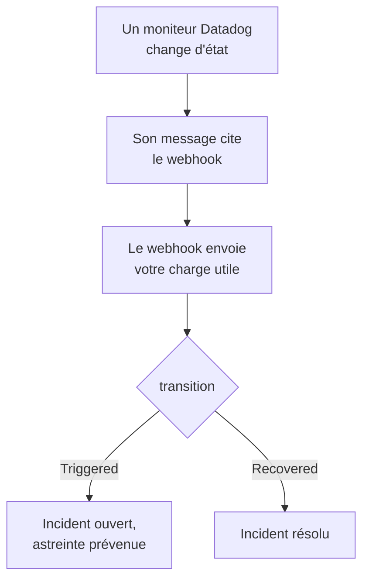

# Datadog

Envoyez les alertes des moniteurs [Datadog](https://www.datadoghq.com) à OneUptime, pour que chaque alerte devienne un incident qui prévient votre équipe d'astreinte et soit résolu quand le moniteur Datadog se rétablit. Datadog envoie ses alertes par son [intégration Webhooks](https://docs.datadoghq.com/integrations/webhooks/), il n'y a donc rien à installer d'un côté comme de l'autre.

:::cards
- [Choisir comment OneUptime reçoit les alertes](#choisir-comment-oneuptime-reçoit-les-alertes): Un moniteur de requêtes entrantes, ou un workflow à vous.
- [Recevoir les alertes avec un moniteur](#recevoir-les-alertes-avec-un-moniteur): Un incident par alerte, résolu au rétablissement.
- [Configurer Datadog](#configurer-datadog): Un webhook, et les moniteurs qui le préviennent.
- [Dépannage](#dépannage): Quand les alertes n'arrivent pas, ou que les incidents restent ouverts.
:::

## Fonctionnement



Un moniteur Datadog prévient les webhooks que cite son message quand il change d'état : quand il se déclenche, avertit, se rétablit ou n'a pas de données. Vous écrivez vous-même le corps JSON du webhook, à partir des [variables de modèle](https://docs.datadoghq.com/integrations/webhooks/#usage) de Datadog, ce guide vous en donne donc un qui nomme chaque alerte et dit ce qui lui est arrivé.

## Avant de commencer

- Un compte Datadog où vous pouvez configurer des intégrations et modifier des moniteurs.
- Dans OneUptime, le droit de créer des moniteurs, ou des workflows si vous prenez cette voie.

## Choisir comment OneUptime reçoit les alertes

Configurez d'abord OneUptime : il vous donne l'URL à laquelle Datadog envoie.

| Façon | Utilisez-la quand |
| --- | --- |
| Un moniteur de requêtes entrantes (recommandé) | Vous voulez que chaque alerte devienne un incident qui prévient l'astreinte et soit résolu quand le moniteur Datadog se rétablit. Il n'y a rien à construire. |
| Un workflow avec un déclencheur Webhook | Il vous faut une logique propre : filtrer les alertes, les remanier ou appeler d'abord d'autres systèmes. Un workflow déclare un incident pour chaque alerte qu'il reçoit, et ne le résout pas au rétablissement. |

Les deux reçoivent le même JSON du même webhook, vous pouvez donc commencer par l'un et changer plus tard en modifiant une URL dans Datadog.

## Recevoir les alertes avec un moniteur

Un [moniteur de requêtes entrantes](/docs/monitor/incoming-request-monitor) vous donne une URL, et ses critères décident de ce que fait chaque alerte.

:::steps
### Créer le moniteur

Allez dans **Moniteurs** et cliquez sur **Créer un moniteur**. Choisissez **Requête entrante** sous **Type de moniteur**, nommez-le `Datadog` et cliquez sur **Suivant**.

### Déclarer un incident pour chaque alerte

À l'étape **Critères**, ouvrez le premier critère, celui qui marque le moniteur hors ligne. Réglez son filtre sur **Corps de la requête**, **Contient**, `"transition":"Triggered"`. Ce critère déclare déjà un incident quand son filtre correspond. Remplissez l'incident :

- **Titre de l'incident** : `{{requestBody.title}}`.
- **Description de l'incident**, sous **Description** : `{{requestBody.body}}`, puis `Datadog: {{requestBody.link}}` sur une ligne à part.
- **Gravité** : la gravité d'incident que doivent avoir ces alertes.
- **Politiques d'astreinte**, sous **Astreinte** : les politiques à prévenir.
- **Résoudre automatiquement l'incident**, sous **Plus de champs** : laissez-le activé, comme au départ. Sans lui, les rétablissements sont ignorés et les incidents restent ouverts.

### Ouvrir un incident par alerte

Dans le même critère, ouvrez **Paramètres** et activez **Regrouper les incidents et alertes par un champ de la charge utile**. Remplissez-le comme ci-dessous, pour que chaque alerte ait son propre incident et que son rétablissement le résolve :

| Champ | Valeur |
| --- | --- |
| **Ouvrir un incident distinct pour chaque…** | `requestBody.alert_key` |
| **Champ qui signale le rétablissement** | `requestBody.transition` |
| **Value that means recovered** | `Recovered` |

### Remettre le moniteur en ligne

Ouvrez le second critère, celui qui marque le moniteur en ligne, et réglez son filtre sur **Corps de la requête**, **Contient**, `"transition":"Recovered"`.

### Copier l'URL

Cliquez sur **Créer un moniteur**. La page **Vue d'ensemble** du moniteur affiche son **URL de heartbeat**. Copiez-la pour Datadog :

```text
https://oneuptime.com/heartbeat/<secret key>
```

Une installation auto-hébergée a son propre hôte à la place de `oneuptime.com`.
:::

La charge utile ci-dessous règle `alert_key` sur l'ID du moniteur Datadog et les tags du groupe qui a alerté, pour que chaque groupe d'un moniteur multi-alertes ait son propre incident et que le rétablissement de ce groupe le résolve. Un moniteur qui se redéclenche ou renotifie pendant que son incident est ouvert n'en ouvre pas un second. Voir [Recevoir des alertes d'un autre système](/docs/monitor/incoming-request-monitor#recevoir-les-alertes-dun-autre-système) pour ce que fait chaque paramètre.

> [!NOTE]
> Une notification **Warn** ou **No Data** n'ouvre pas d'incident avec ces filtres. Pour être prévenu aussi des avertissements, cliquez sur **Ajouter un critère**, donnez au nouveau critère le filtre **Corps de la requête**, **Contient**, `"transition":"Warn"`, un incident avec sa propre **Gravité** et les mêmes réglages de regroupement, puis faites-le glisser au-dessus du premier critère. Les critères sont vérifiés depuis le haut, et le premier qui correspond décide.

## Configurer Datadog

:::steps
### Ajouter le webhook

Dans Datadog, ouvrez la [tuile de l'intégration Webhooks](https://app.datadoghq.com/integrations/webhooks), et installez-la si elle ne l'est pas encore. Ajoutez un webhook avec ces réglages, puis enregistrez-le :

- **Name** : `oneuptime`. Les moniteurs citent le webhook par ce nom, sous la forme `@webhook-oneuptime`.
- **URL** : l'URL que vous avez copiée dans OneUptime.
- **Payload** :

  ```json
  {
    "alert_key": "$ALERT_ID $ALERT_SCOPE",
    "transition": "$ALERT_TRANSITION",
    "title": "$EVENT_TITLE",
    "body": "$TEXT_ONLY_MSG",
    "host": "$HOSTNAME",
    "priority": "$PRIORITY",
    "link": "$LINK"
  }
  ```

### Citer le webhook dans vos moniteurs

Dans chaque moniteur Datadog qui doit prévenir par OneUptime, ajoutez `@webhook-oneuptime` au message de notification du moniteur, et enregistrez le moniteur. Datadog envoie alors les alertes et les rétablissements de ce moniteur à OneUptime.
:::

| Variable | Ce que Datadog y met |
| --- | --- |
| `$ALERT_ID` | L'ID du moniteur Datadog qui a alerté. |
| `$ALERT_SCOPE` | Les tags du groupe qui a alerté, par exemple `host:web-1`. |
| `$ALERT_TRANSITION` | Ce qui s'est passé : `Triggered`, `Re-Triggered`, `Warn`, `Recovered`, `No Data` ou `Renotify`, entre autres. |
| `$EVENT_TITLE` | Le titre de l'événement, par exemple `[Triggered] High CPU`. |
| `$TEXT_ONLY_MSG` | Le message du moniteur, sans Markdown. |
| `$LINK` | Un lien vers l'événement dans Datadog. |

## Tester

Envoyez à OneUptime une alerte, comme le ferait Datadog :

```bash
curl -X POST "https://oneuptime.com/heartbeat/<secret key>" \
  -H "Content-Type: application/json" \
  -d '{
    "alert_key": "1234 host:web-1",
    "transition": "Triggered",
    "title": "[Triggered] High CPU",
    "body": "CPU is above 90% on web-1.",
    "host": "web-1",
    "priority": "normal",
    "link": "https://app.datadoghq.com/event/event?id=1"
  }'
```

Un incident s'ouvre, intitulé `[Triggered] High CPU`. Envoyez la même requête avec `transition` sur `Recovered`, et l'incident est résolu.

Testez ensuite depuis Datadog : ouvrez un moniteur qui cite le webhook, cliquez sur **Test Notifications** et envoyez sa notification **Alert**. Consultez la chronologie du moniteur OneUptime pour voir qu'elle est arrivée.

## Recevoir les alertes avec un workflow

Utilisez un [workflow](/docs/workflows/index) quand il vous faut vos propres étapes entre Datadog et l'incident.

:::steps
### Créer le workflow

Allez dans **Flux de travail**, cliquez sur **Créer un flux de travail**, puis sur **Partir de zéro**. Nommez-le `Datadog alerts` et cliquez sur **Créer un flux de travail**.

### Ajouter le déclencheur Webhook

Cliquez sur le bloc en pointillés **Choisissez ce qui démarre ce flux de travail** et choisissez **Webhook**. Cliquez sur le déclencheur, puis sur **Copier l'URL**, et utilisez cette URL dans le webhook de Datadog.

### Vérifier que le moniteur s'est déclenché

Cliquez sur **Ajouter un composant**, ajoutez un bloc **If / Else** et reliez-y le point **Out** du déclencheur. Réglez **Value to check** sur `{{local.components.webhook-1.returnValues.request-body.transition}}`, **Comparison** sur **is equal to** et **Compare with** sur `Triggered`.

### Déclarer l'incident

Ajoutez un bloc **Create One Incident** et reliez-y le côté **Yes** du bloc **If / Else**. Dans **Incident Template**, choisissez un modèle qui fixe la gravité et les politiques d'astreinte à prévenir (voir [Modèles d'incident](/docs/incidents/settings#modèles-dincident)). Dans **JSON Object**, indiquez ce qui vient de Datadog :

```json
{
  "title": "{{local.components.webhook-1.returnValues.request-body.title}}",
  "description": "{{local.components.webhook-1.returnValues.request-body.body}}\nDatadog: {{local.components.webhook-1.returnValues.request-body.link}}"
}
```

Sans modèle, **JSON Object** doit aussi contenir `incidentSeverityId`, l'ID de l'une des gravités d'incident du projet.

### Activer le workflow

Activez **Activé** en haut du **Constructeur**. Un workflow désactivé répond à Datadog par `400`.
:::

Chaque notification `Triggered` déclare un nouvel incident. Un rétablissement prend le côté **No** du bloc **If / Else**, où rien n'est relié, l'exécution s'arrête donc là. Pour un incident par alerte, résolu au rétablissement, utilisez le moniteur.

## Dépannage

:::details Rien n'arrive dans OneUptime
- Vérifiez que le message du moniteur Datadog cite `@webhook-oneuptime`, écrit comme le webhook est nommé.
- Le moniteur répond `200` immédiatement, avant de vérifier quoi que ce soit, même avec une clé secrète erronée. Consultez la chronologie du moniteur pour voir si les alertes arrivent.
- Un workflow désactivé répond `400`. Activez **Activé** en haut de son **Constructeur**.
:::

:::details Les incidents s'ouvrent mais ne sont jamais résolus
- Le moniteur Datadog doit aussi prévenir le webhook de ses rétablissements. Un message qui ne cite le webhook que pour les alertes, dans une condition, n'envoie aucun rétablissement.
- L'incident du critère a besoin de **Résoudre automatiquement l'incident**, sous **Plus de champs**.
- **Value that means recovered** doit valoir exactement `Recovered`. La comparaison respecte la casse.
- L'`alert_key` du rétablissement doit être celui de l'alerte : laissez `$ALERT_ID $ALERT_SCOPE` tel quel dans la charge utile.
:::

:::details Un champ affiche le nom d'une variable, ou rien
Datadog ne remplit que les variables qui s'appliquent à l'événement. Envoyez une notification de test, puis regardez ce qui est arrivé : dans la chronologie du moniteur, ou pour un workflow dans **Journaux → Exécutions**.
:::

:::details Toutes les alertes d'un moniteur finissent dans un seul incident
Chaque groupe a besoin de son propre `alert_key`. Vérifiez que la charge utile le compose à partir de `$ALERT_ID` et de `$ALERT_SCOPE`, et que le chemin de regroupement est `requestBody.alert_key`.
:::

## Sécurité

- **Traitez l'URL comme un mot de passe.** Quiconque la possède peut ouvrir des incidents. Si elle fuit, réinitialisez-la : **Réinitialiser la clé secrète des requêtes entrantes** sur la page **Paramètres** du moniteur, ou **Réinitialiser l'URL** dans le déclencheur **Webhook** du workflow. Mettez ensuite à jour l'**URL** du webhook dans Datadog.
- **Auto-hébergé ?** Datadog envoie ses webhooks depuis Internet, votre OneUptime doit donc y être joignable en HTTPS.

## Étapes suivantes

:::cards
- [Surveillance des requêtes entrantes](/docs/monitor/incoming-request-monitor): Chaque paramètre du moniteur qui reçoit vos alertes.
- [Prometheus Alertmanager](/docs/integrations/prometheus-alertmanager): La même configuration, pour Alertmanager.
- [Règles d'escalade](/docs/on-call/escalation-rules): Décider qui une politique d'astreinte prévient, et quand.
- [Présentation des intégrations](/docs/integrations/index): Les autres outils que vous pouvez connecter.
:::
