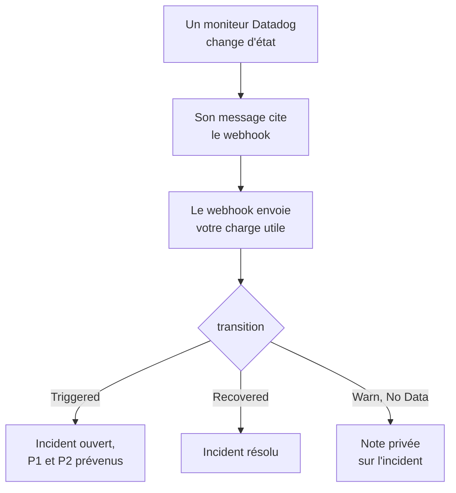

# Datadog

Envoyez les alertes des moniteurs [Datadog](https://www.datadoghq.com) à OneUptime, pour que chacune devienne un incident ou une alerte, prévienne votre équipe d'astreinte quand elle est urgente et soit résolue quand le moniteur Datadog se rétablit. Datadog envoie ses alertes par son [intégration Webhooks](https://docs.datadoghq.com/integrations/webhooks/), il n'y a donc rien à installer d'un côté comme de l'autre.

:::cards
- [Choisir comment OneUptime reçoit les alertes](#choisir-comment-oneuptime-reçoit-les-alertes): Un modèle de workflow, ou un moniteur de requêtes entrantes.
- [Partir du modèle](#partir-du-modèle): Choisissez qui prévenir, copiez l'URL et voyez ce que fait chaque alerte.
- [Recevoir les alertes avec un moniteur](#recevoir-les-alertes-avec-un-moniteur): Un incident par alerte, résolu au rétablissement.
- [Configurer Datadog](#configurer-datadog): Un webhook, et les moniteurs qui le préviennent.
- [Dépannage](#dépannage): Quand les alertes n'arrivent pas, ou que les incidents restent ouverts.
:::

## Fonctionnement



Un moniteur Datadog prévient les webhooks que cite son message quand il change d'état : quand il se déclenche, avertit, se rétablit ou n'a pas de données. Vous écrivez vous-même le corps JSON du webhook, à partir des [variables de modèle](https://docs.datadoghq.com/integrations/webhooks/#usage) de Datadog, ce guide vous en donne donc un qui nomme chaque alerte et dit ce qui lui est arrivé.

## Avant de commencer

- Un compte Datadog où vous pouvez configurer des intégrations et modifier des moniteurs.
- Dans OneUptime, le droit de créer des workflows, ou des moniteurs si vous prenez cette voie. Sur OneUptime Cloud, les workflows demandent l'offre **Growth** ou supérieure.

## Choisir comment OneUptime reçoit les alertes

Configurez d'abord OneUptime : il vous donne l'URL à laquelle Datadog envoie.

| Façon | Utilisez-la quand |
| --- | --- |
| Le modèle de workflow (recommandé) | Vous voulez chaque alerte comme un incident ou une alerte à une gravité tirée de la priorité du moniteur, avec l'astreinte prévenue pour P1 et P2, les avertissements notés dessus, et résolue au rétablissement. Il n'y a rien à construire. |
| Un moniteur de requêtes entrantes | Vous voulez des incidents sans workflow, avec n'importe quelle offre, et un moniteur dont le statut suit Datadog. |

Les deux reçoivent le même JSON du même webhook, vous pouvez donc commencer par l'un et changer plus tard en modifiant une URL dans Datadog.

## Partir du modèle

La boîte de dialogue **Créer un flux de travail** propose deux modèles Datadog, sous **Datadog** dans sa liste de catégories : **Declare an incident when a Datadog monitor triggers**, et **Create an alert when a Datadog monitor triggers** pour les alertes. Les deux font la même chose, chacun avec son propre type d'enregistrement.

:::steps
1. Allez dans **Flux de travail** et cliquez sur **Créer un flux de travail**. Sous **Ou partir d'un modèle**, choisissez **Datadog** dans la liste de catégories, cliquez sur **Declare an incident when a Datadog monitor triggers**, ou sur **Create an alert when a Datadog monitor triggers**, puis sur **Utiliser ce modèle**.
2. Sous **Who to page for P1 and P2 monitors**, choisissez les politiques d'astreinte à prévenir, ou aucune pour ne prévenir personne, et cliquez sur **Créer un flux de travail**. Le workflow s'ouvre dans le **Constructeur**, désactivé.
3. Cliquez sur le déclencheur **Webhook**, puis sur **Copier l'URL**, et gardez l'URL pour Datadog.
4. Activez **Activé** en haut du **Constructeur**. Un workflow désactivé répond à Datadog par `400`.
:::

Ensuite, [configurez Datadog](#configurer-datadog) pour qu'il envoie ses alertes à cette URL. L'étape `read-event-1` du workflow s'ouvre avec la même configuration, pour quand vous y reviendrez dans le **Constructeur**.

### Ce que fait le workflow

Après le déclencheur **Webhook**, l'étape **Check With JavaScript** `read-event-1` lit la `transition` qu'envoie Datadog, et **Incident From Another Tool**, ou **Alert From Another Tool** dans le modèle des alertes, fait ce qu'elle signifie, d'après la clé de cycle de l'alerte. Datadog garde cette clé depuis le moment où une alerte se déclenche jusqu'à son rétablissement, et la fois suivante où elle se déclenche, la clé est nouvelle : chaque fois a donc son propre incident. L'incident garde la clé dans son champ personnalisé `datadogAlertCycleKey`.

| Transition | Ce que fait le workflow |
| --- | --- |
| `Triggered`, `Re-Triggered` | Déclare un incident intitulé `Datadog: <monitor>`, à la gravité à laquelle correspond la priorité du moniteur, tenu à l'écart de vos pages de statut. Sa description renvoie à l'alerte dans Datadog, et indique la priorité, l'hôte, le périmètre et le message du moniteur. Une notification pour une alerte qui a déjà son incident n'en ouvre pas un second, et ne prévient plus personne. |
| `Recovered` | Résout l'incident de l'alerte, sauf s'il est déjà résolu. La raison figure dans sa chronologie. |
| `Warn`, `Re-Warn`, `No Data`, `Re-No Data` | Ajoute une note privée à l'incident de l'alerte, disant quel est maintenant l'état du moniteur. |
| `Renotify` | Rien : l'alerte est toujours ouverte. |

Un avertissement ou un rétablissement pour une alerte sans incident ne change rien. Tout le reste, comme une requête d'un autre outil, est laissé tel quel : `read-event-1` prend **No**, et les **Étapes** de l'exécution disent pourquoi. Rien ne repart vers Datadog : il résout lui-même ses alertes quand le signal se rétablit, et c'est ce qui résout l'incident.

### Priorités et astreinte

Un nouvel incident prévient les politiques d'astreinte que vous avez choisies quand son moniteur est P1 ou P2, ou n'a pas de priorité. P3, P4 et P5 ouvrent un incident et ne préviennent personne. Dans un nouveau projet, les priorités correspondent à ces gravités d'incident et d'alerte :

| Priorité Datadog | Incident | Alerte | Astreinte |
| --- | --- | --- | --- |
| P1 | Critical Incident | High | Prévenue |
| P2 | Critical Incident | High | Prévenue |
| Sans priorité | Critical Incident | High | Prévenue |
| P3 | Major Incident | Low | Non prévenue |
| P4 | Minor Incident | Low | Non prévenue |
| P5 | Minor Incident | Low | Non prévenue |

Avec vos propres gravités, P1, P2 et l'absence de priorité vont à la plus grave, P3 à celle du milieu, et P4 et P5 à la moins grave.

- Pour faire correspondre une priorité à l'une de vos gravités par son nom, modifiez `SEVERITY_BY_NAME` dans l'étape `read-event-1`, par exemple `{ P3: 'Minor Incident' }`.
- Pour prévenir aussi pour P3, mettez **Compare with** de l'étape `if-page-1` **If / Else** à `3`.

## Recevoir les alertes avec un moniteur

Un [moniteur de requêtes entrantes](/docs/monitor/incoming-request-monitor) vous donne une URL, et ses critères décident de ce que fait chaque alerte.

:::steps
### Créer le moniteur

Allez dans **Moniteurs** et cliquez sur **Créer un moniteur**. Choisissez **Requête entrante** sous **Type de moniteur**, nommez-le `Datadog` et cliquez sur **Suivant**.

### Déclarer un incident pour chaque alerte

À l'étape **Critères**, ouvrez le premier critère, celui qui marque le moniteur hors ligne. Réglez son filtre sur **Corps de la requête**, **Contient**, `"transition":"Triggered"`. Ce critère déclare déjà un incident quand son filtre correspond. Remplissez l'incident :

- **Titre de l'incident** : `{{requestBody.title}}`.
- **Description de l'incident**, sous **Description** : `{{requestBody.body}}`, puis `Datadog: {{requestBody.link}}` sur une ligne à part.
- **Gravité** : la gravité d'incident que doivent avoir ces alertes.
- **Politiques d'astreinte**, sous **Astreinte** : les politiques à prévenir.
- **Résoudre automatiquement l'incident**, sous **Plus de champs** : laissez-le activé, comme au départ. Sans lui, les rétablissements sont ignorés et les incidents restent ouverts.

### Ouvrir un incident par alerte

Dans le même critère, ouvrez **Paramètres** et activez **Regrouper les incidents et alertes par un champ de la charge utile**. Remplissez-le comme ci-dessous, pour que chaque alerte ait son propre incident et que son rétablissement le résolve :

| Champ | Valeur |
| --- | --- |
| **Ouvrir un incident distinct pour chaque…** | `requestBody.alert_key` |
| **Champ qui signale le rétablissement** | `requestBody.transition` |
| **Value that means recovered** | `Recovered` |

### Remettre le moniteur en ligne

Ouvrez le second critère, celui qui marque le moniteur en ligne, et réglez son filtre sur **Corps de la requête**, **Contient**, `"transition":"Recovered"`.

### Copier l'URL

Cliquez sur **Créer un moniteur**. La page **Vue d'ensemble** du moniteur affiche son **URL de heartbeat**. Copiez-la pour Datadog :

```text
https://oneuptime.com/heartbeat/<secret key>
```

Une installation auto-hébergée a son propre hôte à la place de `oneuptime.com`.
:::

La charge utile ci-dessous règle `alert_key` sur l'ID du moniteur Datadog et les tags du groupe qui a alerté, pour que chaque groupe d'un moniteur multi-alertes ait son propre incident et que le rétablissement de ce groupe le résolve. Un moniteur qui se redéclenche ou renotifie pendant que son incident est ouvert n'en ouvre pas un second. Voir [Recevoir des alertes d'un autre système](/docs/monitor/incoming-request-monitor#recevoir-les-alertes-dun-autre-système) pour ce que fait chaque paramètre.

> [!NOTE]
> Une notification **Warn** ou **No Data** n'ouvre pas d'incident avec ces filtres. Pour être prévenu aussi des avertissements, cliquez sur **Ajouter un critère**, donnez au nouveau critère le filtre **Corps de la requête**, **Contient**, `"transition":"Warn"`, un incident avec sa propre **Gravité** et les mêmes réglages de regroupement, puis faites-le glisser au-dessus du premier critère. Les critères sont vérifiés depuis le haut, et le premier qui correspond décide.

## Configurer Datadog

:::steps
### Ajouter le webhook

Dans Datadog, ouvrez la [tuile de l'intégration Webhooks](https://app.datadoghq.com/integrations/webhooks), et installez-la si elle ne l'est pas encore. Ajoutez un webhook avec ces réglages, puis enregistrez-le :

- **Name** : `oneuptime`. Les moniteurs citent le webhook par ce nom, sous la forme `@webhook-oneuptime`.
- **URL** : l'URL que vous avez copiée dans OneUptime.
- **Payload** :

  ```json
  {
    "alert_key": "$ALERT_ID $ALERT_SCOPE",
    "alert_cycle_key": "$ALERT_CYCLE_KEY",
    "transition": "$ALERT_TRANSITION",
    "alert_priority": "$ALERT_PRIORITY",
    "title": "$EVENT_TITLE",
    "body": "$TEXT_ONLY_MSG",
    "host": "$HOSTNAME",
    "scope": "$ALERT_SCOPE",
    "priority": "$PRIORITY",
    "link": "$LINK"
  }
  ```

### Citer le webhook dans vos moniteurs

Dans chaque moniteur Datadog qui doit prévenir par OneUptime, ajoutez `@webhook-oneuptime` au message de notification du moniteur, et enregistrez le moniteur. Datadog envoie alors les alertes et les rétablissements de ce moniteur à OneUptime.
:::

| Variable | Ce que Datadog y met |
| --- | --- |
| `$ALERT_ID` | L'ID du moniteur Datadog qui a alerté. |
| `$ALERT_SCOPE` | Les tags du groupe qui a alerté, par exemple `host:web-1`. |
| `$ALERT_CYCLE_KEY` | Un ID qui reste le même depuis le moment où une alerte se déclenche jusqu'à son rétablissement. |
| `$ALERT_TRANSITION` | Ce qui s'est passé : `Triggered`, `Re-Triggered`, `Warn`, `Recovered`, `No Data` ou `Renotify`, entre autres. |
| `$ALERT_PRIORITY` | La priorité du moniteur Datadog, de `P1` à `P5`, ou rien pour un moniteur qui n'en a pas. |
| `$EVENT_TITLE` | Le titre de l'événement, par exemple `[Triggered] High CPU`. |
| `$TEXT_ONLY_MSG` | Le message du moniteur, sans Markdown. |
| `$LINK` | Un lien vers l'événement dans Datadog. |

Une même charge utile sert dans les deux cas : le modèle se fie à `alert_cycle_key` et `alert_priority`, et le moniteur à `alert_key`. Gardez-les tous, et vous pourrez changer plus tard en modifiant l'URL seule.

## Tester

Envoyez une alerte à l'URL que vous avez copiée, comme le ferait Datadog :

```bash
curl -X POST "<url>" \
  -H "Content-Type: application/json" \
  -d '{
    "alert_key": "1234 host:web-1",
    "alert_cycle_key": "7151157925468446720",
    "transition": "Triggered",
    "alert_priority": "P1",
    "title": "[Triggered] High CPU",
    "body": "CPU is above 90% on web-1.",
    "host": "web-1",
    "scope": "host:web-1",
    "priority": "normal",
    "link": "https://app.datadoghq.com/event/event?id=1"
  }'
```

Avec le modèle, un incident s'ouvre, intitulé `Datadog: High CPU`, et les politiques d'astreinte que vous avez choisies sont prévenues. Avec le moniteur, un incident s'ouvre, intitulé `[Triggered] High CPU`. Envoyez la même requête avec `transition` sur `Recovered`, et l'incident est résolu.

Testez ensuite depuis Datadog : ouvrez un moniteur qui cite le webhook, cliquez sur **Test Notifications** et envoyez sa notification **Alert**. Pour voir qu'elle est arrivée, ouvrez les **Journaux → Exécutions** du workflow, ou la chronologie du moniteur OneUptime.

## Dépannage

:::details Rien n'arrive dans OneUptime
- Vérifiez que le message du moniteur Datadog cite `@webhook-oneuptime`, écrit comme le webhook est nommé.
- Le moniteur répond `200` immédiatement, avant de vérifier quoi que ce soit, même avec une clé secrète erronée. Consultez la chronologie du moniteur pour voir si les alertes arrivent.
- Un workflow désactivé répond `400`. Activez **Activé** en haut de son **Constructeur**.
:::

:::details Le workflow s'exécute, mais n'ouvre rien
Ouvrez l'exécution dans **Journaux → Exécutions**. L'entrée `read-event-1` de ses **Étapes** dit pourquoi il a pris **No**.

- `Datadog named no alert cycle key` : ajoutez `"alert_cycle_key": "$ALERT_CYCLE_KEY"` à la charge utile du webhook dans Datadog.
- `Datadog named no transition` : ajoutez `"transition": "$ALERT_TRANSITION"` à la charge utile du webhook dans Datadog.
:::

:::details L'astreinte n'est pas prévenue
- Seuls les moniteurs P1 et P2 et les moniteurs sans priorité préviennent. Voir [Priorités et astreinte](#priorités-et-astreinte).
- Une notification pour une alerte qui a déjà son incident ne prévient plus personne.
- Si personne n'est choisi dans la boîte de dialogue **Créer un flux de travail**, le workflow n'a aucune étape qui prévienne.
:::

:::details Les incidents s'ouvrent mais ne sont jamais résolus
- Le moniteur Datadog doit aussi prévenir le webhook de ses rétablissements. Un message qui ne cite le webhook que pour les alertes, dans une condition, n'envoie aucun rétablissement.
- Avec le modèle, ouvrez l'exécution du rétablissement dans **Journaux → Exécutions** : sa dernière étape dit pourquoi. L'`alert_cycle_key` du rétablissement doit être celui de l'alerte, laissez donc `$ALERT_CYCLE_KEY` tel quel dans la charge utile.
- Avec le moniteur, l'incident du critère a besoin de **Résoudre automatiquement l'incident**, sous **Plus de champs**.
- **Value that means recovered** doit valoir exactement `Recovered`. La comparaison respecte la casse.
- L'`alert_key` du rétablissement doit être celui de l'alerte : laissez `$ALERT_ID $ALERT_SCOPE` tel quel dans la charge utile.
:::

:::details Un champ affiche le nom d'une variable, ou rien
Datadog ne remplit que les variables qui s'appliquent à l'événement. Envoyez une notification de test, puis regardez ce qui est arrivé : dans la chronologie du moniteur, ou pour un workflow dans **Journaux → Exécutions**.
:::

:::details Toutes les alertes d'un moniteur finissent dans un seul incident
Avec le moniteur, chaque groupe a besoin de son propre `alert_key`. Vérifiez que la charge utile le compose à partir de `$ALERT_ID` et de `$ALERT_SCOPE`, et que le chemin de regroupement est `requestBody.alert_key`.
:::

## Sécurité

- **Traitez l'URL comme un mot de passe.** Quiconque la possède peut ouvrir des incidents. Si elle fuit, réinitialisez-la : **Réinitialiser l'URL** dans le déclencheur **Webhook** du workflow, ou **Réinitialiser la clé secrète des requêtes entrantes** sur la page **Paramètres** du moniteur. Mettez ensuite à jour l'**URL** du webhook dans Datadog.
- **Les liens mènent à Datadog.** Le modèle ne renvoie à une alerte que sur un site Datadog, quoi que dise une requête, et écrit ce que Datadog a envoyé comme du texte.
- **Auto-hébergé ?** Datadog envoie ses webhooks depuis Internet, votre OneUptime doit donc y être joignable en HTTPS.

## Étapes suivantes

:::cards
- [Modèles de workflow](/docs/workflows/authoring): Créez un workflow à partir d'un modèle, et modifiez-le dans le Constructeur.
- [Surveillance des requêtes entrantes](/docs/monitor/incoming-request-monitor): Chaque paramètre du moniteur qui reçoit vos alertes.
- [New Relic](/docs/integrations/new-relic): Le même modèle, pour les problèmes New Relic.
- [Règles d'escalade](/docs/on-call/escalation-rules): Décider qui une politique d'astreinte prévient, et quand.
- [Présentation des intégrations](/docs/integrations/index): Les autres outils que vous pouvez connecter.
:::
