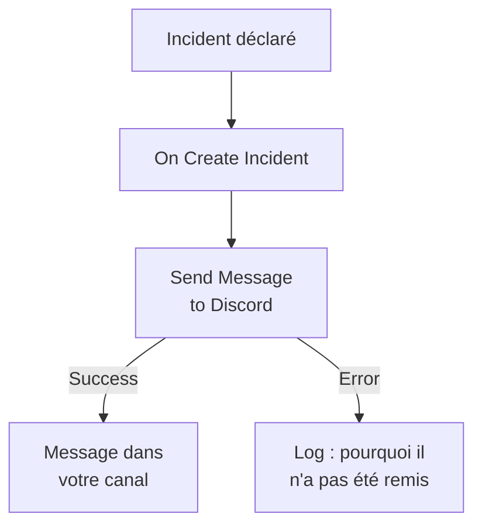

# Discord

Publiez un message dans un canal [Discord](https://discord.com) quand un incident s'ouvre, pour que les personnes qui suivent ce canal le sachent tout de suite. L'étape de workflow **Send Message to Discord** de OneUptime publie via le webhook du canal, et un modèle prêt à l'emploi construit tout le workflow pour vous. Cette intégration est **sortante** : OneUptime publie dans le canal et ne lit pas ce qui s'y dit.

:::cards
- [Fonctionnement](#fonctionnement): Ce que fait le workflow quand un incident s'ouvre.
- [Mise en place](#mettre-en-place-lintégration): Un webhook dans Discord, puis le workflow : à partir du modèle ou de zéro.
- [Conseils](#conseils): Mise en forme, longs messages et autres événements.
- [Dépannage](#dépannage): Ce que signifient les erreurs de l'étape, et quoi changer.
:::

## Fonctionnement



L'étape publie le **Message Text** sur le webhook du canal. Elle prend sa sortie **Success** quand Discord accepte le message, et sa sortie **Error**, avec la raison de Discord, quand Discord le refuse. Le modèle relie une étape **Log** à **Error**, si bien qu'une exécution qui n'a pas pu publier dit pourquoi.

## Avant de commencer

- Dans Discord, la permission **Manage Webhooks** sur le canal.
- Dans OneUptime, le droit de créer des workflows et des variables. Sur OneUptime Cloud, les workflows demandent l'offre **Growth** ou une offre supérieure.

## Mettre en place l'intégration

:::steps
### Créer un webhook dans Discord

1. Dans Discord, ouvrez les paramètres du canal avec **Edit Channel**, puis **Integrations → Webhooks**, et sélectionnez **New Webhook**.
2. Nommez-le, par exemple `OneUptime`, et vérifiez qu'il publie dans le bon canal.
3. Sélectionnez **Copy Webhook URL**.

Toute personne qui a l'URL peut publier dans le canal : gardez-la donc aussi précieusement qu'un mot de passe.

### Construire le workflow

Partez du modèle, qui construit tout le workflow pour vous, ou de zéro.

:::tabs
@tab À partir du modèle
1. Ouvrez **Flux de travail** et cliquez sur **Créer un flux de travail**.
2. Tapez `Discord` dans **Rechercher des modèles…**, cliquez sur **Tell Discord when an incident opens**, puis sur **Utiliser ce modèle**.
3. Gardez le nom **Notify Discord on new incident** ou changez-le, et cliquez sur **Suivant**.
4. Collez l'URL dans **Discord Webhook URL**, et cliquez sur **Créer un flux de travail**.

Le workflow s'ouvre dans le **Constructeur** avec trois étapes : **On Create Incident** ; **Send Message to Discord**, qui publie le numéro, le titre, la gravité et l'état de l'incident ; et une étape **Log** sur sa sortie **Error**. L'URL est enregistrée comme variable secrète `discordWebhookUrl` du workflow.
@tab De zéro
1. Enregistrez l'URL comme variable globale secrète : allez dans **Flux de travail → Variables globales**, cliquez sur **Créer : Variable de flux de travail**, nommez-la `DISCORD_WEBHOOK_URL`, et cliquez sur **Suivant**. Collez l'URL dans **Contenu**, activez **Secret**, et cliquez sur **Créer : Variable de flux de travail**.
2. Allez dans **Flux de travail**, cliquez sur **Créer un flux de travail**, choisissez **Partir de zéro**, nommez le workflow, et cliquez sur **Créer un flux de travail**.
3. Dans le **Constructeur**, cliquez sur **Choisissez ce qui démarre ce flux de travail** et choisissez **On Create Incident** sous **Populaires**. Cliquez sur le déclencheur : ses **Fields to pass on** commencent par **Titre**, alors cliquez sur **Ajouter un champ** et choisissez les autres champs que votre message affiche, par exemple **Numéro d'incident avec préfixe**.
4. Cliquez sur **Ajouter un composant**, cherchez `discord`, et cliquez sur **Send Message to Discord**. Reliez la sortie **Success** du déclencheur à cette étape.
5. Cliquez sur la nouvelle étape. Dans **Discord Incoming Webhook URL**, cliquez sur **{ }** et choisissez `DISCORD_WEBHOOK_URL` sous **Variables globales**. Dans **Message Text**, écrivez le message, et insérez les champs de l'incident avec **{ }**.
:::

Un message construit de zéro lit les champs de l'incident avec des références comme celles-ci :

```text
🚨 **Incident {{local.components.incident-on-create-1.returnValues.model.incidentNumberWithPrefix}} declared**
**Title:** {{local.components.incident-on-create-1.returnValues.model.title}}
```

### L'activer et le tester

Basculez l'interrupteur **Activé** en haut du **Constructeur**. À partir de là, chaque nouvel incident est publié dans le canal.

Pour tester sans ouvrir d'incident, cliquez sur **Exécuter le flux de travail** et choisissez un incident existant sous **Incident** : les plus récents sont listés, et saisir son numéro ou une partie de son titre en trouve un autre. Cliquez sur **Exécuter le flux de travail manuellement** et confirmez avec **Exécuter**. Le panneau **Exécution du flux de travail** suit l'exécution, et le message apparaît dans le canal. Si l'étape prend plutôt **Error**, la ligne de l'étape **Log** dit pourquoi : voir [Dépannage](#dépannage).
:::

## Conseils

- **Mettre en forme avec le Markdown de Discord.** Le texte est envoyé tel qu'il est saisi, le Markdown de Discord y fonctionne donc : des astérisques autour d'un mot le mettent en gras, et une URL s'affiche comme un lien.
- **Tenir compte de la limite de 2 000 caractères.** Discord accepte les messages de 2 000 caractères au plus. Un message plus long est coupé, et se termine par "… (truncated — see OneUptime for the full text)", au lieu d'être refusé.
- **Publier plus que les nouveaux incidents.** Construisez un autre workflow sur **On Update Incident** pour les changements d'état, ou sur **On Create Alert** pour les alertes, avec la même étape. Pour ne publier que certains incidents, placez un bloc **If / Else** avant l'étape.
- **Seulement les adresses de Discord.** L'étape publie vers une URL `https` sur `discord.com` ou `discordapp.com`, et ne suit pas les redirections : une URL qui pointe ailleurs arrête donc l'exécution.

## Dépannage

Quand l'étape prend **Error**, l'exécution dit pourquoi : l'étape **Log** du modèle écrit `❌ Discord could not deliver the incident notification:` et la raison de Discord.

:::details Discord répond "Unknown Webhook" ou "Invalid Webhook Token"
Le webhook a été supprimé, ou l'URL a été mal copiée. Créez un nouveau webhook, et remplacez l'URL : dans le workflow du modèle, la variable `discordWebhookUrl` ; dans un workflow à vous, le contenu de `DISCORD_WEBHOOK_URL`.
:::

:::details Discord répond "You are being rate limited"
Discord limite la fréquence à laquelle un webhook peut publier. Une rafale d'incidents peut l'atteindre : publiez moins de messages, par exemple seulement pour certaines gravités.
:::

:::details L'exécution s'arrête avec "Discord Webhook URL must be an https URL on discord.com or discordapp.com"
**Discord Incoming Webhook URL** contient autre chose qu'un webhook Discord, ou la variable qu'il lit est vide. Collez de nouveau l'URL de **Copy Webhook URL**.
:::

## Étapes suivantes

:::cards
- [Composants de workflow](/docs/workflows/components#discord): Chaque paramètre de l'étape, et ce que signifient ses sorties.
- [Telegram](/docs/integrations/telegram): La même idée, dans une discussion Telegram.
- [Exécutions de workflow](/docs/workflows/runs-and-logs): Lire ce qu'a fait chaque exécution du workflow.
- [Présentation des intégrations](/docs/integrations/index): Le schéma sortant, et les autres outils que vous pouvez connecter.
:::
