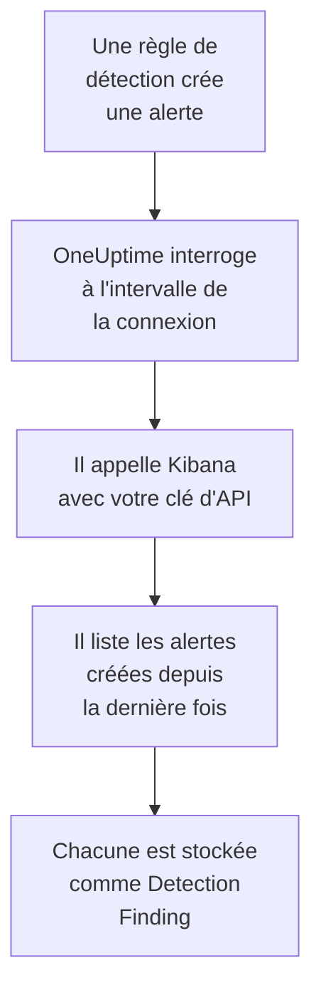

# Elastic Security

Importez les alertes de détection que lèvent vos règles [Elastic Security](https://www.elastic.co/security) dans les événements de sécurité de OneUptime. Vous les y recherchez à côté de vos logs, traces et métriques, vous les corrélez avec toutes les autres sources, et vous prévenez l'astreinte pour celles qui comptent. OneUptime les lit via l'API du moteur de détection de Kibana avec une clé d'API que vous créez, et ne modifie rien dans Elastic.

:::cards
- [Configurer la connexion](#configurer-la-connexion): Une clé d'API, ses privilèges et le formulaire de la connexion.
- [Ce qui est importé](#ce-qui-est-importé): Comment chaque alerte de détection devient un événement de sécurité.
- [Fonctionnement des interrogations](#fonctionnement-des-interrogations): La fenêtre que lit chaque interrogation, et ce qu'en fait un espace chargé.
- [Dépannage](#dépannage): Ce que signifie chaque erreur, et ce qu'il faut changer.
:::

## Fonctionnement



Chaque minute, OneUptime interroge chaque connexion activée dont l'intervalle d'interrogation est écoulé. Une interrogation demande à Kibana les alertes de détection créées dans votre espace depuis la dernière interrogation, 1 000 à la fois, et stocke chacune comme un événement [OCSF](https://schema.ocsf.io/) Detection Finding (classe `2004`). Tous les types de règles comptent : requête personnalisée, seuil, EQL, correspondance d'indicateur, apprentissage automatique et nouveaux termes. Les règles de détection, les moniteurs et les tableaux de bord traitent alors les alertes comme des événements de sécurité de n'importe quelle autre source.

## Avant de commencer

- Dans OneUptime, le rôle Project Owner, Project Admin ou Security Admin. Les rôles Security Member et Security Viewer voient les connexions et l'historique de leurs exécutions, mais ne peuvent pas les modifier.
- Elastic Security 8.x ou ultérieur, sur Elastic Cloud ou sur votre propre pile Elastic, avec des règles de détection qui tournent dans un espace Kibana.
- Un accès Kibana qui peut voir les alertes de détection dans cet espace : les privilèges d'index `read` et `view_index_metadata` sur `.alerts-security.alerts-<space-id>`, et un privilège de fonctionnalité Security de Kibana qui lui permet d'y lire les alertes.
- Un Kibana que OneUptime peut joindre en HTTPS. OneUptime Cloud se connecte depuis Internet, Kibana a donc besoin d'une adresse publique, comme en ont les déploiements Elastic Cloud : les adresses privées sont refusées. Un OneUptime auto-hébergé se connecte depuis ses conteneurs d'application et de workers, et peut joindre un Kibana sur votre réseau privé, sauf si `DATA_SOURCE_BLOCK_PRIVATE_ADDRESSES` vaut `true`.

## Configurer la connexion

:::steps
### Créer une clé d'API

1. Dans Kibana, ouvrez **Stack Management → API keys** et sélectionnez **Create API key**.
2. Nommez-la, par exemple `oneuptime-security-events`. Une clé a les privilèges de l'utilisateur qui la crée, sauf si vous lui en donnez moins : elle n'a besoin que de ceux ci-dessus.
3. Choisissez quand elle expire, ou jamais. Une clé qui expire arrête la connexion jusqu'à ce que vous la remplaciez.
4. Créez la clé et copiez sa valeur **Base64**, que Kibana n'affiche qu'une fois. Pas l'ID de la clé, ni la paire `id:api_key`.

### Trouver l'ID de votre espace

Les alertes sont stockées par espace. Ouvrez l'espace où tournent vos règles : son ID est la partie de l'adresse de Kibana après `/s/`, par exemple `security` dans `https://kibana.example.com/s/security/app/security`. L'espace par défaut n'a pas de partie `/s/` et n'a besoin d'aucun ID.

### Ajouter la connexion dans OneUptime

Ouvrez **Produits → Événements de sécurité → Connexions** (`/dashboard/{projectId}/security-events/connections`), cliquez sur **Ajouter une connexion**, choisissez **Elastic Security**, puis cliquez sur **Suivant**. Remplissez les paramètres du tableau ci-dessous, cliquez sur **Suivant**, et collez la clé dans **Clé API**.

### La tester avant d'enregistrer

Cliquez sur **Tester ces paramètres** sous **Tester avant d'enregistrer**. Le test s'authentifie et lit les alertes avec les valeurs du formulaire, sans rien stocker : un mauvais espace ou un privilège manquant apparaît donc avant que la connexion n'existe. Cliquez ensuite sur **Suivant**, donnez un **Nom** à la connexion et créez-la.
:::

| Réglage | Ce qu'il faut saisir |
| --- | --- |
| **Kibana URL** | L'adresse depuis laquelle Kibana est servi, par exemple `https://kibana.example.com` ou `https://<deployment>.kb.<region>.cloud.es.io`. Sans chemin : ni `/app/security`, ni `/api`, ni la partie `/s/<space>`. |
| **Kibana space** | L'ID de l'espace, pas son nom : lettres, chiffres, tirets et traits de soulignement. Laissez-le vide pour l'espace par défaut. |
| **Clé API** | La valeur **Base64** de la clé, seule : OneUptime ajoute lui-même le schéma `ApiKey`. Elle est chiffrée, jamais renvoyée par l'API et jamais réaffichée. Remplacez-la avec **Mettre à jour les identifiants** sur la connexion. |

L'étape **Interrogation** contient aussi une **Description** facultative, le **Intervalle d'interrogation (minutes)**, un nombre entier de `1` à `1440` qui vaut `5` au départ, et **Activé**, qui est activé au départ.

## Ce qui est importé

Chaque alerte de détection devient un événement Detection Finding (classe OCSF `2004`), avec le fournisseur `Elastic` et le produit `Elastic Security` :

| Champ de l'alerte | Colonne OneUptime |
| --- | --- |
| `_id`, l'ID de l'alerte | UID de l'événement, qui sert aussi à écarter les doublons |
| `kibana.alert.original_time`, sinon `kibana.alert.start`, sinon `@timestamp` | Heure de l'événement |
| `kibana.alert.rule.name` | Nom de la règle |
| `kibana.alert.rule.uuid`, sinon `kibana.alert.rule.rule_id` | ID de la règle |
| `kibana.alert.reason`, sinon le nom de la règle, sinon `kibana.alert.rule.description` | Message |
| `kibana.alert.severity`, sinon une tranche de `kibana.alert.risk_score` | Gravité |
| `kibana.alert.workflow_status` : `open`, `acknowledged` ou `closed` | Statut |
| `kibana.alert.rule.threat`, sous-techniques comprises | Tactiques et techniques MITRE ATT&CK |
| `user.name`, `host.name`, `source.ip` ou `host.ip`, `process.name` ou `process.executable` | Utilisateur, hôte, IP et processus de l'acteur |
| `user.target.name`, `destination.domain`, `destination.ip`, `destination.port`, `file.path` | Utilisateur, hôte, IP, port et ressource de la cible |
| Ceux-ci, et `related.*`, `dns.question.name`, `url.domain` et les hachages de fichiers | Observables |
| L'alerte entière, aplatie en clés à points, avec `_index` et `_id` | `attributes` |

L'heure d'une alerte est, à dessein, celle de l'activité qu'elle concerne. Son `@timestamp`, quand la règle l'a créée, est ce que lit l'interrogation : une alerte créée aujourd'hui sur l'activité d'hier apparaît donc à la date d'hier dans l'explorateur des événements de sécurité. Quand une alerte n'a pas de gravité, son score de risque décide : à partir de `74` Critical, de `48` High, de `22` Medium, et en dessous Low.

## Fonctionnement des interrogations

Chaque interrogation liste les alertes créées dans sa fenêtre, les plus anciennes d'abord, 1 000 par page. Dans un autre espace que celui par défaut, le chemin commence par `/s/{Kibana space}` :

```text
POST {Kibana URL}/api/detection_engine/signals/search
    {"query": {"range": {"@timestamp": {"gte": "{window start}", "lt": "{window end}"}}},
     "size": 1000, "sort": [{"@timestamp": "asc"}]}
```

- **L'heure de création est le curseur.** Les alertes sont listées par leur propre `@timestamp`, quand l'exécution de la règle les a créées, jamais par l'heure de l'activité qu'elles concernent. Une règle qui tourne toutes les heures crée des alertes sur une activité vieille d'une heure au plus, et un curseur sur l'heure d'activité les sauterait toutes.
- **La première interrogation remonte 24 heures en arrière**, pour qu'une nouvelle connexion montre tout de suite ses alertes récentes.
- **Chaque interrogation suivante commence 1 minute avant le curseur enregistré**, si bien qu'une alerte créée à la limite entre deux fenêtres n'est jamais sautée.
- **Une interrogation lit au plus 24 heures au-delà du curseur.** Une connexion dont le curseur a pris du retard le rattrape en une suite de fenêtres de 24 heures, et sa **Santé** indique **Catching up**.
- **Les doublons sont écartés par l'`_id` de l'alerte** au sein du projet, si bien que le chevauchement, une fenêtre relue et un import ne stockent jamais une alerte deux fois.

La recherche d'alertes de Kibana accepte une taille et un tri, mais pas de jeton de page. OneUptime pagine donc en déplaçant le début de la plage sur la dernière alerte de chaque page, et laisse de côté, par `_id`, les alertes déjà lues à cet instant. Une exécution de règle date souvent de nombreuses alertes de la même heure, et un tel groupe est lu page par page, aucune deux fois et aucune sautée.

### Quand une fenêtre contient plus qu'une interrogation ne peut lire

Une interrogation lit au plus 10 000 alertes, en 20 requêtes au plus. Quand une fenêtre en contient davantage, l'exécution est **Partiel**, avec un avertissement comme celui-ci :

```text
Stopped after collecting 10000 alerts; the window holds more.
```

Les alertes sont lues les plus anciennes d'abord, OneUptime déplace donc le curseur à l'heure de création de la dernière alerte lue, et l'interrogation suivante commence là, avec la même longueur de fenêtre. Un espace chargé rattrape 10 000 alertes par interrogation, au lieu de relire les mêmes. Les alertes créées à ce même instant sont lues deux fois, et la vérification des doublons écarte la seconde copie.

Les ID laissés de côté voyagent dans chaque requête, et Kibana limite la taille d'une requête. Quand plus d'alertes partagent un même instant qu'une requête ne peut en laisser de côté, environ 7 800, l'exécution s'arrête là comme **Partiel**, avec un avertissement qui nomme l'instant.

Quand une exécution ne parvient pas du tout à dépasser le curseur enregistré, OneUptime raccourcit plutôt la fenêtre :

1. **Réduire.** L'interrogation suivante lit une fenêtre deux fois plus courte, depuis le même point de départ, et continue de la diviser par deux jusqu'à ce qu'une fenêtre soit lue entièrement, jusqu'à une minute. L'avertissement de l'exécution le dit : `This window holds more records than one poll can read; the next poll reads a {n} minute window from the same starting point.`
2. **Revenir à la taille normale.** Une fois une fenêtre lue entièrement, la suivante est de nouveau deux fois plus longue, jusqu'à 24 heures.
3. **Passer au-delà d'une seule minute.** Si même une minute contient plus qu'une interrogation ne peut lire, l'interrogation passe au-delà, pour que les alertes plus récentes continuent d'arriver. L'exécution reste **Partiel**, et **Dernière erreur** indique `More records were created in the one minute from {cursor} to {end} than one poll can read. Polling moved past this minute so newer records keep arriving; use Import this time range in Diagnostics on this minute to recover what one run can read.` Importez cette minute avec **Importer cette plage de temps** pour récupérer ce qu'une exécution peut lire.

Une exécution qui échoue complètement, avec une erreur de Kibana, garde le curseur et la longueur de fenêtre, et l'interrogation suivante relit la même fenêtre. La seule exception est une requête qui a expiré : le curseur reste, mais la fenêtre suivante est deux fois plus courte, car une fenêtre trop lourde pour recevoir une réponse à temps expirerait à chaque essai. Changer le **Intervalle d'interrogation (minutes)** n'y change rien : il décide à quelle fréquence une interrogation commence, pas où commence sa fenêtre.

### Exécuter, prévisualiser et importer à la demande

Cliquez sur **Diagnostics** sur une connexion pour voir ses exécutions récentes et travailler avec elle à la main. Quiconque peut modifier la connexion peut les lancer ; quiconque peut la voir peut lire l'historique.

- **Exécuter maintenant** lance tout de suite une interrogation, avec le curseur habituel, même quand la connexion n'est pas **Activé**.
- **Preview alerts** lit une plage de temps de 7 jours au plus et n'importe rien.
- **Importer cette plage de temps** importe une plage de 7 jours au plus, après votre confirmation, sans déplacer le curseur. Les alertes déjà importées sont sautées.
- **Copier les diagnostics** sur une exécution copie son rapport pour le support. Il ne contient jamais d'identifiants.

## Tester la connexion

**Tester la connexion** sur la ligne d'une connexion, et **Tester ces paramètres** dans le formulaire, s'exécutent dans le processus de l'API, pas dans un worker d'arrière-plan, pour qu'un test réponde même quand les workers sont le problème. Il effectue ces vérifications, dans l'ordre :

| Vérification | Ce qu'elle vérifie |
| --- | --- |
| **Configuration** | Chaque réglage est présent et bien formé. Rien n'est contacté quand cela échoue. |
| **Authenticate with Kibana** | `/api/status` de Kibana répond en entier. Kibana répond aussi, avec moins, aux appelants qu'il n'a pas authentifiés : une réponse courte fait donc échouer cette vérification. |
| **Read detection alerts** | Une alerte créée dans les 24 dernières heures peut être lue. Cela prouve les privilèges et l'espace. |
| **Alerts available to import** | Combien d'alertes ont été créées dans les 24 dernières heures et les 7 derniers jours, avec `+` là où Elasticsearch n'en a compté qu'une partie. Aucune en 7 jours est un avertissement, pas un échec. |
| **Background workers**, **Poll scheduler**, **Security event storage** | Le côté de OneUptime lui-même : un processus prend les tâches de la file Worker, la tâche d'interrogation s'exécute chaque minute, et le stockage des événements de sécurité répond. |
| **Scheduled polling** | Pour une connexion enregistrée : l'interrogation est activée, aucune exécution n'est bloquée en attente d'un worker, et les interrogations s'exécutent à l'heure. |

Chaque requête d'un test a un délai de 20 secondes. Un test n'importe jamais rien et ne déplace jamais le curseur, et chaque vérification en échec dit ce qu'il faut changer.

## Envoyer des événements de sécurité à Elastic Security

OneUptime peut aussi envoyer ce qu'il trouve à Elasticsearch, sous forme de documents Elastic Common Schema (ECS) dans un flux de données, pour que les alertes, chronologies et règles de détection d'Elastic Security voient les détections de OneUptime à côté des vôtres. Une détection est un document avec `event.kind` `alert`, et tout autre événement a `event.kind` `event`.

:::steps
### Créer une clé d'API qui peut écrire

Dans Kibana, ouvrez **Stack Management → API keys**, cliquez sur **Create API key**, donnez-lui les privilèges ci-dessous et copiez sa valeur **Encoded**.

### Ajouter la destination

Ouvrez **Produits → Événements de sécurité → Connexions**. Sous **Envoyer vers votre SIEM**, cliquez sur **Ajouter une destination**, choisissez Elastic Security sous **SIEM** et cliquez sur **Suivant**. Renseignez l'**URL Elasticsearch**, le point de terminaison Elasticsearch du déploiement et non celui de Kibana, et collez la clé dans **Clé API**. **Flux de données** est facultatif : vide, les documents vont dans `logs-oneuptime.security-default`, qu'Elasticsearch crée à la première écriture.

### Envoyer un événement de test et commencer l'envoi

Cliquez sur **Envoyer un événement de test** : un document arrive dans le flux de données. Puis, sous **Ce qu'il faut envoyer**, gardez **Détections uniquement** ou choisissez **Tous les événements de sécurité**, et cliquez sur **Commencer l'envoi**.
:::

Les privilèges de la clé, pour le flux de données par défaut :

```json title="oneuptime-writer-role.json"
{
  "oneuptime-writer": {
    "indices": [
      {
        "names": [
          "logs-oneuptime.security-*"
        ],
        "privileges": [
          "create_doc",
          "auto_configure"
        ]
      }
    ]
  }
}
```

- Les documents partent par lots de 500 au plus, chacun avec l'id propre de son événement, si bien qu'un événement envoyé deux fois est stocké une seule fois.
- Un document qu'Elasticsearch ne peut pas mapper est laissé de côté et nommé dans **Voir l'erreur**, et un document qu'il ne peut pas accepter pour l'instant (`429`) est renvoyé.
- Les alertes que OneUptime a importées d'Elastic Security ne lui sont jamais renvoyées.

## Dépannage

La **Dernière erreur** de la connexion conserve le message d'erreur complet, identifiants masqués, derrière un préfixe qui nomme l'étape en échec. Quand une connexion a une erreur, sélectionnez **Voir l'erreur** dans sa colonne **Actions** pour la lire, et **Copier l'erreur** dans la boîte de dialogue pour la copier. Lisez d'abord le préfixe.

:::details Dernière erreur commence par `Elastic Security status request`
- `Elastic Security status request failed (HTTP ...)` : Kibana a refusé la requête de statut.
  - `HTTP 401` : Kibana n'a pas accepté la clé d'API. Ce n'est pas la valeur **Base64**, ou elle a expiré ou a été invalidée. Créez une nouvelle clé, et enregistrez-la avec **Mettre à jour les identifiants**.
  - `HTTP 404` : la **Kibana URL** a un chemin, ou n'est pas Kibana.
  - `HTTP 503` : Kibana se déclare indisponible, en général parce qu'il ne peut pas joindre Elasticsearch.
  - `HTTP 3xx` : Kibana a redirigé la requête, et les redirections sont refusées. Utilisez l'adresse depuis laquelle Kibana est servi.
- `Elastic Security status request returned ...` : autre chose que Kibana a répondu, par exemple une page de connexion ou un proxy.
- Quand seul le test échoue, en disant que Kibana `answered without authenticating the request`, la clé n'a pas atteint Kibana. Vérifiez que c'est la valeur **Base64**, et qu'aucun proxy devant Kibana ne retire l'en-tête `Authorization`.
:::

:::details Dernière erreur commence par `Elastic Security alerts search`
- `Elastic Security alerts search failed (HTTP ...)` : Kibana a refusé la recherche d'alertes.
  - `HTTP 403` : la clé se connecte, mais ne peut pas lire les alertes de l'espace. Donnez-lui les privilèges indiqués dans [Avant de commencer](#avant-de-commencer).
  - `HTTP 404` : aucun espace n'a cet ID **Kibana space**, ou Elastic Security n'y est pas activé.
  - `HTTP 429` ou `HTTP 5xx` : Kibana ou Elasticsearch limite les requêtes ou échoue. L'interrogation suivante réessaie.
- `Elastic Security alerts search returned ...` : Kibana a répondu `200`, mais sans page d'alertes lisible, par exemple avec sa propre erreur. Le message la cite. C'est signalé au lieu d'être pris pour une fenêtre vide, pour que le curseur ne dépasse jamais des alertes que personne n'a lues.
:::

:::details Dernière erreur se termine par `did not complete`
`Elastic Security alerts search did not complete`, et de même pour la requête de statut, signifie que la requête n'a pas reçu de réponse : un délai dépassé, un nom qui ne se résout pas, une connexion refusée, ou une adresse privée refusée. Vérifiez que l'application OneUptime et les workers peuvent joindre Kibana, avec le bon schéma et le bon port. Après un délai dépassé, l'interrogation suivante lit une fenêtre deux fois plus courte.
:::

:::details Dernière interrogation vaut Never et Dernière erreur est vide
Aucune interrogation ne s'est terminée pour cette connexion. Lancez **Tester la connexion** : ses vérifications **Background workers** et **Poll scheduler** nomment la cause. Sur une installation auto-hébergée, la cause habituelle est `DISABLE_QUEUE_WORKERS=true` sur l'application, sans déploiement de workers séparé qui prenne les tâches : réglez-le sur `false`, ou lancez le déploiement des workers (Helm : `worker.enabled: true`).
:::

:::details Une exécution est Partial
- `Stopped after collecting 10000 alerts; the window holds more` : la fenêtre contenait plus que les 10 000 alertes qu'une exécution lit. Rien n'est perdu : l'interrogation suivante commence après la dernière alerte lue. Une connexion qui reste **Partiel** d'interrogation en interrogation rattrape un retard, et ses valeurs **Dernière interrogation** et **Dernier événement importé** continuent d'avancer. Si elle ne rattrape jamais, l'espace crée plus de 10 000 alertes par intervalle d'interrogation : raccourcissez le **Intervalle d'interrogation (minutes)**.
- `More records were created in the one minute from ... than one poll can read` : l'interrogation est passée au-delà de cette minute. Importez-la avec **Importer cette plage de temps** dans **Diagnostics**. Une importation lit autant qu'une interrogation.
:::

:::details Le test réussit, mais rien n'est importé
Lisez **Alerts available to import** dans le rapport du test. `0` sur les 7 derniers jours signifie qu'aucune règle n'a créé d'alerte dans cet espace : vérifiez que des règles y sont activées, et que **Kibana space** est l'espace où elles tournent. S'il existe des alertes, élargissez la plage de temps dans l'explorateur des événements de sécurité : les alertes apparaissent à l'heure de leur activité, qui peut être bien antérieure à leur création.
:::

## Ce que vous obtenez

- **Recherche.** Filtrez les alertes par gravité, statut, règle, technique MITRE ATT&CK, utilisateur, hôte ou n'importe quel observable dans l'explorateur des événements de sécurité, à côté de toutes les autres sources.
- **Corrélation.** Les utilisateurs, hôtes, IP, domaines et hachages de chaque alerte sont indexés comme observables, si bien qu'une recherche trouve tout ce qui les mentionne.
- **Règles de détection.** Des règles Sigma qui s'exécutent selon un planning sur vos événements de sécurité, et ouvrent des alertes qui préviennent l'astreinte.
- **Moniteurs.** Les moniteurs d'événements de sécurité comptent les événements correspondants, par exemple les nouvelles alertes critiques, et ouvrent des incidents ou des alertes au-delà d'un seuil.

Les événements de sécurité sont facturés comme le reste de votre télémétrie, par Go ingéré. Voir les [tarifs](https://oneuptime.com/pricing).

## Étapes suivantes

:::cards
- [Événements de sécurité](/docs/telemetry/security-events): Rechercher, corréler et alerter sur ce que vous importez.
- [Splunk Enterprise Security](/docs/integrations/splunk): Importer aussi les notable events d'un search head Splunk.
- [Rôles](/docs/permissions/reference#rôles): Ce que les rôles Security peuvent voir et modifier.
- [Présentation des intégrations](/docs/integrations/index): Les autres outils que vous pouvez connecter.
:::
