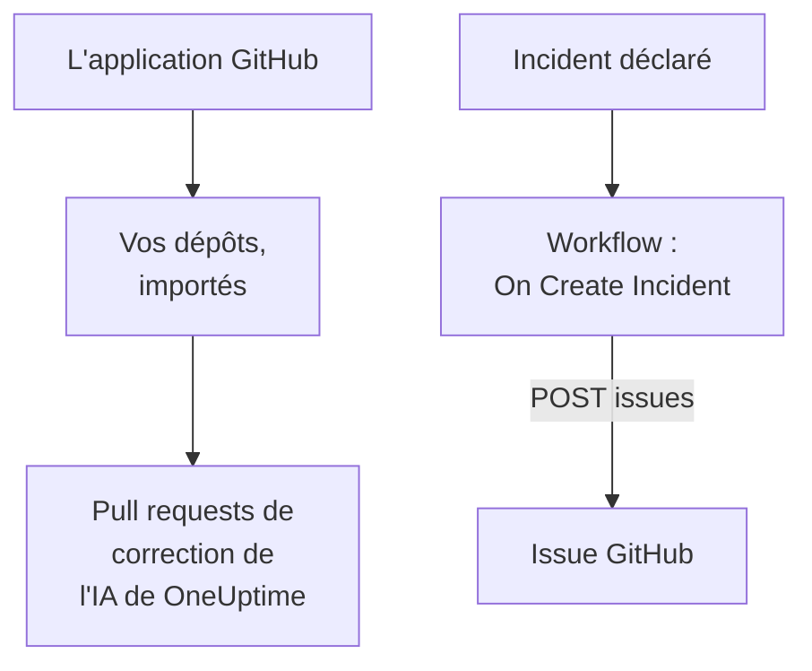

# GitHub

OneUptime fonctionne avec [GitHub](https://github.com) de deux façons. Connectez vos dépôts via l'application GitHub de OneUptime, et l'IA de OneUptime ouvre des pull requests qui corrigent ce qu'elle trouve, et répond quand vous la mentionnez dans une issue ou une pull request. Ou construisez un workflow qui ouvre une issue GitHub pour chaque incident, afin que le travail qui en découle soit suivi dans le dépôt propriétaire du service.

:::cards
- [Choisir comment connecter](#choisir-comment-connecter): L'application GitHub ou un workflow, et ce que fait chacun.
- [Connecter vos dépôts](#connecter-vos-dépôts): L'application GitHub, pour les pull requests de correction.
- [Ouvrir une issue pour chaque incident](#ouvrir-une-issue-github-pour-chaque-incident): Un workflow, deux blocs.
- [Dépannage](#dépannage): Quand GitHub refuse une requête.
:::

## Fonctionnement



Les deux sont indépendantes, et vous pouvez utiliser l'une, l'autre ou les deux. L'application GitHub fonctionne dans les dépôts où vous l'installez. Le workflow n'a besoin que d'un jeton, et appelle l'[API REST](https://docs.github.com/en/rest/issues/issues#create-an-issue) de GitHub comme n'importe quelle autre API.

## Choisir comment connecter

| Façon | Ce qu'elle fait | Ce dont elle a besoin |
| --- | --- | --- |
| L'application GitHub | Importe vos dépôts. L'IA de OneUptime y ouvre des pull requests qui corrigent des exceptions, des traces lentes et les causes que trouvent ses investigations, et répond aux mentions dans les issues et les pull requests. | Une organisation ou un compte où installer l'application. Sur OneUptime Cloud, l'offre **Growth**. |
| Un workflow | Ouvre une issue GitHub pour chaque incident, dans le dépôt que vous choisissez. | Un jeton GitHub qui peut créer des issues, et un workflow de deux blocs. |

## Connecter vos dépôts

Ouvrez **Produits → Code → Tâches**, puis **Dépôts de code**, et cliquez sur **Se connecter avec l'application GitHub**. GitHub demande où installer l'application et quels dépôts elle peut utiliser. Chaque dépôt de l'installation est importé, et reste à jour quand vous ajoutez des dépôts à l'installation ou que vous les en retirez.

Si l'application est déjà installée sur le compte, pour un autre projet ou directement depuis GitHub, cliquez sur **Connecter une installation existante**, sous la carte **Se connecter avec l'application GitHub**, au lieu de la réinstaller. Il faut pour cela un compte GitHub qui administre l'installation : le propriétaire d'un compte personnel, ou une personne disposant du droit admin sur chaque dépôt auquel l'installation a accès, comme un propriétaire de l'organisation.

Une instance auto-hébergée a d'abord besoin de sa propre application GitHub : [Intégration GitHub](/docs/self-hosted/github-integration) montre comment la créer. Ensuite, les [Tâches de correction](/docs/ai/ai-agent) ouvrent des pull requests dans vos dépôts, et la page [GitHub App](/docs/ai/github-app) montre ce que fait l'application quand vous la mentionnez dans une issue ou une pull request.

## Avant de commencer

Le reste de cette page construit le workflow. Il faut :

- Un jeton GitHub qui peut créer des issues dans le dépôt : un jeton d'accès personnel à granularité fine pour ce dépôt, avec la permission **Issues** réglée sur **Read and write**, ou un jeton classique avec le scope `repo`. Créez-en un dans les [paramètres des jetons](https://github.com/settings/tokens) de GitHub.
- Dans OneUptime, le droit de créer des workflows et des variables globales. Sur OneUptime Cloud, les workflows nécessitent l'offre **Growth** ou supérieure.

## Enregistrer le jeton

:::steps
1. Allez dans **Flux de travail → Variables globales** et cliquez sur **Créer : Variable de flux de travail**.
2. Nommez-la `GITHUB_TOKEN` et cliquez sur **Suivant**.
3. Collez le jeton dans **Contenu**, activez **Secret**, et cliquez sur **Créer : Variable de flux de travail**.
:::

Une variable secrète est remplacée par `[REDACTED]` dans les journaux d'exécution, le jeton n'apparaît donc jamais dans une exécution.

## Ouvrir une issue GitHub pour chaque incident

:::steps
### Créer le workflow

Allez dans **Flux de travail**, cliquez sur **Créer un flux de travail**, puis sur **Partir de zéro**. Nommez-le `Incidents to GitHub` et cliquez sur **Créer un flux de travail**.

### Ajouter le déclencheur

Cliquez sur le bloc en pointillés **Choisissez ce qui démarre ce flux de travail** et choisissez **On Create Incident**. Cliquez sur le déclencheur : ses **Fields to pass on** commencent par **Titre**, alors cliquez sur **Ajouter un champ** et choisissez **Description** et **Numéro d'incident avec préfixe**.

### Ouvrir l'issue

Cliquez sur **Ajouter un composant**, ajoutez un bloc **API Post (JSON)** et reliez-y le point **Success** du déclencheur. Réglez son **URL** sur `https://api.github.com/repos/your-org/your-repo/issues`, avec le propriétaire et le nom de votre dépôt. Sous **Plus de champs**, réglez ses **Request Headers** sur :

```json
{
  "Authorization": "Bearer {{global.variables.GITHUB_TOKEN}}",
  "Accept": "application/vnd.github+json",
  "X-GitHub-Api-Version": "2022-11-28"
}
```

Et son **Request Body** sur :

```json
{
  "title": "{{local.components.incident-on-create-1.returnValues.model.title}}",
  "body": "{{local.components.incident-on-create-1.returnValues.model.description}}\n\nOpened by OneUptime for incident {{local.components.incident-on-create-1.returnValues.model.incidentNumberWithPrefix}}.",
  "labels": ["incident"]
}
```

### Tester, puis activer

Cliquez sur **Exécuter le flux de travail**, choisissez un incident de test sous **Incident** et lancez-le. L'étape **API Post (JSON)** affiche une réponse `201` contenant la nouvelle issue, avec son `number` et son `html_url`. Activez ensuite **Activé** en haut du **Constructeur**.
:::

L'issue reste ouverte quand l'incident est résolu, car le travail qui en découle survit généralement à l'incident. Pour des tickets synchronisés avec l'incident dans les deux sens, voir [Jira](/docs/integrations/jira).

## Conseils

- **GitHub Enterprise Server.** Envoyez plutôt la requête à votre serveur : `https://your-github-host/api/v3/repos/your-org/your-repo/issues`. Un serveur sur une adresse de réseau privé exige un OneUptime auto-hébergé dont l'administrateur l'autorise : voir [Accès réseau sortant](/docs/workflows/configuration#accès-réseau-sortant).
- **L'assigner.** Ajoutez `"assignees": ["octocat"]` ou `"milestone": 3` au corps. GitHub ignore sans un mot les labels, les assignés et les jalons quand le jeton ne peut pas pousser dans le dépôt.
- **Seulement certains incidents.** Placez un bloc **If / Else** entre le déclencheur et le bloc d'API, et n'ouvrez des issues que sur son côté **Yes**, par exemple pour une gravité.

## Dépannage

L'étape **API Post (JSON)** prend **Error** quand GitHub refuse la requête. Ses **Response Status** et **Response Body** dans l'exécution disent pourquoi.

:::details GitHub répond 401
Le jeton est faux, expiré ou révoqué. Créez-en un nouveau, et remplacez le contenu de `GITHUB_TOKEN`.
:::

:::details GitHub répond 403
Le jeton ne peut pas y créer d'issues : un jeton à granularité fine sans **Issues** réglé sur **Read and write** pour ce dépôt, un jeton que votre organisation n'a pas approuvé, ou un jeton classique non autorisé pour l'authentification unique de votre organisation. Un 403 dont le corps parle d'une limite de débit signifie que le jeton a envoyé trop de requêtes : attendez, ou ouvrez des issues pour moins d'incidents.
:::

:::details GitHub répond 404
Le propriétaire ou le dépôt dans l'**URL** est faux, ou le jeton ne peut pas voir le dépôt. GitHub répond 404, et non 403, pour un dépôt privé qu'un jeton ne peut pas voir.
:::

:::details GitHub répond 410 ou 422
- `410` : les issues sont désactivées dans les paramètres du dépôt.
- `422` : GitHub ne peut pas lire le corps. Vérifiez que c'est du JSON valide, que `title` est renseigné, et que `labels` et `assignees` sont des listes.
:::

## Étapes suivantes

:::cards
- [GitHub App](/docs/ai/github-app): Demander à l'IA de OneUptime une modification, une révision ou une revue depuis GitHub même.
- [GitLab](/docs/integrations/gitlab): Le même workflow, pour les issues GitLab.
- [Composants de workflow](/docs/workflows/components#api): Chaque paramètre des blocs d'API.
- [Présentation des intégrations](/docs/integrations/index): Les modèles derrière chaque intégration.
:::
