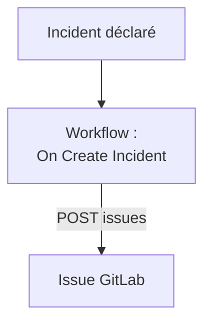

# GitLab

Ouvrez une issue [GitLab](https://gitlab.com) pour chaque incident OneUptime, afin que le travail qui en découle soit suivi dans le projet propriétaire du service. Un workflow appelle l'[API Issues](https://docs.gitlab.com/api/issues/#new-issue) de GitLab, sur GitLab.com ou sur votre propre GitLab.

:::cards
- [Enregistrer le jeton](#enregistrer-le-jeton): Gardez le jeton de GitLab hors de vos workflows.
- [Ouvrir une issue pour chaque incident](#ouvrir-une-issue-gitlab-pour-chaque-incident): Un workflow, deux blocs.
- [Conseils](#conseils): Votre propre GitLab, les chemins de projet et les assignés.
- [Dépannage](#dépannage): Quand GitLab refuse une requête.
:::

> [!NOTE]
> L'IA de OneUptime travaille aussi dans les dépôts GitLab : connectez-les dans Code avec un jeton d'accès, et elle ouvre une demande de fusion pour chaque correction. Voir [Connecter un dépôt](/docs/ai/ai-agent#connecter-un-dépôt).

## Fonctionnement



Le workflow s'exécute une fois pour chaque nouvel incident. Son bloc **API Post (JSON)** envoie le titre et la description de l'incident aux issues du projet, signés avec un jeton d'accès.

## Avant de commencer

- L'ID du projet GitLab. Sur la page d'aperçu du projet, sélectionnez le menu d'actions, les trois points verticaux, puis **Copy project ID**.
- Un jeton d'accès GitLab avec le scope `api`, pour un utilisateur ou un bot dont le rôle dans le projet peut créer des issues : un jeton d'accès de projet, de groupe ou personnel. Créez-le sous **Settings → Access tokens** dans le projet, le groupe ou vos paramètres utilisateur.
- Dans OneUptime, le droit de créer des workflows et des variables globales. Sur OneUptime Cloud, les workflows nécessitent l'offre **Growth** ou supérieure.

## Enregistrer le jeton

:::steps
1. Allez dans **Flux de travail → Variables globales** et cliquez sur **Créer : Variable de flux de travail**.
2. Nommez-la `GITLAB_TOKEN` et cliquez sur **Suivant**.
3. Collez le jeton dans **Contenu**, activez **Secret**, et cliquez sur **Créer : Variable de flux de travail**.
:::

Une variable secrète est remplacée par `[REDACTED]` dans les journaux d'exécution, le jeton n'apparaît donc jamais dans une exécution.

## Ouvrir une issue GitLab pour chaque incident

:::steps
### Créer le workflow

Allez dans **Flux de travail**, cliquez sur **Créer un flux de travail**, puis sur **Partir de zéro**. Nommez-le `Incidents to GitLab` et cliquez sur **Créer un flux de travail**.

### Ajouter le déclencheur

Cliquez sur le bloc en pointillés **Choisissez ce qui démarre ce flux de travail** et choisissez **On Create Incident**. Cliquez sur le déclencheur : ses **Fields to pass on** commencent par **Titre**, alors cliquez sur **Ajouter un champ** et choisissez **Description** et **Numéro d'incident avec préfixe**.

### Ouvrir l'issue

Cliquez sur **Ajouter un composant**, ajoutez un bloc **API Post (JSON)** et reliez-y le point **Success** du déclencheur. Réglez son **URL** sur `https://gitlab.com/api/v4/projects/12345678/issues`, avec l'ID de votre projet à la place de `12345678`. Sous **Plus de champs**, réglez ses **Request Headers** sur :

```json
{
  "PRIVATE-TOKEN": "{{global.variables.GITLAB_TOKEN}}"
}
```

Et son **Request Body** sur :

```json
{
  "title": "{{local.components.incident-on-create-1.returnValues.model.title}}",
  "description": "{{local.components.incident-on-create-1.returnValues.model.description}}\n\nOpened by OneUptime for incident {{local.components.incident-on-create-1.returnValues.model.incidentNumberWithPrefix}}.",
  "labels": "incident,oneuptime"
}
```

### Tester, puis activer

Cliquez sur **Exécuter le flux de travail**, choisissez un incident de test sous **Incident** et lancez-le. L'étape **API Post (JSON)** affiche une réponse `201` contenant la nouvelle issue, avec son `iid` et son `web_url`. Activez ensuite **Activé** en haut du **Constructeur**.
:::

Le bloc envoie du JSON, il n'a donc besoin d'aucun en-tête `Content-Type`. GitLab crée les labels qu'il ne connaît pas encore : `incident` et `oneuptime` ne demandent donc aucune configuration. L'issue reste ouverte quand l'incident est résolu, car le travail qui en découle survit généralement à l'incident.

## Conseils

- **Votre propre GitLab.** Envoyez plutôt la requête à votre serveur : `https://gitlab.example.com/api/v4/projects/12345678/issues`. Un serveur sur une adresse de réseau privé exige un OneUptime auto-hébergé dont l'administrateur l'autorise : voir [Accès réseau sortant](/docs/workflows/configuration#accès-réseau-sortant).
- **Le chemin du projet à la place de son ID.** Le chemin fonctionne à la place de l'ID, avec son `/` écrit `%2F` : `projects/your-group%2Fyour-project/issues`. L'URL est envoyée exactement telle qu'elle est écrite : encodez-la donc vous-même.
- **L'assigner.** Ajoutez `"assignee_ids": [42]` ou `"due_date": "2026-12-31"` au corps, ou `"confidential": true` pour ne la montrer qu'aux membres du projet.
- **Seulement certains incidents.** Placez un bloc **If / Else** entre le déclencheur et le bloc d'API, et n'ouvrez des issues que sur son côté **Yes**, par exemple pour une gravité.

## Dépannage

L'étape **API Post (JSON)** prend **Error** quand GitLab refuse la requête. Ses **Response Status** et **Response Body** dans l'exécution disent pourquoi.

:::details GitLab répond 401
Le jeton est faux, expiré ou révoqué. Créez-en un nouveau, et remplacez le contenu de `GITLAB_TOKEN`.
:::

:::details GitLab répond 403
Le jeton n'a pas le scope `api`, ou le rôle de son utilisateur dans le projet ne peut pas créer d'issues. Le corps nomme `insufficient_scope` quand c'est le scope.
:::

:::details GitLab répond 404
L'ID du projet dans l'**URL** est faux, ou le jeton ne peut pas voir le projet. GitLab répond 404, et non 403, pour un projet privé qu'un jeton ne peut pas voir.
:::

:::details GitLab répond 400
GitLab ne peut pas lire le corps : `title` manque, ou un champ a le mauvais type. Le corps nomme le champ.
:::

## Étapes suivantes

:::cards
- [GitHub](/docs/integrations/github): Le même workflow pour GitHub, et l'application GitHub.
- [Composants de workflow](/docs/workflows/components#api): Chaque paramètre des blocs d'API.
- [Exécutions de workflow](/docs/workflows/runs-and-logs): Lisez ce que chaque requête a envoyé et reçu.
- [Présentation des intégrations](/docs/integrations/index): Les modèles derrière chaque intégration.
:::
