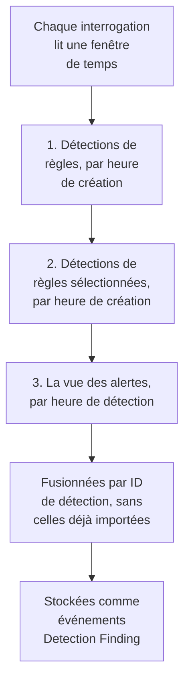

# Google SecOps

Faites entrer les alertes et les détections de [Google SecOps](https://cloud.google.com/security/products/security-operations) (anciennement Chronicle) dans les événements de sécurité de OneUptime. Vous les y recherchez à côté de vos logs, traces et métriques, vous les corrélez avec toutes les autres sources, et vous prévenez l'astreinte pour celles qui comptent.

:::cards
- [Choisir comment se connecter](#choisir-comment-se-connecter): Un webhook de playbook SOAR, le connecteur géré, ou le transfert UDM.
- [Configurer le connecteur géré](#configurer-le-connecteur-géré): Une clé de compte de service, et le formulaire de la connexion.
- [Fonctionnement des interrogations du connecteur](#fonctionnement-des-interrogations-du-connecteur): Trois lectures de chaque fenêtre, et leurs budgets.
- [Dépannage](#dépannage): Ce que dit Dernière erreur, et ce qu'il faut faire.
- [Envoyer des événements de sécurité à Google SecOps](#envoyer-des-événements-de-sécurité-à-google-secops): Les détections de OneUptime, dans Google SecOps.
:::

## Choisir comment se connecter

| Méthode | Ce qui arrive | Utilisez-la quand |
| --- | --- | --- |
| Un webhook de playbook SOAR | Chaque alerte qu'un playbook envoie, en quelques secondes | Vous exécutez des playbooks SOAR, et voulez leurs alertes dans OneUptime sans interrogation. |
| Le connecteur géré | Les alertes, et les détections de règles si vous le choisissez, interrogées à intervalle régulier | Vous voulez que OneUptime les récupère pour vous, sans rien à configurer dans SecOps. |
| Le transfert d'événements UDM | Les événements UDM bruts, pour une recherche et une corrélation complètes | Vous exportez déjà des événements UDM, et les voulez tous. |

Chaque méthode normalise ce qui arrive en [OCSF](https://schema.ocsf.io/), l'Open Cybersecurity Schema Framework dans lequel OneUptime stocke chaque événement de sécurité, pour que les règles de détection et les tableaux de bord fonctionnent de la même façon quelle que soit la source.

## Avant de commencer

- Pour le connecteur géré, dans OneUptime, le rôle Project Owner, Project Admin ou Security Admin. Les rôles Security Member et Security Viewer peuvent lire les connexions, mais pas en créer.
- Pour le webhook et le transfert UDM, une clé d'ingestion : ouvrez **Paramètres du projet → Télémétrie & APM → Clés d'ingestion** et cliquez sur **Créer une clé d'ingestion**.
- Pour le connecteur géré, le droit de créer un compte de service Google Cloud, dans le projet auquel votre instance SecOps est liée.

## Envoyer les alertes depuis un playbook SOAR

Les playbooks SOAR de Google SecOps peuvent envoyer des alertes à n'importe quel point de terminaison HTTP. Dirigez-en un vers l'ingestion des événements de sécurité de OneUptime.

:::steps
### Ajouter une action HTTP request

Dans votre playbook SOAR de SecOps, ajoutez une action **HTTP request** qui s'exécute sur les nouvelles alertes.

### La diriger vers OneUptime

Réglez sa **Method** sur `POST`, et son **URL** sur `https://oneuptime.com/security-events/v1/ingest`, ou `https://<your-host>/security-events/v1/ingest` sur une installation auto-hébergée. Ajoutez ces en-têtes :

```text
Content-Type: application/json
x-oneuptime-token: <your telemetry ingestion key>
```

Envoyez le JSON de l'alerte comme **Body**. Une détection, des détails de règle avec les événements UDM correspondants sous `collectionElements`, est reconnue d'elle-même, stockée comme un événement Detection Finding, et les utilisateurs, hôtes et IP de ses événements correspondants sont gardés comme observables.

### Vérifier que les alertes arrivent

Exécutez le playbook. Ses alertes apparaissent dans **Produits → Événements de sécurité** en quelques secondes.
:::

## Transférer les événements UDM

Pour une recherche et une corrélation complètes, transférez les événements UDM eux-mêmes, par exemple depuis un pipeline d'export BigQuery, une Cloud Function, ou n'importe quel transmetteur que vous exécutez déjà :

```bash
curl -X POST "https://oneuptime.com/security-events/v1/ingest?format=udm" \
  -H "Content-Type: application/json" \
  -H "x-oneuptime-token: <your telemetry ingestion key>" \
  -d '{
    "events": [
      {
        "metadata": {
          "event_type": "USER_LOGIN",
          "event_timestamp": "2026-08-21T10:00:00Z",
          "vendor_name": "Google",
          "product_name": "Google SecOps"
        },
        "principal": { "user": { "userid": "alice" }, "ip": ["203.0.113.7"] },
        "target": { "hostname": "vpn-gw-01" },
        "security_result": [{ "severity": "HIGH", "action": ["BLOCK"] }]
      }
    ]
  }'
```

- `format` peut valoir `udm`, `ocsf`, `google-secops-alert` ou `generic`. Omettez-le, et le format est détecté événement par événement.
- Le corps peut être un événement, une liste d'événements, ou `{ "events": [...] }`.
- `x-oneuptime-service-name` nomme le service de télémétrie auquel appartiennent les événements. Sans lui, ils appartiennent au service nommé d'après le produit de la charge utile.

## Configurer le connecteur géré

OneUptime interroge les détections et les alertes de votre locataire à intervalle régulier, sans configuration SOAR. Google SecOps est un fournisseur des Security Event Connections, il est donc créé, testé, interrogé et diagnostiqué sur la même page et de la même façon que tous les autres connecteurs gérés.

:::steps
### Créer une clé de compte de service

Dans Google Cloud, créez un compte de service dans le projet auquel votre instance SecOps est liée, et accordez-lui le rôle **Chronicle API Viewer** (`roles/chronicle.viewer`). Ce rôle comprend les autorisations `legacySearchDetections`, `legacySearchCuratedDetections`, `countAllCuratedRuleSetDetections` et `legacyFetchAlertsView` avec lesquelles le connecteur lit.

Dans l'onglet **Keys** du compte de service, ajoutez une clé de type **JSON** et téléchargez-la. Vous collez le fichier entier dans la connexion. Son `token_uri` doit être une URL `https` sur un hôte Google, ce qu'est déjà une clé téléchargée depuis Google Cloud.

### Trouver la région et le nom de ressource de l'instance

Dans Google SecOps, ouvrez **SIEM Settings → Profile**. Le nom de ressource de l'instance a la forme `projects/{project}/locations/{location}/instances/{instance}`, où le composant de l'instance est l'ID de l'instance SecOps ; un nom d'affichage de connexion ou un nom de compte de service ne le remplace pas. La région est le point de terminaison régional qui dessert cet emplacement, et elle doit correspondre au segment locations du nom de ressource de l'instance, sinon la connexion est refusée à l'enregistrement.

### Ajouter la connexion

Ouvrez **Produits → Événements de sécurité → Connexions** (`/dashboard/{projectId}/security-events/connections`), sélectionnez **Ajouter une connexion**, choisissez **Google SecOps**, et remplissez le formulaire avec les réglages du tableau ci-dessous.

### Tester avant d'enregistrer

Sélectionnez **Tester ces paramètres** sous **Tester avant d'enregistrer** avant d'enregistrer. Le test s'exécute avec les valeurs du formulaire sans rien enregistrer, une clé mal formée, un rôle manquant ou une mauvaise instance est donc repéré avant que la connexion existe. Dans le formulaire de modification, le même bouton teste la **Région**, l'**Nom de ressource de l'instance** et le **Data to import** affichés à l'écran avec la clé enregistrée ; un champ d'identifiants laissé vide garde la clé enregistrée. Quand quelque chose de testé diffère de ce que la connexion a enregistré, y compris une clé nouvellement saisie, aucune ligne d'historique d'exécution n'est enregistrée, car la connexion n'a pas encore ces réglages.
:::

| Réglage | Où le trouver | Obligatoire |
| --- | --- | --- |
| **Région** | Le point de terminaison régional de Google SecOps (`us`, `europe`, `asia-southeast1`, ...) qui correspond à l'emplacement de votre nom de ressource d'instance. Il n'y a pas de valeur par défaut, pour qu'un locataire hors des États-Unis ne puisse pas enregistrer le mauvais point de terminaison par accident. | Oui |
| **Nom de ressource de l'instance** | Dans Google SecOps, **SIEM Settings → Profile** : `projects/{project}/locations/{location}/instances/{instance}`. | Oui |
| **Fermer les alertes quand leur dossier est fermé** | À la dernière étape du formulaire, désactivé jusqu'à ce que vous l'activiez. Activé, fermer un dossier ferme ses alertes Google SecOps : voir [Fermer les alertes quand leur dossier est fermé](#fermer-les-alertes-quand-leur-dossier-est-fermé). | Non |
| **JSON du compte de service** | Google Cloud, l'onglet **Keys** du compte de service. Collez le fichier de clé JSON entier. En écriture seule : chiffré au repos, jamais renvoyé par l'API, plus jamais affiché sur la page. Utilisez **Mettre à jour les identifiants** sur la connexion pour le renouveler. | Oui |
| **Data to import** | Les **Alertes** sont toujours importées, car l'API des alertes de Google les renvoie toujours. Sélectionnez **Détections** pour importer aussi les correspondances de règles qui n'ont pas généré d'alerte. Cela ne transfère pas les événements UDM bruts : transférez-les vous-même, comme ci-dessus. | Alertes toujours |

L'étape d'interrogation du formulaire demande un **Nom**, une **Description** facultative, le réglage **Activé** de la connexion, et le **Intervalle d'interrogation (minutes)** : un nombre entier de `1` à `1440`, `5` par défaut. Toute valeur hors de cette plage est refusée à l'enregistrement.

Les nouvelles détections sont importées comme des événements Detection Finding attribués à un service de télémétrie `Google SecOps`.

## Lire la santé de la connexion

La liste des connexions affiche **Nom**, **Fournisseur** (avec en dessous la sélection Data to import de la connexion), **Statut** (Enabled ou Disabled), **Santé**, **Intervalle (minutes)**, **Dernière interrogation**, **Dernière interrogation réussie** et **Dernier événement importé**. Quand une connexion a une erreur, **Voir l'erreur** apparaît dans sa colonne **Actions**, à côté de **Tester la connexion**, **Exécuter maintenant**, **Diagnostics**, **Modifier** et **Mettre à jour les identifiants**. Enabled signifie que l'interrogation automatique est configurée. Dernière interrogation enregistre une tentative ; une fenêtre vide réussie ne prouve pas qu'une détection donnée a été importée.

**Santé** indique **Last poll succeeded** seulement une fois qu'un événement a été importé. D'ici là, une connexion qui réussit indique **Polling, no events imported yet**, l'état à examiner avec Tester la connexion. Les autres états sont **No records returned**, **Partial import**, **Catching up**, **Last poll failed**, **Poll overdue**, **Schedule paused** et **En attente de la première interrogation** ; survolez un état pour voir ce qu'il signifie.

> [!NOTE]
> Le connecteur utilise les anciennes API de détections et d'alertes `v1alpha` de Chronicle, que Google fournit en pré-GA. Quand une interrogation échoue, le champ **Dernière erreur** de la connexion conserve le message d'erreur complet, identifiants masqués, derrière un préfixe qui nomme l'étape en échec, y compris quand Chronicle répond `200` et place le refus dans le corps. Sélectionnez **Voir l'erreur** dans la colonne **Actions** de la connexion pour lire le message, puis **Copier l'erreur** dans la boîte de dialogue pour le copier pour le support.

## Fonctionnement des interrogations du connecteur



Une fois par minute, un worker d'arrière-plan met en file une interrogation pour chaque connexion activée dont l'intervalle est écoulé depuis sa dernière interrogation. Chaque interrogation est une exécution dans l'historique de la connexion, effectuée par un worker. Elle lit une fenêtre de temps de trois façons et fusionne les résultats par ID de détection, pour qu'un enregistrement renvoyé par plus d'une passe soit stocké une seule fois :

1. **Détections de règles par heure de création.** `legacy:legacySearchDetections` avec `ruleId=-` (chaque révision de chaque règle) et `listBasis=CREATED_TIME`, en suivant `nextPageToken` jusqu'à la dernière page.
2. **Détections de règles sélectionnées par heure de création.** `legacy:legacySearchCuratedDetections`, de la même façon, une fois par règle sélectionnée (écrite par Google). Ce point de terminaison prend un seul ID de règle sélectionnée (`ur_...`) et n'a pas de joker « toutes les règles », la passe appelle donc d'abord `:countAllCuratedRuleSetDetections` pour la semaine qui précède la fenêtre jusqu'à sa fin, et recherche chaque règle sélectionnée qui a produit des détections. Une règle sélectionnée qui ne s'est pas déclenchée cette semaine-là n'a rien à importer. Un locataire sans accès aux règles sélectionnées répond à cette passe par `400`, `403` ou `404` ; c'est enregistré comme un avertissement sur l'exécution, pas comme un échec.
3. **La vue des alertes par heure de détection.** `legacy:legacyFetchAlertsView`, qui couvre les alertes de télémétrie, les alertes SOAR et les alertes d'intelligence machine aussi bien que les alertes de règles. Le point de terminaison n'a pas de pagination, une réponse que Google limite est donc découpée en fenêtres plus petites et relue.

La vue des alertes ne peut filtrer que par heure de détection, et Google rend souvent une alerte lisible longtemps après son heure de détection (délai d'ingestion, règles planifiées, réexécutions sur des données tardives). Une interrogation planifiée **balaie donc aussi la vue des alertes sur les 24 heures qui précèdent sa fenêtre**, alertes seulement, enregistré comme la vérification **Read late alerts by detection time**. Les enregistrements déjà importés sont sautés, les répétitions de ce balayage apparaissent donc sous **Already imported**. Le balayage est fait au mieux : quand Google le limite, que son budget s'épuise ou qu'il échoue, l'exécution reçoit un avertissement, mais l'interrogation n'est pas marquée Partial ou Échec et le curseur avance quand même, car la journée qu'il reparcourt a déjà été lue par des interrogations précédentes.

L'interrogation par **heure de création** est tout le principe. Une règle Google SecOps s'exécute selon un planning (toutes les 10 minutes, toutes les heures, tous les jours), et la détection qu'elle crée porte un `detectionTime` qui est la fin de la fenêtre de temps de la règle ou l'heure de l'événement correspondant, alors que `createdTime` est le moment où le moteur de détection l'a réellement produite. Une détection créée à 10:05 pour une fenêtre qui se termine à 09:00 a une heure de détection déjà derrière un curseur qui a dépassé 09:00 il y a plusieurs interrogations, un connecteur qui interroge par heure de détection ne la voit donc jamais, pas plus qu'un événement arrivé en retard. Lire par heure de création fait poser à chaque interrogation la question « qu'est-ce que Google a créé depuis ma dernière visite », la question qui a une réponse. Chaque exécution enregistre son délai de création, combien d'enregistrements récupérés ont été créés plus d'un intervalle d'interrogation (plus une minute) après leur heure de détection, et le plus grand écart, pour que l'effet soit visible dans Diagnostics.

La première interrogation d'une nouvelle connexion remonte **24 heures** en arrière par heure de création. Chaque interrogation suivante reprend depuis le curseur enregistré de la connexion avec un chevauchement de **1 minute** ; un enregistrement créé à la frontière d'une fenêtre est lu par les deux interrogations et stocké une seule fois, car les interrogations sautent les événements déjà stockés avec le même identifiant source. Chaque interrogation planifiée lit au plus **24 heures** au-delà du curseur, une connexion dont le curseur enregistré est plus ancien rattrape donc son retard en fenêtres successives de 24 heures (Santé indique **Catching up**) au lieu d'écarter les détections intermédiaires. Utilisez **Importer cette plage de temps** dans Diagnostics pour les enregistrements créés avant la première fenêtre de 24 heures.

### Quand une fenêtre contient plus qu'une interrogation ne peut lire

Le connecteur donne à chaque interrogation des budgets fixes : la passe des détections de règles a **20** pages de recherche, la passe des règles sélectionnées jusqu'à **200** requêtes (le comptage plus au moins une page par règle sélectionnée qui s'est déclenchée la semaine passée, les règles les plus actives d'abord), la vue des alertes et son balayage des alertes tardives se partagent **16** requêtes, et toute la lecture s'arrête après **4 minutes**. La passe des règles sélectionnées ne commence plus de nouvelle règle une fois 60 % de ce temps écoulés, pour que la vue des alertes s'exécute quand même. Quand une interrogation ne peut pas rechercher chaque règle sélectionnée active, elle enregistre un avertissement qui indique combien n'ont pas été recherchées au lieu de retenir le curseur, car une fenêtre plus courte aurait toujours chacune de ces règles à rechercher. Une passe qu'un budget a arrêtée en cours de route est enregistrée comme une vérification en avertissement qui nomme le budget (par exemple `Read rule detections by created time was stopped by the request budget after 20 requests.`), et une passe que le budget n'a jamais laissée commencer est une vérification sautée avec la même raison dans les avertissements de l'exécution, jamais un succès. Une fenêtre avec plus de détections que cela ne peut pas être lue en une interrogation, et l'interrogation ne relit jamais indéfiniment la même fenêtre :

1. **Réduire.** Les points de terminaison de recherche de Google renvoient les détections les plus récentes d'abord, une interrogation qui s'arrête tôt n'a donc aucun point d'où reprendre. L'interrogation est enregistrée comme **Partiel**, le curseur reste où il était, et l'interrogation suivante lit une fenêtre deux fois plus courte depuis le même point de départ, avec l'avertissement `This window holds more records than one poll can read; the next poll reads a {n} minute window from the same starting point.` La division par deux continue jusqu'à une minute, jusqu'à ce qu'une fenêtre tienne.
2. **Revenir à la taille normale.** Chaque interrogation complète double la fenêtre suivante, jusqu'au maximum de 24 heures, pour qu'une rafale coûte quelques interrogations courtes plutôt qu'une connexion durablement lente.
3. **Passer au-delà d'une seule minute.** Si même une minute contient plus de détections qu'une interrogation ne peut lire, l'interrogation déplace le curseur au-delà de cette minute pour que les détections plus récentes continuent d'arriver. L'exécution est **Partiel** et le même texte ouvre **Dernière erreur** : `More records were created in the one minute from {start} to {end} than one poll can read. Polling moved past this minute so newer records keep arriving; use Import this time range in Diagnostics on this minute to recover what one run can read.` Pour récupérer ce qu'une exécution peut lire, ouvrez **Diagnostics**, choisissez une plage personnalisée qui couvre cette minute (les champs de plage utilisent votre heure locale ; le message est en UTC) et lancez **Importer cette plage de temps** ; une importation a les mêmes limites par exécution qu'une interrogation. Les détections déjà importées sont sautées.

Une interrogation Partial conserve aussi ses avertissements dans **Dernière erreur**, où ils restent jusqu'à ce qu'une interrogation complète les efface. Une interrogation qui échoue complètement (une erreur, pas trop d'enregistrements) garde son curseur et sa longueur de fenêtre et est réessayée au tick suivant. La seule exception est une requête qui a expiré : l'interrogation suivante lit une fenêtre deux fois plus courte depuis le même point de départ (`The source did not answer in time for this window; the next poll reads a {n} minute window from the same starting point.`), car une fenêtre trop lourde pour recevoir une réponse à temps expirerait sinon à chaque nouvel essai. Raccourcir l'intervalle d'interrogation n'y change rien : la fenêtre est décidée par le curseur et le résultat de la dernière interrogation, pas par la fréquence des interrogations.

## Tester la connexion

**Tester la connexion**, sur la ligne de la connexion ou dans **Diagnostics**, s'exécute de façon synchrone dans le processus de l'API. Le test n'a pas besoin d'un worker d'arrière-plan, et c'est justement pour cela qu'il peut vous dire quand aucun worker ne tourne. La liste des vérifications :

1. **Configuration** : chaque champ est présent et bien formé : une **Région** prise en charge qui correspond à l'emplacement de l'instance, un **Nom de ressource de l'instance** de la bonne forme, et une clé **JSON du compte de service** avec `client_email`, une `private_key` lisible et un `token_uri` Google. Rien n'est contacté si cela échoue.
2. **Authenticate with Google** : la clé est échangée contre un jeton d'accès auprès du point de terminaison OAuth de Google, avant que Chronicle soit contacté.
3. **Read rule detections**, **Read curated rule detections** et **Read the alerts view** : une sonde d'un seul enregistrement pour chaque passe sur les 24 dernières heures. La vérification des règles sélectionnées lit les comptes des règles sélectionnées sur les 7 derniers jours et sonde la règle sélectionnée qui a le plus de détections ; si aucune règle sélectionnée ne s'est déclenchée cette semaine-là, elle réussit sans rien à sonder. Une lecture des règles sélectionnées qui reçoit `400`, `403` ou `404` est un avertissement, car le locataire n'a peut-être simplement pas accès aux règles sélectionnées.
4. **Detections available to import** : ce que Google a avec la sélection **Data to import** enregistrée et avec l'autre (Alertes seules, ou Alertes et **Détections**) sur les 24 dernières heures et les 7 derniers jours : le nombre de correspondances de la vue des alertes et une page de recherche par heure de création par plage, indiqués comme un nombre ou comme `1000+`. Quand la sélection enregistrée n'a rien mais que l'autre a quelque chose, la vérification avertit : vos règles créent des détections, mais les alertes n'y sont pas activées. Modifiez la connexion et sélectionnez **Détections** sous **Data to import**, ou activez les alertes sur les règles dans Google SecOps.
5. **Background workers**, **Poll scheduler** et **Security event storage** : si un processus consomme la file Worker de OneUptime, si la tâche d'interrogation à la minute est enregistrée, et si le stockage des événements de sécurité répond à la même recherche de doublons que l'interrogation exécute avant chaque insertion, pour qu'une base analytique en panne échoue ici avec un nom plutôt qu'une heure plus tard comme erreur d'interrogation.
6. **Scheduled polling** (connexions enregistrées seulement) : si l'interrogation est activée, si une exécution en file est bloquée en attente d'un worker, et si la connexion est interrogée selon le planning.

Chaque requête d'un test a un délai de 20 secondes. Les tests ne touchent ni au curseur d'interrogation ni au stockage des événements. Une connexion enregistrée testée avec ses réglages enregistrés obtient une ligne d'historique d'exécution de type test, et les détails de la ligne montrent la même liste de vérifications.

## Prévisualiser, exécuter et importer à la demande

Ouvrez **Diagnostics** sur une connexion pour voir les exécutions récentes et piloter le connecteur. Les propriétaires de projet, les administrateurs de projet et les administrateurs de sécurité peuvent lancer des opérations. Les membres et observateurs de sécurité peuvent lire l'historique.

- **Exécuter maintenant** met tout de suite une interrogation en file, avec le curseur et le chemin d'ingestion habituels, même quand l'interrogation planifiée est désactivée. Les états en file et en cours restent visibles pendant que le worker exécute la requête. Si une exécution reste en file, vérifiez que des workers traitent la file Worker ; la vérification **Background workers** de Tester la connexion dit si un processus le fait.
- **Preview detections** lit une plage de temps choisie sans importer ni changer le curseur. Utilisez la dernière heure, 24 heures, 7 jours, ou une plage personnalisée de 7 jours au plus. La plage correspond à la vue des alertes de SecOps, qui lit par heure de détection, et les deux passes de recherche lisent les détections créées dans la plage ainsi que celles dont l'heure de détection s'y trouve, un aperçu d'hier montre donc aussi les détections créées hier sur des événements plus anciens. L'aperçu montre l'heure de détection et l'heure de création séparément. Les résultats suivent la sélection **Data to import** enregistrée de la connexion.
- **Importer cette plage de temps** importe la plage choisie, après votre confirmation, sans déplacer le curseur d'interrogation. C'est aussi ainsi que vous récupérez une minute que l'interrogation a dépassée, comme décrit plus haut. Prévisualisez d'abord la plage. Les interrogations et importations répétées sautent les événements déjà stockés avec le même identifiant source dans le projet. Les importations peuvent déclencher les règles de détection et les moniteurs configurés, exactement comme l'interrogation planifiée.

Les détails de chaque exécution montrent la **Requested window (UTC)**, la sélection **Data to import** de la connexion et cinq comptes :

| Compte | Ce qu'il compte |
| --- | --- |
| **Returned by Google SecOps** | Les enregistrements que Google a renvoyés sur les trois passes, après fusion par ID. |
| **Imported into OneUptime** | Les lignes écrites dans le stockage des événements. |
| **Already imported** | Les enregistrements sautés parce que le même identifiant source est déjà stocké dans ce projet ; le chevauchement de 1 minute et les réexécutions rendent cela normal. |
| **Rejeté** | Les objets renvoyés qui ne sont pas des détections Google SecOps. Ils sont comptés et signalés, jamais réessayés, et ne retiennent pas le curseur. |
| **Échec** | Les enregistrements qui n'ont pas pu être normalisés. Une interrogation les réessaie dans une fenêtre plus courte. |

Les **Provider details** ajoutent le **Time basis read**, les enregistrements **Returned by each pass** (détections de règles, détections de règles sélectionnées et vue des alertes) et le **Creation lag**. Suivent les vérifications, une par passe, les avertissements et des exemples de détections. Les détails d'une interrogation planifiée montrent aussi la **Window read by this poll** et ce que **La prochaine interrogation planifiée lit**, et une interrogation Partial dit si elle a gardé son point de départ et réduit la fenêtre suivante, ou si elle est passée au-delà d'une seule minute qu'elle nomme. **Succès**, **No records returned**, **Partiel** et **Échec** sont des résultats distincts.

Utilisez **View events in this time range** sur une exécution pour ouvrir la plage de temps d'événement des détections qu'elle a renvoyées. Sinon, une détection créée aujourd'hui avec l'heure de détection d'hier peut être masquée par un filtre sur les événements récents. L'historique des exécutions conserve les échecs après qu'une interrogation complète ultérieure a effacé Dernière erreur. Utilisez **Copier les diagnostics** quand vous contactez le support ; les identifiants du compte de service et les jetons ne sont jamais inclus.

## Pourquoi je ne vois aucun événement ?

Parcourez ces points dans l'ordre. Chacun se distingue du suivant dans **Diagnostics** ou avec **Tester la connexion**.

1. **Data to import.** Par défaut, seules les **Alertes** sont importées, et une détection de règle n'est une alerte que si les alertes sont activées sur la règle dans Google SecOps. Un locataire dont les règles créent des détections sans alerte interroge honnêtement à vide pour toujours. Lancez **Tester la connexion** : la vérification **Detections available to import** compte avec et sans **Détections** et le dit quand les sélectionner ajouterait des enregistrements. Modifiez la connexion et sélectionnez **Détections** sous **Data to import**, ou activez les alertes sur les règles.
2. **Fréquence d'exécution des règles et latence de détection.** Les détections sont créées quand la règle s'exécute, ce qui peut être jusqu'à une heure ou un jour après les événements qu'elles décrivent. Le connecteur interroge par heure de création, elles arrivent donc à la première interrogation après que Google les a créées, pas à leur heure de détection. Une règle que vous venez d'activer n'a encore rien créé, et un locataire calme n'a rien à créer. La vérification de disponibilité indique combien de détections ont été créées dans les 24 dernières heures et les 7 derniers jours ; zéro avec et sans **Détections** signifie que Google n'a encore rien que OneUptime puisse importer.
3. **Lisez les comptes de la dernière exécution.** Dans Diagnostics, **Returned by Google SecOps** avec zéro **Imported into OneUptime** et un compte **Already imported** correspondant, c'est le connecteur qui fonctionne comme prévu : ces détections ont été importées par une interrogation précédente. Les enregistrements **Rejeté** sont des objets renvoyés par Google qui ne sont pas du tout des détections.
4. **Une interrogation a-t-elle seulement lieu ?** Dernière interrogation qui indique `Never` avec une Dernière erreur vide signifie qu'aucune interrogation ne s'est terminée pour cette connexion. Tester la connexion indique **Background workers** (les processus qui consomment la file Worker), **Poll scheduler** (l'enregistrement du planificateur à la minute) et **Scheduled polling** (le planning propre à cette connexion, y compris une interrogation en retard ou une exécution bloquée en file). Voir l'entrée de dépannage ci-dessous pour les réglages de déploiement qui en sont la cause.
5. **Cherchez au bon endroit.** Les événements sont stockés sous leur heure de détection, qui peut précéder de plusieurs heures ou jours le moment où ils ont été créés et importés, un filtre « dernière heure » dans les événements de sécurité masque donc une détection importée il y a une minute sur un événement d'hier. Utilisez **View events in this time range** sur une exécution dans Diagnostics : cela ouvre la plage de temps d'événement des détections que cette exécution a renvoyées.

## Comment la gravité est définie

Google SecOps stocke la gravité d'une détection à des endroits différents selon l'auteur de la règle, et OneUptime les lit dans cet ordre, en utilisant le premier qui nomme une gravité :

1. **La gravité propre à Google** (`detection[].severity`). Google la définit sur les règles sélectionnées, comme Applied Threat Intelligence et les ensembles de règles sélectionnées.
2. **La gravité de l'alerte** (la `severity` de la Collection), pour les alertes SOAR et les corps de webhook.
3. **La gravité `meta` de la règle.** Pour une règle YARA-L personnalisée, Google laisse `detection[].severity` vide et renvoie la section `meta` de la règle comme `ruleLabels`. OneUptime lit le label `severity`, qui est la valeur qu'affiche le tableau de bord des règles de Google SecOps. Info, Informational, Low, Medium, High et Critical sont reconnus, quelle que soit la casse.
4. **Le résultat `$risk_score` de la règle**, si la règle ne définit aucune gravité, classé selon les [plages recommandées par Google](https://docs.cloud.google.com/chronicle/docs/yara-l/outcome-syntax) : 90–100 Critical, 80–89 High, 50–79 Medium, 20–49 Low, 1–19 Informational. OneUptime n'utilise qu'un score que la règle définit elle-même. Il ignore le `riskScore` que Google remplit pour les règles qui n'en ont pas (40 pour les règles qui alertent, 15 sinon), car cette valeur par défaut ne dit rien de la gravité de la détection.

Une détection qu'aucun de ces éléments ne classe est affichée comme Unknown. Pour classer une règle personnalisée, ajoutez une gravité à sa section `meta` dans Google SecOps, par exemple `severity = "High"`, ou définissez `$risk_score` dans sa section `outcome`. Les détections que la règle crée ensuite sont importées avec cette gravité.

## Fermer les alertes quand leur dossier est fermé

Avec **Fermer les alertes quand leur dossier est fermé** activé, fermer un [dossier de sécurité](/docs/telemetry/security-cases#fermer-un-dossier) ferme les alertes Google SecOps dont il est issu. Chaque alerte est marquée fermée avec le verdict du dossier, un True Positive comme malveillant et un False Positive ou un Benign Positive comme non malveillant, avec la note de clôture du dossier et un lien vers le dossier. La chronologie du dossier indique combien d'alertes ont été fermées.

- Le compte de service a besoin de `chronicle.legacies.legacyUpdateAlert`, que possède le rôle `roles/chronicle.editor`. Le rôle `roles/chronicle.viewer` lit les alertes mais ne peut pas les fermer, et un `403` l'indique sur le dossier.
- Une alerte que Google SecOps n'a plus est ignorée. Quand Google SecOps est injoignable, OneUptime réessaie pendant environ une heure, puis écrit sur le dossier ce qu'il n'a pas pu fermer.

## Surveiller vos autres événements pour ses indicateurs

Un [flux de renseignement](/docs/telemetry/threat-intelligence#comment-google-secops-est-lu) dont la **Source** est **Google SecOps** lit, par cette connexion, les indicateurs que le renseignement sur les menaces de Google SecOps a trouvés dans ses événements, et surveille le reste des événements de votre projet pour les repérer : les connexions, les flux réseau et les événements de terminaux que Google SecOps n'a jamais vus.

## Envoyer des événements de sécurité à Google SecOps

OneUptime peut aussi envoyer ce qu'il trouve à Google SecOps, pour que le SIEM dans lequel travaille votre équipe voie les détections de OneUptime à côté des siennes. Chaque événement de sécurité est importé comme événement UDM, avec sa gravité, ses tags MITRE ATT&CK et la règle qui l'a trouvé :

| Événement de sécurité | Type d'événement UDM |
| --- | --- |
| Une connexion | `USER_LOGIN` |
| Un processus lancé, ouvert, injecté ou arrêté | `PROCESS_LAUNCH`, `PROCESS_OPEN`, `PROCESS_INJECTION`, `PROCESS_TERMINATION` |
| Un processus qui a élevé ses privilèges | `PROCESS_PRIVILEGE_ESCALATION` |
| Toute autre activité de processus | `PROCESS_UNCATEGORIZED` |
| Une connexion réseau | `NETWORK_CONNECTION` |
| Tout le reste, ou un événement sans les champs dont son type a besoin | `GENERIC_EVENT` |

Dans un événement de processus, `principal` est le processus qui a agi et `target` le processus sur lequel il a agi : dans un lancement, le processus parent et le processus qu'il a lancé.

:::steps
### Créer une clé qui peut importer des événements

Dans Google Cloud, créez un compte de service dans le projet auquel votre instance SecOps est liée, et attribuez-lui un rôle doté de l'autorisation `chronicle.events.import`, comme **Chronicle API Editor** (`roles/chronicle.editor`). Dans son onglet **Keys**, ajoutez une clé de type **JSON** et téléchargez-la.

### Ajouter la destination

Ouvrez **Produits → Événements de sécurité → Connexions**. Sous **Envoyer vers votre SIEM**, cliquez sur **Ajouter une destination**, choisissez Google SecOps sous **SIEM** et cliquez sur **Suivant**. Choisissez la **Région**, renseignez le **Nom de ressource de l'instance** comme pour le connecteur ci-dessus et collez la clé dans **JSON du compte de service**.

### Envoyer un événement de test

Cliquez sur **Envoyer un événement de test**. Un `GENERIC_EVENT` du produit `OneUptime Security Events` part vers Google SecOps avec les paramètres du formulaire, et rien n'est enregistré. Il apparaît dans Google SecOps en quelques minutes.

### Choisir ce qui est envoyé

Sous **Ce qu'il faut envoyer**, gardez **Détections uniquement**, c'est-à-dire ce qu'ont trouvé vos règles et votre renseignement sur les menaces et les alertes levées par vos produits connectés, ou choisissez **Tous les événements de sécurité**. Cliquez sur **Commencer l'envoi**.
:::

- Une destination envoie les événements qui arrivent à partir du moment où elle est enregistrée, jamais l'historique du projet, et envoie les nouveaux chaque minute.
- Les alertes que OneUptime a importées de Google SecOps ne lui sont jamais renvoyées.
- Quand Google SecOps ne répond pas ou refuse un lot, la destination garde sa place et réessaie à l'exécution suivante. Son **Statut** indique alors **En échec**, et **Voir l'erreur** montre ce qu'a répondu Google SecOps.

## Dépannage

:::details Les détections des règles personnalisées affichent la gravité Unknown alors que les sélectionnées sont classées
La règle ne définit aucune gravité. Ajoutez `severity = "Low"`, `"Medium"`, `"High"` ou `"Critical"` à la section `meta` de la règle, ou définissez `$risk_score` dans sa section `outcome` (voir [Comment la gravité est définie](#comment-la-gravité-est-définie)). Les versions antérieures à ce changement ignoraient aussi la gravité `meta` d'une règle personnalisée ; la mise à niveau reclasse les détections que ces versions ont importées, à l'aide des labels de règle stockés avec chaque détection.
:::

:::details Les alertes apparaissent dans Google SecOps mais jamais dans OneUptime
Passez à une version qui lit les détections des règles sélectionnées une règle à la fois et qui balaie la vue des alertes à la recherche d'alertes tardives. Les versions antérieures envoyaient `ruleId=-` à `legacySearchCuratedDetections`, qui n'a pas de joker, Google répondait donc à chaque recherche de règles sélectionnées par un succès vide ; et elles ne lisaient la vue des alertes que sur les quelques minutes d'heure de détection de l'interrogation elle-même, une alerte que Google rendait lisible plus tard n'était donc jamais vue. Les deux ressemblaient à une connexion saine et calme. Après la mise à niveau, utilisez **Importer cette plage de temps** dans Diagnostics pour importer les 7 derniers jours.
:::

:::details Google renvoie zéro enregistrement
Vérifiez la fenêtre de temps exacte, la base de temps et la sélection **Data to import** enregistrée dans Diagnostics, et lancez Tester la connexion pour lire les comptes de disponibilité avec et sans **Détections**. Une correspondance de règle sans alerte exige la case **Détections**. Prévisualisez une période qui couvre à la fois son heure de détection et son heure de création. La première interrogation planifiée remonte 24 heures en arrière par heure de création ; utilisez **Importer cette plage de temps** pour les enregistrements plus anciens.
:::

:::details Santé indique Partial import
Ouvrez la dernière exécution dans **Diagnostics** et lisez ses avertissements ; les mêmes avertissements sont dans Dernière erreur. `This window holds more records than one poll can read; ...` signifie que l'interrogation réduit sa fenêtre depuis le même point de départ et qu'aucune action n'est nécessaire : elle reprend sa taille une fois les interrogations complètes. `More records were created in the one minute from ...` signifie que l'interrogation est passée au-delà de cette minute ; importez-la avec **Importer cette plage de temps** pour récupérer les détections qu'elle a sautées. Un avertissement qui dit qu'une passe a été arrêtée par le budget de requêtes ou le budget de temps de l'interrogation, ou n'a pas été lancée à cause d'eux, nomme la passe écourtée. Raccourcir l'intervalle d'interrogation ne change pas la fenêtre. Une Dernière erreur vide ne prouve pas à elle seule une couverture complète.
:::

:::details Santé indique Poll overdue
Les interrogations planifiées ne s'exécutent pas à l'heure. Vérifiez la file des workers, et lancez Tester la connexion pour les vérifications **Background workers** et **Scheduled polling**.
:::

:::details Statut indique Disabled
L'interrogation planifiée saute la connexion. Les utilisateurs autorisés peuvent toujours tester, prévisualiser, lancer une interrogation avec **Exécuter maintenant**, ou importer depuis Diagnostics.
:::

:::details Dernière interrogation indique `Never` et Dernière erreur est vide
Aucune interrogation ne s'est terminée pour cette connexion. Ouvrez **Diagnostics** : quand son historique d'exécution ne contient aucune interrogation, ou seulement une bloquée en file, le worker d'arrière-plan n'a pas du tout exécuté la tâche d'interrogation, rien n'a donc jamais atteint Chronicle. Sur les déploiements auto-hébergés, la cause habituelle est `DISABLE_QUEUE_WORKERS=true` sur le conteneur de l'application sans déploiement de workers séparé qui vide les files. Réglez `DISABLE_QUEUE_WORKERS=false` (la valeur par défaut de `config.example.env` fournie avec Docker Compose), ou lancez le déploiement de workers dédié (Helm : `worker.enabled: true`, qui vaut `false` par défaut). Tester la connexion le signale comme une vérification **Background workers**, **Poll scheduler** ou **Scheduled polling** en échec. Une interrogation qui s'est exécutée mais s'est arrêtée avant d'atteindre la connexion est plutôt une exécution en échec dans cet historique : `Another poll or import for this source is still running in this project` signifie qu'une autre interrogation ou importation Google SecOps de ce projet détenait le verrou de la source, et la connexion est remise en file au tick suivant. Un planificateur qui n'a même pas pu mettre une interrogation en file inscrit `Scheduler could not queue a poll:` et la raison dans Dernière erreur.
:::

:::details Dernière erreur est renseignée
Une interrogation a été tentée et quelque chose y a échoué, une interrogation n'a pas pu lire toute sa fenêtre, ou le planificateur n'a pas pu mettre une interrogation en file. Pour une interrogation en échec, le champ conserve le message d'erreur complet, identifiants masqués. Quand une connexion a une erreur, sélectionnez **Voir l'erreur** dans sa colonne **Actions** pour ouvrir le message complet, puis **Copier l'erreur** dans la boîte de dialogue pour le copier pour le support. Le champ s'efface à la prochaine interrogation complète, ce qui retire aussi l'action **Voir l'erreur** ; l'historique des exécutions le garde. Lisez d'abord le préfixe. Un message qui commence par `More records were created in the one minute from` est cette minute sautée plutôt qu'un échec ; voir **Santé indique Partial import** plus haut. Seuls quatre préfixes portent un statut HTTP, un message sans statut n'est donc pas la preuve d'une faute du côté de OneUptime :

- `Google token exchange failed (HTTP ...)` : l'identifiant du compte de service a été refusé au point de terminaison OAuth de Google, avant que Chronicle soit jamais contacté. Généralement une clé mal formée, révoquée, ou d'un mauvais projet.
- `Google token exchange returned ...` : ce même point de terminaison OAuth a répondu, mais par quelque chose d'inutilisable : pas d'`access_token`, ou un corps qui n'est pas du JSON. Toujours avant Chronicle, et généralement un proxy ou une passerelle placé entre les deux plutôt que la clé elle-même.
- `Google SecOps detections search failed (HTTP ...)` : Chronicle lui-même a refusé la recherche par heure de création (`legacySearchDetections` ou `legacySearchCuratedDetections`). Un `403` signifie généralement qu'il manque au compte de service le rôle **Chronicle API Viewer** sur le projet auquel l'instance est liée ; sur la passe des règles sélectionnées, un `400`, `403` ou `404` est rétrogradé en avertissement car le locataire n'a peut-être simplement pas accès aux règles sélectionnées.
- `Google SecOps detections search returned ...` : Chronicle a répondu `200` à la recherche, mais le corps n'était pas une page de détections lisible : vide, pas du JSON, ou d'une forme que l'analyseur ne reconnaît pas. Signalé plutôt que compté comme une fenêtre calme, pour que le curseur ne puisse pas avancer au-delà de ce qui a été manqué.
- `Google SecOps curated rule detection counts failed (HTTP ...)` : Chronicle a refusé `countAllCuratedRuleSetDetections`, l'appel qui nomme les règles sélectionnées que recherche la passe des règles sélectionnées. Un `400`, `403` ou `404` est rétrogradé en avertissement pour la même raison que la recherche des règles sélectionnées ; tout le reste fait échouer l'interrogation.
- `Google SecOps curated rule detection counts returned ...` : Chronicle a répondu `200` aux comptes des règles sélectionnées, mais le corps était vide, pas du JSON, ou d'une forme que l'analyseur ne reconnaît pas. Signalé plutôt que lu comme « aucune règle sélectionnée ne s'est déclenchée », pour que les détections des règles sélectionnées ne soient pas sautées en silence.
- `Google SecOps alerts fetch failed (HTTP ...)` : Chronicle lui-même a refusé la requête à la vue des alertes. Un `403` signifie généralement qu'il manque au compte de service le rôle **Chronicle API Viewer** sur le projet auquel l'instance est liée ; un `404` signifie généralement que le nom de ressource de l'instance désigne une autre instance, ou que le préfixe de région n'est pas l'un de ceux que dessert Chronicle.
- `Google SecOps alerts fetch returned ...` : Chronicle a répondu `200`, mais le corps n'était pas un flux d'alertes de détection lisible : vide, pas du JSON, ou d'une forme que l'analyseur ne reconnaît pas. C'est volontairement signalé plutôt que compté comme une fenêtre vide : traiter un corps illisible comme « aucune alerte » ferait avancer le curseur au-delà de tout ce qui a été manqué.
- `Google SecOps alerts query was rejected by Chronicle on an HTTP 200` : Chronicle a accepté la requête, l'a exécutée, et a refusé la requête dans le corps qu'il a renvoyé (`validSnapshotQuery` ou `validBaselineQuery` à false, ou `queryValidationErrors`). C'est le refus de Google, et il n'y a aucun statut HTTP nulle part.
- `timed out after 60 seconds with no response` : ni le point de terminaison OAuth de Google ni Chronicle n'ont répondu avant que le client abandonne (un test de connexion utilise un délai de 20 secondes par requête et indique la même formulation avec ce nombre). Rien n'est revenu, le message n'attribue donc la faute à aucun côté ; vérifiez la sortie réseau du worker OneUptime ainsi que le locataire.
- Un message qui ne correspond à aucun des cas ci-dessus ne vient pas de Google. Un message qui commence par un nom de champ, `Region`, `Instance resource name` ou `Service account JSON`, signifie que les réglages enregistrés ne passent pas la validation : modifiez la connexion, ou remplacez la clé avec **Mettre à jour les identifiants**. Une connexion reprise de l'ancien connecteur Google SecOps dont les réglages enregistrés ne passent plus les règles actuelles arrive ici jusqu'à ce qu'elle soit modifiée. Sinon, l'échec venait du côté de OneUptime : généralement, les détections sont arrivées et c'est leur écriture dans le stockage de télémétrie qui a échoué.
:::

:::details Dernière erreur cite `Unknown name "pageSize": Cannot bind query parameter`
Le message indique `Google SecOps alerts fetch failed (HTTP 400)`, et identifie un paramètre de requête non pris en charge sur la vue des alertes. La version upstream **13.0.0** a déjà remplacé `pageSize` par `alertListOptions.maxReturnedAlerts` sur ce point de terminaison. Inspectez les images réelles de l'application et des workers, y compris les builds personnalisés et les workers déployés séparément, si cette erreur apparaît encore. Renouveler la clé du compte de service ne corrige pas un paramètre de requête non pris en charge. Un échange de jeton OAuth réussi confirme l'acceptation des identifiants ; le refus du paramètre ne prouve à lui seul ni l'authentification ni l'autorisation.
:::

### Une requête d'alertes renvoie toujours `400 INVALID_ARGUMENT`

Un échange de jeton OAuth réussi confirme que Google a accepté l'identifiant du compte de service. Il ne confirme ni le nom de ressource de l'instance SecOps ni l'autorisation de lire cette instance. Une réponse générique `Request contains an invalid argument` n'identifie pas l'argument en cause.

La version upstream **13.0.0** utilise déjà `alertListOptions.maxReturnedAlerts` sur la vue des alertes. Si un déploiement qui indique cette version envoie encore `pageSize` à cet endroit, vérifiez les images réelles utilisées par chaque worker qui interroge, y compris les workers déployés séparément et les builds personnalisés.

1. Vérifiez les **versions des images de l'application et des workers en cours d'exécution**. Mettre à jour un fichier source local du connecteur ou téléverser de nouveau le JSON du compte de service ne met pas à jour un conteneur déployé. Déployez une image qui contient la correction du connecteur sur chaque application ou worker dédié qui exécute la tâche d'interrogation. Si vous construisez votre propre image, reconstruisez-la avec la source corrigée et déployez un nouveau tag immuable ; redémarrer un pod avec l'ancienne image ne suffit pas.
2. Vérifiez la requête à la vue des alertes avec la [référence de l'API Google](https://docs.cloud.google.com/chronicle/docs/reference/rest/v1alpha/projects.locations.instances.legacy/legacyFetchAlertsView). Elle utilise `timeRange.startTime`, `timeRange.endTime`, `snapshotQuery=` (une valeur vide inclut tous les statuts d'alerte), `alertListOptions.maxReturnedAlerts`, et `includeNonAlertingDetections` défini explicitement d'après la sélection **Data to import** enregistrée. Elle ne doit envoyer ni `pageSize` ni `pageToken` sur ce point de terminaison. Les deux passes par heure de création utilisent [`legacySearchDetections`](https://docs.cloud.google.com/chronicle/docs/reference/rest/v1alpha/projects.locations.instances.legacy/legacySearchDetections) et `legacySearchCuratedDetections`, où `ruleId`, `listBasis`, `alertState`, `pageSize` et `pageToken` sont les paramètres documentés, et leurs échecs portent plutôt le préfixe de la recherche de détections. `legacySearchCuratedDetections` reçoit toujours un seul ID de règle sélectionnée, jamais `-`. Ne le remplacez pas par un filtre qui exclut les alertes fermées, car cela perd des détections.
3. Comparez la ressource complète `projects/{project}/locations/{location}/instances/{instance}` avec les valeurs des paramètres de votre locataire Google SecOps. Le composant de l'instance doit être l'ID de l'instance SecOps ; un nom d'affichage de connexion ou un nom de compte de service ne le remplace pas. Vérifiez que le point de terminaison régional correspond à l'emplacement de l'instance.
4. Attendez le prochain intervalle d'interrogation configuré une fois le déploiement terminé. **Dernière interrogation** devrait avancer et **Dernière erreur** devrait s'effacer lors d'une interrogation complète. Si la fenêtre contient des détections, elles devraient apparaître sous **Produits → Événements de sécurité** ; une fenêtre calme peut légitimement ingérer zéro événement.

Si la même erreur persiste, ouvrez **Voir l'erreur** depuis la colonne **Actions** de la connexion, utilisez **Copier l'erreur** dans la boîte de dialogue, et fournissez au support ce message, le tag ou le digest de l'image, la région et le nom de ressource de l'instance. Les identifiants du message enregistré sont masqués ; n'envoyez pas séparément la clé privée du compte de service, l'assertion JWT ou le jeton d'accès. Les erreurs enregistrées avant la mise à niveau peuvent déjà être tronquées ; une interrogation en échec ultérieure enregistre le message complet. Une interrogation en échec garde sa fenêtre pour un nouvel essai, et une interrogation Partial réduit sa fenêtre suivante ou passe au-delà d'une seule minute qu'elle nomme dans Dernière erreur. Le rattrapage planifié traite jusqu'à 24 heures par exécution.

## Mise à niveau depuis l'ancien connecteur Google SecOps

Google SecOps avait auparavant sa propre carte de connexions, sa propre API et son propre programme d'interrogation. C'est désormais un fournisseur des Security Event Connections, et la mise à niveau déplace pour vous les connexions existantes.

- **Les connexions sont déplacées automatiquement.** Quand la version mise à niveau exécute ses migrations de données, chaque connexion Google SecOps est copiée dans les Security Event Connections avec le fournisseur `google-secops`. Elle garde son ID, son nom, sa **Région**, son **Nom de ressource de l'instance**, sa clé de compte de service, son état **Activé**, son intervalle d'interrogation, sa sélection **Data to import**, son curseur d'interrogation, Dernière interrogation, Dernière interrogation réussie, Dernier événement importé et Dernière erreur, pour que l'interrogation reprenne là où elle s'était arrêtée. Le connecteur garde l'identité `Google` / `Google SecOps` sous laquelle l'ancien importait, les détections déjà importées comptent donc comme **Already imported** au lieu d'être stockées deux fois.
- **L'historique récent des exécutions suit.** Les 500 exécutions les plus récentes de chaque connexion sont copiées dans son historique d'exécution dans **Diagnostics**. Une exécution encore en file ou en cours est copiée comme en échec avec `This operation was still in progress when Google SecOps moved to Security Event Connections, so its outcome was not recorded here. Check the imported security events before running it again.`
- **Les anciennes lignes sont désactivées, pas supprimées.** Un ancien worker encore actif pendant un déploiement progressif ne peut donc pas interroger la même instance une seconde fois. Revenir à une version avec l'ancien connecteur exige de réactiver ces lignes.
- **Une connexion qui ne peut pas être déplacée reste où elle était.** Une connexion sans clé enregistrée, ou dont la clé ne peut pas être déchiffrée avec le `ENCRYPTION_SECRET` de ce serveur, est sautée et nommée dans le journal du worker ; ajoutez-la de nouveau sous **Produits → Événements de sécurité → Connexions**. Une connexion dont les réglages enregistrés ne passent plus la validation actuelle est quand même déplacée, et ses interrogations échouent avec un message qui nomme le champ jusqu'à ce que vous la modifiiez. Une connexion qu'une erreur passagère de base de données a interrompue est déplacée quand la migration s'exécute de nouveau au prochain démarrage d'un worker, et l'interrogation reprend depuis son curseur copié.
- **Les routes de l'API ont changé.** Les routes `/google-secops-connection` et `/google-secops-connection-run`, y compris `/google-secops-connection/test` et `/google-secops-connection/:connectionId/run`, sont remplacées par `/security-event-connection` et `/security-event-connection-run` avec le fournisseur `google-secops` ; les opérations sont `/security-event-connection/test` et `/security-event-connection/:connectionId/run`. Les anciens champs de premier niveau passent dans `config` et `secrets` :

  ```json
  {
    "data": {
      "name": "Google SecOps production",
      "provider": "google-secops",
      "config": {
        "region": "us",
        "instanceResourceName": "projects/{project}/locations/{location}/instances/{instance}"
      },
      "secrets": {
        "serviceAccountJson": "<the service account key file, as a JSON string>"
      },
      "alertingOnly": true,
      "pollIntervalInMinutes": 5,
      "isEnabled": true
    }
  }
  ```

  `alertingOnly` est l'inverse de l'ancien `includeNonAlertingDetections` : réglez-le sur `false` pour importer aussi les **Détections**. `secrets` est en écriture seule, comme l'était `serviceAccountJson`.

- **Les événements portent un nouvel attribut de connexion.** Les détections importées avant le déplacement gardent l'attribut `oneuptime.google_secops.connection_id`. Les détections importées après portent `oneuptime.security_connection.id` (avec `oneuptime.security_connection.provider` réglé sur `google-secops`), comme pour chaque connecteur géré. Les deux contiennent le même ID de connexion, filtrez donc sur les deux pour chercher de part et d'autre de la mise à niveau. **View events in this time range** sur une exécution reprise utilise l'attribut avec lequel ses événements ont été écrits.

## Ce que vous obtenez

- **Recherche.** Filtrez les événements par gravité, classe OCSF, acteur, cible ou n'importe quel observable dans l'explorateur des événements de sécurité.
- **Corrélation.** Les utilisateurs, hôtes, IP et domaines de chaque événement sont indexés comme observables, une recherche trouve donc tout ce qui mentionne un hôte, à côté des logs et des métriques de cet hôte.
- **Règles de détection.** Des règles Sigma qui s'exécutent selon un planning sur vos événements de sécurité, ouvrent des alertes qui préviennent l'astreinte, et écrivent des événements Detection Finding.
- **Moniteurs.** Les moniteurs d'événements de sécurité comptent les événements correspondants, et ouvrent des incidents ou des alertes au-delà d'un seuil.
- **Tableaux de bord et IA.** Des widgets d'événements de sécurité sur les tableaux de bord, dont une vue de flux Sankey, et les outils d'IA `search_security_events` et `security_event_summary` pour des questions en langage courant.

Les événements de sécurité sont facturés comme le reste de votre télémétrie, par Go ingéré. Voir les [tarifs](https://oneuptime.com/pricing).

## Étapes suivantes

:::cards
- [Événements de sécurité](/docs/telemetry/security-events): Rechercher, corréler et alerter sur ce que vous importez.
- [Microsoft Sentinel](/docs/integrations/microsoft-sentinel): Importer aussi les incidents d'un espace de travail Sentinel.
- [Rôles](/docs/permissions/reference#rôles): Ce que les rôles Security peuvent voir et modifier.
- [Présentation des intégrations](/docs/integrations/index): Les autres outils que vous pouvez connecter.
:::
