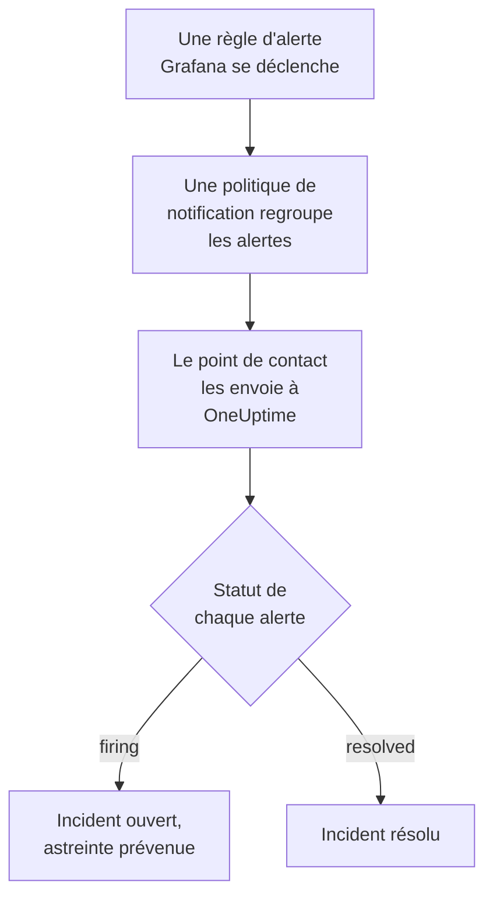

# Grafana

Envoyez les alertes de [Grafana](https://grafana.com) à OneUptime, pour que chaque alerte qui se déclenche devienne un incident qui prévient votre équipe d'astreinte et soit résolu quand l'alerte se rétablit. Grafana envoie ses alertes par un point de contact webhook, il n'y a donc rien à installer d'un côté comme de l'autre.

:::cards
- [Choisir comment OneUptime reçoit les alertes](#choisir-comment-oneuptime-reçoit-les-alertes): Un moniteur de requêtes entrantes, ou un workflow à vous.
- [Recevoir les alertes avec un moniteur](#recevoir-les-alertes-avec-un-moniteur): Un incident par alerte, résolu au rétablissement.
- [Configurer Grafana](#configurer-grafana): Un point de contact webhook, et la politique qui l'utilise.
- [Dépannage](#dépannage): Quand les alertes n'arrivent pas, ou que les incidents restent ouverts.
:::

## Fonctionnement



Les politiques de notification de Grafana regroupent les alertes qui se déclenchent, et un point de contact webhook envoie chaque groupe sous forme d'une notification JSON. Elle a la même forme qu'une notification de [Prometheus Alertmanager](/docs/integrations/prometheus-alertmanager) : un `status`, une liste `alerts` où chaque alerte a son propre `status` et son `fingerprint`, et les `commonLabels` et `commonAnnotations` que ses alertes partagent. Grafana ajoute un `title` et un `message` écrits pour des humains.

## Avant de commencer

- Grafana 9 ou plus récent, avec Grafana Alerting, la valeur par défaut depuis Grafana 9. Il doit pouvoir joindre votre OneUptime en HTTPS.
- Dans OneUptime, le droit de créer des moniteurs, ou des workflows si vous prenez cette voie.

## Choisir comment OneUptime reçoit les alertes

Configurez d'abord OneUptime : il vous donne l'URL à laquelle Grafana envoie.

| Façon | Utilisez-la quand |
| --- | --- |
| Un moniteur de requêtes entrantes (recommandé) | Vous voulez que chaque alerte devienne un incident qui prévient l'astreinte et soit résolu quand l'alerte se rétablit. Il n'y a rien à construire. |
| Un workflow avec un déclencheur Webhook | Il vous faut une logique propre : filtrer les alertes, les remanier ou appeler d'abord d'autres systèmes. Un workflow ouvre un incident par notification, pas par alerte, et ne le résout pas au rétablissement. |

Les deux reçoivent le même JSON du même point de contact, vous pouvez donc commencer par l'un et changer plus tard en modifiant une URL dans Grafana.

## Recevoir les alertes avec un moniteur

Un [moniteur de requêtes entrantes](/docs/monitor/incoming-request-monitor) vous donne une URL, et ses critères décident de ce que fait chaque notification.

:::steps
### Créer le moniteur

Allez dans **Moniteurs** et cliquez sur **Créer un moniteur**. Choisissez **Requête entrante** sous **Type de moniteur**, nommez-le `Grafana` et cliquez sur **Suivant**.

### Déclarer un incident pour chaque alerte déclenchée

À l'étape **Critères**, ouvrez le premier critère, celui qui marque le moniteur hors ligne. Réglez son filtre sur **Corps de la requête**, **Contient**, `"status":"firing"`. Ce critère déclare déjà un incident quand son filtre correspond. Remplissez l'incident :

- **Titre de l'incident** : `{{requestBody.commonLabels.alertname}}`.
- **Description de l'incident**, sous **Description** : `{{requestBody.message}}`, le texte que Grafana écrit pour la notification.
- **Gravité** : la gravité d'incident que doivent avoir ces alertes.
- **Politiques d'astreinte**, sous **Astreinte** : les politiques à prévenir.
- **Résoudre automatiquement l'incident**, sous **Plus de champs** : laissez-le activé, comme au départ. Sans lui, les rétablissements sont ignorés et les incidents restent ouverts.

### Ouvrir un incident par alerte

Dans le même critère, ouvrez **Paramètres** et activez **Regrouper les incidents et alertes par un champ de la charge utile**. Remplissez-le comme ci-dessous, pour que chaque alerte ait son propre incident et que son rétablissement le résolve :

| Champ | Valeur |
| --- | --- |
| **Ouvrir un incident distinct pour chaque…** | `requestBody.alerts[*].fingerprint` |
| **Champ qui signale le rétablissement** | `requestBody.alerts[*].status` |
| **Value that means recovered** | `resolved` |

### Remettre le moniteur en ligne

Ouvrez le second critère, celui qui marque le moniteur en ligne, et réglez son filtre sur **Corps de la requête**, **Contient**, `"status":"resolved"`.

### Copier l'URL

Cliquez sur **Créer un moniteur**. La page **Vue d'ensemble** du moniteur affiche son **URL de heartbeat**. Copiez-la pour Grafana :

```text
https://oneuptime.com/heartbeat/<secret key>
```

Une installation auto-hébergée a son propre hôte à la place de `oneuptime.com`.
:::

Chaque alerte d'une notification ouvre son propre incident, dans la limite de **Incidents max par requête** (`100` sauf si vous le changez), et le `status` propre à chaque alerte décide du moment où son incident est résolu. Le `fingerprint` de Grafana identifie une alerte par ses labels, c'est donc la valeur selon laquelle regrouper. Voir [Recevoir des alertes d'un autre système](/docs/monitor/incoming-request-monitor#recevoir-les-alertes-dun-autre-système) pour ce que fait chaque paramètre.

> [!WARNING]
> Ne regroupez pas selon un label que toutes les alertes d'une notification partagent. La politique de notification par défaut de Grafana regroupe les alertes par `grafana_folder` et `alertname`, chaque alerte d'une notification a donc le même `alertname` : regrouper selon `requestBody.alerts[*].labels.alertname` réunit toute la notification en un seul incident.

`{{requestBody.commonLabels.alertname}}` et `{{requestBody.message}}` décrivent toute la notification, c'est-à-dire une règle d'alerte avec la politique par défaut. La clé de regroupement est aussi une variable, `{{fingerprint}}`, mais c'est un hachage qui ne dit rien à un intervenant. Voir [Modèles d'incident et d'alerte](/docs/monitor/incident-alert-templating) pour toutes les variables que vous pouvez utiliser.

## Configurer Grafana

:::steps
### Ajouter un point de contact webhook

Dans Grafana, allez dans **Alerting → Contact points** et cliquez sur **+ Add contact point**. Dans Grafana 11 et plus récent, **Alerting** se trouve sous **Alerts & IRM**, et **Contact points** est un onglet de **Notification configuration**.

Nommez le point de contact `OneUptime`, choisissez **Webhook** sous **Integration**, et collez l'URL copiée dans **URL**. Laissez **HTTP Method** sur `POST`, et cliquez sur **Save contact point**.

### Lui envoyer les alertes

Allez dans **Alerting → Notification policies**. Réglez le point de contact de la politique par défaut sur `OneUptime`, ou ajoutez une politique enfant qui correspond aux alertes que OneUptime doit recevoir, avec `OneUptime` comme point de contact.
:::

Grafana envoie `Content-Type: application/json`, dont le moniteur a besoin pour lire les champs d'une notification. Le réglage **Max Alerts** du point de contact limite les alertes d'une notification : laissez-le à `0`, sans limite, ou au plus à **Incidents max par requête** du moniteur.

## Tester

1. Dans Grafana, ouvrez le point de contact `OneUptime` et cliquez sur **Test**. Grafana envoie une alerte de test déclenchée, et un incident s'ouvre dans OneUptime. Une alerte de test ne se rétablit jamais, résolvez donc cet incident à la main.
2. Laissez une vraie règle d'alerte se déclencher, par exemple en abaissant un instant son seuil, et regardez son incident s'ouvrir, puis se résoudre quand vous rétablissez le seuil.

## Recevoir les alertes avec un workflow

Utilisez un [workflow](/docs/workflows/index) quand il vous faut vos propres étapes entre Grafana et l'incident.

:::steps
### Créer le workflow

Allez dans **Flux de travail**, cliquez sur **Créer un flux de travail**, puis sur **Partir de zéro**. Nommez-le `Grafana alerts` et cliquez sur **Créer un flux de travail**.

### Ajouter le déclencheur Webhook

Cliquez sur le bloc en pointillés **Choisissez ce qui démarre ce flux de travail** et choisissez **Webhook**. Cliquez sur le déclencheur, puis sur **Copier l'URL**, et utilisez cette URL dans le point de contact de Grafana.

### Vérifier que la notification se déclenche

Cliquez sur **Ajouter un composant**, ajoutez un bloc **If / Else** et reliez-y le point **Out** du déclencheur. Réglez **Value to check** sur `{{local.components.webhook-1.returnValues.request-body.status}}`, **Comparison** sur **is equal to** et **Compare with** sur `firing`.

### Déclarer l'incident

Ajoutez un bloc **Create One Incident** et reliez-y le côté **Yes** du bloc **If / Else**. Dans **Incident Template**, choisissez un modèle qui fixe la gravité et les politiques d'astreinte à prévenir (voir [Modèles d'incident](/docs/incidents/settings#modèles-dincident)). Dans **JSON Object**, indiquez ce qui vient de Grafana :

```json
{
  "title": "{{local.components.webhook-1.returnValues.request-body.title}}",
  "description": "{{local.components.webhook-1.returnValues.request-body.message}}"
}
```

Sans modèle, **JSON Object** doit aussi contenir `incidentSeverityId`, l'ID de l'une des gravités d'incident du projet.

### Activer le workflow

Activez **Activé** en haut du **Constructeur**. Un workflow désactivé répond à Grafana par `400`.
:::

Une exécution traite une notification, elle déclare donc un seul incident, quel que soit le nombre d'alertes de la notification. Une notification `resolved` prend le côté **No** du bloc **If / Else**, où rien n'est relié, l'exécution s'arrête donc là. Pour un incident par alerte, résolu au rétablissement, utilisez le moniteur.

## Dépannage

:::details Rien n'arrive dans OneUptime
- Cliquez sur **Test** sur le point de contact : Grafana affiche une erreur quand il ne peut pas joindre l'URL. Le journal du serveur Grafana donne les détails.
- Le moniteur répond `200` immédiatement, avant de vérifier quoi que ce soit, même avec une clé secrète erronée. Consultez la chronologie du moniteur pour voir si les notifications arrivent.
- Un workflow désactivé répond `400`. Activez **Activé** en haut de son **Constructeur**.
:::

:::details Les incidents s'ouvrent mais ne sont jamais résolus
- L'incident du critère a besoin de **Résoudre automatiquement l'incident**, sous **Plus de champs**.
- **Champ qui signale le rétablissement** doit valoir `requestBody.alerts[*].status`, et **Value that means recovered** exactement `resolved`. La comparaison respecte la casse.
- Les chemins de regroupement doivent commencer par `requestBody.`, et seul le premier `[*]` d'un chemin lit une liste. Un chemin qui enfreint l'une de ces règles ne correspond à rien, sans erreur.
:::

:::details Un seul incident pour une notification pleine d'alertes
Vous avez regroupé selon un label identique pour toutes les alertes d'une notification, comme `alertname` avec la politique par défaut. Regroupez plutôt selon `requestBody.alerts[*].fingerprint`.
:::

:::details L'incident affiche une référence au lieu d'une valeur
Une référence à un champ que la notification n'a pas est laissée telle qu'elle est écrite, accolades comprises. Comparez le nom du champ avec ce que Grafana a envoyé : pour un workflow, ouvrez l'exécution dans **Journaux → Exécutions** et comparez avec ce que le déclencheur a reçu.
:::

Le guide [Prometheus Alertmanager](/docs/integrations/prometheus-alertmanager#dépannage) couvre d'autres cas, et ils s'appliquent aussi aux notifications de Grafana.

## Sécurité

- **Traitez l'URL comme un mot de passe.** Quiconque la possède peut ouvrir des incidents. Si elle fuit, réinitialisez-la : **Réinitialiser la clé secrète des requêtes entrantes** sur la page **Paramètres** du moniteur, ou **Réinitialiser l'URL** dans le déclencheur **Webhook** du workflow. Mettez ensuite à jour l'**URL** du point de contact dans Grafana.
- **Auto-hébergé ?** Laissez Grafana joindre votre OneUptime en HTTPS à travers votre pare-feu.

## Étapes suivantes

:::cards
- [Surveillance des requêtes entrantes](/docs/monitor/incoming-request-monitor): Chaque paramètre du moniteur qui reçoit vos alertes.
- [Prometheus Alertmanager](/docs/integrations/prometheus-alertmanager): La même configuration, avec un dispositif d'homme mort pour vos alertes.
- [Surveillance des métriques](/docs/monitor/metrics-monitor): Alerter sur les mêmes métriques directement dans OneUptime.
- [Présentation des intégrations](/docs/integrations/index): Les autres outils que vous pouvez connecter.
:::
