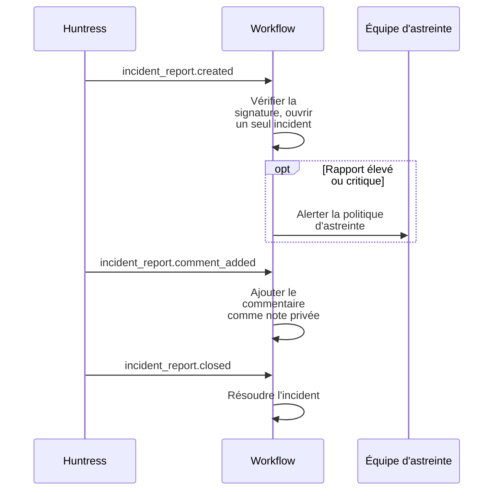

# Intégration Huntress

Alertez votre équipe d'astreinte pour les rapports d'incident Huntress, avec un workflow. Quand le SOC de Huntress envoie un rapport d'incident sur un poste ou une identité, le workflow ouvre un seul incident pour lui, alerte la politique d'astreinte que vous choisissez, ajoute les commentaires faits dans Huntress comme notes privées, et résout l'incident quand le rapport est clos dans Huntress.

Cette intégration est **entrante** : Huntress envoie chaque événement d'un rapport d'incident à l'URL propre du workflow, signé avec le secret de signature du point de terminaison. OneUptime n'appelle jamais Huntress, il n'a donc besoin d'aucune clé d'API Huntress.

:::cards
- [Fonctionnement](#fonctionnement) : Ce que le workflow fait de chaque événement d'un rapport.
- [Mise en place](#mettre-en-place-lintégration) : Créer le workflow, ajouter le point de terminaison dans Huntress, enregistrer son secret de signature, envoyer un test.
- [Le déclencheur](#le-déclencheur-huntress-incident-report) : Les valeurs qu'un rapport transmet au workflow, et les paramètres du déclencheur.
- [Dépannage](#dépannage) : Ce que signifient les erreurs du déclencheur, et quoi changer.
:::

## Fonctionnement

Huntress envoie un événement sur un rapport d'incident quand le rapport est envoyé, quand quelqu'un le commente et quand il est clos. Le déclencheur **Huntress Incident Report** démarre le workflow une fois pour chaque événement, et son **Event** dit lequel c'était : `created`, `comment-added` ou `closed`.

1. **Vérifier.** Une requête doit être signée avec le secret de signature du point de terminaison, au plus cinq minutes avant son arrivée. Tout le reste est refusé, et les paramètres du déclencheur disent pourquoi.
2. **Démarrer le workflow.** Chaque événement démarre une exécution, avec les champs du rapport comme valeurs du déclencheur. Un événement que Huntress renvoie ne démarre plus rien.
3. **Ouvrir un seul incident.** Sur `created`, le workflow ouvre un incident nommé d'après le rapport, par exemple `Huntress: Incident on DESKTOP-01 (Acme Corp)`. Sa description contient le résumé du rapport, sa gravité dans Huntress, l'organisation, l'hôte ou l'identité concerné, les indicateurs trouvés par Huntress et un lien vers le rapport dans Huntress. L'incident reçoit une étiquette au nom de l'organisation du rapport, et alerte la politique d'astreinte de votre choix quand le rapport est élevé ou critique.
4. **Suivre le rapport.** Sur `comment-added`, le commentaire devient une note privée sur l'incident. Sur `closed`, l'incident est résolu, avec la raison sur sa chronologie.

L'incident garde le numéro du rapport dans ses champs personnalisés, sous `huntressReportId` : c'est ainsi que le workflow le retrouve quand Huntress commente ou clôt le rapport. Les incidents ouverts ainsi n'apparaissent jamais sur une page de statut, et vos règles d'incident (règles d'astreinte, de propriétaires, d'étiquettes et de confidentialité) s'y appliquent comme à tout autre incident.

## Avant de commencer

- Dans OneUptime, un rôle qui peut créer et modifier des workflows, comme **Propriétaire du projet**, **Administrateur du projet** ou **Administrateur des flux de travail**.
- Dans Huntress, le rôle **Account Admin** : seuls les administrateurs de compte peuvent ajouter des webhooks.
- Une politique d'astreinte à alerter.
- Sur OneUptime Cloud, une offre avec les workflows : Growth ou supérieure. Chaque événement envoyé par Huntress est une exécution de workflow.
- Sur une installation auto-hébergée, un OneUptime que Huntress peut joindre depuis Internet en HTTPS : Huntress n'envoie de webhooks qu'à des URL `https://`.

## Mettre en place l'intégration

:::steps
### Créer le workflow

Ouvrez **Flux de travail** et cliquez sur **Créer un flux de travail**. Sous **Ou partir d'un modèle**, choisissez la catégorie **Huntress**, choisissez **Open an incident for each Huntress incident report**, cliquez sur **Utiliser ce modèle** et créez le workflow. Il s'ouvre dans le **Constructeur**, désactivé.

### Choisir qui alerter

Cliquez sur l'étape **Page an On-Call Policy**, choisissez les **Politiques d'astreinte** à alerter et enregistrez l'étape.

### Ajouter un point de terminaison webhook dans Huntress

Cliquez sur le déclencheur **Huntress Incident Report**, puis sur **Copier l'URL** sous **Ajouter un point de terminaison webhook dans Huntress**. L'URL ressemble à `https://oneuptime.com/workflow/huntress/<key>` ; sur une installation auto-hébergée, elle commence par votre propre hôte.

Dans Huntress, ouvrez le menu en haut à droite et choisissez **Integrations**. Cliquez sur **Add an Integration**, choisissez **Webhooks**, puis cliquez sur **Add Endpoint**. Collez l'URL, activez **Incident Reports** et enregistrez. Laissez **Escalations**, **Platform Actions** et **Account Notices** désactivés : le déclencheur accepte ces événements et ne démarre rien pour eux.

### Enregistrer le secret de signature du point de terminaison

Dans Huntress, ouvrez le menu du point de terminaison (⋯) et choisissez **View Signing Secret**. Copiez-le en entier : il commence par `whsec_`. Dans le déclencheur, cliquez sur **Enregistrer le secret de signature**, collez-le, puis cliquez sur **Enregistrer le secret de signature**. Le secret est chiffré et n'est plus jamais affiché.

Tant que le secret n'est pas enregistré, le déclencheur refuse toutes les requêtes. Huntress renvoie plus tard un événement refusé : un événement refusé maintenant arrive quand même.

### Activer le workflow, et envoyer un test

Activez **Activé** en haut du **Constructeur**. Dans Huntress, ouvrez le menu du point de terminaison (⋯) et choisissez **Send Test**. En quelques secondes, le déclencheur affiche **Reçoit les rapports**.

> [!NOTE]
> Quoi que contienne le test, le déclencheur montre qu'il est arrivé. Un test qui contient un rapport d'incident démarre le workflow comme n'importe quel autre rapport.
:::

## Ce que fait le workflow

Le modèle prend un chemin pour chaque **Event**, avec un **Switch / Case** après le déclencheur :

| Event | Ce que fait le workflow |
| --- | --- |
| `created` | Ouvre un incident avec l'**Incident Severity ID** du déclencheur, étiqueté avec son **Organization Label ID**. Pour un rapport élevé ou critique, **Page an On-Call Policy** alerte votre politique ; un rapport faible n'alerte personne. Un rapport qui a déjà un incident n'en ouvre pas d'autre. |
| `comment-added` | Retrouve l'incident du rapport et y ajoute le commentaire comme note privée. |
| `closed` | Retrouve l'incident du rapport et le résout, sauf s'il est déjà résolu. La raison figure sur sa chronologie : Huntress a clos le rapport. |

C'est un workflow comme un autre, vous pouvez donc changer ce qu'il fait : n'alerter que pour les rapports critiques en changeant ce que compare le **If / Else** après **Create One Incident**, publier chaque rapport dans un canal de discussion avec une étape Slack ou Microsoft Teams, ou orienter chaque organisation vers sa propre politique d'astreinte avec un **Switch / Case** sur **Organization**. Chaque exécution figure dans les exécutions du workflow, avec ce que chaque étape a fait.

### Gravités

Huntress donne à chaque rapport d'incident l'une de trois gravités. L'**Incident Severity ID** du déclencheur est la gravité d'incident avec laquelle le rapport s'ouvre : celle que choisit son paramètre, ou sinon l'ordre de vos gravités d'incident, tel que **Incidents → Paramètres → Gravité de l'incident** les liste :

| Gravité Huntress | Ce que Huntress entend par là | Paramètre | Gravité d'incident quand le paramètre est vide |
| --- | --- | --- | --- |
| Critical | Attaquants aux commandes, logiciels malveillants dangereux ou compromission active, à contenir immédiatement. | **Gravité pour les rapports critiques** | La plus élevée |
| High | Logiciel malveillant confirmé qui demande une remédiation urgente, ou compromission d'identité exploitable. | **Gravité pour les rapports élevés** | La deuxième |
| Low | Programmes potentiellement indésirables, restes de logiciels malveillants et découvertes plus anciennes sur les identités. | **Gravité pour les rapports faibles** | La troisième |

Un projet qui a moins de gravités utilise sa moins élevée pour le reste. Un rapport sans gravité est traité comme élevé. Si une gravité que vous avez choisie est supprimée, l'ordre décide de nouveau.

### Organisations

L'**Organization Label ID** du déclencheur est une étiquette au nom de l'organisation Huntress du rapport, par exemple _Acme Corp_, qu'il crée quand le premier rapport de cette organisation arrive. Un workflow reçoit les rapports de toutes les organisations de votre compte Huntress, et **Uniquement ces organisations** du déclencheur restreint cela : un nom ou un ID d'organisation par ligne, les noms sans tenir compte de la casse.

> [!TIP]
> Pour alerter l'équipe propre à chaque client, ajoutez une règle d'astreinte des incidents par organisation, par exemple « Si **Étiquettes d'incident** contient l'une de _Acme Corp_ », qui exécute la politique de ce client. Voir [Règles d'astreinte des incidents](/docs/incidents/settings#règles-dastreinte-des-incidents).

## Le déclencheur Huntress Incident Report

Le déclencheur s'ouvre sur Huntress : son URL, une coche à côté de chaque étape de mise en place terminée, et ce que Huntress a envoyé en dernier. Ses paramètres, tous facultatifs, sont repliés sous **Plus de champs** : **Uniquement ces organisations**, **Gravité pour les rapports critiques**, **Gravité pour les rapports élevés** et **Gravité pour les rapports faibles**.

| Valeur | Ce qu'elle contient |
| --- | --- |
| **Event** | `created`, `comment-added` ou `closed`. Un rapport déjà clos ou rejeté est `closed`, quel que soit l'événement qui l'a apporté. |
| **Report ID** | Le numéro du rapport dans Huntress. |
| **Severity** | `critical`, `high` ou `low`. |
| **Status** | Le statut du rapport dans Huntress, comme `sent`, `closed` ou `dismissed`. |
| **Subject** | L'objet du rapport, tel que Huntress l'écrit. |
| **Summary** | Ce qu'a écrit l'analyste du SOC. |
| **Organization**, **Organization ID** | L'organisation Huntress concernée par le rapport. |
| **Affected** | L'hôte ou l'identité concerné par le rapport. |
| **Platform**, **Indicators** | Où Huntress l'a trouvé, et ce qu'il a trouvé. |
| **Comment** | Le commentaire que quelqu'un a ajouté, sur `comment-added`. |
| **Report URL** | Où le rapport s'ouvre dans Huntress. |
| **Incident Title**, **Incident Description** | Un titre et une description Markdown pour un incident sur le rapport. |
| **Note** | Du Markdown pour une note sur l'événement : le commentaire, ou le fait que Huntress a clos le rapport. |
| **Incident Severity ID**, **Organization Label ID** | La gravité d'incident et l'étiquette, comme ci-dessus. |
| **Received At** | Quand OneUptime a reçu l'événement. |

**Summary** et **Comment** sont du texte écrit par les analystes de Huntress. Pour les mettre dans un incident ou une note, utilisez **Incident Description** et **Note** : ils gardent la mise en forme, et rien en eux ne charge d'image ni ne mentionne qui que ce soit.

Pour essayer le workflow sans Huntress, cliquez sur **Exécuter le flux de travail** dans le **Constructeur** et saisissez un **Event**, un **Report ID** et les champs dont vous avez besoin. Utilisez le même **Report ID** pour suivre un rapport de `created` à `closed`.

## Connexions Huntress créées auparavant

Huntress se configurait auparavant sous **Incidents → Intégrations → Huntress**. Chaque connexion Huntress est devenue un workflow du même nom, activé, qui fait ce que faisait la connexion : il alerte les mêmes politiques d'astreinte pour les mêmes rapports, ajoute les mêmes étiquettes et résout (ou se contente de noter) de la même façon. Son URL reste celle de la connexion, `https://oneuptime.com/api/huntress/webhook/<connection-id>`, et son secret de signature est le même : il n'y a rien à changer dans Huntress. Les incidents que la connexion a ouverts gardent le numéro de leur rapport, si bien que le workflow les retrouve quand Huntress commente ou clôt ces rapports.

## Sécurité

- **Uniquement des requêtes signées.** Le déclencheur vérifie les en-têtes `svix-id`, `svix-timestamp` et `svix-signature` envoyés par Huntress par rapport au corps de la requête, tel qu'il est arrivé. Une requête qui n'est pas signée avec le secret enregistré, ou qui a été signée plus de cinq minutes avant ou après, est refusée.
- **Le secret reste secret.** Il est chiffré au repos, jamais renvoyé par l'API et plus jamais affiché. **Remplacer le secret de signature** dans le déclencheur en enregistre un autre, comme le secret d'un nouveau point de terminaison.
- **L'URL est une adresse, pas un mot de passe.** Elle se termine par la clé du workflow ; seule une requête signée avec le secret du point de terminaison démarre le workflow.
- **Un point de terminaison par workflow.** Chaque workflow a sa propre URL et son propre secret. Pour recevoir les rapports d'un deuxième compte Huntress, créez un deuxième workflow.

## Utiliser plutôt l'e-mail

Huntress envoie aussi les rapports d'incident par e-mail, et un [moniteur d'e-mails entrants](/docs/monitor/incoming-email-monitor) peut ouvrir des incidents à partir de ces e-mails, par exemple quand l'objet contient `Critical Incident Report`. Il traite toutefois les e-mails comme le statut d'un seul moniteur : tant que son incident est ouvert, le rapport suivant n'en ouvre aucun, et l'incident est résolu par les critères du moniteur plutôt que quand Huntress clôt le rapport. Le workflow ouvre un incident par rapport et résout chacun avec son rapport : préférez-le. Dès que le workflow reçoit des rapports, cessez d'envoyer les e-mails au moniteur, sinon chaque rapport alerte deux fois.

## Dépannage

Quand le déclencheur refuse une requête, ses paramètres en donnent la raison sous **La dernière requête a été refusée**. Dans Huntress, **View Delivery Attempts** dans le menu du point de terminaison (⋯) liste chaque livraison avec la réponse de OneUptime.

:::details "A request arrived but was refused, because no signing secret is saved for this workflow yet"
Enregistrez le secret de signature du point de terminaison : voir [Mettre en place l'intégration](#mettre-en-place-lintégration). Huntress renvoie la requête refusée.
:::

:::details "The request's signature does not match the signing secret"
Le secret enregistré n'est pas celui de ce point de terminaison. Chaque point de terminaison a le sien : dans Huntress, ouvrez le menu du point de terminaison (⋯), choisissez **View Signing Secret**, copiez-le en entier et enregistrez-le avec **Remplacer le secret de signature**.
:::

:::details "The request was signed more than five minutes from now"
Les horloges de Huntress et de votre serveur OneUptime ont plus de cinq minutes d'écart, ou la requête est rejouée. Sur une installation auto-hébergée, vérifiez que l'horloge du serveur est juste.
:::

:::details "A request arrived while this workflow is off"
Activez **Activé** en haut du **Constructeur**. Huntress renvoie la requête refusée, et elle démarre alors le workflow.
:::

:::details "No Huntress workflow has this address."
Le workflow a été supprimé ou archivé, son déclencheur n'est plus **Huntress Incident Report**, ou l'URL du point de terminaison dans Huntress n'est pas celle du workflow. Copiez l'URL depuis le déclencheur et collez-la de nouveau dans le point de terminaison dans Huntress.
:::

:::details Aucun incident n'a été ouvert
Ouvrez les exécutions du workflow et l'exécution du rapport. Si **Create One Incident** a échoué parce que la gravité d'incident est vide, le projet n'a aucune gravité d'incident : ajoutez-en une sous **Incidents → Paramètres → Gravité de l'incident**.
:::

:::details Personne n'a été alerté
Un rapport faible ouvre un incident sans alerter. Sinon, l'exécution du rapport dit ce qu'a fait **Page an On-Call Policy**, et la page **Exécutions d'astreinte** de l'incident montre ce que chaque politique a fait.
:::

## Étapes suivantes

:::cards
- [Déclencheurs de workflow](/docs/workflows/triggers) : Les autres façons de démarrer un workflow.
- [Règles d'astreinte des incidents](/docs/incidents/settings#règles-dastreinte-des-incidents) : Alerter l'équipe propre à chaque organisation, par son étiquette.
- [États et sévérités des incidents](/docs/incidents/states-and-severities) : Ordonner les gravités avec lesquelles s'ouvrent les rapports Huntress.
- [Présentation des intégrations](/docs/integrations/index) : Les autres outils que vous pouvez connecter.
:::
