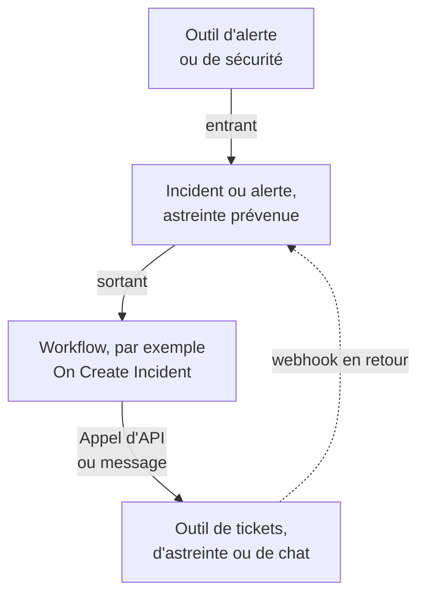

# Présentation des intégrations

OneUptime fonctionne avec les outils que votre équipe utilise déjà. Les outils d'alerte y ouvrent des incidents, et OneUptime ouvre des tickets, des alertes d'astreinte et des messages de chat dans d'autres outils. Certains outils se connectent depuis un formulaire, d'autres depuis un modèle de workflow prêt à l'emploi. Tout autre outil doté d'un webhook ou d'une API se connecte par un workflow que vous construisez.

:::cards
- [Choisir comment connecter](#choisir-comment-connecter): Les quatre façons de s'intégrer, et quand utiliser chacune.
- [Catalogue](#catalogue): Chaque outil doté d'un guide, regroupé par fonction.
- [Construire votre propre intégration](#construire-votre-propre-intégration): Les modèles entrant et sortant, pour tout autre outil.
- [Protéger les identifiants](#protéger-les-identifiants): Les variables secrètes, et les en-têtes que chaque outil attend.
:::

## Fonctionnement des intégrations

Chaque intégration déplace des données dans un sens ou dans les deux. **Entrant** : un autre outil signale à OneUptime un problème, et OneUptime ouvre un incident ou une alerte et prévient l'équipe d'astreinte. **Sortant** : quelque chose se produit dans OneUptime, et un workflow prévient un autre outil : il crée un ticket, appelle quelqu'un ou publie un message.



Une intégration bidirectionnelle, comme Jira ou Dynamics 365, utilise les deux sens : un workflow envoie l'incident vers l'extérieur, et un autre, démarré par le webhook de l'autre outil, rapporte les changements.

## Choisir comment connecter

| Façon | Idéale pour | Exemples |
| --- | --- | --- |
| Une connexion intégrée | Les outils auxquels OneUptime se connecte lui-même. Vous remplissez un formulaire, et il n'y a rien à construire. | [Slack](/docs/workspace-connections/slack), [Microsoft Teams](/docs/workspace-connections/microsoft-teams), les connexions des [Événements de sécurité](/docs/telemetry/security-events) |
| Un modèle de workflow | Les outils de tickets, synchronisés dans les deux sens, les problèmes de supervision, les rapports d'incident de sécurité et les messages de chat. Vous choisissez un modèle et remplissez quelques paramètres. | [Jira](/docs/integrations/jira), [Microsoft Dynamics 365](/docs/integrations/microsoft-dynamics-365), [Huntress](/docs/integrations/huntress), [Zabbix](/docs/integrations/zabbix) |
| Un moniteur de requêtes entrantes | Les outils d'alerte qui envoient un webhook. Vous obtenez un incident par alerte, transmis à l'astreinte et résolu quand l'alerte se rétablit, sans workflow. | [Zabbix](/docs/integrations/zabbix), [Prometheus Alertmanager](/docs/integrations/prometheus-alertmanager), [Grafana](/docs/integrations/grafana) |
| Un workflow que vous construisez | Tout outil doté d'un webhook ou d'une API REST, et toute logique qui vous est propre. | [PagerDuty](/docs/integrations/pagerduty), [Opsgenie](/docs/integrations/opsgenie), [ServiceNow](/docs/integrations/servicenow) |

Commencez par le haut du tableau : plus une façon est haute, moins il y a à maintenir.

## Catalogue

### Outils de surveillance et d'alerte

| Outil | Sens | Ce qu'il fait |
| --- | --- | --- |
| [Zabbix](/docs/integrations/zabbix) | Les deux | Transforme les problèmes Zabbix en incidents ou en alertes, les résout au rétablissement, et acquitte ou ferme les problèmes depuis OneUptime. |
| [Prometheus Alertmanager](/docs/integrations/prometheus-alertmanager) | Entrant | Transforme les notifications d'Alertmanager en incidents. |
| [Grafana](/docs/integrations/grafana) | Entrant | Transforme les alertes Grafana en incidents. |
| [Datadog](/docs/integrations/datadog) | Entrant | Transforme les alertes des moniteurs Datadog en incidents. |

### Outils de sécurité

| Outil | Sens | Ce qu'il fait |
| --- | --- | --- |
| [Huntress](/docs/integrations/huntress) | Entrant | Prévient l'astreinte pour les rapports d'incident Huntress, et résout l'incident quand le rapport est clos. |
| [Google SecOps](/docs/integrations/google-secops) | Les deux | Amène les détections et les indicateurs de Google SecOps dans les Événements de sécurité, et lui envoie ce que OneUptime trouve. |
| [Microsoft Sentinel](/docs/integrations/microsoft-sentinel) | Les deux | Amène les incidents de Microsoft Sentinel dans les Événements de sécurité, et lui envoie ce que OneUptime trouve. |
| [Microsoft Defender XDR](/docs/integrations/microsoft-defender-xdr) | Entrant | Amène les alertes de Microsoft Defender XDR dans les Événements de sécurité. |
| [CrowdStrike Falcon](/docs/integrations/crowdstrike-falcon) | Entrant | Amène les alertes de CrowdStrike Falcon dans les Événements de sécurité. |
| [Splunk Enterprise Security](/docs/integrations/splunk) | Les deux | Amène les notable events de Splunk dans les Événements de sécurité, et lui envoie ce que OneUptime trouve. |
| [Elastic Security](/docs/integrations/elastic-security) | Les deux | Amène les alertes de détection d'Elastic Security dans les Événements de sécurité, et lui envoie ce que OneUptime trouve. |
| [AWS Security Hub](/docs/integrations/aws-security-hub) | Entrant | Amène les constats d'AWS Security Hub dans les Événements de sécurité. |
| [Okta System Log](/docs/integrations/okta) | Entrant | Amène les connexions, les modifications de comptes et les détections de menaces d'Okta dans les Événements de sécurité. |
| [Microsoft Entra ID](/docs/integrations/microsoft-entra-id) | Entrant | Amène les connexions et les modifications d'annuaire de Microsoft Entra ID, et le journal d'audit Microsoft 365, dans les Événements de sécurité. |
| [Google Workspace](/docs/integrations/google-workspace) | Entrant | Amène les connexions, les modifications d'administration et les détections de Google Workspace dans les Événements de sécurité. |

### Outils de tickets et de gestion des services informatiques

| Outil | Sens | Ce qu'il fait |
| --- | --- | --- |
| [Jira](/docs/integrations/jira) | Les deux | Crée un ticket Jira pour chaque incident ou alerte, et rapporte les changements de statut et les commentaires. |
| [Microsoft Dynamics 365](/docs/integrations/microsoft-dynamics-365) | Les deux | Crée un dossier Dynamics 365 pour chaque incident ou alerte, et rapporte les changements de statut et les notes. |
| [ServiceNow](/docs/integrations/servicenow) | Sortant | Crée un incident ServiceNow pour chaque incident OneUptime, et le résout avec l'incident. |
| [GitHub](/docs/integrations/github) | Sortant | Crée une issue GitHub pour un incident. |
| [GitLab](/docs/integrations/gitlab) | Sortant | Crée une issue GitLab pour un incident. |

### Outils d'astreinte

| Outil | Sens | Ce qu'il fait |
| --- | --- | --- |
| [PagerDuty](/docs/integrations/pagerduty) | Sortant | Déclenche un incident PagerDuty pour chaque incident OneUptime, et le résout avec l'incident. |
| [Opsgenie](/docs/integrations/opsgenie) | Sortant | Crée une alerte Opsgenie pour chaque incident OneUptime, et la ferme avec l'incident. |

### Outils de chat

| Outil | Sens | Ce qu'il fait |
| --- | --- | --- |
| [Slack](/docs/workspace-connections/slack) | Les deux | Une connexion intégrée : canaux d'incident, actions depuis Slack et astreinte. |
| [Microsoft Teams](/docs/workspace-connections/microsoft-teams) | Les deux | Une connexion intégrée : canaux d'incident, actions depuis Teams et astreinte. |
| [Mattermost](/docs/workflows/components#mattermost) | Sortant | Publie les mises à jour d'incident dans un canal Mattermost. |
| [Discord](/docs/integrations/discord) | Sortant | Publie les mises à jour d'incident dans un canal Discord. |
| [Telegram](/docs/integrations/telegram) | Sortant | Envoie un message dans un chat Telegram quand une alerte se déclenche. |
| [IRC](/docs/integrations/irc) | Sortant | Publie les mises à jour d'incident dans un canal IRC. |

> [!TIP]
> Slack et Microsoft Teams ont aussi des étapes de workflow. Utilisez la connexion intégrée pour les canaux d'incident et l'astreinte, et une étape de workflow quand il vous faut seulement un message dans un canal.

### Plateformes d'hébergement

| Outil | Sens | Ce qu'il fait |
| --- | --- | --- |
| [Vercel](/docs/integrations/vercel) | Entrant | Ajoutez OneUptime depuis le Vercel Marketplace : traces, logs, moniteurs de disponibilité et une page de statut pour vos projets Vercel. |

## Quitter un autre outil

Pour quitter un autre outil d'astreinte, de disponibilité ou de page de statut, faites venir votre équipe au lieu de connecter les deux. **Paramètres du projet → Avancé → Importer depuis un autre outil** lit votre compte avec une clé d'API, vous montre ce qu'il a trouvé et crée ce que vous cochez. Chaque outil a son guide :

- Outils d'astreinte et d'incidents : [Opsgenie](/docs/moving-to-oneuptime/opsgenie), [PagerDuty](/docs/moving-to-oneuptime/pagerduty), [incident.io](/docs/moving-to-oneuptime/incident-io), [Splunk On-Call](/docs/moving-to-oneuptime/splunk-on-call) et [Grafana OnCall](/docs/moving-to-oneuptime/grafana-oncall).
- Outils de disponibilité et de pages de statut : [UptimeRobot](/docs/moving-to-oneuptime/uptimerobot), [Atlassian Statuspage](/docs/moving-to-oneuptime/atlassian-statuspage), [Better Stack](/docs/moving-to-oneuptime/better-stack), [Pingdom](/docs/moving-to-oneuptime/pingdom), [StatusCake](/docs/moving-to-oneuptime/statuscake) et [Uptime Kuma](/docs/moving-to-oneuptime/uptime-kuma).

## Construire votre propre intégration

Un outil sans guide entre quand même dans l'un de deux modèles. S'il peut envoyer un webhook, utilisez le modèle entrant. S'il a une API REST, utilisez le modèle sortant. Les deux sont des workflows : voir [Présentation des workflows](/docs/workflows/index) pour commencer.

### Entrant : un autre outil envoie des données à OneUptime

Pour un outil d'alerte, commencez par un [moniteur de requêtes entrantes](/docs/monitor/incoming-request-monitor#recevoir-les-alertes-dun-autre-système) : il ouvre un incident par alerte et le résout au rétablissement, sans rien à construire. Construisez un workflow quand il vous faut une logique propre :

:::steps
1. Ouvrez **Flux de travail**, cliquez sur **Créer un flux de travail**, puis sur **Partir de zéro**. Nommez le workflow et cliquez sur **Créer un flux de travail**.
2. Cliquez sur le bloc en pointillés **Choisissez ce qui démarre ce flux de travail** et choisissez **Webhook**. Cliquez sur le déclencheur, puis sur **Copier l'URL**.
3. Dans l'autre outil, envoyez son webhook à cette URL en `POST` avec `Content-Type: application/json`.
4. Ajoutez les blocs qui le traitent. Ils lisent la requête avec des références comme `{{local.components.webhook-1.returnValues.request-body.status}}` : un bloc **If / Else** pour vérifier un champ, puis **Create One Incident** pour déclarer un incident.
5. Activez **Activé** en haut du **Constructeur**, envoyez un test depuis l'autre outil et ouvrez **Journaux → Exécutions** pour voir ce qui est arrivé.
:::

L'URL est le seul identifiant, traitez-la donc comme un mot de passe. Voir [Webhook](/docs/workflows/triggers#webhook).

### Sortant : OneUptime envoie des données à un autre outil

:::steps
1. Enregistrez la clé d'API de l'outil comme variable globale secrète, comme indiqué [plus bas](#protéger-les-identifiants).
2. Créez un workflow, cliquez sur le bloc en pointillés et choisissez un déclencheur d'événement, par exemple **On Create Incident**. Cliquez sur le déclencheur : ses **Fields to pass on** commencent par **Titre**, alors cliquez sur **Ajouter un champ** et choisissez les autres champs à envoyer, par exemple **Description**.
3. Cliquez sur **Ajouter un composant** et ajoutez un bloc **API Post (JSON)**. Reliez-y le point **Success** du déclencheur.
4. Remplissez son **URL**, ses **Request Headers** avec l'en-tête `Authorization`, et son **Request Body** avec les champs de l'incident, par exemple `{{local.components.incident-on-create-1.returnValues.model.title}}`.
5. Cliquez sur **Exécuter le flux de travail**, choisissez un incident sous **Incident** et lancez-le. Une exécution de test envoie vraiment la requête. Activez ensuite **Activé**.
:::

Quand l'outil a besoin de données remaniées d'abord, ajoutez un bloc [Run Custom JavaScript](/docs/workflows/components#custom-code) entre les deux. La recette est la même pour Zendesk, New Relic, AWS (via SNS), StatusCake et tous les autres : seuls l'URL et le corps changent.

## Protéger les identifiants

Ne collez jamais une clé d'API ou un jeton dans un bloc. Enregistrez-le une fois comme variable globale secrète :

:::steps
1. Allez dans **Flux de travail → Variables globales** et cliquez sur **Créer : Variable de flux de travail**.
2. Nommez-la, par exemple `JIRA_AUTH`, et cliquez sur **Suivant**.
3. Collez la clé dans **Contenu**, activez **Secret** et cliquez sur **Créer : Variable de flux de travail**.
:::

Tout bloc la lit avec `{{global.variables.JIRA_AUTH}}`. Le contenu d'une variable ne peut plus être relu une fois enregistré, et celui d'une variable secrète est remplacé par `[REDACTED]` dans les journaux d'exécution. Pour les jetons qui expirent, comme ceux de Microsoft Entra ID, une [variable OAuth 2.0](/docs/workflows/variables#variables-oauth-20-des-jetons-qui-se-renouvellent-seuls) en récupère un nouveau d'elle-même. Voir [Variables de workflow](/docs/workflows/variables#variables-globales).

### Aide-mémoire d'authentification

La plupart des intégrations sortantes placent la clé dans un en-tête de requête. Les formes courantes :

| Schéma | Ce qu'il faut envoyer | Utilisé par |
| --- | --- | --- |
| Jeton Bearer | `Authorization: Bearer {{global.variables.TOKEN}}` | GitHub et la plupart des API modernes |
| Authentification Basic | `Authorization: Basic {{global.variables.BASE64_USER_PASS}}` | Jira Cloud, ServiceNow |
| En-tête de clé d'API | `Authorization: GenieKey {{global.variables.OPSGENIE_KEY}}` | Opsgenie |
| En-tête de jeton privé | `PRIVATE-TOKEN: {{global.variables.GITLAB_TOKEN}}` | GitLab |
| Clé dans le corps | `routing_key` dans le corps JSON | PagerDuty Events API |
| OAuth 2.0 avec identifiants client | `Authorization: Bearer {{local.variables.dynamicsAccessToken}}`, issu d'une variable OAuth 2.0 | Microsoft Dynamics 365 |

Pour l'authentification Basic, encodez `username:password` ou `email:api_token` une seule fois, et enregistrez le résultat comme secret. Sous macOS ou Linux :

```bash
printf '%s' 'you@example.com:your_api_token' | base64 | tr -d '\n'
```

Utilisez `printf`, pas `echo` : `echo` ajoute un saut de ligne, qui est encodé avec le reste et casse les identifiants. `tr` garde un long résultat sur une seule ligne.

## Installations auto-hébergées

Un OneUptime auto-hébergé appelle d'autres outils depuis votre réseau, et d'autres outils l'appellent depuis le leur :

- **Sortant :** les requêtes de workflow vers des adresses de réseau privé sont refusées, sauf si un administrateur les autorise. Voir [Accès réseau sortant](/docs/workflows/configuration#accès-réseau-sortant).
- **Entrant :** les webhooks d'un outil doivent atteindre votre OneUptime en HTTPS, donc un outil dans le cloud a besoin d'une adresse publique à appeler.
- **Les intégrations intégrées** ont chacune un guide d'installation : [Slack](/docs/self-hosted/slack-integration), [Microsoft Teams](/docs/self-hosted/microsoft-teams-integration), [GitHub](/docs/self-hosted/github-integration), [Twilio](/docs/self-hosted/twilio-integration), [SendGrid Inbound Email](/docs/self-hosted/sendgrid-inbound-email) et [Notifications push](/docs/self-hosted/push-notifications).

## Étapes suivantes

:::cards
- [Présentation des workflows](/docs/workflows/index): Comment les workflows s'exécutent, et comment construire le vôtre.
- [Surveillance des requêtes entrantes](/docs/monitor/incoming-request-monitor): Recevoir les alertes de n'importe quel outil sans workflow.
- [Jira](/docs/integrations/jira): Une intégration bidirectionnelle complète, à partir de modèles.
- [Variables de workflow](/docs/workflows/variables): Transmettre des données entre blocs, et en tenir les secrets à l'écart.
:::
