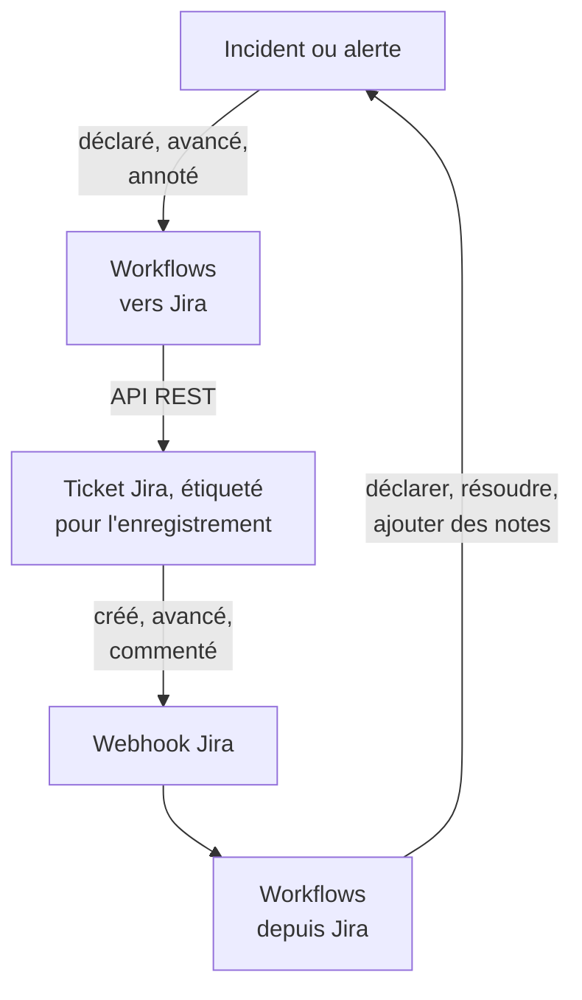

# Jira

Gardez les tickets [Jira](https://www.atlassian.com/software/jira) en phase avec vos incidents et alertes OneUptime, dans les deux sens. Des modèles de workflow prêts à l'emploi créent un ticket pour chaque incident ou alerte, le font avancer avec l'enregistrement et y copient les notes en commentaires. D'autres déclarent des incidents à partir de nouveaux tickets et rapportent les changements de statut, les commentaires et les modifications. Il n'y a pas de plugin : les workflows appellent l'API REST de Jira, et Jira appelle leurs URL de webhook.

:::cards
- [Partir d'un modèle](#partir-dun-modèle): Les 17 modèles, ce qu'ils demandent et comment les configurer.
- [Fonctionnement des modèles](#fonctionnement-des-modèles): Comment tickets et enregistrements restent liés, sans boucles.
- [Le construire vous-même](#le-construire-vous-même): Chaque sens à la main, quand un modèle ne convient pas.
- [Dépannage](#dépannage): Ce que signifient les réponses de Jira.
:::

> [!NOTE]
> Atlassian renomme des éléments de Jira Cloud : un **project** s'appelle désormais **space** dans une grande partie de l'interface, et un **issue** s'appelle **work item**. Les sites utilisent les deux termes, vous trouverez donc les deux ici là où le vocabulaire compte.

## Fonctionnement



Chaque modèle est un petit workflow, vous ne prenez donc que les sens qui vous intéressent, pour les incidents, les alertes ou les deux. Les modèles de OneUptime vers Jira partent d'un événement dans OneUptime et appellent l'API REST de Jira. Les modèles de Jira vers OneUptime partent d'un webhook Jira. Tous retrouvent les enregistrements des autres grâce à deux étiquettes sur le ticket.

Tout ce qui figure sur cette page est écrit pour **Jira Cloud**. [Jira Data Center](#jira-data-center) liste ce qui change sur un Jira autogéré.

## Avant de commencer

- Un site Jira Cloud, par exemple `https://your-domain.atlassian.net`, et un projet où créer les tickets.
- Un utilisateur Jira pour l'intégration, et un jeton d'API pour lui. Donnez à l'utilisateur **Browse Projects**, **Create Issues**, **Edit Issues**, **Add Comments** et **Transition Issues** dans le projet.
- Un administrateur Jira, pour enregistrer les webhooks dont les modèles de Jira vers OneUptime ont besoin.
- Dans OneUptime, le droit de créer des workflows. Sur OneUptime Cloud, les workflows nécessitent l'offre **Growth** ou supérieure.

## Partir d'un modèle

La boîte de dialogue **Créer un flux de travail** propose 17 modèles Jira, sous **Jira** dans sa liste de catégories : neuf pour les incidents, puis huit pour les alertes, chaque groupe sous son propre titre. Ils partagent une convention, des étiquettes sur le ticket Jira, de sorte que toute combinaison fonctionne ensemble.

### Modèles pour les incidents

| Modèle | Ce qu'il fait | Ce qu'il demande |
| --- | --- | --- |
| **De OneUptime vers Jira** | | |
| Create a Jira issue when an incident is declared | Crée un ticket pour chaque nouvel incident et lui ajoute l'ID de l'incident en étiquette. Les incidents déclarés depuis Jira, et les incidents privés, sont ignorés. | API URL, API token, project key, issue type, OneUptime URL |
| Move the Jira issue when the incident is acknowledged or resolved | Fait avancer le ticket lié : vers un statut In Progress quand l'incident est pris en compte, et vers un statut Done quand il est résolu. Ne le fait jamais reculer. | API URL, API token |
| Copy incident private notes to the Jira issue | Publie chaque nouvelle note privée en commentaire sur le ticket lié, en commentaire interne dans Jira Service Management. | API URL, API token |
| Copy incident public notes to the Jira issue | Publie chaque nouvelle note publique en commentaire sur le ticket lié. | API URL, API token |
| Comment on the Jira issue when the incident is edited | Quand le titre, la gravité, la description, la cause ou les notes de remédiation de l'incident changent, publie l'état actuel de l'incident, en commentaire interne dans Jira Service Management. | API URL, API token |
| **De Jira vers OneUptime** | | |
| Declare an incident when a Jira issue is created | Déclare un incident pour chaque nouveau ticket, tenu à l'écart de vos pages de statut, avec une gravité choisie d'après la priorité du ticket, puis étiquette le ticket pour lier les deux. | Site URL, API URL, API token et un webhook Jira pour **Issue created** |
| Acknowledge or resolve the incident when its Jira issue moves | Prend en compte l'incident quand son ticket lié passe à un statut In Progress, et le résout quand le ticket passe à un statut Done. | Un webhook Jira pour **Issue updated** |
| Add Jira comments to the incident as private notes | Copie chaque commentaire d'un ticket lié sur l'incident, en note privée. | Site URL, API URL, API token et un webhook Jira pour **Comment created** |
| Add Jira issue changes to the incident as private notes | Note chaque modification d'un ticket lié, comme la priorité, la personne assignée ou le résumé, sur l'incident en note privée. Les changements de statut sont laissés au modèle ci-dessus. | Site URL et un webhook Jira pour **Issue updated** |

### Modèles pour les alertes

Les modèles pour les alertes font les mêmes travaux pour les alertes. Il y en a un de moins, car les alertes n'ont pas de notes publiques. [Ce qui change pour les alertes](#ce-qui-change-pour-les-alertes) liste le reste.

| Modèle | Ce qu'il fait | Ce qu'il demande |
| --- | --- | --- |
| **De OneUptime vers Jira** | | |
| Create a Jira issue when an alert is created | Crée un ticket pour chaque nouvelle alerte, y compris chaque alerte qu'un moniteur lève, et lui ajoute l'ID de l'alerte en étiquette. Les alertes créées depuis Jira, et les alertes privées, sont ignorées. | API URL, API token, project key, issue type, OneUptime URL |
| Move the Jira issue when the alert is acknowledged or resolved | Fait avancer le ticket lié : vers un statut In Progress quand l'alerte est prise en compte, et vers un statut Done quand elle est résolue. Ne le fait jamais reculer. | API URL, API token |
| Copy alert private notes to the Jira issue | Publie chaque nouvelle note privée en commentaire sur le ticket lié, en commentaire interne dans Jira Service Management. | API URL, API token |
| Comment on the Jira issue when the alert is edited | Quand le titre, la gravité, la description, la cause ou les notes de remédiation de l'alerte changent, publie l'état actuel de l'alerte, en commentaire interne dans Jira Service Management. | API URL, API token |
| **De Jira vers OneUptime** | | |
| Create an alert when a Jira issue is created | Crée une alerte pour chaque nouveau ticket, avec une gravité choisie d'après la priorité du ticket, puis étiquette le ticket pour lier les deux. | Site URL, API URL, API token et un webhook Jira pour **Issue created** |
| Acknowledge or resolve the alert when its Jira issue moves | Prend en compte l'alerte quand son ticket lié passe à un statut In Progress, et la résout quand le ticket passe à un statut Done. | Un webhook Jira pour **Issue updated** |
| Add Jira comments to the alert as private notes | Copie chaque commentaire d'un ticket lié sur l'alerte, en note privée. | Site URL, API URL, API token et un webhook Jira pour **Comment created** |
| Add Jira issue changes to the alert as private notes | Note chaque modification d'un ticket lié, comme la priorité, la personne assignée ou le résumé, sur l'alerte en note privée. Les changements de statut sont laissés au modèle ci-dessus. | Site URL et un webhook Jira pour **Issue updated** |

Aucun des modèles de OneUptime vers Jira n'envoie à Jira un incident marqué [**Incident privé**](/docs/incidents/declaring-incidents#étape-1-détails-de-lincident), ni une alerte marquée **Alerte privée** : ni l'enregistrement, ni son état, ni ses notes, ni ses modifications, sauf si vous l'activez. Voir [Limites](#limites).

### Ce qui change pour les alertes

Chaque modèle pour les alertes est construit comme son jumeau pour les incidents, étape par étape. Là où les alertes diffèrent des incidents, les modèles diffèrent aussi :

- **Pas de notes publiques.** Les alertes n'ont que des notes privées, donc chaque commentaire publié par les modèles pour les alertes est un commentaire interne dans Jira Service Management.
- **Pas de page de statut.** Une alerte n'atteint jamais une page de statut, donc **Create an alert when a Jira issue is created** écrit la gravité, le titre, la description et `customFields.jiraIssueKey`, et rien d'autre.
- **Deux gravités, donc Medium devient Low.** Un nouveau projet a deux gravités d'alerte, High et Low, alors qu'il a trois gravités d'incident. Le modèle de création répartit les priorités de Jira sur les gravités du projet. Avec les deux par défaut, Highest, High, Critical et Blocker deviennent High, et toute autre priorité devient Low, Medium et Major compris. Pour envoyer Medium vers High, remplacez `medium: 1` par `medium: 0` dans `PRIORITY_RANK` du script `prepare-alert-1`.
- **Liens et étiquettes des alertes.** Le ticket pointe vers `/dashboard/<project id>/alerts/<alert id>`, et porte l'étiquette `oneuptime-alert-<alert id>`.
- **Les numéros disent ce qu'ils numérotent.** Avec le préfixe par défaut `#`, une alerte et un incident peuvent tous deux être `#12`, donc les modèles écrivent `Alert #12` ou `Incident #12`. Un numéro avec son propre préfixe, comme `ALT-12`, est écrit tel quel.
- **Alertes privées.** Une alerte marquée **Alerte privée**, à la main ou par une règle de confidentialité des alertes, reste hors de Jira sauf si vous réglez `SYNC_PRIVATE_ALERTS` sur `true`.

**Les moniteurs lèvent des alertes d'eux-mêmes, et parfois beaucoup.** **Create a Jira issue when an alert is created** crée un ticket pour chacune. Sauf si chaque alerte mérite un ticket, placez une condition devant l'étape Jira. Pour ne créer des tickets que pour les alertes High :

1. Ouvrez le **Constructeur** du workflow et ajoutez un bloc **If / Else**.
2. Réglez **Value to check** sur `{{local.components.alert-on-create-1.returnValues.model.alertSeverity.name}}`, **Comparison** sur **is equal to** et **Compare with** sur `High`.
3. Supprimez la ligne qui va de `alert-on-create-1` à `prepare-issue-1` en faisant glisser son extrémité hors du point (voir [Ranger](/docs/workflows/authoring#mettre-de-lordre)). Reliez ensuite **Success** du déclencheur au bloc **If / Else**, et son **Yes** à `prepare-issue-1`.

Une alerte qui prend le côté **No** termine là l'exécution, et aucun ticket n'est créé pour elle.

### Ce que demandent les modèles

L'étape **Configurer** de l'assistant de création demande jusqu'à cinq valeurs. Les tableaux ci-dessus indiquent celles dont chaque modèle a besoin.

- **Jira Site URL** — l'adresse à laquelle vous ouvrez Jira, par exemple `https://your-domain.atlassian.net`. Sur Jira Data Center, son URL de base, par exemple `https://jira.example.com:8443` ou `https://example.com/jira`. Les modèles qui amènent Jira dans OneUptime lient le ticket dans la description ou la note qu'ils écrivent, et ce lien va toujours vers ce site, quoi que dise l'événement. Le champ n'accepte donc que l'adresse d'un site : un schéma, un hôte, un port s'il y en a un et, sur Data Center, le chemin sous lequel Jira tourne. Il refuse l'adresse d'une page du site, une requête ou un nom d'utilisateur, et indique quoi saisir à la place. Une barre oblique finale est acceptée. Si la variable est vidée plus tard, le ticket est nommé sans lien.
- **Jira API URL** — là où le workflow envoie ses requêtes Jira : votre site, par exemple `https://your-domain.atlassian.net`, sans barre oblique finale. Avec un jeton d'API à portées, ce qui inclut tout jeton de compte de service, utilisez plutôt `https://api.atlassian.com/ex/jira/<cloudId>`. Votre `cloudId` figure dans le JSON de `https://your-domain.atlassian.net/_edge/tenant_info`. Avec un jeton classique, c'est la même adresse que la **Jira Site URL**, donc dans les modèles qui demandent les deux, l'assistant la remplit à partir de la **Jira Site URL** jusqu'à ce que vous y tapiez quelque chose.
- **Jira API Token (base64 of email:token)** — pas le jeton seul, mais l'e-mail et le jeton du compte encodés ensemble, comme Jira Cloud accepte l'authentification Basic. [Créer le jeton d'API](#créer-le-jeton-dapi) montre comment. Les jetons expirent, par défaut un an après leur création, notez donc la date quelque part.
- **Jira Project Key** — le projet (space) où les nouveaux tickets sont créés : le `OPS` de `OPS-123`.
- **Jira Issue Type** — le type de ticket à créer, écrit exactement comme dans ce projet, par exemple `Task`, `Bug` ou `Incident`.
- **OneUptime URL** — l'adresse à laquelle vous ouvrez OneUptime : `https://oneuptime.com`, ou votre propre hôte. La description du ticket renvoie avec elle vers l'incident ou l'alerte.

### Créer le jeton d'API

:::steps
1. Créez un jeton pour un utilisateur Jira dédié, un compte Atlassian ordinaire utilisé seulement par l'intégration, plutôt que pour une personne : tickets et commentaires sont attribués au propriétaire du jeton. Connectez-vous avec cet utilisateur et créez le jeton sur [id.atlassian.com/manage-profile/security/api-tokens](https://id.atlassian.com/manage-profile/security/api-tokens). Un jeton classique (**Create API token**) fonctionne avec l'URL de votre site. Un jeton à portées (**Create API token with scopes**) ne fonctionne qu'avec l'adresse `api.atlassian.com` ci-dessus. Les portées classiques `read:jira-work` et `write:jira-work` couvrent tous les appels des modèles.
2. Encodez l'e-mail de ce compte et le jeton :

   ```bash
   printf '%s' 'jira-bot@example.com:your_api_token' | base64 | tr -d '\n'
   ```

   Utilisez `printf`, pas `echo` : `echo` ajoute un saut de ligne, qui est encodé avec le reste, et Jira n'accepte plus les identifiants. Sur l'URL de votre site, cela se manifeste rarement par un `401` (voir [Limites](#limites)). `tr` garde la sortie sur une ligne : `base64` de GNU sous Linux coupe tous les 76 caractères, et un jeton actuel est assez long pour être coupé.

3. Collez la sortie dans **Jira API Token (base64 of email:token)**.
:::

Un **compte de service** Atlassian fonctionne aussi. Un administrateur de l'organisation le crée, avec son jeton, dans [admin.atlassian.com](https://admin.atlassian.com) sous **Directory → Service accounts**. Ce jeton a toujours des portées, donc la **Jira API URL** doit être l'adresse `https://api.atlassian.com/ex/jira/<cloudId>` (la **Jira Site URL** reste votre site), et l'e-mail que vous encodez est celui du compte de service lui-même. Donnez au compte de service les permissions de projet listées plus haut, comme à tout utilisateur.

### Créer les workflows

:::steps
1. Ouvrez **Flux de travail → Créer un flux de travail**. Sous **Ou partir d'un modèle**, choisissez **Jira** dans la liste des catégories, ou tapez `Jira` dans **Rechercher des modèles…**, et cliquez sur le modèle voulu. Il s'ouvre et montre ce qu'il fait et les paramètres qu'il demandera. Cliquez sur **Utiliser ce modèle**.
2. **Nom** est rempli à partir du modèle. Changez-le si vous le souhaitez.
3. **Configurer** demande les valeurs ci-dessus. Elles sont enregistrées comme variables propres au workflow, sous **Variables de flux de travail** dans son menu. Le jeton d'API est enregistré comme secret : il est masqué dans **Journaux → Exécutions**, et ne va jamais que dans l'en-tête `Authorization` des appels à Jira.
4. Cliquez sur **Créer un flux de travail**. Chaque workflow est créé désactivé : activez **Activé** en haut de son **Constructeur**.
:::

Commencez par **Create a Jira issue when an incident is declared**, ou par **Create a Jira issue when an alert is created** pour les alertes : chaque autre modèle de OneUptime vers Jira du même genre retrouve le ticket grâce à l'étiquette que celui-ci ajoute. Activez-le, déclarez un incident de test ou créez une alerte de test, et ouvrez **Journaux → Exécutions** du workflow. L'exécution devrait se terminer avec **Exécuté**, et le **Response Body** de sa dernière étape, `create-issue-1`, nomme le nouveau ticket.

Chaque workflow garde sa propre copie de ces valeurs. Quand vous remplacez le jeton, mettez à jour `jiraBasicAuthToken` sous **Variables de flux de travail** dans chaque workflow Jira qui l'a demandé. Si Jira change d'adresse, mettez à jour `jiraSiteUrl` et `jiraBaseUrl` de la même façon.

### Connecter les modèles à webhook

Les modèles de Jira vers OneUptime, quatre pour les incidents et quatre pour les alertes, partent d'un [déclencheur Webhook](/docs/workflows/triggers#webhook), il faut donc indiquer à Jira où envoyer ses événements. Procédez dans cet ordre :

1. Créez le workflow et **activez-le d'abord**. Un workflow désactivé répond `400` à Jira, et Jira ne retente pas une livraison refusée avec un `4xx`. Les événements envoyés avant l'activation sont perdus, pas mis en file d'attente.
2. Ouvrez le **Constructeur** du workflow, cliquez sur le bloc déclencheur **Webhook** (`webhook-1`), puis sur **Copier l'URL** en haut de ses paramètres. L'URL ressemble à ceci :

   ```text
   https://<your OneUptime host>/workflow/trigger/<webhook secret key>
   ```

3. Dans Jira, allez dans **Settings → System → WebHooks** (sous **Advanced**) et cliquez sur **Create a WebHook**. Collez l'URL, cochez l'événement du tableau ci-dessous, sous **Issue related events**, et saisissez un filtre JQL pour que seuls les tickets de votre projet le déclenchent. Laissez **Exclude body** décoché : le workflow lit tout dans le corps.

| Modèle | Événement Jira | Filtre JQL |
| --- | --- | --- |
| **Incidents** | | |
| Declare an incident when a Jira issue is created | **Issue created** | `project = OPS AND (labels is EMPTY OR labels != oneuptime)` |
| Acknowledge or resolve the incident when its Jira issue moves | **Issue updated** | `project = OPS` |
| Add Jira comments to the incident as private notes | **Comment created** | `project = OPS` |
| Add Jira issue changes to the incident as private notes | **Issue updated** | `project = OPS` |
| **Alertes** | | |
| Create an alert when a Jira issue is created | **Issue created** | `project = OPS AND (labels is EMPTY OR labels != oneuptime)` |
| Acknowledge or resolve the alert when its Jira issue moves | **Issue updated** | `project = OPS` |
| Add Jira comments to the alert as private notes | **Comment created** | `project = OPS` |
| Add Jira issue changes to the alert as private notes | **Issue updated** | `project = OPS` |

Remplacez `OPS` par la clé de votre projet. Le filtre des deux modèles qui créent un enregistrement empêche les tickets ouverts par OneUptime de les atteindre : ils les ignoreraient de toute façon, mais un événement qui n'arrive jamais ne coûte aucune exécution. `labels != oneuptime` seul écarterait aussi tout ticket sans étiquette, c'est pourquoi `labels is EMPTY` est là. Les autres modèles n'agissent que sur des tickets liés, donc `project = OPS AND labels = oneuptime` est pour eux un filtre plus strict.

Chaque workflow a sa propre URL, chacun a donc besoin de son propre webhook Jira. Deux modèles sur **Issue updated** demandent deux webhooks, et quatre si vous utilisez aussi les versions pour les alertes.

**Vous utilisez les deux modèles qui créent un enregistrement ?** **Declare an incident when a Jira issue is created** et **Create an alert when a Jira issue is created** écoutent tous deux **Issue created**. Chacun vérifie les étiquettes du ticket auprès de Jira avant de créer quoi que ce soit, mais les deux livraisons arrivent ensemble, donc un nouveau ticket peut recevoir à la fois un incident et une alerte. Enregistrez-les pour des tickets différents, par projet ou par type de ticket :

```text
project = OPS AND issuetype = Incident AND (labels is EMPTY OR labels != oneuptime)
project = OPS AND issuetype = Alert AND (labels is EMPTY OR labels != oneuptime)
```

Utilisez des types de ticket qui existent dans votre projet, écrits comme Jira les écrit.

Avant de vous y fier :

- **Jira n'appelle qu'en HTTPS, sur ses ports autorisés.** OneUptime Cloud convient. Une installation autogérée doit être joignable depuis Internet en HTTPS sur un port de la liste de Jira.
- **Toute personne qui a l'URL peut déclencher le workflow.** Les webhooks de Jira ne portent rien qu'un workflow puisse vérifier, l'URL est donc le seul secret. Quelqu'un qui l'a peut déclarer des incidents ou créer des alertes (les modèles qui créent un enregistrement demandent à Jira si le ticket nommé existe et n'est pas encore lié, mais prennent le titre, la description et la priorité dans la requête) et peut faire avancer ou annoter les incidents et alertes dont il connaît l'ID ou la clé de ticket Jira. Ce que dit une telle requête est écrit comme du texte (voir [Limites](#limites)), et le lien vers le ticket va vers le site que nomme votre **Jira Site URL**, quoi que dise la requête. Ne gardez l'URL que dans Jira. Si elle fuite, cliquez sur le déclencheur **Webhook** dans le **Constructeur** du workflow, cliquez sur **Réinitialiser l'URL** et collez la nouvelle URL dans le webhook Jira. L'ancienne URL cesse aussitôt de fonctionner.
- **Chaque événement est une exécution.** Sur OneUptime Cloud, chaque livraison compte dans les exécutions de workflow de votre offre, y compris celles qu'un modèle ignore. Le filtre JQL limite ce nombre. Voir [Limites de l'offre](/docs/workflows/configuration#limites-du-forfait).

### Vérifier que cela fonctionne

Les **Étapes** de chaque exécution disent ce qu'a fait le modèle : ouvrez donc l'exécution dans **Journaux → Exécutions** et regardez comment elle s'est terminée :

- **Exécuté** : il a fait son travail, et sa dernière étape nomme le ticket, l'incident ou l'alerte.
- **Exécuté**, avec son étape **Check With JavaScript** sur **No** : il a ignoré l'événement exprès, et l'étape dit pourquoi : le ticket n'est lié à aucun enregistrement de ce genre, la note vient de Jira, l'enregistrement est privé, ou aucun statut Jira ne correspond au nouvel état.
- **Erreur** : une étape a échoué, et son entrée dans **Étapes** dit pourquoi. Pour un appel à Jira, elle inclut la réponse de Jira.
- **Erreur** à `link-issue-1` : un modèle qui crée un enregistrement à partir d'un ticket Jira l'a créé, mais Jira n'a pas accepté les étiquettes de lien, donc les autres modèles ne peuvent pas encore le trouver. Ajoutez les étiquettes à la main.

Les événements ignorés sont normaux : la plupart des événements Jira ne concernent pas un modèle donné. Voir [Exécutions de workflow](/docs/workflows/runs-and-logs).

## Fonctionnement des modèles

### Comment les deux côtés restent liés

C'est Jira qui garde le lien. Un ticket qui appartient à un incident ou à une alerte porte deux étiquettes :

- `oneuptime`, qui marque le ticket comme lié.
- `oneuptime-incident-<incident id>` pour un incident, ou `oneuptime-alert-<alert id>` pour une alerte, qui nomme l'enregistrement. L'ID est la dernière partie de l'adresse de l'enregistrement dans le tableau de bord : `/dashboard/<project id>/incidents/<incident id>`.

Les deux modèles qui créent un ticket ajoutent les deux étiquettes en le créant, et les deux modèles qui créent un enregistrement à partir d'un ticket Jira les ajoutent dès que l'enregistrement existe. Tous les autres modèles font le lien grâce à elles : ceux de OneUptime vers Jira cherchent dans Jira l'étiquette de l'enregistrement, et ceux de Jira vers OneUptime lisent l'ID de l'enregistrement dans les étiquettes du ticket. Ne les renommez donc pas et ne les supprimez pas. Pour lier un ticket ouvert à la main, ajoutez vous-même les deux étiquettes, mais seulement quand l'enregistrement n'a pas encore de ticket.

**Un ticket est lié à un incident ou à une alerte, jamais aux deux.** Les modèles qui créent un enregistrement ignorent tout ticket qui porte `oneuptime`, ou une étiquette commençant par `oneuptime-incident-` ou `oneuptime-alert-`, et les modèles d'un genre ignorent les tickets liés à l'autre. Quand vous liez un ticket à la main, donnez-lui une seule étiquette d'enregistrement, pas une de chaque.

**Un enregistrement a un seul ticket.** Les modèles qui publient sur un ticket ou le font avancer n'agissent que quand exactement un ticket porte l'étiquette de l'enregistrement. Cloner un ticket dans Jira copie ses étiquettes, donc le clone d'un ticket lié revendique le même enregistrement. Dès lors, ces modèles s'arrêtent, et chaque exécution se termine par un saut qui nomme les deux tickets :

```text
More than one Jira issue is labelled oneuptime-incident-<id> (OPS-17, OPS-30). A cloned issue copies the label: remove it from every issue except the one filed for the incident.
```

L'autre sens n'a pas ce contrôle : les changements de statut, les commentaires et les modifications du clone atteignent l'enregistrement comme s'ils avaient été faits sur l'original. Quand vous clonez un ticket lié, retirez donc les deux étiquettes du clone.

Les incidents et alertes créés depuis Jira gardent aussi la clé du ticket dans `customFields.jiraIssueKey`, écrite à leur création. C'est ainsi que les modèles qui créent un ticket savent que l'enregistrement en a déjà un.

### Comment les modèles évitent les boucles

Chaque écriture dans un sens est un événement dans l'autre : un commentaire publié dans Jira revient sous forme de webhook **Comment created**, et une note ajoutée dans OneUptime lance le déclencheur de note. Trois choses arrêtent l'écho :

- **Des marqueurs dans le texte.** Chaque commentaire que les modèles publient dans Jira commence par `Synced from OneUptime`. Chaque note écrite depuis Jira, et la cause de chaque changement d'état fait depuis Jira, commence par `Synced from Jira`. Chaque sens ignore le texte qui porte le marqueur de l'autre côté, même dans un commentaire écrit par quelqu'un qui en cite un.
- **Des étiquettes sur les nouveaux tickets.** Les tickets ouverts par OneUptime portent l'étiquette `oneuptime`, et les modèles qui créent un enregistrement les ignorent. Ils demandent à Jira les étiquettes du ticket avant de créer quoi que ce soit, plutôt que de se fier à l'événement. Les enregistrements créés depuis Jira portent `customFields.jiraIssueKey`, et les modèles qui créent un ticket les ignorent.
- **Les états n'avancent que vers l'avant, des deux côtés.** Les modèles de statut écrivent une nouvelle ligne dans la chronologie d'états de l'enregistrement, comme le fait le bouton **Résoudre**, et toujours vers un état ultérieur. Les modèles de transition ne font jamais reculer un ticket non plus. Ainsi, quand un côté résout, l'autre se trouve déjà terminé et ne change rien.

Gardez les marqueurs quand vous modifiez les modèles. Ce sont les constantes `FROM_ONEUPTIME` et `FROM_JIRA` du bloc d'aide en tête de chaque script. Un commentaire ou une note écrits sans leur marqueur sont recopiés aussitôt dans l'autre sens.

### Comment le modèle de transition choisit un statut

Jira n'a pas d'appel « passer à Done ». Un ticket avance par une transition, et les transitions dont il dispose dépendent de son workflow et de son statut. **Move the Jira issue when the incident is acknowledged or resolved**, et son jumeau pour les alertes, lisent donc les transitions ouvertes au ticket et en choisissent une d'après le statut auquel elle mène :

- **Seulement vers l'avant.** Jira range les statuts en trois catégories, To Do, In Progress et Done, et le modèle ne choisit jamais une transition vers une catégorie antérieure à celle du ticket, pas même pour un statut nommé dans `STATE_TO_JIRA_STATUS`. Prendre en compte un incident dont le ticket est déjà Done se termine par `Jira issue OPS-17 is already Done, so it was not moved back to an In Progress status.`
- **Les noms habituels d'abord.** Pour un enregistrement résolu, un statut nommé Done, Resolved, Closed, Complete, Completed ou Fixed l'emporte. Pour un enregistrement pris en compte, In Progress ou Work in Progress l'emporte. Un statut portant un autre nom dans la bonne catégorie est utilisé quand c'est le seul qui convient.
- **Jamais une supposition qui abandonne le travail.** Un statut dont le nom ressemble à Canceled, Declined, Rejected, Won't Do, Duplicate, Obsolete, Waiting, Pending, Escalated, On Hold ou Blocked n'est jamais choisi, sauf si `STATE_TO_JIRA_STATUS` le nomme. Ainsi, une demande Jira Service Management qui peut passer à Resolved ou à Canceled passe à Resolved.
- **Deux chemins vers le même statut.** Quand deux transitions mènent à un même statut, il prend celle qui n'a pas d'écran.

Quand le doute subsiste, il ne fait rien avancer et dit pourquoi : deux statuts conviennent aussi bien l'un que l'autre, ou aucune transition n'est de celles qu'il peut choisir seul.

```text
Jira issue OPS-17 could move to Released or Deployed for a Done status. Name the one to use in STATE_TO_JIRA_STATUS.
Jira issue OPS-17 has no transition from In Review to a Done status that can be chosen without naming it in STATE_TO_JIRA_STATUS.
```

Nommez alors le statut dans `STATE_TO_JIRA_STATUS`, en tête du script `plan-transition-1`, d'après les noms de vos états OneUptime. Un état listé là fait passer le ticket à ce statut par son nom, quelle que soit sa catégorie, tant que ce n'est pas un retour en arrière :

```javascript
const STATE_TO_JIRA_STATUS = {
  Resolved: "Resolved",
  Acknowledged: "In Progress",
};
```

### Changer ce que fait un modèle

Ouvrez le **Constructeur** du workflow et cliquez sur le bloc à changer. Les réglages que vous voudrez le plus probablement changer sont des constantes en haut d'un script, le **JavaScript Code** d'un bloc **Check With JavaScript**, juste sous le bloc d'aide commun. Les versions pour les incidents et pour les alertes d'un modèle gardent les mêmes constantes dans les mêmes blocs :

| Constante | Modèle, et bloc | Ce qu'elle règle |
| --- | --- | --- |
| `STATE_TO_JIRA_STATUS` | Move the Jira issue when the incident (or alert) is acknowledged or resolved — `plan-transition-1` | Associe un nom d'état OneUptime à un nom de statut Jira, par exemple `{ Resolved: 'Resolved', Acknowledged: 'In Progress' }`. Les états non listés suivent leur sens : pris en compte fait passer le ticket à un statut In Progress, résolu à un statut Done, et tout autre état est ignoré. Nommez un statut ici quand le journal d'exécution vous le demande — voir [Comment le modèle de transition choisit un statut](#comment-le-modèle-de-transition-choisit-un-statut). |
| `PREFERRED_STATUS`, `NEVER_GUESS` | Move the Jira issue when the incident (or alert) is acknowledged or resolved — `plan-transition-1` | Les noms de statut que le modèle préfère quand il suit le sens, et ceux qu'il ne choisit jamais sauf si `STATE_TO_JIRA_STATUS` les nomme. Les deux sont des expressions régulières comparées au nom du statut, sans tenir compte de la casse. |
| `SYNC_PRIVATE_INCIDENTS` | Chaque modèle d'incident de OneUptime vers Jira — `prepare-issue-1`, `plan-transition-1` ou `build-comment-1` | `false` garde hors de Jira les incidents marqués **Incident privé** : aucun ticket n'est créé pour eux, leur ticket n'avance pas, et ni leurs notes ni leurs modifications ne sont publiées. Réglez-la sur `true` pour les envoyer quand même. Chaque modèle a sa propre copie, réglez-la donc dans chaque modèle qui doit les envoyer. |
| `SYNC_PRIVATE_ALERTS` | Chaque modèle d'alerte de OneUptime vers Jira — `prepare-issue-1`, `plan-transition-1` ou `build-comment-1` | La même chose pour les alertes marquées **Alerte privée** : `false` les garde hors de Jira de la même façon, et `true` les envoie quand même. Réglez-la dans chaque modèle d'alerte qui doit les envoyer. |
| `JIRA_STATUS_TO_STATE` | Acknowledge or resolve the incident (or alert) when its Jira issue moves — `read-event-1` | Associe un nom de statut Jira à un nom d'état OneUptime, par exemple `{ 'In Review': 'Monitoring' }`. Les statuts non listés suivent la catégorie de statut de Jira : In Progress prend en compte l'incident ou l'alerte, Done le résout, et To Do ne correspond à rien. |
| `PRIORITY_RANK` | Declare an incident when a Jira issue is created — `prepare-incident-1` ; Create an alert when a Jira issue is created — `prepare-alert-1` | Associe une priorité Jira, écrite en minuscules, à `0` (votre gravité la plus sévère), `1` ou `2` (la moins sévère), les gravités intermédiaires étant réparties sur l'intervalle. Les priorités non listées tombent au milieu. Avec les deux gravités d'alerte d'un nouveau projet, `0` donne High et `1` comme `2` donnent Low, donc Medium devient Low sauf si vous le changez en `medium: 0`. |
| `EVENTS` | Add Jira comments to the incident (or alert) as private notes — `read-comment-1` | Les événements de commentaire qui deviennent des notes. Ajoutez `'comment_updated'` pour copier aussi les modifications — chaque modification devient une nouvelle note — et cochez aussi **Comment updated** sur le webhook Jira. |
| `IGNORED_FIELDS` | Add Jira issue changes to the incident (or alert) as private notes — `read-changes-1` | Les champs Jira, en minuscules, dont les changements ne méritent pas de note. Un changement est écarté quand l'ID ou le nom de son champ est listé, c'est ainsi que `'rank'` attrape Rank, un champ personnalisé qui arrive sous un ID comme `customfield_10019`. Le statut est sur la liste parce que le modèle de statut s'en charge. |

Les noms d'état et de statut utilisés comme clés doivent être écrits exactement comme ils sont nommés, majuscules comprises. Évitez `{{` dans le code : un script est rempli comme tout autre paramètre avant de s'exécuter, donc deux accolades ouvrantes à la suite seraient lues comme une référence.

Pour envoyer plus de champs sur les nouveaux tickets, modifiez le **Request Body** du bloc `create-issue-1` des modèles qui créent un ticket. Il contient le projet, le type, le résumé, les étiquettes et la description du ticket, et vous pouvez ajouter une priorité, des composants, une personne assignée ou des champs personnalisés dans `fields`, sous les formes que décrit [Remplir plus de champs](#remplir-plus-de-champs). Gardez les deux étiquettes. Le texte du résumé et de la description se trouve dans le script `prepare-issue-1`. La description donne la gravité, l'état et la description de l'enregistrement, puis sa cause et ses notes de remédiation quand il en a : un moniteur les remplit quand il lève un incident ou une alerte, et elles l'expliquent souvent.

Les notes privées et les commentaires de modification sont marqués internes par l'entrée `properties`, `sd.public.comment`, du **Request Body** de leur bloc `post-comment-1`. Seul Jira Service Management la lit. Ne la supprimez que si les clients doivent voir ces commentaires.

### Limites

- **Jira Cloud uniquement.** Les modèles appellent l'API REST v3 de Jira Cloud avec l'authentification Basic. Data Center n'a pas de v3 et prend un jeton d'accès personnel en `Bearer`, donc chaque bloc d'API a besoin des changements décrits dans [Jira Data Center](#jira-data-center) : des chemins `/rest/api/2/...`, des chaînes simples au lieu de corps en Atlassian Document Format, et l'en-tête. Les blocs `find-issue-1` changent le plus : Data Center n'a pas de `/search/jql`, ils doivent donc faire un `POST` vers `/rest/api/2/search` à la place.
- **Les incidents déclarés depuis Jira sont discrets.** Ils sont créés masqués de vos pages de statut, sans prévenir les abonnés des pages de statut, car le texte d'un ticket n'a pas été écrit pour des clients. Pour en afficher un, activez **Visible sur la page de statut** sur la page **Paramètres** de l'incident (voir [Garder un incident hors de la page de statut](/docs/incidents/states-and-severities#garder-un-incident-hors-de-la-page-de-statut)), ou activez **Show On Status Pages**, sous **Plus de champs**, dans le bloc `incident-from-another-tool-1` du modèle.
- **Les incidents et alertes privés restent dans OneUptime.** Les modèles de OneUptime vers Jira les ignorent, et chaque saut le dit dans **Journaux → Exécutions**. Pour les envoyer quand même, réglez `SYNC_PRIVATE_INCIDENTS` ou `SYNC_PRIVATE_ALERTS` sur `true`. Rendre un enregistrement privé plus tard arrête la synchronisation à partir de ce moment, mais ne reprend pas ce que Jira a déjà. Les modèles de Jira vers OneUptime ne vérifient pas, donc les commentaires, modifications et changements de statut d'un ticket lié atteignent toujours un enregistrement privé.
- **Rien ne recule.** Rouvrir un ticket Jira ne change rien dans OneUptime, et un statut de la catégorie To Do ne correspond à aucun état. Voir [L'ordre est une vraie contrainte](/docs/incidents/states-and-severities#lordre-est-une-vraie-contrainte-pas-une-préférence-daffichage). Les modèles de transition ne font jamais non plus passer un ticket à une catégorie de statut antérieure.
- **Chaque alerte reçoit un ticket.** Hormis les alertes privées, le modèle d'alerte qui crée un ticket en crée un pour chaque alerte, y compris chacune de celles qu'un moniteur lève. [Ce qui change pour les alertes](#ce-qui-change-pour-les-alertes) montre comment ajouter une condition.
- **Les premières secondes peuvent manquer le ticket.** La recherche de Jira se met à jour un instant après qu'un ticket change, donc une note, un changement d'état ou une modification dans les premières secondes après la création d'un enregistrement peut manquer le nouveau ticket et se terminer par le saut `No Jira issue is labelled …`. Cette exécution n'est pas relancée. Il en va de même juste après la création d'un enregistrement depuis Jira, jusqu'à l'ajout de ses étiquettes.
- **Privé et public ne veulent pas dire la même chose dans Jira.** Dans un projet Jira Service Management, les notes privées et les commentaires de modification, qui portent la cause et la remédiation, deviennent des commentaires internes, tandis que les notes publiques d'un incident deviennent des commentaires que le client peut voir. Dans tout autre genre de projet, ce sont tous des commentaires ordinaires que quiconque voit le ticket peut lire.
- **Les commentaires de modification suivent les enregistrements, pas les changements.** Les formulaires de détails des incidents et des alertes envoient le titre et la gravité à chaque enregistrement, donc enregistrer l'un d'eux après n'avoir changé que ses étiquettes, ou son réglage privé, publie aussi un commentaire, avec les mêmes valeurs que le précédent. Le déclencheur donne au workflow l'enregistrement tel qu'il est, pas ce qui a changé.
- **La mise en forme ne passe pas.** Les notes sont publiées dans Jira en texte brut, donc le Markdown arrive avec ses caractères bruts. Le texte enrichi de Jira arrive dans OneUptime sous la forme du balisage wiki qu'envoient les webhooks de Jira, comme `*bold*`, et se lit exactement comme il a été écrit : une image, un lien, du HTML, un diagramme ou une mention de chat comme `<!channel>` tapés dans un ticket, un commentaire, un statut ou un nom s'affichent comme leurs caractères et ne font rien, car un gluon de mots invisible suit le caractère qui les ouvrirait. Une copie du texte garde ce gluon. Le lien vers le ticket va vers le site que nomme la **Jira Site URL** du workflow. Un workflow garde les scripts avec lesquels il a été créé, donc un workflow créé à partir d'une ancienne version d'un modèle écrit le texte comme le faisait cette version : recréez-le à partir de son modèle pour obtenir ce comportement.
- **Les workflows créés avant la Jira Site URL lient le ticket au site que nomme l'événement.** Un workflow garde les scripts et paramètres avec lesquels il a été créé, donc un workflow de création depuis un ticket, de commentaires ou de modifications de ticket fait avant que son modèle ne demande la **Jira Site URL** prend encore le site du lien du ticket dans l'adresse du ticket donnée par l'événement. Pour lier vers votre propre site, recréez le workflow à partir de son modèle, qui demande la **Jira Site URL**. Activez le nouveau workflow, collez son URL de webhook dans le webhook Jira à la place de l'ancienne (chaque workflow a sa propre URL), puis supprimez l'ancien workflow.
- **Un jeton erroné ou expiré le dit rarement.** Sur l'URL de votre site, Jira répond à un appel qu'il ne peut pas authentifier comme à un visiteur anonyme, pas par un `401`. Un jeton erroné ou expiré se manifeste donc par le `The target project doesn't exist or you don't have permission to create issues in it` du modèle de création (un `400`), par `Issue does not exist or you do not have permission to see it` (un `404`), ou par le saut `No Jira issue is labelled oneuptime-incident-<id>, or the Jira credentials cannot see it.` Un simple `401` est surtout ce que répond l'adresse `api.atlassian.com`. Pour tester la valeur, envoyez-la à `/rest/api/3/myself` : il répond avec le nom et l'e-mail du compte quand la valeur fonctionne, et `401` quand elle ne fonctionne pas.

  ```bash
  curl -H 'Authorization: Basic <the encoded value>' https://your-domain.atlassian.net/rest/api/3/myself
  ```

- **Le même événement peut arriver deux fois.** Jira retente une livraison qui a échoué sur une erreur serveur ou a expiré. Si OneUptime avait déjà commencé l'exécution, les modèles de commentaires et de modifications de ticket ajoutent une seconde note. Les modèles qui créent un enregistrement n'en créent pas un second : ils demandent d'abord à Jira les étiquettes du ticket, et quand une nouvelle tentative arrive, la première exécution a déjà étiqueté le ticket. Cela ne sert à rien quand la première exécution a créé l'enregistrement mais que Jira a refusé les étiquettes : l'exécution échoue à `link-issue-1`, et vous devez ajouter les étiquettes à la main.

## Le construire vous-même

Les modèles couvrent les cas courants. Pour construire un sens vous-même, ou changer un sens au-delà de ses constantes, cette section construit les deux sens à la main, pour les incidents. [Faire de même pour les alertes](#faire-de-même-pour-les-alertes) le transpose aux alertes.

### Enregistrer les identifiants Jira

Jira Cloud accepte l'authentification Basic construite à partir de l'e-mail du compte et d'un jeton d'API, encodés ensemble, comme dans [Ce que demandent les modèles](#ce-que-demandent-les-modèles).

1. Allez dans **Flux de travail → Variables globales** et cliquez sur **Créer : Variable de flux de travail**. Nommez-la `JIRA_AUTH`, collez la valeur encodée dans **Contenu**, activez **Secret** et créez-la.
2. Créez une seconde variable, `JIRA_URL`, contenant `https://your-domain.atlassian.net` sans barre oblique finale, et laissez **Secret** désactivé.

Tout bloc peut alors envoyer `Basic {{global.variables.JIRA_AUTH}}` comme en-tête `Authorization`, et le jeton n'apparaît jamais dans le workflow ni dans ses exécutions. Avec un jeton à portées, `JIRA_URL` vaut plutôt `https://api.atlassian.com/ex/jira/<cloudId>`, et chaque chemin ci-dessous s'y ajoute sans changement.

Les jetons expirent par défaut au bout d'un an et ne se renouvellent pas. Pour ne pas en remplacer un à la main, une organisation qui utilise la gestion centralisée des utilisateurs d'Atlassian peut donner à un compte de service un [identifiant OAuth 2.0](https://support.atlassian.com/user-management/docs/create-oauth-2-0-credential-for-service-accounts/) : un ID client et un secret qu'un workflow échange contre un jeton de courte durée, comme le fait la page [Microsoft Dynamics 365](/docs/integrations/microsoft-dynamics-365).

### Créer un ticket Jira pour chaque incident

:::steps
1. Créez à partir de zéro un workflow nommé `Incidents to Jira`. Cliquez sur le bloc en pointillés et ajoutez le déclencheur **On Create Incident**. Ses **Fields to pass on** commencent par **Titre** : cliquez sur **Ajouter un champ** et choisissez **Description** et **Numéro d'incident**. L'ID est toujours transmis. Laissez son **Identifiant** à `incident-on-create-1`.
2. Cliquez sur **Ajouter un composant**, ajoutez un bloc **API Post (JSON)** et reliez-y le point **Success** du déclencheur. Réglez son **Identifiant** sur `create-issue`, son **URL** sur `{{global.variables.JIRA_URL}}/rest/api/3/issue` et, sous **Plus de champs**, ses **Request Headers** sur `{"Authorization": "Basic {{global.variables.JIRA_AUTH}}", "Accept": "application/json"}`.
3. Réglez son **Request Body** sur le ticket, et remplacez `OPS` et `Bug` par la clé de votre projet et un type de ticket de ce projet :

   ```json
   {
     "fields": {
       "project": { "key": "OPS" },
       "issuetype": { "name": "Bug" },
       "summary": "OneUptime #{{local.components.incident-on-create-1.returnValues.model.incidentNumber}}: {{local.components.incident-on-create-1.returnValues.model.title}}",
       "labels": ["oneuptime"],
       "description": {
         "type": "doc",
         "version": 1,
         "content": [
           {
             "type": "paragraph",
             "content": [
               {
                 "type": "text",
                 "text": "{{local.components.incident-on-create-1.returnValues.model.description}}"
               }
             ]
           }
         ]
       }
     }
   }
   ```

4. Activez **Activé**, déclarez un incident de test et ouvrez **Journaux → Exécutions**. L'étape `create-issue` affiche un `201` et un corps avec l'`id`, la `key` et le `self` du nouveau ticket.
:::

La description paraît lourde, car l'API v3 de Jira Cloud prend le texte enrichi en **Atlassian Document Format**, un arbre de document plutôt qu'une chaîne. Le corps ci-dessus contient le plus petit document valide : un paragraphe avec un nœud de texte. Il en va de même pour `environment` et les champs personnalisés de texte multiligne. Un bloc suivant lit la nouvelle clé avec `{{local.components.create-issue.returnValues.response-body.key}}`.

### Remplir plus de champs

Dans `fields`, vous pouvez ajouter :

- **Priorité** : `"priority": { "id": "20000" }`, avec un ID de priorité de votre site.
- **Personne assignée** : `"assignee": { "id": "<accountId>" }`. Jira Cloud désigne les personnes par leur ID de compte Atlassian.
- **Étiquettes** : `"labels": ["oneuptime", "sev1"]`, une liste de chaînes sans espaces.
- **Composants** : `"components": [{ "id": "10000" }]`.
- **Champs personnalisés** : `"customfield_10034": "..."`, par l'ID propre du champ. Une liste à choix unique prend `{"value": "red"}`, un champ de texte multiligne un document comme la description.

Demandez à Jira ce dont un projet a besoin plutôt que de deviner. Le premier appel liste les types de ticket d'un projet, et le second les champs de l'un d'eux, ceux qui sont obligatoires, et leurs ID `customfield_NNNNN` :

```bash
curl -u 'you@example.com:your_api_token' \
  'https://your-domain.atlassian.net/rest/api/3/issue/createmeta/OPS/issuetypes'

curl -u 'you@example.com:your_api_token' \
  'https://your-domain.atlassian.net/rest/api/3/issue/createmeta/OPS/issuetypes/10001'
```

### Transmettre l'ID de l'incident à Jira

Chaque moitié d'une synchronisation bidirectionnelle a besoin qu'un système garde l'ID de l'autre. Gardez l'ID de l'incident sur le ticket : Jira le renvoie alors avec chaque événement, et le workflow entrant le lit dans la requête. Mettez-le dans une étiquette, la même que celle qu'utilisent les [modèles](#comment-les-deux-côtés-restent-liés), pour que vos workflows et les modèles retrouvent les tickets les uns des autres :

```json
"labels": ["oneuptime", "oneuptime-incident-{{local.components.incident-on-create-1.returnValues.model._id}}"]
```

Un administrateur Jira peut ajouter à la place un champ personnalisé de texte court, nommé par exemple OneUptime Incident ID, que vous réglez avec `"customfield_10050": "{{local.components.incident-on-create-1.returnValues.model._id}}"`. Il est plus simple à relire qu'une étiquette.

Pour donner à tous dans Jira un chemin de retour, ajoutez après `create-issue` un bloc **API Post (JSON)** qui publie un lien distant sur `{{global.variables.JIRA_URL}}/rest/api/3/issue/{{local.components.create-issue.returnValues.response-body.key}}/remotelink` :

```json
{
  "globalId": "system=https://oneuptime.com&id={{local.components.incident-on-create-1.returnValues.model._id}}",
  "object": {
    "url": "https://oneuptime.com/dashboard/{{local.components.incident-on-create-1.returnValues.model.projectId.value}}/incidents/{{local.components.incident-on-create-1.returnValues.model._id}}",
    "title": "OneUptime incident #{{local.components.incident-on-create-1.returnValues.model.incidentNumber}}"
  }
}
```

Pour cela, dans les **Fields to pass on** du déclencheur, cliquez sur **Ajouter un champ** et choisissez **ID du projet**, et gardez le `.value` : une colonne qui contient l'ID d'un autre enregistrement arrive sous la forme `{"_type": "ObjectID", "value": "..."}`. Le `globalId` permet de répéter l'appel sans risque : Jira met à jour le lien qui le porte au lieu d'en ajouter un second.

### Commenter et faire avancer le ticket avec l'incident

Construisez cela dans un second workflow, pour qu'un échec ici n'empêche jamais l'ouverture des tickets.

:::steps
1. Créez un workflow nommé `Incident updates to Jira`, avec le déclencheur **On Update Incident**. Dans **Fields to watch**, cliquez sur **Ajouter un champ** et choisissez **État actuel de l'incident**. Dans **Fields to pass on**, cliquez sur **Ajouter un champ**, ouvrez **État actuel de l'incident** et choisissez **Nom**.
2. Ajoutez un bloc **If / Else** : **Value to check** `{{local.components.incident-on-update-1.returnValues.model.currentIncidentState.name}}`, **Comparison** **is equal to**, **Compare with** `Resolved`, ou le nom de votre état résolu.
3. Après son côté **Yes**, trouvez le ticket avec un bloc **API Post (JSON)** dont l'**Identifiant** est `find-issue`, qui publie sur `{{global.variables.JIRA_URL}}/rest/api/3/search/jql` :

   ```json
   {
     "jql": "project = OPS AND labels = \"oneuptime-incident-{{local.components.incident-on-update-1.returnValues.model._id}}\"",
     "fields": ["key"],
     "maxResults": 1
   }
   ```

4. Lisez l'ID du ticket avec `{{local.components.find-issue.returnValues.response-body.issues[0].id}}`, et utilisez-le dans les appels ci-dessous.
:::

Envoyez la JQL dans le corps plutôt que dans l'URL : une URL est envoyée exactement comme elle est écrite, sans être encodée pour vous, et la JQL est pleine d'espaces, de guillemets et de signes `=`. Une requête doit être bornée, c'est pourquoi la clause `project =` est là. Sur Cloud, le point d'accès est `/rest/api/3/search/jql` ; l'ancien `/rest/api/3/search` a disparu.

- **Commentaire** : un bloc **API Post (JSON)** vers `{{global.variables.JIRA_URL}}/rest/api/3/issue/<id>/comment`, avec un document comme `body` : `{"body": {"type": "doc", "version": 1, "content": [{"type": "paragraph", "content": [{"type": "text", "text": "Resolved in OneUptime."}]}]}}`.
- **Transition** : un bloc **API Get (JSON)** sur `{{global.variables.JIRA_URL}}/rest/api/3/issue/<id>/transitions` liste les transitions ouvertes depuis le statut du ticket, chacune avec un `id`, un `name` et le statut auquel elle mène, `to`. Un bloc **API Post (JSON)** vers la même URL avec `{"transition": {"id": "31"}}` en exécute une, et répond `204`.

Un ID de transition appartient au workflow Jira du ticket, donc un administrateur Jira qui modifie ce workflow peut casser un ID écrit en dur. Lire la liste à l'exécution, comme le font les modèles, l'évite.

### Recevoir les changements de Jira

Construisez d'abord le workflow qui reçoit :

1. Créez un workflow nommé `Jira to OneUptime`, avec le déclencheur **Webhook**.
2. Ouvrez le **Constructeur** du workflow, cliquez sur le déclencheur **Webhook**, puis sur **Copier l'URL** en haut de ses paramètres. L'URL ressemble à ceci :

   ```text
   https://oneuptime.com/workflow/trigger/<webhook secret key>
   ```

   Une installation autogérée utilise son propre hôte. Traitez l'URL comme un mot de passe : quiconque l'a peut démarrer le workflow. Si elle fuite, cliquez sur **Réinitialiser l'URL** au même endroit, et l'ancienne URL cesse aussitôt de fonctionner.

3. Depuis le déclencheur, ajoutez un bloc **Update One Incident**. Réglez sa **Query** sur `{"_id": "{{local.components.webhook-1.returnValues.request-body.oneuptimeIncidentId}}"}`, et son **Data (JSON Object)** sur le changement, par exemple un nouveau `currentIncidentStateId`. Un bloc **Find One Incident State** avec la requête `{"name": "Resolved"}` vous donne cet ID avec `{{local.components.incident-state-find-one-1.returnValues.model._id}}`.

Activez-le, puis faites-le appeler par Jira, depuis une règle d'automatisation ou depuis un webhook :

:::tabs
@tab Automation rule
1. Dans Jira, ouvrez l'automatisation du projet : **Space settings → Automation**, ou **Project settings → Automation** sur les sites plus anciens. Pour plusieurs projets, utilisez **Settings → System → Global automation**.
2. Créez une règle avec le déclencheur **Work item transitioned** (**Issue transitioned** sur les sites plus anciens), réglée pour s'exécuter quand le statut passe à **Done**. Le déclencheur **Work item updated** laisse de côté les changements de statut.
3. Ajoutez l'action **Send web request** : **Web request URL** l'URL du workflow, **HTTP method** `POST`, un en-tête `Content-Type: application/json` et un corps **Custom data** :

   ```json
   {
     "oneuptimeIncidentId": "{{issue.customfield_10050}}",
     "issueKey": "{{issue.key}}",
     "status": "{{issue.status.name}}"
   }
   ```

   Avec une étiquette plutôt qu'un champ personnalisé, envoyez `"labels": "{{issue.labels}}"`, et extrayez l'ID avec un bloc **Run Custom JavaScript**.

4. Activez la règle et faites passer un ticket de test à Done. Vérifiez le journal d'audit de la règle dans Jira, et **Journaux → Exécutions** dans OneUptime.

Pour être sûr qu'une requête vient de votre règle, ajoutez un second en-tête, `X-OneUptime-Secret`, avec une valeur que vous inventez, et utilisez l'option **Hide** de l'action sur cet en-tête. Dans le workflow, placez un bloc **If / Else** avant la mise à jour : **Value to check** `{{local.components.webhook-1.returnValues.request-headers.x-oneuptime-secret}}`, **Comparison** **is equal to** et **Compare with** la même valeur, gardée dans une variable globale secrète.

Send web request n'appelle que les ports 80, 8080, 443, 6017, 8443, 8444, 7990, 8090, 8085, 8060, 8900 et 9900. Jira Cloud compte les exécutions de règles sur un quota mensuel qui dépend de votre offre, donc une règle sur chaque transition d'un projet chargé finit par peser.
@tab Jira webhook
1. En tant qu'administrateur Jira, allez dans **Settings → System → WebHooks** (sous **Advanced**) et cliquez sur **Create a WebHook**.
2. Collez l'URL du workflow, cochez **Issue updated** et saisissez un filtre JQL, par exemple `project = OPS AND labels = oneuptime`.
3. Dans le workflow, lisez la charge utile propre à Jira : `issue` contient le ticket, et `changelog.items` contient chaque champ modifié, avant et après. Pour un changement de statut, prenez l'élément dont le `field` est `status`. Un bloc **Run Custom JavaScript** est le moyen le plus simple de la lire.

Un webhook peut porter un secret, et Jira signe alors le corps dans un en-tête `X-Hub-Signature`. Un workflow ne peut pas le vérifier, car le déclencheur Webhook transmet un corps déjà lu comme du JSON. Jira retente une livraison échouée jusqu'à cinq fois, donc le workflow doit supporter de recevoir deux fois le même événement.
:::

Dans les deux cas, l'URL du workflow est un identifiant : gardez-la dans Jira, et réinitialisez-la si elle fuite.

### Faire de même pour les alertes

Commencez par les modèles pour les alertes de [Partir d'un modèle](#partir-dun-modèle). Pour construire un workflow d'alerte à la main, suivez les étapes ci-dessus avec la version pour les alertes de chaque bloc et champ :

| Incident | Alerte |
| --- | --- |
| **On Create Incident** (`incident-on-create-1`) | **On Create Alert** (`alert-on-create-1`) |
| **On Update Incident** (`incident-on-update-1`) | **On Update Alert** (`alert-on-update-1`) |
| **On Create Incident Internal Note** | **On Create Alert Internal Note** |
| **On Create Incident Public Note** | Aucun : les alertes n'ont pas de notes publiques |
| `incidentNumber`, `currentIncidentState`, `incidentSeverity` | `alertNumber`, `currentAlertState`, `alertSeverity` |
| **Find One Incident State** | **Find One Alert State** |
| **Update One Incident** | **Update One Alert** |
| Étiquette `oneuptime-incident-<incident id>` | Étiquette `oneuptime-alert-<alert id>` |
| `/dashboard/<project id>/incidents/<incident id>` | `/dashboard/<project id>/alerts/<alert id>` |

Un workflow a exactement un déclencheur, donc les incidents et les alertes ont chacun besoin de leur workflow. Pour faire le même travail Jira pour les deux, construisez-le une fois dans un workflow avec un déclencheur **Manual**, et démarrez-le depuis les deux avec un bloc **Execute Workflow**.

## Jira Data Center

Jira autogéré fonctionne de la même façon, avec une poignée de substitutions. Jira Server a atteint la fin de son support en février 2024, Data Center est donc la cible autogérée.

| Cloud | Data Center |
| --- | --- |
| `/rest/api/3/...` | `/rest/api/2/...` : il n'y a pas de v3 sur Data Center |
| `POST /rest/api/3/search/jql` pour chercher avec la JQL | `POST /rest/api/2/search` : il n'y a pas de `/search/jql` sur Data Center. Le corps garde `jql`, `fields` et `maxResults` ; envoyez `expand` sous forme de liste, `["transitions"]` |
| `description` sous forme de document Atlassian Document Format | `description` sous forme de chaîne simple en balisage wiki |
| `Authorization: Basic base64(email:api_token)` | `Authorization: Bearer <personal access token>` |
| Jeton d'API depuis id.atlassian.com | **Profile → Personal access tokens → Create token** sur votre propre compte Jira |
| Action d'automatisation **Send web request** | Action d'automatisation **Send outgoing web request** |

Le bloc qui crée le ticket devient donc un `POST` vers `/rest/api/2/issue`, avec une description simple :

```json
{
  "fields": {
    "project": { "key": "OPS" },
    "issuetype": { "name": "Bug" },
    "summary": "OneUptime #123: Checkout is down",
    "description": "Plain text goes straight in here."
  }
}
```

Autres différences à prévoir :

- **La Jira Site URL est votre URL de base**, telle que l'affiche **Administration → System → General configuration**, avec son port et le chemin sous lequel Jira tourne : `https://jira.example.com:8443` ou `https://example.com/jira`. Les modèles lient un ticket à `<base URL>/browse/<key>`. Le champ accepte un chemin d'un seul segment, comme `/jira`, et en refuse un plus long, qui serait l'adresse d'une page de Jira plutôt que son URL de base.
- **Les jetons d'accès personnels** existent à partir de Jira Core et Jira Software 8.14 et de Jira Service Management 4.15. Ils expirent, par défaut au bout de 365 jours. L'authentification Basic par mot de passe fonctionne encore, mais quelques échecs de connexion déclenchent un CAPTCHA qui bloque le compte sur l'API REST jusqu'à ce que quelqu'un le lève dans un navigateur. Préférez un jeton.
- **L'automatisation est intégrée** à partir de Jira Data Center 10.0. Avant, c'était l'application Automation for Jira, installée à part.
- **La livraison des webhooks est asynchrone** à partir de Data Center 10.0, donc les événements peuvent arriver dans le désordre. Faites en sorte que le workflow qui les reçoit le supporte.

## Dépannage

Ouvrez d'abord l'étape en échec dans **Journaux → Exécutions**. Jira répond avec un corps JSON qui nomme ce qu'il a refusé, et le bloc d'API le garde dans `response-body`.

:::details 401 Unauthorized
Encodez de nouveau `email:api_token` avec `printf`, pas `echo`, et mettez à jour le jeton : un saut de ligne final est la cause habituelle. Vérifiez ensuite que le compte du jeton peut créer des tickets dans le projet. Sur Data Center, vérifiez que vous envoyez `Bearer`, pas `Basic`. Sur l'URL d'un site Cloud, des identifiants erronés ressemblent plus souvent au cas suivant.
:::

:::details Jira dit qu'un projet ou un ticket qui existe n'existe pas, ou une recherche ne trouve rien
Sur l'URL d'un site Cloud, ce sont en général les identifiants, pas les données : Jira répond à un appel qu'il ne peut pas authentifier comme à un visiteur anonyme. Envoyez la valeur encodée à `/rest/api/3/myself`, comme le montre [Limites](#limites). S'il répond `401`, encodez-la de nouveau ou remplacez le jeton. S'il répond avec le bon compte, il manque une permission à ce compte dans le projet : **Browse Projects** pour voir ses tickets, **Create Issues** pour en créer un.
:::

:::details 400 Bad Request qui nomme un champ
Le type de ticket n'existe pas dans le projet, ou le projet a un champ obligatoire que vous n'envoyez pas. Lancez les appels `createmeta` de [Remplir plus de champs](#remplir-plus-de-champs) pour ce projet et ce type de ticket, et comparez. Un `400` à propos de `description` signifie que l'API v3 de Cloud a reçu une chaîne au lieu d'un document Atlassian Document Format.
:::

:::details 404 Not Found
Vérifiez l'URL de base et la version de l'API : `/rest/api/3/...` sur Cloud, `/rest/api/2/...` sur Data Center.
:::

:::details 429 Too Many Requests
Jira limite la vitesse à laquelle vous l'appelez. La réponse porte `Retry-After`, en secondes. Les écritures sur un même ticket sont très limitées, donc un workflow qui commente et fait une transition coup sur coup peut atteindre la limite. Placez un bloc **Sleep** entre les appels, ou déplacez le travail en masse dans un workflow planifié.
:::

:::details L'appel de transition répond 400
L'ID de transition n'est pas ouvert depuis le statut actuel du ticket. Récupérez `/transitions` pour ce ticket, et utilisez un ID de la réponse.
:::

:::details Jira montre que la règle ou le webhook s'est exécuté, mais rien n'atteint OneUptime
Vérifiez d'abord le port : Jira n'appelle que ses ports autorisés. Envoyez ensuite vous-même une requête à l'URL du workflow avec `curl`, et cherchez-la dans **Journaux → Exécutions**. Si la vôtre arrive et pas celle de Jira, le problème est du côté de Jira. Si l'exécution est là mais refusée, vérifiez que le workflow est activé.
:::

:::details Le workflow s'exécute, mais l'incident ne change pas
Un bloc **Update One Incident** indique `Items Updated: 0` quand sa requête n'a rien trouvé, et c'est un succès, pas une erreur. Vérifiez que l'ID de la requête est bien celui de l'incident OneUptime, et que vous interrogez `_id`.
:::

:::details Une référence apparaît telle qu'elle est écrite dans un ticket Jira
Une référence qui ne se résout pas est envoyée telle qu'elle est écrite, accolades comprises, au lieu d'être vidée. Dans l'onglet **Étapes** de l'exécution, le paramètre qui la contenait est marqué **Non résolu** : en général un identifiant de bloc mal tapé ou une variable renommée.
:::

## Étapes suivantes

:::cards
- [Microsoft Dynamics 365](/docs/integrations/microsoft-dynamics-365): La même synchronisation bidirectionnelle pour les dossiers Dynamics 365.
- [Variables de workflow](/docs/workflows/variables): Les secrets, et la lecture des valeurs d'un bloc depuis le suivant.
- [Configuration et sécurité des workflows](/docs/workflows/configuration): La sécurité des webhooks, l'accès réseau sortant et les limites de l'offre.
- [Présentation des intégrations](/docs/integrations/index): Les autres outils que vous pouvez connecter.
:::
