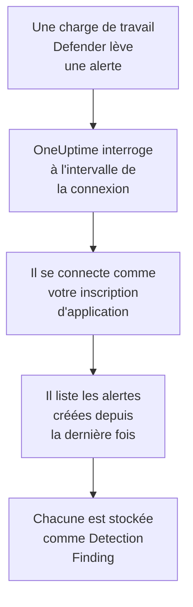

# Microsoft Defender XDR

Importez les alertes de chaque charge de travail [Microsoft Defender XDR](https://learn.microsoft.com/en-us/defender-xdr/), des points de terminaison, des identités, de la messagerie et des applications cloud, dans les événements de sécurité de OneUptime. Vous les y recherchez à côté de vos logs, traces et métriques, vous les corrélez avec toutes les autres sources, et vous prévenez l'astreinte pour celles qui comptent. OneUptime les lit via l'API de sécurité de Microsoft Graph avec une inscription d'application que vous créez : aucun agent, playbook ou espace de travail Sentinel n'est nécessaire.

:::cards
- [Configurer la connexion](#configurer-la-connexion): Une inscription d'application, une autorisation et le formulaire de la connexion.
- [Ce qui est importé](#ce-qui-est-importé): Comment chaque alerte Defender devient un événement de sécurité.
- [Fonctionnement des interrogations](#fonctionnement-des-interrogations): La fenêtre que lit chaque interrogation, et ce qu'en fait un locataire chargé.
- [Dépannage](#dépannage): Ce que signifie chaque erreur, et ce qu'il faut changer.
:::

## Fonctionnement



Chaque minute, OneUptime interroge chaque connexion activée dont l'intervalle d'interrogation est écoulé. Une interrogation se connecte à Microsoft Entra ID en tant que votre inscription d'application, demande à Microsoft Graph les alertes créées depuis la dernière interrogation ([List alerts_v2](https://learn.microsoft.com/en-us/graph/api/security-list-alerts_v2)), et stocke chacune comme un événement [OCSF](https://schema.ocsf.io/) Detection Finding (classe `2004`). Les règles de détection, les moniteurs et les tableaux de bord le traitent alors comme un événement de sécurité de n'importe quelle autre source.

## Avant de commencer

- Dans OneUptime, le rôle Project Owner, Project Admin ou Security Admin. Les rôles Security Member et Security Viewer voient les connexions et l'historique de leurs exécutions, mais ne peuvent pas les modifier.
- Un locataire Microsoft Entra avec une licence Microsoft Defender XDR : n'importe quelle charge de travail Defender intégrée au portail Microsoft Defender, comme Defender for Endpoint, for Identity, for Office 365 ou for Cloud Apps.
- Un rôle Entra qui peut inscrire des applications, comme Administrateur d'applications, et un Administrateur général ou un Administrateur de rôle privilégié pour accorder le consentement administrateur.
- Le HTTPS sortant de l'application et des workers OneUptime vers `login.microsoftonline.com` et `graph.microsoft.com`, ou vers `login.microsoftonline.us` et `graph.microsoft.us` pour Azure Government.

## Configurer la connexion

La connexion s'authentifie avec le [flux d'informations d'identification du client OAuth 2.0](https://learn.microsoft.com/en-us/entra/identity-platform/v2-oauth2-client-creds-grant-flow) : en tant qu'application, jamais en tant que personne, avec une seule autorisation d'application.

:::steps
### Inscrire une application

1. Connectez-vous au [portail Azure](https://portal.azure.com) et ouvrez **Microsoft Entra ID**.
2. Allez dans **App registrations → New registration**. Nommez-la `OneUptime Security Events`, laissez **Supported account types** sur **Accounts in this organizational directory only**, laissez l'URI de redirection vide, et sélectionnez **Register**.
3. Sur la page **Overview** de l'application, copiez l'**ID d'application (client)** et le **ID de l'annuaire (tenant)**.

### L'autoriser à lire les alertes

1. Allez dans **API permissions → Add a permission → Microsoft Graph → Application permissions**, choisissez `SecurityAlert.Read.All`, et sélectionnez **Add permissions**. C'est l'autorisation la moins privilégiée que l'appel [List alerts_v2](https://learn.microsoft.com/en-us/graph/api/security-list-alerts_v2#permissions) accepte pour une application : n'ajoutez pas `SecurityAlert.ReadWrite.All`.
2. Sélectionnez **Grant admin consent for** votre locataire, et confirmez. Le statut de l'autorisation doit indiquer **Granted** : sans consentement, chaque lecture est refusée avec `403`.

### Créer un secret client

Allez dans **Certificates & secrets → Client secrets → New client secret**, choisissez quand il expire, et sélectionnez **Add**. Copiez la **Value** du secret, et non son **Secret ID**, avant de quitter la page : elle n'est plus jamais affichée.

Notez quand le secret expire. Ce jour-là, l'interrogation s'arrête avec `Microsoft Defender XDR token request failed (HTTP 401)` jusqu'à ce que vous le remplaciez avec **Mettre à jour les identifiants**.

### Ajouter la connexion dans OneUptime

Ouvrez **Produits → Événements de sécurité → Connexions** (`/dashboard/{projectId}/security-events/connections`), cliquez sur **Ajouter une connexion**, choisissez **Microsoft Defender XDR** sous **EDR / XDR**, et cliquez sur **Suivant**. Remplissez les réglages du tableau ci-dessous, cliquez sur **Suivant**, et collez la valeur du secret dans **Secret client**.

### La tester avant d'enregistrer

Cliquez sur **Tester ces paramètres** sous **Tester avant d'enregistrer**. Le test se connecte et lit les alertes avec les valeurs du formulaire, et n'enregistre rien, un secret erroné ou un consentement manquant apparaît donc avant que la connexion existe. Cliquez ensuite sur **Suivant**, donnez à la connexion un **Nom**, et créez-la.
:::

| Réglage | Où le trouver |
| --- | --- |
| **ID de l'annuaire (tenant)** | La page **Overview** de l'application. Le GUID du locataire, ou un domaine vérifié comme `contoso.onmicrosoft.com`. |
| **ID d'application (client)** | La page **Overview** de l'application. Le GUID de l'application qui a `SecurityAlert.Read.All`. |
| **Cloud** | **Cloud public Azure**, qui sert aussi Microsoft 365 GCC, ou **Azure Government (États-Unis)** pour GCC High (`login.microsoftonline.us` et `graph.microsoft.us`). Microsoft 365 DoD et le cloud 21Vianet en Chine ne sont pas pris en charge. |
| **Secret client** | La **Value** du secret. Il est chiffré, jamais renvoyé par l'API et plus jamais affiché. Remplacez-le avec **Mettre à jour les identifiants** sur la connexion. |

L'étape **Interrogation** contient aussi une **Description** facultative, le **Intervalle d'interrogation (minutes)**, un nombre entier de `1` à `1440` qui vaut `5` au départ, et **Activé**, qui est activé au départ.

## Ce qui est importé

Chaque [alerte](https://learn.microsoft.com/en-us/graph/api/resources/security-alert) Defender XDR devient un événement Detection Finding (classe OCSF `2004`), avec le fournisseur `Microsoft` et le produit `Microsoft Defender XDR`, attribué au service de télémétrie `Microsoft Defender XDR` :

| Colonne OCSF | Champ de l'alerte |
| --- | --- |
| `eventUid` | `id`, l'ID de l'alerte Graph, qui sert aussi à écarter les doublons |
| `time` | `firstActivityDateTime`, ou `createdDateTime` s'il n'y en a pas |
| `message`, `ruleName` | `title` |
| `ruleId` | `detectorId`, ou `alertPolicyId` s'il n'y en a pas |
| `severityName` | `severity` : `informational`, `low`, `medium` ou `high`, et `unknown` reste Unknown |
| `statusName` | `status` : `new` devient New, `inProgress` In Progress, `resolved` Resolved |
| `mitreTechniques` | `mitreTechniques` |
| `mitreTactics` | `categories` ou `category`, quand c'est une tactique ATT&CK : `CredentialAccess` devient `TA0006`. Les autres catégories restent dans `attributes`. |
| `principalHost`, `principalUser`, `principalIp`, `principalProcess` | L'`evidence` avec le rôle `source`, `attacker` ou `compromised`, sinon la première de chaque type |
| `targetHost`, `targetUser`, `targetIp`, `targetResource` | L'`evidence` avec un rôle de cible, comme `destination` ou `attacked`. Les URL, les boîtes aux lettres et les ressources cloud remplissent `targetResource`. |
| `observables` | Chaque nom d'hôte, IP, utilisateur, nom de fichier, SHA-1 et SHA-256, URL, domaine, boîte aux lettres et ID de ressource de `evidence` |
| `attributes` | L'alerte entière, aplatie en clés pointées comme `evidence.0.hostName`, `serviceSource` et `incidentId` |

Les alertes de chaque `serviceSource` sont importées, celles de Microsoft Sentinel aussi une fois Sentinel connecté au portail Defender. Les incidents ne sont pas importés, mais chaque alerte garde son `incidentId` et son `incidentWebUrl` dans `attributes`.

## Fonctionnement des interrogations

Chaque interrogation liste les alertes créées dans sa fenêtre, 100 par page, et suit le `@odata.nextLink` de Graph jusqu'à avoir lu toute la fenêtre :

```text
GET https://graph.microsoft.com/v1.0/security/alerts_v2?$filter=createdDateTime ge {start} and createdDateTime lt {end}&$top=100
```

- **L'heure de création est le curseur.** Defender crée souvent une alerte des heures après son `firstActivityDateTime`, et un curseur sur l'heure d'activité sauterait chacune de ces alertes.
- **La première interrogation remonte 24 heures en arrière**, pour qu'une nouvelle connexion montre tout de suite ses alertes récentes.
- **Chaque interrogation suivante commence 1 minute avant le curseur enregistré**, pour qu'une alerte créée à la frontière entre deux fenêtres soit lue deux fois et importée une seule.
- **Une interrogation lit au plus 24 heures au-delà du curseur.** Une connexion dont le curseur a pris du retard, pendant que les workers étaient arrêtés ou que le locataire était limité, le rattrape en une suite de fenêtres de 24 heures.
- **Les doublons sont écartés par l'`id` de l'alerte** parmi les événements du projet venant de `Microsoft` / `Microsoft Defender XDR`, pour que le chevauchement, une fenêtre relue et une importation ne stockent jamais une alerte deux fois.
- **Une exécution en échec ne change rien.** Après une erreur réseau, ou un statut d'erreur de Graph, le curseur et la longueur de fenêtre restent tels quels, et l'interrogation suivante relit la même fenêtre. La seule exception est une requête qui a expiré : le curseur reste, mais la fenêtre suivante est deux fois plus courte, car une fenêtre trop lourde pour recevoir une réponse à temps expirerait à chaque essai.

### Quand une fenêtre contient plus qu'une interrogation ne peut lire

Une interrogation lit au plus 20 pages de 100 alertes : 2 000 alertes. Quand cette limite l'arrête avant la fin de sa fenêtre, l'exécution est **Partiel**, avec cet avertissement :

```text
Stopped after 20 alerts requests (the per-run request limit) before reading the whole window. Microsoft Graph lists alerts newest first and documents no way to sort them oldest first, so this run cannot name a point to resume from.
```

[List alerts_v2](https://learn.microsoft.com/en-us/graph/api/security-list-alerts_v2) documente `$filter`, `$top`, `$skip` et `$count`, mais pas `$orderby`, et renvoie les alertes les plus récentes d'abord. Les 2 000 alertes lues par une exécution arrêtée sont les plus récentes de sa fenêtre, déplacer le curseur au-delà sauterait donc les plus anciennes qu'elle n'a jamais atteintes. OneUptime raccourcit plutôt la fenêtre :

1. **Réduire.** L'interrogation suivante lit une fenêtre deux fois plus courte, depuis le même point de départ, et continue de la diviser par deux jusqu'à ce qu'une fenêtre soit lue entièrement, jusqu'à une minute. L'avertissement de l'exécution le dit : `This window holds more records than one poll can read; the next poll reads a {n} minute window from the same starting point.` Les alertes déjà importées depuis la fenêtre plus longue sont sautées comme doublons.
2. **Revenir à la taille normale.** Une fois une fenêtre lue entièrement, le curseur passe à sa fin, et la fenêtre suivante est de nouveau deux fois plus longue, jusqu'à 24 heures.
3. **Passer au-delà d'une seule minute.** Si même une minute contient plus de 2 000 alertes, l'interrogation passe au-delà, pour que les alertes plus récentes continuent d'arriver. L'exécution reste **Partiel**, et **Dernière erreur** indique `More records were created in the one minute from {cursor} to {end} than one poll can read. Polling moved past this minute so newer records keep arriving; use Import this time range in Diagnostics on this minute to recover what one run can read.` Importez cette minute avec **Importer cette plage de temps** pour récupérer ce qu'une exécution peut lire.

Une exécution **Partiel** pour une autre raison, comme une alerte qui n'a pas pu être lue en événement de sécurité, est réessayée de la même façon, depuis le même point de départ. Changer le **Intervalle d'interrogation (minutes)** n'y change rien : il décide à quelle fréquence une interrogation commence, pas où commence sa fenêtre.

### Exécuter, prévisualiser et importer à la demande

Cliquez sur **Diagnostics** sur une connexion pour voir ses exécutions récentes et travailler avec elle à la main. Quiconque peut modifier la connexion peut les lancer ; quiconque peut la voir peut lire l'historique.

- **Exécuter maintenant** lance tout de suite une interrogation, avec le curseur habituel, même quand la connexion n'est pas **Activé**.
- **Preview alerts** lit une plage de temps de 7 jours au plus et n'importe rien.
- **Importer cette plage de temps** importe une plage de 7 jours au plus, après votre confirmation, sans déplacer le curseur. Les alertes déjà importées sont sautées.
- **Copier les diagnostics** sur une exécution copie son rapport pour le support. Il ne contient jamais d'identifiants.

## Tester la connexion

**Tester la connexion** sur la ligne d'une connexion, et **Tester ces paramètres** dans le formulaire, s'exécutent dans le processus de l'API, pas dans un worker d'arrière-plan, pour qu'un test réponde même quand les workers sont le problème. Il effectue ces vérifications, dans l'ordre :

| Vérification | Ce qu'elle vérifie |
| --- | --- |
| **Configuration** | Les quatre réglages sont présents et bien formés. Rien n'est contacté quand cela échoue. |
| **Authenticate with Microsoft Entra** | Microsoft Entra ID délivre un jeton pour Microsoft Graph, dans le cloud que vous avez choisi. Cela échoue sur un secret erroné ou expiré, un ID de locataire ou de client erroné, ou le mauvais cloud. |
| **Read alerts from Microsoft Graph** | Une alerte créée dans les 24 dernières heures peut être lue (`$top=1`). Un `403` ici signifie que l'autorisation `SecurityAlert.Read.All` ou le consentement administrateur manque, ou que le locataire n'a pas Defender XDR. |
| **Alerts available to import** | Combien d'alertes ont été créées dans les 24 dernières heures et les 7 derniers jours, une page de 100 pour chacun, `100+` signifie donc davantage. Aucune en 7 jours est un avertissement, pas un échec. |
| **Background workers**, **Poll scheduler**, **Security event storage** | Le côté de OneUptime lui-même : un processus prend les tâches de la file Worker, la tâche d'interrogation s'exécute chaque minute, et le stockage des événements de sécurité répond. |
| **Scheduled polling** | Pour une connexion enregistrée : l'interrogation est activée, aucune exécution n'est bloquée en attente d'un worker, et les interrogations s'exécutent à l'heure. |

Chaque requête d'un test a un délai de 20 secondes. Un test n'importe jamais rien et ne déplace jamais le curseur, et chaque vérification en échec dit ce qu'il faut changer.

## Dépannage

La **Dernière erreur** de la connexion conserve le message d'erreur complet, identifiants masqués, derrière un préfixe qui nomme l'étape en échec. Quand une connexion a une erreur, sélectionnez **Voir l'erreur** dans sa colonne **Actions** pour la lire, et **Copier l'erreur** dans la boîte de dialogue pour la copier. Lisez d'abord le préfixe.

:::details Dernière erreur commence par `Microsoft Defender XDR token request`
- `Microsoft Defender XDR token request failed (HTTP ...)` : Microsoft Entra ID a refusé de délivrer un jeton, Graph n'a donc jamais été contacté. Le message se termine par une indication, selon le code `error` d'Entra :
  - `invalid_client` (`AADSTS7000215`) : le secret est erroné, expiré, ou appartient à une autre application. Créez-en un nouveau sous **Certificates & secrets**, et enregistrez-le avec **Mettre à jour les identifiants**.
  - `unauthorized_client` (`AADSTS700016`) : l'**ID d'application (client)** n'est pas dans ce **ID de l'annuaire (tenant)**, ou **Cloud** est erroné.
  - `AADSTS90002` : ce locataire n'existe pas.
  - `invalid_scope` : l'étendue Graph n'existe pas dans le cloud que vous avez choisi. Vérifiez **Cloud**.
- `Microsoft Defender XDR token request returned ...` : Microsoft Entra ID a répondu par quelque chose d'inutilisable, un corps qui n'est pas du JSON ou sans `access_token`. C'est généralement un proxy ou une passerelle entre les deux, pas les identifiants.
- `Microsoft Defender XDR token request did not complete: ...` : le point de terminaison des jetons était injoignable, ou n'a pas répondu à temps. Vérifiez le HTTPS sortant de l'application et des workers OneUptime vers `login.microsoftonline.com`, ou `login.microsoftonline.us`.
:::

:::details Dernière erreur commence par `Microsoft Defender XDR alerts request`
- `Microsoft Defender XDR alerts request failed (HTTP ...)` : Graph a refusé de lister les alertes. Le message nomme le code d'erreur de Graph, et une indication :
  - `403` (`Authorization_RequestDenied`) : `SecurityAlert.Read.All` ou son consentement administrateur manque, ou le locataire n'a pas de licence Defender XDR. Le consentement met quelques minutes à s'appliquer.
  - `401` (`InvalidAuthenticationToken`) après la délivrance d'un jeton : **Cloud** ne correspond généralement pas au locataire.
  - `429` (`TooManyRequests`) : Graph limite l'application, et l'interrogation suivante relit la même fenêtre. Le message ne peut pas citer le `Retry-After` de Graph, car le client HTTP de OneUptime ne garde aucun en-tête de réponse sur une erreur. Si cela continue, augmentez le **Intervalle d'interrogation (minutes)**.
  - `5xx` : un problème du côté de Graph. L'interrogation suivante réessaie.
  - `400` : Graph n'a pas voulu exécuter la requête, que construit OneUptime et non vos réglages. Copiez le message pour le support de OneUptime.
- `Microsoft Defender XDR alerts request returned ...` : Graph a répondu `200`, mais avec quelque chose que le connecteur ne pouvait pas utiliser : un corps qui n'est pas du JSON, aucune liste `value`, ou un `@odata.nextLink` qui n'est pas un lien `https://` sur l'hôte Graph de votre cloud. Un tel lien est refusé, pour que le jeton ne soit jamais envoyé ailleurs. C'est signalé plutôt que pris pour une fenêtre vide, pour que le curseur ne dépasse jamais des alertes que personne n'a lues.
- `Microsoft Defender XDR alerts request did not complete: ...` : Graph était injoignable, ou n'a pas répondu à temps : 60 secondes pour une interrogation, 20 pour un test. Vérifiez le HTTPS sortant vers `graph.microsoft.com`, ou `graph.microsoft.us`.
:::

:::details Le test réussit, mais Dernière interrogation vaut Never
La tâche d'interrogation ne s'est jamais exécutée. Lisez les vérifications **Background workers** et **Poll scheduler**. Sur une installation auto-hébergée, la cause habituelle est `DISABLE_QUEUE_WORKERS=true` sur l'application, sans déploiement de workers séparé qui prenne les tâches : réglez-le sur `false`, ou lancez le déploiement des workers (Helm : `worker.enabled: true`, qui vaut `false` par défaut).
:::

:::details Les interrogations réussissent, mais une alerte connue manque
Comparez le `createdDateTime` de l'alerte dans le portail Defender avec la fenêtre de l'exécution dans **Diagnostics** : les fenêtres portent sur l'heure de création, pas sur l'heure d'activité.

- Une alerte créée avant que la connexion existe est plus ancienne que le premier retour en arrière de 24 heures. Importez-la avec **Importer cette plage de temps**.
- Une exécution **Partiel** a été arrêtée par la limite de 2 000 alertes. L'interrogation suivante lit une fenêtre plus courte depuis le même début, l'alerte est donc importée dès qu'une fenêtre qui la contient est lue entièrement.
- Si **Dernière erreur** nomme une minute que l'interrogation a dépassée, importez cette minute avec **Importer cette plage de temps**.
:::

:::details La même alerte apparaît deux fois
Le chevauchement de 1 minute n'en est pas la cause : la seconde lecture est comptée comme doublon et n'est pas stockée. Deux événements avec le même `eventUid` ont été importés sous des produits différents, par exemple la même alerte arrivant aussi par une connexion Microsoft Sentinel. Les doublons sont écartés par fournisseur et par produit.
:::

## Ce que vous obtenez

- **Recherche.** Filtrez les alertes Defender par gravité, statut, technique MITRE, hôte, utilisateur, IP ou n'importe quel observable dans l'explorateur des événements de sécurité, à côté des logs et des métriques de cet hôte.
- **Corrélation.** Les preuves de chaque alerte, ses appareils, utilisateurs, IP, fichiers et URL, sont indexées comme observables, une recherche trouve donc tout ce qui mentionne un hôte dans toutes les sources.
- **Règles de détection.** Des règles Sigma qui s'exécutent selon un planning sur vos événements de sécurité, et ouvrent des alertes qui préviennent l'astreinte.
- **Moniteurs.** Les moniteurs d'événements de sécurité comptent les événements correspondants, et ouvrent des incidents ou des alertes au-delà d'un seuil.

Les événements de sécurité sont facturés comme le reste de votre télémétrie, par Go ingéré. Voir les [tarifs](https://oneuptime.com/pricing).

## Étapes suivantes

:::cards
- [Événements de sécurité](/docs/telemetry/security-events): Rechercher, corréler et alerter sur ce que vous importez.
- [Microsoft Sentinel](/docs/integrations/microsoft-sentinel): Importer aussi les incidents d'un espace de travail Sentinel.
- [Rôles](/docs/permissions/reference#rôles): Ce que les rôles Security peuvent voir et modifier.
- [Présentation des intégrations](/docs/integrations/index): Les autres outils que vous pouvez connecter.
:::
