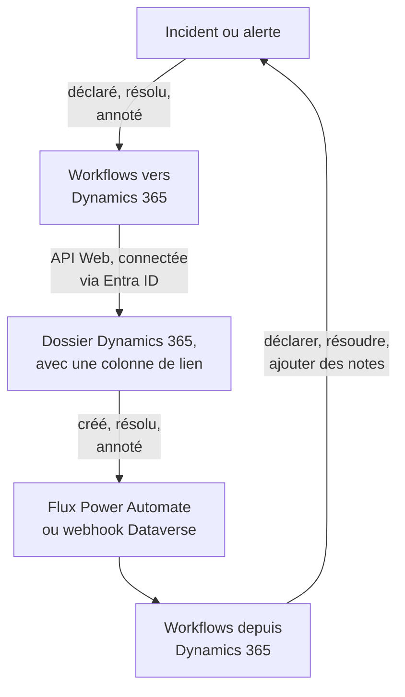

# Microsoft Dynamics 365

Gardez les dossiers (cases) [Microsoft Dynamics 365](https://www.microsoft.com/dynamics-365) en phase avec vos incidents et alertes OneUptime, dans les deux sens. Des modèles de workflow prêts à l'emploi ouvrent un dossier pour chaque incident ou alerte, le ferment quand l'enregistrement est résolu et y copient les notes. D'autres déclarent des incidents à partir de nouveaux dossiers et rapportent les résolutions et les notes. Il n'y a pas de plugin : les workflows appellent l'API Web de Dataverse, et Dynamics 365 appelle leurs URL de webhook.

:::cards
- [Préparer Dynamics 365](#préparer-dynamics-365): Un enregistrement d'application, un utilisateur d'application et une colonne de lien.
- [Partir d'un modèle](#partir-dun-modèle): Les 13 modèles, ce qu'ils demandent et comment les configurer.
- [Fonctionnement des modèles](#fonctionnement-des-modèles): Comment dossiers et enregistrements restent liés, sans boucles.
- [Le construire vous-même](#le-construire-vous-même): Chaque sens à la main, quand un modèle ne convient pas.
:::

## Fonctionnement



Chaque modèle est un petit workflow, vous ne prenez donc que les sens qui vous intéressent, pour les incidents, les alertes ou les deux. Les modèles de OneUptime vers Dynamics 365 appellent l'API Web de Dataverse, connectés en tant qu'application via Microsoft Entra ID. Les modèles de Dynamics 365 vers OneUptime démarrent quand un flux Power Automate ou un webhook Dataverse les appelle. Une colonne de texte que vous ajoutez à la table Case lie chaque dossier à son enregistrement.

## Avant de commencer

- Un environnement Dynamics 365 avec la table **Case**. Les dossiers viennent de Dynamics 365 Customer Service : un environnement Dataverse qui ne l'a pas n'a pas de table `incident` où écrire.
- Le droit d'inscrire une application dans **Microsoft Entra ID**, et de créer un utilisateur d'application dans l'environnement. Ce sont souvent deux administrateurs différents.
- Dans OneUptime, le droit de créer des workflows. Sur OneUptime Cloud, les workflows nécessitent l'offre **Growth** ou supérieure.

> [!NOTE]
> Cette page utilise les noms de Dataverse, pas les libellés des formulaires de Dynamics. Un dossier est la table `incident`, sa collection dans une URL est `incidents`, sa clé est `incidentid` et sa colonne de titre est `title`. Le numéro de dossier que vous voyez est `ticketnumber`.

## Préparer Dynamics 365

Les modèles comme un workflow que vous construisez vous-même en ont besoin. OneUptime se connecte en tant qu'application, pas en tant que personne, avec le flux OAuth 2.0 des identifiants client.

:::steps
### Inscrire une application dans Microsoft Entra ID

1. Connectez-vous au [portail Azure](https://portal.azure.com) en tant qu'administrateur du locataire de votre environnement Dynamics, et ouvrez **Microsoft Entra ID**.
2. Allez dans **App registrations → New registration**. Nommez-la `OneUptime Integration`, laissez **Supported account types** sur **Accounts in this organizational directory only** et sélectionnez **Register**.
3. Depuis la page **Overview** de l'application, copiez l'**Application (client) ID** et le **Directory (tenant) ID**.
4. Allez dans **Certificates & secrets → Client secrets → New client secret**, et copiez la **Value** du secret, pas son ID, avant de quitter la page : elle n'est plus jamais affichée. Un secret client vit au plus 24 mois, notez donc sa date d'expiration.

N'ajoutez aucune permission d'API et n'accordez aucun consentement administrateur : sans utilisateur connecté, ils ne servent à rien. C'est Dynamics 365 qui décide de ce que l'application peut faire, par son utilisateur d'application.

### Créer l'utilisateur d'application

1. Dans le [centre d'administration Power Platform](https://admin.powerplatform.microsoft.com/), sélectionnez **Manage → Environments**, puis votre environnement.
2. Sélectionnez **Settings → Users + permissions → Application users**, puis **+ New app user** et **+ Add an app**. Choisissez l'inscription et sélectionnez **Add**.
3. Choisissez une **Business unit**, puis donnez-lui un rôle de sécurité personnalisé avec l'icône de modification à côté de **Security roles**. Au niveau Organization, le rôle a besoin de :
   - **Case** : Create, Read, Write, Append et Append To.
   - **Note** : Create, Read et Append, pour les modèles de notes.
   - **Activity** : Create, Read et Append, car fermer un dossier enregistre une Case Resolution, qui est une activité.
   - **Account**, et **Contact** si les dossiers sont ouverts au nom d'un contact : Read et Append To.
4. Sélectionnez **Save**, puis **Create**.

Un utilisateur d'application ne peut avoir qu'un rôle personnalisé : copiez un rôle existant et réduisez-le. Sans cet utilisateur, Microsoft Entra ID délivre quand même des jetons, mais chaque appel à Dynamics 365 échoue avec `403` et `0x80072560`, « The user isn't a member of the organization. »

### Ajouter une colonne de lien à la table Case

Dataverse n'a rien de comparable aux étiquettes de Jira, donc un dossier et un enregistrement OneUptime se retrouvent grâce à une colonne que vous ajoutez.

1. Dans [make.powerapps.com](https://make.powerapps.com), choisissez votre environnement, ouvrez **Tables → Case → Columns** et sélectionnez **New column**.
2. Nommez-la `OneUptime Link`, gardez **Data type** sur **Single line of text** et enregistrez. La longueur maximale par défaut de 100 suffit largement : les modèles écrivent au plus 55 caractères.
3. Ouvrez la nouvelle colonne et copiez son **Logical name**, par exemple `new_oneuptimelink`. Le préfixe vient de l'éditeur de votre solution, le vôtre peut donc différer, comme `cr4f2_oneuptimelink`.

Ajoutez la colonne au formulaire Case si les agents doivent voir le lien.
:::

## Partir d'un modèle

La boîte de dialogue **Créer un flux de travail** propose 13 modèles Dynamics 365, sous **Dynamics 365** dans sa liste de catégories : sept pour les incidents, puis six pour les alertes, chaque groupe sous son propre titre. Ils partagent la colonne de lien, de sorte que toute combinaison fonctionne ensemble.

### Modèles pour les incidents

| Modèle | Ce qu'il fait | Ce qu'il demande |
| --- | --- | --- |
| **De OneUptime vers Dynamics 365** | | |
| Create a Dynamics 365 case when an incident is declared | Ouvre un dossier pour chaque nouvel incident, avec une priorité choisie d'après sa gravité et l'ID de l'incident dans la colonne de lien. Les incidents déclarés depuis Dynamics 365, et les incidents privés, sont ignorés. | Les cinq paramètres Dynamics 365, le client des nouveaux dossiers et l'URL de OneUptime |
| Resolve the Dynamics 365 case when the incident is resolved | Ferme le dossier lié comme **Problem Solved** quand l'incident est résolu, en enregistrant une Case Resolution comme le fait une résolution à la main. Ne rouvre jamais un dossier. | Les cinq paramètres Dynamics 365 |
| Copy incident private notes to the Dynamics 365 case | Ajoute chaque nouvelle note privée au dossier lié, sous forme de note. | Les cinq paramètres Dynamics 365 |
| Copy incident public notes to the Dynamics 365 case | Ajoute chaque nouvelle note publique au dossier lié, sous forme de note, pour que les agents puissent dire aux clients ce qu'indique la page de statut. | Les cinq paramètres Dynamics 365 |
| **De Dynamics 365 vers OneUptime** | | |
| Declare an incident when a Dynamics 365 case is created | Déclare un incident pour chaque nouveau dossier, tenu à l'écart de vos pages de statut, avec une gravité choisie d'après la priorité du dossier, puis écrit l'ID de l'incident dans la colonne de lien du dossier. | Les cinq paramètres Dynamics 365, et un flux ou un webhook pour les nouveaux dossiers |
| Resolve the incident when its Dynamics 365 case is resolved | Résout l'incident quand son dossier lié est résolu. | Les cinq paramètres Dynamics 365, et un flux ou un webhook pour les changements de statut des dossiers |
| Add Dynamics 365 case notes to the incident as private notes | Copie chaque note qu'un agent ajoute à un dossier lié sur l'incident, en note privée. | Les cinq paramètres Dynamics 365, et un flux ou un webhook pour les nouvelles notes |

### Modèles pour les alertes

Les modèles pour les alertes font les mêmes travaux pour les alertes. Il y en a un de moins, car les alertes n'ont pas de notes publiques, et **Create an alert when a Dynamics 365 case is created** n'écrit aucun paramètre de page de statut, car une alerte n'atteint jamais une page de statut.

| Modèle | Ce qu'il fait | Ce qu'il demande |
| --- | --- | --- |
| **De OneUptime vers Dynamics 365** | | |
| Create a Dynamics 365 case when an alert is created | Ouvre un dossier pour chaque nouvelle alerte, y compris chaque alerte qu'un moniteur lève. Les alertes créées depuis Dynamics 365, et les alertes privées, sont ignorées. | Les cinq paramètres Dynamics 365, le client des nouveaux dossiers et l'URL de OneUptime |
| Resolve the Dynamics 365 case when the alert is resolved | Ferme le dossier lié comme **Problem Solved** quand l'alerte est résolue. | Les cinq paramètres Dynamics 365 |
| Copy alert private notes to the Dynamics 365 case | Ajoute chaque nouvelle note privée au dossier lié, sous forme de note. | Les cinq paramètres Dynamics 365 |
| **De Dynamics 365 vers OneUptime** | | |
| Create an alert when a Dynamics 365 case is created | Crée une alerte pour chaque nouveau dossier, avec une gravité choisie d'après la priorité du dossier, puis écrit l'ID de l'alerte dans la colonne de lien du dossier. | Les cinq paramètres Dynamics 365, et un flux ou un webhook pour les nouveaux dossiers |
| Resolve the alert when its Dynamics 365 case is resolved | Résout l'alerte quand son dossier lié est résolu. | Les cinq paramètres Dynamics 365, et un flux ou un webhook pour les changements de statut des dossiers |
| Add Dynamics 365 case notes to the alert as private notes | Copie chaque note qu'un agent ajoute à un dossier lié sur l'alerte, en note privée. | Les cinq paramètres Dynamics 365, et un flux ou un webhook pour les nouvelles notes |

Aucun des modèles de OneUptime vers Dynamics 365 n'envoie à Dynamics 365 un incident marqué **Incident privé**, ni une alerte marquée **Alerte privée** : ni l'enregistrement, ni son état, ni ses notes, sauf si vous l'activez. Voir [Changer ce que fait un modèle](#changer-ce-que-fait-un-modèle).

**Les moniteurs lèvent des alertes d'eux-mêmes, et parfois beaucoup.** **Create a Dynamics 365 case when an alert is created** ouvre un dossier pour chacune. Sauf si chaque alerte mérite un dossier, placez un bloc **If / Else** entre le déclencheur et le reste du workflow, par exemple sur `{{local.components.alert-on-create-1.returnValues.model.alertSeverity.name}}`, et ne reliez que son côté **Yes** à la suite.

### Ce que demandent les modèles

L'étape **Configurer** de l'assistant de création demande jusqu'à sept valeurs : chaque modèle demande les cinq premières, les paramètres Dynamics 365, et les deux modèles qui créent un dossier demandent aussi les deux dernières. Elle vérifie la forme de chaque paramètre Dynamics 365 avant que quoi que ce soit ne soit créé, et dit quoi saisir à la place, car une valeur de mauvaise forme n'est une erreur nulle part avant une exécution.

- **Dynamics 365 Environment URL** — l'adresse de votre environnement, par exemple `https://yourorg.crm.dynamics.com`, depuis le [centre d'administration Power Platform](https://admin.powerplatform.microsoft.com/) sous **Environments**, votre environnement, **Environment URL**. Seulement l'adresse : pas le point d'accès de l'API Web, qui se termine par `/api/data/v9.2`, et pas de barre oblique finale.
- **Directory (Tenant) ID** — depuis la page **Overview** de l'inscription d'application.
- **Application (Client) ID** — depuis la même page.
- **Client Secret Value** — la **Value** du secret client, depuis **Certificates & secrets**. Pas son **Secret ID**, qui est un GUID : l'assistant refuse un GUID ici.
- **Case Link Column** — le nom logique de la colonne de lien, par exemple `new_oneuptimelink`.
- **Customer for New Cases** — seuls les deux modèles qui créent un dossier le demandent. Chaque dossier a besoin d'un client, et un incident OneUptime n'en a pas, donc les nouveaux dossiers sont tous ouverts au nom d'un seul : collez l'ID d'un compte, ou `contacts(<id>)` pour un contact. Ouvrez l'enregistrement dans Dynamics 365 : son ID est la partie qui suit `id=` dans l'adresse.
- **OneUptime URL** — seuls les deux modèles qui créent un dossier la demandent : l'adresse à laquelle vous ouvrez OneUptime, par exemple `https://oneuptime.com`. La description du dossier renvoie avec elle vers l'incident ou l'alerte.

**Comment les modèles se connectent.** L'assistant enregistre le locataire, l'ID client et le secret dans une seule [variable OAuth 2.0](/docs/workflows/variables#variables-oauth-20-des-jetons-qui-se-renouvellent-seuls), `dynamicsAccessToken`, sous **Variables de flux de travail** du workflow : Client Credentials, l'URL de jeton `https://login.microsoftonline.com/<tenant>/oauth2/v2.0/token`, la portée `<environment URL>/.default`, et le secret client, envoyé dans le corps de la requête et stocké chiffré. Chaque appel à Dynamics 365 envoie `Authorization: Bearer {{local.variables.dynamicsAccessToken}}`. OneUptime récupère le jeton la première fois qu'une étape en a besoin, en récupère un nouveau avant qu'il n'expire, et le remplace par `[REDACTED]` dans les journaux d'exécution et les traces des étapes.

Pour vérifier la connexion avant toute exécution, ouvrez **Variables de flux de travail**, cliquez sur **Voir** sur `dynamicsAccessToken`, puis sur **Actualiser maintenant**. **Access Token Fetched** signifie que l'inscription d'application est correcte. Sinon, l'erreur de Microsoft Entra ID nomme ce qui ne va pas, par exemple `AADSTS7000215: Invalid client secret provided`.

Chaque workflow garde sa propre copie. Quand vous remplacez le secret client, ouvrez `dynamicsAccessToken` dans chaque workflow Dynamics 365 et utilisez **Mettre à jour les identifiants**.

### Créer les workflows

:::steps
1. Ouvrez **Flux de travail → Créer un flux de travail**. Sous **Ou partir d'un modèle**, choisissez **Dynamics 365** dans la liste des catégories, ou tapez `Dynamics` dans **Rechercher des modèles…**, et cliquez sur le modèle voulu. Il s'ouvre et montre ce qu'il fait et les paramètres qu'il demandera. Cliquez sur **Utiliser ce modèle**.
2. **Nom** est rempli à partir du modèle. Changez-le si vous le souhaitez.
3. **Configurer** demande les valeurs ci-dessus.
4. Cliquez sur **Créer un flux de travail**. Chaque workflow est créé désactivé : activez **Activé** en haut de son **Constructeur**.
:::

Commencez par **Create a Dynamics 365 case when an incident is declared**, ou par **Create a Dynamics 365 case when an alert is created** pour les alertes : chaque autre modèle de OneUptime vers Dynamics 365 du même genre retrouve le dossier grâce au lien que celui-ci écrit. Activez-le, déclarez un incident de test ou créez une alerte de test, et ouvrez **Journaux → Exécutions** du workflow. La dernière étape de l'exécution devrait indiquer `✅ Opened Dynamics 365 case CAS-01001-X1Y2Z3 for INC-42, linked as oneuptime-incident-<id>.`

### Connecter les modèles de Dynamics 365 vers OneUptime

Les modèles de Dynamics 365 vers OneUptime, trois pour les incidents et trois pour les alertes, partent d'un [déclencheur Webhook](/docs/workflows/triggers#webhook), il faut donc indiquer à Dynamics 365 où envoyer ses événements. Procédez dans cet ordre :

1. Créez le workflow et **activez-le d'abord**. Un workflow désactivé refuse les livraisons, et elles ne sont pas mises en file d'attente.
2. Ouvrez le **Constructeur** du workflow, cliquez sur le bloc déclencheur **Webhook** (`webhook-1`), puis sur **Copier l'URL** en haut de ses paramètres. L'URL ressemble à ceci :

   ```text
   https://<your OneUptime host>/workflow/trigger/<webhook secret key>
   ```

3. Faites publier Dynamics 365 sur cette URL, depuis un flux Power Automate ou depuis un webhook Dataverse.

Chaque modèle a seulement besoin de savoir quelle ligne a changé. Il relit cette ligne dans Dynamics 365 avant de faire quoi que ce soit, donc il ne prend jamais le titre, le statut ou le lien d'un dossier dans la requête, et peu lui importe lequel des deux l'envoie.

:::tabs
@tab Power Automate flow
Dans [Power Automate](https://make.powerautomate.com), créez un **Automated cloud flow** avec le déclencheur **Microsoft Dataverse** **When a row is added, modified or deleted**, réglé comme ci-dessous, avec **Scope** sur **Organization**. Ajoutez l'action intégrée **HTTP** : **Method** `POST`, **URI** l'URL du workflow, un en-tête `Content-Type: application/json` et le corps ci-dessous, avec l'ID de la ligne choisi dans le contenu dynamique du déclencheur.

| Modèle | Change type | Table name | Select columns | Body |
| --- | --- | --- | --- | --- |
| Déclarer un incident / créer une alerte quand un dossier est créé | Added | Cases | | `{"incidentid": "<Case>"}` |
| Résoudre l'incident / l'alerte quand son dossier est résolu | Modified | Cases | `statecode,statuscode` | `{"incidentid": "<Case>"}` |
| Ajouter les notes du dossier à l'incident / l'alerte en notes privées | Added | Notes | | `{"annotationid": "<Note>"}` |

Pour n'envoyer que certains dossiers, utilisez **Filter rows** du déclencheur, par exemple `prioritycode eq 1` pour les dossiers de priorité haute. Vous pouvez aussi publier toute la sortie du déclencheur : les modèles y lisent l'ID de la ligne et son `SdkMessage` de la même façon.
@tab Dataverse webhook
Enregistrez l'URL avec le [Plug-in Registration Tool](https://learn.microsoft.com/en-us/power-apps/developer/data-platform/register-web-hook) : **Register New WebHook**, avec l'authentification **HttpHeader** et un en-tête de votre choix ; c'est l'URL elle-même qui est le secret. Enregistrez ensuite une étape dessus pour chaque événement ci-dessous, avec **Event Pipeline Stage of Execution** sur **PostOperation** et **Execution Mode** sur **Asynchronous**.

| Modèle | Message | Primary Entity | Filtering Attributes |
| --- | --- | --- | --- |
| Déclarer un incident / créer une alerte quand un dossier est créé | `Create` | `incident` | |
| Résoudre l'incident / l'alerte quand son dossier est résolu | `Close`, et `Update` pour les changements de statut faits par d'autres | `incident` | `statecode, statuscode` (Update) |
| Ajouter les notes du dossier à l'incident / l'alerte en notes privées | `Create` | `annotation` | |

Résoudre un dossier déclenche le message **Close**, pas **Update**, c'est pourquoi ce modèle a besoin des deux. Un webhook publie le contexte d'exécution du plug-in, qui nomme la ligne dans `PrimaryEntityId`, ou, pour **Close**, dans son `IncidentResolution`, et les modèles la lisent là. Un webhook Dataverse n'appelle que les ports 80 et 443, et n'a pas de filtre de lignes propre : chaque nouveau dossier atteint le modèle de création, sauf si vous le restreignez avec `ONLY_PRIORITIES`.
:::

Avant de vous fier à l'un ou à l'autre :

- **Toute personne qui a l'URL peut déclencher le workflow.** Comme les modèles relisent chaque ligne dans Dynamics 365, une requête ne peut leur faire regarder qu'un vrai dossier ou une vraie note. Elle peut quand même faire agir les modèles de création sur un dossier qui n'est pas encore lié. Ne gardez l'URL que dans le flux ou le webhook. Si elle fuite, cliquez sur le déclencheur **Webhook** dans le **Constructeur** du workflow, cliquez sur **Réinitialiser l'URL** et collez la nouvelle URL dans le flux ou le webhook. L'ancienne URL cesse aussitôt de fonctionner.
- **Chaque événement est une exécution**, y compris ceux qu'un modèle ignore. Sur OneUptime Cloud, chacun compte dans les exécutions de workflow de votre offre, et filtrer dans le flux limite ce nombre. Voir [Limites de l'offre](/docs/workflows/configuration#limites-du-forfait).
- **Vous utilisez les deux modèles qui créent un enregistrement à partir d'un dossier ?** **Declare an incident when a Dynamics 365 case is created** et **Create an alert when a Dynamics 365 case is created** agissent tous deux sur chaque dossier qu'on leur envoie. Chacun vérifie d'abord la colonne de lien, mais deux livraisons pour un même nouveau dossier arrivent ensemble, donc le dossier peut se retrouver avec un incident et une alerte. Envoyez-leur des dossiers différents, par type de dossier par exemple.

### Vérifier que cela fonctionne

Chaque modèle se termine par une étape **Log** qui dit ce qui s'est passé, c'est donc la dernière étape d'une exécution dans **Journaux → Exécutions** qu'il faut regarder :

- `✅` — il a fait son travail, et nomme le dossier, l'incident ou l'alerte.
- `ℹ️` — il a ignoré l'événement exprès, et dit pourquoi : le dossier n'est lié à aucun enregistrement de ce genre, la note vient de l'autre côté, l'enregistrement est privé, ou aucun statut de dossier ne correspond au nouvel état.
- `❌` — un appel a échoué. Pour un appel à Dynamics 365, la ligne inclut la réponse de Dynamics 365.
- `⚠️` — un modèle qui crée un enregistrement à partir d'un dossier l'a créé, mais Dynamics 365 n'a pas accepté le lien, donc les autres modèles ne peuvent pas encore le trouver. Saisissez le lien à la main dans la colonne du dossier.

Si une exécution s'arrête à la première étape Dynamics 365 avec `Could not get an OAuth 2.0 access token for {{local.variables.dynamicsAccessToken}}`, les paramètres de connexion sont erronés, et le message cite la réponse de Microsoft Entra ID. Voir [Ce que demandent les modèles](#ce-que-demandent-les-modèles).

## Fonctionnement des modèles

### Comment les deux côtés restent liés

C'est le dossier qui garde le lien. Un dossier qui appartient à un incident a `oneuptime-incident-<incident id>` dans sa colonne de lien, et un dossier qui appartient à une alerte a `oneuptime-alert-<alert id>`. L'ID est la dernière partie de l'adresse de l'enregistrement dans le tableau de bord.

Les modèles qui créent un dossier l'écrivent en ouvrant le dossier, et les modèles qui créent un enregistrement à partir d'un dossier l'écrivent dès que l'enregistrement existe. Tous les autres modèles font le lien grâce à lui : ceux de OneUptime vers Dynamics 365 cherchent le dossier par son lien, et ceux de Dynamics 365 vers OneUptime lisent l'ID de l'enregistrement sur le dossier. Pour lier un dossier ouvert à la main, saisissez vous-même la valeur dans sa colonne de lien, mais seulement quand l'enregistrement n'a pas encore de dossier.

**Un dossier est lié à un incident ou à une alerte, jamais aux deux.** Une seule colonne sert aux deux genres. Les modèles pour les incidents ignorent un dossier lié à une alerte, et inversement, et les modèles qui créent un enregistrement à partir d'un dossier laissent de côté tout dossier dont la colonne de lien contient quoi que ce soit.

**Un enregistrement a un seul dossier.** Les modèles qui écrivent dans un dossier n'agissent que quand exactement un dossier contient le lien de l'enregistrement. Si le lien est copié dans un second dossier, ils s'arrêtent, et chaque exécution se termine par un saut qui nomme les deux :

```text
More than one Dynamics 365 case holds the link oneuptime-incident-<id> (CAS-01001-X1Y2Z3, CAS-01002-K4L5M6). Clear it on every case except the one opened for the incident.
```

Les incidents et alertes créés à partir d'un dossier gardent aussi l'ID et le numéro du dossier dans `customFields.dynamicsCaseId` et `customFields.dynamicsCaseNumber`, écrits à leur création. C'est ainsi que les modèles qui créent un dossier savent que l'enregistrement en a déjà un.

### Comment les modèles évitent les boucles

Chaque écriture dans un sens est un événement dans l'autre : une note ajoutée à un dossier revient comme une nouvelle note, et une note privée ajoutée dans OneUptime lance le déclencheur de note. Quatre choses arrêtent l'écho :

- **Des marqueurs dans le texte.** Chaque note que les modèles ajoutent à un dossier est intitulée `Synced from OneUptime: …`, tout comme l'objet de chaque Case Resolution qu'ils enregistrent. Chaque note écrite depuis Dynamics 365, et la cause de chaque changement d'état fait depuis Dynamics 365, commence par `Synced from Dynamics 365`. Chaque sens ignore le texte qui porte le marqueur de l'autre côté, même dans une note écrite par quelqu'un qui en cite un.
- **Le lien dès le premier enregistrement.** Un dossier que OneUptime ouvre contient son lien dès qu'il existe, donc quand son **Create** revient, le modèle qui crée un enregistrement à partir d'un dossier le trouve lié et ne fait rien.
- **`customFields.dynamicsCaseId`.** Un enregistrement créé à partir d'un dossier le porte, et les modèles qui créent un dossier ignorent ces enregistrements.
- **Les états n'avancent que vers l'avant, des deux côtés.** Résoudre l'enregistrement ferme le dossier, et le **Close** du dossier trouve alors l'enregistrement déjà résolu. Quand le dossier est résolu en premier, l'enregistrement est résolu, et sa mise à jour trouve le dossier déjà fermé. Un dossier déjà résolu ou annulé n'est jamais rouvert.

Gardez les marqueurs quand vous modifiez les modèles. Ce sont les constantes `FROM_ONEUPTIME` et `FROM_DYNAMICS` du bloc d'aide en tête de chaque script.

### Changer ce que fait un modèle

Ouvrez le **Constructeur** du workflow et cliquez sur le bloc à changer. Les réglages que vous voudrez le plus probablement changer sont des constantes en haut d'un script, le **JavaScript Code** d'un bloc **Run Custom JavaScript**, juste sous le bloc d'aide commun. Les versions pour les incidents et pour les alertes gardent les mêmes constantes dans les mêmes blocs.

| Constante | Modèle, et bloc | Ce qu'elle règle |
| --- | --- | --- |
| `SYNC_PRIVATE_INCIDENTS`, `SYNC_PRIVATE_ALERTS` | Chaque modèle de OneUptime vers Dynamics 365 — `prepare-case-1`, `plan-case-1`, `build-note-1` | `false` garde les enregistrements privés hors de Dynamics 365 : aucun dossier n'est ouvert pour eux, leur dossier n'est pas modifié, et leurs notes ne sont pas ajoutées. Réglez-la sur `true` dans chaque modèle qui doit les envoyer. |
| `SEVERITY_TO_PRIORITY`, `DEFAULT_PRIORITY` | Créer un dossier Dynamics 365 — `prepare-case-1` | Les gravités du projet sont réparties sur les priorités de dossier selon leur ordre : la plus sévère ouvre un dossier High (`1`), la moins sévère un dossier Low (`3`), et celles du milieu des dossiers Normal (`2`). Listez une gravité par son nom, en minuscules, pour choisir vous-même sa priorité, par exemple `{ 'major incident': 1 }`. `DEFAULT_PRIORITY` (`2`) sert pour une gravité absente de la liste du projet, ou pour un projet qui n'en a qu'une. |
| `CASE_ORIGIN`, `CASE_TYPE` | Créer un dossier Dynamics 365 — `prepare-case-1` | Le `caseorigincode` (`3`, Web) et le `casetypecode` (`2`, Problem) du nouveau dossier. Pour régler une autre colonne, ajoutez-la à `CASE` dans le même script, sous son nom logique. |
| `MAX_TITLE_LENGTH`, `MAX_DESCRIPTION_LENGTH` | Créer un dossier Dynamics 365 — `prepare-case-1` | Les limites propres à la table Case, 200 et 2000 caractères. La description garde le lien de retour vers OneUptime, quelle que soit la longueur coupée. Augmentez-les si votre table Case le permet. |
| `RESOLVED_CASE_STATUS` | Résoudre le dossier Dynamics 365 — `plan-case-1` | Le statut avec lequel un enregistrement résolu ferme son dossier : `5` correspond à Problem Solved, `1000` à Information Provided. |
| `STATE_TO_CASE_STATUS` | Résoudre le dossier Dynamics 365 — `plan-case-1` | Fait évoluer le dossier quand l'enregistrement atteint un autre état, par le nom de l'état : `{ Acknowledged: 4 }` le fait passer à Researching quand l'incident est pris en compte. Les statuts actifs de Dynamics 365 sont `1` In Progress, `2` On Hold, `3` Waiting for Details et `4` Researching. Un état résolu listé ici ferme le dossier avec le statut qu'il nomme. |
| `PRIORITY_RANK` | Créer à partir d'un dossier Dynamics 365 — `prepare-incident-1`, `prepare-alert-1` | Associe une priorité de dossier (`1` High, `2` Normal, `3` Low) à `0` (votre gravité la plus sévère), `1` ou `2` (la moins sévère). Les priorités non listées tombent au milieu. Avec les deux gravités d'alerte d'un nouveau projet, Normal devient Low sauf si vous changez `2: 1` en `2: 0`. |
| `ONLY_PRIORITIES` | Créer à partir d'un dossier Dynamics 365 — `prepare-incident-1`, `prepare-alert-1` | Vide, elle prend chaque dossier qu'envoie le flux ou le webhook. `[1]` ne crée des enregistrements que pour les dossiers de priorité haute. |
| `CASE_STATUS_TO_STATE`, `CASE_STATE_TO_STATE_FLAG` | Résoudre quand le dossier Dynamics 365 est résolu — `decide-state-1` | Un statut de dossier, par son nom, vers un état OneUptime, par exemple `{ Researching: 'Acknowledged' }`. Sinon, c'est l'état du dossier qui décide : Resolved résout l'enregistrement. Ajoutez `2: 'isResolvedState'` pour le résoudre aussi quand son dossier est annulé. |
| `MESSAGES` | Chaque modèle de Dynamics 365 vers OneUptime — `read-event-1` | Les événements sur lesquels le modèle agit. Ajoutez `'Update'` à la liste du modèle de notes pour copier aussi les notes modifiées : chaque modification devient une nouvelle note. |
| `MAX_NOTE_LENGTH` | Les modèles de notes — `build-note-1`, `read-note-1` | La note la plus longue que chacun écrit : 100 000 caractères vers Dynamics 365, la limite propre d'une note, et 30 000 vers OneUptime. |

Les noms d'état et de statut utilisés comme clés doivent être écrits exactement comme ils sont nommés, majuscules comprises. Évitez `{{` dans le code : un script est rempli comme tout autre paramètre avant de s'exécuter, donc deux accolades ouvrantes à la suite seraient lues comme une référence.

### Limites

- **Le cloud commercial de Microsoft.** L'URL de jeton est `login.microsoftonline.com`. Pour les clouds US Government (GCC High, DoD) ou Chine, ouvrez `dynamicsAccessToken`, utilisez **Modifier les paramètres** et remplacez l'URL de jeton par l'hôte de connexion de votre cloud, par exemple `login.microsoftonline.us`.
- **Dynamics 365 peut refuser de résoudre un dossier.** Vos paramètres Customer Service peuvent empêcher de résoudre un dossier tant qu'il a des activités ouvertes ou des dossiers enfants ouverts, et une règle métier ou un plug-in peut aussi le refuser. L'exécution se termine par `❌ Dynamics 365 did not resolve the case`, avec la raison donnée par Dynamics 365, et le dossier reste tel quel.
- **Enregistrements et dossiers ne reculent jamais.** Rouvrir un dossier ne change rien dans OneUptime, et un enregistrement résolu n'est jamais rouvert. Un dossier déjà résolu ou annulé n'est jamais rouvert pour être fermé de nouveau.
- **Notes et descriptions sont du texte brut.** Une note écrite dans l'éditeur de texte enrichi de Dynamics 365 arrive dans OneUptime sous la forme du texte qu'il affiche, tout comme une description de dossier écrite dans l'éditeur ou tirée d'un e-mail : les paragraphes et les sauts de ligne restent, tandis que la mise en forme, les images et les styles propres à l'e-mail disparaissent. Une note OneUptime arrive dans Dynamics 365 avec ses caractères bruts, Markdown compris. Le texte venu de Dynamics 365 — le titre et la description d'un dossier, une note, les noms des statuts, priorités, clients et personnes — se lit exactement comme il a été écrit : une image, un lien, du HTML, un diagramme ou une mention de chat comme `<!channel>` qui y sont tapés s'affichent comme leurs caractères et ne font rien, car un gluon de mots invisible suit le caractère qui les ouvrirait. Une copie du texte garde ce gluon. Un workflow garde les scripts avec lesquels il a été créé, donc un workflow créé à partir d'une ancienne version d'un modèle écrit le texte comme le faisait cette version : recréez-le à partir de son modèle pour obtenir ce comportement. Les pièces jointes restent dans Dynamics 365 ; la note dans OneUptime nomme le fichier.
- **Les notes modifiées ne sont pas copiées**, seulement les nouvelles, sauf si vous ajoutez `'Update'` à `MESSAGES`.
- **Les incidents et alertes privés restent dans OneUptime**, mais les modèles de Dynamics 365 vers OneUptime ne vérifient pas : les notes et changements de statut d'un dossier lié atteignent toujours un enregistrement privé.
- **Chaque dossier reçoit un enregistrement.** Sauf si vous filtrez le flux ou réglez `ONLY_PRIORITIES`, les modèles qui créent un enregistrement à partir d'un dossier créent un incident ou une alerte pour chaque nouveau dossier qu'on leur envoie. Dans un service client chargé, cela fait beaucoup.
- **Le même événement peut arriver deux fois.** Un webhook Dataverse retente une fois quand OneUptime répond `502`, `503` ou `504`. Un **Create** retenté qui arrive après que la première exécution a lié le dossier est laissé de côté. Un autre qui arrive pendant que la première exécution est encore en cours peut créer un second enregistrement.

## Le construire vous-même

Les modèles couvrent les cas courants. Pour construire un sens vous-même, cette section construit les deux à la main, pour les incidents, après [Préparer Dynamics 365](#préparer-dynamics-365). [Faire de même pour les alertes](#faire-de-même-pour-les-alertes) le transpose aux alertes.

### Se connecter avec une variable OAuth 2.0

Créez le jeton une fois, pour tous les workflows, sous forme de [variable OAuth 2.0](/docs/workflows/variables#variables-oauth-20-des-jetons-qui-se-renouvellent-seuls) :

1. Allez dans **Flux de travail → Variables globales**, ouvrez le menu **Plus** (**⋯**) à côté de **Créer : Variable de flux de travail** et choisissez **Créer une variable OAuth 2.0**. Nommez-la `DYNAMICS_TOKEN`.
2. Sur **Fournisseur**, choisissez **Microsoft Entra ID**, remplacez `{tenant-id}` dans l'**URL du jeton** par votre Directory (tenant) ID, et choisissez **Client Credentials**.
3. Sur **Identifiants**, saisissez l'**ID client** et le **Secret client**. Sur **Avancé**, réglez la portée sur `https://yourorg.crm.dynamics.com/.default`, puis créez la variable.

Tout bloc envoie alors `Bearer {{global.variables.DYNAMICS_TOKEN}}` dans son en-tête `Authorization`. OneUptime récupère le jeton, en récupère un nouveau avant qu'il n'expire, et le tient à l'écart des journaux d'exécution.

La portée doit être l'URL de votre environnement suivie de `/.default`. Une URL d'environnement erronée est la cause habituelle de `AADSTS70011: The provided value for the input parameter 'scope' is not valid`.

### Ouvrir un dossier pour chaque incident

:::steps
1. Créez à partir de zéro un workflow nommé `Incidents to Dynamics 365`. Cliquez sur le bloc en pointillés et ajoutez le déclencheur **On Create Incident**. Ses **Fields to pass on** commencent par **Titre** : cliquez sur **Ajouter un champ** et choisissez **Description** et **Numéro d'incident**. L'ID est toujours transmis.
2. Cliquez sur **Ajouter un composant**, ajoutez un bloc **API Post (JSON)** et reliez-y le point **Success** du déclencheur. Réglez son **Identifiant** sur `create-case`, et son **URL** sur `https://yourorg.crm.dynamics.com/api/data/v9.2/incidents?$select=incidentid,ticketnumber`.
3. Sous **Plus de champs**, réglez ses **Request Headers** sur :

   ```json
   {
     "Authorization": "Bearer {{global.variables.DYNAMICS_TOKEN}}",
     "OData-MaxVersion": "4.0",
     "OData-Version": "4.0",
     "Accept": "application/json",
     "If-None-Match": "null",
     "Prefer": "return=representation"
   }
   ```

4. Réglez son **Request Body** sur le dossier, avec le GUID du compte auquel vos dossiers appartiennent :

   ```json
   {
     "title": "OneUptime #{{local.components.incident-on-create-1.returnValues.model.incidentNumber}}: {{local.components.incident-on-create-1.returnValues.model.title}}",
     "description": "{{local.components.incident-on-create-1.returnValues.model.description}}",
     "caseorigincode": 3,
     "prioritycode": 1,
     "new_oneuptimelink": "oneuptime-incident-{{local.components.incident-on-create-1.returnValues.model._id}}",
     "customerid_account@odata.bind": "/accounts(00000000-0000-0000-0000-000000000000)"
   }
   ```

5. Activez **Activé**, déclarez un incident de test et ouvrez **Journaux → Exécutions**. L'étape `create-case` affiche un `201` et un corps avec le nouvel `incidentid` et le `ticketnumber`.
:::

Chaque dossier a besoin d'un client, donc `customerid` est obligatoire. Il peut désigner un compte ou un contact, c'est pourquoi vous écrivez `customerid_account@odata.bind` ou `customerid_contact@odata.bind`, exactement ainsi. `Prefer: return=representation` fait répondre `201` avec le dossier lui-même, pour que le bloc suivant puisse lire `{{local.components.create-case.returnValues.response-body.incidentid}}`. Sans cet en-tête, Dynamics 365 répond `204` sans corps.

`new_oneuptimelink` est la colonne de lien de [Préparer Dynamics 365](#préparer-dynamics-365), qui contient la même valeur que celle qu'écrivent les modèles, pour que vos workflows et les modèles retrouvent les dossiers les uns des autres. Utilisez le nom logique de votre colonne.

### Faire correspondre priorité et statut

Dynamics 365 livre `severitycode` avec une seule option, réglez donc plutôt `prioritycode`, et créez une branche sur la gravité de l'incident avec un bloc **If / Else** pour avoir une priorité par gravité. Envoyez ces colonnes sous forme de nombres :

| Colonne | Valeurs |
| --- | --- |
| `prioritycode` | `1` High, `2` Normal, `3` Low |
| `caseorigincode` | `1` Phone, `2` Email, `3` Web, `2483` Facebook, `3986` Twitter, `700610000` IoT |
| `casetypecode` | `1` Question, `2` Problem, `3` Request |
| `statecode` | `0` Active, `1` Resolved, `2` Cancelled |
| `statuscode` | `1` In Progress, `2` On Hold, `3` Waiting for Details, `4` Researching, `5` Problem Solved, `6` Cancelled, `1000` Information Provided, `2000` Merged |

`statuscode` peut être personnalisé, votre environnement peut donc avoir ses propres valeurs.

### Résoudre le dossier quand l'incident est résolu

Construisez cela dans un second workflow, pour qu'un échec ici n'empêche jamais l'ouverture des dossiers.

:::steps
1. Créez un workflow nommé `Close Dynamics 365 cases`, avec le déclencheur **On Update Incident**. Dans **Fields to watch**, cliquez sur **Ajouter un champ** et choisissez **État actuel de l'incident**. Dans **Fields to pass on**, cliquez sur **Ajouter un champ**, ouvrez **État actuel de l'incident** et choisissez **Est un état de résolution**.
2. Ajoutez un bloc **If / Else** : **Value to check** `{{local.components.incident-on-update-1.returnValues.model.currentIncidentState.isResolvedState}}`, **Comparison** **is true**.
3. Après son côté **Yes**, ajoutez un bloc **API Get (JSON)** avec l'**Identifiant** `find-case`, les mêmes en-têtes sans `Prefer`, et cette **URL** :

   ```text
   https://yourorg.crm.dynamics.com/api/data/v9.2/incidents?$select=incidentid&$filter=new_oneuptimelink%20eq%20'oneuptime-incident-{{local.components.incident-on-update-1.returnValues.model._id}}'
   ```

4. Ajoutez après lui un bloc **API Post (JSON)** vers `https://yourorg.crm.dynamics.com/api/data/v9.2/CloseIncident`, avec les mêmes en-têtes et ce corps :

   ```json
   {
     "IncidentResolution": {
       "@odata.type": "Microsoft.Dynamics.CRM.incidentresolution",
       "subject": "Resolved in OneUptime",
       "incidentid@odata.bind": "/incidents({{local.components.find-case.returnValues.response-body.value[0].incidentid}})"
     },
     "Status": 5
   }
   ```
:::

L'URL est envoyée exactement comme elle est écrite, donc les espaces de `$filter` sont écrits `%20`. Une requête répond avec une liste `value`, et `value[0]` est son premier dossier. `Status` est un `statuscode` de l'état Resolved : `5` correspond à Problem Solved.

Utilisez `CloseIncident` pour résoudre, plutôt qu'un `PATCH` de `statecode` : il enregistre la Case Resolution qu'un dossier résolu est censé avoir, et un `PATCH` est refusé là où un administrateur a configuré des transitions de statut. Pour tout le reste, comme une priorité ou un titre, envoyez un bloc **API Patch (JSON)** vers `https://yourorg.crm.dynamics.com/api/data/v9.2/incidents(<the case id>)` avec un en-tête `If-Match: *`, qui l'empêche de créer un nouveau dossier, et seulement les colonnes que vous changez.

### Recevoir les changements de Dynamics 365

Construisez d'abord le workflow qui reçoit :

1. Créez un workflow nommé `Dynamics 365 to OneUptime`, avec le déclencheur **Webhook**.
2. Ouvrez le **Constructeur** du workflow, cliquez sur le déclencheur **Webhook**, puis sur **Copier l'URL** en haut de ses paramètres. L'URL ressemble à ceci :

   ```text
   https://oneuptime.com/workflow/trigger/<webhook secret key>
   ```

   Sur une installation autogérée, l'URL porte votre propre hôte. Traitez l'URL comme un mot de passe : quiconque l'a peut démarrer le workflow. Si elle fuite, cliquez sur **Réinitialiser l'URL** au même endroit, et l'ancienne URL cesse aussitôt de fonctionner.

3. Ajoutez un bloc **If / Else** qui vérifie un secret partagé avant toute autre chose : **Value to check** `{{local.components.webhook-1.returnValues.request-headers.x-oneuptime-secret}}`, **Comparison** **is equal to**, **Compare with** une valeur que vous inventez, gardée dans une variable globale secrète.
4. Après son côté **Yes**, ajoutez un bloc **Update One Incident**. Réglez sa **Query** sur `{"_id": "{{local.components.webhook-1.returnValues.request-body.oneuptimeIncidentId}}"}`, et son **Data (JSON Object)** sur le changement, par exemple un nouveau `currentIncidentStateId`. Un bloc **Find One Incident State** avec la requête `{"name": "Resolved"}` vous donne cet ID avec `{{local.components.incident-state-find-one-1.returnValues.model._id}}`.

Activez-le, puis faites-le appeler par Dynamics 365 :

:::tabs
@tab Power Automate flow
1. Dans [Power Automate](https://make.powerautomate.com), créez un **Automated cloud flow** avec le déclencheur **Microsoft Dataverse** **When a row is added, modified or deleted** : **Change type** `Modified`, **Table name** `Cases`, **Scope** `Organization` et **Select columns** `statecode,statuscode`, pour qu'il ne se déclenche que sur les changements de statut.
2. Ajoutez **Get a row by ID** sur `Cases`, avec l'ID de la ligne venu du déclencheur : une mise à jour ne porte que les colonnes qui ont changé.
3. Ajoutez l'action intégrée **HTTP** : **Method** `POST`, **URI** l'URL du workflow, les en-têtes `Content-Type: application/json` et `X-OneUptime-Secret: <your secret>`, et un corps construit à partir de la ligne : `oneuptimeIncidentId` est la colonne de lien sans `oneuptime-incident-`, par exemple `replace(<link column>, 'oneuptime-incident-', '')`, à côté de `ticketnumber` et `statecode`.
4. Enregistrez le flux et activez-le.

Le connecteur Microsoft Dataverse est premium : le propriétaire du flux a besoin de la licence, et le flux s'arrête si elle expire. La livraison prend en général quelques secondes.
@tab Dataverse webhook
1. Enregistrez l'URL du workflow avec le [Plug-in Registration Tool](https://learn.microsoft.com/en-us/power-apps/developer/data-platform/register-web-hook) : **Register New WebHook**, avec l'authentification **HttpHeader** et l'en-tête `X-OneUptime-Secret`.
2. Enregistrez une étape pour le message **Update** sur `incident`, avec **Filtering Attributes** limité aux colonnes dont vous avez besoin, **PostOperation** et **Asynchronous**.
3. Dans le workflow, lisez la charge utile : c'est le contexte d'exécution du plug-in, dans lequel `InputParameters` est une liste de paires `{key, value}` et la ligne modifiée se trouve sous `Target`. Un bloc **Run Custom JavaScript** est le moyen le plus simple de la lire.

Dataverse n'appelle que les ports 80 et 443, attend une réponse 60 secondes, et retente une fois, seulement sur `502`, `503` et `504`. Une mise à jour ne porte que les colonnes qui ont changé, enregistrez donc une post-image pour les autres.
:::

### Faire de même pour les alertes

Les alertes fonctionnent de la même façon. Changez le type d'enregistrement, et rien d'autre ne change :

| Incident | Alerte |
| --- | --- |
| **On Create Incident** (`incident-on-create-1`) | **On Create Alert** (`alert-on-create-1`) |
| **On Update Incident** (`incident-on-update-1`) | **On Update Alert** (`alert-on-update-1`) |
| `incidentNumber`, `currentIncidentState`, `incidentSeverity` | `alertNumber`, `currentAlertState`, `alertSeverity` |
| **Find One Incident State** | **Find One Alert State** |
| **Update One Incident** | **Update One Alert** |

Un workflow a exactement un déclencheur, donc les incidents et les alertes ont chacun besoin de leur workflow. Pour faire le même travail Dynamics 365 pour les deux, construisez-le une fois dans un workflow avec un déclencheur **Manual**, et démarrez-le depuis les deux avec un bloc **Execute Workflow**.

## Dépannage

Ouvrez d'abord l'étape en échec dans **Journaux → Exécutions**. Les deux points d'accès de Microsoft répondent avec un corps JSON qui explique le problème, et le bloc d'API le garde dans `response-body`.

:::details 400 avec AADSTS70011, la portée n'est pas valide
La portée n'est pas l'URL de votre environnement suivie de `/.default`. Copiez l'URL depuis le centre d'administration Power Platform, et retirez toute barre oblique finale et tout chemin `/api/data/...`.
:::

:::details 401 Unauthorized depuis Dynamics 365
L'en-tête `Authorization` manque ou est mal formé. Il doit contenir `Bearer`, une espace, puis le jeton.
:::

:::details 403 Forbidden avec 0x80072560
« The user isn't a member of the organization » : l'utilisateur d'application manque, ou appartient à une autre inscription d'application. Le jeton est correct. Créez l'utilisateur comme dans [Préparer Dynamics 365](#préparer-dynamics-365).
:::

:::details 403 Forbidden avec une erreur de privilège
L'utilisateur d'application existe, mais son rôle de sécurité n'a pas un privilège dont l'appel a besoin, comme Create, Read ou Write sur **Case**.
:::

:::details 400 Bad Request à propos du client
`customerid` est obligatoire. Envoyez `customerid_account@odata.bind` ou `customerid_contact@odata.bind`, exactement ainsi, avec une adresse comme `/accounts(<guid>)`.
:::

:::details 404 Not Found sur CloseIncident
`CloseIncident` est fourni avec Dynamics 365 Customer Service, pas avec Dataverse seul. Cherchez-le dans le `$metadata` de votre environnement.
:::

:::details 412 Precondition Failed avec DuplicateRecord
Une règle de détection des doublons a trouvé une correspondance. Restreignez la règle, ou cessez d'envoyer le champ sur lequel elle se base.
:::

:::details 429 Too Many Requests
Les limites de protection du service de Dataverse permettent environ 6 000 requêtes, et 20 minutes de temps d'exécution, par utilisateur sur toute période de cinq minutes. La réponse porte `Retry-After`, en secondes. Placez un bloc **Sleep** dans un workflow qui envoie des rafales, ou déplacez le travail dans un workflow planifié.
:::

:::details Rien n'arrive dans OneUptime
Envoyez vous-même une requête à l'URL du webhook avec `curl`, et cherchez-la dans **Journaux → Exécutions**. Si la vôtre arrive et pas celle de Dynamics 365, cherchez en amont : l'historique d'exécution du flux lui-même, ou les System Jobs en échec d'un webhook Dataverse.
:::

:::details Le workflow s'exécute, mais l'incident ne change pas
Un bloc **Update One Incident** indique `Items Updated: 0` quand sa requête n'a rien trouvé, et c'est un succès, pas une erreur. Vérifiez que l'ID de la requête est bien celui de l'incident OneUptime, et que vous interrogez `_id`.
:::

## Étapes suivantes

:::cards
- [Jira](/docs/integrations/jira): La même synchronisation bidirectionnelle pour les tickets Jira.
- [Variables de workflow](/docs/workflows/variables#variables-oauth-20-des-jetons-qui-se-renouvellent-seuls): Les variables OAuth 2.0, et les jetons qu'elles gardent à jour.
- [Configuration et sécurité des workflows](/docs/workflows/configuration): La sécurité des webhooks, l'accès réseau sortant et les limites de l'offre.
- [Adresses IP](/docs/configuration/ip-addresses): Les adresses sortantes de OneUptime, si Dynamics 365 se trouve derrière une liste d'autorisation.
:::
