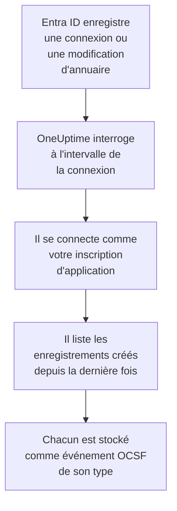

# Microsoft Entra ID

Importez les connexions et les modifications d'annuaire de [Microsoft Entra ID](https://learn.microsoft.com/en-us/entra/identity/) dans les événements de sécurité de OneUptime et, si vous le souhaitez, l'activité d'Exchange, SharePoint, OneDrive et Teams du [journal d'audit Microsoft 365](https://learn.microsoft.com/en-us/purview/audit-log-activities). Vous les y recherchez à côté de vos logs, traces et métriques, vous les corrélez avec toutes les autres sources, et vous prévenez l'astreinte pour celles qui comptent. OneUptime les lit avec une inscription d'application que vous créez, et ne modifie rien dans votre locataire.

:::cards
- [Configurer la connexion](#configurer-la-connexion): Une inscription d'application, ses autorisations et le formulaire de la connexion.
- [Ce qui est importé](#ce-qui-est-importé): Quels enregistrements, et comment chacun devient un événement de sécurité.
- [Fonctionnement des interrogations](#fonctionnement-des-interrogations): La fenêtre que lit chaque interrogation, et pourquoi elle chevauche la précédente de 30 minutes.
- [Dépannage](#dépannage): Ce que signifie chaque erreur, et ce qu'il faut changer.
:::

## Fonctionnement

Chaque minute, OneUptime interroge chaque connexion activée dont l'intervalle d'interrogation est écoulé. Une interrogation se connecte à Microsoft Entra ID en tant que votre inscription d'application et lit, dans cet ordre, les modifications d'annuaire ([List directoryAudits](https://learn.microsoft.com/en-us/graph/api/directoryaudit-list)) et les connexions ([List signIns](https://learn.microsoft.com/en-us/graph/api/signin-list)) enregistrées depuis la dernière interrogation, puis, quand l'option **Journal d'audit Microsoft 365** est activée, le nouveau contenu du journal d'audit ([Office 365 Management Activity API](https://learn.microsoft.com/en-us/office/office-365-management-api/office-365-management-activity-api-reference)). Chaque enregistrement est stocké comme un événement [OCSF](https://schema.ocsf.io/) : une connexion comme un événement Authentication, un rôle attribué comme un événement User Access Management, un verdict d'hameçonnage comme un Detection Finding.

## Avant de commencer

- Dans OneUptime, le rôle Project Owner, Project Admin ou Security Admin. Les rôles Security Member et Security Viewer voient les connexions et l'historique de leurs exécutions, mais ne peuvent pas les modifier.
- Pour les connexions, Microsoft Entra ID P1 ou P2, inclus dans Microsoft 365 E3, E5 et Business Premium : Microsoft Graph ne fournit les connexions qu'à ces locataires. Les modifications d'annuaire sont lues dans tout locataire.
- Un rôle Entra qui peut inscrire des applications, comme Administrateur d'applications, et un Administrateur général ou un Administrateur de rôle privilégié pour accorder le consentement administrateur.
- Pour le journal d'audit Microsoft 365, l'audit activé pour le locataire, ce qu'il est par défaut : dans le [portail Microsoft Purview](https://purview.microsoft.com), **Audit** ne doit pas proposer **Start recording user and admin activity**.
- Du HTTPS sortant depuis l'application et les workers OneUptime vers `login.microsoftonline.com`, `graph.microsoft.com` et `manage.office.com`, ou vers `login.microsoftonline.us`, `graph.microsoft.us` et `manage.office365.us` pour Azure Government.

## Configurer la connexion

La connexion s'authentifie avec le [flux d'informations d'identification du client OAuth 2.0](https://learn.microsoft.com/en-us/entra/identity-platform/v2-oauth2-client-creds-grant-flow) : en tant qu'application, jamais en tant que personne, avec des autorisations en lecture seule.

:::steps
### Inscrire une application

1. Connectez-vous au [centre d'administration Microsoft Entra](https://entra.microsoft.com) et ouvrez **App registrations**.
2. Sélectionnez **New registration**. Nommez-la `OneUptime Security Events`, laissez **Supported account types** sur **Accounts in this organizational directory only**, laissez l'URI de redirection vide, et sélectionnez **Register**.
3. Sur la page **Overview** de l'application, copiez l'**ID d'application (client)** et le **ID de l'annuaire (tenant)**.

### L'autoriser à lire les journaux

1. Allez dans **API permissions → Add a permission → Microsoft Graph → Application permissions**, choisissez `AuditLog.Read.All`, et sélectionnez **Add permissions**. Microsoft indique que sa liste des connexions peut aussi demander `Directory.Read.All` : ajoutez-la si les connexions sont refusées avec `403` une fois le consentement accordé.
2. Pour le journal d'audit Microsoft 365, ajoutez une deuxième autorisation : **Add a permission → Office 365 Management APIs → Application permissions**, puis `ActivityFeed.Read`.
3. Sélectionnez **Grant admin consent for** votre locataire, et confirmez. Le statut de chaque autorisation doit indiquer **Granted** : sans consentement, chaque lecture est refusée avec `403`.

### Créer un secret client

Allez dans **Certificates & secrets → Client secrets → New client secret**, choisissez quand il expire, et sélectionnez **Add**. Copiez la **Value** du secret, et non son **Secret ID**, avant de quitter la page : elle n'est plus jamais affichée. Le jour où il expire, l'interrogation s'arrête avec `Microsoft Entra ID token request failed (HTTP 401)` jusqu'à ce que vous le remplaciez avec **Mettre à jour les identifiants**.

### Ajouter la connexion dans OneUptime

Ouvrez **Produits → Événements de sécurité → Connexions** (`/dashboard/{projectId}/security-events/connections`), cliquez sur **Ajouter une connexion**, choisissez **Microsoft Entra ID** sous **Identité**, et cliquez sur **Suivant**. Remplissez les réglages du tableau ci-dessous, cliquez sur **Suivant**, et collez la valeur du secret dans **Secret client**. À l'étape **Interrogation**, activez **Journal d'audit Microsoft 365** pour le lire aussi.

### La tester avant d'enregistrer

Cliquez sur **Tester ces paramètres** sous **Tester avant d'enregistrer**. Le test se connecte et lit chaque journal avec les valeurs du formulaire, et n'enregistre rien, un secret erroné ou un consentement manquant apparaît donc avant que la connexion existe. Cliquez ensuite sur **Suivant**, donnez à la connexion un **Nom**, et créez-la.
:::

| Réglage | Où le trouver |
| --- | --- |
| **ID de l'annuaire (tenant)** | La page **Overview** de l'application. Le GUID du locataire, ou un domaine vérifié comme `contoso.onmicrosoft.com`. Avec **Journal d'audit Microsoft 365** activé, le GUID : la Management API ne désigne un locataire que par lui. |
| **ID d'application (client)** | La page **Overview** de l'application. Le GUID de l'application qui a `AuditLog.Read.All`. |
| **Cloud** | **Cloud public Azure**, ou **Azure Government (États-Unis)** pour GCC High (`login.microsoftonline.us`, `graph.microsoft.us` et `manage.office365.us`). |
| **Journal d'audit Microsoft 365** | Facultatif, désactivé par défaut. Activé, chaque interrogation lit aussi le journal d'audit Microsoft 365. L'application a besoin de `ActivityFeed.Read`. |
| **Secret client** | La **Value** du secret. Il est chiffré, jamais renvoyé par l'API et plus jamais affiché. Remplacez-le avec **Mettre à jour les identifiants** sur la connexion. |

L'étape **Interrogation** contient aussi une **Description** facultative, le **Intervalle d'interrogation (minutes)**, un nombre entier de `1` à `1440` qui vaut `5` au départ, et **Activé**, qui est activé au départ.

## Ce qui est importé

Chaque événement a le fournisseur `Microsoft` et le produit `Microsoft Entra ID`. Son attribut `entra.log` indique de quel journal vient une connexion ou une modification, et le `microsoft365.contentType` d'un enregistrement Microsoft 365 son type de contenu.

| Enregistrement | Classe OCSF | Gravité |
| --- | --- | --- |
| Une connexion qui a réussi | Authentication (`3002`), statut `Success` | Informational |
| Une connexion qui attend une deuxième étape, comme la MFA (`50074`, `50076`) ou une invite à changer de mot de passe | Authentication (`3002`), statut `Interrupted` | Informational : une étape, pas un échec |
| Une connexion qui a échoué, avec la raison et le code d'erreur d'Entra | Authentication (`3002`), statut `Failure` | Low |
| Une connexion qu'Identity Protection a jugée à risque moyen ou élevé | Authentication (`3002`) | Medium ou High |
| Un utilisateur, un groupe ou un rôle modifié, selon sa catégorie | Account Change (`3001`), Group Management (`3006`), User Access Management (`3005`), ou Entity Management (`3004`) pour le reste | Medium pour un rôle privilégié, comme Global Administrator ; Low pour une modification qui a échoué |

Avec **Journal d'audit Microsoft 365** activé, les enregistrements sur lesquels une équipe de sécurité agit en sont importés, et le reste, comme un fichier ouvert ou un e-mail lu, est seulement compté :

| Enregistrement Microsoft 365 | Classe OCSF | Gravité |
| --- | --- | --- |
| Une cmdlet Exchange, comme `New-InboxRule` ou `Set-Mailbox`, une règle de boîte de réception créée dans Outlook, ou un e-mail envoyé au nom de quelqu'un d'autre | API Activity (`6003`) | Medium quand elle transfère du courrier, avec `microsoft365.forwardsMail` à `true` |
| Une autorisation de boîte aux lettres accordée, comme `Add-MailboxPermission` | User Access Management (`3005`) | Low |
| Un fichier partagé dans SharePoint ou OneDrive | File Hosting Activity (`6006`) | Low avec un invité ou un lien que tout le monde peut ouvrir, avec `microsoft365.sharedOutside` à `true` |
| Un administrateur de collection de sites ajouté ou retiré | User Access Management (`3005`) | Low |
| Un e-mail malveillant ou d'hameçonnage trouvé par Microsoft Defender for Office 365 | Detection Finding (`2004`) | High pour un logiciel malveillant, Medium pour l'hameçonnage |
| Une alerte levée par Microsoft 365 | Detection Finding (`2004`) | Celle de l'alerte |
| Une application, un bot ou un connecteur ajouté à une équipe | Application Lifecycle (`6002`) | Low |

Les tâches internes d'Exchange, exécutées sous son compte système, sont laissées de côté sauf si elles transfèrent du courrier. Chaque événement garde l'enregistrement complet, aplati en clés pointées comme `status.errorCode` ou `Parameters.ForwardTo`, pour qu'une règle lise n'importe quel champ sous le nom que lui donne Microsoft. Les règles de la bibliothèque pour Entra ID les lisent tels qu'ils sont importés ici.

Les mêmes connexions et modifications d'annuaire peuvent aussi parvenir à OneUptime sous forme de journaux, exportées par un paramètre de diagnostic Azure et lues par [Vos journaux](/docs/telemetry/security-events#trouver-des-événements-de-sécurité-dans-vos-journaux). Chaque enregistrement reçoit le même ID d'événement dans les deux cas, mais un enregistrement lu des deux façons est stocké deux fois : lisez Entra ID d'une seule façon.

## Fonctionnement des interrogations

- **Les enregistrements sont lus selon le moment où Entra ID les a enregistrés**, `activityDateTime` pour une modification et `createdDateTime` pour une connexion.
- **La première interrogation remonte 24 heures en arrière**, si bien qu'une nouvelle connexion montre tout de suite ses enregistrements récents.
- **Chaque interrogation suivante commence 30 minutes avant le curseur enregistré.** Microsoft indique que les deux journaux arrivent avec quelques minutes de retard, le chevauchement lit donc un enregistrement en retard à l'interrogation suivante, et les doublons sont écartés par ID d'enregistrement dans le projet.
- **Une interrogation lit au plus 24 heures au-delà du curseur.** Une connexion dont le curseur a pris du retard le rattrape en une suite de fenêtres de 24 heures.
- **Un locataire sans Microsoft Entra ID P1 ou P2** importe ses modifications d'annuaire, et la vérification **Read sign-ins** de chaque exécution avertit que les connexions n'ont pas été lues.
- **Une exécution en échec ne change rien.** Après une erreur réseau, ou un statut d'erreur de Graph, le curseur et la longueur de fenêtre restent tels quels, et l'interrogation suivante relit la même fenêtre. La seule exception est une requête qui a expiré : le curseur reste, mais la fenêtre suivante est deux fois plus courte, car une fenêtre trop lourde pour recevoir une réponse à temps expirerait à chaque essai.

Le journal d'audit Microsoft 365 est lu selon le moment où Microsoft a mis à disposition chaque blob de contenu, un jour à la fois, et pas plus loin que les 7 jours que Microsoft le conserve. La première interrogation abonne l'application à `Audit.Exchange`, `Audit.SharePoint` et `Audit.General`, et Microsoft met à disposition les premiers enregistrements d'un nouvel abonnement en 12 heures au plus. Le journal d'audit n'arrête jamais les journaux d'Entra ID : une autorisation manquante est un avertissement et la fenêtre avance, tandis qu'une panne du côté de Microsoft, comme `HTTP 503`, rend l'exécution **Partiel** pour que la fenêtre soit relue.

### Quand une fenêtre contient plus qu'une interrogation ne peut lire

Chaque journal a son propre budget : 10 pages de 500 modifications d'annuaire, 20 pages de 500 connexions et, pour le journal d'audit Microsoft 365, 120 requêtes et 10 000 enregistrements. Une interrogation s'arrête au bout de 4 minutes. Quand un budget arrête un journal avant la fin de sa fenêtre, l'exécution est **Partiel**, et son avertissement nomme le journal et le budget. Microsoft Graph liste les enregistrements les plus récents en premier, OneUptime raccourcit donc la fenêtre au lieu de déplacer le curseur au-delà d'enregistrements qu'il n'a jamais atteints :

1. **Réduire.** L'interrogation suivante lit une fenêtre deux fois plus courte, depuis le même point de départ, et continue de la diviser par deux jusqu'à ce qu'une fenêtre soit lue entièrement, jusqu'à une minute. L'avertissement de l'exécution le dit : `This window holds more records than one poll can read; the next poll reads a {n} minute window from the same starting point.` Les enregistrements déjà importés depuis la fenêtre plus longue sont sautés comme doublons.
2. **Revenir à la taille normale.** Une fois une fenêtre lue entièrement, le curseur passe à sa fin, et la fenêtre suivante est de nouveau deux fois plus longue, jusqu'à 24 heures.
3. **Passer au-delà d'une seule minute.** Si même une minute contient plus qu'une interrogation ne peut lire, l'interrogation passe au-delà, pour que les enregistrements plus récents continuent d'arriver. L'exécution reste **Partiel**, et **Dernière erreur** indique `More records were created in the one minute from {cursor} to {end} than one poll can read. Polling moved past this minute so newer records keep arriving; use Import this time range in Diagnostics on this minute to recover what one run can read.` Importez cette minute avec **Importer cette plage de temps** pour récupérer ce qu'une exécution peut lire.

Changer le **Intervalle d'interrogation (minutes)** n'y change rien : il décide à quelle fréquence une interrogation commence, pas où commence sa fenêtre.

### Exécuter, prévisualiser et importer à la demande

Cliquez sur **Diagnostics** sur une connexion pour voir ses exécutions récentes et travailler avec elle à la main. Quiconque peut modifier la connexion peut les lancer ; quiconque peut la voir peut lire l'historique.

- **Exécuter maintenant** lance tout de suite une interrogation, avec le curseur habituel, même quand la connexion n'est pas **Activé**.
- **Preview records** lit une plage de temps de 7 jours au plus et n'importe rien.
- **Importer cette plage de temps** importe une plage de 7 jours au plus, après votre confirmation, sans déplacer le curseur. Les enregistrements déjà importés sont sautés. Microsoft Entra ID conserve 30 jours de connexions et de modifications d'annuaire avec P1 ou P2, et 7 jours sans.
- **Copier les diagnostics** sur une exécution copie son rapport pour le support. Il ne contient jamais d'identifiants.

## Tester la connexion

**Tester la connexion** sur la ligne d'une connexion, et **Tester ces paramètres** dans le formulaire, s'exécutent dans le processus de l'API, pas dans un worker d'arrière-plan, pour qu'un test réponde même quand les workers sont le problème. Il effectue ces vérifications, dans l'ordre :

| Vérification | Ce qu'elle vérifie |
| --- | --- |
| **Configuration** | Chaque réglage est présent et bien formé. Rien n'est contacté quand cela échoue. |
| **Authenticate with Microsoft Entra** | Entra ID délivre à l'application un jeton pour Microsoft Graph, dans le cloud que vous avez choisi. |
| **Read sign-ins** | Les connexions des dernières 24 heures peuvent être lues. Un avertissement, pas un échec, dans un locataire sans P1 ou P2. |
| **Read directory changes** | Les modifications d'annuaire des dernières 24 heures peuvent être lues. |
| **Read the Microsoft 365 audit log** | Seulement avec l'option activée : la Management API répond, et à quels types de contenu l'application est abonnée. |
| **Records available to import** | Combien de connexions et de modifications d'annuaire contiennent les dernières 24 heures, 500 au plus pour chacune, `500+` veut donc dire davantage. Aucune est un avertissement. |
| **Background workers**, **Poll scheduler**, **Security event storage** | Le côté de OneUptime lui-même : un processus prend les tâches de la file Worker, la tâche d'interrogation s'exécute chaque minute, et le stockage des événements de sécurité répond. |
| **Scheduled polling** | Pour une connexion enregistrée : l'interrogation est activée, aucune exécution n'est bloquée en attente d'un worker, et les interrogations s'exécutent à l'heure. |

Chaque requête d'un test a un délai de 20 secondes. Un test n'importe jamais rien et ne déplace jamais le curseur, et chaque vérification en échec dit ce qu'il faut changer.

## Dépannage

La **Dernière erreur** de la connexion conserve le message d'erreur complet, identifiants masqués. Quand une connexion a une erreur, sélectionnez **Voir l'erreur** dans sa colonne **Actions** pour la lire, et **Copier l'erreur** dans la boîte de dialogue pour la copier. Chaque message commence par `Microsoft Entra ID`, nomme ensuite la requête en échec, et cite le code d'erreur de Microsoft quand il y en a un.

:::details Dernière erreur indique `token request failed`
- `HTTP 401` avec `invalid_client` : le secret client est erroné ou expiré. Créez-en un nouveau, et enregistrez-le avec **Mettre à jour les identifiants**.
- `HTTP 400` qui nomme l'ID d'application (client) ou le locataire : vérifiez les deux sur la page **Overview** de l'application, et que le **Cloud** est celui du locataire.
:::

:::details Dernière erreur indique `sign-ins request failed (HTTP 403)` ou `audit logs request failed (HTTP 403)`
- Code d'erreur `Authorization_RequestDenied` : il manque `AuditLog.Read.All` à l'application, ou le consentement n'a pas été accordé. Accordez le consentement administrateur, attendez quelques minutes, et testez de nouveau. Pour les connexions, accordez aussi `Directory.Read.All`.
- Code d'erreur `Authentication_RequestFromNonPremiumTenantOrB2CTenant` : le locataire n'a pas Microsoft Entra ID P1 ou P2. Les modifications d'annuaire sont toujours importées.
:::

:::details Le journal d'audit Microsoft 365 n'est pas lu
- `subscriptions request failed (HTTP 401)` ou `(HTTP 403)`, avec `AF10001` : il manque à l'application `ActivityFeed.Read` des Office 365 Management APIs, ou le consentement n'a pas été accordé.
- De `AF20010` à `AF20013` : la Management API ne connaît pas l'**ID de l'annuaire (tenant)**. Utilisez le GUID du locataire.
- `subscription start failed` avec `AF20023` : un administrateur a désactivé l'abonnement. Un type de contenu auquel on ne peut pas s'abonner est nommé dans les avertissements de l'exécution, et les autres sont toujours lus.
- Aucun enregistrement pendant des heures après la première interrogation : Microsoft met à disposition le premier contenu d'un nouvel abonnement en 12 heures au plus.
:::

:::details Dernière erreur indique `did not complete`
La requête n'a pas reçu de réponse : un délai dépassé, un nom qui ne se résout pas, ou une adresse refusée. Vérifiez que l'application et les workers OneUptime peuvent joindre les hôtes de [Avant de commencer](#avant-de-commencer), à travers tout proxy que vous utilisez.
:::

:::details Le test réussit, mais Dernière interrogation vaut Never
La tâche d'interrogation ne s'est jamais exécutée. Lisez les vérifications **Background workers** et **Poll scheduler**. Sur une installation auto-hébergée, la cause habituelle est `DISABLE_QUEUE_WORKERS=true` sur l'application, sans déploiement de workers séparé qui prenne les tâches : réglez-le sur `false`, ou lancez le déploiement des workers (Helm : `worker.enabled: true`, qui vaut `false` par défaut).
:::

## Étapes suivantes

:::cards
- [Événements de sécurité](/docs/telemetry/security-events): Rechercher, corréler et alerter sur ce que vous importez.
- [Journal système Okta](/docs/integrations/okta): Importer les connexions d'un autre fournisseur d'identité.
- [Google Workspace](/docs/integrations/google-workspace): Importer les connexions et les modifications d'administration de Google.
- [Présentation des intégrations](/docs/integrations/index): Les autres outils que vous pouvez connecter.
:::
