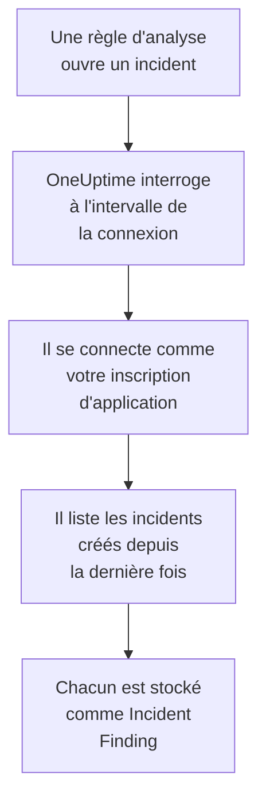

# Microsoft Sentinel

Importez les incidents qu'ouvrent vos règles d'analyse [Microsoft Sentinel](https://learn.microsoft.com/en-us/azure/sentinel/overview) dans les événements de sécurité de OneUptime. Vous les y recherchez à côté de vos logs, traces et métriques, vous les corrélez avec toutes les autres sources, et vous prévenez l'astreinte pour ceux qui comptent. OneUptime les lit avec une inscription d'application que vous créez, et ne modifie rien dans Azure.

:::cards
- [Configurer la connexion](#configurer-la-connexion): Une inscription d'application, un rôle et le formulaire de la connexion.
- [Ce qui est importé](#ce-qui-est-importé): Comment chaque incident Sentinel devient un événement de sécurité.
- [Fonctionnement des interrogations](#fonctionnement-des-interrogations): La fenêtre que lit chaque interrogation, et ce qu'en fait un espace de travail chargé.
- [Dépannage](#dépannage): Ce que signifie chaque erreur, et ce qu'il faut changer.
:::

## Fonctionnement



Chaque minute, OneUptime interroge chaque connexion activée dont l'intervalle d'interrogation est écoulé. Une interrogation se connecte à Microsoft Entra ID en tant que votre inscription d'application, demande à Azure Resource Manager les incidents créés depuis la dernière interrogation, et stocke chacun comme un événement [OCSF](https://schema.ocsf.io/) Incident Finding (classe `2005`). Les règles de détection, les moniteurs et les tableaux de bord le traitent alors comme un événement de sécurité de n'importe quelle autre source.

## Avant de commencer

- Dans OneUptime, le rôle Project Owner, Project Admin ou Security Admin. Les rôles Security Member et Security Viewer voient les connexions et l'historique de leurs exécutions, mais ne peuvent pas les modifier.
- Un espace de travail Log Analytics où Microsoft Sentinel est activé, dans le cloud public Azure ou dans Azure Government (US).
- Dans Microsoft Entra ID, le droit de créer une inscription d'application et un secret client.
- Sur le groupe de ressources qui contient l'espace de travail, le droit d'attribuer des rôles, par exemple Propriétaire ou Administrateur de l'accès utilisateur.

## Configurer la connexion

La connexion s'authentifie avec le flux d'informations d'identification du client OAuth 2.0 : en tant qu'application, jamais en tant que personne. Son accès vient d'un rôle Azure, l'inscription d'application n'a donc besoin d'aucune autorisation d'API.

:::steps
### Inscrire une application

1. Connectez-vous au [portail Azure](https://portal.azure.com) et ouvrez **Microsoft Entra ID**.
2. Allez dans **App registrations → New registration**. Nommez-la `OneUptime Sentinel connector`, laissez **Supported account types** sur **Accounts in this organizational directory only**, laissez l'URI de redirection vide, et sélectionnez **Register**.
3. Sur la page **Overview** de l'application, copiez l'**ID d'application (client)** et le **ID de l'annuaire (tenant)**.
4. Allez dans **Certificates & secrets → Client secrets → New client secret**, choisissez quand il expire, et sélectionnez **Add**. Copiez la **Value** du secret, et non son **Secret ID**, avant de quitter la page : elle n'est plus jamais affichée.

### L'autoriser à lire les incidents

1. Dans le portail Azure, ouvrez le groupe de ressources qui contient votre espace de travail Log Analytics.
2. Sélectionnez **Access control (IAM) → Add → Add role assignment**.
3. Dans l'onglet **Role**, choisissez **Microsoft Sentinel Reader**.
4. Dans l'onglet **Members**, choisissez **User, group, or service principal**, cliquez sur **Select members**, et choisissez votre inscription d'application par son nom.
5. Sélectionnez **Review + assign**.

Le rôle permet à l'application de lire les incidents (`Microsoft.SecurityInsights/incidents/read`) et de n'écrire rien. Microsoft recommande de l'attribuer sur le groupe de ressources plutôt que sur l'espace de travail, pour qu'il couvre aussi la solution `SecurityInsights` d'où viennent les incidents. Une nouvelle attribution peut mettre quelques minutes à s'appliquer.

### Trouver les détails de l'espace de travail

Ouvrez l'espace de travail Log Analytics dans le portail Azure. Sa page **Overview** affiche le **ID d'abonnement**, le **Resource group** et le nom de l'espace de travail. L'ID de ressource de l'espace de travail contient les trois :

```text
/subscriptions/{Subscription ID}/resourceGroups/{Resource group}/providers/Microsoft.OperationalInsights/workspaces/{Workspace name}
```

### Ajouter la connexion dans OneUptime

Ouvrez **Produits → Événements de sécurité → Connexions** (`/dashboard/{projectId}/security-events/connections`), cliquez sur **Ajouter une connexion**, choisissez **Microsoft Sentinel**, et cliquez sur **Suivant**. Remplissez les réglages du tableau ci-dessous, cliquez sur **Suivant**, et collez la valeur du secret dans **Secret client**.

### La tester avant d'enregistrer

Cliquez sur **Tester ces paramètres** sous **Tester avant d'enregistrer**. Le test se connecte et lit les incidents avec les valeurs du formulaire, et n'enregistre rien, un secret erroné ou un rôle manquant apparaît donc avant que la connexion existe. Cliquez ensuite sur **Suivant**, donnez à la connexion un **Nom**, et créez-la.
:::

| Réglage | Où le trouver |
| --- | --- |
| **ID de l'annuaire (tenant)** | La page **Overview** de l'application. Le GUID du locataire, ou un domaine vérifié comme `contoso.onmicrosoft.com`. |
| **ID d'application (client)** | La page **Overview** de l'application. Un GUID. |
| **ID d'abonnement** | La page **Overview** de l'espace de travail. Un GUID. |
| **Resource group** | La page **Overview** de l'espace de travail. De 1 à 90 lettres, chiffres, traits de soulignement, tirets, points ou parenthèses, sans point à la fin. |
| **Workspace name** | La page **Overview** de l'espace de travail. De 3 à 90 lettres, chiffres ou tirets, commençant et finissant par une lettre ou un chiffre. |
| **Cloud** | **Cloud public Azure** (`login.microsoftonline.com`, `management.azure.com`) ou **Azure Government (États-Unis)** (`login.microsoftonline.us`, `management.usgovcloudapi.net`). |
| **Secret client** | La **Value** du secret. Il est chiffré, jamais renvoyé par l'API et plus jamais affiché. Remplacez-le avec **Mettre à jour les identifiants** sur la connexion. |

L'étape **Interrogation** contient aussi une **Description** facultative, le **Intervalle d'interrogation (minutes)**, un nombre entier de `1` à `1440` qui vaut `5` au départ, et **Activé**, qui est activé au départ.

## Ce qui est importé

Chaque incident Sentinel devient un événement Incident Finding (classe OCSF `2005`, activité `Create`), attribué au service de télémétrie `Microsoft Sentinel` :

| Colonne OCSF | Champ de l'incident Sentinel |
| --- | --- |
| `time` | `properties.createdTimeUtc`, quand Sentinel a créé l'incident |
| `eventUid` | `name`, le GUID de l'incident, qui sert aussi à écarter les doublons |
| `message`, `ruleName` | `properties.title` |
| `ruleId` | Le GUID de la règle à la fin de la première entrée de `properties.relatedAnalyticRuleIds` |
| `severityName` | `properties.severity` : `High`, `Medium`, `Low` ou `Informational` |
| `statusName` | `properties.status` : `New`, `Active` ou `Closed` |
| `mitreTactics` | `properties.additionalData.tactics`, en ID ATT&CK : `Persistence` devient `TA0003` |
| `principalUser` | `properties.owner.userPrincipalName`, ou `properties.owner.email` |
| `targetResource` | `properties.incidentUrl`, un lien vers l'incident dans le portail Azure |
| `observables` | L'UPN, l'e-mail et l'ID d'objet du propriétaire, et le nom de chaque label |
| `attributes` | L'incident entier, aplati en clés pointées comme `properties.classification` et `properties.firstActivityTimeUtc` |

Les incidents fermés créés dans la fenêtre d'une interrogation sont aussi importés. Filtrez sur `statusName` dans l'explorateur des événements de sécurité pour ne voir que les incidents ouverts.

## Fonctionnement des interrogations

Chaque interrogation liste les incidents créés dans sa fenêtre, les plus anciens d'abord, 50 par page, et suit le `nextLink` de l'API jusqu'à avoir lu toute la fenêtre :

```text
GET https://management.azure.com/subscriptions/{sub}/resourceGroups/{rg}/providers/Microsoft.OperationalInsights/workspaces/{ws}/providers/Microsoft.SecurityInsights/incidents
    ?api-version=2024-03-01
    &$filter=(properties/createdTimeUtc ge {windowStart}) and (properties/createdTimeUtc lt {windowEnd})
    &$orderby=properties/createdTimeUtc asc
    &$top=50
```

- **L'heure de création est le curseur.** Une règle d'analyse planifiée qui s'exécute toutes les heures ouvre son incident longtemps après l'activité qu'elle a repérée, et le `firstActivityTimeUtc` de l'incident peut être plus ancien de plusieurs heures ou jours. Un curseur sur l'heure d'activité sauterait chacun de ces incidents. Les heures d'activité restent dans `attributes`, et les exemples des diagnostics montrent les deux.
- **La première interrogation remonte 24 heures en arrière**, pour qu'une nouvelle connexion montre tout de suite ses incidents récents.
- **Chaque interrogation suivante commence 1 minute avant le curseur enregistré**, pour qu'un incident créé à la frontière entre deux fenêtres ne soit jamais sauté.
- **Une interrogation lit au plus 24 heures au-delà du curseur.** Une connexion dont le curseur a pris du retard le rattrape en une suite de fenêtres de 24 heures, et sa **Santé** indique **Catching up**.
- **Les doublons sont écartés par le GUID de l'incident** (`name`) au sein du projet, pour que le chevauchement, une fenêtre relue et une importation ne stockent jamais un incident deux fois.

### Quand une fenêtre contient plus qu'une interrogation ne peut lire

Une interrogation lit au plus 20 pages de 50 incidents : 1 000 incidents. Quand cette limite l'arrête avant la fin de sa fenêtre, l'exécution est **Partiel**, avec un avertissement comme celui-ci :

```text
Stopped after 20 incidents requests (the per-run request limit) before reading the whole window. Incidents are read oldest first; every incident created before 2026-09-14T08:12:44.000Z was read.
```

Les incidents sont lus des plus anciens aux plus récents, OneUptime déplace donc le curseur à l'heure de création du dernier incident lu, et l'interrogation suivante commence là, avec la même longueur de fenêtre. Un espace de travail chargé rattrape environ 1 000 incidents par interrogation, au lieu de relire les mêmes. Les incidents créés au même instant sont lus deux fois, et la vérification des doublons écarte la seconde copie.

Quand une exécution ne parvient pas du tout à dépasser le curseur enregistré, OneUptime raccourcit plutôt la fenêtre :

1. **Réduire.** L'interrogation suivante lit une fenêtre deux fois plus courte, depuis le même point de départ, et continue de la diviser par deux jusqu'à ce qu'une fenêtre soit lue entièrement, jusqu'à une minute. L'avertissement de l'exécution le dit : `This window holds more records than one poll can read; the next poll reads a {n} minute window from the same starting point.`
2. **Revenir à la taille normale.** Une fois une fenêtre lue entièrement, la suivante est de nouveau deux fois plus longue, jusqu'à 24 heures.
3. **Passer au-delà d'une seule minute.** Si même une minute contient plus qu'une interrogation ne peut lire, l'interrogation passe au-delà, pour que les incidents plus récents continuent d'arriver. L'exécution reste **Partiel**, et **Dernière erreur** indique `More records were created in the one minute from {cursor} to {end} than one poll can read. Polling moved past this minute so newer records keep arriving; use Import this time range in Diagnostics on this minute to recover what one run can read.` Importez cette minute avec **Importer cette plage de temps** pour récupérer ce qu'une exécution peut lire.

Une exécution qui échoue complètement, avec une erreur de Microsoft Entra ID ou d'Azure Resource Manager, garde le curseur et la longueur de fenêtre, et l'interrogation suivante relit la même fenêtre. La seule exception est une requête qui a expiré : le curseur reste, mais la fenêtre suivante est deux fois plus courte, car une fenêtre trop lourde pour recevoir une réponse à temps expirerait à chaque essai. Changer le **Intervalle d'interrogation (minutes)** n'y change rien : il décide à quelle fréquence une interrogation commence, pas où commence sa fenêtre.

### Exécuter, prévisualiser et importer à la demande

Cliquez sur **Diagnostics** sur une connexion pour voir ses exécutions récentes et travailler avec elle à la main. Quiconque peut modifier la connexion peut les lancer ; quiconque peut la voir peut lire l'historique.

- **Exécuter maintenant** lance tout de suite une interrogation, avec le curseur habituel, même quand la connexion n'est pas **Activé**.
- **Preview incidents** lit une plage de temps de 7 jours au plus et n'importe rien.
- **Importer cette plage de temps** importe une plage de 7 jours au plus, après votre confirmation, sans déplacer le curseur. Les incidents déjà importés sont sautés.
- **Copier les diagnostics** sur une exécution copie son rapport pour le support. Il ne contient jamais d'identifiants.

## Tester la connexion

**Tester la connexion** sur la ligne d'une connexion, et **Tester ces paramètres** dans le formulaire, s'exécutent dans le processus de l'API, pas dans un worker d'arrière-plan, pour qu'un test réponde même quand les workers sont le problème. Il effectue ces vérifications, dans l'ordre :

| Vérification | Ce qu'elle vérifie |
| --- | --- |
| **Configuration** | Chaque réglage est présent et bien formé. Rien n'est contacté quand cela échoue. |
| **Authenticate with Microsoft Entra** | Microsoft Entra ID délivre à votre inscription d'application un jeton pour Azure Resource Manager. |
| **Read incidents** | Un incident créé dans les 24 dernières heures peut être lu (`$top=1`). Cela prouve le rôle et les détails de l'espace de travail. |
| **Incidents available to import** | Combien d'incidents ont été créés dans les 24 dernières heures et les 7 derniers jours, une page de 50 pour chacun, `50+` signifie donc davantage. Aucun en 7 jours est un avertissement, pas un échec. |
| **Background workers**, **Poll scheduler**, **Security event storage** | Le côté de OneUptime lui-même : un processus prend les tâches de la file Worker, la tâche d'interrogation s'exécute chaque minute, et le stockage des événements de sécurité répond. |
| **Scheduled polling** | Pour une connexion enregistrée : l'interrogation est activée, aucune exécution n'est bloquée en attente d'un worker, et les interrogations s'exécutent à l'heure. |

Chaque requête d'un test a un délai de 20 secondes. Un test n'importe jamais rien et ne déplace jamais le curseur, et chaque vérification en échec dit ce qu'il faut changer.

## Envoyer des événements de sécurité à Microsoft Sentinel

OneUptime peut aussi envoyer ce qu'il trouve à Microsoft Sentinel, par l'API Logs Ingestion d'Azure Monitor, dans une table personnalisée de l'espace de travail sur lequel Sentinel s'exécute. Vos règles d'analyse, requêtes de chasse et classeurs interrogent alors `OneUptimeSecurityEvents_CL` à côté de vos autres tables.

:::steps
### Créer la table et sa règle de collecte de données

Dans le portail Azure, ouvrez **Tables → Create → New custom log (DCR-based)** de l'espace de travail. Nommez la table `OneUptimeSecurityEvents`, créez une nouvelle règle de collecte de données, et un point de terminaison de collecte de données si le formulaire en demande un. Chargez l'exemple ci-dessous comme fichier d'exemple, gardez la transformation telle quelle et créez la table.

### Laisser une application y envoyer

Inscrivez une application et donnez-lui un secret client, comme dans [Inscrire une application](#inscrire-une-application). Ouvrez ensuite la règle de collecte de données, **Access control (IAM) → Add → Add role assignment**, choisissez **Monitoring Metrics Publisher** et sélectionnez l'application.

### Ajouter la destination

Ouvrez **Produits → Événements de sécurité → Connexions**. Sous **Envoyer vers votre SIEM**, cliquez sur **Ajouter une destination**, choisissez Microsoft Sentinel sous **SIEM** et cliquez sur **Suivant**. Renseignez l'**ID de l'annuaire (tenant)**, l'**ID d'application (client)** et le **Secret client**, le **Point de terminaison d'ingestion des journaux** depuis la page **Overview** du point de terminaison de collecte de données (ou de la règle), et l'**ID immuable de la règle de collecte de données** depuis la **JSON View** de la règle. **Flux** est facultatif : vide, c'est `Custom-OneUptimeSecurityEvents_CL`.

### Envoyer un événement de test et commencer l'envoi

Cliquez sur **Envoyer un événement de test** : une ligne arrive dans la table en quelques minutes. Puis, sous **Ce qu'il faut envoyer**, gardez **Détections uniquement** ou choisissez **Tous les événements de sécurité**, et cliquez sur **Commencer l'envoi**.
:::

Le fichier d'exemple, une ligne avec chaque colonne de la table :

```json title="oneuptime-security-events-sample.json"
[
  {
    "TimeGenerated": "2026-10-21T10:00:00.000Z",
    "EventId": "0193c0de-cccc-4aaa-8bbb-000000000001",
    "EventUid": "okta-1",
    "ClassName": "Authentication",
    "CategoryName": "Identity & Access Management",
    "ActivityName": "Logon",
    "Severity": "Medium",
    "SeverityId": 3,
    "Status": "Failure",
    "Message": "Failed sign-in for alice",
    "VendorName": "Okta",
    "ProductName": "Okta System Log",
    "RuleId": "",
    "RuleName": "",
    "MitreTactics": [],
    "MitreTechniques": [],
    "PrincipalUser": "alice@example.com",
    "PrincipalHost": "laptop-7",
    "PrincipalIp": "203.0.113.7",
    "TargetUser": "",
    "TargetHost": "app.example.com",
    "TargetIp": "198.51.100.20",
    "TargetPort": 443,
    "TargetResource": "",
    "ProcessName": "",
    "ProcessCommandLine": "",
    "ParentProcessName": "",
    "Observables": [
      "alice@example.com",
      "203.0.113.7"
    ],
    "Attributes": {
      "okta.outcome.reason": "INVALID_CREDENTIALS"
    }
  }
]
```

- L'API Logs Ingestion accepte jusqu'à 1 Mo par appel, donc les lignes partent par lots de 500 au plus. Un lot qu'Azure refuse est divisé jusqu'à trouver la ligne qu'il n'accepte pas, qui est laissée de côté, et la limitation (`429`) est réessayée.
- Un `403` signifie que l'application n'a pas **Monitoring Metrics Publisher** sur la règle, et un `404` un ID immuable ou un flux erroné.
- Les incidents que OneUptime a importés de Microsoft Sentinel ne lui sont jamais renvoyés.

## Dépannage

La **Dernière erreur** de la connexion conserve le message d'erreur complet, identifiants masqués, derrière un préfixe qui nomme l'étape en échec. Quand une connexion a une erreur, sélectionnez **Voir l'erreur** dans sa colonne **Actions** pour la lire, et **Copier l'erreur** dans la boîte de dialogue pour la copier. Lisez d'abord le préfixe.

:::details Dernière erreur commence par `Microsoft Sentinel token request`
- `Microsoft Sentinel token request failed (HTTP ...)` : Microsoft Entra ID a refusé de délivrer un jeton, Azure n'a donc jamais été contacté. Le message cite le code d'Entra :
  - `AADSTS7000215` ou `invalid_client` : le **Secret client** est erroné ou expiré, ou c'est l'ID du secret au lieu de sa valeur. Créez un nouveau secret, et enregistrez-le avec **Mettre à jour les identifiants**.
  - `AADSTS700016` ou `unauthorized_client` : l'**ID d'application (client)** n'est pas dans le **ID de l'annuaire (tenant)** indiqué. Comparez les deux avec la page **Overview** de l'application.
  - `AADSTS90002` ou `HTTP 404` : ce locataire n'existe pas. Le **ID de l'annuaire (tenant)** est erroné, ou il est dans l'autre cloud : vérifiez **Cloud**.
  - `HTTP 429` ou `HTTP 5xx` : Microsoft Entra ID limite les requêtes ou est indisponible. L'interrogation suivante réessaie.
- `Microsoft Sentinel token request returned ...` : Microsoft Entra ID a répondu par quelque chose d'inutilisable, par exemple un corps qui n'est pas du JSON ou sans `access_token`. C'est généralement un proxy ou une passerelle entre les deux.
- `Microsoft Sentinel token request failed:`, sans statut, ou `Microsoft Sentinel token request timed out after ... seconds with no response` : la requête n'a reçu aucune réponse. Vérifiez le DNS, le TLS et le HTTPS sortant de l'application et des workers OneUptime vers `login.microsoftonline.com`.
:::

:::details Dernière erreur commence par `Microsoft Sentinel incidents list`
- `Microsoft Sentinel incidents list failed (HTTP ...)` : Azure Resource Manager a refusé la requête.
  - `HTTP 401` : il n'a pas accepté le jeton. Presque toujours, **Cloud** ne correspond pas au locataire, ou l'inscription d'application a été supprimée. Un jeton qui expire entre deux pages est renouvelé et réessayé une fois de lui-même.
  - `HTTP 403` ou `AuthorizationFailed` : l'application n'a pas encore **Microsoft Sentinel Reader** sur le groupe de ressources. Attribuez-le, et attendez quelques minutes.
  - `HTTP 404` : aucun espace de travail n'a ce **ID d'abonnement**, ce **Resource group** et ce **Workspace name**, ou Microsoft Sentinel n'y est pas activé. Copiez-les depuis la page **Overview** de l'espace de travail.
  - `HTTP 429` ou `HTTP 5xx` : Azure Resource Manager limite les requêtes ou est indisponible. L'interrogation suivante réessaie.
  - `HTTP 400` : Azure Resource Manager a refusé la requête, que construit OneUptime et non vos réglages. Envoyez le message au support de OneUptime.
- `Microsoft Sentinel incidents list returned ...` : Azure a répondu `200`, mais sans page d'incidents lisible, ou avec un `nextLink` vers un autre hôte, que la connexion refuse pour que le jeton ne quitte jamais Azure Resource Manager. C'est signalé plutôt que pris pour une fenêtre vide, pour que le curseur ne dépasse jamais des incidents que personne n'a lus.
- `Microsoft Sentinel incidents list failed:`, sans statut, ou `Microsoft Sentinel incidents list timed out after ... seconds with no response` : la requête n'a reçu aucune réponse. Vérifiez le HTTPS sortant des workers OneUptime vers `management.azure.com`, ou `management.usgovcloudapi.net`.
:::

:::details Dernière interrogation vaut Never et Dernière erreur est vide
Aucune interrogation ne s'est terminée pour cette connexion. Lancez **Tester la connexion** : ses vérifications **Background workers** et **Poll scheduler** nomment la cause. Sur une installation auto-hébergée, la cause habituelle est `DISABLE_QUEUE_WORKERS=true` sur l'application, sans déploiement de workers séparé qui prenne les tâches : réglez-le sur `false`, ou lancez le déploiement des workers (Helm : `worker.enabled: true`).
:::

:::details Une exécution est Partial
- `Stopped after 20 incidents requests (the per-run request limit) before reading the whole window` : la fenêtre contenait plus que les 1 000 incidents qu'une exécution lit. Rien n'est perdu : l'interrogation suivante commence après le dernier incident lu. Une connexion qui reste **Partiel** d'une interrogation à l'autre rattrape un retard, et sa **Dernière interrogation** et son **Dernier événement importé** continuent d'avancer.
- `Microsoft Sentinel returned incidents out of creation-time order, so this run cannot name a point to resume from.` : l'API a ignoré l'ordre des plus anciens aux plus récents, l'exécution ne peut donc pas déplacer le curseur sur son dernier incident, et l'interrogation suivante lit plutôt une fenêtre plus courte. Si cela se répète, envoyez le rapport de l'exécution au support de OneUptime.
- `More records were created in the one minute from ... than one poll can read` : l'interrogation est passée au-delà de cette minute. Importez-la avec **Importer cette plage de temps** dans **Diagnostics**. Une importation lit autant qu'une interrogation.
:::

:::details Le test réussit, mais rien n'est importé
Lisez **Incidents available to import** dans le rapport du test. `0` sur les 7 derniers jours signifie que les règles d'analyse de l'espace de travail n'ont ouvert aucun incident, ce qui n'est pas une faute de la connexion. Dans Microsoft Sentinel, vérifiez que les règles sont activées et réglées pour créer des incidents.
:::

## Azure Government

Réglez **Cloud** sur **Azure Government (États-Unis)**. La connexion se connecte alors à `login.microsoftonline.us` avec l'étendue `https://management.usgovcloudapi.net/.default`, et lit les incidents depuis `management.usgovcloudapi.net`. Tout le reste, y compris l'attribution du rôle, est identique.

## Ce que vous obtenez

- **Recherche.** Filtrez les incidents par gravité, statut, propriétaire, label ou tactique dans l'explorateur des événements de sécurité, à côté de toutes les autres sources.
- **Corrélation.** Le propriétaire et les labels de chaque incident sont indexés comme observables, une recherche trouve donc tout ce qui les mentionne.
- **Règles de détection.** Des règles Sigma qui s'exécutent selon un planning sur vos événements de sécurité, et ouvrent des alertes qui préviennent l'astreinte.
- **Moniteurs.** Les moniteurs d'événements de sécurité comptent les événements correspondants, par exemple les nouveaux incidents High, et ouvrent des incidents ou des alertes au-delà d'un seuil.

Les événements de sécurité sont facturés comme le reste de votre télémétrie, par Go ingéré. Voir les [tarifs](https://oneuptime.com/pricing).

## Étapes suivantes

:::cards
- [Événements de sécurité](/docs/telemetry/security-events): Rechercher, corréler et alerter sur ce que vous importez.
- [Microsoft Defender XDR](/docs/integrations/microsoft-defender-xdr): Importer aussi les alertes de chaque charge de travail Defender.
- [Rôles](/docs/permissions/reference#rôles): Ce que les rôles Security peuvent voir et modifier.
- [Présentation des intégrations](/docs/integrations/index): Les autres outils que vous pouvez connecter.
:::
