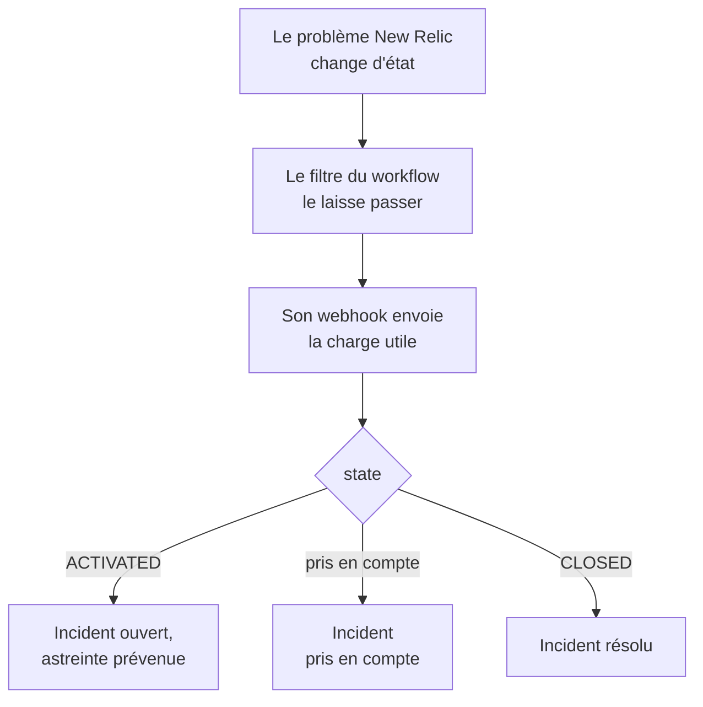

# New Relic

Envoyez les problèmes [New Relic](https://newrelic.com) à OneUptime, pour que chaque problème devienne un incident ou une alerte qui prévient votre équipe d'astreinte, soit pris en compte quand quelqu'un prend en compte le problème, et soit résolu quand le problème se ferme. New Relic envoie ses problèmes par une [destination webhook](https://docs.newrelic.com/docs/alerts/get-notified/notification-integrations/), il n'y a donc rien à installer d'un côté comme de l'autre.

:::cards
- [Partir du modèle](#partir-du-modèle): Choisissez qui prévenir, copiez l'URL et voyez ce que fait chaque problème.
- [Configurer New Relic](#configurer-new-relic): Une destination webhook, et le workflow qui la notifie.
- [Tester](#tester): Envoyez vous-même un problème, puis un depuis New Relic.
- [Dépannage](#dépannage): Quand les problèmes n'arrivent pas, ou que les incidents restent ouverts.
:::

## Fonctionnement



Un workflow New Relic choisit les problèmes à envoyer grâce à son filtre, et notifie une destination webhook quand l'un d'eux est activé, pris en compte ou fermé, avec une charge utile JSON que New Relic remplit. L'ID du problème est ce qui permet à OneUptime de retrouver l'incident qu'il a ouvert.

## Avant de commencer

- Un compte New Relic où vous pouvez créer des destinations et des workflows.
- Dans OneUptime, le droit de créer des workflows. Sur OneUptime Cloud, les workflows demandent l'offre **Growth** ou supérieure.

## Partir du modèle

Configurez d'abord OneUptime : il vous donne l'URL à laquelle New Relic envoie. La boîte de dialogue **Créer un flux de travail** propose deux modèles New Relic, sous **New Relic** dans sa liste de catégories : **Declare an incident for each New Relic issue**, et **Create an alert for each New Relic issue** pour les alertes. Les deux font la même chose, chacun avec son propre type d'enregistrement.

:::steps
1. Allez dans **Flux de travail** et cliquez sur **Créer un flux de travail**. Sous **Ou partir d'un modèle**, choisissez **New Relic** dans la liste de catégories, cliquez sur **Declare an incident for each New Relic issue**, ou sur **Create an alert for each New Relic issue**, puis sur **Utiliser ce modèle**.
2. Sous **Who to page for new New Relic issues**, choisissez les politiques d'astreinte à prévenir, ou aucune pour ne prévenir personne, et cliquez sur **Créer un flux de travail**. Le workflow s'ouvre dans le **Constructeur**, désactivé.
3. Cliquez sur le déclencheur **Webhook**, puis sur **Copier l'URL**, et gardez l'URL pour New Relic.
4. Activez **Activé** en haut du **Constructeur**. Un workflow désactivé répond à New Relic par `400`.
:::

Ensuite, [configurez New Relic](#configurer-new-relic) pour qu'il envoie ses problèmes à cette URL. L'étape `read-event-1` du workflow s'ouvre avec la même configuration, pour quand vous y reviendrez dans le **Constructeur**.

### Ce que fait le workflow

Après le déclencheur **Webhook**, l'étape **Check With JavaScript** `read-event-1` lit le `state` qu'envoie New Relic, et **Incident From Another Tool**, ou **Alert From Another Tool** dans le modèle des alertes, fait ce qu'il signifie, d'après l'ID du problème. L'incident garde l'ID dans son champ personnalisé `newRelicIssueId`.

| Ce qu'envoie New Relic | Ce que fait le workflow |
| --- | --- |
| `state` vaut `ACTIVATED` ou `CREATED` | Déclare un incident intitulé `New Relic: <issue>`, à la gravité à laquelle correspond la priorité du problème, tenu à l'écart de vos pages de statut. Sa description renvoie au problème dans New Relic, et indique la priorité, les entités, les politiques et les conditions. Il prévient les politiques d'astreinte que vous avez choisies. Le même problème qui revient, comme quand New Relic le passe à CRITICAL, n'ouvre pas de second incident, et ne prévient plus personne. |
| `state` vaut `ACTIVATED` et `isAcknowledged` vaut `true` | Prend en compte l'incident du problème, ce qui arrête l'escalade de l'astreinte. La raison figure dans sa chronologie. |
| `state` vaut `CLOSED` | Résout l'incident du problème, sauf s'il est déjà résolu. La raison figure dans sa chronologie. |

Une prise en compte ou une fermeture pour un problème sans incident ne change rien. Tout le reste, comme une requête d'un autre outil, est laissé tel quel : `read-event-1` prend **No**, et les **Étapes** de l'exécution disent pourquoi. Rien ne repart vers New Relic : il ferme lui-même ses problèmes quand le signal se rétablit, et c'est ce qui résout l'incident.

### Priorités et astreinte

Chaque nouveau problème prévient les politiques d'astreinte que vous avez choisies, quelle que soit sa priorité : New Relic fait passer un problème de HIGH à CRITICAL sur place, sur le même problème, donc attendre CRITICAL ne préviendrait jamais pour un problème ouvert à HIGH qui s'est aggravé. Pour prévenir pour moins de problèmes, resserrez le filtre du workflow dans New Relic : seul ce qui le passe arrive dans OneUptime. Dans un nouveau projet, les priorités correspondent à ces gravités d'incident et d'alerte :

| Priorité New Relic | Incident | Alerte | Astreinte |
| --- | --- | --- | --- |
| CRITICAL | Critical Incident | High | Prévenue |
| HIGH | Major Incident | Low | Prévenue |
| MEDIUM | Minor Incident | Low | Prévenue |
| LOW | Minor Incident | Low | Prévenue |

Avec vos propres gravités, CRITICAL va à la plus grave, HIGH à celle du milieu, et MEDIUM et LOW à la moins grave. Un incident garde la gravité à laquelle il s'est ouvert quand New Relic fait monter son problème.

Pour faire correspondre une priorité à l'une de vos gravités par son nom, modifiez `SEVERITY_BY_NAME` dans l'étape `read-event-1`, par exemple `{ HIGH: 'Critical Incident' }`.

## Configurer New Relic

:::steps
### Ajouter la destination webhook

Dans New Relic, allez dans **Alerts → Destinations** et ajoutez une destination **Webhook**. Réglez **Webhook name** sur `OneUptime` et **Endpoint URL** sur l'URL que vous avez copiée dans OneUptime, puis enregistrez-la. Laissez **Use authorization** désactivé : l'URL est le seul identifiant.

### Ajouter le workflow

Allez dans **Alerts → Workflows** et cliquez sur **Add a workflow**. Nommez-le `OneUptime`. Son filtre décide quels problèmes arrivent dans OneUptime, comme les seuls CRITICAL, ou ceux d'une équipe.

### Notifier la destination

Ajoutez au workflow la destination **Webhook** que vous avez créée. Gardez la charge utile que New Relic remplit, et ajoutez une ligne pour `isAcknowledged` après `state`, pour que l'incident soit pris en compte avec son problème :

```json
{
  "id": {{ json issueId }},
  "issueUrl": {{ json issuePageUrl }},
  "title": {{ json annotations.title.[0] }},
  "priority": {{ json priority }},
  "impactedEntities": {{ json entitiesData.names }},
  "totalIncidents": {{ json totalIncidents }},
  "state": {{ json state }},
  "isAcknowledged": {{ json isAcknowledged }},
  "trigger": {{ json triggerEvent }},
  "isCorrelated": {{ json isCorrelated }},
  "createdAt": {{ createdAt }},
  "updatedAt": {{ updatedAt }},
  "sources": {{ json accumulations.source }},
  "alertPolicyNames": {{ json accumulations.policyName }},
  "alertConditionNames": {{ json accumulations.conditionName }},
  "workflowName": {{ json workflowName }}
}
```

La ligne à ajouter est `"isAcknowledged": {{ json isAcknowledged }},`. Cliquez ensuite sur **Update message**.

### La notifier à l'activation, à la prise en compte et à la fermeture

Cliquez sur les trois points de la destination et choisissez **Notify when**. Laissez **Activated**, **Acknowledged** et **Closed** activés.

### Activer le workflow

Cliquez sur **Activate workflow**.
:::

Le workflow OneUptime lit ces champs de la charge utile, et laisse les autres tels quels :

| Champ | Ce que New Relic y met |
| --- | --- |
| `id` | L'ID du problème. |
| `issueUrl` | Un lien vers le problème dans New Relic. |
| `title` | Le titre du problème. |
| `priority` | L'urgence du problème : `CRITICAL`, `HIGH`, `MEDIUM` ou `LOW`. |
| `state` | Où en est le problème : `CREATED`, `ACTIVATED` ou `CLOSED`. |
| `isAcknowledged` | `true` dès que quelqu'un prend en compte le problème dans New Relic. |
| `impactedEntities` | Les noms des entités concernées par le problème. |
| `alertPolicyNames` | Les noms des politiques à l'origine du problème. |
| `alertConditionNames` | Les noms des conditions à l'origine du problème. |

## Tester

Envoyez un problème à l'URL que vous avez copiée, comme le ferait New Relic :

```bash
curl -X POST "<url>" \
  -H "Content-Type: application/json" \
  -d '{
    "id": "7d4a2e1c-3b5f-4c8e-9a1d-2f6b8c0e4a71",
    "issueUrl": "https://radar-api.service.newrelic.com/accounts/1234567/issues/7d4a2e1c-3b5f-4c8e-9a1d-2f6b8c0e4a71?notifier=WEBHOOK",
    "title": "High CPU on checkout-service",
    "priority": "CRITICAL",
    "impactedEntities": ["checkout-service"],
    "state": "ACTIVATED",
    "isAcknowledged": false,
    "alertPolicyNames": ["Production"],
    "alertConditionNames": ["CPU above 90%"]
  }'
```

Un incident s'ouvre, intitulé `New Relic: High CPU on checkout-service`, et les politiques d'astreinte que vous avez choisies sont prévenues. Envoyez la même requête avec `isAcknowledged` sur `true`, et l'incident est pris en compte. Envoyez-la avec `state` sur `CLOSED`, et l'incident est résolu.

Testez ensuite depuis New Relic : ouvrez le message du webhook du workflow, et cliquez sur **Send test notification**. Pour voir qu'il est arrivé, ouvrez les **Journaux → Exécutions** du workflow OneUptime.

## Dépannage

:::details Rien n'arrive dans OneUptime
- Vérifiez que le workflow dans New Relic est actif, et que son filtre laisse passer le problème.
- Vérifiez que l'**Endpoint URL** de la destination est l'URL du déclencheur **Webhook**.
- Un workflow désactivé répond `400`. Activez **Activé** en haut de son **Constructeur**.
:::

:::details Le workflow s'exécute, mais n'ouvre rien
Ouvrez l'exécution dans **Journaux → Exécutions**. L'entrée `read-event-1` de ses **Étapes** dit pourquoi il a pris **No**.

- `New Relic named no issue ID` : gardez la ligne `"id": {{ json issueId }},` dans la charge utile.
- `is in no state` : gardez la ligne `"state": {{ json state }},` dans la charge utile.
:::

:::details Les incidents ne sont pas pris en compte
- La charge utile a besoin de la ligne `"isAcknowledged": {{ json isAcknowledged }},`. Sans elle, un incident s'ouvre et est résolu avec son problème, mais n'est jamais pris en compte.
- Le workflow dans New Relic doit garder **Acknowledged** activé sous **Notify when**.
:::

:::details Les incidents s'ouvrent mais ne sont jamais résolus
- Le workflow dans New Relic doit garder **Closed** activé sous **Notify when**.
- Ouvrez l'exécution de la fermeture dans **Journaux → Exécutions** : sa dernière étape dit pourquoi. L'`id` de la fermeture doit être celui du problème, laissez donc `"id": {{ json issueId }},` tel quel dans la charge utile.
:::

:::details L'astreinte est prévenue pour trop de problèmes
Chaque nouveau problème qui arrive dans OneUptime prévient. Resserrez le filtre du workflow dans New Relic, pour que seuls les problèmes qui doivent prévenir y arrivent. Voir [Priorités et astreinte](#priorités-et-astreinte).
:::

:::details L'astreinte n'est pas prévenue
- Une notification pour un problème qui a déjà son incident ne prévient plus personne, donc un passage à CRITICAL ne prévient personne.
- Si personne n'est choisi dans la boîte de dialogue **Créer un flux de travail**, le workflow n'a aucune étape qui prévienne.
:::

## Sécurité

- **Traitez l'URL comme un mot de passe.** Quiconque la possède peut ouvrir des incidents. Si elle fuit, cliquez sur **Réinitialiser l'URL** dans le déclencheur **Webhook** du workflow. Mettez ensuite à jour l'**Endpoint URL** de la destination dans New Relic.
- **Les liens mènent à New Relic.** Le modèle ne renvoie à un problème que sur un site New Relic, quoi que dise une requête, et écrit ce que New Relic a envoyé comme du texte.
- **Auto-hébergé ?** New Relic envoie ses webhooks depuis Internet, votre OneUptime doit donc y être joignable en HTTPS.

## Étapes suivantes

:::cards
- [Modèles de workflow](/docs/workflows/authoring): Créez un workflow à partir d'un modèle, et modifiez-le dans le Constructeur.
- [Datadog](/docs/integrations/datadog): Le même modèle, pour les moniteurs Datadog.
- [Règles d'escalade](/docs/on-call/escalation-rules): Décider qui une politique d'astreinte prévient, et quand.
- [Présentation des intégrations](/docs/integrations/index): Les autres outils que vous pouvez connecter.
:::
