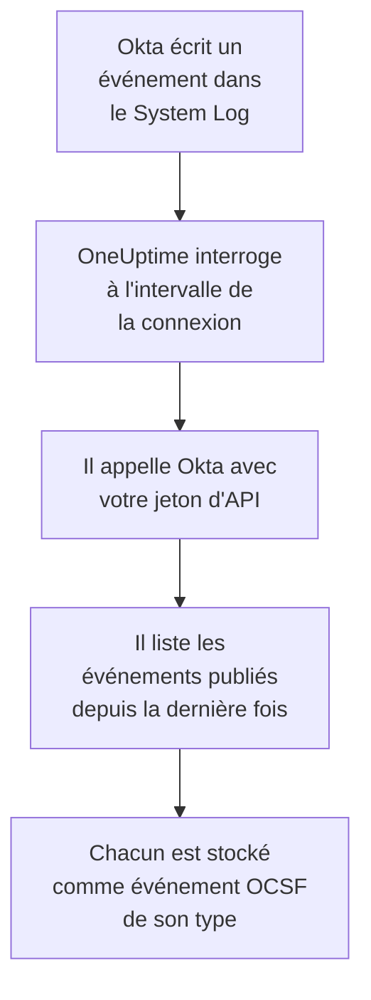

# Journal système Okta

Importez le [Okta System Log](https://developer.okta.com/docs/reference/system-log-query/) dans les événements de sécurité de OneUptime : les connexions des utilisateurs, les défis MFA, les modifications de comptes et de groupes, et les propres détections de menaces d'Okta. Vous les y recherchez à côté de vos logs, traces et métriques, vous les corrélez avec toutes les autres sources, et vous prévenez l'astreinte pour ceux qui comptent. OneUptime les lit avec un jeton d'API que vous créez, et ne modifie rien dans Okta.

:::cards
- [Configurer la connexion](#configurer-la-connexion): Un jeton d'API et le formulaire de la connexion.
- [Ce qui est importé](#ce-qui-est-importé): Quels événements, et comment chacun devient un événement de sécurité.
- [Fonctionnement des interrogations](#fonctionnement-des-interrogations): La fenêtre que lit chaque interrogation, et pourquoi elle chevauche la précédente de 15 minutes.
- [Dépannage](#dépannage): Ce que signifie chaque erreur, et ce qu'il faut changer.
:::

## Fonctionnement



Chaque minute, OneUptime interroge chaque connexion activée dont l'intervalle d'interrogation est écoulé. Une interrogation demande à Okta les événements du System Log publiés depuis la dernière interrogation, et stocke chacun comme un événement [OCSF](https://schema.ocsf.io/) : une connexion d'utilisateur comme un événement Authentication, une modification de compte comme un Account Change, et une détection d'Okta comme un Detection Finding. Les règles de détection, les moniteurs et les tableaux de bord le traitent alors comme un événement de sécurité de n'importe quelle autre source. Cela fonctionne avec chaque cellule Okta, `okta.com`, `oktapreview.com` et `okta-emea.com`, et avec une organisation sur un domaine personnalisé.

## Avant de commencer

- Dans OneUptime, le rôle Project Owner, Project Admin ou Security Admin. Les rôles Security Member et Security Viewer voient les connexions et l'historique de leurs exécutions, mais ne peuvent pas les modifier.
- Un administrateur Okta qui peut voir le System Log, pour créer le jeton. Un jeton peut faire ce que peut son administrateur : utilisez donc un Read-only Administrator, qui lit le System Log et ne modifie rien. Un administrateur en lecture seule voit aussi les utilisateurs, les groupes, les applications et les paramètres : gardez donc le jeton aussi précieusement qu'un mot de passe.
- Idéalement, un compte de service pour cet administrateur. Okta désactive un jeton quand son administrateur est désactivé, et quand il reste 30 jours inutilisé. L'interrogation l'utilise toutes les quelques minutes, il reste donc utilisé tant que la connexion est activée.
- Si votre organisation n'accepte les appels d'API que depuis une zone réseau, une zone qui contient les adresses depuis lesquelles OneUptime appelle : sur OneUptime Cloud, ses adresses sortantes, et sur une installation auto-hébergée, l'adresse publique de vos hôtes d'application et de workers.

## Configurer la connexion

:::steps
### Créer un jeton d'API

1. Connectez-vous à l'**Admin Console** d'Okta en tant qu'administrateur en lecture seule.
2. Ouvrez **Security → API**, puis l'onglet **Tokens**, et sélectionnez **Create token**.
3. Nommez-le, par exemple `OneUptime security events`. Laissez **Any IP** pour l'origine autorisée de ses appels, sauf si votre organisation a besoin d'une zone.
4. Sélectionnez **Create token**, et copiez la **Token Value**. Okta ne l'affiche qu'une fois.

Chaque jeton peut utiliser une part de la limite de débit d'API de l'organisation, que montre sa ligne dans l'onglet **Tokens**. Une interrogation fait au plus 20 requêtes : la part par défaut suffit donc largement, sauf si d'autres outils utilisent le même jeton.

### Ajouter la connexion dans OneUptime

Ouvrez **Produits → Événements de sécurité → Connexions** (`/dashboard/{projectId}/security-events/connections`), cliquez sur **Ajouter une connexion**, choisissez **Okta System Log**, puis cliquez sur **Suivant**. Remplissez les paramètres du tableau ci-dessous, cliquez sur **Suivant**, et collez le jeton dans **API token**.

### La tester avant d'enregistrer

Cliquez sur **Tester ces paramètres** sous **Tester avant d'enregistrer**. Le test se connecte et lit les événements avec les valeurs du formulaire, sans rien stocker : une mauvaise URL ou un filtre invalide apparaît donc avant que la connexion n'existe. Cliquez ensuite sur **Suivant**, donnez un **Nom** à la connexion et créez-la.
:::

| Réglage | Ce qu'il faut saisir |
| --- | --- |
| **Okta organization URL** | L'adresse à laquelle vos utilisateurs se connectent, par exemple `https://acme.okta.com`, `https://acme.oktapreview.com` ou `https://login.example.com`. Elle doit utiliser `https`, sans chemin. Pas l'adresse `-admin` de l'Admin Console, qui ne sert pas l'API. |
| **Event filter** | Facultatif. Un [filtre du System Log](https://developer.okta.com/docs/reference/core-okta-api/#filter) qui choisit les événements à importer, par exemple `eventType sw "user.session" or eventType sw "security"`. Vide, il importe les familles ci-dessous. 2 000 caractères au plus, sur une seule ligne, et pas sur `published` : OneUptime fixe lui-même la plage de temps. |
| **API token** | La valeur du jeton, seule : OneUptime ajoute lui-même le schéma `SSWS`. Elle est chiffrée, jamais renvoyée par l'API et jamais réaffichée. Remplacez-la avec **Mettre à jour les identifiants** sur la connexion. |

L'étape **Interrogation** contient aussi une **Description** facultative, le **Intervalle d'interrogation (minutes)**, un nombre entier de `1` à `1440` qui vaut `5` au départ, et **Activé**, qui est activé au départ.

## Ce qui est importé

Sans **Event filter**, OneUptime importe les familles d'événements que surveille une équipe de sécurité, par préfixe de `eventType`. Un filtre à vous remplace cette liste au lieu de la compléter :

| Préfixe | Événements |
| --- | --- |
| `user.session` | Connexions et déconnexions, accès à l'Admin Console, emprunt d'identité |
| `user.authentication` | Résultats d'authentification, authentification unique comprise |
| `user.mfa` | Inscription, défis et réinitialisations de facteurs |
| `user.account` | Changements et réinitialisations de mots de passe, verrouillages, changements de profil et de privilèges |
| `user.lifecycle` | Utilisateurs créés, activés, suspendus, désactivés et supprimés |
| `security.` | ThreatInsight, signalements d'activité suspecte et les autres détections d'Okta |
| `policy.` | Évaluations des politiques de connexion, et modifications de politiques |
| `system.api_token` | Jetons d'API créés et révoqués |
| `application.user_membership` | Affectations d'applications |
| `group.user_membership` | Modifications d'appartenance aux groupes |

Chaque événement devient un événement OCSF, avec le fournisseur `Okta` et le produit `Okta System Log`, de la classe que demande son `eventType` :

| `eventType` | Classe OCSF | Activité |
| --- | --- | --- |
| `user.session.start` | Authentication (`3002`) | `Logon` |
| `user.session.end` | Authentication (`3002`) | `Logoff` |
| `user.authentication.*` | Authentication (`3002`) | `Logon` |
| `user.mfa.*` | Authentication (`3002`) | `Authentication Ticket` |
| Autres événements `user.session.*` | Authentication (`3002`) | `Other` |
| `user.account.*`, `user.lifecycle.*` | Account Change (`3001`) | La dernière partie du type d'événement, par exemple `Update Password` |
| `group.*` | Group Management (`3006`) | La dernière partie du type d'événement, par exemple `Add` |
| `security.*`, et un `policy.evaluate_sign_on` qui a refusé l'accès | Detection Finding (`2004`) | `Create`, avec le type d'événement comme nom de règle |
| Tout le reste | `0`, nommée d'après le type d'événement | La dernière partie du type d'événement |

Un événement qui n'entre dans aucune de ces classes garde quand même chaque champ, et reste consultable par chacun d'eux. Chaque événement remplit ces colonnes :

| Champ Okta | Colonne OneUptime |
| --- | --- |
| `uuid` | UID de l'événement, qui sert aussi à écarter les doublons |
| `published`, quand l'événement s'est produit | Heure de l'événement |
| `displayMessage`, sinon le type d'événement et `outcome.reason` | Message |
| `severity` : `DEBUG` et `INFO` sont Informational, `WARN` Medium, `ERROR` High | Gravité |
| `outcome.result`, comme `SUCCESS`, `FAILURE`, `ALLOW` ou `DENY` | Statut |
| `actor.alternateId`, sinon `actor.displayName` ; `client.ipAddress` | Utilisateur et IP de l'acteur |
| L'`alternateId` du `User` dans `target` | Utilisateur cible |
| L'`alternateId` de l'`AppInstance` dans `target` | Ressource cible |
| L'acteur, chaque cible et l'IP du client | Observables |
| L'événement entier, aplati en clés à points, comme `client.userAgent.browser` et `debugContext.debugData.requestUri` | `attributes` |

Une connexion échouée ou refusée au niveau `INFO` est relevée à Low, pour se distinguer d'une connexion réussie. Le System Log ne porte aucune référence MITRE ATT&CK, ces colonnes restent donc vides.

## Fonctionnement des interrogations

Chaque interrogation liste les événements publiés dans sa fenêtre, les plus anciens d'abord, 1 000 par page, et suit le lien `next` qu'envoie Okta jusqu'à la dernière page :

```text
GET {Okta organization URL}/api/v1/logs?since={window start}&until={window end}&sortOrder=ASCENDING&limit=1000&filter={Event filter}
```

- **L'heure de publication est le curseur.** Un événement du System Log est l'activité elle-même : `published` est donc à la fois le moment où elle s'est produite et ce que lit l'interrogation.
- **La première interrogation remonte 24 heures en arrière**, si bien qu'une nouvelle connexion montre tout de suite ses événements récents.
- **Chaque interrogation suivante commence 15 minutes avant le curseur enregistré.** Okta prévient qu'une requête avec une heure de fin peut omettre des événements retardés, ce qu'il dit rare. Le chevauchement les lit à l'interrogation suivante. Un événement retardé de plus de 15 minutes peut passer derrière le curseur : importez sa plage de temps pour le récupérer.
- **Une interrogation lit au plus 24 heures au-delà du curseur.** Une connexion dont le curseur a pris du retard le rattrape en une suite de fenêtres de 24 heures, et sa **Santé** indique **Catching up**.
- **Les doublons sont écartés par `uuid`** au sein du projet, si bien que le chevauchement, une fenêtre relue et un import ne stockent jamais un événement deux fois.

Un lien `next` qui pointe ailleurs que vers votre **Okta organization URL** n'est jamais suivi, puisque le jeton accompagne chaque requête.

### Quand une fenêtre contient plus qu'une interrogation ne peut lire

Une interrogation lit au plus 10 000 événements, en 20 requêtes au plus. Quand une fenêtre en contient davantage, l'exécution est **Partiel**, avec un avertissement comme celui-ci :

```text
Stopped after collecting 10000 events; the window holds more. The last event read was published at 2026-09-14T08:12:44.000Z.
```

Les événements sont lus les plus anciens d'abord, OneUptime déplace donc le curseur à l'heure de publication du dernier événement lu, et l'interrogation suivante commence là, sans le chevauchement de 15 minutes, avec la même longueur de fenêtre. Une organisation chargée rattrape 10 000 événements par interrogation, au lieu de relire les mêmes. Le chevauchement revient une fois que le curseur a avancé de 15 minutes au-delà de ce point.

Quand une exécution ne parvient pas du tout à dépasser le curseur enregistré, par exemple parce que les 15 minutes de chevauchement contiennent à elles seules plus de 10 000 événements, OneUptime raccourcit plutôt la fenêtre :

1. **Réduire.** L'interrogation suivante lit une fenêtre deux fois plus courte, depuis le même point de départ, et continue de la diviser par deux jusqu'à ce qu'une fenêtre soit lue entièrement, jusqu'à une minute. L'avertissement de l'exécution le dit : `This window holds more records than one poll can read; the next poll reads a {n} minute window from the same starting point.`
2. **Revenir à la taille normale.** Une fois une fenêtre lue entièrement, la suivante est de nouveau deux fois plus longue, jusqu'à 24 heures.
3. **Passer au-delà d'une seule minute.** Si même une minute contient plus qu'une interrogation ne peut lire, l'interrogation passe au-delà, pour que les événements plus récents continuent d'arriver, et le chevauchement des interrogations suivantes ne remonte plus jusqu'à elle. L'exécution reste **Partiel**, et **Dernière erreur** indique `More records were created in the one minute from {cursor} to {end} than one poll can read. Polling moved past this minute so newer records keep arriving; use Import this time range in Diagnostics on this minute to recover what one run can read.` Importez cette minute avec **Importer cette plage de temps** pour récupérer ce qu'une exécution peut lire, ou restreignez l'**Event filter**.

Une exécution qui échoue complètement, avec une erreur d'Okta, garde le curseur et la longueur de fenêtre, et l'interrogation suivante relit la même fenêtre. La seule exception est une requête qui a expiré : le curseur reste, mais la fenêtre suivante est deux fois plus courte, car une fenêtre trop lourde pour recevoir une réponse à temps expirerait à chaque essai. Changer le **Intervalle d'interrogation (minutes)** n'y change rien : il décide à quelle fréquence une interrogation commence, pas où commence sa fenêtre.

### Exécuter, prévisualiser et importer à la demande

Cliquez sur **Diagnostics** sur une connexion pour voir ses exécutions récentes et travailler avec elle à la main. Quiconque peut modifier la connexion peut les lancer ; quiconque peut la voir peut lire l'historique.

- **Exécuter maintenant** lance tout de suite une interrogation, avec le curseur habituel, même quand la connexion n'est pas **Activé**.
- **Preview log events** lit une plage de temps de 7 jours au plus et n'importe rien.
- **Importer cette plage de temps** importe une plage de 7 jours au plus, après votre confirmation, sans déplacer le curseur. Les événements déjà importés sont sautés. Okta conserve 90 jours de System Log.
- **Copier les diagnostics** sur une exécution copie son rapport pour le support. Il ne contient jamais d'identifiants.

## Tester la connexion

**Tester la connexion** sur la ligne d'une connexion, et **Tester ces paramètres** dans le formulaire, s'exécutent dans le processus de l'API, pas dans un worker d'arrière-plan, pour qu'un test réponde même quand les workers sont le problème. Il effectue ces vérifications, dans l'ordre :

| Vérification | Ce qu'elle vérifie |
| --- | --- |
| **Configuration** | Chaque réglage est présent et bien formé. Rien n'est contacté quand cela échoue. |
| **Authenticate with Okta** | Okta accepte le jeton pour le System Log, avec un événement lu et sans filtre. |
| **Read System Log events** | Un événement des 24 dernières heures peut être lu à travers le filtre qu'utilise l'interrogation, le vôtre ou celui par défaut : un **Event filter** invalide échoue donc ici plutôt qu'à la première interrogation. |
| **Events available to import** | Combien d'événements ont été publiés dans les 24 dernières heures et les 7 derniers jours, une page de 1 000 pour chacun, si bien que `1000+` signifie davantage. Aucun en 7 jours est un avertissement, pas un échec. |
| **Background workers**, **Poll scheduler**, **Security event storage** | Le côté de OneUptime lui-même : un processus prend les tâches de la file Worker, la tâche d'interrogation s'exécute chaque minute, et le stockage des événements de sécurité répond. |
| **Scheduled polling** | Pour une connexion enregistrée : l'interrogation est activée, aucune exécution n'est bloquée en attente d'un worker, et les interrogations s'exécutent à l'heure. |

Chaque requête d'un test a un délai de 20 secondes. Un test n'importe jamais rien et ne déplace jamais le curseur, et chaque vérification en échec dit ce qu'il faut changer.

## Dépannage

La **Dernière erreur** de la connexion conserve le message d'erreur complet, identifiants masqués, derrière un préfixe qui nomme l'étape en échec. Quand une connexion a une erreur, sélectionnez **Voir l'erreur** dans sa colonne **Actions** pour la lire, et **Copier l'erreur** dans la boîte de dialogue pour la copier. Chaque message commence par `Okta System Log events request`, et cite le propre code d'erreur d'Okta après le statut ; lisez ce qui suit.

:::details Dernière erreur indique `failed (HTTP 400)`
Okta a refusé les paramètres de la requête, `E0000053`. Quand le jeton a fonctionné, c'est presque toujours l'**Event filter** : vérifiez ses opérateurs, `eq`, `ne`, `co`, `sw`, `ew`, `pr`, `gt`, `ge`, `lt` et `le`, ses `and` et `or`, et les guillemets doubles autour de ses valeurs, ou videz-le pour utiliser les familles par défaut. Lors d'un import, cela peut aussi signifier que la plage commence il y a plus de 180 jours.
:::

:::details Dernière erreur indique `failed (HTTP 401)` ou `failed (HTTP 403)`
- `HTTP 401` : Okta n'a pas accepté le jeton, `E0000011`. Il a été révoqué, est resté 30 jours inutilisé, ou a été désactivé avec son administrateur ; ou il a été collé avec `SSWS` ou un caractère en trop. Créez un nouveau jeton en tant qu'administrateur en lecture seule, et enregistrez-le avec **Mettre à jour les identifiants**.
- `HTTP 403` : le jeton se connecte, mais son administrateur ne peut pas lire le System Log, `E0000006`. Créez-le en tant que Read-only Administrator ou Super Administrator, et vérifiez que sa zone réseau autorise les adresses depuis lesquelles OneUptime appelle.
:::

:::details Dernière erreur indique `failed (HTTP ...)` avec un autre statut
- `HTTP 404` : l'URL ne sert pas l'API d'Okta. Utilisez l'adresse propre de l'organisation, par exemple `https://acme.okta.com`, sans chemin et pas celle en `-admin`.
- `HTTP 3xx` : Okta a redirigé la requête, et les redirections sont refusées, puisque le jeton accompagne chaque requête. Utilisez l'adresse propre de l'organisation.
- `HTTP 429` : Okta limite le jeton, `E0000047`. L'interrogation suivante réessaie. Si cela continue, augmentez la part de la limite de débit du jeton dans l'onglet **Tokens**, donnez à OneUptime un jeton à lui, ou interrogez moins souvent.
- `HTTP 5xx` : Okta a échoué, ou la requête a dépassé la limite de 30 secondes d'Okta, `E0000009`. L'interrogation suivante réessaie ; si cela continue, consultez [status.okta.com](https://status.okta.com).
:::

:::details Dernière erreur indique `returned` ou `did not complete`
- `returned a non-JSON body.` ou `returned an unrecognized response shape` : autre chose que l'API d'Okta a répondu, par exemple une page de connexion ou un proxy, ou Okta a répondu par une erreur. C'est signalé au lieu d'être pris pour une fenêtre vide, pour que le curseur ne dépasse jamais des événements que personne n'a lus.
- `returned a next link outside the Okta organization URL` : un lien `next` pointait ailleurs, et n'a pas été suivi. Okta lui-même ne fait jamais cela : cherchez un proxy qui réécrit les en-têtes.
- `did not complete` : la requête n'a pas reçu de réponse : un délai dépassé, un nom qui ne se résout pas, un certificat auquel OneUptime ne fait pas confiance, ou une adresse refusée. Vérifiez que l'application et les workers OneUptime peuvent joindre votre organisation en HTTPS, à travers le proxy que vous utilisez, le cas échéant.
:::

:::details Dernière interrogation vaut Never et Dernière erreur est vide
Aucune interrogation ne s'est terminée pour cette connexion. Lancez **Tester la connexion** : ses vérifications **Background workers** et **Poll scheduler** nomment la cause. Sur une installation auto-hébergée, la cause habituelle est `DISABLE_QUEUE_WORKERS=true` sur l'application, sans déploiement de workers séparé qui prenne les tâches : réglez-le sur `false`, ou lancez le déploiement des workers (Helm : `worker.enabled: true`).
:::

:::details Une exécution est Partial
- `Stopped after collecting 10000 events` : la fenêtre contenait plus que les 10 000 événements qu'une exécution lit. Rien n'est perdu : l'interrogation suivante commence après le dernier événement lu. Une connexion qui reste **Partiel** d'interrogation en interrogation rattrape un retard, et ses valeurs **Dernière interrogation** et **Dernier événement importé** continuent d'avancer. Si elle ne rattrape jamais, l'organisation publie plus d'événements correspondants qu'un intervalle d'interrogation ne peut en contenir : restreignez l'**Event filter**, ou raccourcissez le **Intervalle d'interrogation (minutes)**.
- `More records were created in the one minute from ... than one poll can read` : l'interrogation est passée au-delà de cette minute. Importez-la avec **Importer cette plage de temps** dans **Diagnostics**. Une importation lit autant qu'une interrogation.
:::

:::details Le test réussit, mais rien n'est importé
Lisez **Events available to import** dans le rapport du test. Avec le filtre par défaut, une organisation qui a des utilisateurs publie des connexions en permanence : `0` sur les 7 derniers jours signifie donc que l'URL est un bac à sable ou une organisation inutilisée. Avec votre propre **Event filter**, cela signifie que le filtre n'a rien trouvé : comparez-le avec les types d'événements du System Log de l'Admin Console.
:::

## Ce que vous obtenez

- **Recherche.** Filtrez les connexions, les résultats MFA, les modifications de comptes et les détections d'Okta par gravité, statut, utilisateur, IP ou n'importe quel observable dans l'explorateur des événements de sécurité, à côté de toutes les autres sources.
- **Corrélation.** Les utilisateurs, applications et IP de chaque événement sont indexés comme observables, si bien qu'une recherche trouve tout ce qu'a fait un utilisateur, à côté des propres logs de son application.
- **Règles de détection.** Des règles Sigma qui s'exécutent selon un planning sur vos événements de sécurité, comme les connexions échouées par IP ou les refus MFA par utilisateur, et ouvrent des alertes qui préviennent l'astreinte.
- **Moniteurs.** Les moniteurs d'événements de sécurité comptent les événements correspondants, et ouvrent des incidents ou des alertes au-delà d'un seuil.

Les événements de sécurité sont facturés comme le reste de votre télémétrie, par Go ingéré. Voir les [tarifs](https://oneuptime.com/pricing).

## Étapes suivantes

:::cards
- [Événements de sécurité](/docs/telemetry/security-events): Rechercher, corréler et alerter sur ce que vous importez.
- [AWS Security Hub](/docs/integrations/aws-security-hub): Importer aussi les constats de votre cloud.
- [Rôles](/docs/permissions/reference#rôles): Ce que les rôles Security peuvent voir et modifier.
- [Présentation des intégrations](/docs/integrations/index): Les autres outils que vous pouvez connecter.
:::
