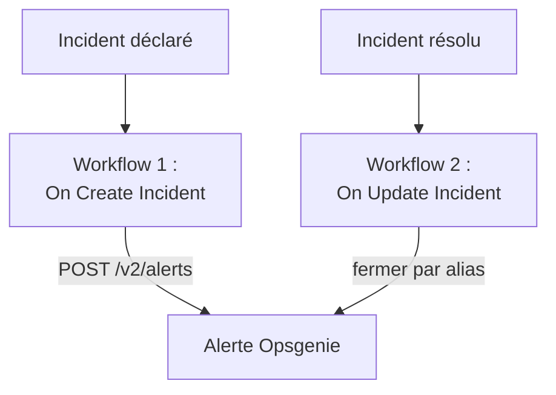

# Opsgenie

Envoyez les incidents OneUptime à [Opsgenie](https://www.atlassian.com/software/opsgenie). Un workflow crée une alerte Opsgenie quand un incident OneUptime est déclaré, et un second la ferme quand l'incident OneUptime est résolu. Utilisez-le tant qu'Opsgenie prévient encore votre équipe et que OneUptime surveille vos systèmes.

:::cards
- [Enregistrer la clé d'API](#enregistrer-la-clé-dapi): Gardez la clé d'Opsgenie hors de vos workflows.
- [Créer des alertes Opsgenie](#créer-une-alerte-opsgenie-pour-chaque-incident): Un workflow, deux blocs.
- [Les fermer](#fermer-lalerte-opsgenie): Un second workflow qui suit l'état de l'incident.
- [Dépannage](#dépannage): Quand Opsgenie refuse une requête.
:::

> [!IMPORTANT]
> Atlassian a cessé de vendre Opsgenie en juin 2025 et en arrête le support en avril 2027. OneUptime prévient aussi les gens, avec des politiques d'astreinte, des plannings et des règles d'escalade. Pour faire venir votre équipe, voir [Quitter Opsgenie](/docs/moving-to-oneuptime/opsgenie) : une importation fait venir vos utilisateurs, vos équipes, vos plannings et vos escalades.

## Fonctionnement



Les deux workflows appellent l'[API Alert d'Opsgenie](https://docs.opsgenie.com/docs/alert-api). Le premier donne à l'alerte un `alias` formé à partir de l'ID de l'incident OneUptime, et le second ferme l'alerte par cet alias.

## Avant de commencer

- Une intégration Opsgenie de type **API**, et son **API Key**. Ajoutez-en une sous **Settings → Integrations** dans Opsgenie, ou sous les **Integrations** d'une équipe pour envoyer les alertes à cette équipe.
- Votre région Opsgenie. Les comptes en Europe, qui se connectent sur `app.eu.opsgenie.com`, utilisent `api.eu.opsgenie.com`. Tous les autres utilisent `api.opsgenie.com`.
- Dans OneUptime, le droit de créer des workflows et des variables globales. Sur OneUptime Cloud, les workflows nécessitent l'offre **Growth** ou supérieure.

## Enregistrer la clé d'API

:::steps
1. Allez dans **Flux de travail → Variables globales** et cliquez sur **Créer : Variable de flux de travail**.
2. Nommez-la `OPSGENIE_KEY` et cliquez sur **Suivant**.
3. Collez la clé d'API dans **Contenu**, activez **Secret** et cliquez sur **Créer : Variable de flux de travail**.
:::

Une variable secrète est remplacée par `[REDACTED]` dans les journaux d'exécution, la clé n'apparaît donc jamais dans une exécution.

## Créer une alerte Opsgenie pour chaque incident

:::steps
### Créer le workflow

Allez dans **Flux de travail**, cliquez sur **Créer un flux de travail**, puis sur **Partir de zéro**. Nommez-le `Incidents to Opsgenie` et cliquez sur **Créer un flux de travail**.

### Ajouter le déclencheur

Cliquez sur le bloc en pointillés **Choisissez ce qui démarre ce flux de travail** et choisissez **On Create Incident**. Cliquez sur le déclencheur : ses **Fields to pass on** commencent par **Titre**, alors cliquez sur **Ajouter un champ** et choisissez **Description**.

### Créer l'alerte

Cliquez sur **Ajouter un composant**, ajoutez un bloc **API Post (JSON)** et reliez-y le point **Success** du déclencheur. Réglez son **URL** sur `https://api.opsgenie.com/v2/alerts`, ou `https://api.eu.opsgenie.com/v2/alerts` en Europe. Sous **Plus de champs**, réglez ses **Request Headers** sur :

```json
{ "Authorization": "GenieKey {{global.variables.OPSGENIE_KEY}}" }
```

Et son **Request Body** sur :

```json
{
  "message": "{{local.components.incident-on-create-1.returnValues.model.title}}",
  "alias": "oneuptime-{{local.components.incident-on-create-1.returnValues.model._id}}",
  "description": "{{local.components.incident-on-create-1.returnValues.model.description}}",
  "priority": "P1",
  "source": "OneUptime"
}
```

### Tester, puis activer

Cliquez sur **Exécuter le flux de travail**, choisissez un incident de test sous **Incident** et lancez-le. L'étape **API Post (JSON)** affiche une réponse `202`, et l'alerte apparaît dans Opsgenie un instant plus tard. Activez ensuite **Activé** en haut du **Constructeur**.
:::

Le schéma d'Opsgenie est le mot `GenieKey`, une espace, puis la clé. Opsgenie limite `message` à 130 caractères, et ses priorités vont de `P1` à `P5` : pour envoyer celle de chaque incident, voir [Faire correspondre les priorités](#faire-correspondre-les-priorités).

## Fermer l'alerte Opsgenie

Un workflow a un seul déclencheur, la fermeture demande donc un second workflow, démarré quand l'état d'un incident change.

:::steps
### Ajouter le déclencheur On Update Incident

Créez un workflow nommé `Close Opsgenie alerts` et choisissez **On Update Incident** comme déclencheur. Dans **Fields to watch**, cliquez sur **Ajouter un champ** et choisissez **État actuel de l'incident**, pour qu'il ne s'exécute que quand l'état change. Dans **Fields to pass on**, demandez si le nouvel état est un état résolu : cliquez sur **Ajouter un champ**, ouvrez **État actuel de l'incident** et choisissez **Est un état de résolution**. Ou cliquez sur **Modifier en JSON** et remplacez le JSON par :

```json
{ "_id": true, "currentIncidentState": { "isResolvedState": true } }
```

### Vérifier que l'incident est résolu

Ajoutez un bloc **If / Else** après le déclencheur. Réglez **Value to check** sur `{{local.components.incident-on-update-1.returnValues.model.currentIncidentState.isResolvedState}}` et **Comparison** sur **is true**.

### Fermer l'alerte

Ajoutez un bloc **API Post (JSON)** après le côté **Yes**, avec les mêmes **Request Headers**, et cette **URL** :

```text
https://api.opsgenie.com/v2/alerts/oneuptime-{{local.components.incident-on-update-1.returnValues.model._id}}/close?identifierType=alias
```

Réglez son **Request Body** sur `{ "source": "OneUptime", "note": "Resolved in OneUptime" }`.

### L'activer

Activez **Activé**, puis résolvez un incident de test dans OneUptime. Opsgenie ferme son alerte.
:::

`identifierType=alias` indique à Opsgenie que l'adresse désigne l'alerte par son alias, et non par son propre ID.

## Faire correspondre les priorités

Pour envoyer la gravité de chaque incident comme priorité Opsgenie, ajoutez un bloc **Run Custom JavaScript** entre le déclencheur et le bloc **API Post (JSON)**.

1. Dans les **Fields to pass on** du déclencheur, cliquez sur **Ajouter un champ**, ouvrez **Gravité de l'incident** et choisissez **Nom**.
2. Réglez les **Arguments** du bloc sur `{ "severity": "{{local.components.incident-on-create-1.returnValues.model.incidentSeverity.name}}" }`, et son **JavaScript Code** sur :

   ```javascript
   // Your incident severities, by name, to Opsgenie's priorities.
   const PRIORITY = {
     "Critical Incident": "P1",
     "Major Incident": "P2",
     "Minor Incident": "P3",
   };

   return { priority: PRIORITY[args.severity] || "P3" };
   ```

3. Dans le corps de la requête, réglez `"priority"` sur `"{{local.components.javascript-1.returnValues.returnValue.priority}}"`.

Les noms ci-dessus sont les trois gravités avec lesquelles un nouveau projet commence. Utilisez les vôtres si vous les avez renommées.

## Dépannage

:::details Opsgenie répond 401 ou 403
La clé est erronée, ou elle appartient à l'autre région. Vérifiez que l'en-tête contient `GenieKey`, une espace et la clé, que la clé est celle d'une intégration **API**, et que l'hôte correspond à votre région : `api.opsgenie.com` ou `api.eu.opsgenie.com`.
:::

:::details La fermeture répond 404
Aucune alerte n'a cet alias. Les deux workflows doivent former l'alias de la même façon, `oneuptime-` suivi du `_id` de l'incident, et l'URL doit se terminer par `?identifierType=alias`.
:::

:::details L'alerte n'apparaît jamais, bien que l'étape affiche 202
Opsgenie répond `202` avant de traiter la requête, donc une requête qu'il refuse ensuite affiche quand même `202`. Cherchez la requête dans les journaux d'Opsgenie pour voir pourquoi elle a été refusée, par exemple une intégration désactivée.
:::

:::details Le workflow ne s'exécute jamais
Vérifiez qu'il est activé : **Activé**, en haut de son **Constructeur**. Ouvrez ensuite **Journaux → Exécutions** : une exécution qui a pris le côté **No** du bloc **If / Else** est une mise à jour qui n'était pas une résolution.
:::

## Étapes suivantes

:::cards
- [Quitter Opsgenie](/docs/moving-to-oneuptime/opsgenie): Faites venir votre équipe, vos plannings et vos escalades avant la fin d'Opsgenie.
- [Règles d'escalade](/docs/on-call/escalation-rules): Prévenez les gens depuis OneUptime lui-même.
- [PagerDuty](/docs/integrations/pagerduty): Les deux mêmes workflows pour PagerDuty.
- [Présentation des intégrations](/docs/integrations/index): Les modèles derrière chaque intégration.
:::
