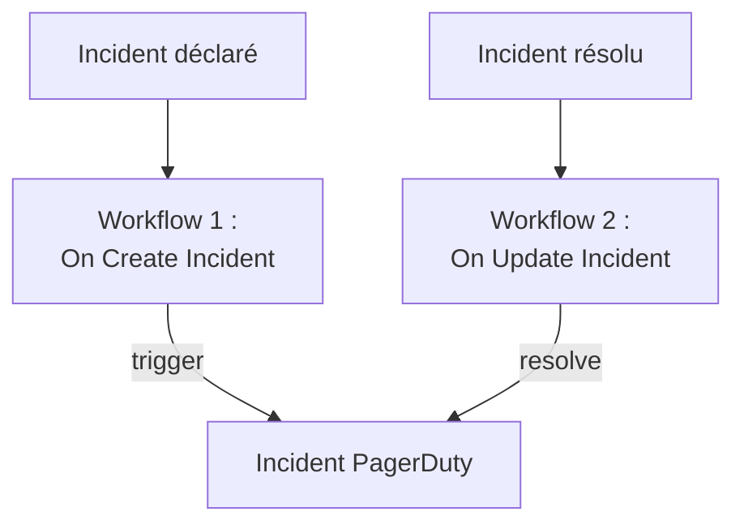

# PagerDuty

Envoyez les incidents OneUptime à [PagerDuty](https://www.pagerduty.com). Un workflow déclenche un incident PagerDuty quand un incident OneUptime est déclaré, et un second le résout quand l'incident OneUptime est résolu. Utilisez-le quand PagerDuty prévient votre équipe et que OneUptime surveille vos systèmes.

:::cards
- [Enregistrer la clé de routage](#enregistrer-la-clé-de-routage): Gardez la clé de PagerDuty hors de vos workflows.
- [Déclencher des incidents PagerDuty](#déclencher-un-incident-pagerduty-pour-chaque-incident): Un workflow, deux blocs.
- [Les résoudre](#résoudre-lincident-pagerduty): Un second workflow qui suit l'état de l'incident.
- [Dépannage](#dépannage): Quand PagerDuty refuse un événement.
:::

> [!TIP]
> OneUptime prévient aussi les gens, avec des politiques d'astreinte, des plannings et des règles d'escalade. Pour faire quitter PagerDuty à votre équipe, voir [Quitter PagerDuty](/docs/moving-to-oneuptime/pagerduty) : une importation fait venir vos utilisateurs, vos plannings et vos politiques d'escalade.

## Fonctionnement



Les deux workflows appellent l'[Events API v2](https://developer.pagerduty.com/docs/events-api-v2/overview/) de PagerDuty avec le même `dedup_key`, formé à partir de l'ID de l'incident OneUptime. Cette clé permet à PagerDuty de savoir que l'événement de résolution ferme l'incident ouvert par l'événement de déclenchement.

## Avant de commencer

- Un service PagerDuty avec une intégration Events API v2. Dans PagerDuty, ouvrez le service, puis **Integrations**, cliquez sur **Add an integration** et choisissez **Events API V2**. Copiez son **Integration Key** : l'Events API l'appelle la clé de routage.
- Dans OneUptime, le droit de créer des workflows et des variables globales. Sur OneUptime Cloud, les workflows nécessitent l'offre **Growth** ou supérieure.

## Enregistrer la clé de routage

:::steps
1. Allez dans **Flux de travail → Variables globales** et cliquez sur **Créer : Variable de flux de travail**.
2. Nommez-la `PAGERDUTY_ROUTING_KEY` et cliquez sur **Suivant**.
3. Collez la clé d'intégration dans **Contenu**, activez **Secret** et cliquez sur **Créer : Variable de flux de travail**.
:::

Une variable secrète est remplacée par `[REDACTED]` dans les journaux d'exécution, la clé n'apparaît donc jamais dans une exécution.

## Déclencher un incident PagerDuty pour chaque incident

:::steps
### Créer le workflow

Allez dans **Flux de travail**, cliquez sur **Créer un flux de travail**, puis sur **Partir de zéro**. Nommez-le `Incidents to PagerDuty` et cliquez sur **Créer un flux de travail**.

### Ajouter le déclencheur

Cliquez sur le bloc en pointillés **Choisissez ce qui démarre ce flux de travail** et choisissez **On Create Incident**. Cliquez sur le déclencheur et, dans **Fields to pass on**, choisissez `title` et `description`.

### Envoyer l'événement de déclenchement

Cliquez sur **Ajouter un composant**, ajoutez un bloc **API Post (JSON)** et reliez-y le point **Success** du déclencheur. Réglez son **URL** sur `https://events.pagerduty.com/v2/enqueue` et son **Request Body** sur :

```json
{
  "routing_key": "{{global.variables.PAGERDUTY_ROUTING_KEY}}",
  "event_action": "trigger",
  "dedup_key": "oneuptime-{{local.components.incident-on-create-1.returnValues.model._id}}",
  "payload": {
    "summary": "{{local.components.incident-on-create-1.returnValues.model.title}}",
    "source": "OneUptime",
    "severity": "critical",
    "custom_details": {
      "description": "{{local.components.incident-on-create-1.returnValues.model.description}}"
    }
  }
}
```

### Tester, puis activer

Cliquez sur **Exécuter le flux de travail**, saisissez l'**ID d'incident** d'un incident de test et lancez-le. L'étape **API Post (JSON)** affiche une réponse `202` avec `"status": "success"`, et PagerDuty ouvre un incident. Activez ensuite **Activé** en haut du **Constructeur**.
:::

Le bloc envoie du JSON, il n'a donc pas besoin d'en-tête `Content-Type`. Le `severity` de PagerDuty est l'un de `critical`, `error`, `warning` et `info` : pour envoyer celui de chaque incident, voir [Faire correspondre les gravités](#faire-correspondre-les-gravités).

## Résoudre l'incident PagerDuty

Un workflow a un seul déclencheur, la résolution demande donc un second workflow, démarré quand l'état d'un incident change.

:::steps
### Ajouter le déclencheur On Update Incident

Créez un workflow nommé `Resolve PagerDuty incidents` et choisissez **On Update Incident** comme déclencheur. Dans **Fields to watch**, choisissez `currentIncidentStateId`, pour qu'il ne s'exécute que quand l'état change. Dans **Fields to pass on**, demandez si le nouvel état est un état résolu :

```json
{ "_id": true, "currentIncidentState": { "isResolvedState": true } }
```

### Vérifier que l'incident est résolu

Ajoutez un bloc **If / Else** après le déclencheur. Réglez **Value to check** sur `{{local.components.incident-on-update-1.returnValues.model.currentIncidentState.isResolvedState}}` et **Comparison** sur **is true**.

### Envoyer l'événement de résolution

Ajoutez un bloc **API Post (JSON)** après le côté **Yes**, avec la même **URL** et ce **Request Body** :

```json
{
  "routing_key": "{{global.variables.PAGERDUTY_ROUTING_KEY}}",
  "event_action": "resolve",
  "dedup_key": "oneuptime-{{local.components.incident-on-update-1.returnValues.model._id}}"
}
```

### L'activer

Activez **Activé**, puis résolvez un incident de test dans OneUptime. PagerDuty résout son incident.
:::

Vérifier `isResolvedState` plutôt que le nom d'un état continue de fonctionner quand vous renommez vos états. Voir [États et sévérités des incidents](/docs/incidents/states-and-severities).

## Faire correspondre les gravités

Pour envoyer la gravité de chaque incident, ajoutez un bloc **Run Custom JavaScript** entre le déclencheur et le bloc **API Post (JSON)**, et lisez sa réponse dans le corps.

1. Dans les **Fields to pass on** du déclencheur, choisissez aussi le `name` de la gravité : `{ "incidentSeverity": { "name": true } }`.
2. Réglez les **Arguments** du bloc sur `{ "severity": "{{local.components.incident-on-create-1.returnValues.model.incidentSeverity.name}}" }`, et son **JavaScript Code** sur :

   ```javascript
   // Your incident severities, by name, to PagerDuty's.
   const SEVERITY = {
     "Critical Incident": "critical",
     "Major Incident": "error",
     "Minor Incident": "warning",
   };

   return { severity: SEVERITY[args.severity] || "info" };
   ```

3. Dans le corps de la requête, réglez `"severity"` sur `"{{local.components.javascript-1.returnValues.returnValue.severity}}"`.

Les noms ci-dessus sont les trois gravités avec lesquelles un nouveau projet commence. Utilisez les vôtres si vous les avez renommées.

## Dépannage

:::details PagerDuty répond 400
Le corps de la réponse dit ce que PagerDuty a refusé, et l'étape **API Post (JSON)** de l'exécution l'affiche. Le plus souvent, la clé de routage n'est pas une clé d'intégration Events API v2 : copiez-la de nouveau depuis les **Integrations** du service. Un événement sans `summary`, `source` ou `severity` est aussi refusé.
:::

:::details L'événement de résolution ne ferme rien
Les deux événements doivent porter exactement le même `dedup_key`. Vérifiez que les deux corps le forment avec `oneuptime-` suivi du `_id` de l'incident, et que le workflow de résolution est activé.
:::

:::details Le workflow ne s'exécute jamais
Vérifiez qu'il est activé : **Activé**, en haut de son **Constructeur**. Ouvrez ensuite **Journaux → Exécutions** : une exécution qui a pris le côté **No** du bloc **If / Else** est une mise à jour qui n'était pas une résolution.
:::

:::details PagerDuty affiche une référence au lieu d'une valeur
Une référence qui ne se résout pas est envoyée telle qu'elle est écrite, accolades comprises. Vérifiez l'identifiant du bloc, le nom du champ et le nom de la variable, sensible à la casse. Dans l'onglet **Étapes** de l'exécution, un paramètre contenant une telle référence est marqué **Non résolu**.
:::

## Étapes suivantes

:::cards
- [Quitter PagerDuty](/docs/moving-to-oneuptime/pagerduty): Faites venir votre équipe, vos plannings et vos politiques d'escalade.
- [Règles d'escalade](/docs/on-call/escalation-rules): Prévenez les gens depuis OneUptime lui-même.
- [Opsgenie](/docs/integrations/opsgenie): Les deux mêmes workflows pour Opsgenie.
- [Présentation des intégrations](/docs/integrations/index): Les modèles derrière chaque intégration.
:::
