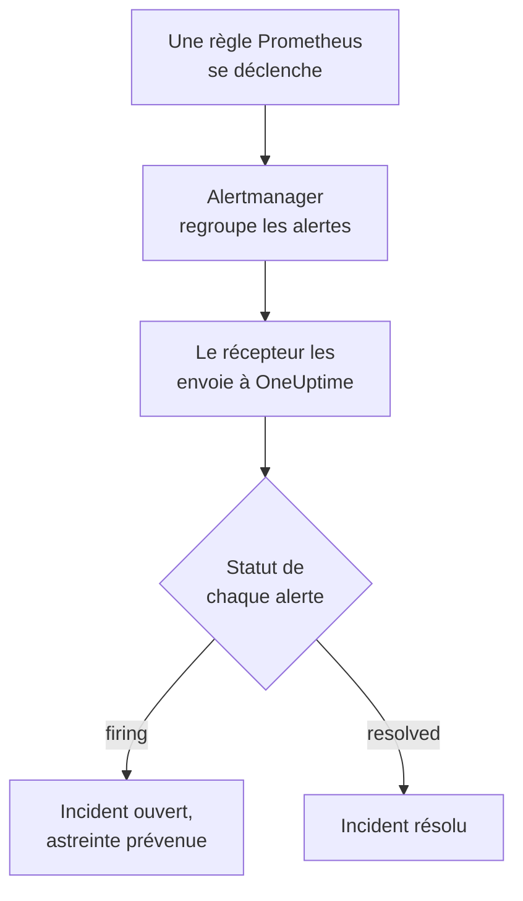

# Prometheus Alertmanager

Envoyez les alertes de [Prometheus Alertmanager](https://prometheus.io/docs/alerting/latest/alertmanager/) à OneUptime, pour que chaque alerte qui se déclenche devienne un incident qui prévient votre équipe d'astreinte et soit résolu quand l'alerte se rétablit. Alertmanager envoie ses notifications à un récepteur webhook, il n'y a donc rien à installer d'un côté comme de l'autre.

:::cards
- [Choisir comment OneUptime reçoit les alertes](#choisir-comment-oneuptime-reçoit-les-alertes): Un moniteur de requêtes entrantes, ou un workflow à vous.
- [Recevoir les alertes avec un moniteur](#recevoir-les-alertes-avec-un-moniteur): Un incident par alerte, résolu au rétablissement.
- [Configurer Alertmanager](#configurer-alertmanager): Un récepteur webhook, et la route qui l'utilise.
- [Dépannage](#dépannage): Quand les alertes n'arrivent pas, ou que les incidents restent ouverts.
:::

## Fonctionnement



Prometheus évalue vos règles d'alerte et envoie les alertes qui se déclenchent à Alertmanager. Alertmanager les regroupe selon les labels du `group_by` de votre route, et envoie chaque groupe au récepteur webhook sous forme d'une notification JSON. La liste `alerts` de la notification contient chaque alerte du groupe, chacune avec son propre `status`, `firing` ou `resolved`, ses labels et annotations, et un `fingerprint` qui l'identifie.

## Avant de commencer

- Un Alertmanager dont vous pouvez modifier le `alertmanager.yml`, et qui peut joindre votre OneUptime en HTTPS.
- Dans OneUptime, le droit de créer des moniteurs, ou des workflows si vous prenez cette voie.

## Choisir comment OneUptime reçoit les alertes

Configurez d'abord OneUptime : il vous donne l'URL à laquelle Alertmanager envoie.

| Façon | Utilisez-la quand |
| --- | --- |
| Un moniteur de requêtes entrantes (recommandé) | Vous voulez que chaque alerte devienne un incident qui prévient l'astreinte et soit résolu quand l'alerte se rétablit. Il n'y a rien à construire. |
| Un workflow avec un déclencheur Webhook | Il vous faut une logique propre : filtrer les alertes, les remanier ou appeler d'abord d'autres systèmes. Un workflow ouvre un incident par notification, pas par alerte, et ne le résout pas au rétablissement. |

Les deux reçoivent le même JSON du même récepteur, vous pouvez donc commencer par l'un et changer plus tard en modifiant une URL dans `alertmanager.yml`.

## Recevoir les alertes avec un moniteur

Un [moniteur de requêtes entrantes](/docs/monitor/incoming-request-monitor) vous donne une URL, et ses critères décident de ce que fait chaque notification.

:::steps
### Créer le moniteur

Allez dans **Moniteurs** et cliquez sur **Créer un moniteur**. Choisissez **Requête entrante** sous **Type de moniteur**, nommez-le `Alertmanager` et cliquez sur **Suivant**.

### Déclarer un incident pour chaque alerte déclenchée

À l'étape **Critères**, ouvrez le premier critère, celui qui marque le moniteur hors ligne. Réglez son filtre sur **Corps de la requête**, **Contient**, `"status":"firing"`. Ce critère déclare déjà un incident quand son filtre correspond. Remplissez l'incident :

- **Titre de l'incident** : `{{requestBody.commonLabels.alertname}} on {{requestBody.commonLabels.instance}}`.
- **Gravité** : la gravité d'incident que doivent avoir ces alertes.
- **Politiques d'astreinte**, sous **Astreinte** : les politiques à prévenir.
- **Résoudre automatiquement l'incident**, sous **Plus de champs** : laissez-le activé, comme au départ. Sans lui, les rétablissements sont ignorés et les incidents restent ouverts.

### Ouvrir un incident par alerte

Dans le même critère, ouvrez **Paramètres** et activez **Regrouper les incidents et alertes par un champ de la charge utile**. Remplissez-le comme ci-dessous, pour que chaque alerte ait son propre incident et que son rétablissement le résolve :

| Champ | Valeur |
| --- | --- |
| **Ouvrir un incident distinct pour chaque…** | `requestBody.alerts[*].fingerprint` |
| **Champ qui signale le rétablissement** | `requestBody.alerts[*].status` |
| **Value that means recovered** | `resolved` |

### Remettre le moniteur en ligne

Ouvrez le second critère, celui qui marque le moniteur en ligne, et réglez son filtre sur **Corps de la requête**, **Contient**, `"status":"resolved"`.

### Copier l'URL

Cliquez sur **Créer un moniteur**. La page **Vue d'ensemble** du moniteur affiche son **URL de heartbeat**. Copiez-la pour Alertmanager :

```text
https://oneuptime.com/heartbeat/<secret key>
```

Une installation auto-hébergée a son propre hôte à la place de `oneuptime.com`.
:::

`[*]` lit chaque alerte d'une notification, une notification de trois alertes peut donc ouvrir trois incidents, dans la limite de **Incidents max par requête** (`100` sauf si vous le changez). Le `status` propre à chaque alerte décide du sort de son incident : quand une alerte d'une notification est résolue et que deux se déclenchent encore, seul l'incident de l'alerte résolue est fermé. Voir [Recevoir des alertes d'un autre système](/docs/monitor/incoming-request-monitor#recevoir-les-alertes-dun-autre-système) pour ce que fait chaque paramètre.

> [!WARNING]
> Regroupez selon une valeur qui change d'une alerte à l'autre au sein d'une notification. Le `fingerprint` d'Alertmanager est un hachage de l'ensemble des labels d'une alerte, il change donc toujours. Un label du `group_by` de votre route ne change jamais : c'est lui qui met les alertes dans une seule notification. Regrouper selon `requestBody.alerts[*].labels.alertname` avec la route ci-dessous réunit toutes les alertes d'une notification en un seul incident, qui prend le statut de la première alerte.

## Nommer les incidents

Le titre ci-dessus lit des labels que toutes les alertes de la notification partagent : `commonLabels` contient ces labels, et `commonAnnotations` les annotations qu'elles partagent. Avec la route ci-dessous, qui regroupe par `alertname` et `instance`, les deux sont présents. Sous **Description**, donnez à l'incident une **Description de l'incident** comme celle-ci :

```text
{{requestBody.commonAnnotations.summary}}

{{requestBody.commonAnnotations.description}}
Severity: {{requestBody.commonLabels.severity}}
Alertmanager: {{requestBody.externalURL}}
```

- La clé de regroupement est aussi une variable, nommée d'après le dernier segment de son chemin : `{{fingerprint}}`. C'est un hachage, elle ne dit donc rien à un intervenant.
- `{{requestBody.alerts[0].annotations.summary}}` lit la première alerte de la notification, qui n'est pas toujours l'alerte pour laquelle l'incident a été ouvert.
- Une référence à un champ que la notification n'a pas est laissée telle qu'elle est écrite, accolades comprises, au lieu d'être vidée.

Voir [Modèles d'incident et d'alerte](/docs/monitor/incident-alert-templating) pour toutes les variables que vous pouvez utiliser.

## Configurer Alertmanager

:::steps
### Ajouter un récepteur webhook

Dans `alertmanager.yml`, ajoutez un récepteur qui envoie à l'URL copiée, et faites-en le récepteur de la route :

```yaml title="alertmanager.yml"
route:
  receiver: oneuptime
  group_by: ["alertname", "instance"]

receivers:
  - name: oneuptime
    webhook_configs:
      - url: "https://oneuptime.com/heartbeat/<secret key>"
        send_resolved: true
```

`send_resolved: true` est la valeur par défaut d'Alertmanager, écrite pour qu'elle reste activée : sans elle, OneUptime n'apprend jamais qu'une alerte s'est rétablie. Alertmanager envoie `Content-Type: application/json`, dont le moniteur a besoin pour lire les champs d'une notification.

### Recharger Alertmanager

Rechargez la configuration, ou redémarrez Alertmanager :

```bash
curl -X POST http://localhost:9093/-/reload
```
:::

La route garde les délais par défaut d'Alertmanager. Elle attend `30s` avant d'envoyer un nouveau groupe (`group_wait`), `5m` avant de renvoyer un groupe qui contient de nouvelles alertes (`group_interval`), et `4h` avant de répéter une notification qui n'a pas changé (`repeat_interval`).

## Tester

Envoyez à OneUptime une notification de deux alertes déclenchées, comme le ferait Alertmanager :

```bash
curl -X POST "https://oneuptime.com/heartbeat/<secret key>" \
  -H "Content-Type: application/json" \
  -d '{
    "version": "4",
    "status": "firing",
    "receiver": "oneuptime",
    "groupLabels": { "alertname": "DiskFull", "instance": "web-1" },
    "commonLabels": { "alertname": "DiskFull", "instance": "web-1", "severity": "critical" },
    "commonAnnotations": { "summary": "Disk almost full on web-1" },
    "externalURL": "http://alertmanager:9093",
    "alerts": [
      {
        "status": "firing",
        "labels": { "alertname": "DiskFull", "instance": "web-1", "severity": "critical", "device": "/dev/sda1" },
        "fingerprint": "a1b2c3d4e5f60001"
      },
      {
        "status": "firing",
        "labels": { "alertname": "DiskFull", "instance": "web-1", "severity": "critical", "device": "/dev/sdb1" },
        "fingerprint": "a1b2c3d4e5f60002"
      }
    ]
  }'
```

Deux incidents s'ouvrent, un par `fingerprint`, chacun intitulé `DiskFull on web-1`. Envoyez la même requête avec chaque `status` sur `resolved`, et les deux sont résolus.

Pour tester tout le chemin depuis Alertmanager, déclenchez une alerte avec `amtool`. Alertmanager l'envoie après `group_wait`, puis envoie son rétablissement quand l'alerte expire quelques minutes plus tard :

```bash
amtool alert add test_alert severity=warning \
  --annotation=summary="Test from Alertmanager" \
  --alertmanager.url=http://localhost:9093
```

## Recevoir les alertes avec un workflow

Utilisez un [workflow](/docs/workflows/index) quand il vous faut vos propres étapes entre Alertmanager et l'incident.

:::steps
### Créer le workflow

Allez dans **Flux de travail**, cliquez sur **Créer un flux de travail**, puis sur **Partir de zéro**. Nommez-le `Alertmanager alerts` et cliquez sur **Créer un flux de travail**.

### Ajouter le déclencheur Webhook

Cliquez sur le bloc en pointillés **Choisissez ce qui démarre ce flux de travail** et choisissez **Webhook**. Cliquez sur le déclencheur, puis sur **Copier l'URL**, et utilisez cette URL dans le récepteur de `alertmanager.yml`.

### Vérifier que la notification se déclenche

Cliquez sur **Ajouter un composant**, ajoutez un bloc **If / Else** et reliez-y le point **Out** du déclencheur. Réglez **Value to check** sur `{{local.components.webhook-1.returnValues.request-body.status}}`, **Comparison** sur **is equal to** et **Compare with** sur `firing`.

### Déclarer l'incident

Ajoutez un bloc **Create One Incident** et reliez-y le côté **Yes** du bloc **If / Else**. Dans **Incident Template**, choisissez un modèle qui fixe la gravité et les politiques d'astreinte à prévenir (voir [Modèles d'incident](/docs/incidents/settings#modèles-dincident)). Dans **JSON Object**, indiquez ce qui vient d'Alertmanager :

```json
{
  "title": "{{local.components.webhook-1.returnValues.request-body.commonLabels.alertname}}",
  "description": "{{local.components.webhook-1.returnValues.request-body.commonAnnotations.summary}}\nAlertmanager: {{local.components.webhook-1.returnValues.request-body.externalURL}}"
}
```

Sans modèle, **JSON Object** doit aussi contenir `incidentSeverityId`, l'ID de l'une des gravités d'incident du projet.

### Activer le workflow

Activez **Activé** en haut du **Constructeur**. Un workflow désactivé répond à Alertmanager par `400`.
:::

Une exécution traite une notification, elle déclare donc un seul incident, quel que soit le nombre d'alertes de la notification. Une notification `resolved` prend le côté **No** du bloc **If / Else**, où rien n'est relié, l'exécution s'arrête donc là. Pour un incident par alerte, résolu au rétablissement, utilisez le moniteur.

## Surveiller Alertmanager lui-même

Aucune des deux façons ne remarque quand Prometheus ou Alertmanager cesse de fonctionner : ne recevoir aucune alerte ressemble exactement à ce que tout aille bien. Envoyez donc une alerte qui se déclenche en permanence à un second moniteur, qui déclare un incident quand cette alerte cesse d'arriver. [kube-prometheus-stack](https://github.com/prometheus-community/helm-charts/tree/main/charts/kube-prometheus-stack) fournit une telle alerte, nommée `Watchdog`. Sur un Prometheus simple, ajoutez une règle d'alerte nommée `Watchdog` dont l'expression est toujours vraie, par exemple `vector(1)`.

:::steps
### Créer le moniteur de surveillance

Créez un second moniteur de requêtes entrantes, nommé `Alertmanager watchdog`. Réglez le filtre de son premier critère, celui qui marque le moniteur hors ligne, sur **Requête entrante**, **Not Recieved In Minutes**, `10`, et le filtre de son second critère sur **Requête entrante**, **Recieved In Minutes**, `10`. Le tableau de bord écrit les deux ainsi. Copiez l'**URL de heartbeat** du nouveau moniteur.

### Y diriger l'alerte de surveillance

Ajoutez un récepteur pour l'URL du moniteur de surveillance, et une route qui lui envoie `Watchdog` toutes les cinq minutes. Une route enfant est examinée avant le récepteur de son parent, `Watchdog` va donc au moniteur de surveillance et toutes les autres alertes vont toujours au premier :

```yaml title="alertmanager.yml"
route:
  receiver: oneuptime
  group_by: ["alertname", "instance"]
  routes:
    - receiver: oneuptime-watchdog
      matchers:
        - alertname = "Watchdog"
      group_wait: 0s
      group_interval: 5m
      repeat_interval: 5m

receivers:
  - name: oneuptime
    webhook_configs:
      - url: "https://oneuptime.com/heartbeat/<secret key>"
        send_resolved: true
  - name: oneuptime-watchdog
    webhook_configs:
      - url: "https://oneuptime.com/heartbeat/<watchdog secret key>"
```
:::

Quand l'alerte de surveillance n'est pas arrivée depuis dix minutes, le moniteur de surveillance passe hors ligne et déclare un incident. La notification de surveillance suivante remet le moniteur en ligne et résout l'incident.

## Dépannage

:::details Rien n'arrive dans OneUptime
- Vérifiez dans le journal d'Alertmanager les erreurs de livraison au récepteur.
- Le moniteur répond `200` immédiatement, avant de vérifier quoi que ce soit, même avec une clé secrète erronée. Consultez la chronologie du moniteur pour voir si les notifications arrivent.
- Un workflow désactivé répond `400`. Activez **Activé** en haut de son **Constructeur**.
:::

:::details Les incidents s'ouvrent mais ne sont jamais résolus
- Vérifiez qu'aucun récepteur ne règle `send_resolved: false` : Alertmanager n'envoie alors jamais de rétablissement.
- L'incident du critère a besoin de **Résoudre automatiquement l'incident**, sous **Plus de champs**.
- **Champ qui signale le rétablissement** doit valoir `requestBody.alerts[*].status`, et **Value that means recovered** exactement `resolved`. La comparaison respecte la casse.
- Les alertes d'une notification au-delà de **Incidents max par requête** ne sont pas lues du tout, leurs rétablissements sont donc perdus aussi.
- Un rétablissement sauté dans une rafale (voir ci-dessous) laisse son incident ouvert pour de bon : Alertmanager répète les alertes déclenchées, mais jamais un rétablissement. Résolvez un tel incident à la main.
:::

:::details Aucun incident ne s'ouvre
Les chemins de regroupement doivent commencer par `requestBody.`, et seul le premier `[*]` d'un chemin lit une liste. Un chemin qui enfreint l'une de ces règles ne correspond à rien, sans erreur.
:::

:::details Un seul incident pour une notification pleine d'alertes
Vous avez regroupé selon un label identique pour toutes les alertes d'une notification, le plus souvent un label du `group_by` de votre route. Regroupez plutôt selon `requestBody.alerts[*].fingerprint`.
:::

:::details L'incident affiche une référence au lieu d'une valeur
Une référence à un champ que la notification n'a pas est laissée telle qu'elle est écrite, accolades comprises. Les règles posent des annotations différentes, utilisez donc les champs que vos règles posent : dans `commonAnnotations`, ou dans les `annotations` de chaque alerte.
:::

:::details Trop d'incidents
Regroupez votre route selon moins de labels, ou augmentez `group_interval`, pour qu'Alertmanager envoie les alertes liées ensemble. Baisser **Incidents max par requête** limite les incidents d'une notification, mais les alertes au-delà de la limite ne sont pas lues, leurs rétablissements sont donc perdus aussi.
:::

:::details Des notifications sont sautées lors d'une rafale
Quand une requête plus récente atteint un moniteur avant qu'une précédente soit évaluée, OneUptime n'évalue que la plus récente, pour qu'un seul expéditeur ne puisse pas submerger un moniteur. La dernière notification d'une rafale est toujours évaluée, mais une précédente sur d'autres alertes peut être sautée, car Alertmanager envoie chaque groupe à la même URL. Augmentez `group_wait` et `group_interval` pour espacer les notifications. Sur une installation auto-hébergée, réglez `INCOMING_REQUEST_INGEST_COALESCE_ENABLED=false` dans l'environnement de l'application OneUptime pour évaluer chaque requête.
:::

## Sécurité

- **Traitez l'URL comme un mot de passe.** Quiconque la possède peut ouvrir des incidents. Si elle fuit, réinitialisez-la : **Réinitialiser la clé secrète des requêtes entrantes** sur la page **Paramètres** du moniteur, ou **Réinitialiser l'URL** dans le déclencheur **Webhook** du workflow. Mettez ensuite à jour l'`url` du récepteur dans `alertmanager.yml`.
- **Auto-hébergé ?** Laissez Alertmanager joindre votre OneUptime en HTTPS à travers votre pare-feu.

## Étapes suivantes

:::cards
- [Surveillance des requêtes entrantes](/docs/monitor/incoming-request-monitor): Chaque paramètre du moniteur qui reçoit vos alertes.
- [Grafana](/docs/integrations/grafana): La même configuration, pour les alertes Grafana.
- [Règles d'escalade](/docs/on-call/escalation-rules): Décider qui une politique d'astreinte prévient, et quand.
- [Présentation des intégrations](/docs/integrations/index): Les autres outils que vous pouvez connecter.
:::
