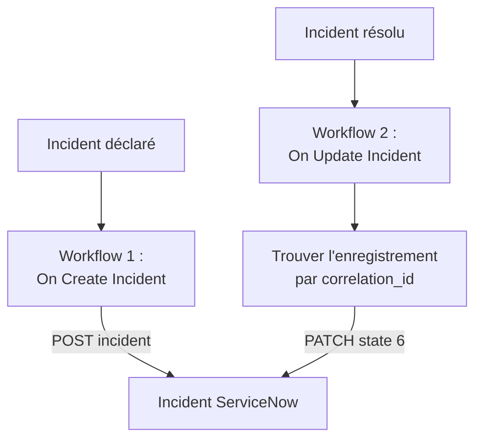

# ServiceNow

Créez un incident [ServiceNow](https://www.servicenow.com) pour chaque incident OneUptime, et résolvez-le quand l'incident OneUptime est résolu, pour que votre centre de services suive ce que voit votre surveillance. Deux workflows appellent la [Table API](https://developer.servicenow.com/dev.do#!/reference/api/latest/rest/c_TableAPI) de ServiceNow.

:::cards
- [Enregistrer les identifiants](#enregistrer-les-identifiants): Gardez le mot de passe ServiceNow hors de vos workflows.
- [Créer des incidents ServiceNow](#créer-un-incident-servicenow-pour-chaque-incident): Un workflow, deux blocs.
- [Les résoudre](#résoudre-lincident-servicenow): Trouver l'enregistrement, puis le clore.
- [Dépannage](#dépannage): Quand ServiceNow refuse une requête.
:::

## Fonctionnement



Le premier workflow écrit l'ID de l'incident OneUptime dans le `correlation_id` de l'enregistrement. Le second retrouve l'enregistrement par cet ID, puis le résout.

## Avant de commencer

- Une instance ServiceNow, par exemple `https://your-instance.service-now.com`.
- Un utilisateur ServiceNow pour l'intégration, qui peut créer et modifier des enregistrements dans la table `incident`, en général avec le rôle `itil`. Son nom et son mot de passe signent les requêtes.
- Dans OneUptime, le droit de créer des workflows et des variables globales. Sur OneUptime Cloud, les workflows nécessitent l'offre **Growth** ou supérieure.

## Enregistrer les identifiants

La Table API accepte l'authentification Basic : le nom et le mot de passe de l'utilisateur, encodés ensemble.

:::steps
1. Encodez-les une fois, sous macOS ou Linux :

   ```bash
   printf '%s' 'integration.user:password' | base64 | tr -d '\n'
   ```

   Utilisez `printf`, pas `echo` : `echo` ajoute un saut de ligne, qui est encodé avec le reste et casse les identifiants.

2. Dans OneUptime, allez dans **Flux de travail → Variables globales** et cliquez sur **Créer : Variable de flux de travail**. Nommez-la `SERVICENOW_AUTH` et cliquez sur **Suivant**.
3. Collez la valeur encodée dans **Contenu**, activez **Secret** et cliquez sur **Créer : Variable de flux de travail**.
:::

## Créer un incident ServiceNow pour chaque incident

:::steps
### Créer le workflow

Allez dans **Flux de travail**, cliquez sur **Créer un flux de travail**, puis sur **Partir de zéro**. Nommez-le `Incidents to ServiceNow` et cliquez sur **Créer un flux de travail**.

### Ajouter le déclencheur

Cliquez sur le bloc en pointillés **Choisissez ce qui démarre ce flux de travail** et choisissez **On Create Incident**. Cliquez sur le déclencheur et, dans **Fields to pass on**, choisissez `title` et `description`.

### Créer l'enregistrement

Cliquez sur **Ajouter un composant**, ajoutez un bloc **API Post (JSON)** et reliez-y le point **Success** du déclencheur. Réglez son **URL** sur `https://your-instance.service-now.com/api/now/table/incident`. Sous **Plus de champs**, réglez ses **Request Headers** sur :

```json
{
  "Authorization": "Basic {{global.variables.SERVICENOW_AUTH}}",
  "Accept": "application/json"
}
```

Et son **Request Body** sur :

```json
{
  "short_description": "OneUptime: {{local.components.incident-on-create-1.returnValues.model.title}}",
  "description": "{{local.components.incident-on-create-1.returnValues.model.description}}",
  "urgency": "1",
  "impact": "1",
  "correlation_id": "oneuptime-{{local.components.incident-on-create-1.returnValues.model._id}}"
}
```

### Tester, puis activer

Cliquez sur **Exécuter le flux de travail**, choisissez un incident de test sous **Incident** et lancez-le. L'étape **API Post (JSON)** affiche une réponse `201` contenant le nouvel enregistrement, avec son `sys_id` et son `number`, par exemple `INC0012345`. Activez ensuite **Activé** en haut du **Constructeur**.
:::

`urgency` et `impact` prennent `1` pour élevé, `2` pour moyen et `3` pour faible, et ServiceNow en déduit la priorité. Toute autre colonne de la table `incident` peut aller dans le corps, sous son nom de colonne.

## Résoudre l'incident ServiceNow

Un workflow a un seul déclencheur, la résolution demande donc un second workflow, démarré quand l'état d'un incident change.

:::steps
### Ajouter le déclencheur On Update Incident

Créez un workflow nommé `Resolve ServiceNow incidents` et choisissez **On Update Incident** comme déclencheur. Dans **Fields to watch**, choisissez `currentIncidentStateId`, pour qu'il ne s'exécute que quand l'état change. Dans **Fields to pass on**, demandez si le nouvel état est un état résolu :

```json
{ "_id": true, "currentIncidentState": { "isResolvedState": true } }
```

### Vérifier que l'incident est résolu

Ajoutez un bloc **If / Else** après le déclencheur. Réglez **Value to check** sur `{{local.components.incident-on-update-1.returnValues.model.currentIncidentState.isResolvedState}}` et **Comparison** sur **is true**.

### Trouver l'enregistrement

Ajoutez un bloc **API Get (JSON)** après le côté **Yes**, avec les mêmes **Request Headers**, et cette **URL** :

```text
https://your-instance.service-now.com/api/now/table/incident?sysparm_query=correlation_id=oneuptime-{{local.components.incident-on-update-1.returnValues.model._id}}&sysparm_fields=sys_id&sysparm_limit=1
```

### Résoudre l'enregistrement

Ajoutez un bloc **API Patch (JSON)** après le **Success** du bloc de recherche, avec les mêmes **Request Headers**, et cette **URL** :

```text
https://your-instance.service-now.com/api/now/table/incident/{{local.components.api-get-1.returnValues.response-body.result[0].sys_id}}
```

Réglez son **Request Body** sur :

```json
{
  "state": "6",
  "close_code": "Solution provided",
  "close_notes": "Resolved in OneUptime"
}
```

### L'activer

Activez **Activé**, puis résolvez un incident de test dans OneUptime. Son incident ServiceNow passe à Resolved.
:::

`state` `6` correspond à Resolved dans les états d'incident par défaut de ServiceNow. `close_code` doit être l'un des codes de résolution de votre instance. Beaucoup d'instances ne résolvent pas un incident sans code de résolution ni notes, envoyez donc les deux.

## Dépannage

:::details ServiceNow répond 401
Les identifiants sont erronés. Encodez de nouveau `username:password` avec `printf`, pas `echo`, et remplacez le contenu de `SERVICENOW_AUTH`.
:::

:::details ServiceNow répond 403
L'utilisateur ne peut pas écrire dans la table `incident`. Donnez-lui le rôle `itil`, ou un rôle avec les mêmes droits, et vérifiez qu'aucune règle d'accès ne lui bloque la Table API.
:::

:::details ServiceNow répond 400, ou la résolution ne change rien
Un nom de colonne ou une valeur ne convient pas à votre instance : une liste `state` personnalisée, ou un `close_code` que votre instance n'a pas. Comparez avec la table `incident` sous **System Definition → Tables** dans ServiceNow, et avec le formulaire de l'enregistrement.
:::

:::details La résolution répond 404
L'étape de recherche n'a trouvé aucun enregistrement, l'URL a donc gardé la référence telle qu'elle est écrite. Vérifiez que le premier workflow a écrit `correlation_id`, et que les deux workflows le forment de la même façon : `oneuptime-` suivi du `_id` de l'incident.
:::

## Étapes suivantes

:::cards
- [Jira](/docs/integrations/jira): Une intégration bidirectionnelle, tenue à jour par des modèles prêts à l'emploi.
- [Composants de workflow](/docs/workflows/components#api): Chaque paramètre des blocs d'API.
- [Exécutions de workflow](/docs/workflows/runs-and-logs): Lisez ce que chaque requête a envoyé et reçu.
- [Présentation des intégrations](/docs/integrations/index): Les modèles derrière chaque intégration.
:::
