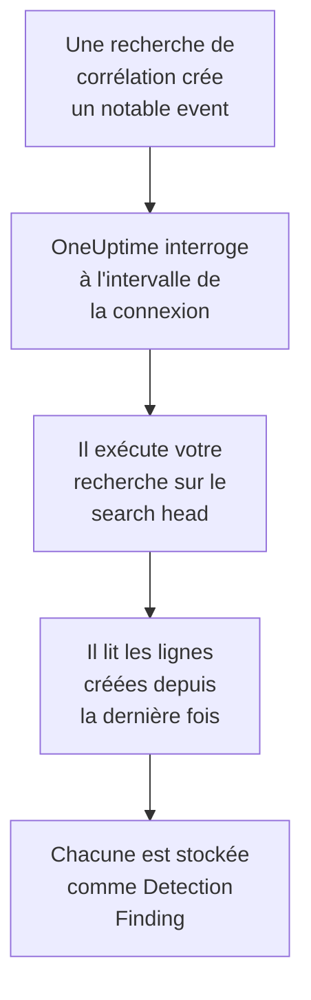

# Splunk Enterprise Security

Importez les notable events que créent les recherches de corrélation de [Splunk Enterprise Security](https://www.splunk.com/en_us/products/enterprise-security.html) dans les événements de sécurité de OneUptime. Vous les y recherchez à côté de vos logs, traces et métriques, vous les corrélez avec toutes les autres sources, et vous prévenez l'astreinte pour ceux qui comptent. OneUptime les lit en exécutant une recherche sur votre search head, en tant qu'utilisateur Splunk que vous créez, et ne modifie rien dans Splunk. Comme ce n'est qu'une recherche, il importe n'importe quel index ou la sortie de n'importe quelle recherche enregistrée, pas seulement les notable events.

:::cards
- [Configurer la connexion](#configurer-la-connexion): Un jeton, un rôle et le formulaire de la connexion.
- [Ce qui est importé](#ce-qui-est-importé): Comment chaque ligne de la recherche devient un événement de sécurité.
- [Fonctionnement des interrogations](#fonctionnement-des-interrogations): La fenêtre que lit chaque interrogation, et ce qu'en fait un search head chargé.
- [Dépannage](#dépannage): Ce que signifie chaque erreur, et ce qu'il faut changer.
:::

## Fonctionnement



Chaque minute, OneUptime interroge chaque connexion activée dont l'intervalle d'interrogation est écoulé. Une interrogation exécute votre recherche via l'API REST du search head, sur les lignes créées depuis la dernière interrogation, et stocke chaque ligne comme un événement [OCSF](https://schema.ocsf.io/) Detection Finding (classe `2004`). Les règles de détection, les moniteurs et les tableaux de bord le traitent alors comme un événement de sécurité de n'importe quelle autre source.

## Avant de commencer

- Dans OneUptime, le rôle Project Owner, Project Admin ou Security Admin. Les rôles Security Member et Security Viewer voient les connexions et l'historique de leurs exécutions, mais ne peuvent pas les modifier.
- Un search head sous Splunk Enterprise 9.0.1 ou ultérieur, ou Splunk Cloud Platform. OneUptime parle à son API REST sur le port de gestion, en général `8089`. Splunk Web, sur le port `8000`, ne sert pas l'API REST.
- Un utilisateur Splunk pour OneUptime, dont le rôle a la capacité `search` et peut lire l'index que lit la recherche : `notable` pour les notable events. Les rôles `ess_analyst` et `ess_user` d'Enterprise Security accordent les deux. La connexion ne fait que lire, le rôle n'a donc besoin de rien d'autre.
- Un search head que OneUptime peut joindre en HTTPS. OneUptime Cloud se connecte depuis Internet, le search head a donc besoin d'une adresse publique : les adresses privées sont refusées. Un OneUptime auto-hébergé se connecte depuis ses conteneurs d'application et de workers, et peut joindre un search head sur votre réseau privé, sauf si `DATA_SOURCE_BLOCK_PRIVATE_ADDRESSES` vaut `true`.

## Configurer la connexion

La connexion s'authentifie avec un jeton d'authentification Splunk, ou avec un nom d'utilisateur et un mot de passe.

:::steps
### Créer un jeton d'authentification

1. Dans Splunk Web, ouvrez **Settings → Tokens**. Si Splunk indique que l'authentification par jeton est désactivée, sélectionnez d'abord **Enable Token Authentication**.
2. Sélectionnez **New Token**. Dans **User**, saisissez l'utilisateur Splunk créé pour OneUptime, et dans **Audience**, indiquez à quoi sert le jeton, par exemple `OneUptime security events`.
3. Choisissez une **Expiration**, ou aucune. Un jeton qui expire arrête la connexion jusqu'à ce que vous le remplaciez.
4. Sélectionnez **Create** et copiez le jeton. Splunk ne l'affiche qu'une fois.

Pour vous authentifier plutôt avec un mot de passe, sautez cette étape et gardez sous la main le nom et le mot de passe de l'utilisateur.

### Ajouter la connexion dans OneUptime

Ouvrez **Produits → Événements de sécurité → Connexions** (`/dashboard/{projectId}/security-events/connections`), cliquez sur **Ajouter une connexion**, choisissez **Splunk Enterprise Security**, puis cliquez sur **Suivant**. Remplissez les paramètres du tableau ci-dessous, cliquez sur **Suivant**, et collez le jeton dans **Authentication token**, ou le mot de passe dans **Mot de passe**.

### La tester avant d'enregistrer

Cliquez sur **Test these settings** sous **Tester avant d'enregistrer**. Le test s'authentifie et exécute votre recherche avec les valeurs du formulaire, sans rien stocker : un mauvais port ou un rôle manquant apparaît donc avant que la connexion n'existe. Cliquez ensuite sur **Suivant**, donnez un **Nom** à la connexion et créez-la.
:::

| Réglage | Ce qu'il faut saisir |
| --- | --- |
| **Splunk management URL** | L'API REST du search head, par exemple `https://splunk.example.com:8089`. Elle doit utiliser `https`, sans chaîne de requête. Un chemin est conservé, pour un proxy inverse qui sert l'API sous un chemin. |
| **Rechercher** | La recherche qui choisit ce qu'il faut importer, `index=notable` tant que vous ne la changez pas. Restreignez-la, par exemple avec `index=notable urgency IN (high, critical)`. OneUptime ajoute lui-même la plage de temps : la recherche ne peut donc fixer ni `earliest` ni `latest`, ni commencer par un pipe. Un `search` en tête est retiré. |
| **Nom d'utilisateur** | Le nom de l'utilisateur Splunk, seulement s'il s'authentifie avec un mot de passe. |
| **Authentication token** | Le jeton de la première étape. Quand un jeton est enregistré, c'est lui qui est utilisé, et pas le nom d'utilisateur ni le mot de passe. |
| **Mot de passe** | Le mot de passe de l'utilisateur Splunk, seulement quand aucun jeton n'est utilisé. |

**Authentication token** et **Mot de passe** sont chiffrés, jamais renvoyés par l'API et jamais réaffichés. Remplacez-en un avec **Update credentials** sur la connexion. Pour passer d'une authentification à l'autre, saisissez-y la nouvelle et activez **Remove the stored Authentication token** ou **Remove the stored Password**.

L'étape **Polling** contient aussi une **Description** facultative, le **Poll Interval (Minutes)**, un nombre entier de `1` à `1440` qui vaut `5` au départ, et **Activé**, qui est activé au départ.

## Ce qui est importé

Chaque ligne que renvoie la recherche devient un événement Detection Finding (classe OCSF `2004`), avec le fournisseur `Splunk` et le produit `Splunk Enterprise Security`. Pour un notable event :

| Champ Splunk | Colonne OneUptime |
| --- | --- |
| `event_id`, sinon `_bkt` et `_cd`, sinon un hachage de la ligne | UID de l'événement, qui sert aussi à écarter les doublons |
| `_time`, quand la recherche de corrélation a créé le notable event | Heure de l'événement |
| `rule_name`, sinon `search_name`, sinon `source` | Nom de la règle |
| `search_name`, sinon `source`, sinon `rule_name` | ID de la règle |
| `rule_title`, sinon `rule_description`, sinon le nom de la règle | Message |
| `urgency`, sinon `severity` | Gravité |
| `status_label`, sinon `status_description`, sinon le nom du statut de revue que contient `status` | Statut |
| `annotations.mitre_attack`, et des champs comme `mitre_technique_id` et `mitre_tactic` | Tactiques et techniques MITRE ATT&CK |
| `user` ou `src_user` ; `src`, `src_ip` ou `src_host` ; `process`, `process_name` ou `parent_process` | Utilisateur, IP, hôte et processus de l'acteur |
| `process_name` ou `process_exec`, `process_path` et `process` ; `parent_process_name` ou `parent_process_exec`, `parent_process_path` et `parent_process` | Nom, chemin et ligne de commande du processus ; nom, chemin et ligne de commande du processus parent |
| `dest_user` ; `dest`, `dest_ip` ou `dest_host` ; `dest_port` | Utilisateur, IP, hôte et port de la cible |
| `file_path`, `url` ou `risk_object` | Ressource cible |
| Chaque utilisateur, hôte et IP, ainsi que `dvc`, `host`, `file_hash`, `file_name`, `url`, `domain`, `query` et `risk_object` | Observables |
| Chaque champ de la ligne, par exemple `security_domain`, `owner`, `orig_sid` et `_raw` | `attributes`, sous le nom propre du champ |

Une ligne d'un autre index est importée de la même façon. Les colonnes que ses champs ne remplissent pas restent vides, et chaque champ reste consultable dans `attributes`.

## Fonctionnement des interrogations

Chaque interrogation exécute une recherche d'export sur sa fenêtre, les plus anciennes d'abord :

```text
POST {Splunk management URL}/services/search/v2/jobs/export
    search=search index=notable | fields * | sort 0 _time | head 10001
    earliest_time={window start}
    latest_time={window end}
    output_mode=json
```

- **L'heure de création est le curseur.** La fenêtre porte sur `_time`, qui pour un notable event est le moment où la recherche de corrélation l'a créé, et non celui où s'est produite l'activité trouvée. Une recherche qui tourne toutes les heures date ses notable events de l'heure de son exécution, si bien qu'aucun ne passe derrière le curseur.
- **La première interrogation remonte 24 heures en arrière**, si bien qu'une nouvelle connexion montre tout de suite ses notable events récents.
- **Chaque interrogation suivante commence 1 minute avant le curseur enregistré**, si bien qu'une ligne créée à la limite entre deux fenêtres n'est jamais sautée.
- **Une interrogation lit au plus 24 heures au-delà du curseur.** Une connexion dont le curseur a pris du retard le rattrape en une suite de fenêtres de 24 heures, et sa **Santé** indique **Catching up**.
- **Les doublons sont écartés par `event_id`**, ou par les `_bkt` et `_cd` propres à Splunk, au sein du projet, si bien que le chevauchement, une fenêtre relue et un import ne stockent jamais une ligne deux fois.

Un search head antérieur à 9.0.1 répond `404` à la requête vers `search/v2/jobs/export`. OneUptime l'envoie alors vers `search/jobs/export`, obsolète, et l'exécution le signale dans un avertissement. Mettez à jour le search head : les versions actuelles désactivent ce point de terminaison.

### Quand une fenêtre contient plus qu'une interrogation ne peut lire

Une interrogation lit au plus 10 000 lignes. Quand une fenêtre en contient davantage, l'exécution est **Partial**, avec un avertissement comme celui-ci :

```text
Stopped after collecting 10000 records; the window holds more. Records are read oldest first, and the last one read was created at 2026-09-14T08:12:44.000Z, where the next poll can resume.
```

La recherche trie la fenêtre par `_time`, les plus anciennes d'abord, si bien que OneUptime place le curseur sur l'heure de création de la dernière ligne lue, et l'interrogation suivante commence là, avec la même longueur de fenêtre. Un search head chargé rattrape 10 000 lignes par interrogation, au lieu de relire les mêmes. Les lignes créées au même instant sont lues deux fois, et la vérification des doublons écarte la seconde copie. Splunk trie toute la fenêtre avant de renvoyer une ligne : une recherche dans **Rechercher** qui trouve bien plus que nécessaire ralentit donc chaque interrogation. Gardez-la ciblée.

Quand une exécution ne parvient pas du tout à dépasser le curseur enregistré, OneUptime raccourcit plutôt la fenêtre :

1. **Réduire.** L'interrogation suivante lit une fenêtre deux fois plus courte, depuis le même point de départ, et continue de la diviser par deux jusqu'à ce qu'une fenêtre soit lue entièrement, jusqu'à une minute. L'avertissement de l'exécution le dit : `This window holds more records than one poll can read; the next poll reads a {n} minute window from the same starting point.`
2. **Revenir à la taille normale.** Une fois une fenêtre lue entièrement, la suivante est de nouveau deux fois plus longue, jusqu'à 24 heures.
3. **Passer au-delà d'une seule minute.** Si même une minute contient plus qu'une interrogation ne peut lire, l'interrogation passe au-delà, pour que les notable events plus récents continuent d'arriver. L'exécution reste **Partial**, et **Dernière erreur** indique `More records were created in the one minute from {cursor} to {end} than one poll can read. Polling moved past this minute so newer records keep arriving; use Import this time range in Diagnostics on this minute to recover what one run can read.` Importez cette minute avec **Importer cette plage de temps** pour récupérer ce qu'une exécution peut lire.

Une exécution qui échoue complètement, avec une erreur de Splunk, garde le curseur et la longueur de fenêtre, et l'interrogation suivante relit la même fenêtre. La seule exception est une requête qui a expiré : le curseur reste, mais la fenêtre suivante est deux fois plus courte, car une fenêtre trop lourde pour recevoir une réponse à temps expirerait à chaque essai. Changer le **Poll Interval (Minutes)** n'y change rien : il décide à quelle fréquence une interrogation commence, pas où commence sa fenêtre.

### Exécuter, prévisualiser et importer à la demande

Cliquez sur **Diagnostics** sur une connexion pour voir ses exécutions récentes et travailler avec elle à la main. Quiconque peut modifier la connexion peut les lancer ; quiconque peut la voir peut lire l'historique.

- **Run now** lance tout de suite une interrogation, avec le curseur habituel, même quand la connexion n'est pas **Activé**.
- **Preview notable events** lit une plage de temps de 7 jours au plus et n'importe rien.
- **Importer cette plage de temps** importe une plage de 7 jours au plus, après votre confirmation, sans déplacer le curseur. Les lignes déjà importées sont sautées.
- **Copier les diagnostics** sur une exécution copie son rapport pour le support. Il ne contient jamais d'identifiants.

## Tester la connexion

**Tester la connexion** sur la ligne d'une connexion, et **Test these settings** dans le formulaire, s'exécutent dans le processus de l'API, pas dans un worker d'arrière-plan, pour qu'un test réponde même quand les workers sont le problème. Il effectue ces vérifications, dans l'ordre :

| Vérification | Ce qu'elle vérifie |
| --- | --- |
| **Configuration** | Chaque réglage est présent et bien formé. Rien n'est contacté quand cela échoue. |
| **Authenticate with Splunk** | Splunk accepte le jeton, ou le nom d'utilisateur et le mot de passe, et nomme l'utilisateur et ses rôles, pour que vous les compariez avec le rôle que vous vouliez accorder. |
| **Run the search on Splunk** | La recherche de **Rechercher** s'exécute sur les dernières 24 heures, pour une ligne, et indique quel point de terminaison d'export a répondu. |
| **Notable events available to import** | Combien de lignes la recherche de **Rechercher** trouve dans les dernières 24 heures et les 7 derniers jours. Aucune en 7 jours est un avertissement, pas un échec. |
| **Background workers**, **Poll scheduler**, **Security event storage** | Le côté de OneUptime lui-même : un processus prend les tâches de la file Worker, la tâche d'interrogation s'exécute chaque minute, et le stockage des événements de sécurité répond. |
| **Scheduled polling** | Pour une connexion enregistrée : l'interrogation est activée, aucune exécution n'est bloquée en attente d'un worker, et les interrogations s'exécutent à l'heure. |

Chaque requête d'un test a un délai de 20 secondes. Un test n'importe jamais rien et ne déplace jamais le curseur, et chaque vérification en échec dit ce qu'il faut changer.

## Envoyer des événements de sécurité à Splunk

OneUptime peut aussi envoyer ce qu'il trouve à Splunk, par son HTTP Event Collector (HEC), pour que vos recherches et vos tableaux de bord voient les détections de OneUptime à côté des vôtres. Chaque événement de sécurité est un événement HEC de sourcetype `oneuptime:security`, ses champs nommés comme le Common Information Model de Splunk les nomme : `src`, `src_ip`, `src_user`, `dest`, `dest_ip`, `dest_port`, `user`, `signature` et `severity`.

:::steps
### Créer un jeton HEC

Dans Splunk Web, ouvrez **Settings → Data inputs → HTTP Event Collector** et cliquez sur **New Token**. Nommez-le, choisissez les index où il peut écrire et son index par défaut, puis copiez la valeur du jeton. Sur Splunk Cloud, HEC écoute sur `https://http-inputs-<stack>.splunkcloud.com` ; sur Splunk Enterprise, sur le port `8088` une fois que **Global Settings** active les jetons.

### Ajouter la destination

Ouvrez **Produits → Événements de sécurité → Connexions**. Sous **Envoyer vers votre SIEM**, cliquez sur **Ajouter une destination**, choisissez Splunk sous **SIEM** et cliquez sur **Suivant**. Renseignez l'**URL HEC** et collez le jeton dans **Jeton HEC**. **Index** et **Type de source** sont facultatifs : vides, les événements vont dans l'index par défaut du jeton avec le sourcetype `oneuptime:security`.

### Envoyer un événement de test et commencer l'envoi

Cliquez sur **Envoyer un événement de test** : un événement informatif part vers Splunk avec les paramètres du formulaire, et rien n'est enregistré. Recherchez-le avec `sourcetype="oneuptime:security"`. Puis, sous **Ce qu'il faut envoyer**, gardez **Détections uniquement** ou choisissez **Tous les événements de sécurité**, et cliquez sur **Commencer l'envoi**.
:::

- L'**URL HEC** doit utiliser `https`, avec un certificat auquel OneUptime fait confiance : les vérifications de certificat ne sont jamais ignorées.
- Les événements partent par lots de 500 au plus. Un événement que Splunk refuse est laissé de côté et nommé dans **Voir l'erreur**, un collecteur occupé (`503`) est réessayé, et un jeton ou un index refusé arrête l'envoi jusqu'à ce que vous le corrigiez.
- Les notable events que OneUptime a importés de Splunk ne lui sont jamais renvoyés.

## Dépannage

La **Dernière erreur** de la connexion conserve le message d'erreur complet, identifiants masqués, derrière un préfixe qui nomme l'étape en échec. Quand une connexion a une erreur, sélectionnez **Voir l'erreur** dans sa colonne **Actions** pour la lire, et **Copier l'erreur** dans la boîte de dialogue pour la copier. Lisez d'abord le préfixe.

:::details Dernière erreur commence par `Splunk Enterprise Security authentication request`
- `Splunk Enterprise Security authentication request failed (HTTP ...)` : Splunk a refusé de dire qui est l'appelant.
  - `HTTP 401` : Splunk n'a pas accepté les identifiants. Le jeton est faux, expiré ou supprimé, l'authentification par jeton est désactivée sur le search head, ou le nom d'utilisateur ou le mot de passe est faux. Créez un nouveau jeton et enregistrez-le avec **Update credentials**.
  - `HTTP 404` : la **Splunk management URL** n'est pas l'API REST. Elle pointe vers Splunk Web sur le port `8000`, ou elle a un chemin que le search head ne sert pas.
- `Splunk Enterprise Security authentication request returned ...` : autre chose que l'API REST du search head a répondu, par exemple le HTML de Splunk Web sur le port `8000` ou la page d'un proxy. Faites pointer l'URL vers le port de gestion.
:::

:::details Dernière erreur commence par `Splunk Enterprise Security search export` ou `Splunk Enterprise Security count search`
- `Splunk Enterprise Security search export failed (HTTP ...)` : Splunk a refusé d'exécuter la recherche.
  - `HTTP 400` : Splunk ne peut pas analyser la recherche. Exécutez la recherche de **Rechercher** dans Splunk Web pour lire son erreur.
  - `HTTP 403` : il manque au rôle de l'utilisateur la capacité `search`, ou il ne peut pas lire l'index. Ajoutez `notable`, ou votre index, aux index que le rôle peut rechercher.
  - `HTTP 404` : aucun des deux points de terminaison d'export n'existe à cette URL, ce n'est donc pas le port de gestion d'un search head.
  - `HTTP 429` ou `HTTP 5xx` : Splunk limite l'utilisateur, est surchargé, ou la recherche a atteint l'une de ses limites. L'interrogation suivante réessaie.
- `Splunk Enterprise Security search export was rejected by Splunk on an HTTP 200` : Splunk a répondu, mais a arrêté la recherche avec une erreur. Le message la cite.
- `Splunk Enterprise Security search export returned a body that is not newline-delimited JSON.` : autre chose que l'API REST a répondu, par exemple Splunk Web ou la page de connexion d'un proxy. C'est signalé au lieu d'être pris pour une fenêtre vide, pour que le curseur ne dépasse jamais des lignes que personne n'a lues.
- `Splunk Enterprise Security count search ...` : les mêmes échecs, venant du comptage de **Notable events available to import**, que seul un test exécute.
:::

:::details Dernière erreur se termine par `did not complete`
`Splunk Enterprise Security search export did not complete`, et de même pour les autres étapes, signifie que la requête n'a pas reçu de réponse : un délai dépassé, un nom qui ne se résout pas, un certificat auquel OneUptime ne fait pas confiance, ou une adresse privée refusée. Vérifiez que l'application OneUptime et les workers peuvent ouvrir une connexion HTTPS vers le port de gestion. Un search head qui répond aux autres requêtes mais dépasse le délai sur la recherche trie trop : l'interrogation suivante lit une fenêtre deux fois plus courte, et une recherche plus étroite dans **Rechercher** règle le problème pour de bon.
:::

:::details Dernière interrogation vaut Never et Dernière erreur est vide
Aucune interrogation ne s'est terminée pour cette connexion. Lancez **Tester la connexion** : ses vérifications **Background workers** et **Poll scheduler** nomment la cause. Sur une installation auto-hébergée, la cause habituelle est `DISABLE_QUEUE_WORKERS=true` sur l'application, sans déploiement de workers séparé qui prenne les tâches : réglez-le sur `false`, ou lancez le déploiement des workers (Helm : `worker.enabled: true`).
:::

:::details Une exécution est Partial
- `Stopped after collecting 10000 records; the window holds more` : la fenêtre contenait plus que les 10 000 lignes qu'une exécution lit. Rien n'est perdu : l'interrogation suivante commence après la dernière ligne lue. Une connexion qui reste **Partial** d'interrogation en interrogation rattrape un retard, et ses valeurs **Dernière interrogation** et **Dernier événement importé** continuent d'avancer. Si elle ne rattrape jamais, la recherche de **Rechercher** trouve plus de 10 000 lignes par intervalle d'interrogation : restreignez-la, ou raccourcissez le **Poll Interval (Minutes)**.
- `More records were created in the one minute from ... than one poll can read` : l'interrogation est passée au-delà de cette minute. Importez-la avec **Importer cette plage de temps** dans **Diagnostics**. Une importation lit autant qu'une interrogation.
:::

:::details Le test réussit, mais rien n'est importé
Lisez **Notable events available to import** dans le rapport du test. `0` sur les 7 derniers jours signifie que la recherche de **Rechercher** n'a rien trouvé dans Splunk : vérifiez dans Incident Review que les recherches de corrélation sont activées et créent des notable events, et que la recherche de **Rechercher** n'est pas plus étroite que voulu.
:::

## Ce que vous obtenez

- **Recherche.** Filtrez les notable events par urgence, statut, règle, utilisateur, hôte ou n'importe quel observable dans l'explorateur des événements de sécurité, à côté de toutes les autres sources.
- **Corrélation.** Les utilisateurs, hôtes, IP et domaines de chaque ligne sont indexés comme observables, si bien qu'une recherche trouve tout ce qui les mentionne.
- **Règles de détection.** Des règles Sigma qui s'exécutent selon un planning sur vos événements de sécurité, et ouvrent des alertes qui préviennent l'astreinte.
- **Moniteurs.** Les moniteurs d'événements de sécurité comptent les événements correspondants, par exemple les nouveaux notable events critiques, et ouvrent des incidents ou des alertes au-delà d'un seuil.

Les événements de sécurité sont facturés comme le reste de votre télémétrie, par Go ingéré. Voir les [tarifs](https://oneuptime.com/pricing).

## Étapes suivantes

:::cards
- [Événements de sécurité](/docs/telemetry/security-events): Rechercher, corréler et alerter sur ce que vous importez.
- [Elastic Security](/docs/integrations/elastic-security): Importer aussi les alertes de détection d'une pile Elastic.
- [Rôles](/docs/permissions/reference#rôles): Ce que les rôles Security peuvent voir et modifier.
- [Présentation des intégrations](/docs/integrations/index): Les autres outils que vous pouvez connecter.
:::
