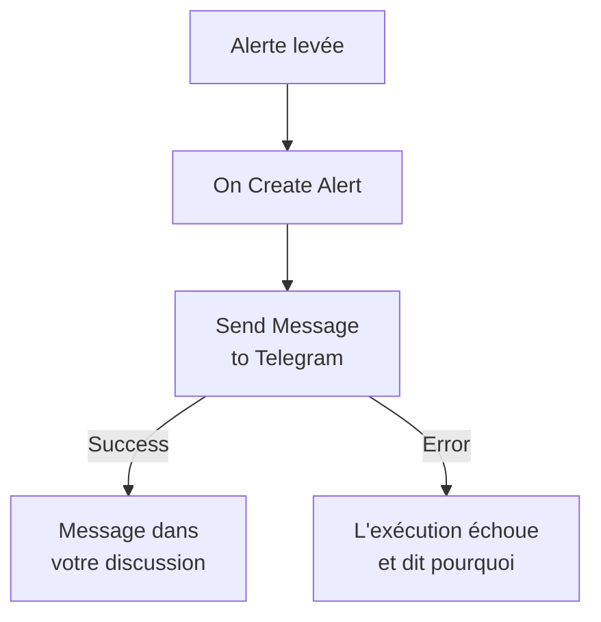

# Telegram

Envoyez un message à une discussion, un groupe ou un canal [Telegram](https://telegram.org) quand une alerte se déclenche ou qu'un incident s'ouvre. L'étape de workflow **Send Message to Telegram** de OneUptime l'envoie au nom d'un bot que vous créez, et un modèle prêt à l'emploi construit le workflow pour les alertes. Cette intégration est **sortante** : le bot envoie des messages et ne lit pas ce qui se dit dans la discussion.

:::cards
- [Fonctionnement](#fonctionnement): Ce que fait le workflow quand une alerte se déclenche.
- [Mise en place](#mettre-en-place-lintégration): Un bot, sa discussion, puis le workflow : à partir du modèle ou de zéro.
- [Conseils](#conseils): Texte brut, longs messages et incidents.
- [Dépannage](#dépannage): Ce que signifient les erreurs de Telegram, et quoi changer.
:::

## Fonctionnement



L'étape envoie le **Message Text** à la discussion, au nom de votre bot, via la Bot API de Telegram. Elle prend sa sortie **Success** quand Telegram accepte le message, et sa sortie **Error**, avec la raison de Telegram, quand Telegram le refuse. Si rien n'est relié à **Error**, comme dans le modèle, une exécution qui n'a pas pu envoyer échoue, et ses **Étapes** disent pourquoi.

## Avant de commencer

- Un compte Telegram, pour créer le bot et l'ajouter à la discussion.
- Dans OneUptime, le droit de créer des workflows et des variables. Sur OneUptime Cloud, les workflows demandent l'offre **Growth** ou une offre supérieure.

## Mettre en place l'intégration

:::steps
### Créer un bot

Dans Telegram, envoyez `/newbot` à [@BotFather](https://t.me/BotFather) et répondez à ses questions. Il vous donne le jeton du bot, par exemple `123456789:ABCdefGhIJKlmnoPQRstuVWxyz`. Toute personne qui a le jeton peut envoyer des messages au nom de votre bot : gardez-le donc aussi précieusement qu'un mot de passe.

### Trouver l'ID de la discussion

1. Ajoutez le bot au groupe, ou faites-en un administrateur du canal. Pour écrire à une personne, celle-ci commence d'abord une discussion avec le bot.
2. Envoyez dans le groupe un message qui mentionne le bot, par exemple `/start@your_bot`, pour que le bot le voie.
3. Ouvrez `https://api.telegram.org/bot<token>/getUpdates` dans un navigateur, avec le jeton du bot à la place de `<token>`.
4. Cherchez `"chat":{"id":` dans la réponse. Le nombre qui suit est l'ID de la discussion. L'ID d'un groupe commence par `-`, et celui d'un grand groupe par `-100`.

Un canal public peut être désigné par son `@username` au lieu d'un ID.

### Construire le workflow

Partez du modèle, qui construit tout le workflow pour les alertes, ou de zéro.

:::tabs
@tab À partir du modèle
1. Ouvrez **Flux de travail** et cliquez sur **Créer un flux de travail**.
2. Tapez `Telegram` dans **Rechercher des modèles…**, cliquez sur **Tell Telegram when an alert fires**, puis sur **Utiliser ce modèle**.
3. Gardez le nom **Notify Telegram on new alert** ou changez-le, et cliquez sur **Suivant**.
4. Collez le jeton dans **Telegram Bot Token** et l'ID dans **Telegram Chat ID**, et cliquez sur **Créer un flux de travail**.

Le workflow s'ouvre dans le **Constructeur** avec deux étapes : **On Create Alert**, et **Send Message to Telegram**, qui envoie le numéro, le titre, la gravité et l'état de l'alerte. Le jeton est enregistré comme variable secrète `telegramBotToken` du workflow, et l'ID comme `telegramChatId`.
@tab De zéro
1. Enregistrez le jeton comme variable globale secrète : allez dans **Flux de travail → Variables globales**, cliquez sur **Créer : Variable de flux de travail**, nommez-la `TELEGRAM_BOT_TOKEN`, et cliquez sur **Suivant**. Collez le jeton dans **Contenu**, activez **Secret**, et cliquez sur **Créer : Variable de flux de travail**.
2. Allez dans **Flux de travail**, cliquez sur **Créer un flux de travail**, choisissez **Partir de zéro**, nommez le workflow, et cliquez sur **Créer un flux de travail**.
3. Dans le **Constructeur**, cliquez sur **Choisissez ce qui démarre ce flux de travail** et choisissez **On Create Alert** sous **Populaires**. Cliquez sur le déclencheur : ses **Fields to pass on** commencent par **Titre**, alors cliquez sur **Ajouter un champ** et choisissez les autres champs que votre message affiche, par exemple **Numéro d'alerte avec préfixe**.
4. Cliquez sur **Ajouter un composant**, cherchez `telegram`, et cliquez sur **Send Message to Telegram**. Reliez la sortie **Success** du déclencheur à cette étape.
5. Cliquez sur la nouvelle étape. Dans **Telegram Bot Token**, cliquez sur **{ }** et choisissez `TELEGRAM_BOT_TOKEN` sous **Variables globales**. Saisissez l'ID de la discussion dans **Chat ID**, écrivez le message dans **Message Text**, et insérez les champs de l'alerte avec **{ }**.
:::

Un message construit de zéro lit les champs de l'alerte avec des références comme celles-ci :

```text
🚨 Alert {{local.components.alert-on-create-1.returnValues.model.alertNumberWithPrefix}} fired
Title: {{local.components.alert-on-create-1.returnValues.model.title}}
```

### L'activer et le tester

Basculez l'interrupteur **Activé** en haut du **Constructeur**. À partir de là, chaque nouvelle alerte est envoyée dans la discussion.

Pour tester sans lever d'alerte, cliquez sur **Exécuter le flux de travail** et choisissez une alerte existante sous **Alerte** : les plus récentes sont listées, et saisir son numéro ou une partie de son titre en trouve une autre. Cliquez sur **Exécuter le flux de travail manuellement** et confirmez avec **Exécuter**. Le panneau **Exécution du flux de travail** suit l'exécution, et le message apparaît dans la discussion. Si l'étape prend plutôt **Error**, l'exécution échoue, et l'entrée de l'étape dans **Étapes** dit pourquoi : voir [Dépannage](#dépannage).
:::

## Conseils

- **Texte brut.** L'étape envoie le texte tel qu'il est saisi, sans la mise en forme de Telegram : `*` et `_` s'affichent donc tels quels.
- **Tenir compte de la limite de 4 096 caractères.** Telegram accepte les messages de 4 096 caractères au plus. Un message plus long est coupé, et se termine par "… (truncated — see OneUptime for the full text)", au lieu d'être refusé.
- **Les incidents aussi.** Construisez le même workflow sur **On Create Incident**, ou sur **On Update Incident** pour les changements d'état. Pour n'envoyer que certaines alertes, placez un bloc **If / Else** avant l'étape.
- **La forme du jeton est vérifiée.** Un jeton qui n'a pas la forme `123456789:ABCdef…` arrête l'exécution avant tout envoi, et le jeton n'est jamais écrit dans le journal.

## Dépannage

Quand l'étape prend **Error**, l'exécution échoue, et l'entrée de l'étape dans les **Étapes** de l'exécution donne la raison de Telegram. Le bot doit être dans la discussion : vérifiez-le d'abord.

:::details Telegram répond "Bad Request: chat not found"
Le **Chat ID** est faux, ou le bot ne voit pas la discussion : ajoutez le bot au groupe, faites-en un administrateur du canal, ou demandez à la personne de commencer une discussion avec le bot. L'ID d'un groupe commence par `-`.
:::

:::details Telegram répond "Forbidden: bot was blocked by the user" ou "bot is not a member"
La personne a bloqué le bot, ou le bot a été retiré du groupe ou du canal. Ajoutez-le de nouveau, ou envoyez vers une autre discussion.
:::

:::details Telegram répond "Unauthorized"
Telegram n'a pas accepté le jeton : il a été révoqué dans @BotFather, ou mal copié. Copiez le jeton actuel du bot depuis @BotFather, et remplacez la valeur de la variable.
:::

:::details Telegram répond "Too Many Requests: retry after"
Telegram limite la vitesse à laquelle un bot envoie, surtout vers un groupe. Une rafale d'alertes peut l'atteindre : envoyez moins de messages, par exemple seulement pour certaines gravités.
:::

## Étapes suivantes

:::cards
- [Composants de workflow](/docs/workflows/components#telegram): Chaque paramètre de l'étape, et ce que signifient ses sorties.
- [Discord](/docs/integrations/discord): La même idée, dans un canal Discord.
- [Exécutions de workflow](/docs/workflows/runs-and-logs): Lire ce qu'a fait chaque exécution du workflow.
- [Présentation des intégrations](/docs/integrations/index): Le schéma sortant, et les autres outils que vous pouvez connecter.
:::
