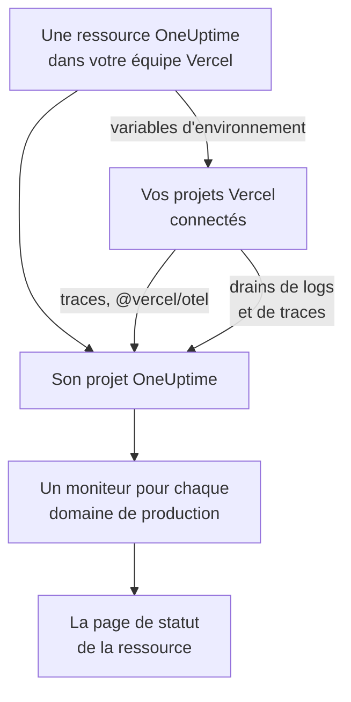

# Vercel

Ajoutez OneUptime à votre équipe Vercel depuis le [Vercel Marketplace](https://vercel.com/marketplace). Vous vous connectez avec votre compte Vercel et payez sur votre facture Vercel, et vos projets Vercel obtiennent dans OneUptime des traces, des logs, une surveillance de disponibilité et une page de statut, sans rien configurer à la main.

:::cards
- [Ajouter OneUptime à votre équipe Vercel](#ajouter-oneuptime-à-votre-équipe-vercel): Une ressource, un forfait et vos projets, dans le tableau de bord Vercel.
- [Envoyer des traces avec @vercel/otel](#envoyer-des-traces-avec-vercelotel): Les variables d'environnement sont déjà en place.
- [Envoyer des logs et des traces avec des drains](#envoyer-des-logs-et-des-traces-avec-des-drains): Les logs et les spans de Vercel lui-même, sur Pro et Enterprise.
- [Forfaits et facturation](#forfaits-et-facturation): Les forfaits de OneUptime, sur votre facture Vercel.
:::

## Fonctionnement

Chaque ressource OneUptime que vous ajoutez dans Vercel est un projet OneUptime à part entière. Vercel donne à chaque projet Vercel que vous connectez à la ressource les variables d'environnement de celle-ci, qui envoient les traces du projet à OneUptime. Les drains envoient les logs et les spans de Vercel, et le domaine de production de chaque projet connecté reçoit un moniteur de disponibilité sur la page de statut de la ressource.



L'intégration est destinée à OneUptime Cloud (`oneuptime.com`). Un OneUptime auto-hébergé ne peut pas être ajouté depuis le Vercel Marketplace : voir [OneUptime auto-hébergé](#oneuptime-auto-hébergé).

## Avant de commencer

- **Une équipe Vercel**, sur n'importe quel forfait. Les drains de logs et de traces nécessitent le forfait Pro ou Enterprise de Vercel ; les traces de `@vercel/otel` fonctionnent sur tous les forfaits.
- **Une adresse e-mail vérifiée** sur votre compte Vercel. OneUptime vous connecte avec elle, et crée avec elle votre compte OneUptime si vous n'en avez pas.
- **Un moyen de paiement dans Vercel**, pour tous les forfaits : les moniteurs et la télémétrie sont facturés à l'usage, forfait Free compris. Voir [Forfaits et facturation](#forfaits-et-facturation).

## Ajouter OneUptime à votre équipe Vercel

:::steps
### Ouvrir OneUptime sur le Vercel Marketplace

Dans le tableau de bord Vercel, ouvrez **Integrations**, puis **Browse Marketplace**, et trouvez OneUptime sous **Observability**. Cliquez sur **Install**, puis acceptez les conditions de OneUptime.

### Choisir un forfait

Choisissez **Free**, **Growth** ou **Scale**. Ce sont les forfaits de OneUptime lui-même, aux prix indiqués sur [oneuptime.com/pricing](https://oneuptime.com/pricing).

### Nommer la ressource et choisir ses paramètres

Nommez la ressource d'après ce qu'elle surveille, par exemple `storefront` : son projet OneUptime et sa page de statut portent son nom. Deux paramètres sont activés au départ :

- **Monitor production domains** : un moniteur de site web pour le domaine de production de chaque projet Vercel que vous connectez.
- **Create a status page** : une page de statut publique pour la ressource, qui affiche ces moniteurs.

### Connecter vos projets

Choisissez les projets Vercel qui envoient à cette ressource, et les environnements qui reçoivent ses variables d'environnement. Ne donnez pas de préfixe personnalisé à la connexion : `@vercel/otel` lit les variables sous leurs propres noms.
:::

La ressource est prête en quelques secondes. Cliquez sur **Open in OneUptime** pour voir son projet.

## Ce que vous apporte chaque ressource

| Quoi | Où le trouver |
| --- | --- |
| Un projet OneUptime, nommé d'après la ressource | Vous en êtes propriétaire. Vos coéquipiers le rejoignent quand ils l'ouvrent depuis Vercel. |
| Une clé d'ingestion nommée `Vercel` | **Paramètres du projet → Télémétrie & APM → Clés d'ingestion** |
| Des variables d'environnement dans chaque projet Vercel connecté | **Settings → Environment Variables** du projet, dans Vercel |
| Un moniteur de site web pour chaque projet connecté | **Moniteurs**, sous le nom du projet Vercel |
| Une page de statut publique | **Pages de statut**, sous le nom de la ressource |

Les variables d'environnement sont les mêmes dans chaque projet connecté :

| Variable | Valeur |
| --- | --- |
| `OTEL_EXPORTER_OTLP_ENDPOINT` | `https://oneuptime.com/otlp` |
| `OTEL_EXPORTER_OTLP_HEADERS` | `x-oneuptime-token=` suivi de la clé d'ingestion de la ressource |
| `OTEL_EXPORTER_OTLP_PROTOCOL` | `http/protobuf` |
| `ONEUPTIME_TELEMETRY_INGESTION_KEY` | La clé d'ingestion seule, que les drains envoient |

Un déploiement reçoit les variables au moment de son build : redéployez après avoir connecté un projet.

## Envoyer des traces avec @vercel/otel

`@vercel/otel` est le paquet OpenTelemetry de Vercel pour Next.js et les autres frameworks que Vercel exécute. Il lit les variables `OTEL_EXPORTER_OTLP_*`, donc un projet connecté à la ressource n'a besoin que du paquet.

:::steps
### Installer le paquet

```bash
npm install @vercel/otel @opentelemetry/api @opentelemetry/api-logs
```

### L'enregistrer

Créez `instrumentation.ts` à la racine du projet, ou dans `src` si le projet en a un, et nommez le service :

```ts title="instrumentation.ts"
import { registerOTel } from "@vercel/otel";

export function register(): void {
  registerOTel({ serviceName: "storefront" });
}
```

### Déployer

Déployez le projet. Ses traces apparaissent dans **Traces**, sous le nom du service.
:::

Sur les forfaits Pro et Enterprise de Vercel, ajoutez aussi un drain de traces : Vercel envoie alors à OneUptime ses propres spans pour chaque requête, avec ceux de votre application, et `@vercel/otel` les laisse au drain, si bien que rien n'arrive en double.

## Envoyer des logs et des traces avec des drains

Un drain envoie à OneUptime ce que Vercel enregistre sur vos projets : un drain de logs leurs logs de build, de fonctions, d'edge et de requêtes, et un drain de traces leurs spans. Les drains nécessitent le forfait Pro ou Enterprise de Vercel, et Vercel facture les données qu'ils envoient sur votre facture Vercel.

:::steps
### Ajouter un drain

Dans Vercel, ouvrez **Team Settings → Drains** et cliquez sur **Add Drain**. Choisissez **Logs** ou **Traces**, puis OneUptime sous **Native Integrations**.

### Choisir les projets

Choisissez les projets et, pour les logs, les sources et les environnements. Le drain envoie avec la clé d'ingestion de la ressource : il n'y a rien à saisir.
:::

Chaque projet Vercel est un service dans OneUptime, nommé d'après le projet. Un log garde son heure, son niveau et son message, et les données de sa requête sous les noms d'OpenTelemetry :

| Champ Vercel | Dans OneUptime |
| --- | --- |
| `projectName` | Le service, `service.name` |
| `timestamp`, `level`, `message` | L'heure, la gravité et le corps du log |
| `deploymentId`, `environment` | `vercel.deployment.id`, `deployment.environment.name` |
| `proxy.method`, `proxy.path`, `proxy.statusCode` | `http.request.method`, `url.path`, `vercel.proxy.status_code` |
| `traceId`, `spanId` | La trace du log, liée à la trace dans **Traces** |
| Tout autre champ | Un attribut sous `vercel.`, par exemple `vercel.source` |

## Moniteurs de disponibilité et page de statut

Quand vous connectez un projet Vercel, OneUptime crée un moniteur de site web pour son domaine de production, vérifié depuis les sondes de OneUptime, et l'ajoute à la page de statut de la ressource. Un projet connecté avant son premier déploiement de production n'a pas encore de domaine : son moniteur est créé lors de ce déploiement. Déconnecter le projet supprime son moniteur.

Chaque moniteur est un moniteur actif, facturé comme n'importe quel autre, et fonctionne comme un moniteur que vous auriez créé vous-même : voir [Surveillance de site web](/docs/monitor/website-monitor). Pour n'en créer aucun, désactivez **Monitor production domains** dans les paramètres de la ressource dans Vercel. Le réactiver crée les moniteurs encore manquants.

## Ouvrir OneUptime depuis Vercel

Cliquez sur **Open in OneUptime** sur la ressource, ou sur l'un de ses liens dans Vercel, et vous êtes connecté à OneUptime avec l'adresse e-mail de votre compte Vercel. La première fois, vous rejoignez le projet de la ressource : comme administrateur si vous êtes propriétaire ou membre de l'équipe Vercel, et comme membre si vous avez l'un de ses rôles en lecture seule.

Si un compte OneUptime existe déjà avec cette adresse e-mail, c'est à ce compte que vous êtes connecté. S'il a l'authentification à deux facteurs activée, ou s'il appartient à un administrateur de OneUptime, vous vous connectez plutôt avec son mot de passe. Vous êtes dans le projet quoi qu'il en soit.

## Forfaits et facturation

| | Fonctionnement |
| --- | --- |
| Forfaits | **Free**, **Growth** et **Scale**, aux prix de oneuptime.com : le prix du forfait par utilisateur, les moniteurs actifs à $1 par moniteur et par mois, et la télémétrie au GB. |
| Où vous payez | Sur votre facture Vercel, une fois par mois, pour chaque ressource. Vercel affiche sur la ressource l'utilisation du mois en cours, mise à jour toutes les heures. |
| Essais | Rien n'est facturé tant que dure l'essai du forfait : ni ses utilisateurs, ni ses moniteurs, ni sa télémétrie. |
| Changer de forfait | Dans Vercel, sur la ressource, ou dans OneUptime sous **Paramètres du projet → Facturation et factures → Facturation**. Un changement à l'un des deux endroits vaut pour les deux. |
| Factures impayées | Vercel retente le paiement pendant 15 jours. Ensuite, le projet n'est plus disponible jusqu'au paiement de la facture : ses données sont conservées, et rien n'est supprimé. |

Sur la facture, chaque ressource a une ligne pour ses utilisateurs, ses moniteurs actifs, sa télémétrie et les éventuelles recharges de solde, en unités d'usage de $0.01.

## Retirer OneUptime

| Vous | Ce qui se passe |
| --- | --- |
| Supprimez une ressource dans Vercel | Son projet est supprimé, après facturation de son utilisation jusque-là. Les projets Vercel connectés perdent les variables d'environnement de la ressource à leur prochain déploiement. |
| Désinstallez OneUptime de l'équipe | Le projet de chaque ressource est supprimé, et la facture finale est envoyée. |
| Supprimez le projet dans OneUptime | La ressource est aussi supprimée dans Vercel. |

> [!CAUTION]
> Supprimer un projet supprime définitivement ses moniteurs, sa page de statut, ses incidents et sa télémétrie. Exportez d'abord tout ce que vous voulez garder.

## OneUptime auto-hébergé

Un OneUptime auto-hébergé ne peut pas être ajouté depuis le Vercel Marketplace, qui ne provisionne que OneUptime Cloud. Vos projets Vercel peuvent quand même lui envoyer des données :

- **Traces** : dans **Settings → Environment Variables** du projet Vercel, définissez les variables de [Ce que vous apporte chaque ressource](#ce-que-vous-apporte-chaque-ressource), avec `https://YOUR-ONEUPTIME-HOST/otlp` comme point de terminaison et une clé d'ingestion de votre projet.
- **Logs** : ajoutez un drain de logs personnalisé dans **Team Settings → Drains**, vers `https://YOUR-ONEUPTIME-HOST/telemetry/vercel/v1/logs`, en JSON ou NDJSON. Ajoutez l'en-tête `x-oneuptime-token` avec votre clé d'ingestion, et réglez le secret de signature du drain sur la même clé : OneUptime n'accepte que les envois que Vercel a signés avec elle.

Le même drain personnalisé fonctionne sur OneUptime Cloud, avec `oneuptime.com` comme hôte.

## Dépannage

:::details Aucune trace n'arrive
- Redéployez le projet : un déploiement construit avant la connexion du projet n'a pas les variables `OTEL_EXPORTER_OTLP_*`.
- Vérifiez le nom des variables dans **Settings → Environment Variables** du projet. Une connexion créée avec un préfixe personnalisé les renomme, et `@vercel/otel` ne les lit plus : connectez de nouveau le projet, sans préfixe.
- Vérifiez que `instrumentation.ts` appelle `registerOTel`, et, sur Next.js 14 et versions antérieures, que `experimental.instrumentationHook` est activé dans `next.config.js`.
:::

:::details Vercel affiche le drain en erreur
Vercel affiche la réponse de OneUptime aux envois du drain :

- `403` avec `x-vercel-signature` dans le message : Vercel n'a pas signé l'envoi avec la clé qu'il transmet. Pour un drain personnalisé, vérifiez son en-tête `x-oneuptime-token`, et réglez son secret de signature sur la même clé.
- `401` : OneUptime ne connaît aucun projet avec la clé qu'envoie le drain : elle a été supprimée, ou mal saisie aux deux endroits. Utilisez une clé de **Paramètres du projet → Télémétrie & APM → Clés d'ingestion**.
- `422` : la clé a été désactivée. Réactivez-la sur la même page, ou utilisez-en une autre.
:::

:::details Un projet connecté n'a pas de moniteur
- **Monitor production domains** est désactivé dans les paramètres de la ressource dans Vercel.
- Le projet n'a pas encore de domaine de production : son moniteur est créé à son premier déploiement de production.
- Le projet a déjà autant de moniteurs actifs que son forfait le permet : passez à un forfait supérieur, puis désactivez et réactivez **Monitor production domains**.
:::

:::details Vercel demande de vérifier votre adresse e-mail
OneUptime a besoin d'une adresse e-mail vérifiée par Vercel, et un compte OneUptime existant avec cette adresse doit aussi avoir vérifié sa propre adresse. Vérifiez l'adresse, puis ajoutez la ressource ou ouvrez de nouveau OneUptime.
:::

## Étapes suivantes

:::cards
- [Explorateur de traces](/docs/telemetry/traces-explorer): Trouver une requête lente et ses spans.
- [Explorateur de journaux](/docs/telemetry/logs-explorer): Chercher dans vos logs Vercel.
- [Pages de statut](/docs/status-pages/index): Mettre la page de statut de la ressource à vos couleurs, et ajouter des abonnés.
- [Clés d'ingestion](/docs/telemetry/ingestion-keys): Renouveler ou désactiver la clé de la ressource.
:::
