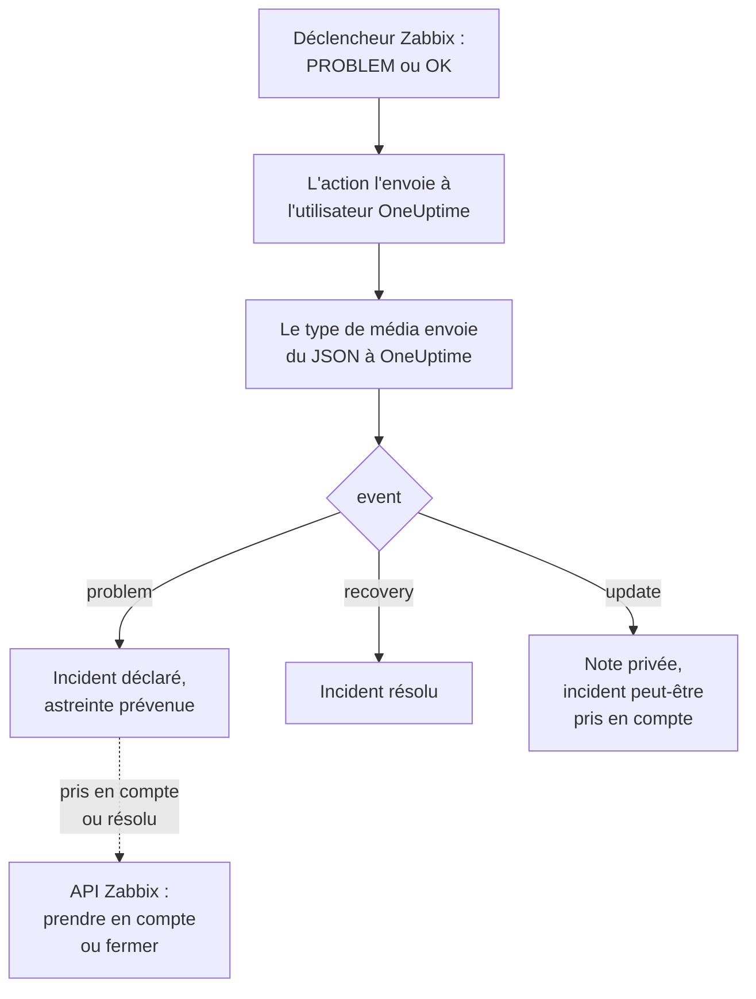

# Zabbix

Envoyez les problèmes [Zabbix](https://www.zabbix.com) à OneUptime, pour que chaque problème devienne un incident qui prévient votre équipe d'astreinte et soit résolu quand Zabbix se rétablit. Des modèles de workflow prêts à l'emploi gardent les deux côtés en phase : ce que les gens font dans Zabbix est noté sur l'incident, et prendre en compte ou résoudre l'incident prend en compte ou ferme le problème dans Zabbix. Zabbix envoie chaque problème par un type de média webhook, il n'y a donc rien à installer d'un côté comme de l'autre.

:::cards
- [Choisir comment OneUptime reçoit les problèmes](#choisir-comment-oneuptime-reçoit-les-problèmes): Des modèles de workflow, ou un moniteur de requêtes entrantes.
- [Partir des modèles](#partir-des-modèles): Six modèles, ce qu'ils font et ce qu'ils demandent.
- [Configurer Zabbix](#configurer-zabbix): Un type de média, un utilisateur et une action.
- [Dépannage](#dépannage): Quand les problèmes n'arrivent pas, ou que les incidents restent ouverts.
:::

## Fonctionnement



Zabbix envoie un problème à un utilisateur, par les médias de cet utilisateur. Ici, le média est un type de média webhook nommé **OneUptime** : son script envoie un petit document JSON à OneUptime pour chaque problème, pour son rétablissement et pour chaque mise à jour que quelqu'un lui apporte dans Zabbix, avec l'ID d'événement du problème, son nom, l'hôte et la sévérité. C'est par l'ID d'événement que OneUptime retrouve l'incident qu'un problème a ouvert.

## Avant de commencer

- Un serveur Zabbix que vous administrez. Ce guide est écrit pour Zabbix 6.0 LTS et 7.0 LTS. Les types de média webhook fonctionnent de la même façon depuis Zabbix 5.0. Les modèles qui appellent l'API de Zabbix demandent Zabbix 6.4 ou plus récent, ou [une modification sous Zabbix 6.0](#sous-zabbix-60).
- Un serveur Zabbix qui peut joindre votre OneUptime en HTTPS et, pour les modèles qui appellent Zabbix, un OneUptime qui peut joindre Zabbix.
- Dans OneUptime, le droit de créer des workflows, ou des moniteurs si vous prenez cette voie. Sur OneUptime Cloud, les workflows demandent l'offre **Growth** ou supérieure.

## Choisir comment OneUptime reçoit les problèmes

Configurez d'abord OneUptime : il vous donne l'URL à laquelle Zabbix envoie.

| Façon | Utilisez-la quand |
| --- | --- |
| Les modèles de workflow (recommandés) | Vous voulez chaque problème comme un incident ou une alerte à sa sévérité Zabbix, avec l'astreinte prévenue pour High et Disaster, résolu au rétablissement, avec ce que les gens font dans Zabbix noté dessus, et Zabbix pris en compte ou fermé depuis OneUptime. |
| Un moniteur de requêtes entrantes | Vous voulez des incidents sans workflow, avec n'importe quelle offre, et un moniteur dont le statut suit Zabbix. Rien ne repart vers Zabbix. |

Les deux reçoivent le même JSON du même type de média, vous pouvez donc commencer par l'un et changer plus tard en modifiant une URL dans Zabbix.

## Partir des modèles

La boîte de dialogue **Créer un flux de travail** propose six modèles Zabbix, sous **Zabbix** dans sa liste de catégories : trois pour les incidents, puis les trois mêmes pour les alertes.

| Modèle | Ce qu'il fait | Ce qu'il demande |
| --- | --- | --- |
| **Incidents** | | |
| Declare an incident for each Zabbix problem | Le workflow auquel Zabbix envoie chaque événement. Il déclare un incident pour chaque problème, prévient l'astreinte pour High et Disaster, note les mises à jour faites dans Zabbix et résout l'incident au rétablissement. | Zabbix URL |
| Acknowledge or close the Zabbix problem with the incident | Quand l'incident est pris en compte, prend en compte son problème. Quand il est résolu, ferme le problème, ou le prend en compte là où Zabbix ne permet pas de le fermer à la main. | Zabbix URL, Zabbix API Token |
| Copy incident private notes to the Zabbix problem | Ajoute chaque note privée de l'incident à son problème, comme message. | Zabbix URL, Zabbix API Token |
| **Alertes** | | |
| Create an alert for each Zabbix problem | La même chose que pour les incidents, avec une alerte pour chaque problème. | Zabbix URL |
| Acknowledge or close the Zabbix problem with the alert | La même chose que pour les incidents, d'après l'état de l'alerte. | Zabbix URL, Zabbix API Token |
| Copy alert private notes to the Zabbix problem | Ajoute chaque note privée de l'alerte à son problème, comme message. | Zabbix URL, Zabbix API Token |

Commencez par **Declare an incident for each Zabbix problem**, ou par **Create an alert for each Zabbix problem** pour les alertes : l'incident ou l'alerte qu'il ouvre garde l'ID d'événement du problème dans son champ personnalisé `zabbixEventId`, et les deux autres modèles retrouvent le problème grâce à lui.

### Ce que demandent les modèles

- **Zabbix URL** : l'adresse à laquelle vous ouvrez Zabbix, comme `https://zabbix.example.com`, ou `https://example.com/zabbix` quand Zabbix tourne sous un chemin. Les liens vers un problème y mènent, et les modèles qui appellent Zabbix envoient leurs requêtes à son `api_jsonrpc.php`. Le champ refuse l'adresse d'une page de Zabbix.
- **Zabbix API Token** : un jeton d'API de l'utilisateur Zabbix au nom duquel agit le workflow. [Créer le jeton d'API](#créer-le-jeton-dapi) montre comment. Il est enregistré comme variable secrète, et n'est envoyé qu'à Zabbix : dans l'en-tête `Authorization`, ou dans le corps de la requête sous Zabbix 6.0.

### Recevoir les problèmes avec le modèle

:::steps
1. Allez dans **Flux de travail** et cliquez sur **Créer un flux de travail**. Sous **Ou partir d'un modèle**, choisissez **Zabbix** dans la liste de catégories, cliquez sur **Declare an incident for each Zabbix problem**, puis sur **Utiliser ce modèle**.
2. Renseignez **Zabbix URL**. Sous **Who to page for High and Disaster problems**, choisissez les politiques d'astreinte à prévenir, ou aucune pour ne prévenir personne, et cliquez sur **Créer un flux de travail**. Le workflow s'ouvre dans le **Constructeur**, désactivé.
3. Cliquez sur le déclencheur **Webhook**, puis sur **Copier l'URL**, et gardez l'URL pour Zabbix.
4. Activez **Activé** en haut du **Constructeur**. Un workflow désactivé répond à Zabbix par `400`.
:::

Ensuite, [configurez Zabbix](#configurer-zabbix) pour qu'il envoie ses problèmes à cette URL.

### Ce que fait le workflow

Après le déclencheur **Webhook**, l'étape **Check With JavaScript** `read-event-1` lit l'`event` qu'envoie le type de média, et **Incident From Another Tool**, ou **Alert From Another Tool** dans le modèle des alertes, fait ce qu'il signifie, par l'ID d'événement du problème :

| Événement | Ce que fait le workflow |
| --- | --- |
| `problem` | Déclare un incident intitulé `Zabbix: <problem> on <host>`, à la gravité à laquelle correspond la sévérité Zabbix, tenu à l'écart de vos pages de statut. Sa description renvoie au problème dans Zabbix et indique l'hôte, la sévérité, l'heure de début, ses données opérationnelles et ses tags. Pour un problème High ou Disaster, il prévient la politique d'astreinte que vous avez choisie. Un problème que Zabbix renvoie, avec le même ID d'événement, n'ouvre pas de second incident. |
| `recovery` | Résout l'incident du problème, sauf s'il est déjà résolu. La raison figure dans sa chronologie. |
| `update` | Ajoute à l'incident, comme note privée, ce qui a été fait dans Zabbix : qui l'a fait, ce qu'il a fait et ce qu'il a écrit. Quand la mise à jour a pris en compte le problème, il prend aussi en compte l'incident, ce qui arrête l'escalade de l'astreinte. |

Tout le reste, comme une requête d'un autre outil, est laissé tel quel : `read-event-1` prend **No**, et les **Étapes** de l'exécution disent pourquoi. Une étape qui échoue fait échouer l'exécution, et son entrée dans **Étapes** dit pourquoi.

### Sévérités

Dans un nouveau projet, le modèle fait correspondre les six sévérités de Zabbix à ces gravités d'incident et d'alerte :

| Sévérité Zabbix | Incident | Alerte | Astreinte |
| --- | --- | --- | --- |
| Disaster | Critical Incident | High | Prévenue |
| High | Critical Incident | High | Prévenue |
| Average | Major Incident | Low | Non prévenue |
| Warning | Major Incident | Low | Non prévenue |
| Information | Minor Incident | Low | Non prévenue |
| Not classified | Minor Incident | Low | Non prévenue |

Avec vos propres gravités, Disaster et High vont à la plus grave, Average et Warning à celle du milieu, et Information et Not classified à la moins grave. Zabbix numérote ses sévérités de 0 (Not classified) à 5 (Disaster), et le modèle lit le numéro : renommer une sévérité dans Zabbix ne change donc rien.

- Pour faire correspondre une sévérité à l'une de vos gravités par son nom, modifiez `SEVERITY_BY_NAME` dans l'étape `read-event-1`, par exemple `{ 2: 'Minor Incident' }` pour Warning.
- Pour prévenir aussi pour les problèmes Average, mettez **Compare with** de l'étape `if-page-1` **If / Else** à `3`.

### Renvoyer les prises en compte et les notes vers Zabbix

:::steps
1. [Créez le jeton d'API](#créer-le-jeton-dapi).
2. Créez un workflow à partir de **Acknowledge or close the Zabbix problem with the incident**. Renseignez **Zabbix URL** et **Zabbix API Token**, cliquez sur **Créer un flux de travail**, et activez **Activé**.
3. Si vous voulez aussi les notes dans Zabbix, faites de même avec **Copy incident private notes to the Zabbix problem**.
:::

Le modèle d'état interroge d'abord Zabbix sur le problème : un problème que Zabbix a déjà pris en compte ou résolu est laissé tel quel. Pour fermer un problème, son déclencheur doit avoir **Allow manual close** dans Zabbix. Sans cela, le problème est pris en compte à la place, avec un message disant que l'incident a été résolu, et Zabbix le ferme à son rétablissement. Les incidents qu'aucun problème Zabbix n'a ouverts, et les incidents marqués **Incident privé**, ne sont jamais envoyés à Zabbix.

### Créer le jeton d'API

:::steps
1. Utilisez l'utilisateur `OneUptime` qui [reçoit les problèmes](#créer-un-utilisateur-qui-reçoit-les-problèmes). Zabbix n'envoie pas à un utilisateur ses propres mises à jour : avec le jeton de cet utilisateur, les prises en compte et les messages de OneUptime ne reviennent donc jamais vers OneUptime comme mises à jour.
2. Vérifiez le rôle de l'utilisateur dans **Users → User roles**. Il lui faut **Access to API** activé, et **Acknowledge problems**, **Add problem comments** et **Close problems** autorisés. Le **User role** les autorise, sauf si quelqu'un l'a modifié.
3. Vérifiez le groupe de l'utilisateur dans **Users → User groups**. La permission **Read** sur les groupes d'hôtes suffit pour prendre en compte les problèmes et ajouter des messages. Pour fermer des problèmes, il lui faut **Read-write**.
4. Allez dans **Users → API tokens** et cliquez sur **Create API token**. Choisissez l'utilisateur `OneUptime`, décochez **Set expiration date and time** ou notez la date, et cliquez sur **Add**.
5. Copiez le **Auth token** : Zabbix ne l'affiche qu'une fois. Collez-le dans **Zabbix API Token**.
:::

### Sous Zabbix 6.0

Zabbix 6.0 lit le jeton d'API dans le corps de la requête, pas dans son en-tête `Authorization`. Dans l'étape **Update Zabbix Problem** de chaque modèle qui appelle Zabbix, activez **Zabbix 6.0**, sous **Plus de champs**. Zabbix 7.2 et plus récent refusent un jeton dans le corps : désactivez-le donc à nouveau lors de la mise à niveau.

## Recevoir les problèmes avec un moniteur

Un [moniteur de requêtes entrantes](/docs/monitor/incoming-request-monitor) vous donne une URL, et ses critères décident de ce que fait chaque requête.

:::steps
### Créer le moniteur

Allez dans **Moniteurs** et cliquez sur **Créer un moniteur**. Choisissez **Requête entrante** sous **Type de moniteur**, nommez-le `Zabbix` et cliquez sur **Suivant**.

### Déclarer un incident pour chaque problème

À l'étape **Critères**, ouvrez le premier critère, celui qui marque le moniteur hors ligne. Réglez son filtre sur **Corps de la requête**, **Contient**, `"status":"1"`. Ce critère déclare déjà un incident quand son filtre correspond. Remplissez l'incident :

- **Titre de l'incident** : `Zabbix: {{requestBody.name}} on {{requestBody.host}}`.
- **Gravité** : la gravité d'incident que doivent avoir les problèmes Zabbix.
- **Politiques d'astreinte**, sous **Astreinte** : les politiques à prévenir.
- **Résoudre automatiquement l'incident**, sous **Plus de champs** : laissez-le activé, comme au départ. Sans lui, les rétablissements sont ignorés et les incidents restent ouverts.

### Ouvrir un incident par problème

Dans le même critère, ouvrez **Paramètres** et activez **Regrouper les incidents et alertes par un champ de la charge utile**. Remplissez-le comme ci-dessous, pour que chaque problème ait son propre incident et que son rétablissement le résolve :

| Champ | Valeur |
| --- | --- |
| **Ouvrir un incident distinct pour chaque…** | `requestBody.event_id` |
| **Champ qui signale le rétablissement** | `requestBody.status` |
| **Value that means recovered** | `0` |

### Remettre le moniteur en ligne

Ouvrez le second critère, celui qui marque le moniteur en ligne, et réglez son filtre sur **Corps de la requête**, **Contient**, `"status":"0"`.

### Copier l'URL

Cliquez sur **Créer un moniteur**. La page **Vue d'ensemble** du moniteur affiche son **URL de heartbeat**. Copiez-la pour Zabbix :

```text
https://oneuptime.com/heartbeat/<secret key>
```

Une installation auto-hébergée a son propre hôte à la place de `oneuptime.com`.
:::

Le moniteur lit le JSON de la requête tel qu'il est écrit : `"status":"1"`, sans espaces. Voir [Recevoir des alertes d'un autre système](/docs/monitor/incoming-request-monitor#recevoir-les-alertes-dun-autre-système) pour ce que fait chaque paramètre. Une mise à jour faite dans Zabbix est aussi envoyée avec `"status":"1"`, que le moniteur lit de nouveau comme le problème, sans ouvrir de second incident.

## Configurer Zabbix

Zabbix a besoin de trois choses : un type de média qui envoie à OneUptime, un utilisateur à qui l'envoyer, et une action qui envoie les problèmes à cet utilisateur.

:::steps
### Créer le type de média OneUptime

1. Allez dans **Alerts → Media types**, ou **Administration → Media types** sous Zabbix 6.0, et cliquez sur **Create media type**.
2. Réglez **Name** sur `OneUptime` et **Type** sur **Webhook**.
3. Ajoutez ces **Parameters**. Chacun reporte une [macro](https://www.zabbix.com/documentation/current/en/manual/appendix/macros/supported_by_location) Zabbix dans la requête :

   | Nom | Valeur |
   | --- | --- |
   | `url` | `{ALERT.SENDTO}` |
   | `event_id` | `{EVENT.ID}` |
   | `event_name` | `{EVENT.NAME}` |
   | `event_value` | `{EVENT.VALUE}` |
   | `event_severity` | `{EVENT.SEVERITY}` |
   | `event_nseverity` | `{EVENT.NSEVERITY}` |
   | `host` | `{HOST.NAME}` |
   | `event_date` | `{EVENT.DATE}` |
   | `event_time` | `{EVENT.TIME}` |
   | `event_opdata` | `{EVENT.OPDATA}` |
   | `event_tags` | `{EVENT.TAGSJSON}` |
   | `trigger_id` | `{TRIGGER.ID}` |
   | `event_update_status` | `{EVENT.UPDATE.STATUS}` |
   | `event_update_action` | `{EVENT.UPDATE.ACTION}` |
   | `event_update_message` | `{EVENT.UPDATE.MESSAGE}` |
   | `event_update_user` | `{USER.FULLNAME}` |

4. Collez ceci dans **Script** :

   ```javascript
   var params = JSON.parse(value);

   // Zabbix leaves a macro it has no value for as it is written, such as
   // {EVENT.UPDATE.MESSAGE} on a problem: it is sent as nothing.
   function given(text) {
     var written = String(text === undefined || text === null ? "" : text);
     return /^\{[A-Z0-9_.]+\}$/.test(written) || written === "*UNKNOWN*"
       ? ""
       : written;
   }

   var isUpdate = given(params.event_update_status) === "1";
   var payload = {
     source: "zabbix",
     // "problem", "recovery" or "update".
     event: isUpdate
       ? "update"
       : params.event_value === "0"
         ? "recovery"
         : "problem",
     event_id: params.event_id,
     name: params.event_name,
     host: params.host,
     severity: params.event_severity,
     // 0 Not classified, 1 Information, 2 Warning, 3 Average, 4 High, 5 Disaster.
     severity_number: params.event_nseverity,
     // "1" for a problem, "0" for its recovery.
     status: params.event_value,
     date: params.event_date,
     time: params.event_time,
     opdata: given(params.event_opdata),
     tags: [],
     trigger_id: params.trigger_id,
   };

   try {
     var tags = JSON.parse(given(params.event_tags) || "[]");
     payload.tags = Array.isArray(tags) ? tags : [];
   } catch (error) {
     payload.tags = [];
   }

   if (isUpdate) {
     payload.update = {
       action: given(params.event_update_action),
       message: given(params.event_update_message),
       user: given(params.event_update_user),
     };
   }

   var request = new HttpRequest();
   request.addHeader("Content-Type: application/json");

   var response = request.post(params.url, JSON.stringify(payload));

   if (request.getStatus() < 200 || request.getStatus() >= 300) {
     throw (
       "OneUptime responded with HTTP " + request.getStatus() + ": " + response
     );
   }

   return "OK";
   ```

5. Dans l'onglet **Message templates**, ajoutez un modèle pour **Problem**, un pour **Problem recovery** et un pour **Problem update**. Laissez leur texte vide : le script construit la requête. Zabbix n'utilise un type de média que pour les types d'événement dont il a un modèle.
6. Cliquez sur **Add**.

### Créer un utilisateur qui reçoit les problèmes

1. Allez dans **Users → Users**, ou **Administration → Users** sous Zabbix 6.0, et cliquez sur **Create user**. Nommez-le `OneUptime`, et donnez-lui un groupe d'utilisateurs et un rôle qui peut recevoir des notifications, par exemple **User role**.
2. Dans l'onglet **Media**, cliquez sur **Add**. Réglez **Type** sur `OneUptime`, et **Send to** sur l'URL copiée depuis OneUptime. Laissez **When active** et les sévérités tels quels, ou décochez les sévérités que OneUptime ne doit pas recevoir.
3. Cliquez sur **Add**, puis de nouveau sur **Add** pour enregistrer l'utilisateur.

### Envoyer les problèmes à OneUptime avec une action

1. Allez dans **Alerts → Actions → Trigger actions**, ou **Configuration → Actions** sous Zabbix 6.0, et cliquez sur **Create action**. Nommez-la `Notify OneUptime`.
2. Sous **Conditions**, restreignez-la si vous le souhaitez, par exemple avec **Trigger severity is greater than or equals Warning**. Sans conditions, chaque problème est envoyé.
3. Dans l'onglet **Operations**, ajoutez une opération qui envoie à l'utilisateur `OneUptime` par le type de média `OneUptime`.
4. Ajoutez la même opération sous **Recovery operations**, pour que les rétablissements soient aussi envoyés, et sous **Update operations**, pour que les prises en compte et les commentaires faits dans Zabbix soient envoyés.
5. Cliquez sur **Add**, et vérifiez que l'action est activée.
:::

Pour envoyer certains problèmes au modèle d'incident et d'autres au modèle d'alerte, donnez à l'utilisateur `OneUptime` deux médias de type `OneUptime` : chacun envoie à l'URL d'un workflow, avec les sévérités qu'il doit recevoir.

## Le tester

1. Dans Zabbix, ouvrez **Alerts → Media types** et cliquez sur **Test** à côté de `OneUptime`. Saisissez l'URL copiée et des valeurs d'exemple, comme `event_id` `12345`, `event_name` `Test problem`, `host` `web-1`, `event_nseverity` `4` et `event_value` `1`. Cliquez sur **Test** : Zabbix affiche la réponse du script, `OK`, ou l'erreur qu'il a levée.
2. Dans OneUptime, ouvrez **Journaux → Exécutions** du workflow et vérifiez l'exécution, ou ouvrez le moniteur et vérifiez qu'un incident s'est ouvert.
3. Testez de nouveau avec `event_value` `0` et le même `event_id`. L'incident est résolu.

Laissez ensuite un vrai déclencheur se produire, par exemple en abaissant un seuil un instant, et regardez le problème arriver. Pour essayer une mise à jour, prenez en compte le problème dans Zabbix avec un message : l'incident reçoit une note privée et est pris en compte.

## Faire correspondre les sévérités Zabbix

Zabbix envoie sa sévérité sous forme de texte : `Not classified`, `Information`, `Warning`, `Average`, `High` ou `Disaster`.

- **Avec les modèles**, les sévérités sont mises en correspondance pour vous : voir [Sévérités](#sévérités).
- **Avec le moniteur**, cliquez sur **Ajouter un critère** pour chaque groupe de sévérités, et faites glisser le nouveau critère au-dessus du premier : les critères sont vérifiés à partir du haut, et le premier qui correspond décide. Donnez à chacun deux filtres, `"status":"1"` et une sévérité comme `"severity":"Disaster"`, avec **Condition de correspondance** sur **Tous**. Donnez à chacun un incident avec sa propre **Gravité** et **Résoudre automatiquement l'incident**, et les mêmes paramètres de regroupement.

## Dépannage

:::details Rien n'arrive dans OneUptime
- Dans Zabbix, ouvrez **Reports → Action log** et vérifiez que l'action a envoyé le problème, et ce qui est revenu.
- Depuis le serveur Zabbix, envoyez vous-même une requête : `curl -i -X POST <url> -H 'Content-Type: application/json' -d '{"source":"zabbix","event":"problem","event_id":"1","name":"Test","host":"test","severity_number":"4","status":"1"}'`.
- Le moniteur répond `200` immédiatement, avant de vérifier quoi que ce soit, même avec une clé secrète erronée. Consultez la chronologie du moniteur pour voir si les requêtes arrivent.
- Un workflow désactivé répond `400`. Activez **Activé** en haut de son **Constructeur**.
:::

:::details Zabbix signale une erreur de script
Ouvrez le type de média et utilisez **Test** : Zabbix affiche le résultat du script ou l'erreur qu'il a levée. Une réponse de OneUptime hors `2xx` est levée par le script avec son statut, vérifiez donc d'abord l'URL.
:::

:::details Les incidents s'ouvrent mais ne sont jamais résolus
- L'action a besoin de **Recovery operations**, sinon Zabbix n'envoie jamais le rétablissement.
- Avec le modèle, ouvrez **Journaux → Exécutions** du workflow et l'exécution du rétablissement : sa dernière étape dit pourquoi. Le rétablissement d'un problème qui n'a ouvert aucun incident ne change rien.
- Avec le moniteur, l'incident du critère doit avoir **Résoudre automatiquement l'incident**, sous **Plus de champs**. **Champ qui signale le rétablissement** doit valoir `requestBody.status`, et **Value that means recovered** exactement `0`.
:::

:::details Le problème Zabbix n'est ni pris en compte ni fermé
Ouvrez l'exécution du modèle d'état dans **Journaux → Exécutions** : sa dernière étape dit ce que Zabbix a répondu.

- `Not authorized` : le jeton d'API est faux, expiré ou désactivé, ou Zabbix est antérieur à 6.4 (voir [Sous Zabbix 6.0](#sous-zabbix-60)).
- `Cannot close problem: trigger does not allow manual closing` : activez **Allow manual close** sur le déclencheur. Le modèle prend déjà en compte ces problèmes au lieu de les fermer.
- `No permissions to referred object or it does not exist!` : l'utilisateur voit le problème, mais il lui faut la permission **Read-write** pour le fermer.
- `Zabbix has no problem with event ID` : l'utilisateur ne voit pas l'hôte du problème. Donnez à son groupe d'utilisateurs la permission **Read** sur le groupe d'hôtes.
:::

:::details L'incident affiche une référence au lieu d'une valeur
Une référence à un champ que la requête n'a pas est laissée telle qu'elle est écrite, accolades comprises, au lieu d'être vidée. Vérifiez que Zabbix envoie `Content-Type: application/json`, et que les noms de champ que vous utilisez (`name`, `host`, `severity`, `status`, `event_id`) correspondent à la charge utile du script. Pour un workflow, ouvrez l'exécution dans **Journaux → Exécutions** et comparez avec ce que le déclencheur a reçu. Voir [Pièges](/docs/workflows/variables#pièges).
:::

:::details Chaque problème arrive deux fois
L'action a probablement deux opérations qui envoient au même utilisateur, par exemple une première étape et une étape d'escalade. Le modèle ouvre un seul incident par ID d'événement quoi qu'il arrive, mais chaque envoi est une exécution. Vérifiez les **Operations** de l'action.
:::

## Sécurité

- **Traitez l'URL comme un mot de passe.** Quiconque la possède peut ouvrir des incidents. Si elle fuit, réinitialisez-la : **Réinitialiser l'URL** dans le déclencheur **Webhook** du workflow, ou **Réinitialiser la clé secrète des requêtes entrantes** sur la page **Paramètres** du moniteur. Mettez ensuite à jour **Send to** dans les médias de l'utilisateur Zabbix.
- **Les liens mènent à votre Zabbix.** Le modèle renvoie à un problème sur le site que nomme son **Zabbix URL**, quoi que dise une requête, et écrit ce que Zabbix a envoyé comme du texte.
- **Limitez le jeton d'API à ce que fait le workflow.** C'est une variable secrète, masquée dans les journaux d'exécution et envoyée uniquement à Zabbix, dans l'en-tête `Authorization` sauf si **Zabbix 6.0** est activé. Donnez à son utilisateur un rôle qui ne permet rien de plus que les actions ci-dessus, et supprimez le jeton dans **Users → API tokens** s'il fuit.
- **N'envoyez que ce qui mérite un incident.** Utilisez les conditions de l'action, ou les sévérités du média de l'utilisateur, pour garder dans Zabbix les problèmes de faible sévérité.
- **Auto-hébergé ?** Laissez votre serveur Zabbix joindre votre OneUptime en HTTPS à travers votre pare-feu. Pour appeler un Zabbix sur un réseau privé, le workflow a besoin d'un [accès réseau sortant](/docs/workflows/configuration#accès-réseau-sortant).

## Étapes suivantes

:::cards
- [Modèles de workflow](/docs/workflows/authoring): Créez un workflow à partir d'un modèle, et modifiez-le dans le Constructeur.
- [Surveillance des requêtes entrantes](/docs/monitor/incoming-request-monitor): Chaque paramètre du moniteur qui reçoit les problèmes Zabbix.
- [Règles d'escalade](/docs/on-call/escalation-rules): Décider qui une politique d'astreinte prévient, et quand.
- [Présentation des intégrations](/docs/integrations/index): Les autres outils que vous pouvez connecter.
:::
